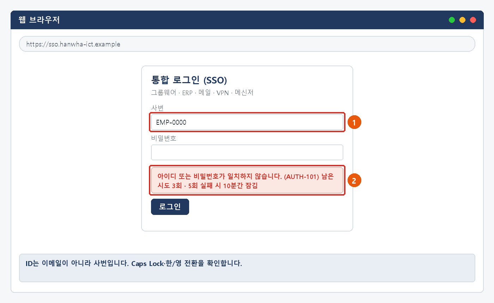
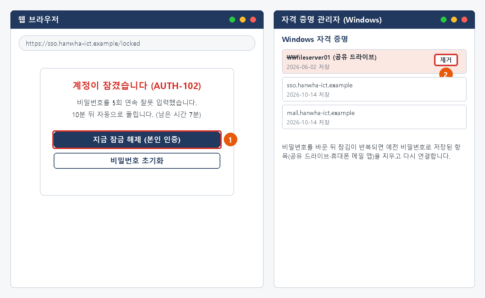
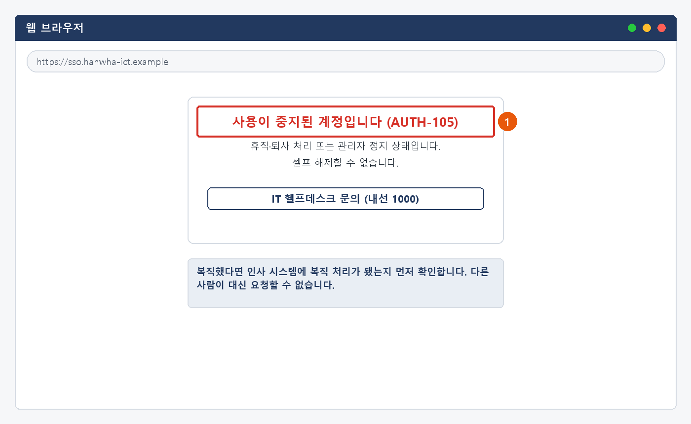

# 사내 SSO 로그인 오류 대응 가이드

> 가상 ICT 기업 임직원 IT 안내 · 계정·로그인  
> IT-ACC-001 | 서비스데스크 | 2026-10-16 | v2.0 | **사내 일반** (전 임직원)

## 목차

- 1. 개요
- 2. 먼저 확인할 사항
- 3. 증상별 조치 방법
  - 3.1 '아이디 또는 비밀번호가 일치하지 않습니다' (AUTH-101)
  - 3.2 계정이 잠겼을 때 (AUTH-102) · 반복해서 잠길 때
  - 3.3 통합 로그인 자체가 안 될 때 (로딩·화면 반복·여러 명 동시)
  - 3.4 휴면 계정일 때 (AUTH-103)
  - 3.5 사용이 중지된 계정일 때 (AUTH-105)
  - 3.6 자꾸 로그아웃될 때 · 안전한 로그아웃
- 4. 자주 묻는 질문
- 5. 주의사항
- 6. 문의처
- 부록 · 관련 문서 · 용어
- 개정 이력

## 1. 개요

**목적**

- 통합 로그인(SSO)이 안 될 때 오류 메시지로 원인을 찾고 직접 해결하는 방법을 안내합니다.
- 계정 잠김·휴면·사용 중지, 로그인 화면 반복, 세션 끊김을 다룹니다.
- 여러 명이 함께 로그인하지 못할 때 신고하는 방법을 안내합니다.

**적용 대상**

- 회사 계정(사번)으로 로그인하는 전 임직원이 대상입니다.
- 비밀번호 변경·만료·분실은 IT-ACC-002, 추가 인증(MFA) 문제는 IT-ACC-003을 봅니다.
- 내가 하지 않은 로그인 알림은 IT-SEC-003을 봅니다.

**적용 환경**

- 통합 로그인 https://sso.ict.example
- 그룹웨어·ERP·메일·VPN·메신저 (SSO 연동)
- Windows / macOS / iOS / Android

## 2. 먼저 확인할 사항

#### 조치하기 전에 확인합니다

- **ID는 사번** 입니다 (예: EMP-0000). 이메일 주소가 아닙니다.
- 통합 로그인 계정 하나로 그룹웨어·ERP·메일·VPN·메신저에 모두 로그인합니다. **SSO 계정이 잠기면 이 시스템들이 모두 함께 막힙니다.**
- 로그인 화면의 **오류 메시지와 코드(AUTH-1xx)** 를 확인합니다. 아래 표에서 볼 곳을 찾습니다.
- **옆자리 동료도 같은 증상** 이면 개인 문제가 아닐 수 있습니다. 개인 조치를 멈추고 3.3을 따릅니다.
- 지원 환경: Windows 10 22H2 이상·Windows 11, macOS 13 이상 (Chrome·Edge 최신), iOS 16 이상, Android 11 이상

> ★ **헬프데스크와 챗봇은 비밀번호와 인증번호를 묻지 않습니다**
>
> 이를 묻는 전화·메신저·메일은 사칭일 수 있으니 응하지 말고 정보보안팀(내선 1119)에 알려 주세요.

#### 오류 메시지로 원인 찾기

| 화면 메시지 (코드) | 원인 | 볼 곳 |
| --- | --- | --- |
| 아이디 또는 비밀번호가 일치하지 않습니다. (AUTH-101) | 입력 오류 | 3.1 |
| 계정이 잠겼습니다. 10분 뒤 자동으로 풀립니다. (AUTH-102) | 비밀번호 5회 연속 실패 | 3.2 |
| (메시지 없이) 로딩만 돌거나 로그인 화면이 계속 다시 나타남 | 쿠키·캐시·시간 설정, 또는 SSO 장애 | 3.3 |
| 장기 미사용으로 휴면 처리된 계정입니다. (AUTH-103) | 90일 이상 로그인하지 않음 | 3.4 |
| 비밀번호가 만료되었습니다. (AUTH-104) | 사용 기간(90일) 경과 | IT-ACC-002 3.3 |
| 사용이 중지된 계정입니다. (AUTH-105) | 휴직·퇴사·관리자 정지 | 3.5 |
| 추가 인증에 실패했습니다. (AUTH-201) | 인증 앱·인증번호 문제 | IT-ACC-003 |
| 세션이 만료되었습니다. 다시 로그인하세요. | 30분 미사용, 다른 곳에서 로그인 | 3.6 |

#### 증상별 바로가기

| 겪고 있는 증상 | 볼 곳 | 처리 구분 |
| --- | --- | --- |
| 비밀번호가 틀리다고 나온다 (AUTH-101) | 3.1 | 🟢 사용자 직접 조치 |
| 계정이 잠겼다 (AUTH-102) / 풀어도 다시 잠긴다 | 3.2 | 🟢 사용자 직접 조치 |
| 로그인 화면이 로딩만 돌거나 계속 반복된다 / 옆자리 동료도 안 된다 | 3.3 | 🔴 즉시 신고·이관 |
| 휴면 계정이라고 나온다 (AUTH-103) | 3.4 | 🟢 사용자 직접 조치 |
| 사용이 중지된 계정이라고 나온다 (AUTH-105) | 3.5 | 🔵 IT 담당자 처리 |
| 자꾸 로그아웃된다 / 세션이 만료된다 | 3.6 | 🟢 사용자 직접 조치 |
| 비밀번호를 바꾸고 싶다 / 만료됐다 / 잊었다 | IT-ACC-002 | 🟢 사용자 직접 조치 |
| 인증 앱 알림이 안 온다 / 인증번호가 틀리다 | IT-ACC-003 | 🟢 사용자 직접 조치 |
| 메일은 되는데 그룹웨어만 안 된다 | IT-SYS-001 | 🟢 사용자 직접 조치 |
| 내가 하지 않은 로그인 알림이 왔다 | IT-SEC-003 3.1 | 🔴 즉시 신고·이관 |

## 3. 증상별 조치 방법

| 번호 | 제목 | 문의 유형 | 처리 구분 | 담당 부서 |
| --- | --- | --- | --- | --- |
| 3.1 | '아이디 또는 비밀번호가 일치하지 않습니다' (AUTH-101) | ACC-02 | 🟢 사용자 직접 조치 | 서비스데스크 |
| 3.2 | 계정이 잠겼을 때 (AUTH-102) · 반복해서 잠길 때 | ACC-02 | 🟢 사용자 직접 조치 | 서비스데스크 |
| 3.3 | 통합 로그인 자체가 안 될 때 (로딩·화면 반복·여러 명 동시) | ACC-04 | 🔴 즉시 신고·이관 | 시스템인프라팀 |
| 3.4 | 휴면 계정일 때 (AUTH-103) | ACC-02 | 🟢 사용자 직접 조치 | 서비스데스크 |
| 3.5 | 사용이 중지된 계정일 때 (AUTH-105) | ACC-02 | 🔵 IT 담당자 처리 | 서비스데스크 |
| 3.6 | 자꾸 로그아웃될 때 · 안전한 로그아웃 | ACC-02 | 🟢 사용자 직접 조치 | 서비스데스크 |

### 3.1 '아이디 또는 비밀번호가 일치하지 않습니다' (AUTH-101)

**문의 유형** ACC-02 · **처리 구분** 🟢 사용자 직접 조치 · **담당 부서** 서비스데스크 · **관련 FAQ** FAQ-002

#### 이런 경우

- 비밀번호를 맞게 쳤는데 틀렸다고 나옵니다.
- 오랜만에 로그인하려는데 계속 실패합니다.

#### 원인

- Caps Lock·한/영 전환 같은 입력 실수이거나, 사번 대신 이메일을 입력한 경우가 많습니다.

#### 조치 방법

1. Caps Lock이 켜져 있지 않은지, 한/영 전환이 한글로 되어 있지 않은지 확인합니다.
2. ID 칸에 이메일이 아니라 **사번** 을 입력했는지 확인합니다.
3. 그래도 실패하면 더 시도하지 않습니다. **5회 연속 실패하면 계정이 잠깁니다.**
4. 비밀번호가 기억나지 않으면 IT-ACC-002 3.4(비밀번호 초기화)로 진행합니다.

*그림 3.1-1. ① ID는 사번 ② 오류 메시지와 남은 시도 횟수*

**해결 확인**

- 정확히 입력해 로그인되면 끝난 것입니다.

**해결되지 않으면**

- 최근 비밀번호를 바꿨는데 실패가 쌓인다면 다른 기기에 남은 예전 비밀번호 때문일 수 있습니다 (3.2).
- 5회 실패로 잠겼으면 3.2를 따릅니다.

**문의 시 알려 주실 정보**

- 사번
- 화면 메시지와 코드
- 사용 기기와 브라우저
- 최근 비밀번호를 바꿨는지

### 3.2 계정이 잠겼을 때 (AUTH-102) · 반복해서 잠길 때

**문의 유형** ACC-02 · **처리 구분** 🟢 사용자 직접 조치 · **담당 부서** 서비스데스크 · **관련 FAQ** FAQ-002

#### 이런 경우

- 비밀번호를 여러 번 틀려서 계정이 잠겼습니다. 해제 부탁드립니다.
- 노트북에 예전 비밀번호로 연결된 공유 드라이브가 있어서 그런지 비번 바꾼 뒤로 자꾸 잠겨요.

#### 원인

- 5회 연속 실패로 잠겼거나, 바꾸기 전 비밀번호가 저장된 기기가 자동 로그인을 시도해 다시 잠깁니다.

#### 조치 방법

1. **10분** 을 기다리면 자동으로 풀립니다. 급하면 **[지금 잠금 해제 (본인 인증)]** 를 누릅니다.
2. 비밀번호를 잊었다면 IT-ACC-002 3.4로 초기화합니다. 잠김도 함께 풀립니다.
3. 다시 잠기면 **[자격 증명 관리자]** 에서 예전 비밀번호 항목(공유 드라이브 등)을 지우고 다시 연결합니다.
4. 휴대폰 메일 앱·VPN·메신저의 저장 비밀번호도 바꿉니다.

*그림 3.2-1. ① 셀프 잠금 해제 ② 예전 비밀번호로 저장된 자격 증명 제거*

**해결 확인**

- 잠김이 풀리고 하루 동안 다시 잠기지 않으면 끝난 것입니다.

**해결되지 않으면**

- 위 항목을 모두 정리했는데도 다시 잠기면 IT 헬프데스크(내선 1000)에 잠긴 시각을 알립니다. 로그인 실패 기록으로 원인을 찾습니다.
- 비밀번호를 바꾼 적이 없는데 잠김이 반복되면 IT-SEC-003 3.4를 따릅니다.

**문의 시 알려 주실 정보**

- 사번
- 잠긴 시각 (여러 번이면 모두)
- 최근 비밀번호를 바꿨는지와 그 날짜
- 비밀번호를 저장해 둔 기기·앱

> ※ **5회 연속 실패 시 잠금, 10분 뒤 자동 해제. 잠기면 그룹웨어·ERP·메일·VPN·메신저가 모두 함께 막힙니다.**

### 3.3 통합 로그인 자체가 안 될 때 (로딩·화면 반복·여러 명 동시)

**문의 유형** ACC-04 · **처리 구분** 🔴 즉시 신고·이관 · **담당 부서** 시스템인프라팀

#### 이런 경우

- 통합 로그인 화면에서 계속 로딩만 돌고 넘어가지 않습니다.
- 아침부터 통합 로그인이 안 돼요. 옆자리 분들도 다 안 된대요.

#### 원인

- 여러 명이면 SSO 서버 장애, 나만이면 브라우저의 쿠키·캐시나 PC 시간 차이 때문입니다.

#### 조치 방법

1. **옆자리 동료도 같은지** 먼저 봅니다. 같으면 개인 조치를 멈추고 IT 헬프데스크(내선 1000)에 전화합니다.
2. 나만 안 되면 Ctrl + Shift + Delete로 **[쿠키]·[캐시]** 만 지우고 브라우저를 다시 엽니다.
3. 시크릿 창에서 로그인해 봅니다. 되면 확장 프로그램을 끄고 다시 시도합니다.
4. 주소를 직접 입력하고, PC 시간을 동기화한 뒤 다른 브라우저로도 시도합니다.

![그림 3.3-1. ① 로딩만 도는 로그인 화면 ② 쿠키·캐시만 선택 ③ [삭제]](../images/acc001_33_sso.png)

*그림 3.3-1. ① 로딩만 도는 로그인 화면 ② 쿠키·캐시만 선택 ③ [삭제]*

**해결 확인**

- 로그인 뒤 그룹웨어 첫 화면이 열리면 끝난 것입니다. 장애였다면 사내 공지의 복구 안내를 받으면 됩니다.

**해결되지 않으면**

- 위 조치를 다 해도 나만 안 되면 IT 헬프데스크에 브라우저 종류와 화면 캡처를 보냅니다.
- 장애 공지가 나오면 공지 안내를 따르고, 같은 장애를 여러 창구로 반복 신고하지 않습니다.

**문의 시 알려 주실 정보**

- 사번
- 발생 시각
- 주변에서 같은 증상인 사람 수
- 브라우저 종류와 이미 해 본 조치

> ★ **[저장된 비밀번호]는 지우지 않습니다**
>
> 다른 사이트의 저장 정보까지 지워집니다. 쿠키와 캐시만 선택합니다.

> ※ **단축키: macOS는 Command + Shift + Delete. 시크릿 창은 Chrome Ctrl + Shift + N, Edge Ctrl + Shift + P. 주소는 https://sso.ict.example 을 직접 입력합니다.**

### 3.4 휴면 계정일 때 (AUTH-103)

**문의 유형** ACC-02 · **처리 구분** 🟢 사용자 직접 조치 · **담당 부서** 서비스데스크

#### 이런 경우

- 휴직을 마치고 돌아왔는데 휴면 계정이라며 로그인이 안 됩니다.
- 오래 쓰지 않은 계정으로 로그인하니 휴면 안내가 나옵니다.

#### 원인

- 90일 이상 로그인하지 않으면 계정이 휴면 처리됩니다. 180일 이상이면 장기 휴면입니다.

#### 조치 방법

1. 휴면 안내 화면의 **[휴면 해제하기]** 를 누릅니다.
2. 등록 휴대폰 인증번호로 본인 인증을 합니다.
3. 해제가 끝나면 다시 로그인합니다.
4. 비밀번호가 만료된 상태면 변경 화면으로 넘어갑니다. IT-ACC-002 3.3을 따릅니다.

![그림 3.4-1. ① [휴면 해제하기]에서 본인 인증](../images/acc001_34_dormant.png)

*그림 3.4-1. ① [휴면 해제하기]에서 본인 인증*

**해결 확인**

- 휴면이 풀리고 로그인되면 끝난 것입니다.

**해결되지 않으면**

- 180일 이상 로그인하지 않았으면 셀프 해제가 되지 않습니다. IT 헬프데스크(내선 1000)에 문의합니다.
- 휴직 중 휴대폰 번호가 바뀌어 인증할 수 없으면 IT 헬프데스크에 문의합니다 (본인 확인 필요).

**문의 시 알려 주실 정보**

- 사번
- 마지막으로 로그인한 무렵
- 휴직·복직 여부
- 등록 휴대폰을 지금도 쓰는지

### 3.5 사용이 중지된 계정일 때 (AUTH-105)

**문의 유형** ACC-02 · **처리 구분** 🔵 IT 담당자 처리 · **담당 부서** 서비스데스크

#### 이런 경우

- 복직했는데 "사용이 중지된 계정입니다"라고 나옵니다.
- 어제까지 되던 계정이 갑자기 사용 중지로 나옵니다.

#### 원인

- 휴직·퇴사 처리 상태이거나, 관리자가 보안상 계정을 정지한 경우입니다.

#### 조치 방법

1. 복직했다면 인사 시스템에 복직 처리가 됐는지 소속 부서·인사팀에 먼저 확인합니다.
2. IT 헬프데스크(내선 1000)에 사번과 상황을 알립니다.
3. 서비스데스크가 본인 확인 뒤 인사 상태를 확인해 처리합니다. 다른 사람이 대신 요청할 수 없습니다.

*그림 3.5-1. ① 사용 중지 안내 — 셀프 해제할 수 없음*

**해결 확인**

- 계정이 다시 활성화되어 로그인되면 끝난 것입니다.

**해결되지 않으면**

- 복직 처리 전이면 인사 처리가 끝난 뒤에 활성화됩니다.
- 보안상 정지된 계정은 정보보안팀 확인이 끝나야 풀립니다.

**문의 시 알려 주실 정보**

- 사번
- 휴직·복직 여부와 날짜
- 마지막으로 로그인한 무렵

### 3.6 자꾸 로그아웃될 때 · 안전한 로그아웃

**문의 유형** ACC-02 · **처리 구분** 🟢 사용자 직접 조치 · **담당 부서** 서비스데스크

#### 이런 경우

- 작업 중에 "세션이 만료되었습니다"가 자꾸 나옵니다.
- 로그인해도 몇 분 안 돼서 로그아웃됩니다.

#### 원인

- 30분 동안 쓰지 않으면 보안 정책으로 자동 로그아웃됩니다(정상).
- 같은 계정으로 다른 PC·브라우저에서 로그인했거나, 5분 안에 반복되면 쿠키·시간 설정 문제입니다.

#### 조치 방법

1. 30분 미사용으로 끊긴 것이면 다시 로그인합니다.
2. 한 곳에서만 로그인해 씁니다.
3. 5분 안에 계속 끊기면 3.3의 쿠키·캐시 삭제와 시간 동기화를 합니다.
4. 자리를 비우거나 공용 PC를 쓸 때는 그룹웨어 오른쪽 위 이름 › **[로그아웃]** 을 누르고 브라우저를 닫습니다.

![그림 3.6-1. ① 이름 메뉴 ② [로그아웃]](../images/acc001_36_session.png)

*그림 3.6-1. ① 이름 메뉴 ② [로그아웃]*

**해결 확인**

- 업무 중 갑자기 로그아웃되지 않으면 끝난 것입니다.

**해결되지 않으면**

- 다른 곳에서 로그인하지 않았는데 "다른 기기에서 로그인되어 종료" 안내가 나오면 IT-SEC-003 3.1을 따릅니다.

**문의 시 알려 주실 정보**

- 사번
- 끊긴 시각과 화면 메시지
- 사용 기기·브라우저

## 4. 자주 묻는 질문

**Q. 계정이 잠겼어요. (FAQ-002)**

A. 비밀번호를 5회 연속 틀리면 계정이 잠기며 10분 후 자동 해제됩니다. 비밀번호를 바꾼 뒤 반복해서 잠긴다면 휴대폰 메일 앱, PC에 저장된 자격 증명(네트워크 드라이브 등)에 예전 비밀번호가 남아 있는지 확인하세요.

**Q. 메일은 되는데 그룹웨어만 로그인이 안 돼요.**

A. 메일이 되면 SSO 계정은 정상입니다. IT-SYS-001 그룹웨어·ERP 이용 오류 대응 가이드를 확인하세요.

**Q. ID를 모르겠어요.**

A. ID는 사번입니다. 사원증이나 인사 시스템에서 확인할 수 있습니다.

**Q. 집에서는 로그인이 안 되고 회사에서는 돼요.**

A. VPN 연결을 먼저 확인하세요 (IT-NET-001). VPN 연결 뒤에도 AUTH 코드가 나오면 이 문서 2장의 표를 봅니다.

**Q. 로그인 화면 주소가 평소와 달라요.**

A. 로그인하지 말고 창을 닫으세요. 피싱 사이트일 수 있습니다 (IT-SEC-001).

## 5. 주의사항

> ★ **꼭 지켜 주세요**
>
> 비밀번호·인증번호는 누구에게도 알려 주지 않습니다. 헬프데스크·챗봇도 묻지 않습니다.
>
> 여러 명이 함께 로그인하지 못하면 캐시 삭제·비밀번호 변경을 반복하지 말고 바로 알립니다.
>
> 로그인 주소는 즐겨찾기 대신 https://sso.ict.example 을 직접 입력합니다.

- 다른 사람의 계정은 대신 요청할 수 없습니다. 당사자가 직접 문의합니다.
- 공용 PC에서는 로그아웃하고 브라우저를 닫습니다.
- 비밀번호를 바꾼 뒤에는 휴대폰 메일 앱·자격 증명 관리자에 저장된 비밀번호도 바꿉니다.

## 6. 문의처

| 창구 | 연락처 | 이용 기준 |
| --- | --- | --- |
| ITssue 챗봇 | 사내 IT 포털 상단 [챗봇 문의] | 24시간. 모든 IT 문의의 기본 창구입니다. 챗봇이 해결하지 못하면 확인을 거쳐 담당 팀에 티켓으로 접수합니다. |
| IT 헬프데스크 (서비스데스크) | 내선 1000 (평일 09:00~18:00) | PC나 챗봇을 쓸 수 없을 때, 여러 사람이 함께 업무를 못 할 때, 본인 확인이 필요한 처리 |
| 정보보안팀 | 내선 1119 | 링크 클릭·비밀번호 입력·감염 의심·계정 도용·장비 분실처럼 바로 알려야 할 보안 문제 |
| 메신저 | #it-helpdesk 채널 | 일반 IT 문의 (챗봇을 쓸 수 없을 때) |
| 메일 | it-helpdesk@ict.example | 일반 IT 문의. 비밀번호·인증번호는 메일로 보내지 않습니다. |
| 처리 상황 알림 | 사내 메신저 알림 | 접수·담당자 배정·처리 완료를 알려 드립니다. 진행 상황은 [내 요청 현황]에서도 봅니다. |

## 부록 · 관련 문서 · 용어

#### 관련 문서

| 문서 번호 | 문서명 | 이럴 때 봅니다 |
| --- | --- | --- |
| IT-ACC-002 | 비밀번호 변경·초기화 가이드 | 비밀번호를 바꾸거나 만료·분실됐을 때 |
| IT-ACC-003 | MFA 인증 오류 대응 가이드 | 추가 인증 단계에서 실패할 때 |
| IT-SYS-001 | 그룹웨어·ERP 이용 오류 대응 가이드 | 로그인 뒤 그룹웨어·ERP 화면 오류 |
| IT-SYS-003 | 사내 시스템 장애 신고·이관 가이드 | 여러 사람이 사내 시스템을 함께 못 쓸 때 |
| IT-NET-001 | VPN 접속 장애 대응 가이드 | 외부에서 VPN이 연결되지 않을 때 |
| IT-SEC-003 | 계정 도용·장비 분실 신고 가이드 | 내가 하지 않은 로그인 알림, 바꾼 적 없는 반복 잠김 |
| IT-STD-001 | IT 서비스 운영 기준 | 긴급도와 처리 기준 |

#### 용어

| 용어 | 설명 |
| --- | --- |
| 통합 로그인 (SSO) | 사번 계정 하나로 그룹웨어·ERP·메일·VPN·메신저에 함께 로그인하는 방식 |
| 계정 잠금 | 비밀번호를 5회 연속 틀리면 계정이 막히는 것. 10분 뒤 자동으로 풀린다 |
| 자격 증명 관리자 | Windows가 공유 드라이브 등의 로그인 정보를 저장해 두는 곳 |
| 휴면 계정 | 90일 이상 로그인하지 않아 사용이 멈춘 계정 |
| 쿠키·캐시 | 브라우저가 저장해 두는 로그인 정보와 화면 파일. 꼬이면 로그인 화면이 반복된다 |
| 세션 | 로그인한 상태. 30분 동안 쓰지 않으면 끊긴다 |

## 개정 이력

| 버전 | 개정일 | 작성자 | 변경 내용 |
| --- | --- | --- | --- |
| v1.0 | 2026-10-12 | 서비스데스크 | 계정·로그인 통합본 최초 작성 |
| v1.1 | 2026-10-12 | 서비스데스크 | 사용자용·관리자용 분리, 본인 확인·콘솔 절차 추가 |
| v1.2 | 2026-10-16 | 서비스데스크 | IT-ACC-001~003 가이드와 -M 매뉴얼로 나눔. 저장소 기준 값(회사명, 비밀번호 12자·4종, 잠금 10분, 연락처·담당 조직)으로 정리 |
| v2.0 | 2026-10-16 | 서비스데스크 | 7개 분류 통합 정리본. 문서 양식·열람 등급·용어·연락처를 통일하고 분류 사이의 중복 내용을 한 문서로 정리 |
