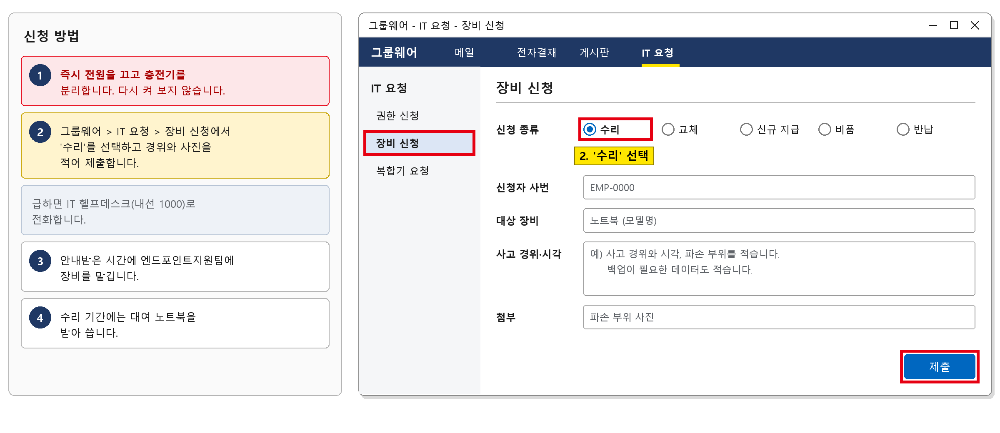
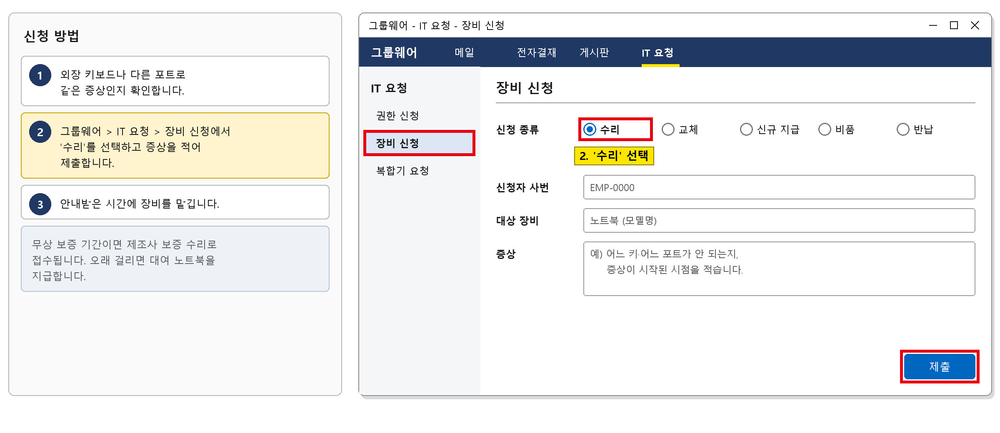
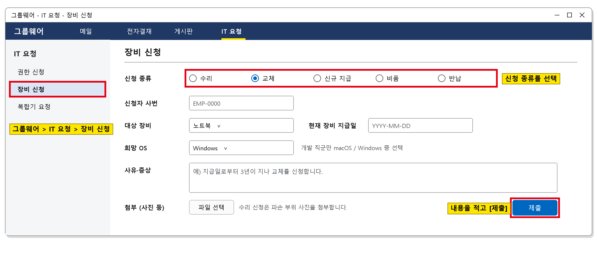
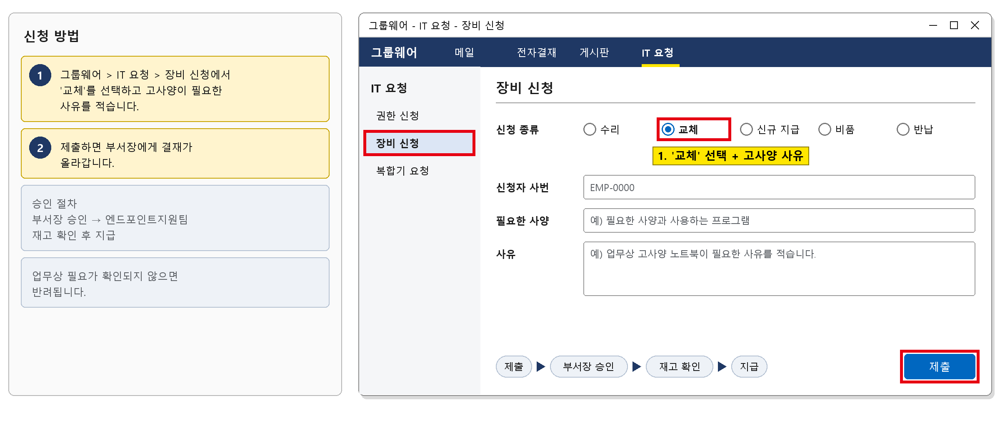
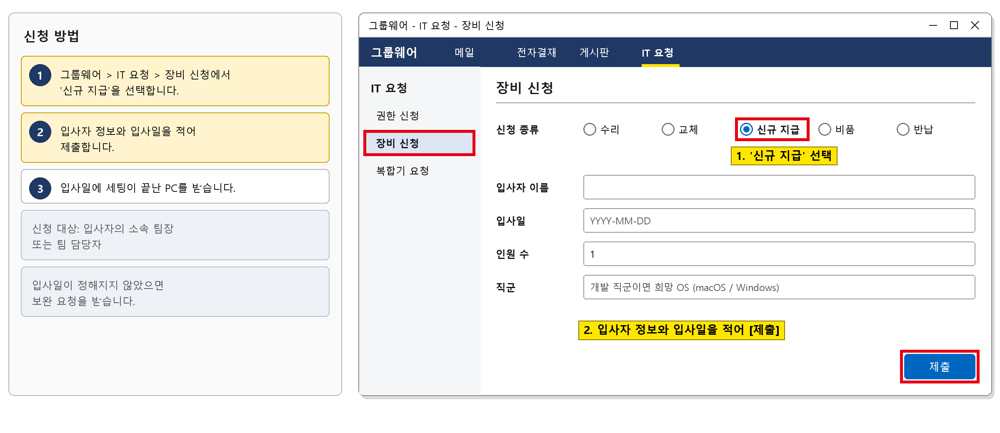
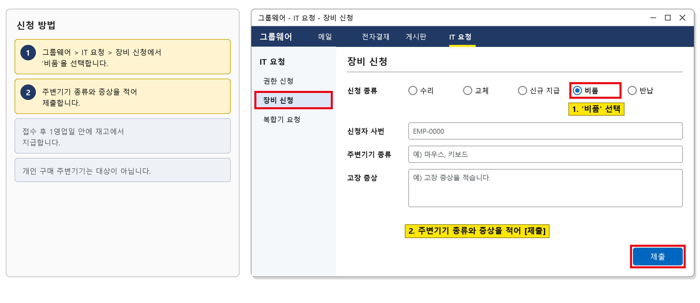
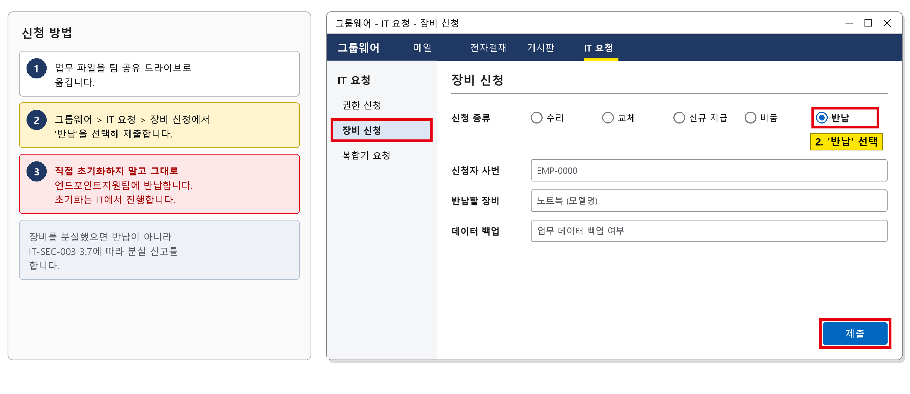

# 업무 장비 교체·수리 신청 가이드

> 가상 ICT 기업 임직원 IT 안내 · HW·업무 PC  
> IT-HW-002 | 엔드포인트지원팀 | 2026-10-16 | v2.0 | **사내 일반** (전 임직원)

## 목차

- 1. 개요
- 2. 신청 전 확인 사항
- 3. 신청 항목별 안내
  - 3.1 노트북 침수·파손 수리 신청
  - 3.2 키보드·포트 등 부품 고장 수리 신청
  - 3.3 교체 주기(3년)가 지난 노트북 교체 신청
  - 3.4 교체 주기 전 고사양 노트북 신청
  - 3.5 신규 입사자 PC 준비 요청
  - 3.6 마우스·키보드 등 주변기기 교체 신청
  - 3.7 퇴사·교체 시 장비 반납
- 4. 자주 묻는 질문
- 5. 주의사항
- 6. 문의처
- 부록 · 관련 문서 · 용어
- 개정 이력

## 1. 개요

#### 목적

업무 장비의 파손·고장 수리, 교체, 신규 지급, 주변기기 교체, 반납을 신청하는 방법을 안내한다.

#### 적용 대상

회사가 지급한 노트북·데스크톱과 마우스·키보드 등 주변기기에 해당한다. 개인 장비는 대상이 아니다. PC가 느리거나 부팅되지 않는 증상은 IT-HW-001을 먼저 본다.

#### 관련 시스템

| 항목 | 내용 |
| --- | --- |
| 신청 경로 | 그룹웨어 > IT 요청 > 장비 신청 |
| 관련 시스템 | 자산 |

## 2. 신청 전 확인 사항

- 음료를 쏟았거나 떨어뜨렸으면 바로 전원을 끄고 충전기를 뺀다. 다시 켜 보지 않는다.
- 업무용 PC 교체 주기는 지급일로부터 3년이다.
- 개발 직군은 macOS/Windows 중 선택할 수 있고, 그 외 직군은 Windows가 기본이다.
- PC가 느리거나 부팅이 안 되는 증상은 IT-HW-001을 먼저 본다.
- 정전 등으로 같은 층의 여러 장비가 한꺼번에 고장 나면 각자 신청하지 말고 IT 헬프데스크 내선 1000으로 바로 전화한다.
- 장비를 잃어버렸으면 IT-SEC-003 3.7에 따라 바로 신고한다.

## 3. 신청 항목별 안내

| 번호 | 제목 | 문의 유형 | 처리 구분 | 담당 부서 |
| --- | --- | --- | --- | --- |
| 3.1 | 노트북 침수·파손 수리 신청 | HW-04 | 🔵 IT 담당자 처리 | 엔드포인트지원팀 |
| 3.2 | 키보드·포트 등 부품 고장 수리 신청 | HW-04 | 🔵 IT 담당자 처리 | 엔드포인트지원팀 |
| 3.3 | 교체 주기(3년)가 지난 노트북 교체 신청 | HW-05 | 🔵 IT 담당자 처리 | 엔드포인트지원팀 |
| 3.4 | 교체 주기 전 고사양 노트북 신청 | HW-05 | 🟡 신청·승인 후 처리 | 엔드포인트지원팀 |
| 3.5 | 신규 입사자 PC 준비 요청 | HW-05 | 🔵 IT 담당자 처리 | 엔드포인트지원팀 |
| 3.6 | 마우스·키보드 등 주변기기 교체 신청 | HW-05 | 🔵 IT 담당자 처리 | 엔드포인트지원팀 |
| 3.7 | 퇴사·교체 시 장비 반납 | HW-05 | 🔵 IT 담당자 처리 | 엔드포인트지원팀 |

### 3.1 노트북 침수·파손 수리 신청

**문의 유형** HW-04 · **처리 구분** 🔵 IT 담당자 처리 · **담당 부서** 엔드포인트지원팀 · **처리 기간** 접수 후 1영업일 · **관련 FAQ** FAQ-017

#### 이럴 때 신청합니다

- 노트북 키보드에 커피 등 음료를 쏟았다.
- 노트북을 떨어뜨려 화면이나 본체가 파손됐다.

#### 신청 대상

- 장비를 쓰는 본인

#### 준비할 정보

- 사번
- 노트북 모델명
- 사고 경위와 시각
- 파손 부위 사진
- 백업이 필요한 데이터

#### 신청 방법

1. 즉시 전원을 끄고 충전기를 분리합니다. 다시 켜 보지 않습니다.
2. 그룹웨어 > IT 요청 > 장비 신청에서 '수리'를 선택하고 경위와 사진을 적어 제출합니다. 급하면 IT 헬프데스크(내선 1000)로 전화합니다.
3. 안내받은 시간에 엔드포인트지원팀에 장비를 맡깁니다.
4. 수리 기간에는 대여 노트북을 받아 씁니다.

*그림 3.1-1. 장비 신청 양식. '수리' 선택과 사고 경위·사진을 적는 위치를 표시한다*

#### 승인 절차

1. 승인 없음 (접수 후 엔드포인트지원팀 처리)

#### 처리 기간과 결과 확인

접수 후 1영업일 안에 점검과 데이터 백업을 하고 수리를 진행한다. 제조사 수리(부품 대기 포함)는 더 걸리며, 그동안 대여 노트북을 쓴다.

#### 반려되는 경우

- 개인 장비는 수리 대상이 아니다.

#### 문의 시 알려 주실 정보

- 신청 번호
- 사번
- 노트북 모델명
- 사고 일시

### 3.2 키보드·포트 등 부품 고장 수리 신청

**문의 유형** HW-04 · **처리 구분** 🔵 IT 담당자 처리 · **담당 부서** 엔드포인트지원팀 · **처리 기간** 접수 후 1영업일 · **관련 FAQ** FAQ-017

#### 이럴 때 신청합니다

- 노트북 키보드 몇 개 키가 눌리지 않는다.
- 사무실 정전 이후 노트북 USB 포트에 꽂은 장비가 자꾸 끊긴다.

#### 신청 대상

- 장비를 쓰는 본인

#### 준비할 정보

- 사번
- 노트북 모델명
- 증상 (어느 키·어느 포트)
- 증상이 시작된 시점

#### 신청 방법

1. 외장 키보드나 다른 포트로 같은 증상인지 확인합니다.
2. 그룹웨어 > IT 요청 > 장비 신청에서 '수리'를 선택하고 증상을 적어 제출합니다.
3. 안내받은 시간에 장비를 맡깁니다.

*그림 3.2-1. 장비 신청 양식. '수리' 선택과 증상을 적는 위치를 표시한다*

#### 승인 절차

1. 승인 없음 (접수 후 엔드포인트지원팀 처리)

#### 처리 기간과 결과 확인

접수 후 1영업일 안에 점검하고, 무상 보증 기간이면 제조사 보증 수리로 접수한다. 메인보드 수리처럼 오래 걸리면 대여 노트북을 지급한다.

#### 반려되는 경우

- 사용자 과실로 인한 파손은 3.1 절차로 처리된다.

#### 문의 시 알려 주실 정보

- 신청 번호
- 사번
- 노트북 모델명
- 증상

### 3.3 교체 주기(3년)가 지난 노트북 교체 신청

**문의 유형** HW-05 · **처리 구분** 🔵 IT 담당자 처리 · **담당 부서** 엔드포인트지원팀 · **처리 기간** 접수 후 1영업일 · **관련 FAQ** FAQ-018

#### 이럴 때 신청합니다

- 노트북을 받은 지 3년이 지나 교체하려 한다.

#### 신청 대상

- 지급일로부터 3년이 지난 장비 사용자

#### 준비할 정보

- 사번
- 현재 노트북 지급일 (모르면 헬프데스크에서 교체 예정일 확인)
- 희망 OS (개발 직군)

#### 신청 방법

1. 헬프데스크에 내 장비의 교체 예정일을 확인합니다.
2. 그룹웨어 > IT 요청 > 장비 신청에서 '교체'를 선택해 제출합니다.
3. 새 장비를 받으면 데이터를 옮기고 기존 장비는 3.7에 따라 반납합니다.

*그림 3.3-1. 장비 신청 양식. 신청 종류(수리/교체/신규 지급/비품/반납) 선택 위치를 표시한다*

#### 승인 절차

1. 승인 없음 (접수 후 엔드포인트지원팀 처리)

#### 처리 기간과 결과 확인

접수 후 1영업일 안에 지급 일정이 안내되고, 보안 프로그램까지 설치된 장비를 받는다.

#### 반려되는 경우

- 지급일로부터 3년이 지나지 않았으면 교체되지 않는다. 업무상 고사양이 필요하면 3.4로 신청한다.

#### 문의 시 알려 주실 정보

- 신청 번호
- 사번
- 현재 장비 지급일

### 3.4 교체 주기 전 고사양 노트북 신청

**문의 유형** HW-05 · **처리 구분** 🟡 신청·승인 후 처리 · **담당 부서** 엔드포인트지원팀 · **처리 기간** 승인 후 1영업일 · **관련 FAQ** FAQ-018

#### 이럴 때 신청합니다

- AI 모델 분석 등 업무 때문에 더 높은 사양의 노트북이 필요하다.

#### 신청 대상

- 업무상 고사양 장비가 필요한 임직원 (부서장 승인 필요)

#### 준비할 정보

- 사번
- 필요한 사양과 사유
- 사용하는 프로그램

#### 신청 방법

1. 그룹웨어 > IT 요청 > 장비 신청에서 '교체'를 선택하고 고사양이 필요한 사유를 적습니다.
2. 제출하면 부서장에게 결재가 올라갑니다.

*그림 3.4-1. 장비 신청 양식. '교체' 선택과 고사양 사유를 적는 위치, 승인 흐름을 표시한다*

#### 승인 절차

1. 부서장 승인
2. 엔드포인트지원팀 재고 확인 후 지급

#### 처리 기간과 결과 확인

부서장 승인 후 1영업일 안에 지급 가능 여부와 일정이 안내된다.

#### 반려되는 경우

- 업무상 필요가 확인되지 않으면 반려된다. 교체 주기가 될 때까지 기존 장비를 쓴다.

#### 문의 시 알려 주실 정보

- 신청 번호
- 사번
- 필요한 사양

### 3.5 신규 입사자 PC 준비 요청

**문의 유형** HW-05 · **처리 구분** 🔵 IT 담당자 처리 · **담당 부서** 엔드포인트지원팀 · **처리 기간** 접수 후 1영업일 · **관련 FAQ** FAQ-018

#### 이럴 때 신청합니다

- 다음 주 입사자가 쓸 PC를 준비해야 한다.

#### 신청 대상

- 입사자의 소속 팀장 또는 팀 담당자

#### 준비할 정보

- 입사자 이름과 입사일
- 인원 수
- 직군 (개발 직군이면 희망 OS)

#### 신청 방법

1. 그룹웨어 > IT 요청 > 장비 신청에서 '신규 지급'을 선택합니다.
2. 입사자 정보와 입사일을 적어 제출합니다.
3. 입사일에 세팅이 끝난 PC를 받습니다.

*그림 3.5-1. 장비 신청 양식. '신규 지급' 선택과 입사자 정보를 적는 위치를 표시한다*

#### 승인 절차

1. 승인 없음 (접수 후 엔드포인트지원팀 처리)

#### 처리 기간과 결과 확인

접수 후 1영업일 안에 재고를 확인하고, 보안 프로그램 설치까지 마친 PC를 입사일에 전달한다.

#### 반려되는 경우

- 입사일이 정해지지 않았으면 보완 요청을 받는다.

#### 문의 시 알려 주실 정보

- 신청 번호
- 입사자 이름
- 입사일

### 3.6 마우스·키보드 등 주변기기 교체 신청

**문의 유형** HW-05 · **처리 구분** 🔵 IT 담당자 처리 · **담당 부서** 엔드포인트지원팀 · **처리 기간** 접수 후 1영업일 · **관련 FAQ** FAQ-018

#### 이럴 때 신청합니다

- 마우스·키보드 등 주변기기가 고장 나 새로 받고 싶다.

#### 신청 대상

- 장비를 쓰는 본인

#### 준비할 정보

- 사번
- 주변기기 종류
- 고장 증상

#### 신청 방법

1. 그룹웨어 > IT 요청 > 장비 신청에서 '비품'을 선택합니다.
2. 주변기기 종류와 증상을 적어 제출합니다.

*그림 3.6-1. 장비 신청 양식. '비품' 선택과 주변기기 종류·증상을 적는 위치를 표시한다*

#### 승인 절차

1. 승인 없음 (접수 후 엔드포인트지원팀 처리)

#### 처리 기간과 결과 확인

접수 후 1영업일 안에 재고에서 지급한다.

#### 반려되는 경우

- 개인 구매 주변기기는 대상이 아니다.

#### 문의 시 알려 주실 정보

- 신청 번호
- 사번
- 주변기기 종류

### 3.7 퇴사·교체 시 장비 반납

**문의 유형** HW-05 · **처리 구분** 🔵 IT 담당자 처리 · **담당 부서** 엔드포인트지원팀 · **처리 기간** 접수 후 1영업일 · **관련 FAQ** FAQ-018

#### 이럴 때 신청합니다

- 퇴사하거나 새 장비를 받아 기존 장비를 반납해야 한다.

#### 신청 대상

- 장비를 쓰던 본인

#### 준비할 정보

- 사번
- 반납할 장비
- 업무 데이터 백업 여부

#### 신청 방법

1. 업무 파일을 팀 공유 드라이브로 옮깁니다.
2. 그룹웨어 > IT 요청 > 장비 신청에서 '반납'을 선택해 제출합니다.
3. 직접 초기화하지 말고 그대로 엔드포인트지원팀에 반납합니다. 초기화는 IT에서 진행합니다.

*그림 3.7-1. 장비 신청 양식. '반납' 선택 위치를 표시한다*

#### 승인 절차

1. 승인 없음 (접수 후 엔드포인트지원팀 처리)

#### 처리 기간과 결과 확인

접수 후 1영업일 안에 반납 일정이 안내되고, 반납한 장비는 IT에서 초기화한다.

#### 반려되는 경우

- 장비를 분실했으면 반납이 아니라 IT-SEC-003 3.7에 따라 분실 신고를 한다.

#### 문의 시 알려 주실 정보

- 신청 번호
- 사번
- 반납할 장비

> ※ **퇴사할 때 계정은 퇴사일 18시에 자동 비활성화되고(IT-ACS-003 3.3), 유료 SW 라이선스도 함께 회수됩니다(IT-SW-002 3.7). 반납 전에 업무 파일을 팀 공유 드라이브로 옮깁니다.**

## 4. 자주 묻는 질문

**Q. 노트북에 음료를 쏟았거나 파손됐어요. (FAQ-017)**

A. 즉시 전원을 끄고 충전기를 분리하세요. 엔드포인트지원팀에 접수하면 데이터 백업 후 수리를 진행하고 필요하면 대여 장비를 지급합니다.

**Q. 노트북 교체·반납은 어떻게 하나요? (FAQ-018)**

A. 업무용 PC 교체 주기는 지급일로부터 3년입니다. 개발 직군은 macOS/Windows 중 선택, 그 외 직군은 Windows가 기본입니다. 반납 시 초기화는 IT에서 진행하므로 그대로 반납하면 됩니다.

## 5. 주의사항

- 음료를 쏟은 장비를 다시 켜지 않는다.
- 회사 장비를 개인적으로 수리업체에 맡기지 않는다.
- 반납 전에 직접 초기화하지 않는다.
- 장비를 잃어버렸으면 IT-SEC-003에 따라 바로 신고한다.

## 6. 문의처

| 창구 | 연락처 | 이용 기준 |
| --- | --- | --- |
| ITssue 챗봇 | 사내 IT 포털 상단 [챗봇 문의] | 24시간. 모든 IT 문의의 기본 창구입니다. 챗봇이 해결하지 못하면 확인을 거쳐 담당 팀에 티켓으로 접수합니다. |
| IT 헬프데스크 (서비스데스크) | 내선 1000 (평일 09:00~18:00) | PC나 챗봇을 쓸 수 없을 때, 여러 사람이 함께 업무를 못 할 때, 본인 확인이 필요한 처리 |
| 정보보안팀 | 내선 1119 | 링크 클릭·비밀번호 입력·감염 의심·계정 도용·장비 분실처럼 바로 알려야 할 보안 문제 |
| 메신저 | #it-helpdesk 채널 | 일반 IT 문의 (챗봇을 쓸 수 없을 때) |
| 메일 | it-helpdesk@ict.example | 일반 IT 문의. 비밀번호·인증번호는 메일로 보내지 않습니다. |
| 처리 상황 알림 | 사내 메신저 알림 | 접수·담당자 배정·처리 완료를 알려 드립니다. 진행 상황은 [내 요청 현황]에서도 봅니다. |

## 부록 · 관련 문서 · 용어

#### 관련 문서

| 문서 번호 | 문서명 | 이럴 때 봅니다 |
| --- | --- | --- |
| IT-HW-001 | 업무 PC 기본 장애 대응 가이드 |  |
| IT-ACS-003 | 퇴사·부서이동 권한 변경 가이드 |  |
| IT-SEC-003 | 계정 도용·장비 분실 신고 가이드 |  |
| IT-STD-001 | IT 서비스 운영 기준 |  |

#### 용어

| 용어 | 설명 |
| --- | --- |
| 대여 노트북 | 수리 기간 동안 임시로 쓰는 회사 노트북 |
| 교체 주기 | 업무용 PC를 새 장비로 바꿀 수 있는 기간. 지급일로부터 3년 |

## 개정 이력

| 버전 | 개정일 | 작성자 | 변경 내용 |
| --- | --- | --- | --- |
| v1.0 | 2026-03-01 | 엔드포인트지원팀 | 최초 작성 |
| v2.0 | 2026-10-16 | 엔드포인트지원팀 | 7개 분류 통합 정리본. 문서 양식·열람 등급·용어·연락처를 통일하고 분류 사이의 중복 내용을 한 문서로 정리 |
