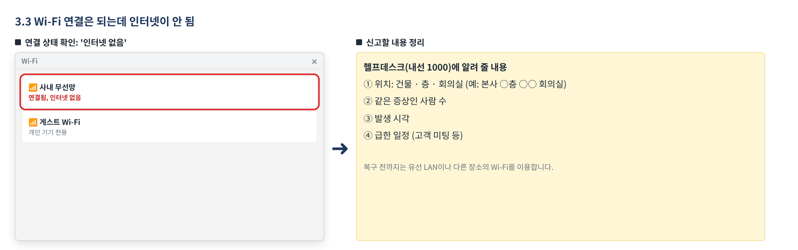
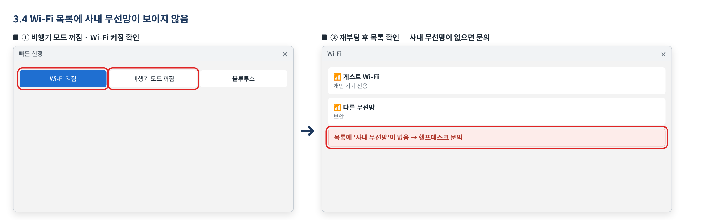
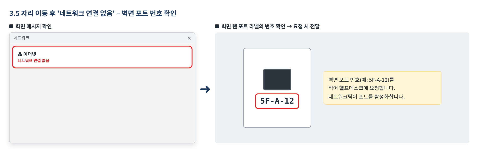
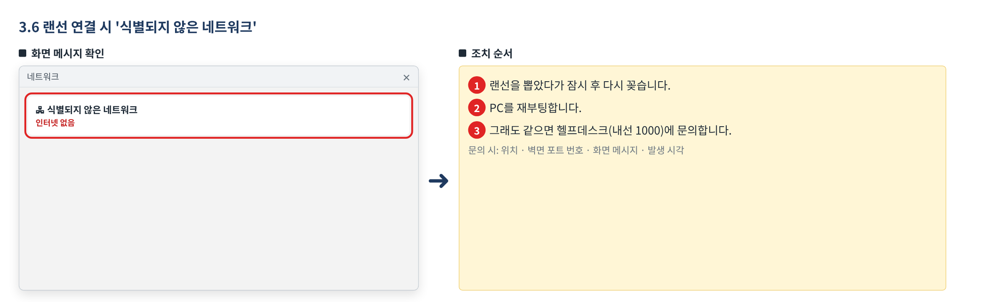
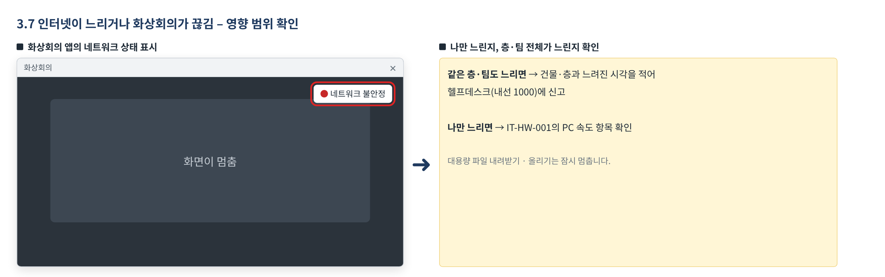

# 사내 네트워크 장애 대응 가이드

> 가상 ICT 기업 임직원 IT 안내 · VPN·네트워크  
> IT-NET-002 | 네트워크팀 | 2026-10-16 | v2.0 | **사내 일반** (전 임직원)

## 목차

- 1. 개요
- 2. 먼저 확인할 사항
- 3. 증상별 조치 방법
  - 3.1 사내 Wi-Fi가 연결됐다 끊겼다 함
  - 3.2 Wi-Fi 연결 시 '인증서를 확인할 수 없습니다' 오류
  - 3.3 사내 Wi-Fi 연결은 되는데 인터넷이 안 됨
  - 3.4 Wi-Fi 목록에 사내 무선망이 보이지 않음
  - 3.5 자리 이동 후 랜선 연결 시 '네트워크 연결 없음'
  - 3.6 랜선 연결 시 '식별되지 않은 네트워크' 표시
  - 3.7 인터넷이 너무 느리거나 화상회의가 계속 끊김
- 4. 자주 묻는 질문
- 5. 주의사항
- 6. 문의처
- 부록 · 관련 문서 · 용어
- 개정 이력

## 1. 개요

#### 목적

사내에서 Wi-Fi·유선 LAN이 연결되지 않거나 인터넷이 느릴 때, 증상별로 직접 확인할 것과 네트워크팀에 요청하는 방법을 안내합니다.

#### 적용 대상

본사·연구동 등 사내에서 회사 지급 PC로 사내 유무선망을 쓰는 전 임직원이 대상입니다. 개인 기기는 게스트 Wi-Fi만 쓸 수 있어 제외합니다. 재택·외부 VPN 문제는 IT-NET-001, 여러 부서가 동시에 네트워크를 쓸 수 없는 장애는 IT-NET-003에서 다룹니다.

#### 적용 환경

| 항목 | 내용 |
| --- | --- |
| 관련 도구·시스템 | 사내 무선망, 사내 유선망 |
| OS | Windows / macOS (개발 직군 선택) |

## 2. 먼저 확인할 사항

- 나만 안 되는지, 같은 층·회의실의 다른 사람도 안 되는지 확인합니다.
- Wi-Fi가 안 되면 유선 LAN으로, 유선이 안 되면 Wi-Fi로 연결해 보며 어느 쪽 문제인지 나눕니다.
- 위치(건물·층·회의실)와 벽면 랜 포트 번호(예: 5F-A-12)를 확인해 둡니다. 신고할 때 필요합니다.
- 개인 기기는 게스트 Wi-Fi만 쓸 수 있으며 사내 시스템에 접근할 수 없습니다.
- 여러 부서·층에서 동시에 네트워크를 전혀 쓸 수 없으면 IT-NET-003 네트워크 장애 신고·이관 가이드를 따릅니다. 느리지만 쓸 수는 있으면 이 문서의 3.7을 봅니다.

## 3. 증상별 조치 방법

| 번호 | 제목 | 문의 유형 | 처리 구분 | 담당 부서 |
| --- | --- | --- | --- | --- |
| 3.1 | 사내 Wi-Fi가 연결됐다 끊겼다 함 | NET-01 | 🟢 사용자 직접 조치 | 네트워크팀 |
| 3.2 | Wi-Fi 연결 시 '인증서를 확인할 수 없습니다' 오류 | NET-01 | 🔵 IT 담당자 처리 | 네트워크팀 |
| 3.3 | 사내 Wi-Fi 연결은 되는데 인터넷이 안 됨 | NET-01 | 🔵 IT 담당자 처리 | 네트워크팀 |
| 3.4 | Wi-Fi 목록에 사내 무선망이 보이지 않음 | NET-01 | 🔵 IT 담당자 처리 | 네트워크팀 |
| 3.5 | 자리 이동 후 랜선 연결 시 '네트워크 연결 없음' | NET-05 | 🔵 IT 담당자 처리 | 네트워크팀 |
| 3.6 | 랜선 연결 시 '식별되지 않은 네트워크' 표시 | NET-05 | 🔵 IT 담당자 처리 | 네트워크팀 |
| 3.7 | 인터넷이 너무 느리거나 화상회의가 계속 끊김 | NET-04 | 🔵 IT 담당자 처리 | 네트워크팀 |

### 3.1 사내 Wi-Fi가 연결됐다 끊겼다 함

**문의 유형** NET-01 · **처리 구분** 🟢 사용자 직접 조치 · **담당 부서** 네트워크팀 · **관련 FAQ** FAQ-006

#### 이런 경우

- 회의실 등에서 사내 Wi-Fi가 연결됐다 끊겼다 합니다.
- 내 노트북만 사내 Wi-Fi가 자꾸 끊기고, 재부팅 후 다시 연결해도 똑같습니다.

화면 메시지: 없음

#### 원인

- PC에 저장된 사내 Wi-Fi 프로필의 인증 정보가 잘못된 경우입니다.
- 무선 랜카드 드라이버가 구버전이거나 절전 설정 때문에 무선 연결이 끊기는 경우입니다.

#### 조치 방법

1. Wi-Fi를 껐다 켭니다.
2. [설정] > [네트워크 및 인터넷] > [Wi-Fi] > [알려진 네트워크 관리]에서 저장된 사내 무선망을 삭제합니다.
3. 사내 무선망을 다시 선택해 연결합니다.

![그림 3.1-1. Windows 설정의 [알려진 네트워크 관리]에서 사내 무선망을 삭제하고, Wi-Fi 목록에서 다시 선택해 연결하는 화면](../images/IT-NET-002_01.png)

*그림 3.1-1. Windows 설정의 [알려진 네트워크 관리]에서 사내 무선망을 삭제하고, Wi-Fi 목록에서 다시 선택해 연결하는 화면*

**해결 확인**

- 다시 연결한 뒤 같은 장소에서 끊기지 않고 웹사이트와 사내 시스템이 열리면 해결된 것입니다.

**해결되지 않으면**

- 다시 연결해도 내 노트북만 계속 끊기면 헬프데스크에 문의합니다. 무선 드라이버 업데이트와 절전 설정 점검을 받습니다.
- 여러 명이 동시에 겪으면 IT-NET-003 네트워크 장애 신고·이관 가이드를 따릅니다.

**문의 시 알려 주실 정보**

- 사번
- 위치(건물·층·회의실)
- 끊기는 빈도와 시각
- 같은 위치 다른 사람의 증상
- 이미 해 본 조치

### 3.2 Wi-Fi 연결 시 '인증서를 확인할 수 없습니다' 오류

**문의 유형** NET-01 · **처리 구분** 🔵 IT 담당자 처리 · **담당 부서** 네트워크팀 · **관련 FAQ** FAQ-006

#### 이런 경우

- 사내 Wi-Fi에 연결하려고 하면 '인증서를 확인할 수 없습니다'라는 메시지가 뜨고 연결되지 않습니다.

화면 메시지: '인증서를 확인할 수 없습니다'

#### 원인

- PC에 설치된 사내 무선망 인증서의 유효 기간이 끝난 경우입니다. 인증서를 다시 발급받아야 합니다.

#### 조치 방법

1. 화면 메시지를 그대로 적어 헬프데스크에 인증서 재발급을 요청합니다. 재발급 전까지는 유선 LAN으로 업무를 볼 수 있습니다.
2. 재발급 안내를 받으면 안내에 따라 인증서 포털에서 새 인증서를 설치합니다.
3. 저장된 사내 무선망을 삭제한 뒤 다시 연결합니다.

![그림 3.2-1. Wi-Fi 목록의 '인증서를 확인할 수 없습니다' 메시지와, 재발급 후 인증서 포털에서 [인증서 설치]를 누르는 화면](../images/IT-NET-002_02.png)

*그림 3.2-1. Wi-Fi 목록의 '인증서를 확인할 수 없습니다' 메시지와, 재발급 후 인증서 포털에서 [인증서 설치]를 누르는 화면*

**해결 확인**

- 인증서 메시지 없이 사내 무선망에 연결되고 인터넷이 되면 해결된 것입니다.

**해결되지 않으면**

- 새 인증서를 설치한 뒤에도 같은 메시지가 뜨면 헬프데스크에 다시 문의합니다.
- 여러 명이 동시에 겪으면 IT-NET-003 네트워크 장애 신고·이관 가이드를 따릅니다.

**문의 시 알려 주실 정보**

- 사번
- 위치
- 화면 메시지
- 발생 시각

### 3.3 사내 Wi-Fi 연결은 되는데 인터넷이 안 됨

**문의 유형** NET-01 · **처리 구분** 🔵 IT 담당자 처리 · **담당 부서** 네트워크팀 · **관련 FAQ** FAQ-006

#### 이런 경우

- 회의실 등에서 사내 Wi-Fi가 연결은 되는데 인터넷이 안 됩니다.
- 같은 층·회의실의 다른 사람도 같은 증상입니다.

화면 메시지: 없음

#### 원인

- 해당 구역의 무선 공유 장비(무선 AP)에 장애가 생긴 경우입니다. 개인 PC 조치로는 해결되지 않습니다.

#### 조치 방법

1. 같은 장소의 다른 사람도 같은 증상인지 확인합니다.
2. 건물·층·회의실 위치를 적어 헬프데스크에 신고합니다. 네트워크팀이 해당 구역 무선 AP를 점검합니다.
3. 복구 전까지는 유선 LAN이나 다른 장소의 Wi-Fi를 이용합니다.

*그림 3.3-1. Wi-Fi 목록에서 사내 무선망이 '연결됨, 인터넷 없음'으로 표시된 화면과 신고할 내용*

**해결 확인**

- 복구 안내를 받은 뒤 같은 장소에서 Wi-Fi로 웹사이트가 열리면 해결된 것입니다.

**해결되지 않으면**

- 복구 안내 후에도 같은 장소에서 인터넷이 안 되면 위치를 적어 다시 문의합니다.
- 여러 명이 동시에 겪으면 IT-NET-003 네트워크 장애 신고·이관 가이드를 따릅니다.

**문의 시 알려 주실 정보**

- 사번
- 건물·층·회의실
- 같은 증상인 사람 수
- 발생 시각
- 급한 일정(고객 미팅 등)

### 3.4 Wi-Fi 목록에 사내 무선망이 보이지 않음

**문의 유형** NET-01 · **처리 구분** 🔵 IT 담당자 처리 · **담당 부서** 네트워크팀 · **관련 FAQ** FAQ-006

#### 이런 경우

- 노트북 Wi-Fi 목록에 사내 무선망이 아예 보이지 않습니다.
- 같은 자리의 다른 사람 노트북에는 사내 무선망이 보입니다.

화면 메시지: 없음

#### 원인

- 노트북의 무선랜 드라이버에 오류가 생긴 경우입니다.

#### 조치 방법

1. 비행기 모드가 꺼져 있고 Wi-Fi가 켜져 있는지 확인합니다.
2. PC를 재부팅한 뒤 Wi-Fi 목록을 다시 확인합니다.
3. 그래도 보이지 않으면 헬프데스크에 문의합니다. 네트워크팀이 무선랜 드라이버를 다시 설치합니다.

*그림 3.4-1. 빠른 설정에서 Wi-Fi 켜짐·비행기 모드 꺼짐을 확인하고, Wi-Fi 목록에 사내 무선망이 있는지 확인하는 화면*

**해결 확인**

- 드라이버 재설치 후 Wi-Fi 목록에 사내 무선망이 보이고 연결되면 해결된 것입니다.

**해결되지 않으면**

- 드라이버를 다시 설치한 뒤에도 보이지 않으면 헬프데스크에 다시 문의합니다.
- 여러 명이 동시에 겪으면 IT-NET-003 네트워크 장애 신고·이관 가이드를 따릅니다.

**문의 시 알려 주실 정보**

- 사번
- 위치
- 목록에 보이는 다른 무선망
- 발생 시각
- 이미 해 본 조치

### 3.5 자리 이동 후 랜선 연결 시 '네트워크 연결 없음'

**문의 유형** NET-05 · **처리 구분** 🔵 IT 담당자 처리 · **담당 부서** 네트워크팀 · **관련 FAQ** FAQ-008

#### 이런 경우

- 자리를 옮긴 뒤 랜선을 꽂아도 '네트워크 연결 없음'이라고 나옵니다.

화면 메시지: '네트워크 연결 없음'

#### 원인

- 사용하지 않던 랜 포트는 보안상 비활성화되어 있을 수 있습니다.

#### 조치 방법

1. 랜선이 PC와 벽면 포트에 끝까지 꽂혀 있는지 확인합니다.
2. 벽면 포트 번호(예: 5F-A-12)를 확인합니다.
3. 포트 번호를 적어 헬프데스크에 요청합니다. 네트워크팀이 포트를 활성화합니다.

*그림 3.5-1. 네트워크 목록의 '네트워크 연결 없음' 표시와 벽면 랜 포트 라벨에서 포트 번호(예: 5F-A-12)를 확인하는 그림*

**해결 확인**

- 랜선을 다시 꽂았을 때 네트워크에 연결되고 웹사이트가 열리면 해결된 것입니다.

**해결되지 않으면**

- 활성화 안내 후에도 연결되지 않으면 다른 랜선으로 바꿔 보고 다시 문의합니다.
- 여러 명이 동시에 겪으면 IT-NET-003 네트워크 장애 신고·이관 가이드를 따릅니다.

**문의 시 알려 주실 정보**

- 사번
- 벽면 포트 번호
- 자리 이동 날짜
- 화면 메시지
- 케이블 확인 여부

### 3.6 랜선 연결 시 '식별되지 않은 네트워크' 표시

**문의 유형** NET-05 · **처리 구분** 🔵 IT 담당자 처리 · **담당 부서** 네트워크팀 · **관련 FAQ** FAQ-008

#### 이런 경우

- 랜선을 꽂으면 '식별되지 않은 네트워크'라고 뜨고 인터넷이 안 됩니다.

화면 메시지: '식별되지 않은 네트워크'

#### 원인

- PC가 네트워크 주소(IP)를 자동으로 받지 못한 경우입니다.

#### 조치 방법

1. 랜선을 뽑았다가 잠시 후 다시 꽂습니다.
2. PC를 재부팅합니다.
3. 그래도 같으면 헬프데스크에 문의합니다. 네트워크팀이 IP 할당 상태를 점검하고 갱신합니다.

*그림 3.6-1. 네트워크 목록에 '식별되지 않은 네트워크'가 표시된 화면과 조치 순서*

**해결 확인**

- '식별되지 않은 네트워크' 표시가 사라지고 인터넷이 되면 해결된 것입니다.

**해결되지 않으면**

- 조치 안내 후에도 같은 표시가 나오면 포트 번호를 적어 다시 문의합니다.
- 여러 명이 동시에 겪으면 IT-NET-003 네트워크 장애 신고·이관 가이드를 따릅니다.

**문의 시 알려 주실 정보**

- 사번
- 위치·벽면 포트 번호
- 화면 메시지
- 발생 시각
- 이미 해 본 조치

### 3.7 인터넷이 너무 느리거나 화상회의가 계속 끊김

**문의 유형** NET-04 · **처리 구분** 🔵 IT 담당자 처리 · **담당 부서** 네트워크팀

#### 이런 경우

- 화상회의 중 화면이 계속 멈추고 끊기며, 같은 팀 사람들도 모두 그렇습니다.
- 층 전체의 인터넷이 느려 웹페이지 하나 여는 데 한참 걸립니다.
- 같은 층에서 VPN·ERP·메일 등 여러 시스템이 동시에 느려집니다.

화면 메시지: 없음

#### 원인

- 대용량 업데이트 배포 등으로 회사 네트워크 사용량(대역폭)이 가득 찬 경우입니다.
- 층 네트워크 장비(스위치)의 연결 포트에 오류가 생긴 경우입니다.

#### 조치 방법

1. 같은 층·팀의 다른 사람도 느린지 확인합니다. 나만 느리면 IT-HW-001 업무 PC 기본 장애 대응 가이드의 PC 속도 항목을 봅니다.
2. 대용량 파일 내려받기·올리기를 잠시 멈춥니다.
3. 건물·층과 느려진 시각을 적어 헬프데스크에 신고합니다. 네트워크팀이 사용량과 장비를 점검합니다.

*그림 3.7-1. 화상회의 앱의 '네트워크 불안정' 표시와, 나만 느린지 층·팀 전체가 느린지에 따른 신고 기준*

**해결 확인**

- 같은 층에서 웹페이지가 바로 열리고 화상회의가 끊기지 않으면 해결된 것입니다.

**해결되지 않으면**

- 조치 안내 후에도 같은 시간대마다 느려지면 시간대를 적어 다시 문의합니다.
- 여러 명이 동시에 겪으면 IT-NET-003 네트워크 장애 신고·이관 가이드를 따릅니다.

**문의 시 알려 주실 정보**

- 사번
- 건물·층
- 같은 증상인 팀·사람
- 느려진 시각
- 느린 서비스

## 4. 자주 묻는 질문

**Q. 사내 Wi-Fi가 연결되지 않아요. (FAQ-006)**

A. Wi-Fi를 껐다 켜고, 저장된 사내 무선망을 삭제한 뒤 다시 연결합니다. '인증서' 오류가 나면 인증서 포털에서 재발급이 필요합니다. 특정 층 전체가 안 되면 AP 장애일 수 있으니 층·위치를 적어 신고합니다.

**Q. 자리를 옮긴 뒤 유선 인터넷이 안 돼요. (FAQ-008)**

A. 사용하지 않던 랜 포트는 보안상 비활성화되어 있을 수 있습니다. 벽면 포트 번호(예: 5F-A-12)를 적어 요청합니다.

**Q. 사내에서 개인 기기를 와이파이에 연결해도 되나요? (FAQ-037)**

A. 개인 기기는 '게스트 Wi-Fi'만 사용할 수 있으며 사내 시스템에는 접근할 수 없습니다. 게스트 비밀번호는 매주 월요일 바뀝니다.

## 5. 주의사항

- 개인 기기를 사내 무선망에 연결하지 않습니다. 개인 기기는 게스트 Wi-Fi만 이용합니다.
- 게스트 Wi-Fi 비밀번호는 매주 월요일 바뀌며, 외부인에게 알려 주지 않습니다.
- 벽면 랜 포트에 개인 공유기나 허브를 연결하지 않습니다.
- 사내 네트워크 장비(무선 AP, 벽면 포트 배선)를 임의로 옮기거나 전원을 끄지 않습니다.

## 6. 문의처

| 창구 | 연락처 | 이용 기준 |
| --- | --- | --- |
| ITssue 챗봇 | 사내 IT 포털 상단 [챗봇 문의] | 24시간. 모든 IT 문의의 기본 창구입니다. 챗봇이 해결하지 못하면 확인을 거쳐 담당 팀에 티켓으로 접수합니다. |
| IT 헬프데스크 (서비스데스크) | 내선 1000 (평일 09:00~18:00) | PC나 챗봇을 쓸 수 없을 때, 여러 사람이 함께 업무를 못 할 때, 본인 확인이 필요한 처리 |
| 정보보안팀 | 내선 1119 | 링크 클릭·비밀번호 입력·감염 의심·계정 도용·장비 분실처럼 바로 알려야 할 보안 문제 |
| 메신저 | #it-helpdesk 채널 | 일반 IT 문의 (챗봇을 쓸 수 없을 때) |
| 메일 | it-helpdesk@ict.example | 일반 IT 문의. 비밀번호·인증번호는 메일로 보내지 않습니다. |
| 처리 상황 알림 | 사내 메신저 알림 | 접수·담당자 배정·처리 완료를 알려 드립니다. 진행 상황은 [내 요청 현황]에서도 봅니다. |

## 부록 · 관련 문서 · 용어

#### 관련 문서

| 문서 번호 | 문서명 | 이럴 때 봅니다 |
| --- | --- | --- |
| IT-NET-001 | VPN 접속 장애 대응 가이드 |  |
| IT-NET-003 | 네트워크 장애 신고·이관 가이드 |  |
| IT-HW-001 | 업무 PC 기본 장애 대응 가이드 |  |
| IT-STD-001 | IT 서비스 운영 기준 |  |

#### 용어

| 용어 | 설명 |
| --- | --- |
| 무선 AP | 사무실 천장 등에 설치된 무선 공유 장비. 구역별로 Wi-Fi 신호를 제공 |
| 무선망 인증서 | 회사 지급 PC가 사내 무선망에 접속할 때 쓰는 인증 파일. 유효 기간이 있음 |
| 랜 포트 | 벽면의 유선 네트워크 단자. 5F-A-12처럼 포트 번호가 붙어 있음 |
| IP 자동 할당 | PC가 네트워크 주소(IP)를 자동으로 받는 기능(DHCP) |
| 대역폭 | 네트워크로 동시에 보낼 수 있는 데이터 양 |
| 게스트 Wi-Fi | 개인 기기용 무선망. 사내 시스템에는 접근할 수 없음 |

## 개정 이력

| 버전 | 개정일 | 작성자 | 변경 내용 |
| --- | --- | --- | --- |
| v1.0 | 2026-03-01 | 네트워크팀 | 최초 작성 |
| v2.0 | 2026-10-16 | 네트워크팀 | 7개 분류 통합 정리본. 문서 양식·열람 등급·용어·연락처를 통일하고 분류 사이의 중복 내용을 한 문서로 정리 |
