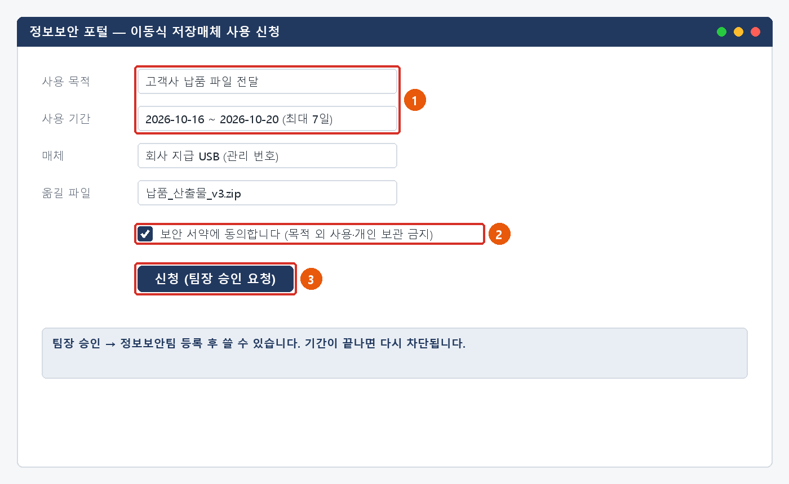
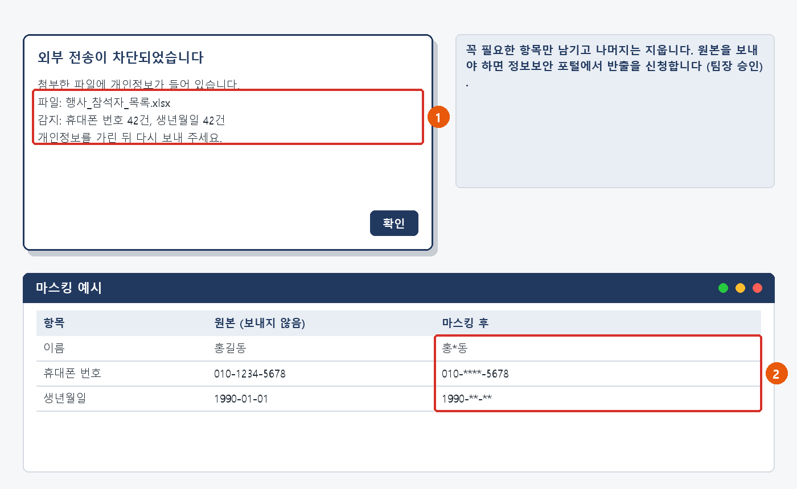
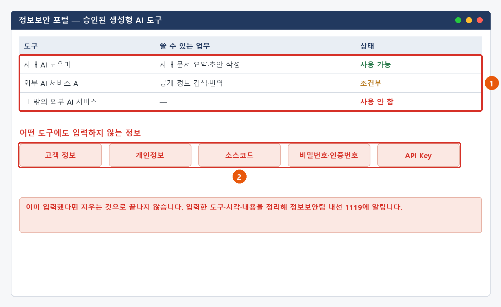

# 보안 예외 신청·정책 안내 가이드

> 가상 ICT 기업 임직원 IT 안내 · 정보보안  
> IT-SEC-004 | 정보보안팀 | 2026-10-16 | v2.0 | **사내 일반** (전 임직원)

## 목차

- 1. 개요
- 2. 먼저 확인할 사항
- 3. 증상별 조치 방법
  - 3.1 USB 등 이동식 저장매체 사용 신청
  - 3.2 개인정보가 든 파일을 외부로 보내야 할 때 (마스킹)
  - 3.3 업무 사이트 차단 해제 요청
  - 3.4 생성형 AI를 업무에 쓸 때
- 4. 자주 묻는 질문
- 5. 주의사항
- 6. 문의처
- 부록 · 관련 문서 · 용어
- 개정 이력

## 1. 개요

**목적**

- USB 사용, 파일 반출, 사이트 차단 해제처럼 보안 예외가 필요할 때 신청하는 방법을 안내합니다.
- 개인정보 마스킹과 생성형 AI 사용 규칙을 안내합니다.

**적용 대상**

- 전 임직원이 대상입니다.
- 예외는 업무에 꼭 필요할 때만, 가장 짧은 기간으로 신청합니다.
- 정책을 묻는 문의는 ITssue 챗봇이 바로 안내하고, 실제 예외는 승인 후 정보보안팀이 등록합니다.

**적용 환경**

- 정보보안 포털
- DLP(정보 유출 방지), 웹 필터
- 그룹웨어 메일

## 2. 먼저 확인할 사항

#### 조치하기 전에 확인합니다

- 예외를 신청하기 전에 **예외 없이 할 수 있는 방법** 이 있는지 봅니다. 파일 전달은 사내 파일 공유 링크(IT-SYS-004)로 할 수 있습니다.
- USB 등 이동식 저장매체는 **기본 차단** 입니다. 쓰려면 **팀장 승인** 을 받아 **최대 7일** 까지 예외를 받습니다.
- 개인정보가 들어 있는 파일은 외부로 보낼 수 없습니다. **가린(마스킹) 뒤** 보냅니다.
- 생성형 AI는 **회사가 승인한 도구** 만 씁니다. 승인 목록은 정보보안 포털에서 확인합니다.
- 업무에 필요한 사이트가 막히면 차단 화면의 URL을 캡처해 해제를 요청합니다. 처리는 1영업일 안에 됩니다.

> ★ **보안 장치를 피해 가는 방법을 쓰지 않습니다**
>
> 개인 메일·개인 클라우드로 보내기, 다른 사람 PC·계정 빌리기, 우회 접속 프로그램은 사용하지 않습니다.

#### 정책 한눈에 보기

| 항목 | 기준 | 볼 곳 |
| --- | --- | --- |
| 이동식 저장매체 (USB 등) | 기본 차단. 팀장 승인 + 보안 서약 후 최대 7일 예외 | 3.1 |
| 개인정보가 든 파일 외부 전송 | 차단. 마스킹 후 발송. 원본이 꼭 필요하면 반출 신청 (팀장 승인) | 3.2 |
| 업무 사이트 차단 | 차단 화면 URL 캡처 → 해제 요청 → 평판 확인 후 1영업일 안에 처리 | 3.3 |
| 생성형 AI | 승인된 도구만. 고객 정보·개인정보·소스코드·비밀번호·인증값·API Key 입력 금지 | 3.4 |

#### 증상별 바로가기

| 겪고 있는 증상 | 볼 곳 | 처리 구분 |
| --- | --- | --- |
| USB로 파일을 옮기거나 전달해야 한다 | 3.1 | 🟡 신청·승인 후 처리 |
| 메일 첨부가 "개인정보 포함으로 외부 전송 차단"으로 막혔다 | 3.2 | 🟢 사용자 직접 조치 |
| 업무에 필요한 사이트가 차단 페이지로 넘어간다 | 3.3 | 🔵 IT 담당자 처리 |
| 생성형 AI를 업무에 써도 되는지 궁금하다 | 3.4 | 🟢 사용자 직접 조치 |
| 생성형 AI에 고객 정보·소스코드 등을 이미 입력했다 | 3.4 | 🟢 사용자 직접 조치 |
| 개인정보가 든 메일을 다른 사람에게 잘못 보냈다 | 3.2 | 🟢 사용자 직접 조치 |

## 3. 증상별 조치 방법

| 번호 | 제목 | 문의 유형 | 처리 구분 | 담당 부서 |
| --- | --- | --- | --- | --- |
| 3.1 | USB 등 이동식 저장매체 사용 신청 | SEC-03 | 🟡 신청·승인 후 처리 | 정보보안팀 |
| 3.2 | 개인정보가 든 파일을 외부로 보내야 할 때 (마스킹) | SEC-03 | 🟢 사용자 직접 조치 | 정보보안팀 |
| 3.3 | 업무 사이트 차단 해제 요청 | SEC-07 | 🔵 IT 담당자 처리 | 정보보안팀 |
| 3.4 | 생성형 AI를 업무에 쓸 때 | SEC (정책) | 🟢 사용자 직접 조치 | 정보보안팀 |

### 3.1 USB 등 이동식 저장매체 사용 신청

**문의 유형** SEC-03 · **처리 구분** 🟡 신청·승인 후 처리 · **담당 부서** 정보보안팀 · **관련 FAQ** FAQ-032

#### 이런 경우

- 고객사에 납품 파일을 USB로 전달해야 합니다. 사용 허가 부탁드려요.
- USB를 꽂았더니 "이동식 저장매체 사용이 차단되었습니다"라고 나옵니다.

#### 원인

- 이동식 저장매체는 정보 유출을 막기 위해 기본 차단입니다.

#### 조치 방법

1. USB 없이 전달할 수 있는지 먼저 봅니다 (사내 파일 공유 링크 등).
2. 정보보안 포털 > **[이동식 저장매체 사용 신청]** 에서 사용 목적, 기간(최대 7일), 매체, 옮길 파일을 입력합니다.
3. 보안 서약(목적 외 사용·개인 보관 금지)에 동의하고 **[신청]** 을 누릅니다. 팀장에게 승인 요청이 갑니다.
4. 팀장 승인 뒤 정보보안팀이 예외를 등록하면 알림이 옵니다. 그때부터 씁니다.
5. 기간이 끝나면 다시 차단됩니다. 더 필요하면 새로 신청합니다.

*그림 3.1-1. 정보보안 포털: ① 목적·기간(최대 7일) ② 보안 서약 ③ 신청*

**해결 확인**

- 등록 알림을 받은 뒤 지정한 매체가 PC에서 인식되면 끝난 것입니다.

**해결되지 않으면**

- 승인 뒤에도 매체가 인식되지 않으면 매체 관리 번호를 적어 ITssue 챗봇에 알립니다.
- 7일보다 길게 필요하면 새로 신청합니다. 기간을 늘려 달라는 요청은 받지 않습니다.

**문의 시 알려 주실 정보**

- 사번
- 사용 목적과 기간
- 매체 종류·관리 번호
- 신청 번호와 팀장 승인 여부

### 3.2 개인정보가 든 파일을 외부로 보내야 할 때 (마스킹)

**문의 유형** SEC-03 · **처리 구분** 🟢 사용자 직접 조치 · **담당 부서** 정보보안팀 · **관련 FAQ** FAQ-032

#### 이런 경우

- 거래처에 보낼 파일을 메일에 첨부했더니 "개인정보가 포함되어 외부 전송이 차단되었습니다"라고 나옵니다.
- 행사 참석자 연락처가 든 파일을 외부 업체에 보내야 합니다.

#### 원인

- 개인정보가 든 파일은 정보 유출 방지(DLP) 정책으로 외부 전송이 차단됩니다.

#### 조치 방법

1. 받는 쪽에 꼭 필요한 항목만 남기고 나머지 열은 지웁니다.
2. 남긴 개인정보는 가립니다. 예: 010-****-5678, 홍*동, 1990-**-**
3. 마스킹한 파일로 다시 보냅니다.
4. 원본이 꼭 필요하면 정보보안 포털 > **[반출 신청]** 에 목적·받는 곳·파일을 적어 팀장 승인을 받습니다.

*그림 3.2-1. ① 외부 전송 차단 안내 ② 마스킹 예시*

**해결 확인**

- 마스킹한 파일이 차단 없이 발송되면 끝난 것입니다.

**해결되지 않으면**

- 마스킹했는데도 계속 차단되면 차단 안내 화면을 캡처해 ITssue 챗봇에 알립니다.
- 개인정보가 든 메일·파일을 **잘못 보냈으면** 바로 정보보안팀(내선 1119)에 받는 사람·시각·파일을 알립니다.

**문의 시 알려 주실 정보**

- 사번
- 차단 안내 화면 (감지된 항목)
- 받는 곳과 보내는 목적
- 반출 신청 번호 (신청했으면)

> ★ **개인 메일·개인 클라우드·메신저로 우회해서 보내지 않습니다**

### 3.3 업무 사이트 차단 해제 요청

**문의 유형** SEC-07 · **처리 구분** 🔵 IT 담당자 처리 · **담당 부서** 정보보안팀 · **관련 FAQ** FAQ-009

#### 이런 경우

- 업무용 참고 사이트가 차단 페이지로 넘어갑니다. 해제 가능할까요?
- 고객사가 알려 준 기술 문서 사이트가 회사에서만 열리지 않습니다.

#### 원인

- 웹 필터가 사이트 분류(파일 공유 등)에 따라 접속을 막았습니다.

#### 조치 방법

1. 차단 화면의 주소(URL)와 차단 분류가 보이게 캡처합니다.
2. 차단 화면의 **[차단 해제 요청]** 을 누르거나 ITssue 챗봇에 "사이트 차단 해제 요청"으로 캡처를 보냅니다.
3. 업무 용도를 구체적으로 적습니다. 마감이 있으면 시각을 함께 적습니다.
4. 정보보안팀이 사이트 평판을 확인하고 1영업일 안에 결과를 알려 줍니다.

![그림 3.3-1. ① 주소 ② 차단 분류·시각 확인 ③ [차단 해제 요청]](../images/sec004_33_block.png)

*그림 3.3-1. ① 주소 ② 차단 분류·시각 확인 ③ [차단 해제 요청]*

**해결 확인**

- 해제 알림을 받은 뒤 사이트가 열리면 끝난 것입니다.

**해결되지 않으면**

- 악성·피싱으로 분류된 사이트는 해제하지 않습니다. 정보보안팀이 다른 방법을 안내합니다.
- 해제 뒤에도 열리지 않으면 브라우저를 다시 시작하고, 그래도 안 되면 다시 알립니다.

**문의 시 알려 주실 정보**

- 사번과 PC 이름
- 차단 화면 캡처 (주소·분류·시각)
- 업무 용도
- 마감 시각 (있으면)

### 3.4 생성형 AI를 업무에 쓸 때

**문의 유형** SEC (정책) · **처리 구분** 🟢 사용자 직접 조치 · **담당 부서** 정보보안팀 · **관련 FAQ** FAQ-038

#### 이런 경우

- 생성형 AI 도구를 업무에 써도 되나요?
- 회의록을 AI로 요약하고 싶은데 어떤 도구를 써야 하나요?

#### 원인

- 승인되지 않은 외부 도구에 입력한 내용은 회사 밖에 저장되거나 학습에 쓰일 수 있습니다.

#### 조치 방법

1. 정보보안 포털에서 **승인된 도구 목록** 을 확인하고, 승인된 도구만 씁니다.
2. 고객 정보, 개인정보, 소스코드, 비밀번호·인증값, API Key는 **어떤 도구에도** 넣지 않습니다.
3. 결과는 사실인지 확인한 뒤 씁니다.
4. 이미 이런 정보를 넣었다면 지우는 것으로 끝내지 말고 정보보안팀(내선 1119)에 알립니다.

*그림 3.4-1. 정보보안 포털: ① 승인된 도구 목록 ② 어떤 도구에도 넣지 않는 정보*

**해결 확인**

- 승인된 도구로, 넣으면 안 되는 정보 없이 쓰고 있다면 따로 할 일은 없습니다.

**해결되지 않으면**

- 쓰고 싶은 도구가 목록에 없으면 IT-SW-001 3.5에 따라 설치 요청을 내면 정보보안팀이 보안 검토를 합니다. 승인 전에는 쓰지 않습니다.
- 넣어도 되는 정보인지 헷갈리면 넣기 전에 챗봇에 물어봅니다.

**문의 시 알려 주실 정보**

- 사번
- 쓰려는 도구와 업무
- (이미 입력했다면) 입력한 도구·시각·정보 종류

> ★ **고객 정보·개인정보·소스코드·비밀번호·API Key는 어떤 AI 도구에도 넣지 않습니다**

## 4. 자주 묻는 질문

**Q. USB를 사용하거나 파일을 외부로 보내야 해요. (FAQ-032)**

A. 이동식 저장매체는 기본 차단입니다. 매체 사용 신청(팀장 승인, 최대 7일)을 제출하세요. 개인정보가 포함된 파일은 외부 전송이 차단되므로 마스킹 후 발송하세요.

**Q. 업무에 필요한 사이트가 차단됐어요. (FAQ-009)**

A. 차단 화면의 URL을 캡처해 '사이트 차단 해제 요청'으로 접수하세요. 보안팀이 사이트 평판을 확인한 뒤 1영업일 내에 처리합니다.

**Q. 생성형 AI 도구를 업무에 써도 되나요? (FAQ-038)**

A. 회사가 승인한 도구만 사용할 수 있으며, 고객·개인정보·소스코드 등 기밀 정보는 입력하지 마세요. 승인 목록은 정보보안 포털에서 확인하세요.

**Q. USB 예외 기간을 늘릴 수 있나요?**

A. 기간 연장은 받지 않습니다. 기간이 끝난 뒤 필요하면 새로 신청합니다 (최대 7일).

## 5. 주의사항

> ★ **꼭 지켜 주세요**
>
> 보안 장치를 피해 가는 방법(개인 메일·개인 클라우드·우회 프로그램)을 쓰지 않습니다.
>
> 고객 정보·개인정보·소스코드·비밀번호·API Key는 승인되지 않은 도구에 넣지 않습니다.
>
> 승인받은 예외는 신청한 목적과 기간 안에서만 씁니다.

- 예외는 꼭 필요할 때만, 가장 짧은 기간으로 신청합니다.
- USB에 옮긴 파일은 목적이 끝나면 지웁니다. 개인적으로 보관하지 않습니다.
- 개인정보는 꼭 필요한 항목만 남기고 가린 뒤 보냅니다.

## 6. 문의처

| 창구 | 연락처 | 이용 기준 |
| --- | --- | --- |
| ITssue 챗봇 | 사내 IT 포털 상단 [챗봇 문의] | 24시간. 모든 IT 문의의 기본 창구입니다. 챗봇이 해결하지 못하면 확인을 거쳐 담당 팀에 티켓으로 접수합니다. |
| IT 헬프데스크 (서비스데스크) | 내선 1000 (평일 09:00~18:00) | PC나 챗봇을 쓸 수 없을 때, 여러 사람이 함께 업무를 못 할 때, 본인 확인이 필요한 처리 |
| 정보보안팀 | 내선 1119 | 링크 클릭·비밀번호 입력·감염 의심·계정 도용·장비 분실처럼 바로 알려야 할 보안 문제 |
| 메신저 | #it-helpdesk 채널 | 일반 IT 문의 (챗봇을 쓸 수 없을 때) |
| 메일 | it-helpdesk@ict.example | 일반 IT 문의. 비밀번호·인증번호는 메일로 보내지 않습니다. |
| 처리 상황 알림 | 사내 메신저 알림 | 접수·담당자 배정·처리 완료를 알려 드립니다. 진행 상황은 [내 요청 현황]에서도 봅니다. |

## 부록 · 관련 문서 · 용어

#### 관련 문서

| 문서 번호 | 문서명 | 이럴 때 봅니다 |
| --- | --- | --- |
| IT-SEC-001 | 피싱·의심 메일 대응 가이드 | 해제를 요청한 사이트가 메일 링크로 알게 된 곳일 때 |
| IT-SYS-004 | 메일 이용 장애 대응 가이드 | 대용량 파일은 사내 파일 공유 링크로 보낼 때 |
| IT-SEC-003 | 계정 도용·장비 분실 신고 가이드 | USB나 반출한 자료를 담은 장비를 잃어버렸을 때 |
| IT-STD-001 | IT 서비스 운영 기준 | 긴급도와 처리 기준 |

#### 용어

| 용어 | 설명 |
| --- | --- |
| 이동식 저장매체 | USB 메모리, 외장 디스크처럼 PC에 꽂아 파일을 옮기는 장치 |
| DLP (정보 유출 방지) | 개인정보·기밀이 회사 밖으로 나가지 않게 전송을 검사·차단하는 보안 장치 |
| 마스킹 | 개인정보 일부를 * 등으로 가려 누구인지 알 수 없게 하는 것 |
| 반출 신청 | 회사 자료를 외부로 보내기 위해 승인을 받는 절차 |
| 웹 필터 | 위험하거나 업무와 무관한 분류의 사이트 접속을 막는 보안 장치 |
| 보안 서약 | 예외를 목적 외로 쓰거나 자료를 개인 보관하지 않겠다는 약속 |

## 개정 이력

| 버전 | 개정일 | 작성자 | 변경 내용 |
| --- | --- | --- | --- |
| v1.0 | 2026-03-01 | 정보보안팀 | 최초 작성 |
| v2.0 | 2026-10-16 | 정보보안팀 | 7개 분류 통합 정리본. 문서 양식·열람 등급·용어·연락처를 통일하고 분류 사이의 중복 내용을 한 문서로 정리 |
