# 사내 시스템 장애 신고·이관 가이드

> 가상 ICT 기업 임직원 IT 안내 · 사내 시스템  
> IT-SYS-003 | 업무시스템팀 | 2026-10-16 | v2.0 | **사내 일반** (전 임직원)

## 목차

- 1. 개요
- 2. 먼저 확인할 사항
- 3. 증상별 조치 방법
  - 3.1 ERP가 로딩만 되고 열리지 않아 여러 부서 업무가 멈춤
  - 3.2 팀 전체가 업무 협업 플랫폼(PMS·BI·마케팅 툴)에 접속할 수 없음
  - 3.3 전 부서에서 메일을 보내지도 받지도 못함
  - 3.4 공유 드라이브가 전부 열리지 않고 다른 팀도 같음
- 4. 자주 묻는 질문
- 5. 주의사항
- 6. 문의처
- 부록 · 관련 문서 · 용어
- 개정 이력

## 1. 개요

#### 목적

ERP·업무 협업 플랫폼·메일·파일서버를 여러 사람이 동시에 쓸 수 없을 때 장애인지 판단하는 방법, 신고 방법, 복구 후 할 일을 안내한다.

#### 적용 대상

ERP 전사 장애, 팀 단위 업무 협업 플랫폼 장애, 메일 서버·파일서버 전사 장애에 해당한다. 혼자만 안 되거나 느리기만 하면 IT-SYS-001·IT-SYS-002·IT-SYS-004·IT-SYS-006을 본다.

#### 적용 환경

| 항목 | 내용 |
| --- | --- |
| 관련 도구·시스템 | ERP |
| 관련 도구·시스템 | 업무 협업 플랫폼(PMS·BI·마케팅 툴) |
| 관련 도구·시스템 | 메일 |
| 관련 도구·시스템 | 파일서버 |
| OS | Windows, macOS (개발 직군 선택) |

## 2. 먼저 확인할 사항

- 옆자리·다른 팀도 같은 증상인지 먼저 확인한다.
- 그룹웨어 공지사항과 #it-helpdesk 채널에 장애 공지가 있는지 확인한다. 공지가 있으면 따로 신고하지 않아도 된다.
- 혼자만 안 되면 개인 문서를 본다: ERP 오류 IT-SYS-001, 메일 IT-SYS-004, 공유 드라이브 IT-SYS-006, 느리기만 하면 IT-SYS-002.
- 장애 중에는 프로그램 재설치나 설정 변경 같은 개인 조치를 하지 않는다.
- 통합 로그인 자체가 안 되면 IT-ACC-001 3.3을 따른다.

## 3. 증상별 조치 방법

| 번호 | 제목 | 문의 유형 | 처리 구분 | 담당 부서 |
| --- | --- | --- | --- | --- |
| 3.1 | ERP가 로딩만 되고 열리지 않아 여러 부서 업무가 멈춤 | SYS-03 | 🔴 즉시 신고·이관 | 업무시스템팀 |
| 3.2 | 팀 전체가 업무 협업 플랫폼(PMS·BI·마케팅 툴)에 접속할 수 없음 | SYS-05 | 🔵 IT 담당자 처리 | 업무시스템팀 |
| 3.3 | 전 부서에서 메일을 보내지도 받지도 못함 | SYS-09 | 🔴 즉시 신고·이관 | 시스템인프라팀 |
| 3.4 | 공유 드라이브가 전부 열리지 않고 다른 팀도 같음 | SYS-16 | 🔴 즉시 신고·이관 | 시스템인프라팀 |

#### 화면 보는 법

*그림 3-1. 그룹웨어 첫 화면. 이 문서에서 자주 쓰는 위치*

- 화면 안내. 이 문서에서 자주 쓰는 위치입니다.
- ① 공지사항: 시스템 장애가 생기면 '장애' 표시가 붙은 공지가 맨 위에 올라옵니다.
- ② IT 헬프데스크: 전화 내선 1000, 메신저 #it-helpdesk 채널. 막히면 여기로 문의합니다.
- ③ 업무 시스템 바로가기: ERP, 인사시스템, PMS, BI 분석, 메신저로 들어갑니다.
- ④ IT 요청: 그룹 메일, 권한, 파일 복구 같은 신청서를 내는 곳입니다.
- 확인: 이 문서의 화면에서 빨간 네모는 누르거나 볼 곳이고, 번호는 오른쪽 설명 번호와 같습니다.

### 3.1 ERP가 로딩만 되고 열리지 않아 여러 부서 업무가 멈춤

**문의 유형** SYS-03 · **처리 구분** 🔴 즉시 신고·이관 · **담당 부서** 업무시스템팀

#### 이런 경우

- ERP에서 저장을 누르면 타임아웃이 난다.
- 다른 부서 사람들도 ERP가 너무 느리거나 안 된다고 한다.

화면 메시지: 없음

#### 원인

- ERP 서버 쪽 장애 (예: 월말 대량 작업과 조회가 겹쳐 데이터 처리가 멈춤). 개인 PC 문제가 아니다.

#### 조치 방법

1. 다른 부서도 같은 증상인지 확인합니다.
2. 그룹웨어 공지사항과 #it-helpdesk 채널을 확인합니다.
3. 공지가 없으면 IT 헬프데스크(내선 1000)에 전화해 부서와 증상을 알립니다.
4. 저장하지 못한 작업은 따로 적어 두고, 복구 공지 후 다시 입력합니다.

**해결 확인**

- 복구 공지 후 ERP가 열리고 저장되면 해결된 것이다.

**해결되지 않으면**

- 복구 후에도 나만 안 되면 IT-SYS-001을 본다.

**문의 시 알려 주실 정보**

- 사번·부서
- 시작 시각
- 안 되는 메뉴·작업
- 같은 증상인 부서
- 마감 영향

#### 화면 따라하기

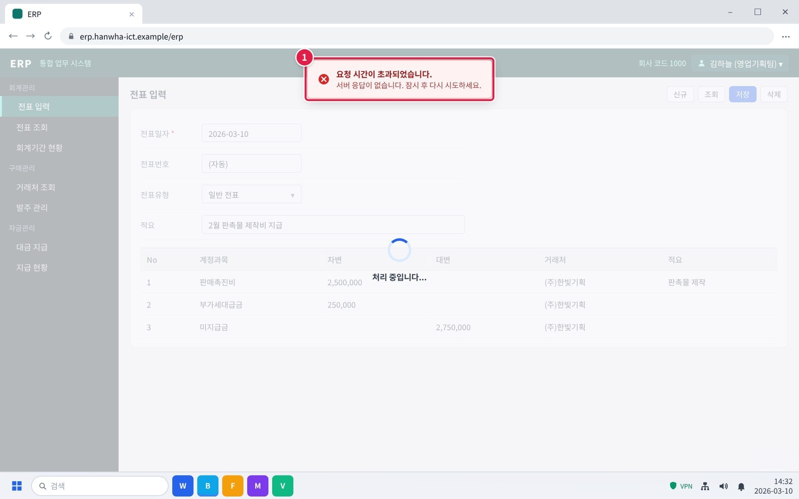

*그림 3.1-1. ERP가 로딩만 되다가 시간 초과가 나는 증상*

- 증상 화면. 이런 화면이 보이면 이 증상입니다.
- ① ERP가 계속 로딩되다가 '요청 시간이 초과되었습니다'가 뜹니다. 저장도 되지 않습니다.

*그림 3.1-2. 다른 부서도 같은지 확인하기*

- 단계 1. 다른 부서도 같은 증상인지 확인합니다.
- ① 팀 채널에 ERP가 되는지 물어봅니다.
- ② 다른 사람, 다른 부서도 같다고 하면 전사 장애일 수 있습니다.

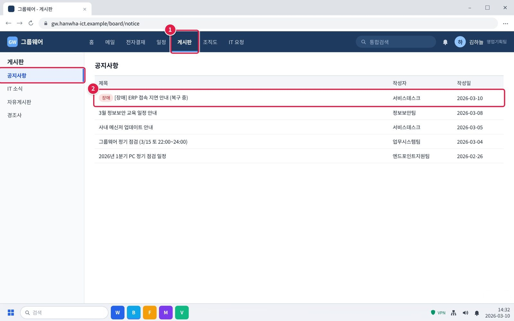

*그림 3.1-3. 그룹웨어 게시판 > 공지사항의 장애 공지*

- 단계 2. 그룹웨어 공지사항과 #it-helpdesk 채널을 확인합니다.
- ① 그룹웨어 위쪽 [게시판]을 누르면 왼쪽에 [공지사항]이 열립니다.
- ② 빨간 '장애' 표시가 붙은 글이 있는지 봅니다. 눌러서 복구 예정 시각을 확인합니다.
- 확인: 장애 공지가 있으면 따로 신고하지 않아도 됩니다.

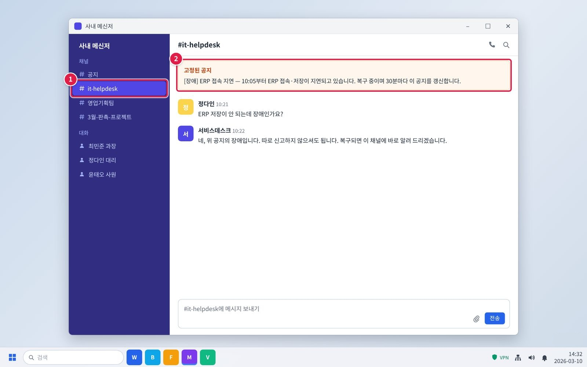

*그림 3.1-4. 메신저 #it-helpdesk 채널의 고정 공지*

- 단계 2. 그룹웨어 공지사항과 #it-helpdesk 채널을 확인합니다.
- ① 메신저 채널 목록에서 #it-helpdesk를 누릅니다.
- ② 맨 위 '고정된 공지'에 장애 안내가 있는지 봅니다.
- 확인: 공지가 있으면 따로 신고하지 않고 복구 안내를 기다립니다.

*그림 3.1-5. 그룹웨어 첫 화면의 IT 헬프데스크 안내*

- 단계 3. 공지가 없으면 IT 헬프데스크(내선 1000)에 전화해 부서와 증상을 알립니다.
- ① 그룹웨어 첫 화면 오른쪽 'IT 헬프데스크'에 전화번호가 있습니다. 사무실 전화로 내선 1000을 누릅니다.
- ※ 이렇게 말하면 됩니다: "영업기획팀 김하늘입니다. ERP가 10시부터 로딩만 되고 저장이 안 됩니다. 우리 팀과 다른 팀도 모두 같습니다. 오늘 마감 작업이 있습니다." 확인: 평일 09:00~18:00에 받습니다. 그 밖의 시간에는 메신저 #it-helpdesk 채널에 남깁니다.

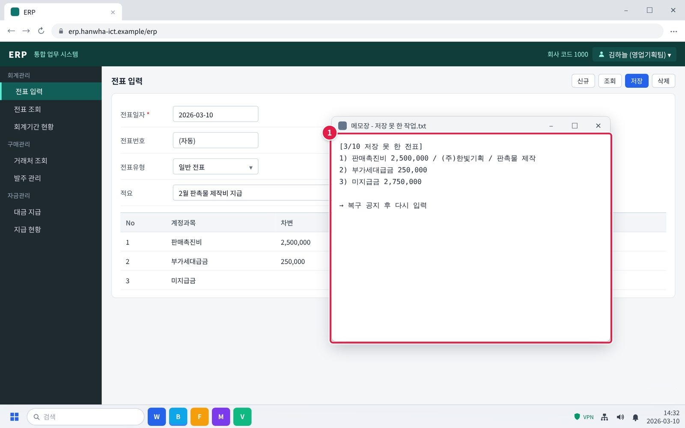

*그림 3.1-6. 저장하지 못한 작업을 메모해 두기*

- 단계 4. 저장하지 못한 작업은 따로 적어 두고, 복구 공지 후 다시 입력합니다.
- ① 저장하지 못한 내용을 메모장 등에 적어 둡니다. 복구 공지가 나오면 그 내용으로 다시 입력합니다.
- 주의: 장애 중에는 저장 버튼을 여러 번 누르지 않습니다. 복구 후 중복 전표가 생길 수 있습니다.

### 3.2 팀 전체가 업무 협업 플랫폼(PMS·BI·마케팅 툴)에 접속할 수 없음

**문의 유형** SYS-05 · **처리 구분** 🔵 IT 담당자 처리 · **담당 부서** 업무시스템팀

#### 이런 경우

- 오후부터 BI 플랫폼이 아예 열리지 않아 팀 분석 업무가 모두 막혔다.
- PMS가 자꾸 다운되고, 새로고침과 재로그인을 해도 팀원 전부 접속이 잘 안 된다.
- 마케팅 툴에 갑자기 접속이 안 돼 진행 중인 캠페인 작업이 모두 멈췄다.

화면 메시지: 없음

#### 원인

- 업무 협업 플랫폼 서버 쪽 장애. 개인 조치로는 해결되지 않는다.

#### 조치 방법

1. 같은 팀 다른 사람도 접속이 안 되는지 확인합니다.
2. 그룹웨어 공지사항과 #it-helpdesk 채널을 확인합니다.
3. 공지가 없으면 IT 헬프데스크(내선 1000)에 팀·시스템 이름·시작 시각을 알립니다.
4. 복구 안내를 받으면 다시 로그인합니다.

**해결 확인**

- 복구 안내 후 플랫폼이 열리면 해결된 것이다.

**해결되지 않으면**

- 느리지만 쓸 수는 있는 상태로 돌아오면 IT-SYS-002를 본다.

**문의 시 알려 주실 정보**

- 사번·부서
- 시스템 이름
- 시작 시각
- 영향 인원
- 멈춘 업무

#### 화면 따라하기

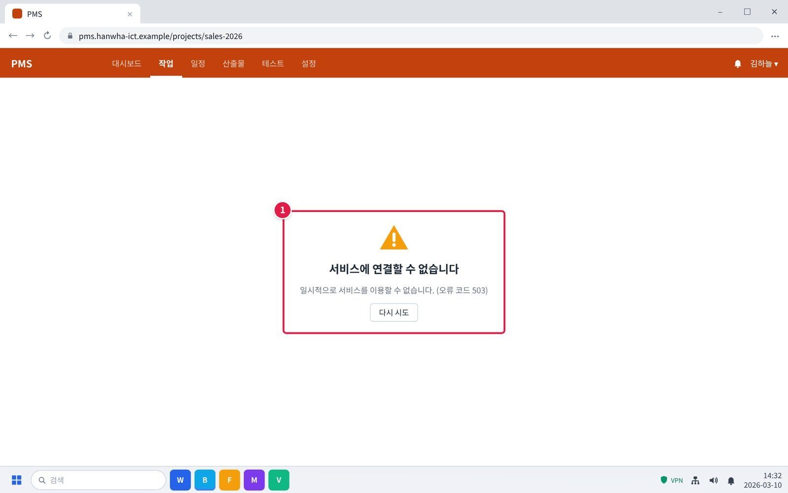

*그림 3.2-1. 팀 전체가 PMS에 접속할 수 없는 증상*

- 증상 화면. 이런 화면이 보이면 이 증상입니다.
- ① PMS를 열면 '서비스에 연결할 수 없습니다'가 뜹니다. 새로고침이나 다시 로그인해도 같습니다.
- 확인: BI 분석이나 마케팅 툴도 같은 방법으로 확인합니다.

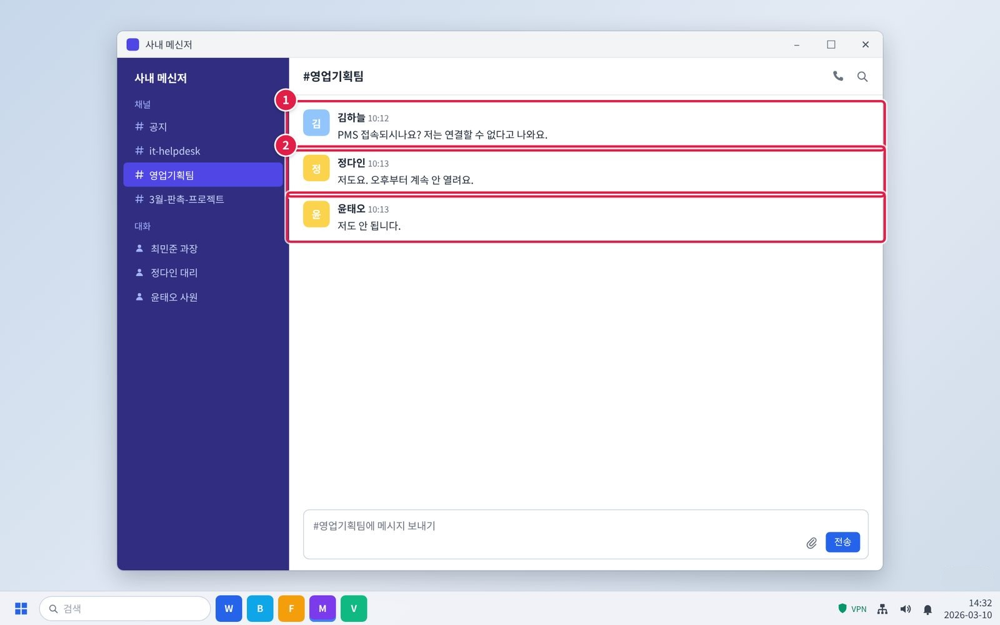

*그림 3.2-2. 같은 팀 다른 사람도 접속이 안 되는지 확인*

- 단계 1. 같은 팀 다른 사람도 접속이 안 되는지 확인합니다.
- ① 팀 채널에 PMS가 열리는지 물어봅니다.
- ② 팀원 모두 안 된다면 팀 단위 장애입니다.

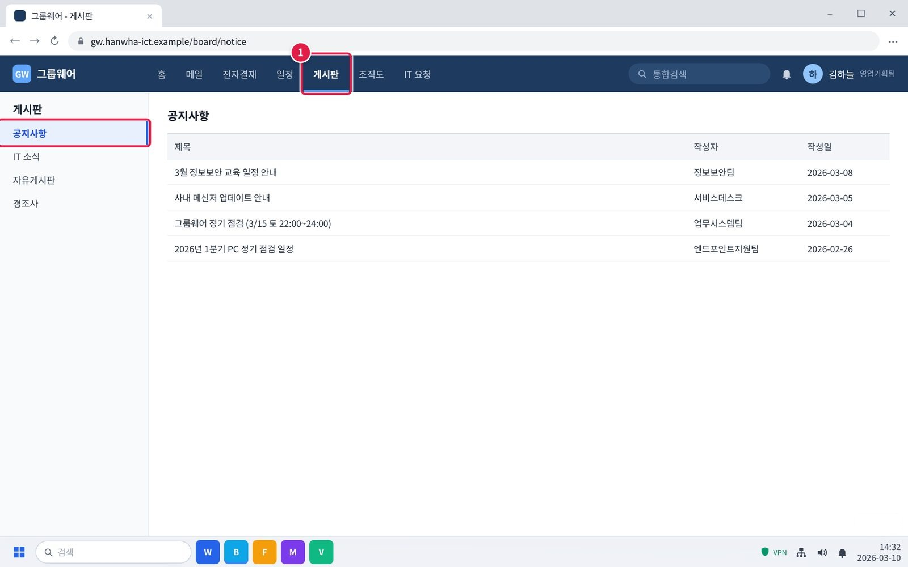

*그림 3.2-3. 그룹웨어 게시판 > 공지사항 확인*

- 단계 2. 그룹웨어 공지사항과 #it-helpdesk 채널을 확인합니다.
- ① [게시판] > [공지사항]을 엽니다.
- ② '장애' 표시가 붙은 PMS 관련 글이 없는지 봅니다.
- 주의: 공지가 없으면 아직 알려지지 않은 장애일 수 있습니다. 다음 단계로 바로 알립니다.

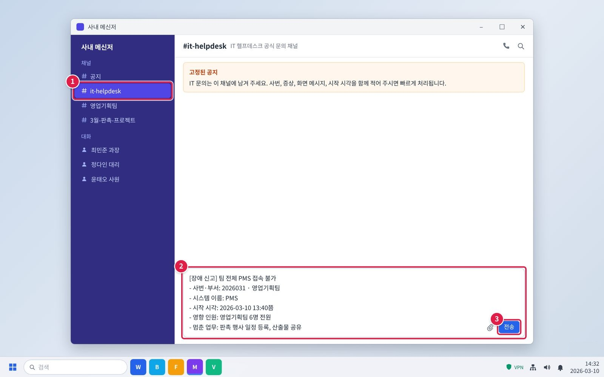

*그림 3.2-4. 메신저 #it-helpdesk 채널에 팀 단위 장애 알리기*

- 단계 3. 공지가 없으면 IT 헬프데스크(내선 1000)에 팀·시스템 이름·시작 시각을 알립니다.
- ① 메신저 왼쪽 채널 목록에서 #it-helpdesk를 누릅니다.
- ② 입력창에 아래 항목을 한 줄씩 적습니다. 그대로 복사해 내용만 바꿔 써도 됩니다.
- ③ [전송]을 누릅니다. 담당자가 이 채널이나 개인 대화로 답합니다.
- ※ 급하면 IT 헬프데스크 내선 1000으로 전화해도 됩니다. 확인: 문의할 때 알려 줄 정보를 처음부터 적으면 다시 묻는 시간이 줄어듭니다.

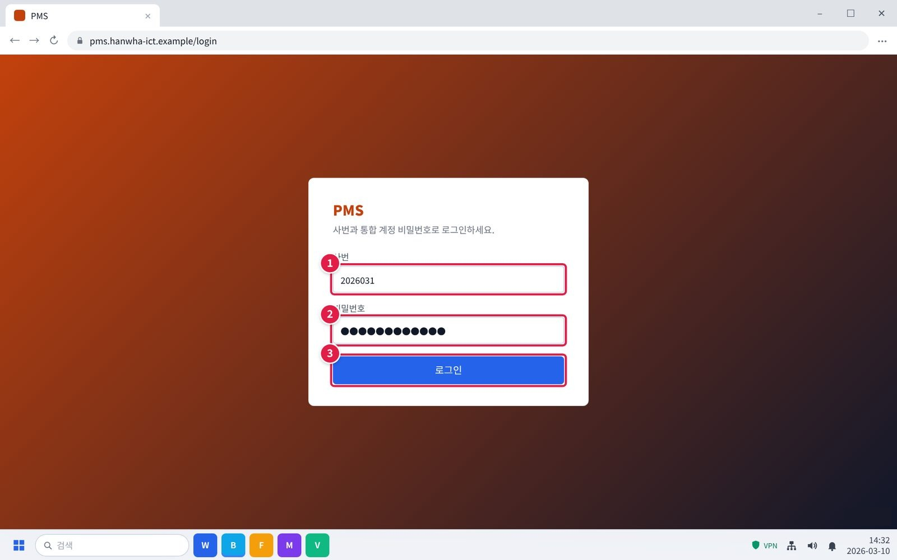

*그림 3.2-5. 복구 안내 후 다시 로그인*

- 단계 4. 복구 안내를 받으면 다시 로그인합니다.
- ① 복구 안내를 받으면 사번을 입력합니다.
- ② 비밀번호를 입력합니다.
- ③ [로그인]을 누릅니다.
- 확인: 플랫폼이 열리면 해결된 것입니다. 느리기만 하면 IT-SYS-002를 봅니다.

### 3.3 전 부서에서 메일을 보내지도 받지도 못함

**문의 유형** SYS-09 · **처리 구분** 🔴 즉시 신고·이관 · **담당 부서** 시스템인프라팀

#### 이런 경우

- 메일이 보내지지도 받아지지도 않고, 다른 사람들도 같은 증상이다.
- 회사 전체에서 메일을 보내지도 받지도 못한다.

화면 메시지: 없음

#### 원인

- 메일 서버 쪽 장애. 메일 프로그램이나 개인 설정 문제가 아니다.

#### 조치 방법

1. 다른 사람도 같은 증상인지 확인합니다.
2. 메일 프로그램을 다시 설치하거나 프로필을 지우지 않습니다.
3. IT 헬프데스크(내선 1000)에 전화합니다. 급한 연락은 메신저나 전화로 합니다.
4. 복구 공지 후 보내지 못한 메일을 다시 보냅니다.

**해결 확인**

- 복구 공지 후 메일을 보내고 받을 수 있으면 해결된 것이다.

**해결되지 않으면**

- 복구 후에도 나만 안 되면 IT-SYS-004 또는 IT-SW-003을 본다.

**문의 시 알려 주실 정보**

- 사번·부서
- 시작 시각
- 보내기·받기 중 안 되는 것
- 같은 증상인 부서

#### 화면 따라하기

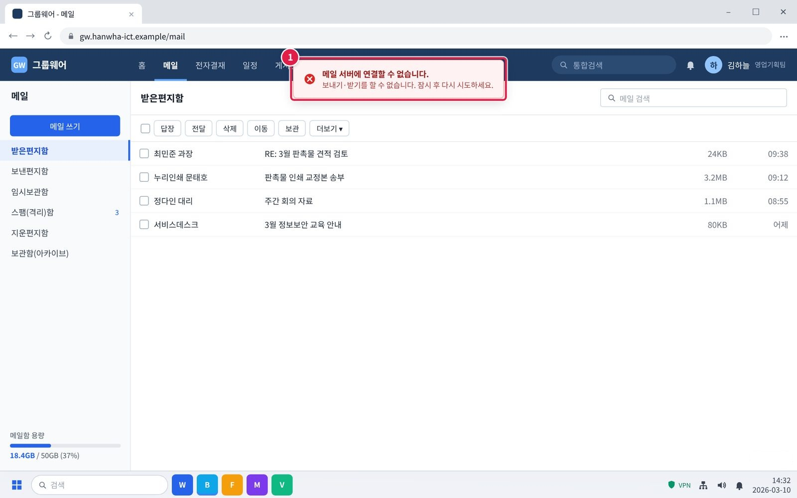

*그림 3.3-1. 메일을 보내지도 받지도 못하는 증상*

- 증상 화면. 이런 화면이 보이면 이 증상입니다.
- ① 메일을 보내거나 새로 고치면 '메일 서버에 연결할 수 없습니다'가 뜹니다. 09:40 이후로 새 메일이 없습니다.

*그림 3.3-2. 다른 사람도 같은지 확인*

- 단계 1. 다른 사람도 같은 증상인지 확인합니다.
- ① 팀 채널에 메일이 되는지 물어봅니다.
- ② 다른 사람, 다른 팀도 같다면 메일 서버 장애입니다.
- 주의: 메일 프로그램을 다시 설치하거나 프로필을 지우지 않습니다. 개인 PC 문제가 아닙니다.

*그림 3.3-3. 그룹웨어 첫 화면의 IT 헬프데스크 안내*

- 단계 3. IT 헬프데스크(내선 1000)에 전화합니다. 급한 연락은 메신저나 전화로 합니다.
- ① 그룹웨어 첫 화면 오른쪽 'IT 헬프데스크'에 전화번호가 있습니다. 사무실 전화로 내선 1000을 누릅니다.
- ※ 이렇게 말하면 됩니다: "영업기획팀 김하늘입니다. 9시 40분쯤부터 메일을 보내지도 받지도 못합니다. 우리 팀과 옆 팀이 모두 같습니다." 확인: 평일 09:00~18:00에 받습니다. 그 밖의 시간에는 메신저 #it-helpdesk 채널에 남깁니다.

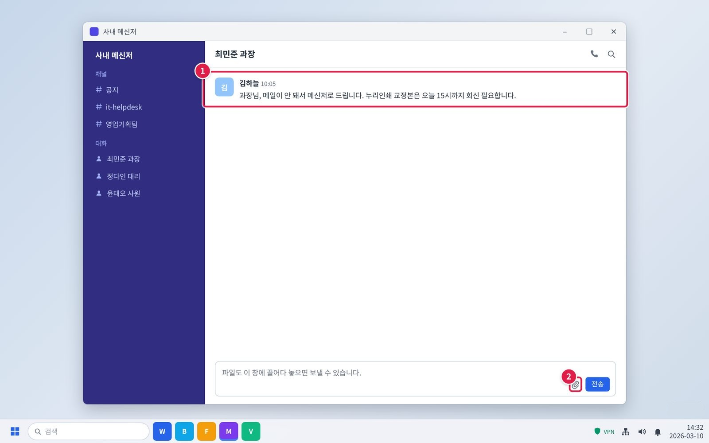

*그림 3.3-4. 급한 연락은 메신저나 전화로*

- 단계 3. IT 헬프데스크(내선 1000)에 전화합니다. 급한 연락은 메신저나 전화로 합니다.
- ① 급한 내용은 메신저 개인 대화로 보냅니다.
- ② 파일은 클립 아이콘으로 붙일 수 있습니다. 사외 연락은 전화로 합니다.

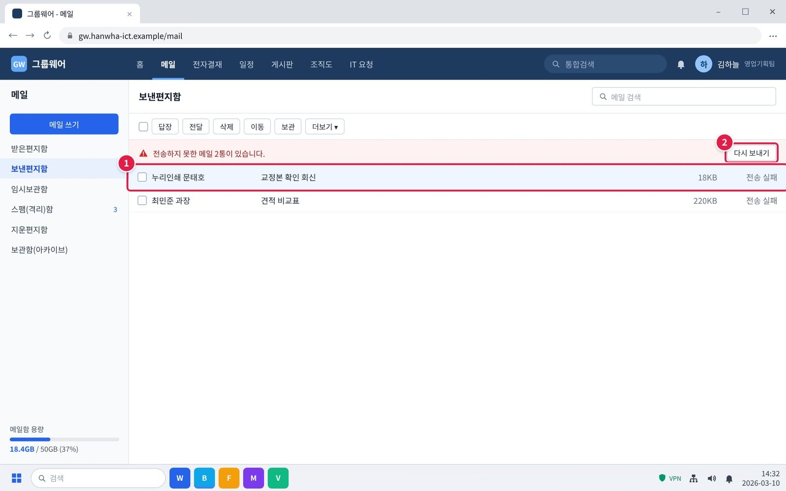

*그림 3.3-5. 복구 후 보내지 못한 메일 다시 보내기*

- 단계 4. 복구 공지 후 보내지 못한 메일을 다시 보냅니다.
- ① 복구 공지가 나오면 [보낸편지함]에서 '전송 실패' 메일을 고릅니다.
- ② [다시 보내기]를 누릅니다.
- 확인: 메일을 보내고 받을 수 있으면 해결된 것입니다.

### 3.4 공유 드라이브가 전부 열리지 않고 다른 팀도 같음

**문의 유형** SYS-16 · **처리 구분** 🔴 즉시 신고·이관 · **담당 부서** 시스템인프라팀 · **관련 FAQ** FAQ-033

#### 이런 경우

- 공유 드라이브가 전부 열리지 않고, 다른 팀도 같다고 한다.
- 파일을 저장하려고 하면 '네트워크 경로를 찾을 수 없습니다'가 나온다.

화면 메시지: "네트워크 경로를 찾을 수 없습니다"

#### 원인

- 파일서버 쪽 장애. 개인 PC나 권한 문제가 아니다.

#### 조치 방법

1. 다른 팀도 같은 증상인지 확인합니다.
2. 열려 있던 파일은 PC에 임시로 저장해 둡니다.
3. IT 헬프데스크(내선 1000)에 전화합니다.
4. 복구 후 임시로 저장한 파일을 공유 드라이브로 옮기고 PC의 사본은 지웁니다.

**해결 확인**

- 복구 공지 후 공유 드라이브가 열리고 저장되면 해결된 것이다.

**해결되지 않으면**

- 복구 후에도 우리 팀 폴더만 안 열리면 IT-SYS-006을 본다.

**문의 시 알려 주실 정보**

- 사번·부서
- 시작 시각
- 화면 메시지
- 같은 증상인 팀

#### 화면 따라하기

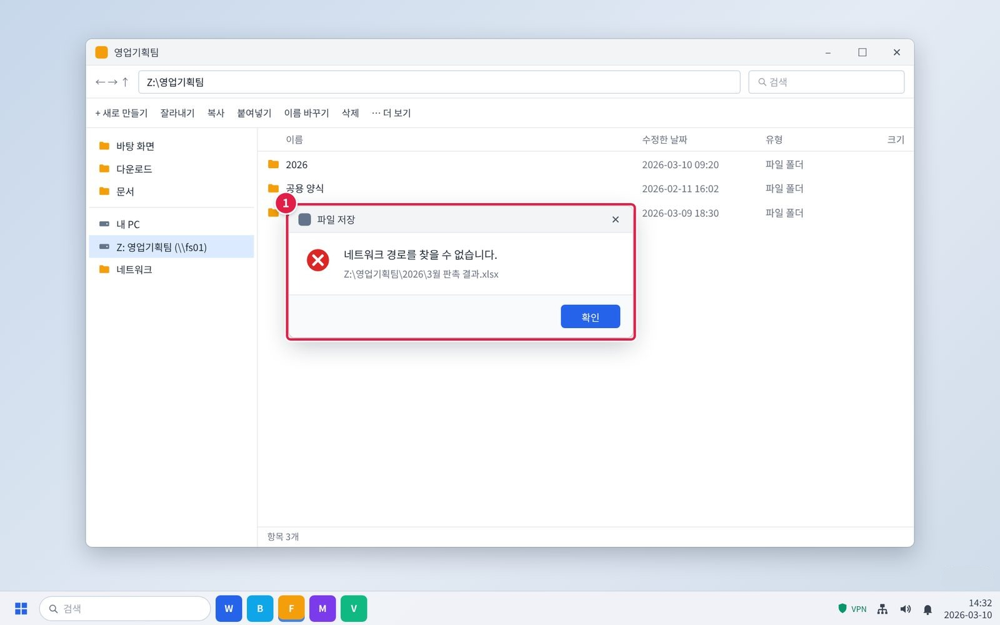

*그림 3.4-1. 공유 드라이브에 저장할 때 '네트워크 경로를 찾을 수 없습니다'*

- 증상 화면. 이런 화면이 보이면 이 증상입니다.
- ① 공유 드라이브가 열리지 않고, 저장하면 '네트워크 경로를 찾을 수 없습니다'가 뜹니다. 다른 팀도 같다고 합니다.

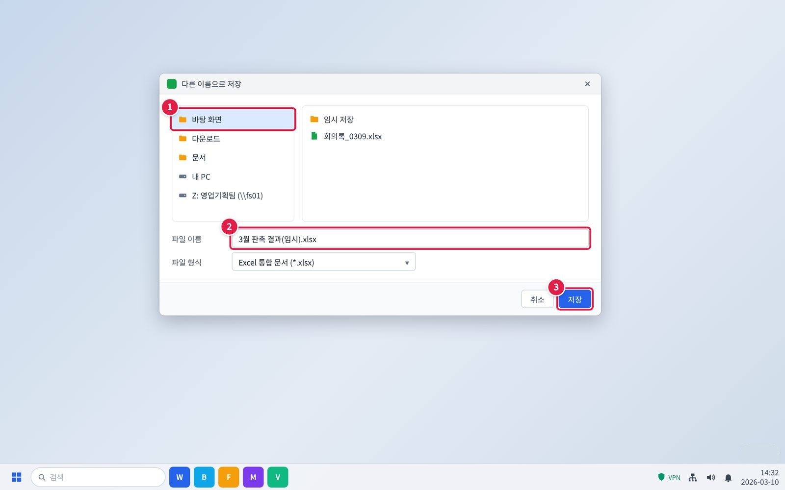

*그림 3.4-2. 열려 있던 파일을 PC에 임시로 저장*

- 단계 2. 열려 있던 파일은 PC에 임시로 저장해 둡니다.
- ① 파일 > 다른 이름으로 저장에서 왼쪽 [바탕 화면]을 고릅니다.
- ② 파일 이름 끝에 (임시)를 붙여 구분합니다.
- ③ [저장]을 누릅니다.

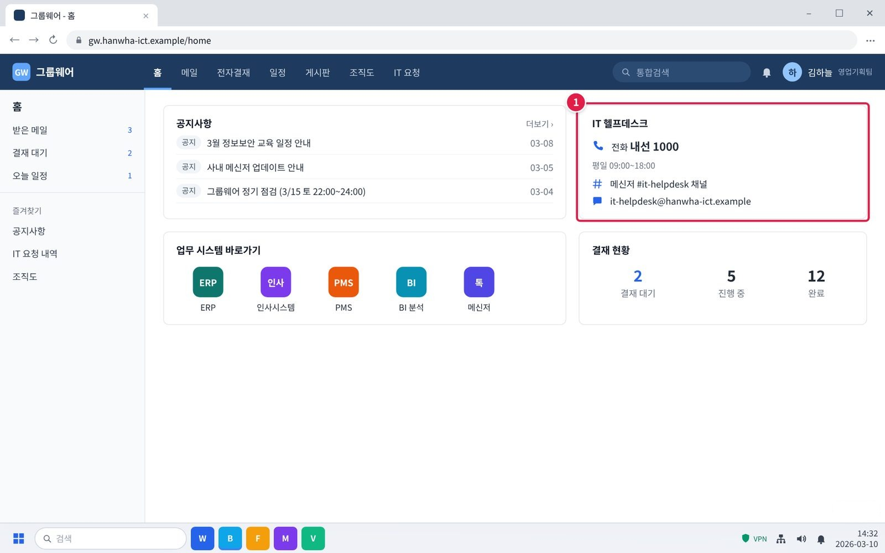

*그림 3.4-3. 그룹웨어 첫 화면의 IT 헬프데스크 안내*

- 단계 3. IT 헬프데스크(내선 1000)에 전화합니다.
- ① 그룹웨어 첫 화면 오른쪽 'IT 헬프데스크'에 전화번호가 있습니다. 사무실 전화로 내선 1000을 누릅니다.
- ※ 이렇게 말하면 됩니다: "영업기획팀 김하늘입니다. 공유 드라이브가 전부 안 열리고 네트워크 경로를 찾을 수 없다고 나옵니다. 다른 팀도 같습니다." 확인: 평일 09:00~18:00에 받습니다. 그 밖의 시간에는 메신저 #it-helpdesk 채널에 남깁니다.

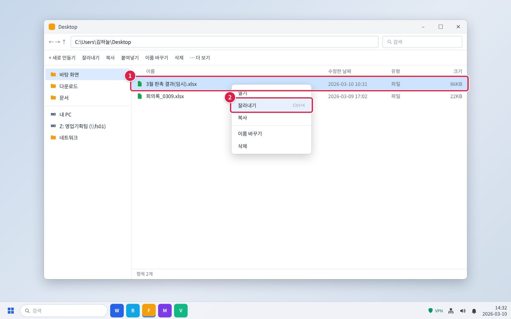

*그림 3.4-4. 복구 후 임시 파일을 공유 드라이브로 옮기기*

- 단계 4. 복구 후 임시로 저장한 파일을 공유 드라이브로 옮기고 PC의 사본은 지웁니다.
- ① 복구 공지가 나오면 바탕 화면의 임시 파일을 마우스 오른쪽 버튼으로 누릅니다.
- ② [잘라내기]를 누른 뒤 공유 드라이브 팀 폴더에서 붙여넣기합니다. PC에 사본이 남지 않습니다.
- 확인: 공유 드라이브에 저장되면 해결된 것입니다. 우리 팀 폴더만 안 열리면 IT-SYS-006을 봅니다.

## 4. 자주 묻는 질문

**Q. 공유 드라이브가 열리지 않아요. (FAQ-033)**

A. VPN 연결 상태(재택 시)를 확인한 뒤, 탐색기에서 드라이브 연결을 끊고 다시 연결하세요. 팀 전체가 안 되면 서비스데스크로 즉시 신고하세요.

## 5. 주의사항

- 장애 중에는 같은 작업을 반복해서 저장하거나 보내지 않는다.
- 장애 중이라도 업무 파일을 개인 메일이나 외부 저장소로 옮기지 않는다.
- 공지를 확인한 뒤에는 같은 내용을 여러 번 신고하지 않는다.

## 6. 문의처

| 창구 | 연락처 | 이용 기준 |
| --- | --- | --- |
| ITssue 챗봇 | 사내 IT 포털 상단 [챗봇 문의] | 24시간. 모든 IT 문의의 기본 창구입니다. 챗봇이 해결하지 못하면 확인을 거쳐 담당 팀에 티켓으로 접수합니다. |
| IT 헬프데스크 (서비스데스크) | 내선 1000 (평일 09:00~18:00) | PC나 챗봇을 쓸 수 없을 때, 여러 사람이 함께 업무를 못 할 때, 본인 확인이 필요한 처리 |
| 정보보안팀 | 내선 1119 | 링크 클릭·비밀번호 입력·감염 의심·계정 도용·장비 분실처럼 바로 알려야 할 보안 문제 |
| 메신저 | #it-helpdesk 채널 | 일반 IT 문의 (챗봇을 쓸 수 없을 때) |
| 메일 | it-helpdesk@ict.example | 일반 IT 문의. 비밀번호·인증번호는 메일로 보내지 않습니다. |
| 처리 상황 알림 | 사내 메신저 알림 | 접수·담당자 배정·처리 완료를 알려 드립니다. 진행 상황은 [내 요청 현황]에서도 봅니다. |

## 부록 · 관련 문서 · 용어

#### 관련 문서

| 문서 번호 | 문서명 | 이럴 때 봅니다 |
| --- | --- | --- |
| IT-SYS-001 | 그룹웨어·ERP 이용 오류 대응 가이드 |  |
| IT-SYS-002 | 사내 시스템 성능 저하 대응 가이드 |  |
| IT-SYS-004 | 메일 이용 장애 대응 가이드 |  |
| IT-SYS-006 | 공유 드라이브·파일 복구 가이드 |  |
| IT-SW-003 | 업무용 SW 실행·오류 대응 가이드 |  |
| IT-NET-003 | 네트워크 장애 신고·이관 가이드 |  |
| IT-ACC-001 | 사내 SSO 로그인 오류 대응 가이드 |  |
| IT-STD-001 | IT 서비스 운영 기준 |  |

#### 용어

| 용어 | 설명 |
| --- | --- |
| 전사 장애 | 여러 부서의 업무가 동시에 멈춘 장애 (긴급도 P1) |
| 업무 협업 플랫폼 | PMS(프로젝트 관리), BI(분석), 마케팅 툴 등 팀 단위로 쓰는 업무 시스템 |

## 개정 이력

| 버전 | 개정일 | 작성자 | 변경 내용 |
| --- | --- | --- | --- |
| v1.0 | 2026-03-01 | 업무시스템팀 | 최초 작성 |
| v2.0 | 2026-10-16 | 업무시스템팀 | 7개 분류 통합 정리본. 문서 양식·열람 등급·용어·연락처를 통일하고 분류 사이의 중복 내용을 한 문서로 정리 |
