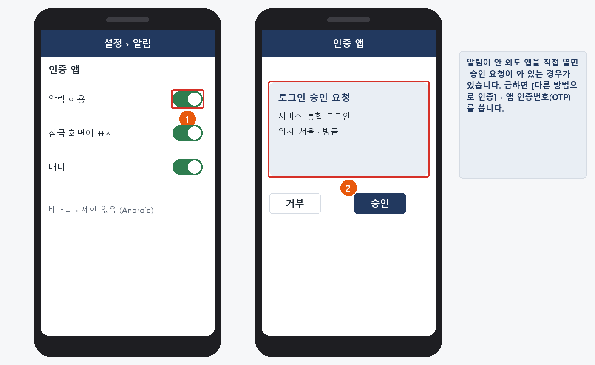
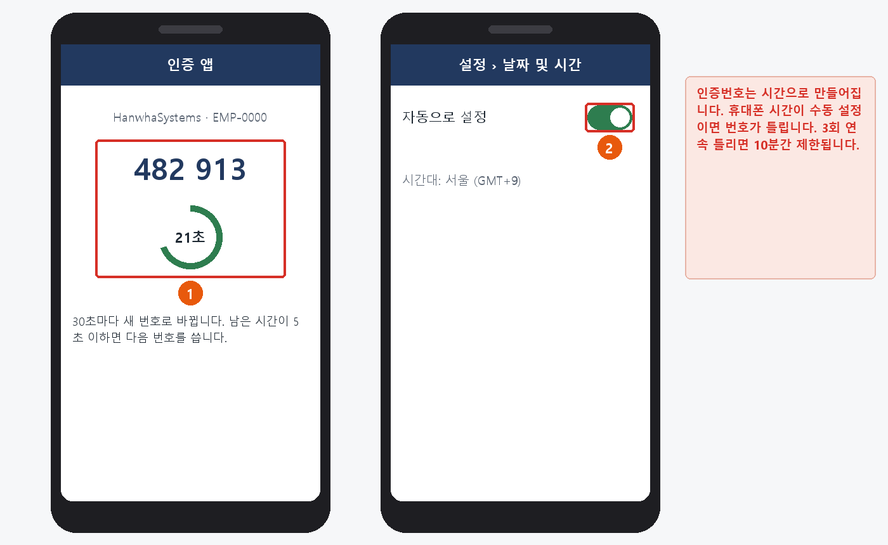
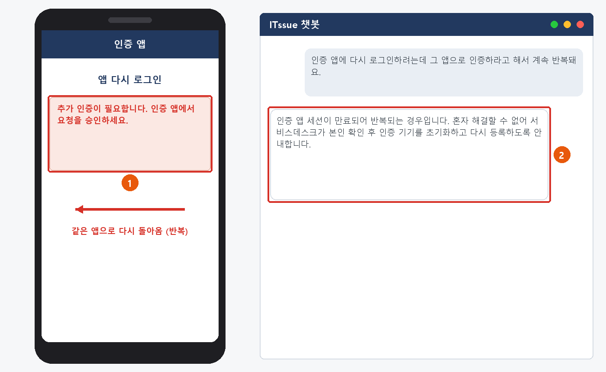
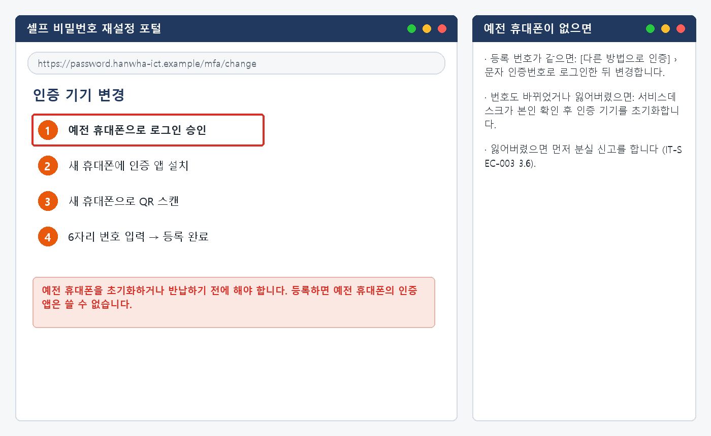

# MFA 인증 오류 대응 가이드

> 한화시스템 ICT 임직원 IT 안내 · 계정·로그인  
> IT-ACC-003 | 서비스데스크 | 2026-10-16 | v2.0 | **사내 일반** (전 임직원)

## 목차

- 1. 개요
- 2. 먼저 확인할 사항
- 3. 증상별 조치 방법
  - 3.1 인증 앱 처음 등록하기
  - 3.2 승인 알림이 오지 않을 때
  - 3.3 OTP 번호가 맞지 않을 때 ('인증 실패' · 10분 제한)
  - 3.4 인증 앱 로그인이 계속 반복될 때
  - 3.5 휴대폰을 바꿀 때 (인증 기기 변경)
- 4. 자주 묻는 질문
- 5. 주의사항
- 6. 문의처
- 부록 · 관련 문서 · 용어
- 개정 이력

## 1. 개요

**목적**

- 비밀번호 다음 단계인 추가 인증(MFA)이 안 될 때 직접 해결하는 방법을 안내합니다.
- 인증 앱 등록과 휴대폰을 바꿀 때 옮기는 방법을 안내합니다.

**적용 대상**

- 인증 앱을 쓰는 전 임직원이 대상입니다.
- 비밀번호 단계 실패·잠김은 IT-ACC-001, 비밀번호 분실은 IT-ACC-002를 봅니다.
- 요청하지 않은 인증 알림, 휴대폰 분실은 IT-SEC-003을 봅니다.

**적용 환경**

- 인증 앱 — App Store·Play 스토어
- 셀프 비밀번호 재설정 포털 [인증 기기 변경]
- iOS 16 이상 / Android 11 이상

## 2. 먼저 확인할 사항

#### 조치하기 전에 확인합니다

- 추가 인증 방법은 3가지입니다: **① 앱 승인 알림(기본) ② 앱 인증번호(OTP, 30초마다 바뀜) ③ 문자 인증번호(3분 유효)**.
- 알림이 안 오면 로그인 화면의 **[다른 방법으로 인증]** 에서 ②나 ③을 고릅니다. OTP는 인터넷 없이도 됩니다.
- 인증 기기는 **1인 1대** 입니다. 새 휴대폰을 등록하면 예전 휴대폰의 인증 앱은 쓸 수 없습니다.
- 휴대폰의 **날짜·시간이 자동 설정** 인지 확인합니다. OTP는 시간으로 만들어집니다.
- 인증 앱은 회사가 안내한 공식 스토어에서만 설치합니다.

> ★ **내가 로그인하지 않았는데 온 승인 요청은 [거부]합니다**
>
> 요청이 반복되거나 실수로 승인했으면 IT-SEC-003 3.2를 따릅니다. 인증번호는 누구에게도 알려 주지 않습니다.

#### 인증 방법과 제한 시간

| 방법 | 쓰는 방식 | 제한 시간 | 안 될 때 |
| --- | --- | --- | --- |
| 앱 승인 알림 (기본) | 인증 앱에 뜬 알림에서 [승인] | 60초 | 3.2 |
| 앱 인증번호 (OTP) | 인증 앱의 6자리 숫자 입력. 인터넷 불필요 | 30초마다 바뀜 · 3회 실패 시 10분 제한 (AUTH-202) | 3.3 |
| 문자 인증번호 (SMS) | 등록 휴대폰으로 받은 6자리 입력 | 3분 · 다시 받기는 1분에 1번 | IT 헬프데스크 |

#### 증상별 바로가기

| 겪고 있는 증상 | 볼 곳 | 처리 구분 |
| --- | --- | --- |
| 인증 앱을 처음 등록해야 한다 | 3.1 | 🟢 사용자 직접 조치 |
| 로그인했는데 인증 앱 승인 알림이 오지 않는다 | 3.2 | 🟢 사용자 직접 조치 |
| OTP 번호를 넣어도 '인증 실패'가 나온다 / 10분 제한됐다 | 3.3 | 🟢 사용자 직접 조치 |
| 인증 앱에 로그인하려니 그 앱으로 인증하라고 해서 계속 반복된다 | 3.4 | 🔵 IT 담당자 처리 |
| 휴대폰을 바꾼다 / 바꿨다 | 3.5 | 🟢 사용자 직접 조치 |
| 내가 로그인하지 않았는데 승인 요청이 왔다 / 실수로 승인했다 | IT-SEC-003 3.2 | 🔴 즉시 신고·이관 |
| 인증 앱이 깔린 휴대폰을 잃어버렸다 | IT-SEC-003 3.6 | 🔴 즉시 신고·이관 |

## 3. 증상별 조치 방법

| 번호 | 제목 | 문의 유형 | 처리 구분 | 담당 부서 |
| --- | --- | --- | --- | --- |
| 3.1 | 인증 앱 처음 등록하기 | ACC-03 | 🟢 사용자 직접 조치 | 서비스데스크 |
| 3.2 | 승인 알림이 오지 않을 때 | ACC-03 | 🟢 사용자 직접 조치 | 서비스데스크 |
| 3.3 | OTP 번호가 맞지 않을 때 ('인증 실패' · 10분 제한) | ACC-03 | 🟢 사용자 직접 조치 | 서비스데스크 |
| 3.4 | 인증 앱 로그인이 계속 반복될 때 | ACC-03 | 🔵 IT 담당자 처리 | 서비스데스크 |
| 3.5 | 휴대폰을 바꿀 때 (인증 기기 변경) | ACC-03 | 🟢 사용자 직접 조치 | 서비스데스크 |

### 3.1 인증 앱 처음 등록하기

**문의 유형** ACC-03 · **처리 구분** 🟢 사용자 직접 조치 · **담당 부서** 서비스데스크 · **관련 FAQ** FAQ-003

#### 이런 경우

- 입사 후 처음으로 추가 인증을 설정해야 합니다.
- 인증 앱을 지웠다가 다시 설치했습니다.

#### 원인

- 인증 앱을 계정에 연결(등록)해야 승인 알림과 OTP를 쓸 수 있습니다.

#### 조치 방법

1. 휴대폰에 공식 스토어에서 **인증 앱** 을 설치하고, 알림을 **[허용]** 합니다.
2. PC에서 셀프 비밀번호 재설정 포털에 로그인합니다 (처음에는 문자 인증번호로 인증).
3. **[인증 기기 등록]** 을 열고, PC 화면의 QR 코드를 앱의 **[QR 스캔]** 으로 찍습니다.
4. 앱에 나온 6자리 번호를 PC에 입력하고 **[등록 완료]** 를 누릅니다.
5. 로그아웃 후 다시 로그인해 승인 알림이 오는지 확인합니다.

![그림 3.1-1. ① PC의 QR 코드 ② 앱의 6자리 번호 ③ [등록 완료]](../images/acc003_31_register.png)

*그림 3.1-1. ① PC의 QR 코드 ② 앱의 6자리 번호 ③ [등록 완료]*

**해결 확인**

- 다시 로그인할 때 승인 알림이 와서 [승인]으로 로그인되면 끝난 것입니다.

**해결되지 않으면**

- QR 스캔이 안 되면 앱의 카메라 권한을 허용합니다.
- 앱을 지웠는데 등록 번호도 바뀌었으면 3.5의 "예전 휴대폰이 없을 때"를 따릅니다.

**문의 시 알려 주실 정보**

- 사번
- 휴대폰 기종·운영체제
- 막힌 단계와 화면

### 3.2 승인 알림이 오지 않을 때

**문의 유형** ACC-03 · **처리 구분** 🟢 사용자 직접 조치 · **담당 부서** 서비스데스크 · **관련 FAQ** FAQ-003

#### 이런 경우

- 로그인하면 휴대폰으로 승인 알림이 와야 하는데 안 와요.
- 어제까지 오던 인증 알림이 오늘부터 안 옵니다.

#### 원인

- 휴대폰 설정에서 인증 앱의 알림 권한이 꺼져 있거나, 배터리 절전으로 앱이 멈춘 경우입니다.

#### 조치 방법

1. 휴대폰이 Wi-Fi나 데이터에 연결돼 있는지 확인합니다.
2. 인증 앱을 직접 열어 봅니다. 알림 없이 앱 안에 승인 요청이 와 있는 경우가 있습니다.
3. 휴대폰 **[설정] › [알림] › 인증 앱** 에서 알림 허용을 켭니다. Android는 **[배터리] › "제한 없음"** 도 설정합니다.
4. 지금 바로 로그인해야 하면 **[다른 방법으로 인증] › 앱 인증번호(OTP)** 를 씁니다.

*그림 3.2-1. ① 인증 앱 알림 허용 ② 앱을 직접 열면 와 있는 승인 요청*

**해결 확인**

- 다시 로그인할 때 승인 알림이 오면 끝난 것입니다.

**해결되지 않으면**

- 설정을 다 해도 알림이 오지 않으면 IT 헬프데스크(내선 1000)에 휴대폰 기종·운영체제를 알립니다.
- 주변 동료도 동시에 알림을 못 받으면 IT 헬프데스크에 전화로 알립니다 (서비스 장애일 수 있음).

**문의 시 알려 주실 정보**

- 사번
- 휴대폰 기종·운영체제
- 언제부터 안 오는지
- 주변에서도 같은지

### 3.3 OTP 번호가 맞지 않을 때 ('인증 실패' · 10분 제한)

**문의 유형** ACC-03 · **처리 구분** 🟢 사용자 직접 조치 · **담당 부서** 서비스데스크 · **관련 FAQ** FAQ-003

#### 이런 경우

- OTP 번호를 입력해도 계속 '인증 실패'가 나옵니다.
- 인증번호를 몇 번 틀렸더니 10분 동안 인증할 수 없다고 나옵니다.

#### 원인

- 휴대폰 시간이 수동 설정이라 OTP 값이 서버와 맞지 않거나, 번호가 바뀌기 직전에 입력한 경우입니다.

#### 조치 방법

1. 남은 시간이 5초 이하면 기다렸다가 **새 번호** 를 입력합니다.
2. 휴대폰 **[설정] › [일반] › [날짜 및 시간] › 자동으로 설정** 을 켭니다.
3. 인증 앱에 계정이 여러 개라면 **HanwhaSystems · 내 사번** 항목의 번호인지 확인합니다.
4. 3회 연속 틀려 10분 제한(AUTH-202)이 걸렸으면 10분 뒤 다시 시도합니다.

*그림 3.3-1. ① 남은 시간 확인 ② 휴대폰 시간 자동 설정 켜기*

**해결 확인**

- OTP 번호로 인증되어 로그인되면 끝난 것입니다.

**해결되지 않으면**

- 시간을 자동으로 바꿨는데도 계속 틀리면 IT 헬프데스크(내선 1000)에 알립니다.
- 문자 인증번호로 먼저 로그인할 수 있습니다.

**문의 시 알려 주실 정보**

- 사번
- 휴대폰 기종·운영체제
- 시간 자동 설정 여부
- 화면 메시지 (AUTH 코드)

### 3.4 인증 앱 로그인이 계속 반복될 때

**문의 유형** ACC-03 · **처리 구분** 🔵 IT 담당자 처리 · **담당 부서** 서비스데스크 · **관련 FAQ** FAQ-003

#### 이런 경우

- 인증 앱에 다시 로그인하려니까 그 인증 앱으로 2차 인증을 하라고 해서 무한 반복이에요.

#### 원인

- 인증 앱의 로그인 세션이 만료되어 앱이 자기 자신으로 인증하려는 순환 상태입니다. 사용자가 풀 수 없습니다.

#### 조치 방법

1. 인증 앱을 지우거나 다시 설치하지 않습니다. 상태가 더 꼬일 수 있습니다.
2. 로그인 화면의 **[다른 방법으로 인증] › 문자 인증번호** 로 로그인이 되는지 확인합니다.
3. ITssue 챗봇이나 IT 헬프데스크(내선 1000)에 "인증 앱 반복"으로 알립니다.
4. 서비스데스크가 본인 확인 후 인증 기기를 초기화하면, 3.1처럼 다시 등록합니다.

*그림 3.4-1. ① 같은 앱으로 다시 인증하라는 반복 ② 챗봇에 알리면 담당자가 처리*

**해결 확인**

- 다시 등록한 인증 앱으로 승인 알림이 오면 끝난 것입니다.

**해결되지 않으면**

- 본인 확인을 위해 화상 확인이 필요할 수 있습니다. 사원증을 준비합니다.

**문의 시 알려 주실 정보**

- 사번
- 휴대폰 기종·운영체제
- 반복되는 화면 (캡처)
- 문자 인증으로는 로그인되는지

### 3.5 휴대폰을 바꿀 때 (인증 기기 변경)

**문의 유형** ACC-03 · **처리 구분** 🟢 사용자 직접 조치 · **담당 부서** 서비스데스크 · **관련 FAQ** FAQ-003

#### 이런 경우

- 휴대폰을 바꾸는데 인증 앱을 어떻게 옮기나요?
- 새 휴대폰으로 바꿨는데 예전 휴대폰은 이미 반납했습니다.

#### 원인

- 인증 기기는 1인 1대라서 새 휴대폰을 등록해야 합니다. 예전 휴대폰이 있으면 셀프로, 없으면 본인 확인 후 담당자가 초기화합니다.

#### 조치 방법

1. **예전 휴대폰을 초기화하기 전에** 셀프 포털 › **[인증 기기 변경]** 을 엽니다.
2. 예전 휴대폰으로 승인한 뒤, 새 휴대폰의 인증 앱으로 QR을 스캔하고 6자리 번호를 넣습니다.
3. 새 휴대폰으로 인증되는지 확인한 다음 예전 휴대폰을 초기화합니다.
4. 예전 휴대폰이 없으면: 번호가 같으면 문자 인증으로 로그인해 변경하고, 번호도 바뀌었으면 IT 헬프데스크에 초기화를 요청합니다.

*그림 3.5-1. ① 예전 휴대폰으로 승인한 뒤 새 휴대폰 등록 / 오른쪽: 예전 휴대폰이 없을 때*

**해결 확인**

- 새 휴대폰으로 승인 알림이 오고 로그인되면 끝난 것입니다.

**해결되지 않으면**

- 휴대폰을 잃어버렸으면 먼저 분실 신고를 합니다 (IT-SEC-003 3.6).
- 회사 메일·메신저 앱도 새 휴대폰에서 다시 로그인합니다.

**문의 시 알려 주실 정보**

- 사번
- 예전 휴대폰이 있는지
- 등록 번호가 바뀌었는지
- 새 휴대폰 기종

> ★ **예전 휴대폰을 초기화한 뒤에는 셀프로 옮길 수 없습니다**

## 4. 자주 묻는 질문

**Q. 휴대폰을 바꿔서 2단계 인증을 못 해요. (FAQ-003)**

A. 기존 휴대폰이 있다면 인증 앱에서 계정을 새 기기로 이전하세요. 기존 휴대폰이 없다면 서비스데스크에 MFA 초기화를 요청한 뒤 새 기기로 재등록합니다. OTP 번호가 계속 틀리면 휴대폰 시간을 '자동 설정'으로 바꿔 보세요.

**Q. 인증 앱을 두 대에 설치할 수 있나요?**

A. 안 됩니다. 인증 기기는 1인 1대입니다. 평소 가지고 다니는 휴대폰 한 대에 설치합니다.

**Q. 해외 출장 중에 인증이 안 돼요.**

A. 문자가 늦을 수 있으니 OTP를 쓰세요. 인터넷 없이도 됩니다. 출장 전 해외 접속 사전 등록은 IT-SEC-003 3.3을 봅니다.

**Q. 실수로 모르는 인증 알림을 승인했어요.**

A. 바로 정보보안팀(내선 1119)에 전화하세요. 계정 도용 가능성이 있습니다 (IT-SEC-003 3.2).

## 5. 주의사항

> ★ **꼭 지켜 주세요**
>
> 인증번호는 누구에게도 알려 주지 않습니다. 헬프데스크·챗봇도 묻지 않습니다.
>
> 내가 하지 않은 로그인의 승인 요청은 [거부]합니다.
>
> 예전 휴대폰은 새 휴대폰 등록이 끝난 뒤에 초기화합니다.

- 인증 앱은 공식 스토어에서만 설치합니다. 메일·메신저로 받은 설치 파일은 열지 않습니다.
- 휴대폰 날짜·시간은 자동 설정으로 둡니다.
- 휴대폰에는 화면 잠금을 걸어 둡니다.

## 6. 문의처

| 창구 | 연락처 | 이용 기준 |
| --- | --- | --- |
| ITssue 챗봇 | 사내 IT 포털(hanwha-admin) 상단 [챗봇 문의] | 24시간. 모든 IT 문의의 기본 창구입니다. 챗봇이 해결하지 못하면 확인을 거쳐 담당 팀에 티켓으로 접수합니다. |
| IT 헬프데스크 (서비스데스크) | 내선 1000 (평일 09:00~18:00) | PC나 챗봇을 쓸 수 없을 때, 여러 사람이 함께 업무를 못 할 때, 본인 확인이 필요한 처리 |
| 정보보안팀 | 내선 1119 | 링크 클릭·비밀번호 입력·감염 의심·계정 도용·장비 분실처럼 바로 알려야 할 보안 문제 |
| 메신저 | #it-helpdesk 채널 | 일반 IT 문의 (챗봇을 쓸 수 없을 때) |
| 메일 | it-helpdesk@hanwha-ict.example | 일반 IT 문의. 비밀번호·인증번호는 메일로 보내지 않습니다. |
| 처리 상황 알림 | 사내 메신저 알림 | 접수·담당자 배정·처리 완료를 알려 드립니다. 진행 상황은 [내 요청 현황]에서도 봅니다. |

## 부록 · 관련 문서 · 용어

#### 관련 문서

| 문서 번호 | 문서명 | 이럴 때 봅니다 |
| --- | --- | --- |
| IT-ACC-001 | 사내 SSO 로그인 오류 대응 가이드 | 비밀번호 단계에서 실패하거나 잠겼을 때 |
| IT-ACC-002 | 비밀번호 변경·초기화 가이드 | 비밀번호를 잊었을 때 |
| IT-SEC-003 | 계정 도용·장비 분실 신고 가이드 | 요청하지 않은 인증 알림, 휴대폰 분실, 해외 출장 |
| IT-STD-001 | IT 서비스 운영 기준 | 긴급도와 처리 기준 |

#### 용어

| 용어 | 설명 |
| --- | --- |
| MFA (2단계 인증) | 비밀번호 다음에 인증 앱 승인·인증번호로 한 번 더 확인하는 것 |
| OTP | 인증 앱에 30초마다 바뀌어 나오는 6자리 인증번호. 인터넷 없이도 된다 |
| 인증 기기 | 인증 앱이 등록된 휴대폰. 1인 1대 |
| MFA 초기화 | 등록된 인증 기기를 해제하는 것. 본인 확인 후 서비스데스크가 한다 |

## 개정 이력

| 버전 | 개정일 | 작성자 | 변경 내용 |
| --- | --- | --- | --- |
| v1.0 | 2026-10-12 | 서비스데스크 | 계정·로그인 통합본 최초 작성 |
| v1.1 | 2026-10-12 | 서비스데스크 | 사용자용·관리자용 분리, 본인 확인·콘솔 절차 추가 |
| v1.2 | 2026-10-16 | 서비스데스크 | IT-ACC-001~003 가이드와 -M 매뉴얼로 나눔. 저장소 기준 값(회사명, 비밀번호 12자·4종, 잠금 10분, 연락처·담당 조직)으로 정리 |
| v2.0 | 2026-10-16 | 서비스데스크 | 7개 분류 통합 정리본. 문서 양식·열람 등급·용어·연락처를 통일하고 분류 사이의 중복 내용을 한 문서로 정리 |
