# 업무 PC 기본 장애 처리 매뉴얼

> 한화시스템 ICT IT 담당자 매뉴얼 · HW·업무 PC  
> IT-HW-001-M | 엔드포인트지원팀 | 2026-10-16 | v2.0 | **사내 제한** (IT 운영 담당자·관리자)
>
> IT운영·보안 조직 내부 문서입니다. 사용자에게 문서 자체를 전달하지 않고, 안내는 짝이 되는 임직원용 가이드를 기준으로 합니다.

## 목차

- 1. 개요
- 2. 접수·분류 기준
- 3. 증상별 처리 절차
  - 3.1 C드라이브가 꽉 찼다는 경고가 뜨고 PC가 느림
  - 3.2 PC를 켜고 프로그램을 여는 데 몇 분씩 걸림
  - 3.3 기본 조치 후에도 엑셀 여러 개나 분석 프로그램을 켜면 노트북이 멈출 듯 느림
  - 3.4 전원 버튼을 눌러도 노트북이 켜지지 않음
  - 3.5 켜면 파란 화면(블루스크린)이 뜨고 재부팅만 반복됨
  - 3.6 로그인 전에 '복구 키를 입력하세요' 화면이 뜸
  - 3.7 로그인하면 화면이 멈추거나 오류가 나서 들어가지지 않음
  - 3.8 도킹스테이션에 연결해도 외부 모니터에 화면이 안 나옴
  - 3.9 듀얼 모니터 중 한 대만 인식됨
  - 3.10 모니터가 깜빡이다 꺼지거나 화면이 일그러짐
  - 3.11 무선 마우스가 자꾸 끊김
  - 3.12 OS 업데이트가 '재시작 중'에서 오래 멈춰 있음
  - 3.13 OS 업데이트 후 소리가 나지 않음
- 4. 대형 장애 대응
- 5. 처리 기록 기준
- 부록 · 관련 문서 · 용어
- 개정 이력

## 1. 개요

#### 목적

PC 속도 저하(HW-01), 부팅 불가·블루스크린(HW-02), 모니터·도킹(HW-03), OS 업데이트 문제(HW-06) 문의를 접수·판단·처리·이관하는 내부 절차를 정한다. 사용자 안내는 IT-HW-001을 기준으로 한다.

#### 담당 범위

| 항목 | 내용 |
| --- | --- |
| 1차 처리 | 서비스데스크(L1): 디스크 정리·시작 프로그램·모니터 감지·케이블 안내, 모호한 증상 확인 |
| 2차 이관 | 엔드포인트지원팀(L2): 메모리 증설·SSD 교체, 부팅 장애 처리(어댑터, 드라이버 롤백, 복구 키, 시스템 파일 복구), 도킹 펌웨어·모니터 교체, OS 업데이트 복구 |
| 배정 기준 | 서비스데스크 L1 · PC·네트워크 1차 점검 영역 (HW-01, HW-03) |
| 배정 기준 | 엔드포인트지원팀 L2 · PC 장애·OS 영역 (HW-01, HW-02, HW-06) |
| 배정 기준 | 엔드포인트지원팀 L2 · 주변기기·자산 영역 (HW-03) |
| 관련 시스템 | 원격 지원 도구, 단말 관리 콘솔(디스크 암호화 복구 키 조회), 자산 관리 화면 |

## 2. 접수·분류 기준

사용자 가이드의 블록별 기본값이다. 긴급도 기준은 IT-STD-001 IT 서비스 운영 기준을 따른다.

| 번호 | 문의 유형 | 증상·요청 | 기본 긴급도 | 1차 처리 | 처리 방식 | 이관 대상 |
| --- | --- | --- | --- | --- | --- | --- |
| 3.1 | HW-01 | C드라이브 공간 부족 | P3 | 서비스데스크 | 즉시 처리 후 필요 시 티켓 | 엔드포인트지원팀 |
| 3.2 | HW-01 | 부팅·프로그램 실행 느림 | P3 | 서비스데스크 | 즉시 처리 후 필요 시 티켓 | 엔드포인트지원팀 |
| 3.3 | HW-01 | 메모리 부족·저장 장치 노후 | P3 | 서비스데스크 | 즉시 처리 후 필요 시 티켓 | 엔드포인트지원팀 |
| 3.4 | HW-02 | 전원 반응 없음 | P2 | 엔드포인트지원팀 | 티켓 | 없음 |
| 3.5 | HW-02 | 블루스크린 재부팅 반복 | P2 | 엔드포인트지원팀 | 티켓 | 없음 |
| 3.6 | HW-02 | 복구 키 입력 화면 | P2 | 엔드포인트지원팀 | 티켓 | 없음 |
| 3.7 | HW-02 | 로그인 후 화면 멈춤 | P2 | 엔드포인트지원팀 | 티켓 | 없음 |
| 3.8 | HW-03 | 도킹 연결 시 외부 모니터 무화면 | P3 | 서비스데스크 | 즉시 처리 후 필요 시 티켓 | 엔드포인트지원팀 |
| 3.9 | HW-03 | 듀얼 모니터 한 대 미인식 | P3 | 서비스데스크 | 즉시 처리 | 없음 |
| 3.10 | HW-03 | 모니터 깜빡임·화면 왜곡 | P3 | 엔드포인트지원팀 | 티켓 | 없음 |
| 3.11 | HW-03 | 무선 마우스 끊김 | P3 | 서비스데스크 | 즉시 처리 | 없음 |
| 3.12 | HW-06 | OS 업데이트 재시작 중 멈춤 | P3 | 엔드포인트지원팀 | 티켓 | 없음 |
| 3.13 | HW-06 | 업데이트 후 소리 안 남 | P3 | 엔드포인트지원팀 | 티켓 | 없음 |

#### 처리 방식

- 즉시 처리: 서비스데스크(L1)가 안내만으로 끝낸 건. 티켓 없이 상담 기록만 남긴다.
- 티켓: 담당자 조치가 필요한 건. 담당팀에 배정하고 상태를 RDY → WIP → FIN → CLS 으로 관리한다.

#### 긴급도 조정 조건

- 부팅 불가·블루스크린(HW-02)은 개인 업무를 전혀 할 수 없으므로 기본 P2로 처리한다.
- 마감·고객 미팅 등 당일 업무 차질을 말하면 HW-01·HW-03이라도 P2로 올린다.
- 증상을 구체적으로 말하지 않으면 느림·부팅·화면·소리 중 무엇인지 추가로 질문한 뒤 분류한다.
- 같은 업데이트 뒤 여러 명에게 같은 증상이 나오면 대표 티켓으로 묶고 해당 배포를 멈춘다.

## 3. 증상별 처리 절차

### 3.1 C드라이브가 꽉 찼다는 경고가 뜨고 PC가 느림

**문의 유형** HW-01 · **기본 긴급도** P3 · **1차 처리** 서비스데스크 · **이관 대상** 엔드포인트지원팀

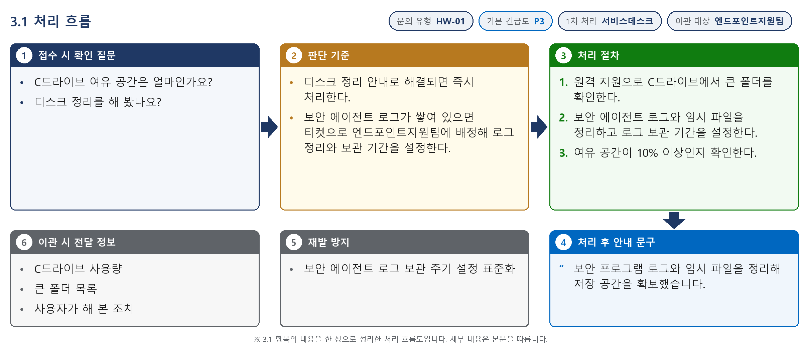

*그림 3.1-1. 처리 흐름도. 접수 시 확인 질문, 판단 기준, 처리 절차, 처리 후 안내와 이관 정보를 순서대로 표시한다*

**접수 시 확인 질문**

- C드라이브 여유 공간은 얼마인가요?
- 디스크 정리를 해 봤나요?

**판단 기준**

- 디스크 정리 안내로 해결되면 즉시 처리한다.
- 보안 에이전트 로그가 쌓여 있으면 티켓으로 엔드포인트지원팀에 배정해 로그 정리와 보관 기간을 설정한다.

#### 처리 절차

1. 원격 지원으로 C드라이브에서 큰 폴더를 확인한다.
2. 보안 에이전트 로그와 임시 파일을 정리하고 로그 보관 기간을 설정한다.
3. 여유 공간이 10% 이상인지 확인한다.

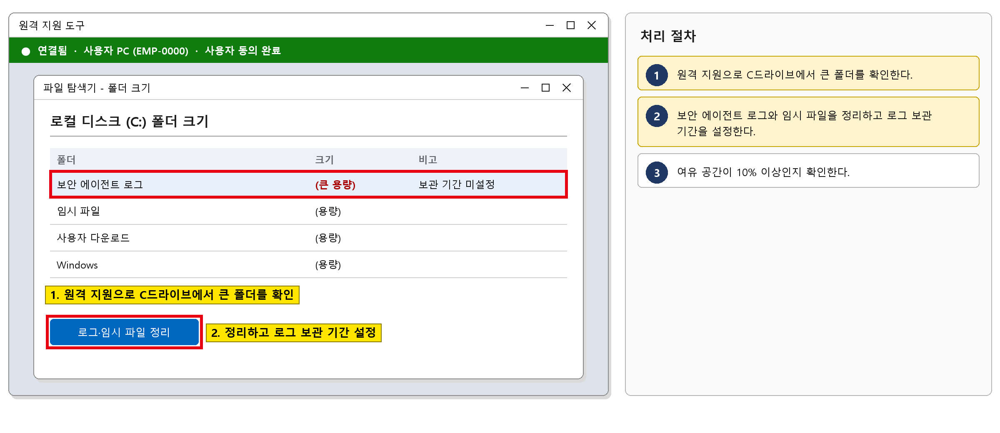

*그림 3.1-2. 원격 지원 도구 화면. C드라이브에서 큰 폴더를 확인하고 정리하는 위치를 표시한다*

#### 처리 후 안내 문구

> 보안 프로그램 로그와 임시 파일을 정리해 저장 공간을 확보했습니다.

**재발 방지**

- 보안 에이전트 로그 보관 주기 설정 표준화

**이관 시 전달 정보**

- C드라이브 사용량
- 큰 폴더 목록
- 사용자가 해 본 조치

### 3.2 PC를 켜고 프로그램을 여는 데 몇 분씩 걸림

**문의 유형** HW-01 · **기본 긴급도** P3 · **1차 처리** 서비스데스크 · **이관 대상** 엔드포인트지원팀

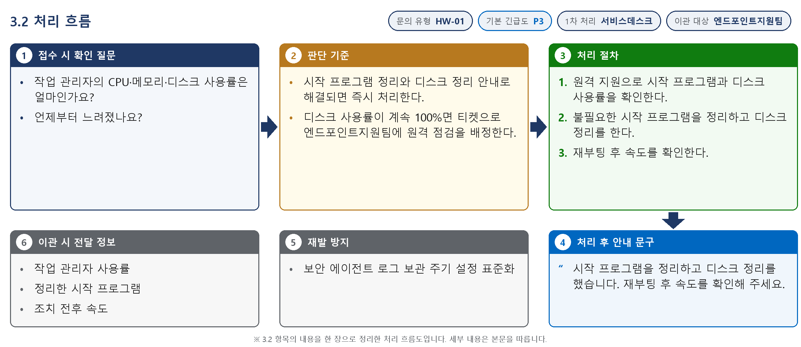

*그림 3.2-1. 처리 흐름도. 접수 시 확인 질문, 판단 기준, 처리 절차, 처리 후 안내와 이관 정보를 순서대로 표시한다*

**접수 시 확인 질문**

- 작업 관리자의 CPU·메모리·디스크 사용률은 얼마인가요?
- 언제부터 느려졌나요?

**판단 기준**

- 시작 프로그램 정리와 디스크 정리 안내로 해결되면 즉시 처리한다.
- 디스크 사용률이 계속 100%면 티켓으로 엔드포인트지원팀에 원격 점검을 배정한다.

#### 처리 절차

1. 원격 지원으로 시작 프로그램과 디스크 사용률을 확인한다.
2. 불필요한 시작 프로그램을 정리하고 디스크 정리를 한다.
3. 재부팅 후 속도를 확인한다.

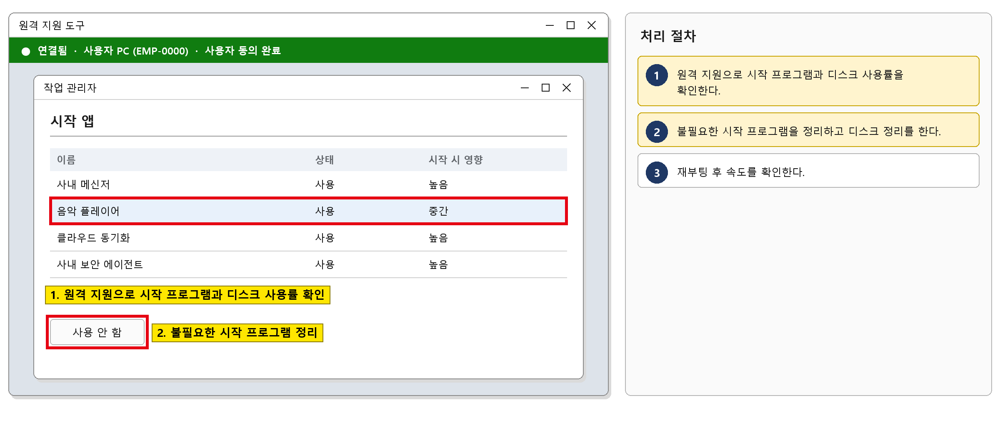

*그림 3.2-2. 원격 지원 도구 화면. 사용자 PC의 시작 프로그램을 확인하고 정리하는 위치를 표시한다*

#### 처리 후 안내 문구

> 시작 프로그램을 정리하고 디스크 정리를 했습니다. 재부팅 후 속도를 확인해 주세요.

**재발 방지**

- 보안 에이전트 로그 보관 주기 설정 표준화

**이관 시 전달 정보**

- 작업 관리자 사용률
- 정리한 시작 프로그램
- 조치 전후 속도

### 3.3 기본 조치 후에도 엑셀 여러 개나 분석 프로그램을 켜면 노트북이 멈출 듯 느림

**문의 유형** HW-01 · **기본 긴급도** P3 · **1차 처리** 서비스데스크 · **이관 대상** 엔드포인트지원팀

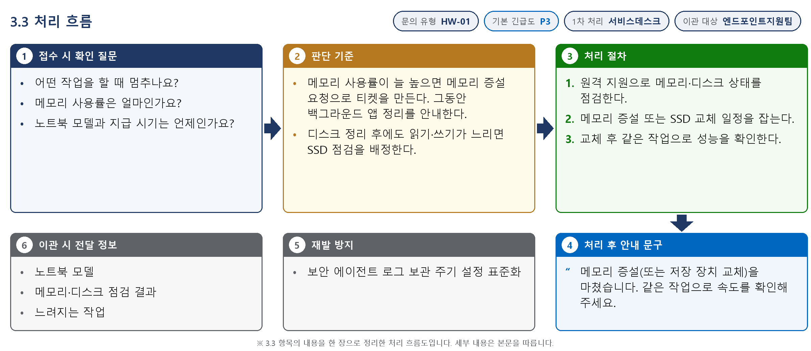

*그림 3.3-1. 처리 흐름도. 접수 시 확인 질문, 판단 기준, 처리 절차, 처리 후 안내와 이관 정보를 순서대로 표시한다*

**접수 시 확인 질문**

- 어떤 작업을 할 때 멈추나요?
- 메모리 사용률은 얼마인가요?
- 노트북 모델과 지급 시기는 언제인가요?

**판단 기준**

- 메모리 사용률이 늘 높으면 메모리 증설 요청으로 티켓을 만든다. 그동안 백그라운드 앱 정리를 안내한다.
- 디스크 정리 후에도 읽기·쓰기가 느리면 SSD 점검을 배정한다.

#### 처리 절차

1. 원격 지원으로 메모리·디스크 상태를 점검한다.
2. 메모리 증설 또는 SSD 교체 일정을 잡는다.
3. 교체 후 같은 작업으로 성능을 확인한다.

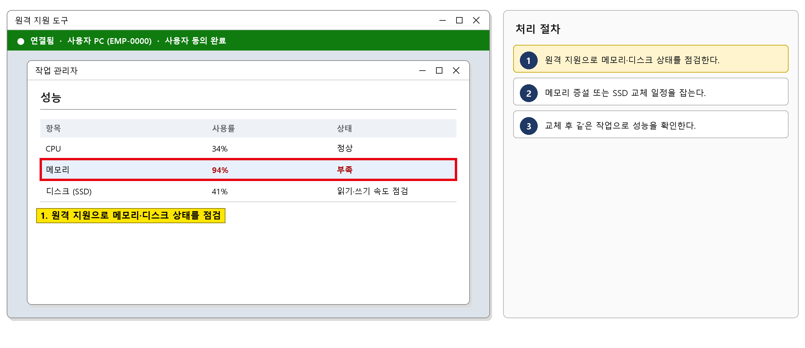

*그림 3.3-2. 원격 지원 도구 화면. 사용자 PC의 메모리·디스크 상태를 점검하는 위치를 표시한다*

#### 처리 후 안내 문구

> 메모리 증설(또는 저장 장치 교체)을 마쳤습니다. 같은 작업으로 속도를 확인해 주세요.

**재발 방지**

- 보안 에이전트 로그 보관 주기 설정 표준화

**이관 시 전달 정보**

- 노트북 모델
- 메모리·디스크 점검 결과
- 느려지는 작업

### 3.4 전원 버튼을 눌러도 노트북이 켜지지 않음

**문의 유형** HW-02 · **기본 긴급도** P2 · **1차 처리** 엔드포인트지원팀 · **이관 대상** 없음

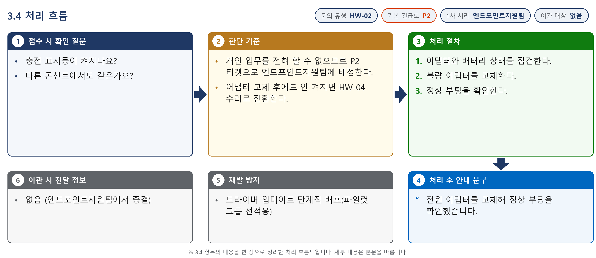

*그림 3.4-1. 처리 흐름도. 접수 시 확인 질문, 판단 기준, 처리 절차, 처리 후 안내와 이관 정보를 순서대로 표시한다*

**접수 시 확인 질문**

- 충전 표시등이 켜지나요?
- 다른 콘센트에서도 같은가요?

**판단 기준**

- 개인 업무를 전혀 할 수 없으므로 P2 티켓으로 엔드포인트지원팀에 배정한다.
- 어댑터 교체 후에도 안 켜지면 HW-04 수리로 전환한다.

#### 처리 절차

1. 어댑터와 배터리 상태를 점검한다.
2. 불량 어댑터를 교체한다.
3. 정상 부팅을 확인한다.

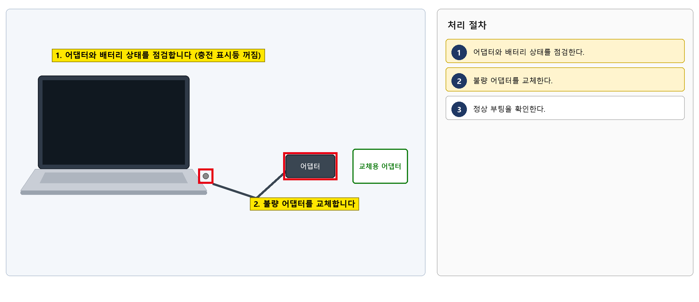

*그림 3.4-2. 전원 어댑터 점검 그림. 점검할 어댑터와 충전 표시등, 교체 위치를 표시한다*

#### 처리 후 안내 문구

> 전원 어댑터를 교체해 정상 부팅을 확인했습니다.

**재발 방지**

- 드라이버 업데이트 단계적 배포(파일럿 그룹 선적용)

**이관 시 전달 정보**

- 없음 (엔드포인트지원팀에서 종결)

### 3.5 켜면 파란 화면(블루스크린)이 뜨고 재부팅만 반복됨

**문의 유형** HW-02 · **기본 긴급도** P2 · **1차 처리** 엔드포인트지원팀 · **이관 대상** 없음

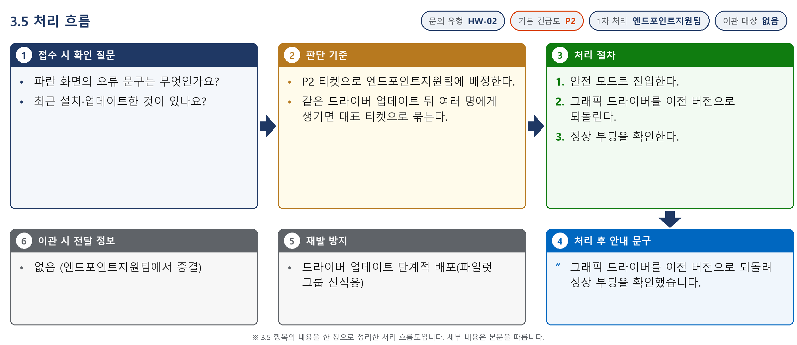

*그림 3.5-1. 처리 흐름도. 접수 시 확인 질문, 판단 기준, 처리 절차, 처리 후 안내와 이관 정보를 순서대로 표시한다*

**접수 시 확인 질문**

- 파란 화면의 오류 문구는 무엇인가요?
- 최근 설치·업데이트한 것이 있나요?

**판단 기준**

- P2 티켓으로 엔드포인트지원팀에 배정한다.
- 같은 드라이버 업데이트 뒤 여러 명에게 생기면 대표 티켓으로 묶는다.

#### 처리 절차

1. 안전 모드로 진입한다.
2. 그래픽 드라이버를 이전 버전으로 되돌린다.
3. 정상 부팅을 확인한다.

![그림 3.5-2. 안전 모드의 장치 관리자 화면. [드라이버 롤백] 위치를 표시한다](../images/IT-HW-001-M_10.png)

*그림 3.5-2. 안전 모드의 장치 관리자 화면. [드라이버 롤백] 위치를 표시한다*

#### 처리 후 안내 문구

> 그래픽 드라이버를 이전 버전으로 되돌려 정상 부팅을 확인했습니다.

**재발 방지**

- 드라이버 업데이트 단계적 배포(파일럿 그룹 선적용)

**이관 시 전달 정보**

- 없음 (엔드포인트지원팀에서 종결)

### 3.6 로그인 전에 '복구 키를 입력하세요' 화면이 뜸

**문의 유형** HW-02 · **기본 긴급도** P2 · **1차 처리** 엔드포인트지원팀 · **이관 대상** 없음

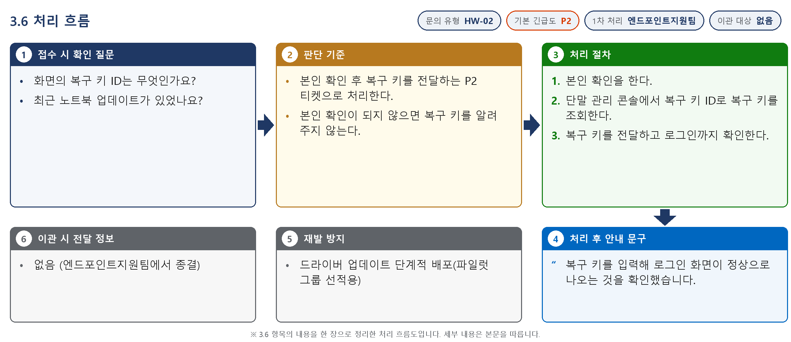

*그림 3.6-1. 처리 흐름도. 접수 시 확인 질문, 판단 기준, 처리 절차, 처리 후 안내와 이관 정보를 순서대로 표시한다*

**접수 시 확인 질문**

- 화면의 복구 키 ID는 무엇인가요?
- 최근 노트북 업데이트가 있었나요?

**판단 기준**

- 본인 확인 후 복구 키를 전달하는 P2 티켓으로 처리한다.
- 본인 확인이 되지 않으면 복구 키를 알려 주지 않는다.

#### 처리 절차

1. 본인 확인을 한다.
2. 단말 관리 콘솔에서 복구 키 ID로 복구 키를 조회한다.
3. 복구 키를 전달하고 로그인까지 확인한다.

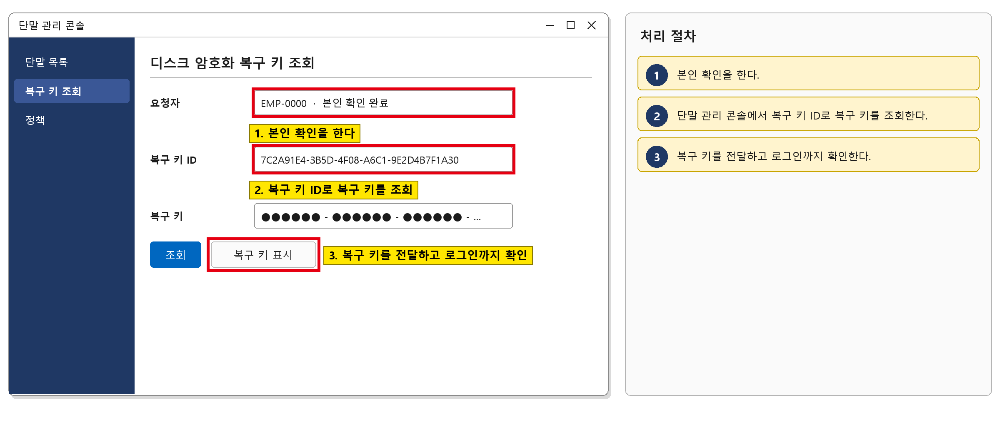

*그림 3.6-2. 단말 관리 콘솔 화면. 복구 키 ID로 복구 키를 조회하는 위치를 표시한다*

#### 처리 후 안내 문구

> 복구 키를 입력해 로그인 화면이 정상으로 나오는 것을 확인했습니다.

**재발 방지**

- 드라이버 업데이트 단계적 배포(파일럿 그룹 선적용)

**이관 시 전달 정보**

- 없음 (엔드포인트지원팀에서 종결)

### 3.7 로그인하면 화면이 멈추거나 오류가 나서 들어가지지 않음

**문의 유형** HW-02 · **기본 긴급도** P2 · **1차 처리** 엔드포인트지원팀 · **이관 대상** 없음

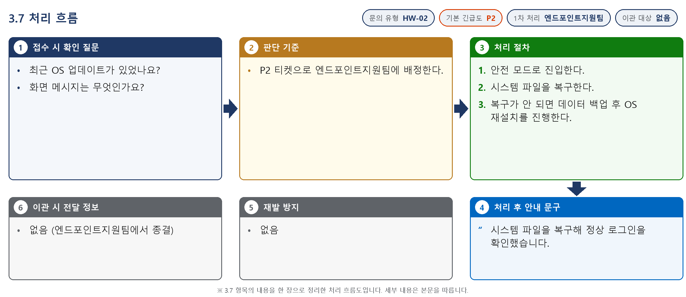

*그림 3.7-1. 처리 흐름도. 접수 시 확인 질문, 판단 기준, 처리 절차, 처리 후 안내와 이관 정보를 순서대로 표시한다*

**접수 시 확인 질문**

- 최근 OS 업데이트가 있었나요?
- 화면 메시지는 무엇인가요?

**판단 기준**

- P2 티켓으로 엔드포인트지원팀에 배정한다.

#### 처리 절차

1. 안전 모드로 진입한다.
2. 시스템 파일을 복구한다.
3. 복구가 안 되면 데이터 백업 후 OS 재설치를 진행한다.

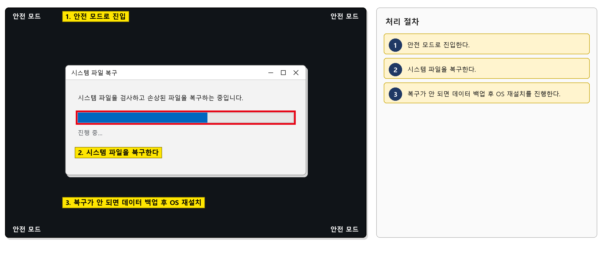

*그림 3.7-2. 안전 모드의 시스템 파일 복구 화면. 복구 진행 위치를 표시한다*

#### 처리 후 안내 문구

> 시스템 파일을 복구해 정상 로그인을 확인했습니다.

**재발 방지**

- 없음

**이관 시 전달 정보**

- 없음 (엔드포인트지원팀에서 종결)

### 3.8 도킹스테이션에 연결해도 외부 모니터에 화면이 안 나옴

**문의 유형** HW-03 · **기본 긴급도** P3 · **1차 처리** 서비스데스크 · **이관 대상** 엔드포인트지원팀

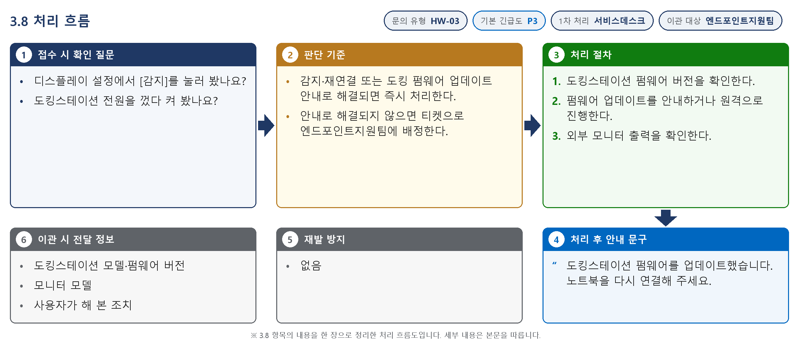

*그림 3.8-1. 처리 흐름도. 접수 시 확인 질문, 판단 기준, 처리 절차, 처리 후 안내와 이관 정보를 순서대로 표시한다*

**접수 시 확인 질문**

- 디스플레이 설정에서 [감지]를 눌러 봤나요?
- 도킹스테이션 전원을 껐다 켜 봤나요?

**판단 기준**

- 감지·재연결 또는 도킹 펌웨어 업데이트 안내로 해결되면 즉시 처리한다.
- 안내로 해결되지 않으면 티켓으로 엔드포인트지원팀에 배정한다.

#### 처리 절차

1. 도킹스테이션 펌웨어 버전을 확인한다.
2. 펌웨어 업데이트를 안내하거나 원격으로 진행한다.
3. 외부 모니터 출력을 확인한다.

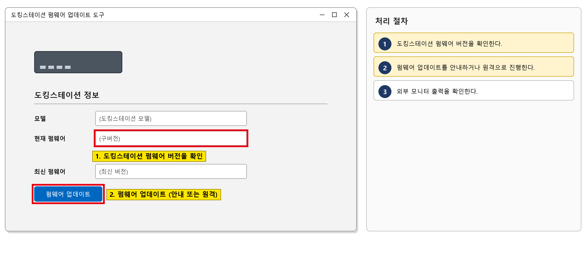

*그림 3.8-2. 도킹스테이션 펌웨어 업데이트 도구 화면. 펌웨어 버전과 업데이트 위치를 표시한다*

#### 처리 후 안내 문구

> 도킹스테이션 펌웨어를 업데이트했습니다. 노트북을 다시 연결해 주세요.

**재발 방지**

- 없음

**이관 시 전달 정보**

- 도킹스테이션 모델·펌웨어 버전
- 모니터 모델
- 사용자가 해 본 조치

### 3.9 듀얼 모니터 중 한 대만 인식됨

**문의 유형** HW-03 · **기본 긴급도** P3 · **1차 처리** 서비스데스크 · **이관 대상** 없음

*그림 3.9-1. 처리 흐름도. 접수 시 확인 질문, 판단 기준, 처리 절차, 처리 후 안내와 이관 정보를 순서대로 표시한다*

**접수 시 확인 질문**

- 케이블을 다시 꽂아 봤나요?
- 다른 케이블로 바꿔 봤나요?

**판단 기준**

- 케이블 교체로 해결되면 즉시 처리한다.
- 케이블을 바꿔도 안 되면 3.10 기준으로 모니터를 점검한다.

#### 처리 절차

1. 케이블 재연결과 [감지]를 안내한다.
2. 불량 케이블을 교체 지급한다.

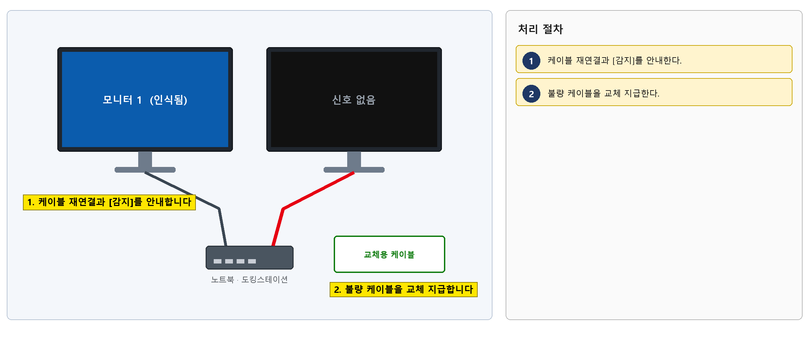

*그림 3.9-2. 듀얼 모니터 연결 그림. 다시 꽂도록 안내할 케이블과 교체 지급할 케이블을 표시한다*

#### 처리 후 안내 문구

> 디스플레이 케이블을 교체했습니다. 두 모니터가 모두 인식되는지 확인해 주세요.

**재발 방지**

- 없음

**이관 시 전달 정보**

- 없음 (서비스데스크에서 종결)

### 3.10 모니터가 깜빡이다 꺼지거나 화면이 일그러짐

**문의 유형** HW-03 · **기본 긴급도** P3 · **1차 처리** 엔드포인트지원팀 · **이관 대상** 없음

*그림 3.10-1. 처리 흐름도. 접수 시 확인 질문, 판단 기준, 처리 절차, 처리 후 안내와 이관 정보를 순서대로 표시한다*

**접수 시 확인 질문**

- 도킹 없이 직접 연결해도 같은가요?
- 증상 사진이 있나요?

**판단 기준**

- 직접 연결에서는 정상이면 도킹 펌웨어 문제로 보고 티켓으로 처리한다.
- 직접 연결에서도 같으면 모니터 패널 불량으로 보고 교체한다.

#### 처리 절차

1. 도킹스테이션 펌웨어를 업데이트한다.
2. 패널 불량이면 모니터를 교체한다.
3. 화면 상태를 확인한다.

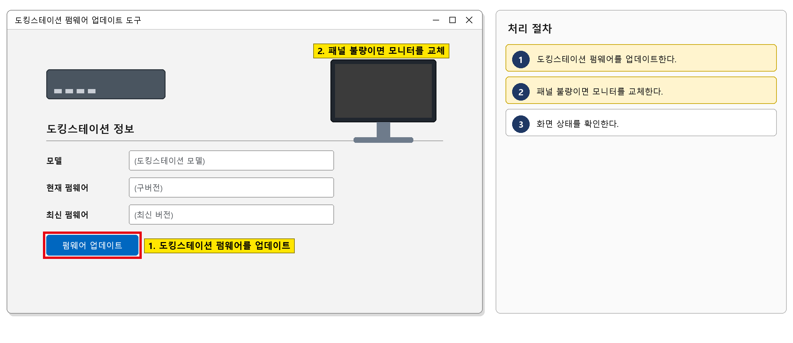

*그림 3.10-2. 도킹스테이션 펌웨어 업데이트 도구 화면. 펌웨어 업데이트 위치를 표시한다*

#### 처리 후 안내 문구

> 도킹스테이션 펌웨어를 업데이트(또는 모니터를 교체)했습니다.

**재발 방지**

- 없음

**이관 시 전달 정보**

- 없음 (엔드포인트지원팀에서 종결)

### 3.11 무선 마우스가 자꾸 끊김

**문의 유형** HW-03 · **기본 긴급도** P3 · **1차 처리** 서비스데스크 · **이관 대상** 없음

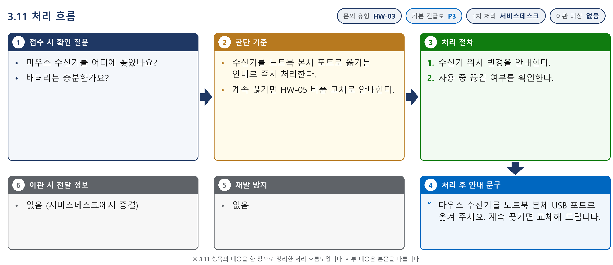

*그림 3.11-1. 처리 흐름도. 접수 시 확인 질문, 판단 기준, 처리 절차, 처리 후 안내와 이관 정보를 순서대로 표시한다*

**접수 시 확인 질문**

- 마우스 수신기를 어디에 꽂았나요?
- 배터리는 충분한가요?

**판단 기준**

- 수신기를 노트북 본체 포트로 옮기는 안내로 즉시 처리한다.
- 계속 끊기면 HW-05 비품 교체로 안내한다.

#### 처리 절차

1. 수신기 위치 변경을 안내한다.
2. 사용 중 끊김 여부를 확인한다.

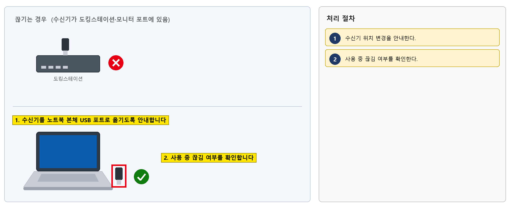

*그림 3.11-2. 무선 마우스 수신기 위치 그림. 사용자에게 안내할 수신기 위치를 표시한다*

#### 처리 후 안내 문구

> 마우스 수신기를 노트북 본체 USB 포트로 옮겨 주세요. 계속 끊기면 교체해 드립니다.

**재발 방지**

- 없음

**이관 시 전달 정보**

- 없음 (서비스데스크에서 종결)

### 3.12 OS 업데이트가 '재시작 중'에서 오래 멈춰 있음

**문의 유형** HW-06 · **기본 긴급도** P3 · **1차 처리** 엔드포인트지원팀 · **이관 대상** 없음

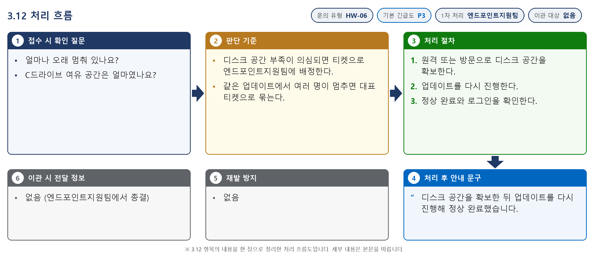

*그림 3.12-1. 처리 흐름도. 접수 시 확인 질문, 판단 기준, 처리 절차, 처리 후 안내와 이관 정보를 순서대로 표시한다*

**접수 시 확인 질문**

- 얼마나 오래 멈춰 있나요?
- C드라이브 여유 공간은 얼마였나요?

**판단 기준**

- 디스크 공간 부족이 의심되면 티켓으로 엔드포인트지원팀에 배정한다.
- 같은 업데이트에서 여러 명이 멈추면 대표 티켓으로 묶는다.

#### 처리 절차

1. 원격 또는 방문으로 디스크 공간을 확보한다.
2. 업데이트를 다시 진행한다.
3. 정상 완료와 로그인을 확인한다.

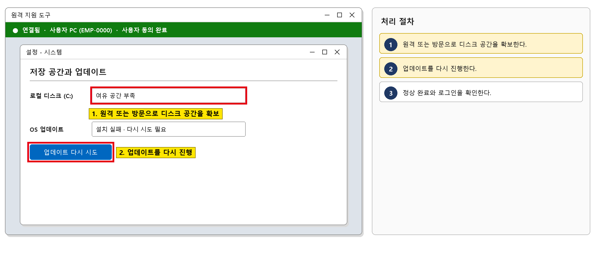

*그림 3.12-2. 원격 지원 도구 화면. 디스크 공간을 확보하고 업데이트를 다시 진행하는 위치를 표시한다*

#### 처리 후 안내 문구

> 디스크 공간을 확보한 뒤 업데이트를 다시 진행해 정상 완료했습니다.

**재발 방지**

- 없음

**이관 시 전달 정보**

- 없음 (엔드포인트지원팀에서 종결)

### 3.13 OS 업데이트 후 소리가 나지 않음

**문의 유형** HW-06 · **기본 긴급도** P3 · **1차 처리** 엔드포인트지원팀 · **이관 대상** 없음

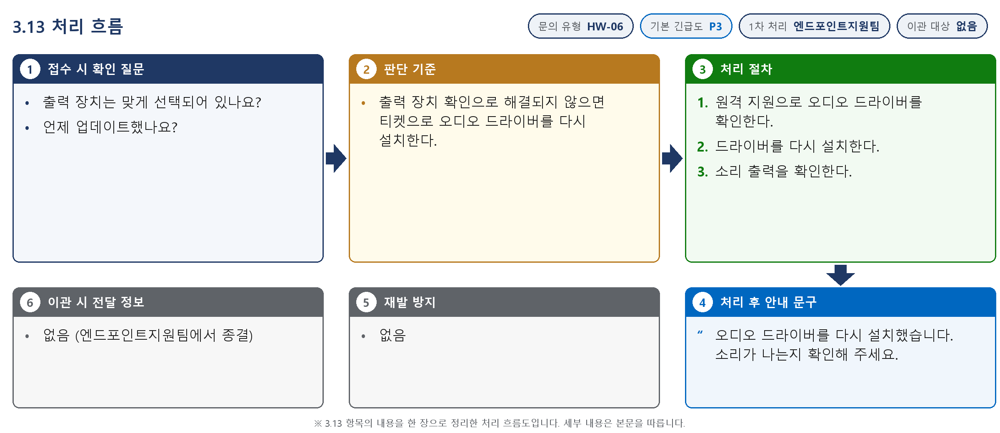

*그림 3.13-1. 처리 흐름도. 접수 시 확인 질문, 판단 기준, 처리 절차, 처리 후 안내와 이관 정보를 순서대로 표시한다*

**접수 시 확인 질문**

- 출력 장치는 맞게 선택되어 있나요?
- 언제 업데이트했나요?

**판단 기준**

- 출력 장치 확인으로 해결되지 않으면 티켓으로 오디오 드라이버를 다시 설치한다.

#### 처리 절차

1. 원격 지원으로 오디오 드라이버를 확인한다.
2. 드라이버를 다시 설치한다.
3. 소리 출력을 확인한다.

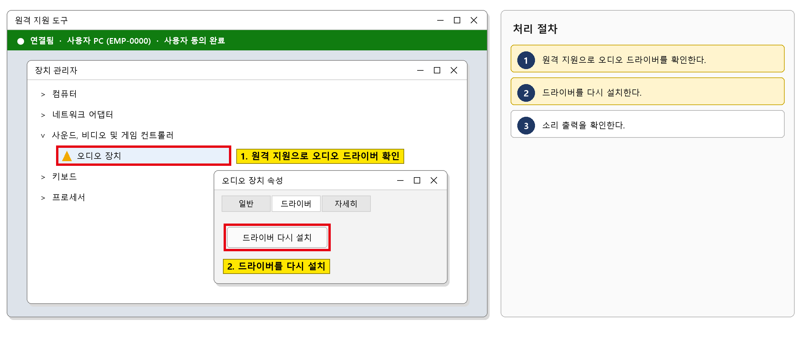

*그림 3.13-2. 원격 지원 도구의 장치 관리자 화면. 오디오 드라이버를 확인하고 다시 설치하는 위치를 표시한다*

#### 처리 후 안내 문구

> 오디오 드라이버를 다시 설치했습니다. 소리가 나는지 확인해 주세요.

**재발 방지**

- 없음

**이관 시 전달 정보**

- 없음 (엔드포인트지원팀에서 종결)

## 4. 대형 장애 대응

1. 같은 OS·드라이버 업데이트 뒤 여러 부서에서 부팅 장애나 같은 오류가 동시에 접수되면 대형 장애로 판단하고 해당 업데이트 배포를 멈춘다.
2. 대표 티켓(MI-YYYY-NN)을 만들고, 같은 증상의 개별 문의는 대표 티켓에 연결한다.
3. 그룹웨어 공지사항에 장애 공지를 올리고 30분마다 갱신한다.
4. 복구 후 개별 문의를 대표 티켓 기준으로 일괄 완료(FIN) 처리하고, IT운영·보안 조직장에게 원인과 재발 방지(드라이버 업데이트 단계적 배포, 파일럿 그룹 선적용)를 보고한다.

## 5. 처리 기록 기준

처리 완료(FIN) 시 티켓에 아래 항목을 남긴다. 반복되는 건은 사용자 가이드 반영 여부를 검토한다.

| 항목 | 기록 내용 |
| --- | --- |
| 원인 | 확인된 원인 한 줄 (예: VPN 클라이언트 구버전 사용) |
| 조치 내용 | 실제로 한 조치. 즉시 처리면 앞에 [즉시 처리] |
| 재발 방지 | 같은 문의를 줄이기 위한 조치 (없으면 '없음') |
| 관련 FAQ | 안내에 쓴 FAQ 번호 |
| 가이드 반영 | 사용자 가이드에 추가·수정이 필요한지 (필요 / 불필요) |

## 부록 · 관련 문서 · 용어

#### 내부 연락처

| 항목 | 내용 |
| --- | --- |
| 서비스데스크 | 내선 1000 |
| 엔드포인트지원팀 | 내선 1030 |
| 정보보안팀 | 내선 1119 |

## 개정 이력

| 버전 | 개정일 | 작성자 | 변경 내용 |
| --- | --- | --- | --- |
| v1.0 | 2026-03-01 | 엔드포인트지원팀 | 최초 작성 |
| v2.0 | 2026-10-16 | 엔드포인트지원팀 | 7개 분류 통합 정리본. 문서 양식·열람 등급·용어·연락처를 통일하고 분류 사이의 중복 내용을 한 문서로 정리 |
