# 프린터·복합기 처리 매뉴얼

> 한화시스템 ICT IT 담당자 매뉴얼 · HW·업무 PC  
> IT-HW-003-M | 서비스데스크 | 2026-10-16 | v2.0 | **사내 제한** (IT 운영 담당자·관리자)
>
> IT운영·보안 조직 내부 문서입니다. 사용자에게 문서 자체를 전달하지 않고, 안내는 짝이 되는 임직원용 가이드를 기준으로 합니다.

## 목차

- 1. 개요
- 2. 접수·분류 기준
- 3. 증상별 처리 절차
  - 3.1 인쇄를 보냈는데 대기열에만 있고 출력되지 않음
  - 3.2 복합기가 프린터 목록에 보이지 않음
  - 3.3 복합기 화면에 '오류 E-xx'가 뜨고 아무도 인쇄할 수 없음
  - 3.4 '메일로 스캔'한 파일이 메일로 오지 않음
  - 3.5 스캔 후 공유폴더에 저장하면 '경로를 찾을 수 없음'이 나옴
  - 3.6 소프트웨어 센터에서 층별 복합기 설치하기
  - 3.7 토너 교체·용지 걸림 반복 시 복합기 점검 요청
- 4. 대형 장애 대응
- 5. 처리 기록 기준
- 부록 · 관련 문서 · 용어
- 개정 이력

## 1. 개요

#### 목적

인쇄 불가(HW-07), 용지·토너(HW-08), 스캔(HW-09) 문의를 접수·처리하는 내부 절차를 정한다. 사용자 안내는 IT-HW-003을 기준으로 한다.

#### 담당 범위

| 항목 | 내용 |
| --- | --- |
| 1차 처리 | 서비스데스크(L1): 인쇄 대기열·스풀러 재시작, 복합기 재등록, 메일 발송 계정 갱신, 스캔 경로 재설정, 토너 교체 |
| 2차 이관 | 없음 (복합기 하드웨어 고장은 유지보수 업체에 출동 요청) |
| 배정 기준 | 서비스데스크 L1 · 프린터·오피스 1차 영역 (HW-07, HW-08, HW-09) |
| 관련 시스템 | 프린트 서버 관리 화면, 복합기 관리 화면, 원격 지원 도구 |

## 2. 접수·분류 기준

사용자 가이드의 블록별 기본값이다. 긴급도 기준은 IT-STD-001 IT 서비스 운영 기준을 따른다.

| 번호 | 문의 유형 | 증상·요청 | 기본 긴급도 | 1차 처리 | 처리 방식 | 이관 대상 |
| --- | --- | --- | --- | --- | --- | --- |
| 3.1 | HW-07 | 인쇄 대기열 멈춤 | P3 | 서비스데스크 | 즉시 처리 후 필요 시 티켓 | 없음 |
| 3.2 | HW-07 | 복합기 목록 미표시 | P3 | 서비스데스크 | 즉시 처리 | 없음 |
| 3.3 | HW-07 | 복합기 오류 코드 | P3 | 서비스데스크 | 티켓 | 없음 |
| 3.4 | HW-09 | 메일로 스캔 미수신 | P3 | 서비스데스크 | 티켓 | 없음 |
| 3.5 | HW-09 | 스캔 공유폴더 경로 오류 | P3 | 서비스데스크 | 티켓 | 없음 |
| 3.6 | HW-07 | 층별 복합기 설치 | P3 | 서비스데스크 | 즉시 처리 후 필요 시 티켓 | 없음 |
| 3.7 | HW-08 | 토너·용지 걸림 | P4 | 서비스데스크 | 티켓 | 없음 |

#### 처리 방식

- 즉시 처리: 서비스데스크(L1)가 안내만으로 끝낸 건. 티켓 없이 상담 기록만 남긴다.
- 티켓: 담당자 조치가 필요한 건. 담당팀에 배정하고 상태를 RDY → WIP → FIN → CLS 으로 관리한다.

#### 긴급도 조정 조건

- 같은 층에서 여러 명이 인쇄하지 못하면 복합기 장애로 보고 위치 단위로 묶어 처리한다.
- 마감 등 당일 업무 차질을 말하면 P3를 P2로 올린다.

## 3. 증상별 처리 절차

### 3.1 인쇄를 보냈는데 대기열에만 있고 출력되지 않음

**문의 유형** HW-07 · **기본 긴급도** P3 · **1차 처리** 서비스데스크 · **이관 대상** 없음

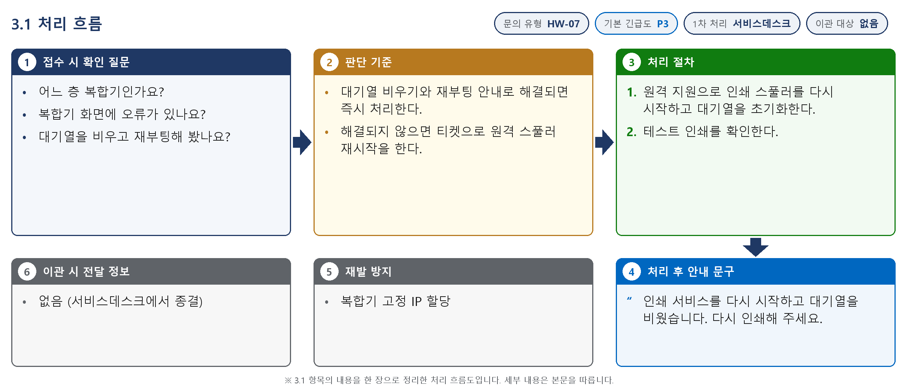

*그림 3.1-1. 처리 흐름도. 접수 시 확인 질문, 판단 기준, 처리 절차, 처리 후 안내와 이관 정보를 순서대로 표시한다*

**접수 시 확인 질문**

- 어느 층 복합기인가요?
- 복합기 화면에 오류가 있나요?
- 대기열을 비우고 재부팅해 봤나요?

**판단 기준**

- 대기열 비우기와 재부팅 안내로 해결되면 즉시 처리한다.
- 해결되지 않으면 티켓으로 원격 스풀러 재시작을 한다.

#### 처리 절차

1. 원격 지원으로 인쇄 스풀러를 다시 시작하고 대기열을 초기화한다.
2. 테스트 인쇄를 확인한다.

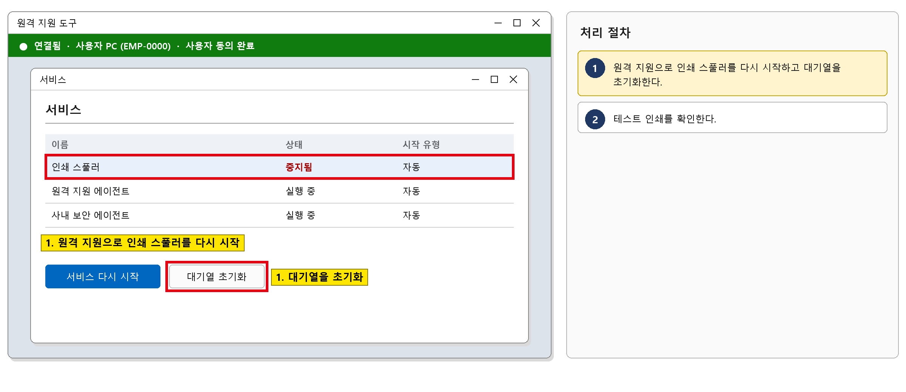

*그림 3.1-2. 원격 지원 도구 화면. 인쇄 스풀러를 다시 시작하고 대기열을 초기화하는 위치를 표시한다*

#### 처리 후 안내 문구

> 인쇄 서비스를 다시 시작하고 대기열을 비웠습니다. 다시 인쇄해 주세요.

**재발 방지**

- 복합기 고정 IP 할당

**이관 시 전달 정보**

- 없음 (서비스데스크에서 종결)

### 3.2 복합기가 프린터 목록에 보이지 않음

**문의 유형** HW-07 · **기본 긴급도** P3 · **1차 처리** 서비스데스크 · **이관 대상** 없음

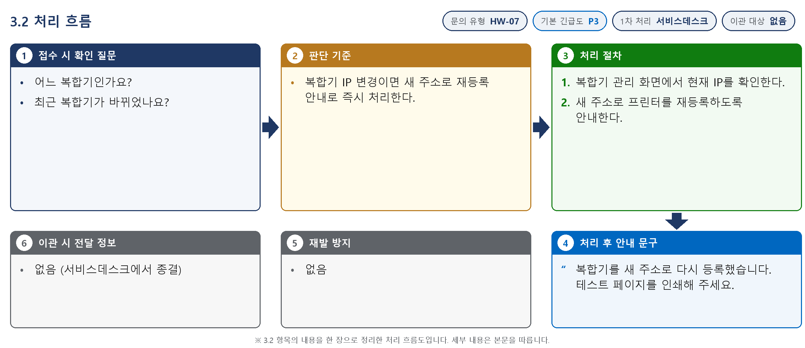

*그림 3.2-1. 처리 흐름도. 접수 시 확인 질문, 판단 기준, 처리 절차, 처리 후 안내와 이관 정보를 순서대로 표시한다*

**접수 시 확인 질문**

- 어느 복합기인가요?
- 최근 복합기가 바뀌었나요?

**판단 기준**

- 복합기 IP 변경이면 새 주소로 재등록 안내로 즉시 처리한다.

#### 처리 절차

1. 복합기 관리 화면에서 현재 IP를 확인한다.
2. 새 주소로 프린터를 재등록하도록 안내한다.

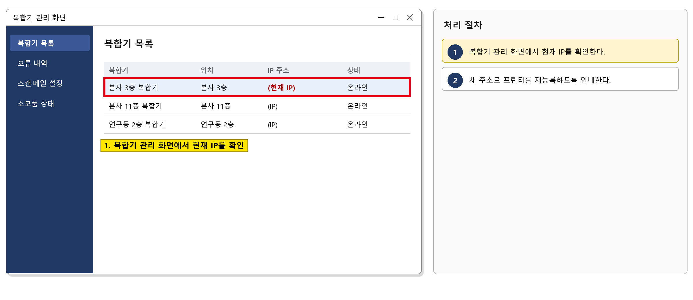

*그림 3.2-2. 복합기 관리 화면. 복합기의 현재 IP를 확인하는 위치를 표시한다*

#### 처리 후 안내 문구

> 복합기를 새 주소로 다시 등록했습니다. 테스트 페이지를 인쇄해 주세요.

**재발 방지**

- 없음

**이관 시 전달 정보**

- 없음 (서비스데스크에서 종결)

### 3.3 복합기 화면에 '오류 E-xx'가 뜨고 아무도 인쇄할 수 없음

**문의 유형** HW-07 · **기본 긴급도** P3 · **1차 처리** 서비스데스크 · **이관 대상** 없음

*그림 3.3-1. 처리 흐름도. 접수 시 확인 질문, 판단 기준, 처리 절차, 처리 후 안내와 이관 정보를 순서대로 표시한다*

**접수 시 확인 질문**

- 오류 코드는 무엇인가요?
- 전원을 껐다 켜 봤나요?

**판단 기준**

- 전원 재시작 후에도 같은 오류면 티켓으로 유지보수 업체 출동을 요청한다.

#### 처리 절차

1. 복합기 관리 화면에서 오류 내역을 확인한다.
2. 유지보수 업체에 출동을 요청한다.
3. 수리 후 인쇄를 확인하고 사용자에게 알린다.

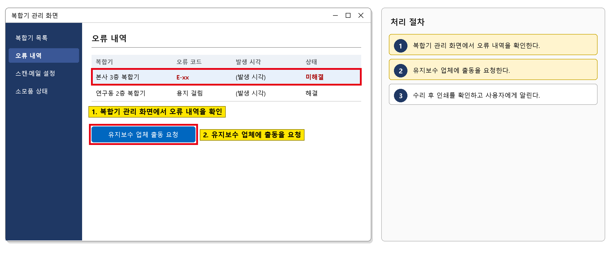

*그림 3.3-2. 복합기 관리 화면. 오류 내역을 확인하고 업체 출동을 요청하는 위치를 표시한다*

#### 처리 후 안내 문구

> 복합기 수리를 마쳤습니다. 다시 인쇄할 수 있습니다.

**재발 방지**

- 복합기 고정 IP 할당

**이관 시 전달 정보**

- 유지보수 업체 출동 요청 시: 복합기 위치·모델·오류 코드

### 3.4 '메일로 스캔'한 파일이 메일로 오지 않음

**문의 유형** HW-09 · **기본 긴급도** P3 · **1차 처리** 서비스데스크 · **이관 대상** 없음

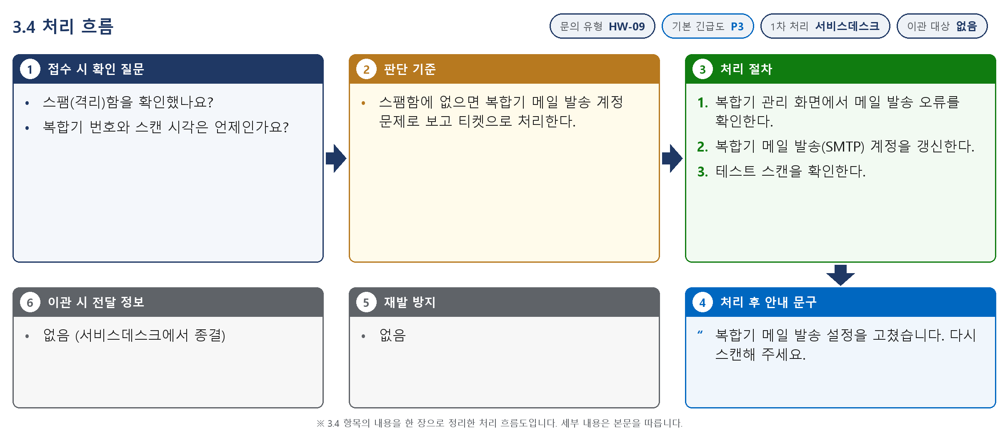

*그림 3.4-1. 처리 흐름도. 접수 시 확인 질문, 판단 기준, 처리 절차, 처리 후 안내와 이관 정보를 순서대로 표시한다*

**접수 시 확인 질문**

- 스팸(격리)함을 확인했나요?
- 복합기 번호와 스캔 시각은 언제인가요?

**판단 기준**

- 스팸함에 없으면 복합기 메일 발송 계정 문제로 보고 티켓으로 처리한다.

#### 처리 절차

1. 복합기 관리 화면에서 메일 발송 오류를 확인한다.
2. 복합기 메일 발송(SMTP) 계정을 갱신한다.
3. 테스트 스캔을 확인한다.

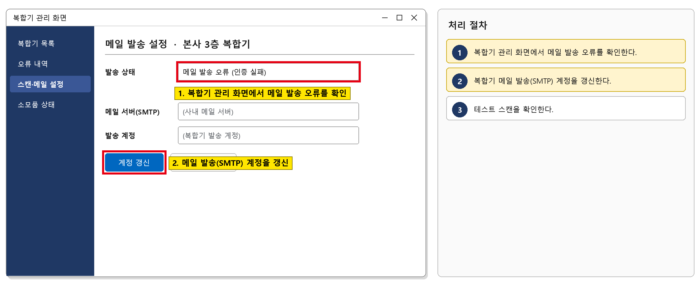

*그림 3.4-2. 복합기 관리 화면. 메일 발송 오류를 확인하고 발송 계정을 갱신하는 위치를 표시한다*

#### 처리 후 안내 문구

> 복합기 메일 발송 설정을 고쳤습니다. 다시 스캔해 주세요.

**재발 방지**

- 없음

**이관 시 전달 정보**

- 없음 (서비스데스크에서 종결)

### 3.5 스캔 후 공유폴더에 저장하면 '경로를 찾을 수 없음'이 나옴

**문의 유형** HW-09 · **기본 긴급도** P3 · **1차 처리** 서비스데스크 · **이관 대상** 없음

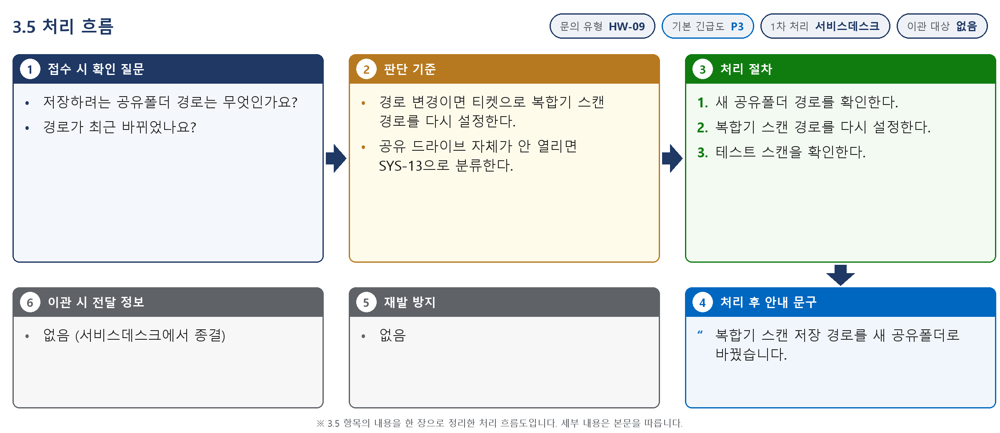

*그림 3.5-1. 처리 흐름도. 접수 시 확인 질문, 판단 기준, 처리 절차, 처리 후 안내와 이관 정보를 순서대로 표시한다*

**접수 시 확인 질문**

- 저장하려는 공유폴더 경로는 무엇인가요?
- 경로가 최근 바뀌었나요?

**판단 기준**

- 경로 변경이면 티켓으로 복합기 스캔 경로를 다시 설정한다.
- 공유 드라이브 자체가 안 열리면 SYS-13으로 분류한다.

#### 처리 절차

1. 새 공유폴더 경로를 확인한다.
2. 복합기 스캔 경로를 다시 설정한다.
3. 테스트 스캔을 확인한다.

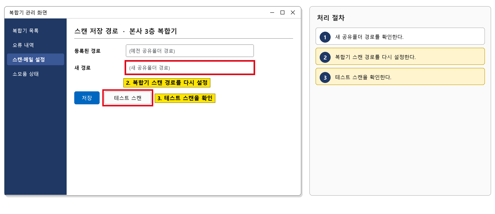

*그림 3.5-2. 복합기 관리 화면. 스캔 저장 경로를 다시 설정하는 위치를 표시한다*

#### 처리 후 안내 문구

> 복합기 스캔 저장 경로를 새 공유폴더로 바꿨습니다.

**재발 방지**

- 없음

**이관 시 전달 정보**

- 없음 (서비스데스크에서 종결)

### 3.6 소프트웨어 센터에서 층별 복합기 설치하기

**문의 유형** HW-07 · **기본 긴급도** P3 · **1차 처리** 서비스데스크 · **이관 대상** 없음

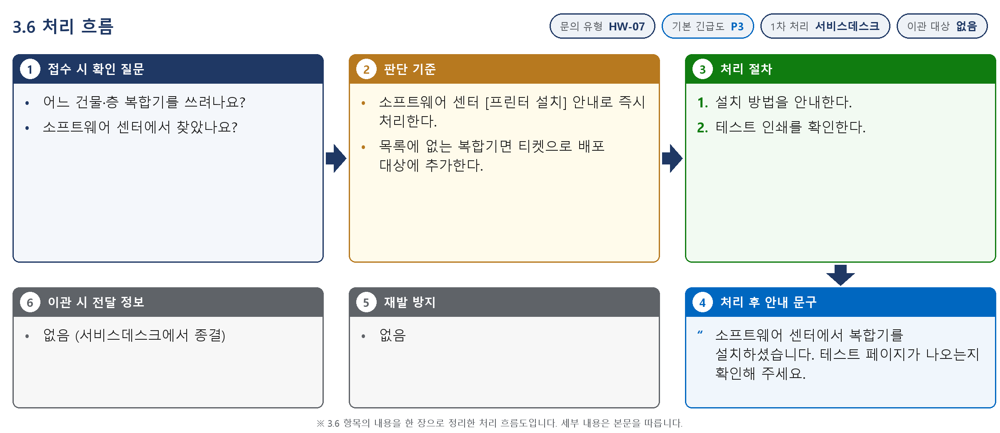

*그림 3.6-1. 처리 흐름도. 접수 시 확인 질문, 판단 기준, 처리 절차, 처리 후 안내와 이관 정보를 순서대로 표시한다*

**접수 시 확인 질문**

- 어느 건물·층 복합기를 쓰려나요?
- 소프트웨어 센터에서 찾았나요?

**판단 기준**

- 소프트웨어 센터 [프린터 설치] 안내로 즉시 처리한다.
- 목록에 없는 복합기면 티켓으로 배포 대상에 추가한다.

#### 처리 절차

1. 설치 방법을 안내한다.
2. 테스트 인쇄를 확인한다.

![그림 3.6-2. 소프트웨어 센터 [프린터 설치] 화면. 사용자에게 안내할 설치 위치를 표시한다](../images/IT-HW-003-M_12.png)

*그림 3.6-2. 소프트웨어 센터 [프린터 설치] 화면. 사용자에게 안내할 설치 위치를 표시한다*

#### 처리 후 안내 문구

> 소프트웨어 센터에서 복합기를 설치하셨습니다. 테스트 페이지가 나오는지 확인해 주세요.

**재발 방지**

- 없음

**이관 시 전달 정보**

- 없음 (서비스데스크에서 종결)

### 3.7 토너 교체·용지 걸림 반복 시 복합기 점검 요청

**문의 유형** HW-08 · **기본 긴급도** P4 · **1차 처리** 서비스데스크 · **이관 대상** 없음

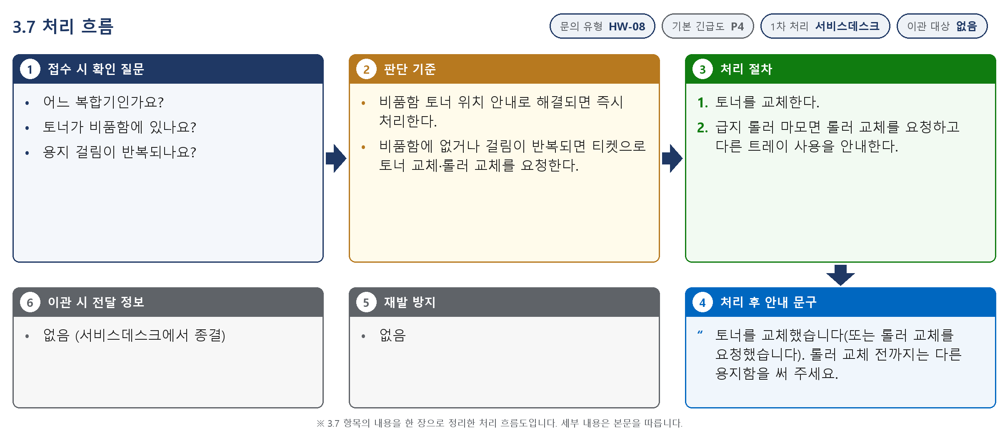

*그림 3.7-1. 처리 흐름도. 접수 시 확인 질문, 판단 기준, 처리 절차, 처리 후 안내와 이관 정보를 순서대로 표시한다*

**접수 시 확인 질문**

- 어느 복합기인가요?
- 토너가 비품함에 있나요?
- 용지 걸림이 반복되나요?

**판단 기준**

- 비품함 토너 위치 안내로 해결되면 즉시 처리한다.
- 비품함에 없거나 걸림이 반복되면 티켓으로 토너 교체·롤러 교체를 요청한다.

#### 처리 절차

1. 토너를 교체한다.
2. 급지 롤러 마모면 롤러 교체를 요청하고 다른 트레이 사용을 안내한다.

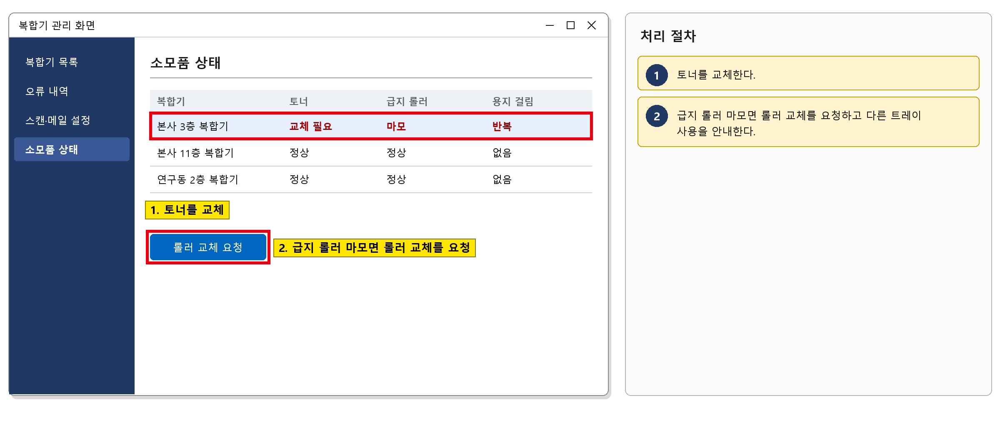

*그림 3.7-2. 복합기 관리 화면. 소모품 상태를 확인하고 롤러 교체를 요청하는 위치를 표시한다*

#### 처리 후 안내 문구

> 토너를 교체했습니다(또는 롤러 교체를 요청했습니다). 롤러 교체 전까지는 다른 용지함을 써 주세요.

**재발 방지**

- 없음

**이관 시 전달 정보**

- 없음 (서비스데스크에서 종결)

## 4. 대형 장애 대응

1. 여러 층 복합기가 동시에 인쇄·스캔되지 않으면 프린트 서버 장애로 보고 대형 장애로 판단한다.
2. 대표 티켓(MI-YYYY-NN)을 만들고, 같은 증상의 개별 문의는 대표 티켓에 연결한다.
3. 그룹웨어 공지사항에 장애 공지를 올리고 30분마다 갱신한다.
4. 복구 후 개별 문의를 대표 티켓 기준으로 일괄 완료(FIN) 처리하고, IT운영·보안 조직장에게 원인을 보고한다.

## 5. 처리 기록 기준

처리 완료(FIN) 시 티켓에 아래 항목을 남긴다. 반복되는 건은 사용자 가이드 반영 여부를 검토한다.

| 항목 | 기록 내용 |
| --- | --- |
| 원인 | 확인된 원인 한 줄 (예: VPN 클라이언트 구버전 사용) |
| 조치 내용 | 실제로 한 조치. 즉시 처리면 앞에 [즉시 처리] |
| 재발 방지 | 같은 문의를 줄이기 위한 조치 (없으면 '없음') |
| 관련 FAQ | 안내에 쓴 FAQ 번호 |
| 가이드 반영 | 사용자 가이드에 추가·수정이 필요한지 (필요 / 불필요) |

## 부록 · 관련 문서 · 용어

#### 내부 연락처

| 항목 | 내용 |
| --- | --- |
| 서비스데스크 | 내선 1000 |
| 정보보안팀 | 내선 1119 |

## 개정 이력

| 버전 | 개정일 | 작성자 | 변경 내용 |
| --- | --- | --- | --- |
| v1.0 | 2026-03-01 | 서비스데스크 | 최초 작성 |
| v2.0 | 2026-10-16 | 서비스데스크 | 7개 분류 통합 정리본. 문서 양식·열람 등급·용어·연락처를 통일하고 분류 사이의 중복 내용을 한 문서로 정리 |
