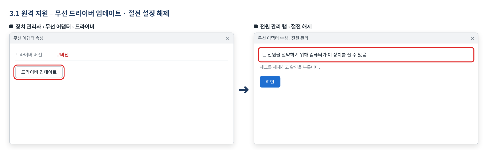
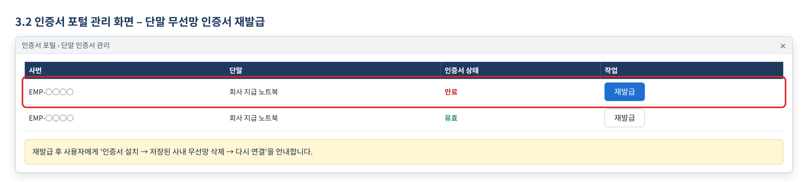
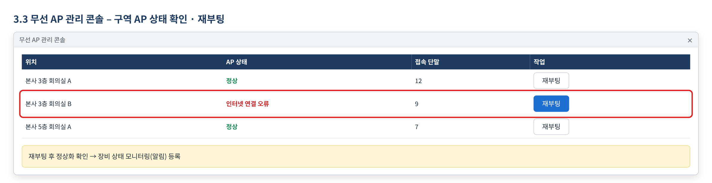
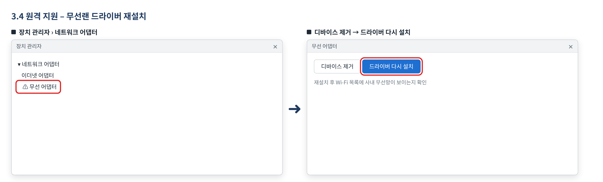
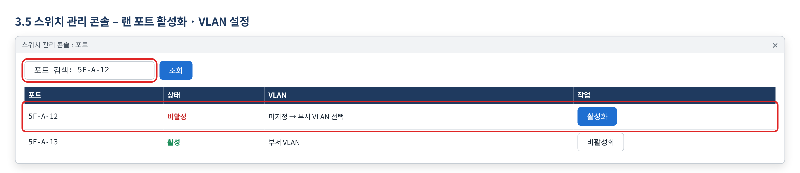
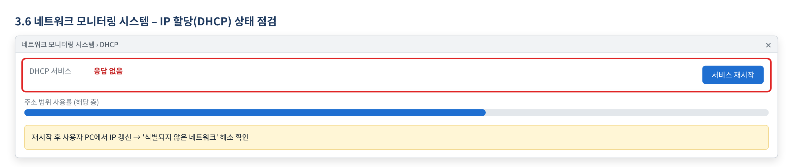
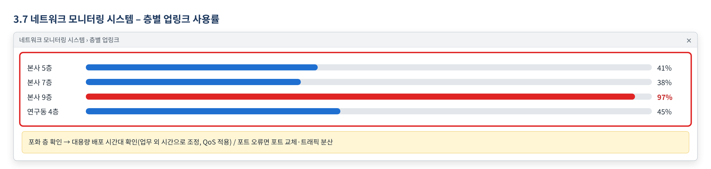

# 사내 네트워크 장애 처리 매뉴얼

> 한화시스템 ICT IT 담당자 매뉴얼 · VPN·네트워크  
> IT-NET-002-M | 네트워크팀 | 2026-10-16 | v2.0 | **사내 제한** (IT 운영 담당자·관리자)
>
> IT운영·보안 조직 내부 문서입니다. 사용자에게 문서 자체를 전달하지 않고, 안내는 짝이 되는 임직원용 가이드를 기준으로 합니다.

## 목차

- 1. 개요
- 2. 접수·분류 기준
- 3. 증상별 처리 절차
  - 3.1 사내 Wi-Fi가 연결됐다 끊겼다 함
  - 3.2 Wi-Fi 연결 시 '인증서를 확인할 수 없습니다' 오류
  - 3.3 사내 Wi-Fi 연결은 되는데 인터넷이 안 됨
  - 3.4 Wi-Fi 목록에 사내 무선망이 보이지 않음
  - 3.5 자리 이동 후 랜선 연결 시 '네트워크 연결 없음'
  - 3.6 랜선 연결 시 '식별되지 않은 네트워크' 표시
  - 3.7 인터넷이 너무 느리거나 화상회의가 계속 끊김
- 4. 대형 장애 대응
- 5. 처리 기록 기준
- 부록 · 관련 문서 · 용어
- 개정 이력

## 1. 개요

#### 목적

IT-NET-002로 들어오는 사내 Wi-Fi·유선 LAN·인터넷 속도 저하 문의를 서비스데스크가 접수·분류하고, 네트워크팀이 장비·설정을 조치하는 기준과 절차를 정한다.

#### 담당 범위

| 항목 | 내용 |
| --- | --- |
| 1차 처리 | 서비스데스크(L1): 증상·위치·포트 번호 확인, Wi-Fi 프로필 재설정 안내로 즉시 처리, 장비 조치가 필요한 건 티켓 생성 |
| 2차 이관 | 네트워크팀(L2): 무선 AP 점검·재부팅, 무선망 인증서 재발급, 무선랜 드라이버 재설치, 랜 포트 활성화·VLAN 설정, IP 할당(DHCP) 점검, 대역폭·스위치 점검 |
| 배정 담당 | 조민재 (무선·유선 LAN), 정서현 (무선·유선 LAN), 성민경 (인터넷·백본), 함성진 (인터넷·백본) |
| 관련 시스템 | 네트워크 모니터링 시스템, 무선 AP 관리 콘솔, 스위치 관리 콘솔, 인증서 포털 |

## 2. 접수·분류 기준

사용자 가이드의 블록별 기본값이다. 긴급도 기준은 IT-STD-001 IT 서비스 운영 기준을 따른다.

| 번호 | 문의 유형 | 증상·요청 | 기본 긴급도 | 1차 처리 | 처리 방식 | 이관 대상 |
| --- | --- | --- | --- | --- | --- | --- |
| 3.1 | NET-01 | 사내 Wi-Fi가 연결됐다 끊겼다 함 | P3 | 서비스데스크 | 즉시 처리 후 필요 시 티켓 | 네트워크팀 |
| 3.2 | NET-01 | Wi-Fi 연결 시 '인증서를 확인할 수 없습니다' 오류 | P3 | 서비스데스크 | 티켓 | 네트워크팀 |
| 3.3 | NET-01 | 사내 Wi-Fi 연결은 되는데 인터넷이 안 됨 | P3 | 서비스데스크 | 티켓 | 네트워크팀 |
| 3.4 | NET-01 | Wi-Fi 목록에 사내 무선망이 보이지 않음 | P3 | 서비스데스크 | 티켓 | 네트워크팀 |
| 3.5 | NET-05 | 자리 이동 후 랜선 연결 시 '네트워크 연결 없음' | P3 | 서비스데스크 | 티켓 | 네트워크팀 |
| 3.6 | NET-05 | 랜선 연결 시 '식별되지 않은 네트워크' 표시 | P3 | 서비스데스크 | 티켓 | 네트워크팀 |
| 3.7 | NET-04 | 인터넷이 너무 느리거나 화상회의가 계속 끊김 | P2 | 서비스데스크 | 티켓 | 네트워크팀 |

#### 처리 방식

- 즉시 처리: 서비스데스크(L1)가 안내만으로 끝낸 건. 티켓 없이 상담 기록만 남긴다.
- 티켓: 담당자 조치가 필요한 건. 담당팀에 배정하고 상태를 RDY → WIP → FIN → CLS 으로 관리한다.

#### 긴급도 조정 조건

- 여러 층·부서에서 네트워크를 전혀 쓸 수 없으면 NET-03(P1)으로 전환하고 IT-NET-003-M 절차를 따른다.
- 고객 미팅 등 당일 일정에 차질이 있거나 급하다고 하면 P3을 P2로 한 단계 올린다 (예: INQ-2026-00180, INQ-2026-00196).
- 같은 구역에서 여러 명이 Wi-Fi 인터넷 불가를 알리면 AP 장애(3.3)로 묶어 우선 배정한다.

## 3. 증상별 처리 절차

### 3.1 사내 Wi-Fi가 연결됐다 끊겼다 함

**문의 유형** NET-01 · **기본 긴급도** P3 · **1차 처리** 서비스데스크 · **이관 대상** 네트워크팀

**접수 시 확인 질문**

- 연결됐다 끊기나요, 아예 연결이 안 되나요? 위치는 어디인가요?
- 같은 장소의 다른 사람도 끊기나요, 내 노트북만 그런가요?
- 저장된 사내 무선망을 삭제하고 다시 연결해 봤나요?

**판단 기준**

- 즉시 처리: 사내 Wi-Fi 프로필 삭제 후 재연결로 해결되면 끝낸다 (INQ-2026-00352).
- 티켓: 내 노트북만 반복해서 끊기면 네트워크팀이 무선 드라이버와 절전 설정을 점검한다 (INQ-2026-00377).
- 같은 장소 여러 명이 겪으면 3.3(AP 장애)으로 분류한다.

#### 처리 절차

1. Wi-Fi 프로필 삭제 후 재연결을 안내한다.
2. 해결되지 않으면 티켓을 만들어 네트워크팀에 배정한다.
3. 네트워크팀이 원격 지원으로 무선 드라이버를 업데이트하고 전원 관리의 절전 설정을 해제한다.
4. 같은 장소에서 끊기지 않는지 사용자와 확인하고 FIN 처리한다.

*그림 3.1-1. 원격 지원으로 무선 어댑터 드라이버를 업데이트하고 전원 관리의 절전 설정을 해제하는 화면*

#### 처리 후 안내 문구

> 사내 Wi-Fi가 끊기던 문제로 무선 드라이버를 업데이트하고 절전 설정을 해제했습니다. 다시 끊기면 위치와 시각을 알려 주세요.

**재발 방지**

- 문의이력에 재발 방지 기록 없음
- 같은 노트북 모델 문의가 반복되면 드라이버 일괄 업데이트 필요 여부를 검토한다.

**이관 시 전달 정보**

- 위치, 끊기는 빈도·시각
- 노트북 모델과 OS
- 프로필 재설정 결과

### 3.2 Wi-Fi 연결 시 '인증서를 확인할 수 없습니다' 오류

**문의 유형** NET-01 · **기본 긴급도** P3 · **1차 처리** 서비스데스크 · **이관 대상** 네트워크팀

**접수 시 확인 질문**

- 화면 메시지가 '인증서를 확인할 수 없습니다'인가요?
- 언제부터 그런가요? 유선 LAN은 되나요?
- 회사 지급 PC인가요?

**판단 기준**

- 즉시 처리 대상이 아니다. 인증서 재발급이 필요하므로 티켓으로 네트워크팀에 이관한다 (이력 4건 모두 티켓).
- 개인 기기라면 게스트 Wi-Fi만 쓸 수 있음을 안내하고 끝낸다 (FAQ-037).

#### 처리 절차

1. 화면 메시지를 확인하고 티켓을 만들어 네트워크팀에 배정한다.
2. 네트워크팀이 인증서 포털에서 해당 단말의 무선망 인증서를 재발급한다.
3. 사용자에게 새 인증서 설치와 사내 무선망 재연결 방법을 안내한다.
4. 정상 연결을 확인하고 FIN 처리한다 (INQ-2026-00133).

*그림 3.2-1. 인증서 포털의 단말 인증서 관리 화면에서 만료된 인증서를 재발급하는 화면*

#### 처리 후 안내 문구

> 사내 무선망 인증서를 재발급했습니다. 안내드린 방법으로 새 인증서를 설치한 뒤 저장된 사내 무선망을 삭제하고 다시 연결해 주세요.

**재발 방지**

- 문의이력 기록: AP 상태 모니터링 알림 등록
- 단말 무선 인증서 만료 문의가 반복되므로 만료 전 사전 안내 여부를 검토한다.

**이관 시 전달 정보**

- 화면 메시지, 사번
- PC 정보(노트북 모델·OS)
- 발생 시각과 유선 LAN 사용 가능 여부

### 3.3 사내 Wi-Fi 연결은 되는데 인터넷이 안 됨

**문의 유형** NET-01 · **기본 긴급도** P3 · **1차 처리** 서비스데스크 · **이관 대상** 네트워크팀

**접수 시 확인 질문**

- 건물·층·회의실 위치는 어디인가요?
- 같은 장소의 다른 사람도 연결은 되는데 인터넷이 안 되나요?
- 급한 일정(고객 미팅 등)이 있나요?

**판단 기준**

- 즉시 처리 대상이 아니다. 평가셋 기준 담당자 배정(네트워크팀 이관)이 정답이다.
- 여러 명이 같은 장소에서 겪으면 하나의 티켓으로 묶어 우선 배정한다.
- 같은 증상이 여러 층에서 동시에 접수되면 NET-03으로 전환한다.

#### 처리 절차

1. 위치와 영향 인원을 확인해 티켓을 만들고 네트워크팀에 배정한다.
2. 네트워크팀이 무선 AP 관리 콘솔에서 해당 구역 AP 상태를 확인한다.
3. 해당 구역 무선 AP를 재부팅해 정상화하고, 장비 상태 모니터링에 등록한다 (INQ-2026-00004 등 7건).
4. 같은 장소에서 인터넷이 되는지 사용자와 확인하고 FIN 처리한다.

*그림 3.3-1. 무선 AP 관리 콘솔에서 오류 구역 AP를 확인하고 재부팅하는 화면*

#### 처리 후 안내 문구

> 본사 ○층 회의실 무선 AP를 재부팅해 정상화했습니다. 같은 증상이 다시 생기면 위치를 알려 주세요.

**재발 방지**

- AP 상태 모니터링 알림 등록 (문의이력)

**이관 시 전달 정보**

- 건물·층·회의실 위치
- 영향 인원과 발생 시각
- 급한 일정 여부

### 3.4 Wi-Fi 목록에 사내 무선망이 보이지 않음

**문의 유형** NET-01 · **기본 긴급도** P3 · **1차 처리** 서비스데스크 · **이관 대상** 네트워크팀

**접수 시 확인 질문**

- 비행기 모드가 꺼져 있고 Wi-Fi가 켜져 있나요?
- 목록에 다른 무선망은 보이나요? 같은 자리 다른 사람에게는 보이나요?
- 재부팅해 봤나요?

**판단 기준**

- 즉시 처리: 비행기 모드 등 설정 문제로 확인되면 안내로 끝낸다.
- 티켓: 설정에 문제가 없는데 사내 무선망이 안 보이면 무선랜 드라이버 재설치가 필요하다 (이력 6건 모두 티켓).

#### 처리 절차

1. 비행기 모드·Wi-Fi 켜짐 여부와 재부팅을 안내한다.
2. 해결되지 않으면 티켓을 만들어 네트워크팀에 배정한다.
3. 네트워크팀이 원격 지원으로 무선랜 드라이버를 다시 설치한다.
4. 사내 무선망이 보이고 연결되는지 확인하고 FIN 처리한다 (INQ-2026-00034).

*그림 3.4-1. 원격 지원으로 장치 관리자에서 무선 어댑터 드라이버를 다시 설치하는 화면*

#### 처리 후 안내 문구

> 무선랜 드라이버를 다시 설치해 사내 무선망 연결을 확인했습니다. 다시 보이지 않으면 바로 알려 주세요.

**재발 방지**

- 문의이력 기록: AP 상태 모니터링 알림 등록
- 드라이버를 다시 설치해도 반복되는 노트북은 엔드포인트지원팀 장비 점검으로 연결한다.

**이관 시 전달 정보**

- 노트북 모델과 OS
- 목록에 보이는 무선망
- 사용자가 해 본 조치

### 3.5 자리 이동 후 랜선 연결 시 '네트워크 연결 없음'

**문의 유형** NET-05 · **기본 긴급도** P3 · **1차 처리** 서비스데스크 · **이관 대상** 네트워크팀

**접수 시 확인 질문**

- 벽면 포트 번호(예: 5F-A-12)는 무엇인가요?
- 자리를 옮긴 날짜는 언제인가요? 케이블을 확인했나요?
- 화면 메시지는 '네트워크 연결 없음'인가요?

**판단 기준**

- 즉시 처리 대상이 아니다. 평가셋 기준 포트 번호를 받아 네트워크팀에 이관한다.
- 포트 번호를 모르면 먼저 확인을 요청한 뒤 티켓을 만든다.

#### 처리 절차

1. 포트 번호와 위치를 받아 티켓을 만들고 네트워크팀에 배정한다.
2. 네트워크팀이 스위치 관리 콘솔에서 해당 포트를 활성화하고 VLAN을 설정한다.
3. 사용자에게 랜선을 다시 꽂아 연결을 확인하도록 안내한다.
4. 정상 연결을 확인하고 FIN 처리한다 (INQ-2026-00122).

*그림 3.5-1. 스위치 관리 콘솔에서 포트 번호로 조회해 포트를 활성화하고 VLAN을 지정하는 화면*

#### 처리 후 안내 문구

> 요청하신 벽면 포트를 활성화했습니다. 랜선을 다시 꽂아 연결을 확인해 주세요.

**재발 방지**

- 문의이력에 재발 방지 기록 없음
- 자리 이동 요청이 있을 때 포트 활성화를 함께 처리하는지 검토한다.

**이관 시 전달 정보**

- 벽면 포트 번호와 위치
- 자리 이동 날짜
- 화면 메시지와 케이블 확인 여부

### 3.6 랜선 연결 시 '식별되지 않은 네트워크' 표시

**문의 유형** NET-05 · **기본 긴급도** P3 · **1차 처리** 서비스데스크 · **이관 대상** 네트워크팀

**접수 시 확인 질문**

- 화면 메시지가 '식별되지 않은 네트워크'인가요?
- 벽면 포트 번호와 위치는 어디인가요?
- 같은 층 다른 사람도 같은 증상인가요? 재부팅해 봤나요?

**판단 기준**

- 즉시 처리: 랜선 재연결이나 재부팅으로 IP를 받으면 끝낸다.
- 티켓: 재부팅 후에도 같으면 IP 할당(DHCP) 점검이 필요하다 (이력 2건 모두 티켓).

#### 처리 절차

1. 랜선 재연결과 재부팅을 안내한다.
2. 해결되지 않으면 티켓을 만들어 네트워크팀에 배정한다.
3. 네트워크팀이 DHCP 서비스 상태를 확인해 재시작하고 사용자 IP를 갱신한다.
4. 인터넷 연결을 확인하고 FIN 처리한다 (INQ-2026-00012, INQ-2026-00238).

*그림 3.6-1. 네트워크 모니터링 시스템에서 DHCP 서비스 상태와 주소 범위 사용률을 확인하는 화면*

#### 처리 후 안내 문구

> IP 자동 할당 문제를 조치하고 IP를 갱신했습니다. 지금 인터넷 연결을 확인해 주세요.

**재발 방지**

- 문의이력에 재발 방지 기록 없음
- 같은 구역에서 반복되면 DHCP 주소 범위와 서비스 상태를 점검한다.

**이관 시 전달 정보**

- 벽면 포트 번호와 위치
- 화면 메시지
- 같은 증상 범위

### 3.7 인터넷이 너무 느리거나 화상회의가 계속 끊김

**문의 유형** NET-04 · **기본 긴급도** P2 · **1차 처리** 서비스데스크 · **이관 대상** 네트워크팀

**접수 시 확인 질문**

- 건물·층은 어디이며, 같은 층·팀 전체가 느린가요?
- 언제부터 느린가요? 특정 시간대에 반복되나요?
- 느린 서비스는 무엇인가요(웹, 화상회의, 사내 시스템)?

**판단 기준**

- 즉시 처리 대상이 아니다. 평가셋 기준 부서 단위 속도 저하는 P2로 네트워크팀에 이관한다.
- 혼자만 느리면 PC 문제일 수 있으므로 HW-01 기준으로 다시 분류한다.
- 여러 층·부서에서 네트워크를 전혀 쓸 수 없으면 NET-03으로 전환한다.

#### 처리 절차

1. 건물·층과 영향 범위를 확인해 P2 티켓을 만들고 네트워크팀에 배정한다.
2. 네트워크팀이 네트워크 모니터링 시스템에서 해당 층 스위치 업링크 사용량과 포트 상태를 확인한다.
3. 대용량 업데이트 배포가 원인이면 배포를 업무 외 시간으로 옮기고 QoS 정책을 적용한다 (INQ-2026-00010 등 7건).
4. 업링크 포트 오류면 포트 교체·트래픽 분산, 대역폭 포화면 업링크를 증설한다 (INQ-2026-00177, INQ-2026-00380).
5. 같은 층 속도가 정상인지 사용자와 확인하고 FIN 처리한다.

*그림 3.7-1. 네트워크 모니터링 시스템에서 층별 업링크 사용률을 확인해 포화 층을 찾는 화면*

#### 처리 후 안내 문구

> 본사 ○층 네트워크 속도 저하를 조치했습니다. 대용량 배포 시간을 업무 외 시간으로 옮기고 트래픽 우선순위를 적용했습니다. 다시 느려지면 시간대를 알려 주세요.

**재발 방지**

- 대용량 배포 작업 업무시간 외 수행 원칙 수립 (문의이력)
- 스위치 대역폭 사용률 알림 등록 (문의이력)

**이관 시 전달 정보**

- 건물·층, 영향 팀·인원
- 시작 시각과 반복 시간대
- 느린 서비스

## 4. 대형 장애 대응

1. 여러 층·부서에서 사내망·인터넷을 전혀 쓸 수 없으면 NET-03 전사 장애로 판단하고 IT-NET-003-M 절차로 넘긴다. 같은 층의 Wi-Fi 장애나 속도 저하는 NET-01·NET-04 티켓으로 처리한다.
2. 대표 티켓(MI-YYYY-NN)을 만들고, 같은 증상의 개별 문의는 대표 티켓에 연결한다.
3. 공지 방법과 갱신 주기는 IT-NET-003-M 4장을 따른다.
4. 복구 후 개별 문의 일괄 완료 처리와 원인 보고는 IT-NET-003-M 4장을 따른다.

## 5. 처리 기록 기준

처리 완료(FIN) 시 티켓에 아래 항목을 남긴다. 반복되는 건은 사용자 가이드 반영 여부를 검토한다.

| 항목 | 기록 내용 |
| --- | --- |
| 원인 | 확인된 원인 한 줄 (예: VPN 클라이언트 구버전 사용) |
| 조치 내용 | 실제로 한 조치. 즉시 처리면 앞에 [즉시 처리] |
| 재발 방지 | 같은 문의를 줄이기 위한 조치 (없으면 빈칸) |
| 관련 FAQ | 안내에 쓴 FAQ 번호 |
| 가이드 반영 | 사용자 가이드에 추가·수정이 필요한지 (필요 / 불필요) |

## 부록 · 관련 문서 · 용어

#### 내부 연락처

| 항목 | 내용 |
| --- | --- |
| 서비스데스크 | IT 헬프데스크 내선 1000 |
| 네트워크팀 | 내선 1040 |
| 엔드포인트지원팀 | 내선 1030 |

## 개정 이력

| 버전 | 개정일 | 작성자 | 변경 내용 |
| --- | --- | --- | --- |
| v1.0 | 2026-03-01 | 네트워크팀 | 최초 작성 |
| v2.0 | 2026-10-16 | 네트워크팀 | 7개 분류 통합 정리본. 문서 양식·열람 등급·용어·연락처를 통일하고 분류 사이의 중복 내용을 한 문서로 정리 |
