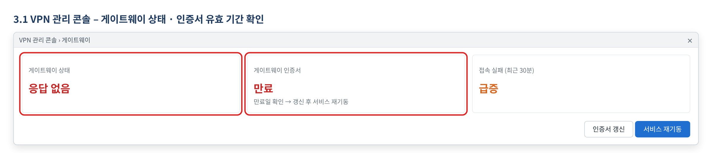
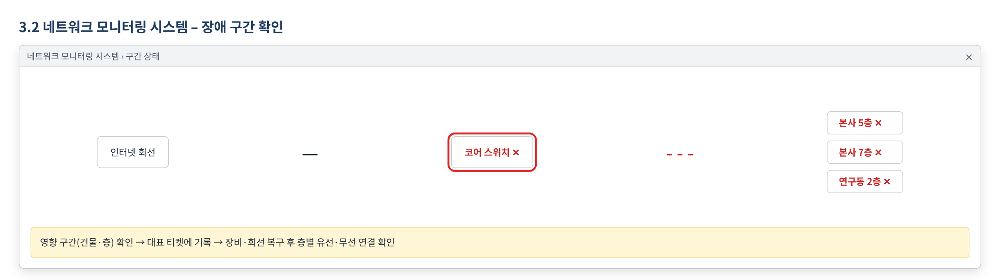

# 네트워크 장애 신고·이관 처리 매뉴얼

> 한화시스템 ICT IT 담당자 매뉴얼 · VPN·네트워크  
> IT-NET-003-M | 네트워크팀 | 2026-10-16 | v2.0 | **사내 제한** (IT 운영 담당자·관리자)
>
> IT운영·보안 조직 내부 문서입니다. 사용자에게 문서 자체를 전달하지 않고, 안내는 짝이 되는 임직원용 가이드를 기준으로 합니다.

## 목차

- 1. 개요
- 2. 접수·분류 기준
- 3. 증상별 처리 절차
  - 3.1 여러 명이 동시에 VPN에 연결되지 않음
  - 3.2 여러 부서·층에서 동시에 사내망·인터넷 불가
- 4. 대형 장애 대응
- 5. 처리 기록 기준
- 부록 · 관련 문서 · 용어
- 개정 이력

## 1. 개요

#### 목적

여러 사용자가 동시에 VPN·사내망·인터넷을 쓰지 못하는 전사 장애(NET-03)를 접수 즉시 판단해 대표 티켓으로 묶고, 네트워크팀이 복구·공지·종료까지 같은 절차로 처리한다.

#### 담당 범위

| 항목 | 내용 |
| --- | --- |
| 1차 처리 | 서비스데스크(L1): 동시 다발 판단, 대표 티켓 생성과 개별 문의 연결, 장애 공지 게시, 사용자 응대 |
| 2차 이관 | 네트워크팀(L2): 원인 확인(VPN 게이트웨이, 회선, 네트워크 장비), 복구, 원인 보고 |
| 배정 담당 | 김태현 (VPN), 황진혁 (VPN), 성민경 (인터넷·백본), 함성진 (인터넷·백본) |
| 관련 시스템 | VPN 관리 콘솔, 네트워크 모니터링 시스템, 장애 공지 게시판 |

## 2. 접수·분류 기준

사용자 가이드의 블록별 기본값이다. 긴급도 기준은 IT-STD-001 IT 서비스 운영 기준을 따른다.

| 번호 | 문의 유형 | 증상·요청 | 기본 긴급도 | 1차 처리 | 처리 방식 | 이관 대상 |
| --- | --- | --- | --- | --- | --- | --- |
| 3.1 | NET-03 | 여러 명이 동시에 VPN에 연결되지 않음 | P1 | 서비스데스크 | 티켓 | 네트워크팀 |
| 3.2 | NET-03 | 여러 부서·층에서 동시에 사내망·인터넷 불가 | P1 | 서비스데스크 | 티켓 | 네트워크팀 |

#### 처리 방식

- 즉시 처리: 서비스데스크(L1)가 안내만으로 끝낸 건. 티켓 없이 상담 기록만 남긴다.
- 티켓: 담당자 조치가 필요한 건. 담당팀에 배정하고 상태를 RDY → WIP → FIN → CLS 으로 관리한다.

#### 긴급도 조정 조건

- NET-03은 기본 P1이며 낮추지 않는다. 혼자만 겪는 것으로 확인되면 NET-02(IT-NET-001-M) 또는 NET-01·NET-05(IT-NET-002-M)로 다시 분류한다.
- 한 층·한 부서의 속도 저하만 있으면 NET-04(P2, IT-NET-002-M 3.7)로 분류한다.
- 공지 뒤 들어오는 같은 증상 문의는 새로 처리하지 않고 대표 티켓에 연결한다.

## 3. 증상별 처리 절차

### 3.1 여러 명이 동시에 VPN에 연결되지 않음

**문의 유형** NET-03 · **기본 긴급도** P1 · **1차 처리** 서비스데스크 · **이관 대상** 네트워크팀

**접수 시 확인 질문**

- 화면 메시지가 '게이트웨이 응답 없음'인가요? 언제부터인가요?
- 같은 팀이나 다른 재택 근무자도 안 되나요? 몇 명쯤인가요?
- 접속 장소는 어디이며, VPN 없이 인터넷은 되나요?

**판단 기준**

- 즉시 처리로 끝내지 않는다. 평가셋 기준 여러 명이 동시에 안 되는 VPN 문의는 P1, 네트워크팀 이관이다.
- 서로 다른 부서에서 같은 증상이 연달아 접수되면 전사 장애로 보고 대표 티켓을 만든다.
- 혼자만 안 되는 것으로 확인되면 NET-02로 다시 분류한다 (IT-NET-001-M).

#### 처리 절차

1. 첫 접수 때 네트워크팀에 전화로 바로 알리고 대표 티켓(MI-YYYY-NN)을 만든다.
2. 네트워크팀이 VPN 관리 콘솔에서 게이트웨이 상태와 인증서 유효 기간을 확인한다.
3. 원인을 조치한다. MI-2026-02는 게이트웨이 인증서 만료로, 인증서 갱신 후 서비스를 재기동했다 (INQ-2026-00098).
4. 복구를 공지하고 연결된 개별 문의를 일괄 FIN 처리한다.

*그림 3.1-1. VPN 관리 콘솔에서 게이트웨이 상태와 인증서 유효 기간, 접속 실패 추이를 확인하는 화면*

#### 처리 후 안내 문구

> VPN 접속 장애가 복구되었습니다. VPN에 다시 연결해 주세요. 복구 후에도 나만 연결되지 않으면 IT-NET-001을 참고해 헬프데스크에 문의해 주세요.

**재발 방지**

- 게이트웨이 인증서 만료 자동 알림 및 갱신 절차 문서화 (문의이력)

**이관 시 전달 정보**

- 첫 접수 시각, 접수 건수와 부서
- 화면 메시지와 접속 장소 분포
- 연결한 개별 문의 번호

### 3.2 여러 부서·층에서 동시에 사내망·인터넷 불가

**문의 유형** NET-03 · **기본 긴급도** P1 · **1차 처리** 서비스데스크 · **이관 대상** 네트워크팀

**접수 시 확인 질문**

- 건물·층은 어디인가요? 유선과 무선이 모두 안 되나요?
- 다른 부서·층도 같은 증상인가요?
- 인터넷과 사내 시스템이 모두 안 되나요?

**판단 기준**

- 즉시 처리로 끝내지 않는다. 여러 부서·층에서 업무가 멈췄으므로 IT-STD-001 기준 P1으로 네트워크팀에 이관한다.
- 한 층의 속도 저하만 있으면 NET-04, 네트워크는 되고 특정 시스템만 안 되면 IT-SYS-003-M으로 분류한다.
- 문의이력에 사례가 없어 IT-STD-001 긴급도 기준과 3.1 처리 기준을 따른다.

#### 처리 절차

1. 영향 건물·층·부서를 모아 대표 티켓을 만들고 네트워크팀에 전화로 알린다.
2. 네트워크팀이 네트워크 모니터링 시스템에서 해당 구간 장비와 회선 상태를 확인한다.
3. 장비·회선을 복구하고 층별로 유선·무선 연결을 확인한다.
4. 복구를 공지하고 개별 문의를 일괄 FIN 처리한 뒤 원인을 보고한다.

*그림 3.2-1. 네트워크 모니터링 시스템에서 장애 구간(장비·층)을 확인하는 화면*

#### 처리 후 안내 문구

> 사내 네트워크 장애가 복구되었습니다. 연결되지 않으면 랜선을 다시 꽂거나 Wi-Fi를 다시 연결해 보시고, 그래도 안 되면 IT-NET-002를 참고해 문의해 주세요.

**재발 방지**

- 문의이력에 사례 없음
- 복구 후 원인 보고에서 정한 재발 방지 조치를 이 항목에 반영한다.

**이관 시 전달 정보**

- 영향 범위(건물·층·부서)와 첫 접수 시각
- 유선·무선 구분
- 연결한 개별 문의 번호

## 4. 대형 장애 대응

1. 같은 증상이 서로 다른 부서에서 짧은 시간에 연달아 접수되면 대형 장애로 판단한다. 예: MI-2026-02(2026-04-22)는 08:40~09:15에 9개 부서에서 12건이 접수됐다.
2. 대표 티켓(MI-YYYY-NN)을 만들고, 같은 증상의 개별 문의는 대표 티켓에 연결한다.
3. 장애 공지 게시판과 #it-helpdesk 채널에 장애 공지를 올리고, 복구 전까지 30분마다 진행 상황을 갱신한다.
4. 복구 후 대표 티켓에 연결된 개별 문의를 일괄 FIN 처리하고, 원인·조치·재발 방지를 정리해 보고한다. MI-2026-02는 첫 접수 후 2시간 50분 만에 모두 완료됐다 (P1 목표 4시간 내).

## 5. 처리 기록 기준

처리 완료(FIN) 시 티켓에 아래 항목을 남긴다. 반복되는 건은 사용자 가이드 반영 여부를 검토한다.

| 항목 | 기록 내용 |
| --- | --- |
| 원인 | 확인된 원인 한 줄 (예: VPN 클라이언트 구버전 사용) |
| 조치 내용 | 실제로 한 조치. 즉시 처리면 앞에 [즉시 처리] |
| 재발 방지 | 같은 문의를 줄이기 위한 조치 (없으면 빈칸) |
| 관련 FAQ | 안내에 쓴 FAQ 번호 |
| 가이드 반영 | 사용자 가이드에 추가·수정이 필요한지 (필요 / 불필요) |

## 부록 · 관련 문서 · 용어

#### 내부 연락처

| 항목 | 내용 |
| --- | --- |
| 서비스데스크 | IT 헬프데스크 내선 1000 |
| 네트워크팀 | 내선 1040 |
| 업무시스템팀 | 내선 1060 |
| 시스템인프라팀 | 내선 1050 |

## 개정 이력

| 버전 | 개정일 | 작성자 | 변경 내용 |
| --- | --- | --- | --- |
| v1.0 | 2026-03-01 | 네트워크팀 | 최초 작성 |
| v2.0 | 2026-10-16 | 네트워크팀 | 7개 분류 통합 정리본. 문서 양식·열람 등급·용어·연락처를 통일하고 분류 사이의 중복 내용을 한 문서로 정리 |
