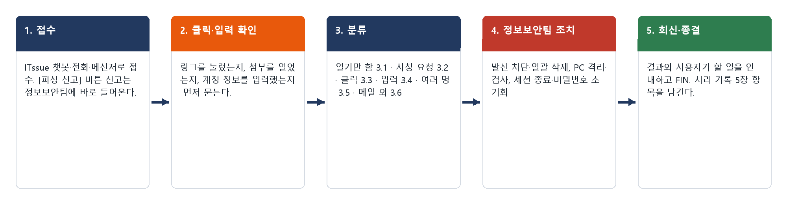
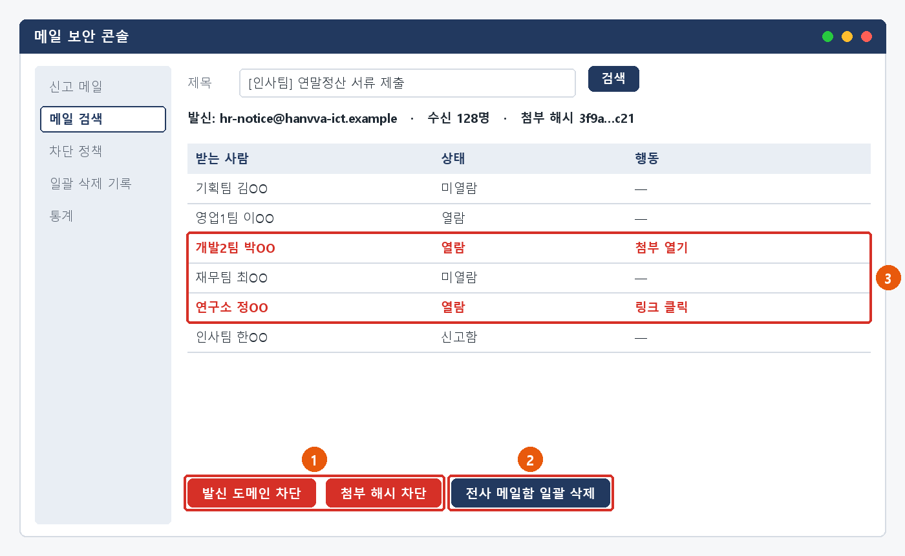
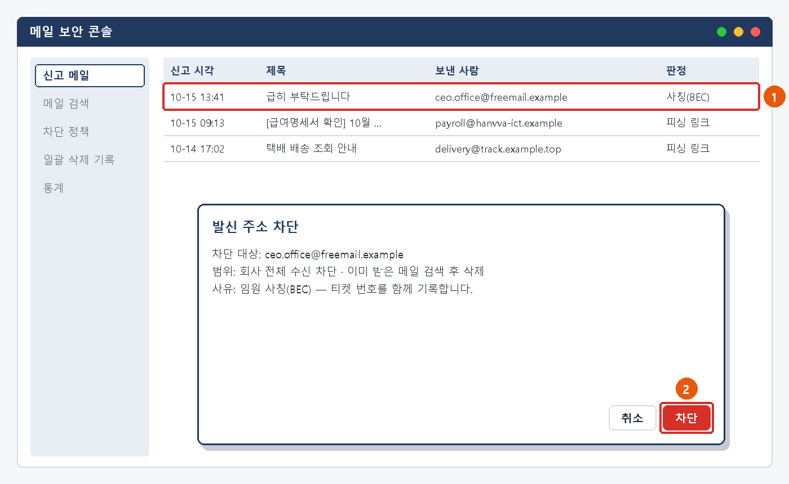
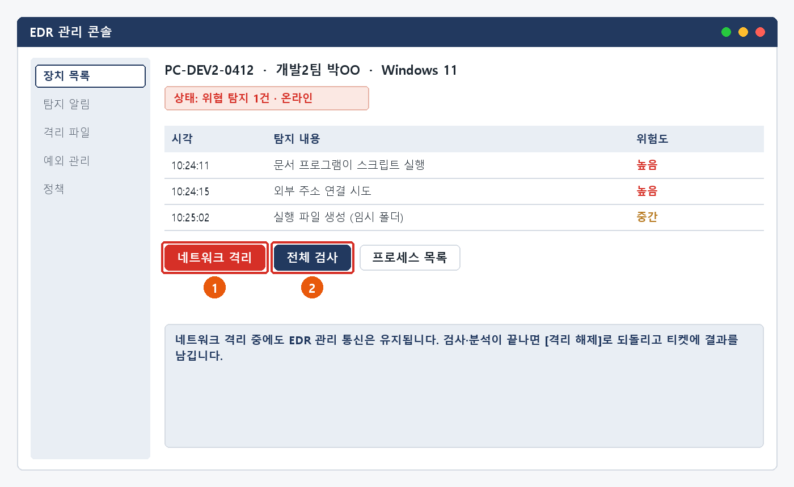

# 피싱·의심 메일 처리 매뉴얼

> 한화시스템 ICT IT 담당자 매뉴얼 · 정보보안  
> IT-SEC-001-M | 정보보안팀 | 2026-10-16 | v2.0 | **사내 제한** (IT 운영 담당자·관리자)
>
> IT운영·보안 조직 내부 문서입니다. 사용자에게 문서 자체를 전달하지 않고, 안내는 짝이 되는 임직원용 가이드를 기준으로 합니다.

## 목차

- 1. 개요
- 2. 접수·분류 기준
- 3. 증상별 처리 절차
  - 3.1 의심 메일을 받았을 때 (열어 보기만 함)
  - 3.2 임원·거래처를 사칭해 송금·구매·자료를 요청할 때
  - 3.3 링크를 눌렀거나 첨부파일을 열었을 때
  - 3.4 피싱 화면에 아이디·비밀번호를 입력했을 때
  - 3.5 여러 사람이 같은 의심 메일을 받았을 때 (대량 유입)
  - 3.6 문자·메신저·전화로 사칭 연락을 받았을 때
- 4. 대형 장애 대응
- 5. 처리 기록 기준
- 6. 연락처
- 개정 이력

## 1. 개요

#### 목적

IT-SEC-001로 들어오는 피싱·의심 메일 문의(단순 수신, 사칭 요청, 링크 클릭·첨부 실행, 계정 정보 입력, 대량 유입, 메일 외 사칭)를 서비스데스크가 안내로 끝낼지 정보보안팀에 바로 넘길지 판단하고, 같은 기준으로 처리한다.

#### 담당 범위

| 항목 | 내용 |
| --- | --- |
| 1차 처리 | 서비스데스크(L1): 클릭·입력 여부 확인, [피싱 신고] 안내, 보안 사고 가능성이 있으면 직접 조치하지 않고 정보보안팀 티켓 생성 |
| 2차 이관 | 정보보안팀(L2): 발신 주소·도메인·첨부 해시 차단, 전사 메일함 일괄 삭제, 클릭자 PC 격리·점검, 세션 종료·비밀번호 초기화, 전사 공지 |
| 배정 기준 | 피싱·계정 도용 담당 (황민석, 송예린). 담당자가 없으면 정보보안팀장(오한결)이 재배정 |
| 관련 시스템 | 메일 보안 콘솔, EDR 관리 콘솔, SSO 접속 기록 조회, 상담 기록 시스템 |

## 2. 접수·분류 기준

사용자 가이드의 항목별 기본값입니다. 긴급도 기준은 IT-STD-001 IT 서비스 운영 기준을 따릅니다.

| 번호 | 문의 유형 | 증상·요청 | 기본 긴급도 | 1차 처리 | 처리 방식 | 이관 대상 |
| --- | --- | --- | --- | --- | --- | --- |
| 3.1 | SEC-01 | 의심 메일을 받았을 때 (열어 보기만 함) | P2 | 서비스데스크 | 즉시 처리 후 필요 시 티켓 | 정보보안팀 |
| 3.2 | SEC-01 | 임원·거래처를 사칭해 송금·구매·자료를 요청할 때 | P2 | 서비스데스크 | 티켓 (응했으면 즉시 이관) | 정보보안팀 |
| 3.3 | SEC-01 | 링크를 눌렀거나 첨부파일을 열었을 때 | P2 | 서비스데스크 | 즉시 이관 (티켓 + 전화) | 정보보안팀 |
| 3.4 | SEC-01 | 피싱 화면에 아이디·비밀번호를 입력했을 때 | P2 | 서비스데스크 | 즉시 이관 (티켓 + 전화) | 정보보안팀 |
| 3.5 | SEC-04 | 여러 사람이 같은 의심 메일을 받았을 때 (대량 유입) | P1 | 서비스데스크 | 대형 장애 (대표 티켓) | 정보보안팀 |
| 3.6 | SEC-01 | 문자·메신저·전화로 사칭 연락을 받았을 때 | P2 | 서비스데스크 | 즉시 처리 후 필요 시 티켓 | 정보보안팀 |

#### 처리 방식

- 즉시 처리: 서비스데스크가 안내만으로 끝낸 건. 티켓 없이 상담 기록만 남긴다.
- 티켓: 담당자 조치가 필요한 건. 정보보안팀에 배정하고 RDY → WIP → FIN → CLS 으로 관리한다.
- 즉시 이관: 링크 클릭·첨부 실행·계정 정보 입력처럼 보안 사고 가능성이 있는 건. 서비스데스크는 직접 조치하지 않고 티켓을 만든 뒤 정보보안팀에 전화로 알린다.

#### 긴급도 조정 조건

- 링크 클릭·비밀번호 입력·계정 도용 의심은 최소 P2로 처리하고 정보보안팀에 바로 넘긴다 (MAN-00 공통 규칙 6).
- 팀 전원처럼 여러 명이 같은 메일을 받았으면 SEC-04(P1)로 분류한다 (INQ-2026-00134, INQ-2026-00139).
- 사칭 메일에 이미 송금·자료 전달을 했으면 P1로 올리고 전화로 알린다.
- 사용자가 급하다고 해도 위 기준에 맞지 않으면 올리지 않는다. 반대로 담담해도 클릭·입력이 있으면 P2 이상이다.

#### 처리 흐름

*그림 2-1. 피싱·의심 메일 문의 처리 흐름*

## 3. 증상별 처리 절차

### 3.1 의심 메일을 받았을 때 (열어 보기만 함)

**문의 유형** SEC-01 · **기본 긴급도** P2 · **1차 처리** 서비스데스크 · **처리 방식** 즉시 처리 후 필요 시 티켓 · **이관 대상** 정보보안팀

**접수 시 확인 질문**

- 링크나 첨부를 눌렀나요? 화면에 무엇을 입력했나요?
- 메일 제목과 보낸 사람 주소는 무엇인가요?
- [피싱 신고]를 눌렀나요?
- 같은 메일을 받은 사람이 더 있나요?

**판단 기준**

- 즉시 처리: 열어 보기만 했으면 [피싱 신고]를 안내하고 상담 기록만 남긴다.
- 티켓: 신고 버튼을 쓸 수 없거나 같은 발신자의 메일이 반복되면 정보보안팀 티켓으로 발신 도메인 차단을 요청한다 (INQ-2026-00115, INQ-2026-00143).
- 전환: 클릭·첨부 실행 → 3.3, 계정 정보 입력 → 3.4, 여러 명 수신 → 3.5.

#### 처리 절차

1. 클릭·입력 여부를 먼저 확인한다. 하나라도 있으면 판단 기준의 전환 조건을 따른다.
2. 사용자에게 [피싱 신고] 사용을 안내한다.
3. 정보보안팀은 메일 보안 콘솔에서 신고 메일의 발신 도메인과 링크를 확인하고 차단한다.
4. 같은 메일이 다른 사람에게도 들어왔으면 전사 메일함에서 일괄 삭제한다 (INQ-2026-00286).
5. 열람·클릭 기록이 있는 사람이 있으면 3.3 절차로 넘긴다.
6. 신고자에게 결과를 회신하고 FIN 처리한다.

*그림 3.1-1. 메일 보안 콘솔: ① 발신 도메인·첨부 해시 차단 ② 전사 메일함 일괄 삭제 ③ 열람·클릭한 사람 확인*

#### 처리 후 안내 문구

> 신고해 주신 메일은 외부에서 보낸 피싱 메일로 확인되어 발신 도메인을 차단하고 같은 메일을 회사 메일함에서 삭제했습니다. 링크나 첨부를 누르지 않으셨다면 추가로 하실 일은 없습니다. 비슷한 메일은 IT-SEC-001 3.1에 따라 [피싱 신고]로 알려 주세요.

**재발 방지**

- 분기별 모의 피싱 훈련 실시 (문의이력)

**이관 시 전달 정보**

- 메일 제목, 보낸 사람 주소, 받은 시각
- 클릭·입력 여부
- 같은 메일을 받은 사람 수

### 3.2 임원·거래처를 사칭해 송금·구매·자료를 요청할 때

**문의 유형** SEC-01 · **기본 긴급도** P2 · **1차 처리** 서비스데스크 · **처리 방식** 티켓 (응했으면 즉시 이관) · **이관 대상** 정보보안팀

**접수 시 확인 질문**

- 누구 이름으로 어떤 요청(금액·구매·자료)이 왔나요?
- 이미 송금·구매·자료 전달을 했나요?
- 요청한 본인에게 다른 경로로 확인했나요?

**판단 기준**

- 티켓: 응하지 않았어도 사칭 메일은 정보보안팀 티켓으로 발신 주소 차단과 전사 주의 공지를 요청한다 (INQ-2026-00005, INQ-2026-00113).
- 즉시 이관 (P1): 이미 송금·구매·자료 전달을 했으면 정보보안팀에 전화로 알리고, 송금이면 사용자가 재무팀에도 바로 알리게 한다.

#### 처리 절차

1. 사용자가 이미 응했는지 먼저 확인한다.
2. 응하지 않았으면 회신 금지, 다른 경로로 본인 확인, [피싱 신고]를 안내한다.
3. 정보보안팀은 메일 보안 콘솔에서 발신 주소를 차단하고 같은 발신자의 메일을 검색해 삭제한다.
4. 임원 사칭이면 전사 주의 공지를 낸다 (INQ-2026-00195).
5. 이미 송금했으면 재무팀과 지급 정지 가능 여부를 확인하고, 정보보안팀장에게 사고 보고를 시작한다.

*그림 3.2-1. 메일 보안 콘솔: ① 신고된 사칭 메일 ② 발신 주소 차단*

#### 처리 후 안내 문구

> 확인해 주신 메일은 임원 이름을 사칭한 메일로 확인되어 발신 주소를 차단했습니다. 메일로 받은 송금·구매 요청은 꼭 메신저나 전화로 본인에게 확인해 주세요.

**재발 방지**

- 분기별 모의 피싱 훈련 실시 (문의이력)
- 임원 사칭 사례를 전사 주의 공지에 넣는다.

**이관 시 전달 정보**

- 사칭된 사람과 보낸 사람 주소
- 요청 내용 (금액·자료)
- 응했는지, 응했다면 시각과 내용
- 신고자 사번

### 3.3 링크를 눌렀거나 첨부파일을 열었을 때

**문의 유형** SEC-01 · **기본 긴급도** P2 · **1차 처리** 서비스데스크 · **처리 방식** 즉시 이관 (티켓 + 전화) · **이관 대상** 정보보안팀

**접수 시 확인 질문**

- 링크를 눌렀나요, 첨부를 열었나요? [콘텐츠 사용]을 눌렀나요?
- 화면에 무엇을 입력했나요? (값은 묻지 않는다)
- 언제 눌렀나요?
- 네트워크를 끊었나요? PC 이름은 무엇인가요?

**판단 기준**

- 즉시 이관: 링크 클릭·첨부 실행은 입력 여부와 관계없이 정보보안팀 티켓(P2)으로 넘긴다 (INQ-2026-00334).
- 첨부 실행·매크로 허용이면 네트워크 차단을 먼저 안내하고, EDR 원격 격리 대상으로 넘긴다.
- 계정 정보를 입력했으면 3.4를 함께 적용한다.

#### 처리 절차

1. 열린 화면을 닫고 아무것도 입력하지 않도록 안내한다.
2. 첨부를 실행했으면 Wi-Fi·랜선 차단을 안내하고 전원은 켜 둔 채로 두게 한다.
3. 티켓을 만들어 정보보안팀에 배정하고 전화로 알린다.
4. 정보보안팀은 피싱 도메인을 차단하고 EDR 관리 콘솔에서 PC를 원격 격리한 뒤 전체 검사한다.
5. 검사 결과 이상이 없으면 격리를 풀고 비밀번호 변경을 권고한 뒤 FIN 처리한다. 감염이 확인되면 IT-SEC-002-M 3.4를 따른다.

*그림 3.3-1. EDR 관리 콘솔: ① 네트워크 격리 ② 전체 검사*

#### 처리 후 안내 문구

> 눌러 주신 링크는 피싱 사이트로 확인되어 차단했습니다. PC 검사 결과 이상은 없었습니다. 안전을 위해 비밀번호 재설정 포털에서 비밀번호를 바꿔 주세요.

**재발 방지**

- 분기별 모의 피싱 훈련 실시 (문의이력)

**이관 시 전달 정보**

- 누른 시각, 링크 주소 또는 첨부파일 이름
- 입력 여부
- 네트워크 차단 여부, PC 이름, 사번

> ★ **사용자에게 PC 전원을 끄거나 보안 프로그램을 끄라고 안내하지 않는다**
>
> 전원을 끄면 메모리의 기록이 사라진다. 네트워크만 끊게 한다.

### 3.4 피싱 화면에 아이디·비밀번호를 입력했을 때

**문의 유형** SEC-01 · **기본 긴급도** P2 · **1차 처리** 서비스데스크 · **처리 방식** 즉시 이관 (티켓 + 전화) · **이관 대상** 정보보안팀

**접수 시 확인 질문**

- 어떤 화면에 어떤 정보를 입력했나요? (값은 묻지 않는다)
- 언제 입력했나요?
- 비밀번호를 이미 바꿨나요?
- 그 뒤 모르는 로그인·인증 알림이 왔나요?

**판단 기준**

- 즉시 이관: 계정 정보를 입력했으면 정보보안팀 티켓(P2)으로 넘긴다.
- 입력 뒤 모르는 접속 시도가 보이면 계정 도용이 진행 중인 것으로 보고 IT-SEC-003-M 3.1을 함께 적용한다 (INQ-2026-00379).

#### 처리 절차

1. 비밀번호 재설정 포털(password.hanwha-ict.example)에서 바로 바꾸도록 안내한다. 첨부도 열었으면 다른 기기에서 바꾸게 한다.
2. 티켓을 만들어 정보보안팀에 배정하고 전화로 알린다.
3. 정보보안팀은 SSO 접속 기록 조회에서 입력 시각 이후 로그인을 확인하고 세션을 강제 종료한다.
4. 모르는 접속이 있으면 본인 확인(사번 + 휴대폰 인증) 후 비밀번호 초기화와 MFA 재등록을 하고 피싱 도메인을 차단한다.
5. 접속 기록 확인 결과를 회신하고 FIN 처리한다.

*그림 3.4-1. SSO 접속 기록 조회: ① 낯선 접속 ② 세션 강제 종료 ③ 비밀번호 초기화·MFA 재등록*

#### 처리 후 안내 문구

> 입력하신 계정 정보가 노출됐을 수 있어 로그인 세션을 모두 끊고 비밀번호를 초기화했습니다. 새 비밀번호로 다시 로그인해 주시고, 같은 비밀번호를 쓰는 다른 사이트가 있으면 함께 바꿔 주세요.

**재발 방지**

- 분기별 모의 피싱 훈련 실시 (문의이력)

**이관 시 전달 정보**

- 입력 시각과 입력한 정보의 종류
- 비밀번호 변경 여부
- 이후 로그인·인증 알림 여부
- 링크 주소

> ★ **사용자에게 비밀번호 값을 묻거나 받지 않는다**
>
> 대화나 티켓에 비밀번호로 보이는 값이 있으면 노출된 것으로 보고 즉시 변경을 안내하고, 기록에서 가린다.

### 3.5 여러 사람이 같은 의심 메일을 받았을 때 (대량 유입)

**문의 유형** SEC-04 · **기본 긴급도** P1 · **1차 처리** 서비스데스크 · **처리 방식** 대형 장애 (대표 티켓) · **이관 대상** 정보보안팀

**접수 시 확인 질문**

- 몇 명이, 어느 부서에서 같은 메일을 받았나요?
- 메일 제목, 보낸 사람, 첨부파일 이름은 무엇인가요?
- 링크나 첨부를 누른 사람이 있나요?

**판단 기준**

- 대형 장애: 같은 의심 메일이 짧은 시간에 여러 명·여러 부서에서 신고되면 SEC-04(P1)로 보고 4장을 따른다.
- 한 팀 안이라도 "팀 전원이 받았다"는 신고는 SEC-04로 분류한다 (INQ-2026-00134).
- 누른 사람은 대량 유입과 별도로 3.3·3.4를 적용한다.

#### 처리 절차

1. 대표 티켓(MI-YYYY-NN)을 만들고 같은 신고는 대표 티켓에 연결한다.
2. 정보보안팀에 전화로 바로 알린다.
3. 정보보안팀은 발신 도메인과 첨부 해시를 차단하고 전사 메일함에서 같은 메일을 일괄 삭제한다 (INQ-2026-00141).
4. 메일 보안 콘솔에서 링크 클릭·첨부 열람 기록이 있는 사람을 찾아 PC를 점검한다.
5. 전사 공지와 ITssue 챗봇 첫 화면 안내를 올린다. 조치가 끝나면 연결된 티켓을 한꺼번에 종료한다.

*그림 3.5-1. 메일 보안 콘솔: 같은 메일을 받은 사람 128명 중 열람·클릭한 사람 확인 (③)*

#### 처리 후 안내 문구

> 여러 부서에 같은 피싱 메일이 들어와 발신 도메인과 첨부파일을 차단하고 회사 메일함에서 모두 삭제했습니다. 메일의 링크나 첨부를 누르셨다면 IT-SEC-001 3.3에 따라 정보보안팀(내선 1119)에 알려 주세요.

**재발 방지**

- 사내 부서 사칭 도메인 유사어 차단 규칙 추가 (문의이력)

**이관 시 전달 정보**

- 신고 건수와 부서
- 메일 제목, 보낸 사람, 첨부파일 이름
- 첫 신고 시각
- 누른 사람 명단

### 3.6 문자·메신저·전화로 사칭 연락을 받았을 때

**문의 유형** SEC-01 · **기본 긴급도** P2 · **1차 처리** 서비스데스크 · **처리 방식** 즉시 처리 후 필요 시 티켓 · **이관 대상** 정보보안팀

**접수 시 확인 질문**

- 어떤 경로(문자·메신저·전화)로 누구를 사칭했나요?
- 무엇을 요구했나요?
- 비밀번호·인증번호를 알려 줬거나 인증 알림을 승인했나요?
- 문자 링크로 앱을 설치했나요?

**판단 기준**

- 즉시 처리: 응하지 않았으면 공식 번호로 다시 확인하는 방법과 신고 방법을 안내하고 상담 기록만 남긴다.
- 티켓: 헬프데스크·정보보안팀을 사칭했으면 전사 주의 공지가 필요하므로 정보보안팀에 넘긴다.
- 즉시 이관: 정보를 알려 줬거나 인증 알림을 승인했으면 3.4와 IT-SEC-003-M 3.2를 적용한다.

#### 처리 절차

1. 사용자가 응했는지 먼저 확인한다.
2. 응하지 않았으면 공식 번호(내선 1000·1119)로 다시 확인하도록 안내한다.
3. 사칭에 쓰인 번호·계정과 내용을 상담 기록에 남기고 정보보안팀에 공유한다.
4. 휴대폰에 앱을 설치했으면 비행기 모드 전환을 안내하고 정보보안팀 티켓을 만든다.
5. 같은 사칭이 여러 건 들어오면 정보보안팀이 전사 주의 공지를 낸다.

#### 처리 후 안내 문구

> 받으신 연락은 IT 부서를 사칭한 것으로 보입니다. IT 헬프데스크와 정보보안팀은 비밀번호나 인증번호를 묻지 않습니다. 비슷한 연락을 받으면 끊고 내선 1000 또는 1119로 확인해 주세요.

**재발 방지**

- 문의이력에 재발 방지 기록 없음
- 사칭 연락 사례를 모의 피싱 훈련에 넣는 것을 검토한다.

**이관 시 전달 정보**

- 연락 경로·시각·번호
- 사칭된 이름
- 요구 내용과 응한 내용

## 4. 대형 장애 대응

- 같은 의심 메일이 짧은 시간에 여러 부서에서 신고되면 개별 건(SEC-01)이 아니라 SEC-04 대량 유입으로 판단한다. 예: MI-2026-03 인사팀 사칭 피싱 캠페인은 2026-05-13 10:20부터 8건이 접수됐고 240분 동안 대응했다.
- 대표 티켓(MI-YYYY-NN) 1건을 정하고, 이후 들어오는 같은 신고는 대표 티켓에 연결한다.
- 정보보안팀은 발신 도메인·첨부 해시 차단 → 전사 메일함 일괄 삭제 → 클릭자 PC 점검 순서로 조치한다.
- 전사 공지를 보내고 ITssue 챗봇 첫 화면에 안내를 띄운다. 공지에는 메일 제목, 하지 말 것(열기·전달), 이미 누른 사람이 할 일(IT-SEC-001 3.3·3.4)을 넣는다.
- 조치가 끝나면 연결된 티켓을 한꺼번에 종료한다 (해결 방법: "MI-YYYY-NN 대형 장애 복구로 일괄 해결"). 장애 보고서에 원인·조치·재발 방지를 남긴다.

> ★ **대량 유입 중에는 사용자에게 의심 메일을 전달받지 않는다**
>
> 원본은 메일 보안 콘솔에서 확인한다. 전달된 메일은 또 다른 유입 경로가 된다.

## 5. 처리 기록 기준

티켓을 종료할 때 아래 항목을 남깁니다.

| 항목 | 적는 내용 |
| --- | --- |
| 원인 | 확인된 원인 한 줄 (예: 외부 피싱 메일, 매크로 행위 기반 오탐) |
| 조치 내용 | 실제로 한 조치. 즉시 처리면 앞에 [즉시 처리] |
| 보안 조치 기록 | 차단한 주소·도메인·해시, 격리·세션 종료 시각, 보존한 증거 (해당할 때) |
| 재발 방지 | 같은 문의를 줄이기 위한 조치 (없으면 빈칸) |
| 관련 FAQ | 안내에 쓴 FAQ 번호 |
| 가이드 반영 | 사용자 가이드에 추가·수정이 필요한지 (필요 / 불필요) |

## 6. 연락처

| 담당 | 연락처 | 이럴 때 |
| --- | --- | --- |
| 서비스데스크 | IT 헬프데스크 내선 1000 | 1차 접수, 즉시 처리 |
| 정보보안팀 | 내선 1119 | 보안 신고·이관. 즉시 이관 건은 티켓과 함께 전화로 알린다 |
| 정보보안팀장 (오한결) | 내선 1119 | 재배정 승인, 대형 장애 판단, 사고 보고 |
| 시스템인프라팀 | 내선 1050 | 서버·DB·SSO·메일 서버 |
| 업무시스템팀 | 내선 1060 | 사내 시스템 권한·접근 기록 |
| 엔드포인트지원팀 | 내선 1030 | PC 재설치·장비 교체, 단말 관리 |

## 개정 이력

| 버전 | 개정일 | 작성자 | 변경 내용 |
| --- | --- | --- | --- |
| v1.0 | 2026-03-01 | 정보보안팀 | 최초 작성 |
| v2.0 | 2026-10-16 | 정보보안팀 | 7개 분류 통합 정리본. 문서 양식·열람 등급·용어·연락처를 통일하고 분류 사이의 중복 내용을 한 문서로 정리 |
