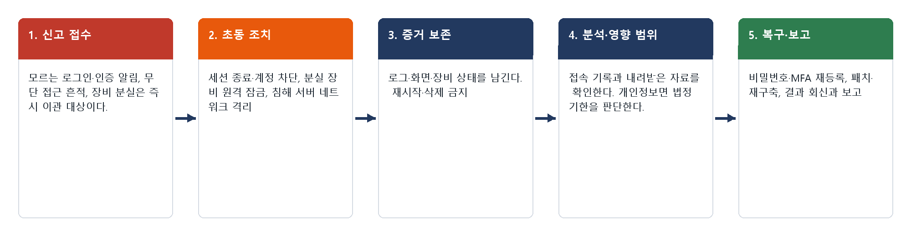
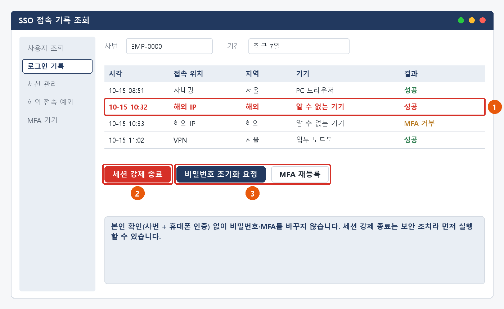
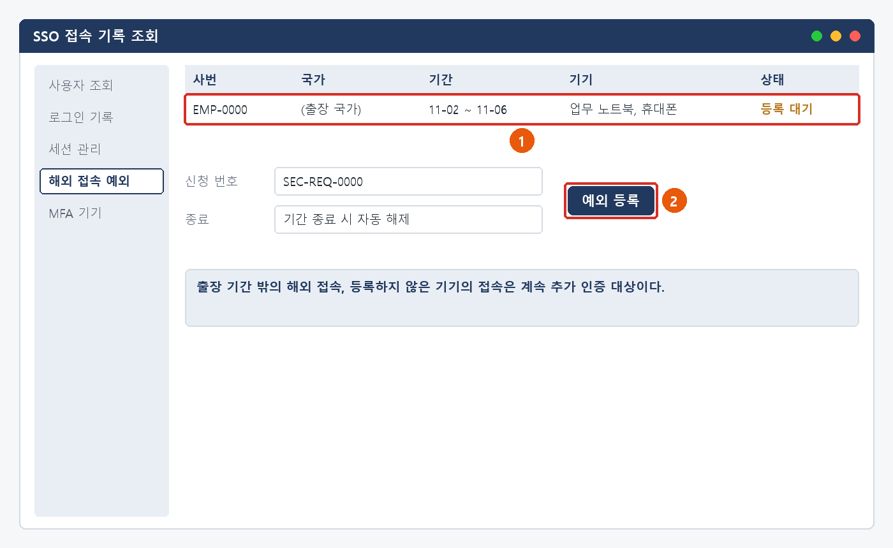
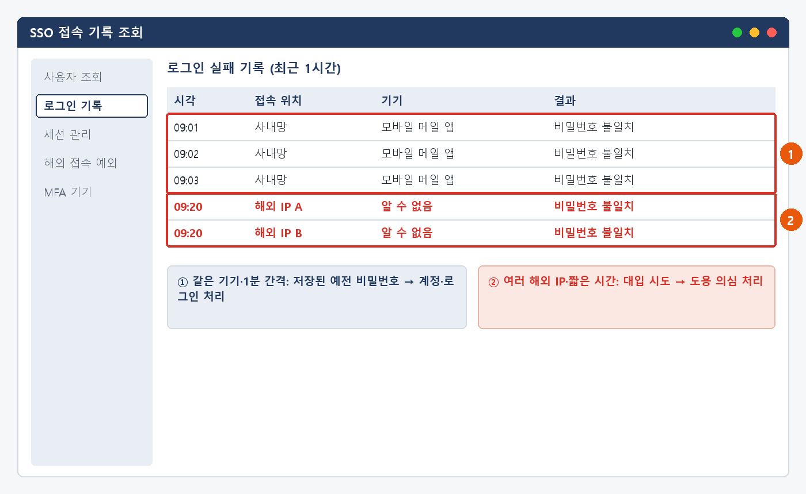
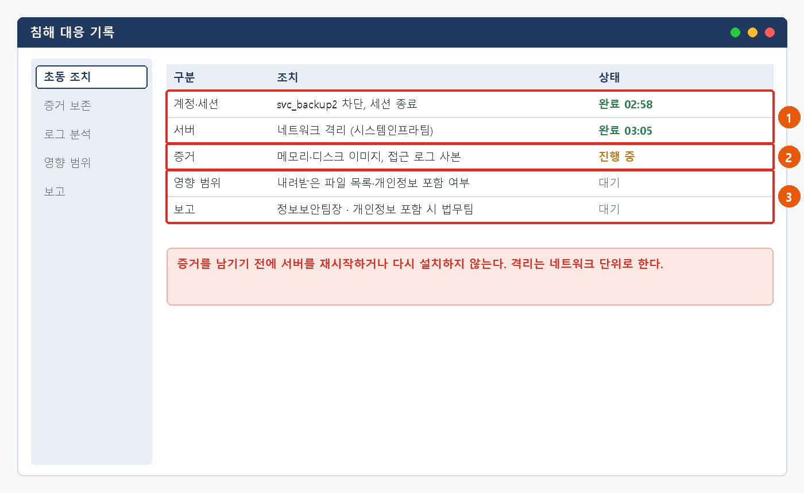
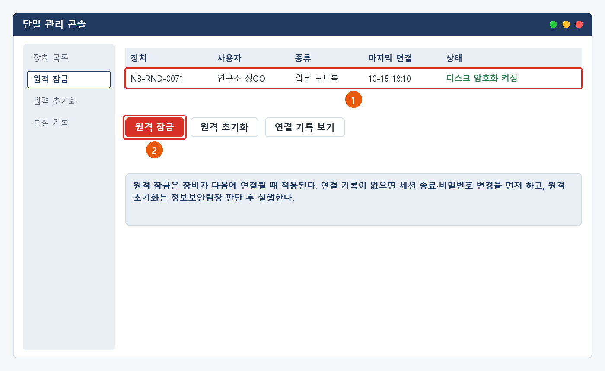

# 계정 도용·장비 분실 처리 매뉴얼

> 한화시스템 ICT IT 담당자 매뉴얼 · 정보보안  
> IT-SEC-003-M | 정보보안팀 | 2026-10-16 | v2.0 | **사내 제한** (IT 운영 담당자·관리자)
>
> IT운영·보안 조직 내부 문서입니다. 사용자에게 문서 자체를 전달하지 않고, 안내는 짝이 되는 임직원용 가이드를 기준으로 합니다.

## 목차

- 1. 개요
- 2. 접수·분류 기준
- 3. 증상별 처리 절차
  - 3.1 내가 하지 않은 로그인 알림을 받았을 때
  - 3.2 요청하지 않은 인증(MFA) 알림이 오거나 실수로 승인했을 때
  - 3.3 해외 출장 전 해외 접속 사전 등록
  - 3.4 계정이 반복해서 잠기거나 비밀번호가 바뀌어 있을 때
  - 3.5 시스템·서버 무단 접근·침해가 의심될 때
  - 3.6 인증 앱·회사 앱이 설치된 휴대폰을 잃어버렸을 때
  - 3.7 업무 노트북 등 회사 장비를 잃어버렸을 때
- 4. 대형 장애 대응
- 5. 처리 기록 기준
- 6. 연락처
- 개정 이력

## 1. 개요

#### 목적

IT-SEC-003으로 들어오는 계정 도용 의심(로그인·인증 알림, 해외 접속, 반복 잠김), 시스템·서버 무단 접근·침해 의심, 장비 분실 신고를 같은 기준으로 접수·이관·처리하고, 증거 보존과 보고를 빠뜨리지 않는다.

#### 담당 범위

| 항목 | 내용 |
| --- | --- |
| 1차 처리 | 서비스데스크(L1): 신고 접수, 비밀번호 즉시 변경 안내, 증거 보존 안내, 티켓 생성 후 정보보안팀에 전화로 이관. 직접 계정·서버를 조치하지 않는다 |
| 2차 이관 | 정보보안팀(L2): 세션 종료·계정 차단, 접속 기록 분석, 해외 접속 예외 등록, 침해 대응(격리·분석·영향 범위·보고), 분실 장비 원격 잠금 |
| 배정 기준 | 계정 도용(SEC-06): 황민석, 송예린 / 침해 대응(SEC-05): 이동욱 / 장비 분실(SEC-08): 지정 담당자 없음, 정보보안팀 단위 배정 (팀장 오한결이 배정) |
| 협업 | 시스템인프라팀(서버 격리·로그), 업무시스템팀(사내 시스템 접근 기록), 엔드포인트지원팀(대체 장비), 법무팀(개인정보 유출 판단) |
| 관련 시스템 | SSO 접속 기록 조회, 단말 관리 콘솔, 침해 대응 기록, 서버 접근 로그 |

## 2. 접수·분류 기준

사용자 가이드의 항목별 기본값입니다. 긴급도 기준은 IT-STD-001 IT 서비스 운영 기준을 따릅니다.

| 번호 | 문의 유형 | 증상·요청 | 기본 긴급도 | 1차 처리 | 처리 방식 | 이관 대상 |
| --- | --- | --- | --- | --- | --- | --- |
| 3.1 | SEC-06 | 내가 하지 않은 로그인 알림을 받았을 때 | P2 | 서비스데스크 | 즉시 이관 (티켓 + 전화) | 정보보안팀 |
| 3.2 | SEC-06 | 요청하지 않은 인증(MFA) 알림이 오거나 실수로 승인했을 때 | P2 | 서비스데스크 | 즉시 이관 (티켓 + 전화) | 정보보안팀 |
| 3.3 | SEC-06 | 해외 출장 전 해외 접속 사전 등록 | P2 | 서비스데스크 | 티켓 (신청) | 정보보안팀 |
| 3.4 | SEC-06 | 계정이 반복해서 잠기거나 비밀번호가 바뀌어 있을 때 | P2 | 서비스데스크 | 기록 확인 후 분기 | 정보보안팀 |
| 3.5 | SEC-05 | 시스템·서버 무단 접근·침해가 의심될 때 | P2 | 서비스데스크 | 즉시 이관 (티켓 + 전화) | 정보보안팀 (침해 대응) |
| 3.6 | SEC-08 | 인증 앱·회사 앱이 설치된 휴대폰을 잃어버렸을 때 | P2 | 서비스데스크 | 즉시 이관 (티켓 + 전화) | 정보보안팀 (팀 단위 배정) |
| 3.7 | SEC-08 | 업무 노트북 등 회사 장비를 잃어버렸을 때 | P2 | 서비스데스크 | 즉시 이관 (티켓 + 전화) | 정보보안팀 (팀 단위 배정) |

#### 처리 방식

- 즉시 이관: 이 문서의 신고는 대부분 즉시 이관이다. 서비스데스크는 티켓을 만들고 정보보안팀에 전화로 알린다.
- 티켓: 해외 접속 사전 등록처럼 신청으로 처리하는 건. 정보보안팀에 배정하고 RDY → IP → FIN → CLS 으로 관리한다.
- 즉시 처리: 저장된 예전 비밀번호로 인한 잠김처럼 도용이 아닌 것으로 확인된 건은 계정·로그인 처리(서비스데스크)로 끝낸다.

#### 긴급도 조정 조건

- SEC-05·SEC-06·SEC-08은 기본 P2다 (taxonomy). 보안 사고 가능성이 있으므로 낮추지 않는다.
- 인증 알림을 실수로 승인했거나, 침해가 진행 중(접속·외부 전송이 계속됨)이면 P1로 올리고 전화로 알린다.
- 여러 계정에 같은 로그인 시도가 동시에 보이면 대형 장애 후보로 4장을 따른다.
- 해외 접속 사전 등록 신청은 P2를 유지하되 출발일을 티켓에 적어 순서를 정한다.

#### 처리 흐름

*그림 2-1. 계정 도용·침해·분실 신고 처리 흐름*

## 3. 증상별 처리 절차

### 3.1 내가 하지 않은 로그인 알림을 받았을 때

**문의 유형** SEC-06 · **기본 긴급도** P2 · **1차 처리** 서비스데스크 · **처리 방식** 즉시 이관 (티켓 + 전화) · **이관 대상** 정보보안팀

**접수 시 확인 질문**

- 알림에 나온 시각·위치·기기는? (값만 확인, 링크는 누르지 않게 한다)
- 비밀번호를 이미 바꿨나요?
- 같은 비밀번호를 다른 사이트에도 쓰나요?
- 최근 의심 메일에 계정 정보를 입력한 적이 있나요?

**판단 기준**

- 즉시 이관: 본인이 하지 않은 로그인·로그인 시도 알림은 정보보안팀 티켓(P2)으로 넘긴다 (INQ-2026-00065, INQ-2026-00082, INQ-2026-00146, INQ-2026-00399).
- 본인이 해외 출장 중 로그인한 것이면 3.3으로 처리한다 (INQ-2026-00015).
- 피싱 사이트 입력이 원인이면 IT-SEC-001-M 3.4를 함께 적용한다.

#### 처리 절차

1. 비밀번호 재설정 포털에서 바로 바꾸도록 안내하고 티켓을 만들어 전화로 알린다.
2. 정보보안팀은 SSO 접속 기록 조회에서 알림 시각 앞뒤의 로그인·실패 기록을 확인한다.
3. 낯선 성공 로그인이 있으면 세션을 강제 종료하고, 본인 확인(사번 + 휴대폰 인증) 후 MFA를 다시 등록하게 한다.
4. 시도 IP를 차단하고, 로그인 뒤 한 일(메일 발송·설정 변경·자료 조회)을 확인한다.
5. 확인 결과를 회신하고 FIN 처리한다. 자료 조회가 있었으면 3.5 기준으로 영향 범위를 확인한다.

*그림 3.1-1. SSO 접속 기록 조회: ① 낯선 접속 ② 세션 강제 종료 ③ 비밀번호 초기화·MFA 재등록*

#### 처리 후 안내 문구

> 알려 주신 로그인은 외부에서 유출된 비밀번호로 시도된 것으로 확인되어 모든 로그인 세션을 끊고 시도한 주소를 차단했습니다. 비밀번호 변경과 인증 앱 재등록까지 마쳤습니다. 같은 비밀번호를 쓰는 다른 사이트가 있으면 함께 바꿔 주세요.

**재발 방지**

- 해외 출장 사전 등록 절차 공지 (문의이력)

**이관 시 전달 정보**

- 알림 시각·위치·기기
- 비밀번호 변경 여부와 시각
- 피싱 입력 등 짐작되는 원인
- 사번

### 3.2 요청하지 않은 인증(MFA) 알림이 오거나 실수로 승인했을 때

**문의 유형** SEC-06 · **기본 긴급도** P2 · **1차 처리** 서비스데스크 · **처리 방식** 즉시 이관 (티켓 + 전화) · **이관 대상** 정보보안팀

**접수 시 확인 질문**

- 알림이 언제, 몇 번 왔나요? 알림에 나온 위치는?
- 승인했나요? 승인했다면 몇 시에?
- 비밀번호를 바꿨나요?

**판단 기준**

- 즉시 이관: 요청하지 않은 인증 알림은 비밀번호가 노출됐다는 뜻이므로 정보보안팀 티켓(P2)으로 넘긴다.
- 승인했으면 P1로 올리고 전화로 바로 알린다. 공격자가 로그인에 성공했을 수 있다.

#### 처리 절차

1. 사용자에게 [거부]와 비밀번호 즉시 변경을 안내한다. 인증 알림 승인을 요청하지 않는다.
2. 티켓을 만들고 정보보안팀에 전화로 알린다.
3. 정보보안팀은 SSO 접속 기록에서 MFA 요청 시각의 로그인 시도와 성공 여부를 확인한다.
4. 승인으로 로그인된 세션이 있으면 즉시 종료하고 계정을 잠근 뒤, 본인 확인 후 비밀번호 초기화·MFA 재등록을 한다.
5. 로그인 뒤 한 일을 확인하고 결과를 회신한 뒤 FIN 처리한다.

*그림 3.2-1. SSO 접속 기록 조회: MFA 승인 직후의 성공 로그인을 확인하고 ② 세션을 끊는다*

#### 처리 후 안내 문구

> 요청하지 않은 인증 알림은 외부에서 비밀번호로 로그인을 시도하면서 생긴 것입니다. 로그인 세션을 끊고 비밀번호와 인증 앱을 다시 등록했습니다. 앞으로도 내가 하지 않은 로그인의 인증 알림은 [거부]해 주세요.

**재발 방지**

- 문의이력에 재발 방지 기록 없음
- 반복 인증 요청(MFA 피로 공격) 탐지 규칙 적용을 검토한다.

**이관 시 전달 정보**

- 알림 시각·횟수·위치
- 승인 여부와 시각
- 비밀번호 변경 여부
- 사번

> ★ **본인 확인 없이 MFA 기기를 초기화하지 않는다**
>
> 공격자가 사용자를 사칭해 초기화를 요청할 수 있다. 세션 종료만 먼저 하고, 초기화는 본인 확인 뒤에 한다.

### 3.3 해외 출장 전 해외 접속 사전 등록

**문의 유형** SEC-06 · **기본 긴급도** P2 · **1차 처리** 서비스데스크 · **처리 방식** 티켓 (신청) · **이관 대상** 정보보안팀

**접수 시 확인 질문**

- 출장 국가·기간·사용 기기는?
- 이미 출장 중인가요? 지금 로그인할 수 있나요?
- 신청 번호가 있나요?

**판단 기준**

- 티켓: 해외 접속 예외 등록은 정보보안팀이 처리한다 (INQ-2026-00015).
- 출장 중 로그인이 막혀 업무를 못 하면 OTP 로그인을 먼저 안내하고, 등록을 서두른다.
- 사용자가 출장 중이 아닌데 해외 로그인이 있으면 3.1로 처리한다.

#### 처리 절차

1. 신청 내용(국가·기간·기기)과 사번을 확인한다.
2. 정보보안팀은 SSO 접속 기록 조회 > [해외 접속 예외]에서 신청한 기간·기기로 예외를 등록한다. 기간 종료 시 자동 해제되게 둔다.
3. 출장 중이면 사용자와 정상 로그인을 확인한다.
4. 등록 완료를 회신하고 FIN 처리한다.

*그림 3.3-1. SSO 접속 기록 조회: ① 신청 내용 확인 ② 기간 한정 예외 등록*

#### 처리 후 안내 문구

> 출장 기간 동안의 해외 접속을 등록했습니다. 등록한 기간과 기기에서는 추가 인증이 줄어듭니다. 출장 중 내가 하지 않은 로그인 알림이 오면 IT-SEC-003 3.1에 따라 바로 알려 주세요.

**재발 방지**

- 해외 출장 사전 등록 절차 공지 (문의이력)

**이관 시 전달 정보**

- 출장 국가·기간·기기
- 신청 번호
- 현재 로그인 가능 여부, 사번

### 3.4 계정이 반복해서 잠기거나 비밀번호가 바뀌어 있을 때

**문의 유형** SEC-06 · **기본 긴급도** P2 · **1차 처리** 서비스데스크 · **처리 방식** 기록 확인 후 분기 · **이관 대상** 정보보안팀

**접수 시 확인 질문**

- 언제부터, 몇 번 잠겼나요?
- 최근 비밀번호를 바꿨나요? 그 날짜는?
- 비밀번호를 저장해 둔 기기·앱은?
- 비밀번호를 바꾸지 않았는데 바뀌어 있나요?

**판단 기준**

- 즉시 처리: 실패 기록이 사내망·같은 기기에서 1분 간격이면 저장된 예전 비밀번호로 보고 계정·로그인 처리로 끝낸다 (MAN-01 ACC-02).
- 즉시 이관: 해외·여러 IP에서 짧은 시간에 실패하면 대입 시도로 보고 정보보안팀에 넘긴다.
- 즉시 이관 (P1): 사용자가 바꾸지 않았는데 비밀번호가 바뀌었으면 계정 탈취로 보고 바로 전화한다.

#### 처리 절차

1. SSO 접속 기록 조회에서 로그인 실패 기록의 위치·기기·간격을 확인한다.
2. 저장된 예전 비밀번호이면 해당 기기의 비밀번호 수정을 안내하고 잠금을 푼다.
3. 대입 시도이면 정보보안팀이 시도 IP를 차단하고, 본인 확인 후 비밀번호를 바꾸게 한다.
4. 비밀번호가 무단으로 바뀌었으면 세션 종료·계정 잠금 후 본인 확인을 거쳐 초기화하고, 로그인 뒤 한 일을 확인한다.
5. 원인과 조치를 회신하고 FIN 처리한다.

*그림 3.4-1. SSO 접속 기록 조회: ① 같은 기기·1분 간격 실패 ② 여러 해외 IP의 대입 시도*

#### 처리 후 안내 문구

> 계정이 잠긴 원인은 외부에서 비밀번호를 여러 번 넣어 본 시도로 확인되어 해당 주소를 차단했습니다. 비밀번호를 바꿔 주시고, 다시 잠기면 잠긴 시각을 알려 주세요.

**재발 방지**

- 문의이력에 재발 방지 기록 없음
- 비밀번호 변경 완료 화면에 "저장된 기기의 비밀번호도 바꾸기" 안내를 넣는다 (MAN-01 ACC-02 재발 방지와 같음).

**이관 시 전달 정보**

- 잠긴 시각들
- 최근 비밀번호 변경 여부·날짜
- 실패 기록 판단 결과 (예전 비밀번호 / 대입 시도 / 무단 변경)
- 사번

### 3.5 시스템·서버 무단 접근·침해가 의심될 때

**문의 유형** SEC-05 · **기본 긴급도** P2 · **1차 처리** 서비스데스크 · **처리 방식** 즉시 이관 (티켓 + 전화) · **이관 대상** 정보보안팀 (침해 대응)

**접수 시 확인 질문**

- 어느 시스템·서버에서 무엇을 발견했나요? (조회·로그인·내려받기·외부 전송·외부 노출)
- 발견 시각과 흔적의 시각은?
- 이미 한 조치는? (비밀번호 변경, 방화벽 차단, 패치, 프로그램 종료) 각 시각은?
- 고객 정보·개인정보가 관련돼 있나요? 지금도 접속이 계속되나요?

**판단 기준**

- 즉시 이관: 무단 접근·침해 의심은 이미 막았다고 해도 정보보안팀 티켓(P2)으로 넘긴다. 문의이력 10건 모두 사용자가 먼저 조치한 뒤 신고했다.
- P1로 올림: 접속·외부 전송이 지금도 계속되거나, 고객사 서버이거나, 고객 정보가 나갔을 가능성이 높으면 (INQ-2026-00388).
- 정상 업무 조회로 확인되면 침해 아님으로 종결한다 (INQ-2026-00368).

#### 처리 절차

1. **초동 조치**: 관련 계정을 막고 세션을 끊는다. 공격이 계속되면 시스템인프라팀과 서버를 네트워크 단위로 격리한다.
2. **증거 보존**: 재시작·재설치 전에 접근 로그 사본과 서버 상태(메모리·디스크)를 남긴다.
3. **분석**: 접근 기록으로 침입 경로와 조회·내려받은 자료를 확인한다. 원인별 조치는 다음 쪽 표를 따른다.
4. **영향 범위**: 개인정보·고객 정보가 나갔으면 즉시 정보보안팀장과 법무팀에 보고하고, 유출을 안 때부터 72시간 안에 통지·신고 대상인지 판단한다.
5. **복구·보고**: 패치·재구축 후 결과를 신고자에게 회신하고, 원인·조치·재발 방지를 기록한 뒤 FIN 처리한다.

#### 원인별 조치 (문의이력)

| 원인 | 조치 | 예 |
| --- | --- | --- |
| 유출된 계정 정보로 외부 접속 | 세션 강제 종료·MFA 재등록, 접근 로그 분석 후 조회 범위 보고 | INQ-2026-00351 |
| 승인되지 않은 원격 제어 프로그램 설치 | 원격 제어 프로그램 제거, 서버 재구축, DLP 정책 강화 | INQ-2026-00354 |
| 개발 DB 접근 제어 설정 누락 | 외부 접근 차단, 접근 로그 분석으로 실제 유출 여부 확인 | INQ-2026-00361 |
| 외부 무차별 대입 로그인 시도 | 공격 IP 차단, 계정 잠금 정책 적용, 침해 흔적 확인 | INQ-2026-00363 |
| 외부 스캐닝 접근 | 방화벽 정책 정식 반영, 유출 없음 확인 회신 | INQ-2026-00365 |
| 같은 팀원의 정상 업무 조회 (침해 아님) | 접근 로그 확인 결과 회신 | INQ-2026-00368 |
| 구버전 서버 OS 취약점 스캔 시도 | OS 보안 패치 적용, 스캔 IP 차단 | INQ-2026-00369 |
| 취약 계정 대상 외부 로그인 시도 | 계정 점검·MFA 적용, 로그 분석 결과 회신 | INQ-2026-00381 |
| 미패치 웹 취약점 악용 | 서버 격리, 취약점 패치, 침해 범위 분석 및 고객사 보고 | INQ-2026-00388 |
| 모르는 계정의 접속·파일 내려받기 (분석 중) | 해당 계정 차단·세션 종료, 접근 로그와 내려받은 파일 범위 분석 | INQ-2026-00386 (IP) |

*그림 3.5-1. 침해 대응 기록: ① 초동 조치 ② 증거 보존 ③ 영향 범위·보고*

#### 처리 후 안내 문구

> 신고해 주신 서버의 접근 기록을 분석한 결과 외부 무차별 대입 로그인 시도였고, 침해 흔적은 없었습니다. 시도한 주소를 차단하고 계정 잠금 정책을 적용했습니다. 같은 시도가 다시 보이면 IT-SEC-003 3.5에 따라 알려 주세요.

**재발 방지**

- 고객정보 대량 조회 이상 탐지 규칙 추가
- 서버 SW 설치 허용 목록 적용
- 개발 서버 공개 포트 자동 점검
- 서버 원격 접속을 VPN 경유로 제한
- 운영 서버 월간 취약점 점검 (모두 문의이력)

**이관 시 전달 정보**

- 시스템·서버 이름과 담당자
- 발견 내용·시각, 흔적의 시각 (캡처·로그)
- 사용자가 이미 한 조치와 시각
- 관련 자료와 개인정보·고객 정보 포함 여부

> ★ **증거를 남기기 전에 서버를 재시작·재설치하지 않는다**
>
> ★ 고객사·외부 통지는 정보보안팀장 판단 후 정해진 창구로만 한다.

### 3.6 인증 앱·회사 앱이 설치된 휴대폰을 잃어버렸을 때

**문의 유형** SEC-08 · **기본 긴급도** P2 · **1차 처리** 서비스데스크 · **처리 방식** 즉시 이관 (티켓 + 전화) · **이관 대상** 정보보안팀 (팀 단위 배정)

**접수 시 확인 질문**

- 언제, 어디서 잃어버렸나요?
- 설치된 회사 앱은? (인증 앱·메일·메신저)
- 휴대폰 화면 잠금을 걸어 두었나요?
- 회사 지급 휴대폰인가요, 개인 휴대폰인가요?

**판단 기준**

- 즉시 이관: 장비 분실은 정보보안팀 티켓(P2)으로 넘긴다. 과거 문의는 없고 지정 담당자도 없으므로 팀 단위로 배정한다 (MAN-07 SEC-08).
- 분실 뒤 낯선 로그인이 있으면 3.1을 함께 적용한다.

#### 처리 절차

1. 신고를 접수하고 정보보안팀에 전화로 알린다. 사용자에게 개인 휴대폰이면 통신사 분실 신고를 안내한다.
2. 정보보안팀은 분실 휴대폰의 인증 앱 등록을 해제하고 메일·메신저 세션을 끊는다.
3. 회사 지급 휴대폰이면 단말 관리 콘솔에서 원격 잠금하고, 분실 경위서 작성을 안내한다.
4. SSO 접속 기록에서 분실 시각 이후의 로그인을 확인한다.
5. 본인 확인 후 새 휴대폰의 인증 앱 등록을 진행하고 FIN 처리한다.

*그림 3.6-1. 단말 관리 콘솔: 회사 지급 장비는 ① 장치 확인 후 ② 원격 잠금*

#### 처리 후 안내 문구

> 잃어버리신 휴대폰의 인증 앱 등록을 해제하고 회사 앱의 로그인을 모두 끊었습니다. 분실 이후 낯선 로그인은 없었습니다. 새 휴대폰의 인증 앱 등록을 마쳤으니 다시 로그인해 주세요.

**재발 방지**

- 문의이력에 기록 없음 (과거 문의 0건)
- 휴대폰 화면 잠금 사용을 보안 공지에 넣는 것을 검토한다.

**이관 시 전달 정보**

- 분실 시각·장소
- 설치된 회사 앱
- 화면 잠금 여부, 회사 지급·개인 구분
- 사번

### 3.7 업무 노트북 등 회사 장비를 잃어버렸을 때

**문의 유형** SEC-08 · **기본 긴급도** P2 · **1차 처리** 서비스데스크 · **처리 방식** 즉시 이관 (티켓 + 전화) · **이관 대상** 정보보안팀 (팀 단위 배정)

**접수 시 확인 질문**

- 언제, 어디서 잃어버렸나요? 마지막으로 쓴 시각은?
- 장비 이름(관리 번호)은?
- 저장된 자료에 고객 자료·개인정보가 있나요?
- VPN·메일 자동 로그인을 썼나요?

**판단 기준**

- 즉시 이관: 장비 분실은 정보보안팀 티켓(P2)으로 넘긴다. 팀 단위로 배정한다.
- P1로 올림: 고객 자료·개인정보가 저장돼 있고 디스크 암호화가 꺼져 있었으면.
- 사용자가 반납·교체 신청으로 접수했어도 분실이면 이 절차로 바꾼다 (IT-HW-002).

#### 처리 절차

1. 신고를 접수하고 정보보안팀에 전화로 알린다.
2. 정보보안팀은 단말 관리 콘솔에서 마지막 연결 시각과 디스크 암호화 상태를 확인하고 원격 잠금을 건다.
3. VPN·메일·SSO 세션을 끊고 비밀번호 변경을 안내한다. 원격 초기화는 정보보안팀장 판단 후 실행한다.
4. 저장 자료에 개인정보가 있으면 3.5의 영향 범위 판단(법무팀 보고, 72시간 판단)을 따른다.
5. 분실 경위서를 받고, 엔드포인트지원팀에 대체 장비를 요청한 뒤 FIN 처리한다. 장비를 찾으면 점검 후 돌려준다.

*그림 3.7-1. 단말 관리 콘솔: ① 마지막 연결·디스크 암호화 확인 ② 원격 잠금*

#### 처리 후 안내 문구

> 잃어버리신 노트북에 원격 잠금을 걸고 회사 시스템의 로그인을 모두 끊었습니다. 비밀번호를 바꿔 주시고, 분실 경위서를 작성해 주세요. 대체 장비는 엔드포인트지원팀이 안내드립니다.

**재발 방지**

- 문의이력에 기록 없음 (과거 문의 0건)
- 디스크 암호화가 꺼진 장비를 정기적으로 점검한다.

**이관 시 전달 정보**

- 분실 시각·장소, 마지막 사용 시각
- 장비 관리 번호
- 저장 자료 (개인정보·고객 자료 여부)
- 자동 로그인 사용 여부, 사번

> ★ **원격 잠금 전에 분실 장비로 들어온 접속이 있는지 확인한다**

## 4. 대형 장애 대응

- 여러 계정에 같은 로그인 시도(같은 IP·같은 시간대)가 동시에 보이면 개별 건이 아니라 대량 대입 공격으로 판단한다. 대표 티켓(MI-YYYY-NN)을 만들고 같은 신고를 연결한다 (MAN-00 7장).
- 대량 대입 공격이면 시스템인프라팀과 SSO에서 공격 IP 대역을 차단하고, 실패가 집중된 계정에 비밀번호 변경을 요청한다.
- 침해가 여러 서버로 번지거나 고객사 서버가 관련되면 정보보안팀장이 대형 장애로 판단하고, 시스템인프라팀·업무시스템팀과 함께 대응한다.
- 전사 공지와 ITssue 챗봇 첫 화면 안내를 올린다. 공지에는 하지 말 것(인증 알림 승인, 알림 메일 링크 클릭)과 할 일(비밀번호 변경)을 넣는다.
- 종료 후 연결된 티켓을 한꺼번에 종료하고 장애 보고서(원인·조치·재발 방지)를 남긴다. 개인정보 유출이 있었으면 법무팀과 통지·신고 결과도 함께 남긴다.

> ★ **대량 공격 중에도 본인 확인 없이 비밀번호·MFA를 일괄 초기화하지 않는다**
>
> 세션 종료와 IP 차단을 먼저 하고, 초기화는 본인 확인 뒤에 한다.

## 5. 처리 기록 기준

티켓을 종료할 때 아래 항목을 남깁니다.

| 항목 | 적는 내용 |
| --- | --- |
| 원인 | 확인된 원인 한 줄 (예: 외부 피싱 메일, 매크로 행위 기반 오탐) |
| 조치 내용 | 실제로 한 조치. 즉시 처리면 앞에 [즉시 처리] |
| 보안 조치 기록 | 차단한 주소·도메인·해시, 격리·세션 종료 시각, 보존한 증거 (해당할 때) |
| 재발 방지 | 같은 문의를 줄이기 위한 조치 (없으면 빈칸) |
| 관련 FAQ | 안내에 쓴 FAQ 번호 |
| 가이드 반영 | 사용자 가이드에 추가·수정이 필요한지 (필요 / 불필요) |

## 6. 연락처

| 담당 | 연락처 | 이럴 때 |
| --- | --- | --- |
| 서비스데스크 | IT 헬프데스크 내선 1000 | 1차 접수, 즉시 처리 |
| 정보보안팀 | 내선 1119 | 보안 신고·이관. 즉시 이관 건은 티켓과 함께 전화로 알린다 |
| 정보보안팀장 (오한결) | 내선 1119 | 재배정 승인, 대형 장애 판단, 사고 보고 |
| 시스템인프라팀 | 내선 1050 | 서버·DB·SSO·메일 서버 |
| 업무시스템팀 | 내선 1060 | 사내 시스템 권한·접근 기록 |
| 엔드포인트지원팀 | 내선 1030 | PC 재설치·장비 교체, 단말 관리 |
| 법무팀 | 그룹웨어 조직도 | 개인정보 유출·통지 판단 |

## 개정 이력

| 버전 | 개정일 | 작성자 | 변경 내용 |
| --- | --- | --- | --- |
| v1.0 | 2026-03-01 | 정보보안팀 | 최초 작성 |
| v2.0 | 2026-10-16 | 정보보안팀 | 7개 분류 통합 정리본. 문서 양식·열람 등급·용어·연락처를 통일하고 분류 사이의 중복 내용을 한 문서로 정리 |
