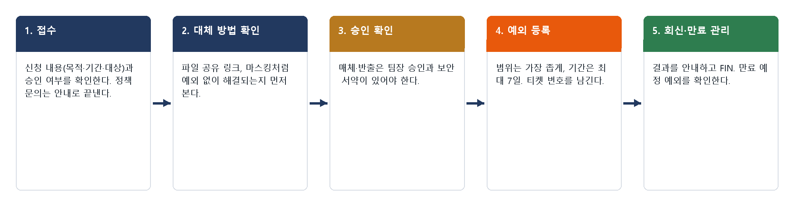
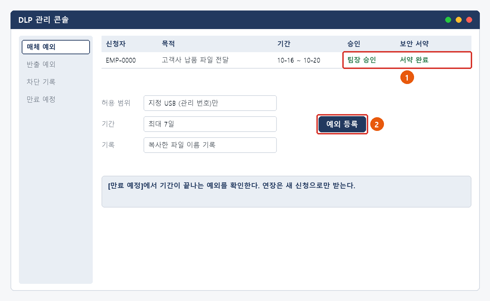
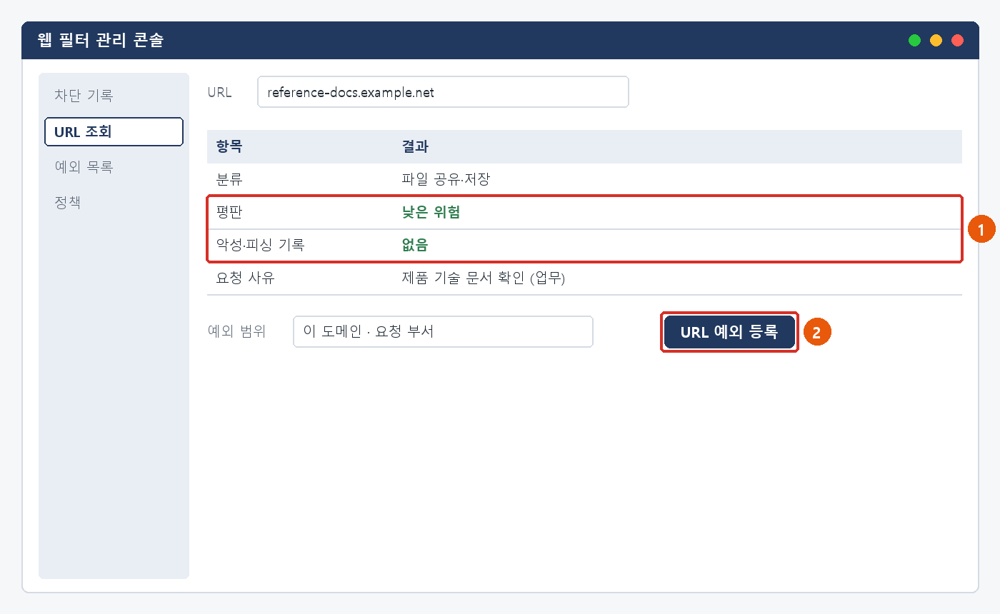

# 보안 예외 신청·정책 처리 매뉴얼

> 한화시스템 ICT IT 담당자 매뉴얼 · 정보보안  
> IT-SEC-004-M | 정보보안팀 | 2026-10-16 | v2.0 | **사내 제한** (IT 운영 담당자·관리자)
>
> IT운영·보안 조직 내부 문서입니다. 사용자에게 문서 자체를 전달하지 않고, 안내는 짝이 되는 임직원용 가이드를 기준으로 합니다.

## 목차

- 1. 개요
- 2. 접수·분류 기준
- 3. 증상별 처리 절차
  - 3.1 USB 등 이동식 저장매체 사용 신청
  - 3.2 개인정보가 든 파일을 외부로 보내야 할 때 (마스킹)
  - 3.3 업무 사이트 차단 해제 요청
  - 3.4 생성형 AI를 업무에 쓸 때
- 4. 대형 장애 대응
- 5. 처리 기록 기준
- 6. 연락처
- 개정 이력

## 1. 개요

#### 목적

IT-SEC-004로 들어오는 보안 예외 신청(이동식 저장매체, 파일 반출, 사이트 차단 해제)과 정책 문의(마스킹, 생성형 AI)를 같은 기준으로 판단하고, 예외는 가장 좁은 범위·짧은 기간으로 등록해 만료까지 관리한다.

#### 담당 범위

| 항목 | 내용 |
| --- | --- |
| 1차 처리 | 서비스데스크(L1)·ITssue 챗봇: 정책 문의 안내, 신청 내용과 승인 여부 확인, 대체 방법 안내 |
| 2차 이관 | 정보보안팀(L2): 매체·반출 예외 등록, URL 평판 확인과 예외 등록, AI 도구 검토, 기밀 입력·오발송 사고 대응 |
| 배정 기준 | 보안 예외·정책 담당 (소시후). 담당자가 없으면 정보보안팀장(오한결)이 재배정 |
| 관련 시스템 | DLP 관리 콘솔, 웹 필터 관리 콘솔, 정보보안 포털, 상담 기록 시스템 |

## 2. 접수·분류 기준

사용자 가이드의 항목별 기본값입니다. 긴급도 기준은 IT-STD-001 IT 서비스 운영 기준을 따릅니다.

| 번호 | 문의 유형 | 증상·요청 | 기본 긴급도 | 1차 처리 | 처리 방식 | 이관 대상 |
| --- | --- | --- | --- | --- | --- | --- |
| 3.1 | SEC-03 | USB 등 이동식 저장매체 사용 신청 | P4 | 서비스데스크 | 신청·승인 후 처리 | 정보보안팀 |
| 3.2 | SEC-03 | 개인정보가 든 파일을 외부로 보내야 할 때 (마스킹) | P4 | 서비스데스크 | 즉시 처리 (오발송은 즉시 이관) | 정보보안팀 |
| 3.3 | SEC-07 | 업무 사이트 차단 해제 요청 | P4 | 서비스데스크 | 티켓 | 정보보안팀 |
| 3.4 | SEC (정책) | 생성형 AI를 업무에 쓸 때 | P4 | ITssue 챗봇·서비스데스크 | 즉시 처리 (기밀 입력은 즉시 이관) | 정보보안팀 |

#### 처리 방식

- 즉시 처리: 정책 문의(규칙·절차·승인 도구 목록)는 안내로 끝낸다. 챗봇이 ANSWER로 처리할 수 있다.
- 신청·승인 후 처리: 매체·반출 예외는 팀장 승인과 보안 서약이 확인된 뒤 정보보안팀이 등록한다.
- 티켓: 사이트 차단 해제, AI 도구 검토 요청. 정보보안팀에 배정하고 RDY → IP → FIN → CLS 으로 관리한다.
- 즉시 이관: 기밀을 승인되지 않은 도구에 입력했거나 개인정보를 잘못 보낸 건. 티켓과 함께 전화로 알린다.

#### 긴급도 조정 조건

- SEC-03·SEC-07은 기본 P4다.
- "오늘 마감", "급합니다"처럼 당일 업무 차질이 있으면 P3로 한 단계 올린다 (INQ-2026-00021, INQ-2026-00073).
- 기밀 입력·개인정보 오발송은 보안 사고로 보고 최소 P2로 처리한다 (MAN-00 공통 규칙 6).
- 승인 절차를 건너뛰어 달라는 요청은 긴급도와 관계없이 받지 않는다.

#### 처리 흐름

*그림 2-1. 보안 예외 신청·정책 문의 처리 흐름*

## 3. 증상별 처리 절차

### 3.1 USB 등 이동식 저장매체 사용 신청

**문의 유형** SEC-03 · **기본 긴급도** P4 · **1차 처리** 서비스데스크 · **처리 방식** 🟡 신청·승인 후 처리 · **이관 대상** 정보보안팀

**접수 시 확인 질문**

- 무엇을, 왜 옮기나요? 받는 곳은?
- 파일 공유 링크로는 안 되나요?
- 기간은? (최대 7일)
- 팀장 승인과 보안 서약을 마쳤나요?

**판단 기준**

- 즉시 처리: 절차 문의면 신청 방법을 안내하고 끝낸다.
- 신청·승인 후 처리: 팀장 승인과 보안 서약이 있으면 정보보안팀이 기간 한정 예외를 등록한다 (INQ-2026-00017, INQ-2026-00347).
- 반려: 승인이 없거나 7일을 넘기는 요청, 개인 매체 사용 요청.

#### 처리 절차

1. 신청 내용(목적·기간·매체·파일)과 팀장 승인, 보안 서약을 확인한다.
2. 파일 공유 링크 같은 대체 방법으로 해결되는지 먼저 안내한다.
3. 정보보안팀은 DLP 관리 콘솔에서 지정 매체(관리 번호)만, 신청 기간(최대 7일)으로 예외를 등록한다. 복사 기록을 켠다.
4. 등록 결과를 신청자에게 알리고 FIN 처리한다.
5. [만료 예정]에서 기간이 끝나는 예외를 확인한다. 연장 요청은 새 신청으로 받는다.

*그림 3.1-1. DLP 관리 콘솔: ① 승인·서약 확인 ② 범위·기간을 정해 예외 등록*

#### 처리 후 안내 문구

> 신청하신 이동식 저장매체 사용을 승인된 기간 동안 등록했습니다. 지정한 매체에서만 쓸 수 있고 기간이 끝나면 다시 차단됩니다. 옮긴 파일은 목적이 끝나면 지워 주세요.

**재발 방지**

- 문의이력에 재발 방지 기록 없음
- 반복 신청이 많은 업무(납품 등)는 파일 전달 방법을 따로 검토한다.

**이관 시 전달 정보**

- 신청 번호, 목적·기간·매체 관리 번호
- 팀장 승인·보안 서약 여부
- 사번

> ★ **예외는 지정 매체·신청 기간으로만 등록한다. 사용자 전체·기간 없는 예외를 만들지 않는다**

### 3.2 개인정보가 든 파일을 외부로 보내야 할 때 (마스킹)

**문의 유형** SEC-03 · **기본 긴급도** P4 · **1차 처리** 서비스데스크 · **처리 방식** 즉시 처리 (오발송은 즉시 이관) · **이관 대상** 정보보안팀

**접수 시 확인 질문**

- 차단 안내에 감지된 항목은? (캡처)
- 받는 곳과 목적은? 모든 항목이 꼭 필요한가요?
- 원본을 보내야 하는 이유가 있나요?
- 이미 잘못 보낸 것이 있나요?

**판단 기준**

- 즉시 처리: 필요한 항목만 남기고 마스킹해 보내도록 안내한다 (FAQ-032).
- 신청·승인 후 처리: 원본 반출이 꼭 필요하면 반출 신청(팀장 승인)으로 받는다.
- 즉시 이관 (P2): 개인정보를 잘못 보냈으면 정보보안팀에 전화로 알린다.

#### 처리 절차

1. 차단 안내 화면으로 감지 항목을 확인한다.
2. 필요한 항목만 남기고 마스킹하는 방법을 안내한다 (예: 010-****-5678).
3. 원본 반출이 필요하면 반출 신청을 안내하고, 승인 뒤 정보보안팀이 DLP 반출 예외(파일·받는 곳 한정)를 등록한다.
4. 오발송이면 받는 사람·시각·파일을 확인하고 정보보안팀이 회수 요청과 영향 범위 판단(법무팀 보고, 72시간 판단)을 한다.
5. 처리 결과를 기록하고 종료한다.

#### 처리 후 안내 문구

> 개인정보가 든 파일은 외부 전송이 차단됩니다. 받는 쪽에 필요한 항목만 남기고 나머지는 가린 뒤 다시 보내 주세요. 원본이 꼭 필요하면 정보보안 포털에서 반출을 신청해 주세요.

**재발 방지**

- 문의이력에 재발 방지 기록 없음
- 자주 차단되는 양식은 처음부터 마스킹된 서식을 배포하는 것을 검토한다.

**이관 시 전달 정보**

- 감지 항목 (캡처)
- 받는 곳·목적
- 반출 신청 번호 또는 오발송 내용(받는 사람·시각·파일)
- 사번

### 3.3 업무 사이트 차단 해제 요청

**문의 유형** SEC-07 · **기본 긴급도** P4 · **1차 처리** 서비스데스크 · **처리 방식** 티켓 · **이관 대상** 정보보안팀

**접수 시 확인 질문**

- 차단된 주소와 차단 분류는? (캡처)
- 업무 용도는?
- 마감이 있나요?
- 이 사이트를 어디서 알게 됐나요? (메일 링크인가요?)

**판단 기준**

- 티켓: 업무 필요성이 확인되면 정보보안팀이 평판을 확인하고 URL 예외로 처리한다 (INQ-2026-00021, INQ-2026-00073).
- 당일 마감이면 P3로 올린다.
- 반려: 악성·피싱 분류, 평판 위험 사이트. 메일 링크로 알게 된 사이트면 IT-SEC-001을 함께 본다.

#### 처리 절차

1. 차단 화면 캡처와 업무 용도를 받아 티켓을 만든다.
2. 정보보안팀은 웹 필터 관리 콘솔에서 URL 분류·평판·악성 기록을 확인한다.
3. 문제가 없으면 도메인 단위·요청 부서 범위로 URL 예외를 등록한다.
4. 1영업일 안에 결과를 회신한다. 반려하면 이유와 대체 방법을 안내한다.
5. 사용자가 접속을 확인하면 FIN 처리한다.

*그림 3.3-1. 웹 필터 관리 콘솔: ① 평판·악성 기록 확인 ② URL 예외 등록*

#### 처리 후 안내 문구

> 요청하신 사이트의 평판을 확인한 결과 업무에 써도 되는 사이트로 확인되어 차단을 해제했습니다. 브라우저를 다시 시작한 뒤 접속해 주세요.

**재발 방지**

- 문의이력에 재발 방지 기록 없음
- 같은 사이트 해제 요청이 여러 부서에서 오면 분류 정책을 검토한다.

**이관 시 전달 정보**

- 차단 화면 캡처 (주소·분류·시각)
- 업무 용도와 마감 시각
- PC 이름, 사번

### 3.4 생성형 AI를 업무에 쓸 때

**문의 유형** SEC (정책) · **기본 긴급도** P4 · **1차 처리** ITssue 챗봇·서비스데스크 · **처리 방식** 즉시 처리 (기밀 입력은 즉시 이관) · **이관 대상** 정보보안팀

**접수 시 확인 질문**

- 어떤 도구로 어떤 업무를 하려고 하나요?
- 입력하려는 정보에 고객 정보·개인정보·소스코드·비밀번호·API Key가 있나요?
- 이미 입력했나요? 언제, 어떤 도구에?

**판단 기준**

- 즉시 처리: 사용 가능 여부 문의는 승인 도구 목록과 입력 금지 정보를 안내하고 끝낸다 (FAQ-038).
- 티켓: 목록에 없는 도구의 사용 검토 요청.
- 즉시 이관 (P2): 승인되지 않은 도구에 기밀을 이미 입력했으면 정보보안팀에 전화로 알린다.

#### 처리 절차

1. 쓰려는 도구가 승인 목록에 있는지, 입력하려는 정보가 금지 대상인지 확인한다.
2. 승인된 도구와 입력 금지 정보를 안내한다. 금지 정보가 있으면 빼고 쓰도록 안내한다.
3. 목록에 없는 도구는 검토 요청 티켓으로 받는다. 검토 전에는 쓰지 않도록 안내한다.
4. 기밀 입력 사고면 정보보안팀이 입력 내용·도구·계정을 확인하고, 서비스의 삭제 요청과 노출된 비밀번호·API Key 교체를 진행한다.
5. 개인정보가 포함됐으면 법무팀에 보고하고 72시간 통지·신고 대상인지 판단한다.

#### 처리 후 안내 문구

> 회사가 승인한 생성형 AI 도구만 쓸 수 있고, 고객 정보·개인정보·소스코드·비밀번호·API Key는 어떤 도구에도 넣지 않습니다. 승인 목록은 정보보안 포털에서 확인해 주세요.

**재발 방지**

- 문의이력에 기록 없음
- 승인 도구 목록과 입력 금지 정보를 사내 공지에 정기적으로 다시 알린다.

**이관 시 전달 정보**

- 도구 이름과 업무
- (사고면) 입력 시각·정보 종류·도구 계정
- 사번

> ★ **사용자가 입력한 기밀 내용을 다시 받아 옮겨 적지 않는다**
>
> 사고 확인에 필요한 정보 종류와 시각만 기록한다.

## 4. 대형 장애 대응

- 이 문서의 신청·정책 문의는 대형 장애 대상이 아니다.
- 웹 필터·DLP 정책 변경 뒤 여러 부서에서 같은 차단 문의가 짧은 시간에 들어오면 정책 오류로 보고 대표 티켓(MI-YYYY-NN)을 만든다 (MAN-00 7장).
- 정책 오류로 확인되면 정보보안팀이 정책을 되돌리고, 개별 예외 등록으로 대응하지 않는다.
- 공지에는 영향 범위와 복구 예정 시각, 그동안 쓸 대체 방법을 넣는다.
- 복구 후 연결된 티켓을 한꺼번에 종료하고 원인·조치·재발 방지를 기록한다.

> ★ **정책 오류 중에도 우회 방법(개인 메일·개인 클라우드)을 안내하지 않는다**

## 5. 처리 기록 기준

티켓을 종료할 때 아래 항목을 남깁니다.

| 항목 | 적는 내용 |
| --- | --- |
| 원인 | 확인된 원인 한 줄 (예: 외부 피싱 메일, 매크로 행위 기반 오탐) |
| 조치 내용 | 실제로 한 조치. 즉시 처리면 앞에 [즉시 처리] |
| 보안 조치 기록 | 차단한 주소·도메인·해시, 격리·세션 종료 시각, 보존한 증거 (해당할 때) |
| 재발 방지 | 같은 문의를 줄이기 위한 조치 (없으면 빈칸) |
| 관련 FAQ | 안내에 쓴 FAQ 번호 |
| 가이드 반영 | 사용자 가이드에 추가·수정이 필요한지 (필요 / 불필요) |
| 예외 관리 | 예외 종류, 범위(매체·URL·파일), 기간과 만료일, 승인자, 티켓 번호 |

## 6. 연락처

| 담당 | 연락처 | 이럴 때 |
| --- | --- | --- |
| 서비스데스크 | IT 헬프데스크 내선 1000 | 1차 접수, 즉시 처리 |
| 정보보안팀 | 내선 1119 | 보안 신고·이관. 즉시 이관 건은 티켓과 함께 전화로 알린다 |
| 정보보안팀장 (오한결) | 내선 1119 | 재배정 승인, 대형 장애 판단, 사고 보고 |
| 시스템인프라팀 | 내선 1050 | 서버·DB·SSO·메일 서버 |
| 업무시스템팀 | 내선 1060 | 사내 시스템 권한·접근 기록 |
| 엔드포인트지원팀 | 내선 1030 | PC 재설치·장비 교체, 단말 관리 |
| 법무팀 | 그룹웨어 조직도 | 개인정보 유출·통지 판단 |

## 개정 이력

| 버전 | 개정일 | 작성자 | 변경 내용 |
| --- | --- | --- | --- |
| v1.0 | 2026-03-01 | 정보보안팀 | 최초 작성 |
| v2.0 | 2026-10-16 | 정보보안팀 | 7개 분류 통합 정리본. 문서 양식·열람 등급·용어·연락처를 통일하고 분류 사이의 중복 내용을 한 문서로 정리 |
