# 사내 시스템 성능 저하 대응 가이드

> 한화시스템 ICT 임직원 IT 안내 · 사내 시스템  
> IT-SYS-002 | 업무시스템팀 | 2026-10-16 | v2.0 | **사내 일반** (전 임직원)

## 목차

- 1. 개요
- 2. 먼저 확인할 사항
- 3. 증상별 조치 방법
  - 3.1 ERP와 PMS 등 여러 업무 시스템이 나만 느림
  - 3.2 사람이 많이 쓰는 오후 시간대에 PMS가 느려짐
  - 3.3 업데이트 이후 BI 분석 플랫폼이 크게 느려짐
  - 3.4 바쁜 시간대에 PMS 연동이 잠깐씩 끊기거나 저장 중 오류가 남
  - 3.5 BI 보고서를 만들 때마다 화면이 꺼짐
  - 3.6 BI 대시보드의 매출 수치가 실제와 다름
  - 3.7 BI·PMS에 파일을 올리면 실패하거나 화면이 꺼짐
  - 3.8 PMS·메신저 연동 시 'API 호출 한도 초과'가 나며 동기화가 실패함
- 4. 자주 묻는 질문
- 5. 주의사항
- 6. 문의처
- 부록 · 관련 문서 · 용어
- 개정 이력

## 1. 개요

#### 목적

ERP와 업무 협업 플랫폼(PMS·BI·마케팅 툴)이 느리거나 일부 기능이 간헐적으로 실패하지만 쓸 수는 있을 때 확인할 사항과 신고 방법을 안내한다.

#### 적용 대상

개인·특정 시간대·업데이트 이후의 지연과 간헐 오류에 해당한다. 팀 전체가 쓸 수 없거나 업무가 멈춘 경우는 IT-SYS-003을 본다.

#### 적용 환경

| 항목 | 내용 |
| --- | --- |
| 관련 도구·시스템 | ERP |
| 관련 도구·시스템 | 업무 협업 플랫폼(PMS·BI·마케팅 툴) |
| OS | Windows, macOS (개발 직군 선택) |

## 2. 먼저 확인할 사항

- 느리지만 쓸 수는 있는지, 아예 쓸 수 없는지 먼저 구분한다. 팀 전체가 쓸 수 없거나 업무가 멈추면 IT-SYS-003을 따른다.
- 같은 층 전체의 인터넷이 느리면 IT-NET-002 3.7을 본다.
- 재택 중 VPN 연결 상태에서만 느리면 IT-NET-001 3.2를 본다.
- 느려진 시각과 업데이트 이후인지를 적어 둔다.

## 3. 증상별 조치 방법

| 번호 | 제목 | 문의 유형 | 처리 구분 | 담당 부서 |
| --- | --- | --- | --- | --- |
| 3.1 | ERP와 PMS 등 여러 업무 시스템이 나만 느림 | SYS-02, SYS-05 | 🟢 사용자 직접 조치 | 업무시스템팀 |
| 3.2 | 사람이 많이 쓰는 오후 시간대에 PMS가 느려짐 | SYS-05 | 🔵 IT 담당자 처리 | 업무시스템팀 |
| 3.3 | 업데이트 이후 BI 분석 플랫폼이 크게 느려짐 | SYS-05 | 🔵 IT 담당자 처리 | 업무시스템팀 |
| 3.4 | 바쁜 시간대에 PMS 연동이 잠깐씩 끊기거나 저장 중 오류가 남 | SYS-05 | 🔵 IT 담당자 처리 | 업무시스템팀 |
| 3.5 | BI 보고서를 만들 때마다 화면이 꺼짐 | SYS-05 | 🔵 IT 담당자 처리 | 업무시스템팀 |
| 3.6 | BI 대시보드의 매출 수치가 실제와 다름 | SYS-05 | 🔵 IT 담당자 처리 | 업무시스템팀 |
| 3.7 | BI·PMS에 파일을 올리면 실패하거나 화면이 꺼짐 | SYS-05 | 🔵 IT 담당자 처리 | 업무시스템팀 |
| 3.8 | PMS·메신저 연동 시 'API 호출 한도 초과'가 나며 동기화가 실패함 | SYS-05 | 🔵 IT 담당자 처리 | 업무시스템팀 |

#### 화면 보는 법

*그림 3-1. 그룹웨어 첫 화면. 이 문서에서 자주 쓰는 위치*

- 화면 안내. 이 문서에서 자주 쓰는 위치입니다.
- ① 공지사항: 시스템 장애가 생기면 '장애' 표시가 붙은 공지가 맨 위에 올라옵니다.
- ② IT 헬프데스크: 전화 내선 1000, 메신저 #it-helpdesk 채널. 막히면 여기로 문의합니다.
- ③ 업무 시스템 바로가기: ERP, 인사시스템, PMS, BI 분석, 메신저로 들어갑니다.
- ④ IT 요청: 그룹 메일, 권한, 파일 복구 같은 신청서를 내는 곳입니다.
- 확인: 이 문서의 화면에서 빨간 네모는 누르거나 볼 곳이고, 번호는 오른쪽 설명 번호와 같습니다.

### 3.1 ERP와 PMS 등 여러 업무 시스템이 나만 느림

**문의 유형** SYS-02, SYS-05 · **처리 구분** 🟢 사용자 직접 조치 · **담당 부서** 업무시스템팀

#### 이런 경우

- ERP와 PMS가 똑같이 느리고, 옆자리 사람은 괜찮다.
- 화면을 옮길 때마다 오래 기다려야 하지만 쓸 수는 있다.

화면 메시지: 없음

#### 원인

- 브라우저 캐시가 쌓였거나 여러 탭·프로그램을 동시에 실행함
- 내 PC나 네트워크 연결 문제

#### 조치 방법

1. 브라우저 캐시를 지우고 브라우저를 다시 엽니다.
2. 쓰지 않는 탭과 프로그램을 닫습니다.
3. 다른 사이트도 느리면 PC나 네트워크 문제일 수 있습니다. IT-HW-001 3.2 또는 IT-NET-002를 봅니다.
4. 재택 중이면 VPN 상태를 확인합니다 (IT-NET-001 3.2).

**해결 확인**

- ERP·PMS 화면이 평소 속도로 열리면 해결된 것이다.

**해결되지 않으면**

- 위 조치 후에도 나만 느리면 헬프데스크에 문의한다.
- 같은 팀 여러 명이 느리면 3.2·3.3을 본다.

**문의 시 알려 주실 정보**

- 사번
- 느린 시스템과 메뉴
- 느려진 시각
- 접속 장소 (사무실 / 재택)

#### 화면 따라하기

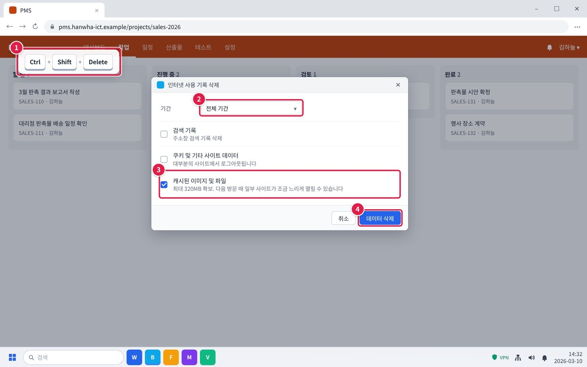

*그림 3.1-1. 브라우저 인터넷 사용 기록 삭제 창*

- 단계 1. 브라우저 캐시를 지우고 브라우저를 다시 엽니다.
- ① 브라우저 화면에서 키보드의 Ctrl + Shift + Delete를 함께 누릅니다. 오른쪽 위 ⋮ 메뉴 > 인터넷 사용 기록 삭제로 열어도 됩니다.
- ② 기간을 '전체 기간'으로 고릅니다.
- ③ '캐시된 이미지 및 파일'만 체크합니다.
- ④ [데이터 삭제]를 누릅니다.
- 주의: '쿠키'는 체크하지 않아도 됩니다. 체크하면 여러 사이트에서 다시 로그인해야 합니다.

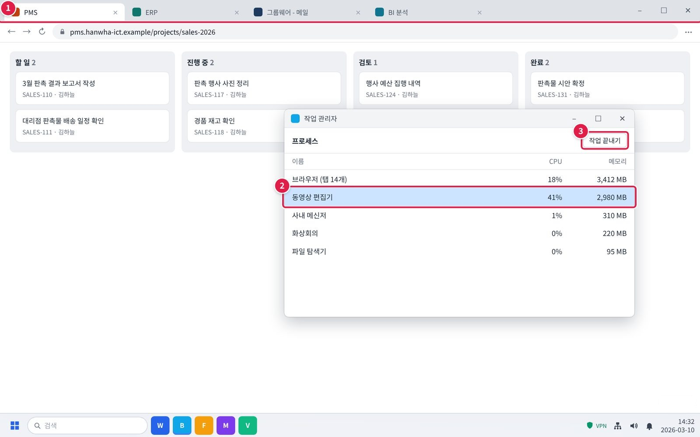

*그림 3.1-2. 브라우저 탭과 작업 관리자*

- 단계 2. 쓰지 않는 탭과 프로그램을 닫습니다.
- ① 브라우저 위쪽 탭 중 지금 쓰지 않는 탭은 X를 눌러 닫습니다.
- ② Ctrl + Shift + Esc로 작업 관리자를 열고, 메모리를 많이 쓰는 안 쓰는 프로그램을 고릅니다.
- ③ [작업 끝내기]를 누릅니다.
- 주의: 저장하지 않은 문서가 열린 프로그램은 먼저 저장하고 닫습니다.

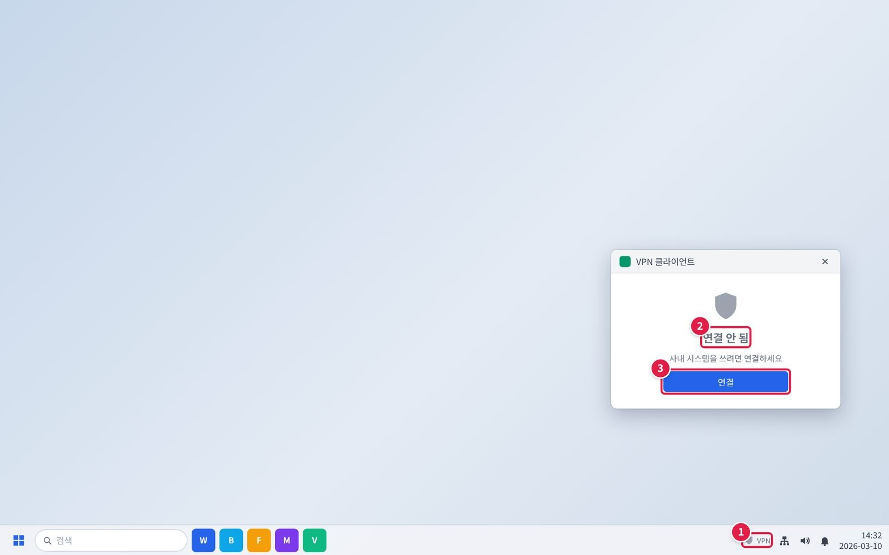

*그림 3.1-3. 작업 표시줄의 VPN 아이콘과 VPN 연결 창*

- 단계 4. 재택 중이면 VPN 상태를 확인합니다 (IT-NET-001 3.2).
- ① 작업 표시줄 오른쪽 아래의 방패 모양 VPN 아이콘을 누릅니다.
- ② 연결 상태를 봅니다. '연결됨'이면 VPN은 정상입니다.
- ③ '연결 안 됨'이면 [연결]을 누르고 통합 계정으로 로그인합니다.
- 확인: 회사 밖(재택·출장)에서는 VPN이 '연결됨'이어야 사내 시스템이 열립니다.

### 3.2 사람이 많이 쓰는 오후 시간대에 PMS가 느려짐

**문의 유형** SYS-05 · **처리 구분** 🔵 IT 담당자 처리 · **담당 부서** 업무시스템팀

#### 이런 경우

- 사람이 많이 쓰는 오후만 되면 PMS가 매우 느려진다.
- 팀원들이 다 느려서 일정 등록이 밀린다.

화면 메시지: 없음

#### 원인

- 이용자가 몰리는 시간대에 시스템 서버 자원(캐시 메모리)이 부족해짐

#### 조치 방법

1. 느려진 시각과 메뉴를 적어 둡니다.
2. 같은 팀 다른 사람도 느린지 확인합니다.
3. 헬프데스크에 신고합니다. 담당자가 서버 자원을 늘리고 설정을 조정합니다.

**해결 확인**

- 오후 시간대에도 평소 속도로 쓸 수 있으면 해결된 것이다.

**해결되지 않으면**

- 팀 전체가 접속할 수 없을 정도가 되면 IT-SYS-003을 따른다.

**문의 시 알려 주실 정보**

- 사번·부서
- 느린 시간대
- 느린 메뉴
- 영향 인원

#### 화면 따라하기

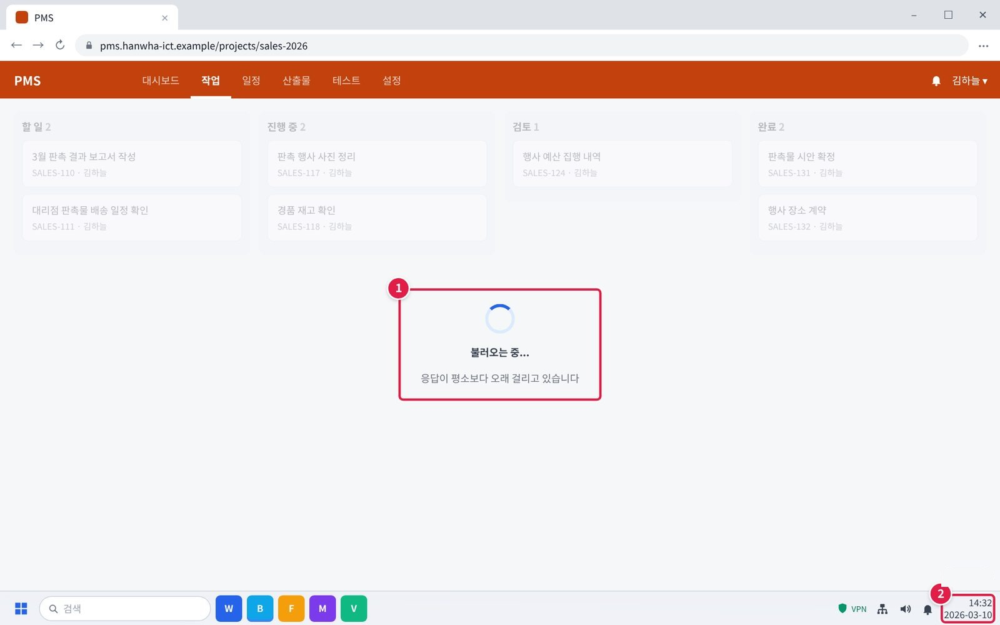

*그림 3.2-1. 오후 시간대 PMS 작업 화면이 오래 로딩되는 증상*

- 증상 화면. 이런 화면이 보이면 이 증상입니다.
- ① 화면을 옮길 때마다 '불러오는 중...'이 오래 떠 있습니다.
- ② 작업 표시줄 시계로 느려진 시각을 적어 둡니다.

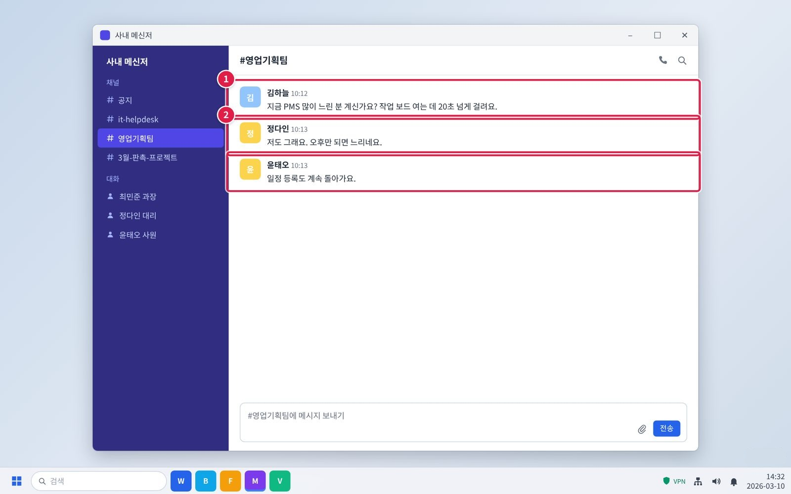

*그림 3.2-2. 같은 팀에 PMS가 느린지 물어보기*

- 단계 2. 같은 팀 다른 사람도 느린지 확인합니다.
- ① 팀 채널에 PMS가 느린지 물어봅니다.
- ② 여러 명이 같다고 하면 팀 단위 문제입니다. 다음 단계로 신고합니다.

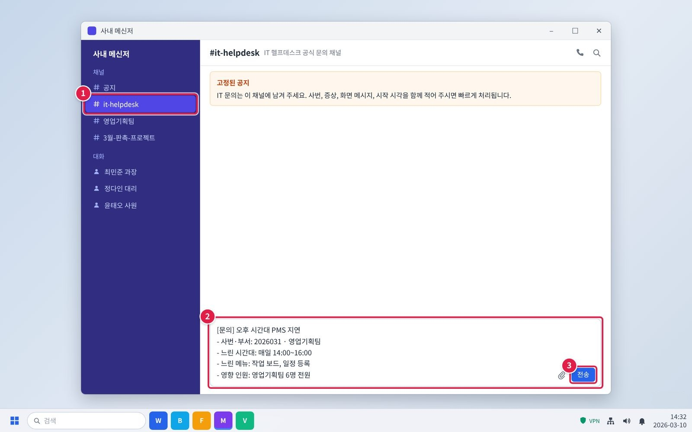

*그림 3.2-3. 메신저 #it-helpdesk 채널에 PMS 지연 신고하기*

- 단계 3. 헬프데스크에 신고합니다. 담당자가 서버 자원을 늘리고 설정을 조정합니다.
- ① 메신저 왼쪽 채널 목록에서 #it-helpdesk를 누릅니다.
- ② 입력창에 아래 항목을 한 줄씩 적습니다. 그대로 복사해 내용만 바꿔 써도 됩니다.
- ③ [전송]을 누릅니다. 담당자가 이 채널이나 개인 대화로 답합니다.
- 주의: 팀 전체가 접속할 수 없을 정도가 되면 IT-SYS-003을 따릅니다.

### 3.3 업데이트 이후 BI 분석 플랫폼이 크게 느려짐

**문의 유형** SYS-05 · **처리 구분** 🔵 IT 담당자 처리 · **담당 부서** 업무시스템팀

#### 이런 경우

- 지난주 업데이트 이후 BI 분석 플랫폼이 매우 느려졌다.
- 캐시 삭제와 재시작을 해 봐도 그대로다.

화면 메시지: 없음

#### 원인

- 업데이트 과정에서 대시보드 조회 성능 설정이 빠짐

#### 조치 방법

1. 브라우저 캐시 삭제와 재시작을 먼저 합니다.
2. 업데이트 이후부터 느려졌다는 점과 느린 대시보드 이름을 적어 헬프데스크에 신고합니다.

**해결 확인**

- 대시보드가 업데이트 전 속도로 열리면 해결된 것이다.

**해결되지 않으면**

- 팀 업무가 멈출 정도면 IT-SYS-003을 따른다.

**문의 시 알려 주실 정보**

- 사번·부서
- 느린 대시보드 이름
- 업데이트 이후 여부
- 이미 해 본 조치

#### 화면 따라하기

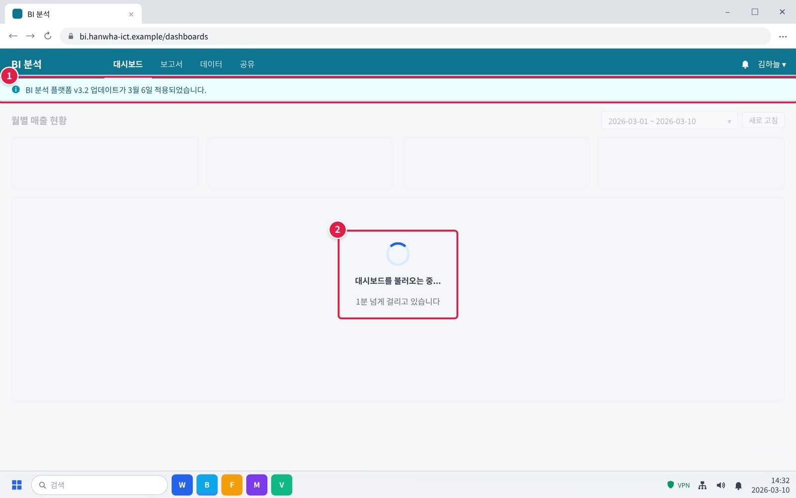

*그림 3.3-1. 업데이트 이후 BI 대시보드가 오래 로딩되는 증상*

- 증상 화면. 이런 화면이 보이면 이 증상입니다.
- ① 업데이트 안내가 보이고,
- ② 대시보드가 1분 넘게 로딩됩니다. 캐시 삭제와 재시작을 해도 같습니다.

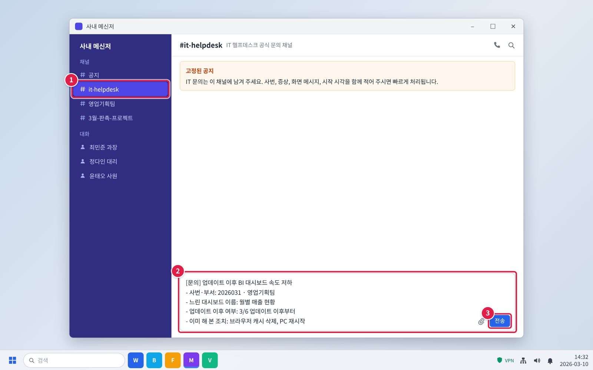

*그림 3.3-2. 메신저 #it-helpdesk 채널에 BI 속도 저하 신고하기*

- 단계 2. 업데이트 이후부터 느려졌다는 점과 느린 대시보드 이름을 적어 헬프데스크에 신고합니다.
- ① 메신저 왼쪽 채널 목록에서 #it-helpdesk를 누릅니다.
- ② 입력창에 아래 항목을 한 줄씩 적습니다. 그대로 복사해 내용만 바꿔 써도 됩니다.
- ③ [전송]을 누릅니다. 담당자가 이 채널이나 개인 대화로 답합니다.
- 확인: 문의할 때 알려 줄 정보를 처음부터 적으면 다시 묻는 시간이 줄어듭니다.

### 3.4 바쁜 시간대에 PMS 연동이 잠깐씩 끊기거나 저장 중 오류가 남

**문의 유형** SYS-05 · **처리 구분** 🔵 IT 담당자 처리 · **담당 부서** 업무시스템팀

#### 이런 경우

- 바쁜 시간대마다 PMS와 테스트 관리 툴 연동이 잠깐씩 끊겨 테스트 결과 등록이 밀린다.
- PMS에서 작업 상태를 업데이트할 때 가끔 오류가 나면서 창이 꺼진다.

화면 메시지: 없음

#### 원인

- 시스템 사이를 잇는 연동 통로의 연결 수가 바쁜 시간대에 모자람

#### 조치 방법

1. 오류가 난 시각과 작업을 적어 둡니다.
2. 잠시 뒤 다시 저장합니다.
3. 매일 반복되면 헬프데스크에 신고합니다.

**해결 확인**

- 바쁜 시간대에도 연동 끊김과 저장 오류가 생기지 않으면 해결된 것이다.

**해결되지 않으면**

- 팀 전체가 PMS를 쓸 수 없게 되면 IT-SYS-003을 따른다.

**문의 시 알려 주실 정보**

- 사번
- 오류가 난 시각
- 작업 내용
- 화면 메시지

#### 화면 따라하기

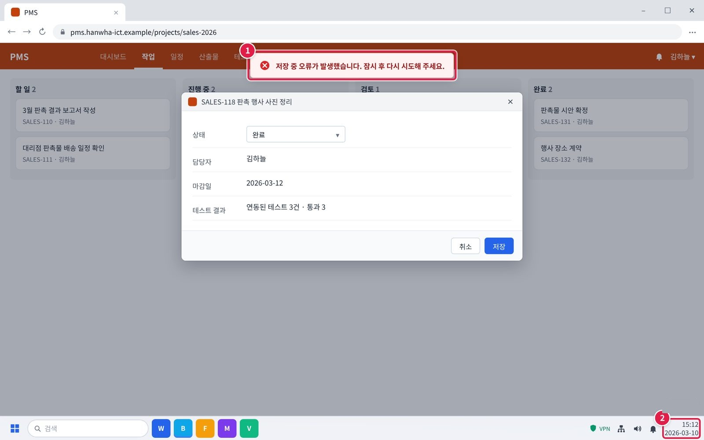

*그림 3.4-1. 바쁜 시간대 PMS 작업 상태 저장 중 오류*

- 증상 화면. 이런 화면이 보이면 이 증상입니다.
- ① 작업 상태를 바꾸고 저장하면 오류가 뜨거나 창이 꺼집니다.
- ② 오류가 난 시각을 작업 표시줄 시계에서 확인해 적어 둡니다.

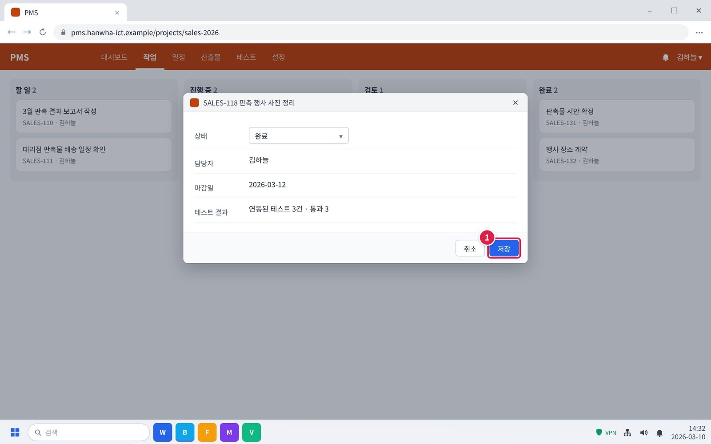

*그림 3.4-2. 잠시 뒤 다시 저장*

- 단계 2. 잠시 뒤 다시 저장합니다.
- ① 1~2분 기다린 뒤 [저장]을 한 번 누릅니다.
- 주의: 여러 번 연달아 누르면 같은 내용이 중복 저장될 수 있습니다.

*그림 3.4-3. 메신저 #it-helpdesk 채널에 PMS 간헐 오류 신고하기*

- 단계 3. 매일 반복되면 헬프데스크에 신고합니다.
- ① 메신저 왼쪽 채널 목록에서 #it-helpdesk를 누릅니다.
- ② 입력창에 아래 항목을 한 줄씩 적습니다. 그대로 복사해 내용만 바꿔 써도 됩니다.
- ③ [전송]을 누릅니다. 담당자가 이 채널이나 개인 대화로 답합니다.
- 확인: 문의할 때 알려 줄 정보를 처음부터 적으면 다시 묻는 시간이 줄어듭니다.

### 3.5 BI 보고서를 만들 때마다 화면이 꺼짐

**문의 유형** SYS-05 · **처리 구분** 🔵 IT 담당자 처리 · **담당 부서** 업무시스템팀

#### 이런 경우

- BI 플랫폼에서 보고서를 만들 때마다 화면이 꺼진다.
- 재시작이랑 브라우저 업데이트는 해 봤다.

화면 메시지: 없음

#### 원인

- 큰 보고서를 만들 때 사용자별 메모리 한도를 넘음

#### 조치 방법

1. 보고서의 기간이나 범위를 나눠 여러 번 만듭니다.
2. 그래도 꺼지면 헬프데스크에 신고합니다. 담당자가 메모리 한도를 조정합니다.

**해결 확인**

- 보고서가 끝까지 만들어지면 해결된 것이다.

**해결되지 않으면**

- 한도를 조정한 뒤에도 꺼지면 보고서 이름과 조건을 알려 다시 문의한다.

**문의 시 알려 주실 정보**

- 사번
- 보고서 이름
- 조회 기간·조건
- 이미 해 본 조치

#### 화면 따라하기

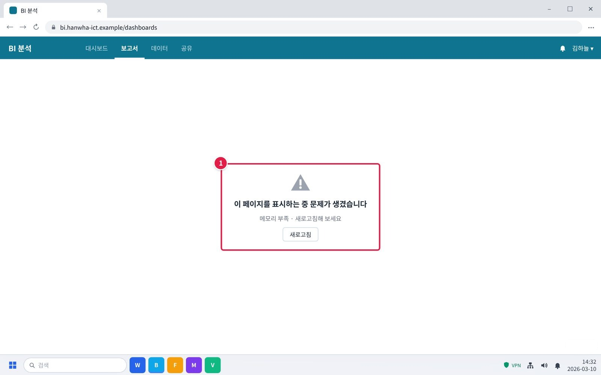

*그림 3.5-1. BI 보고서를 만들 때 화면이 꺼지는 증상*

- 증상 화면. 이런 화면이 보이면 이 증상입니다.
- ① 보고서 생성을 누르면 잠시 뒤 화면이 이렇게 바뀌며 꺼집니다.
- 확인: 조회 기간이 길거나 대상이 많으면 생기기 쉽습니다.

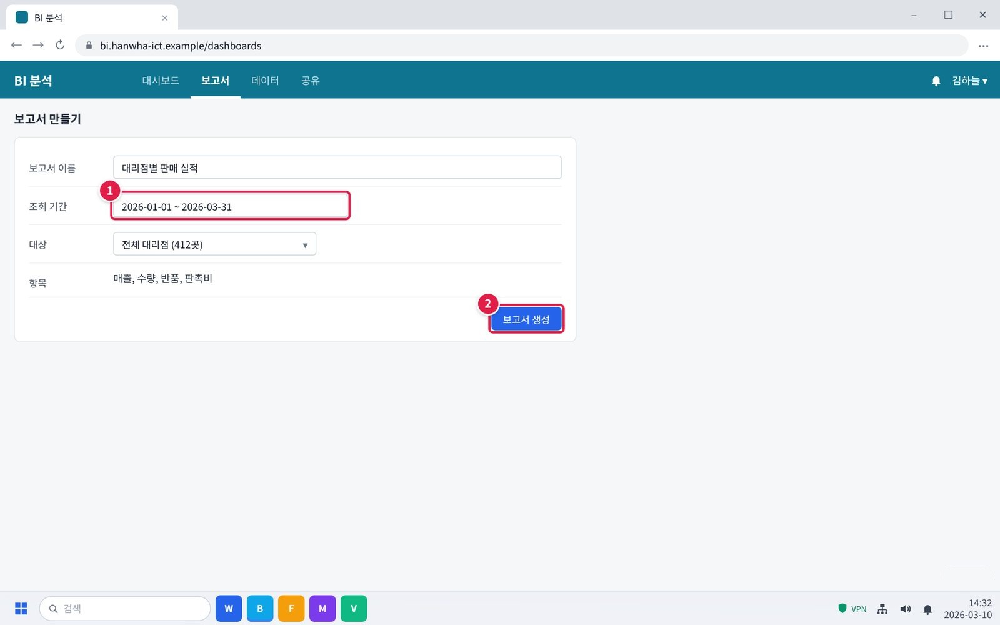

*그림 3.5-2. 조회 기간을 나눠 보고서 만들기*

- 단계 1. 보고서의 기간이나 범위를 나눠 여러 번 만듭니다.
- ① 조회 기간을 3개월 정도로 줄입니다. 예: 2026-01-01 ~ 2026-03-31
- ② [보고서 생성]을 누릅니다. 나머지 기간도 같은 방법으로 나눠 만듭니다.
- 확인: 나눠 만든 보고서는 엑셀로 내려받아 합칠 수 있습니다.

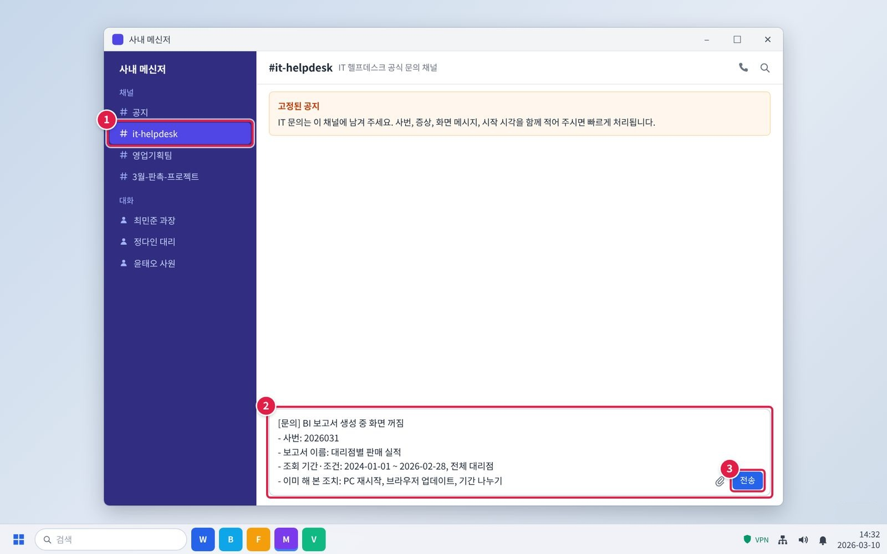

*그림 3.5-3. 메신저 #it-helpdesk 채널에 BI 보고서 오류 신고하기*

- 단계 2. 그래도 꺼지면 헬프데스크에 신고합니다. 담당자가 메모리 한도를 조정합니다.
- ① 메신저 왼쪽 채널 목록에서 #it-helpdesk를 누릅니다.
- ② 입력창에 아래 항목을 한 줄씩 적습니다. 그대로 복사해 내용만 바꿔 써도 됩니다.
- ③ [전송]을 누릅니다. 담당자가 이 채널이나 개인 대화로 답합니다.
- 확인: 문의할 때 알려 줄 정보를 처음부터 적으면 다시 묻는 시간이 줄어듭니다.

### 3.6 BI 대시보드의 매출 수치가 실제와 다름

**문의 유형** SYS-05 · **처리 구분** 🔵 IT 담당자 처리 · **담당 부서** 업무시스템팀

#### 이런 경우

- BI 대시보드의 매출 숫자가 이상하게 나온다.
- 새로 고쳐도 그대로다.

화면 메시지: 없음

#### 원인

- ERP 데이터를 BI로 넘기는 정기 작업(배치)이 빠짐

#### 조치 방법

1. 다른 날짜·기간의 수치도 다른지 확인합니다.
2. 이상한 수치와 날짜를 캡처해 헬프데스크에 신고합니다. 담당자가 연동 작업을 다시 실행합니다.

**해결 확인**

- 대시보드 수치가 ERP와 같으면 해결된 것이다.

**해결되지 않으면**

- 다시 실행한 뒤에도 다르면 비교한 ERP 화면을 함께 보내 다시 문의한다.

**문의 시 알려 주실 정보**

- 사번
- 대시보드 이름
- 이상한 수치와 날짜
- 비교한 ERP 수치

#### 화면 따라하기

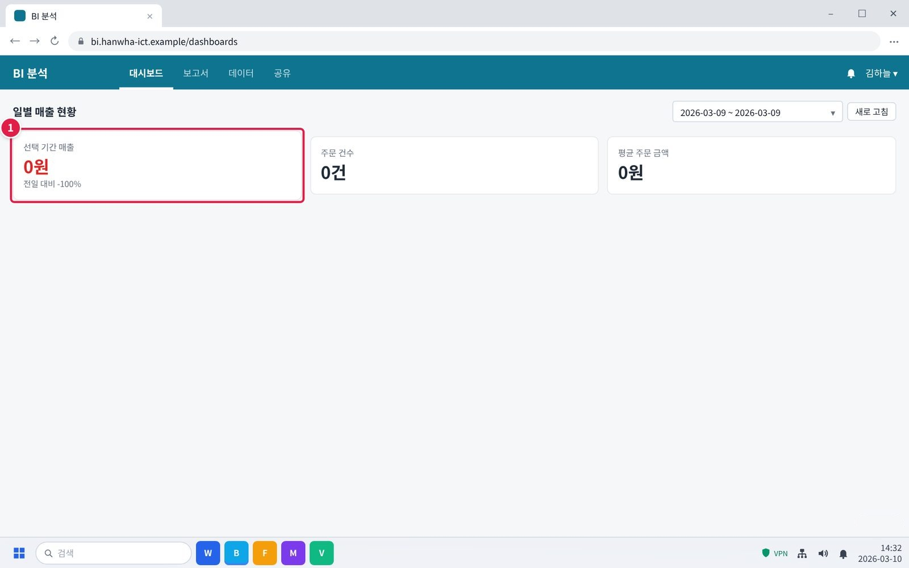

*그림 3.6-1. BI 대시보드의 매출 수치가 0으로 나오는 증상*

- 증상 화면. 이런 화면이 보이면 이 증상입니다.
- ① 3월 9일 매출이 0원으로 나옵니다. 새로 고쳐도 그대로입니다.

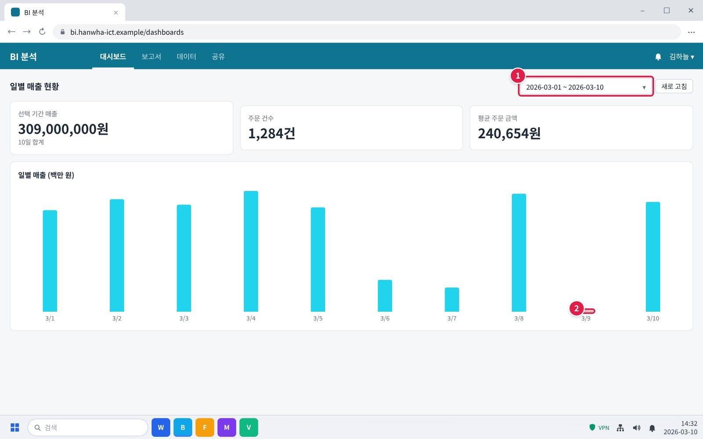

*그림 3.6-2. 기간을 넓혀 다른 날짜와 비교하기*

- 단계 1. 다른 날짜·기간의 수치도 다른지 확인합니다.
- ① 조회 기간을 1일~10일로 넓힙니다.
- ② 다른 날은 정상인데 특정 날짜(3/9)만 비어 있는지 봅니다. 그 날짜를 적어 둡니다.

*그림 3.6-3. 캡처를 붙여 메신저 #it-helpdesk 채널에 신고하기*

- 단계 2. 이상한 수치와 날짜를 캡처해 헬프데스크에 신고합니다. 담당자가 연동 작업을 다시 실행합니다.
- ① 메신저 왼쪽 채널 목록에서 #it-helpdesk를 누릅니다.
- ② 입력창에 아래 항목을 한 줄씩 적습니다. 그대로 복사해 내용만 바꿔 써도 됩니다.
- ③ 클립 아이콘을 눌러 캡처나 파일을 붙입니다. 캡처는 Ctrl+V로 바로 붙여 넣어도 됩니다.
- ④ [전송]을 누릅니다. 담당자가 이 채널이나 개인 대화로 답합니다.
- 확인: 문의할 때 알려 줄 정보를 처음부터 적으면 다시 묻는 시간이 줄어듭니다.

### 3.7 BI·PMS에 파일을 올리면 실패하거나 화면이 꺼짐

**문의 유형** SYS-05 · **처리 구분** 🔵 IT 담당자 처리 · **담당 부서** 업무시스템팀

#### 이런 경우

- BI 플랫폼에 엑셀 데이터 업로드가 계속 실패한다. 파일과 재로그인은 확인했다.
- PMS에 산출물 파일을 올릴 때마다 화면이 꺼진다.

화면 메시지: 없음

#### 원인

- 업데이트 후 업로드 파일 형식 검사 오류
- 업로드 용량 제한을 넘는 파일에 안내가 나오지 않음

#### 조치 방법

1. 파일 크기를 확인합니다. 큰 파일은 부서 공유 드라이브에 올리고 경로를 공유합니다.
2. 작은 파일도 실패하면 파일 이름과 화면을 캡처해 헬프데스크에 신고합니다.

**해결 확인**

- 파일이 올라가면 해결된 것이다.

**해결되지 않으면**

- 업로드가 계속 실패하면 공유 드라이브 경로로 공유하고 담당자 안내를 기다린다.

**문의 시 알려 주실 정보**

- 사번
- 시스템 이름
- 파일 형식과 크기
- 화면 캡처

#### 화면 따라하기

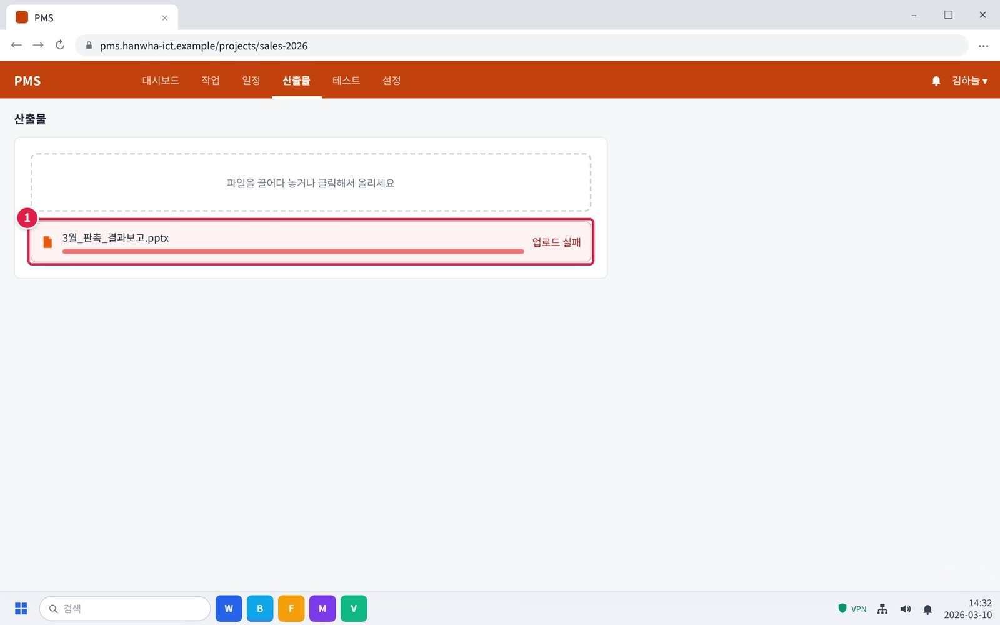

*그림 3.7-1. PMS 산출물 업로드가 실패하는 증상*

- 증상 화면. 이런 화면이 보이면 이 증상입니다.
- ① 파일을 올리면 끝까지 진행된 뒤 '업로드 실패'가 나오거나 화면이 꺼집니다.

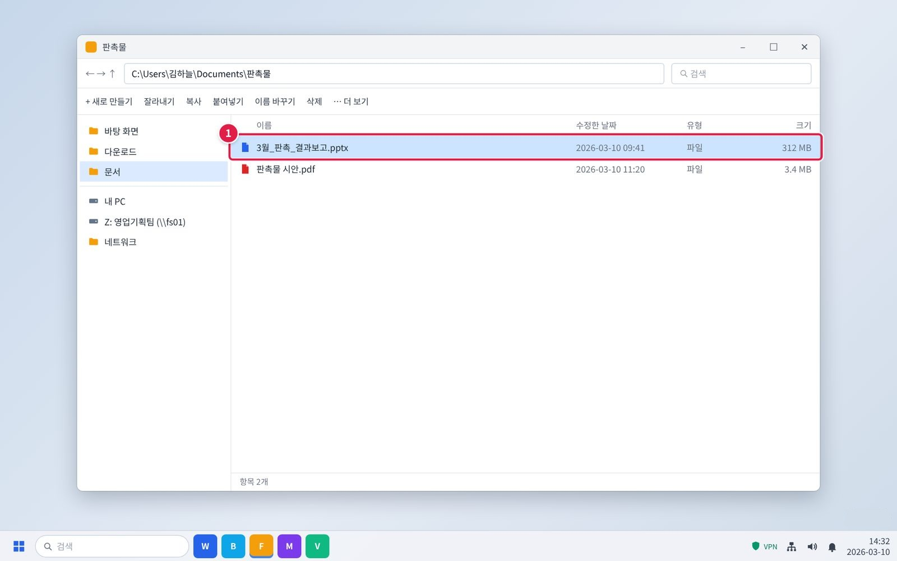

*그림 3.7-2. 파일 탐색기에서 파일 크기 확인*

- 단계 1. 파일 크기를 확인합니다. 큰 파일은 부서 공유 드라이브에 올리고 경로를 공유합니다.
- ① 파일 탐색기에서 올리려던 파일의 '크기' 열을 봅니다. 수백 MB처럼 큰 파일은 업로드 제한에 걸릴 수 있습니다.

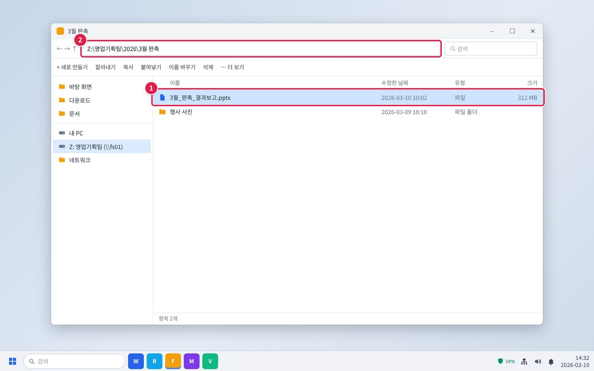

*그림 3.7-3. 큰 파일은 부서 공유 드라이브에 올리고 경로 공유*

- 단계 1. 파일 크기를 확인합니다. 큰 파일은 부서 공유 드라이브에 올리고 경로를 공유합니다.
- ① 큰 파일은 부서 공유 드라이브(Z:) 팀 폴더에 복사합니다.
- ② 위쪽 주소 표시줄을 누르고 Ctrl + C로 경로를 복사해 PMS 댓글이나 메신저에 붙여 넣습니다.
- 주의: 개인 메일이나 외부 저장소로 옮기지 않습니다.

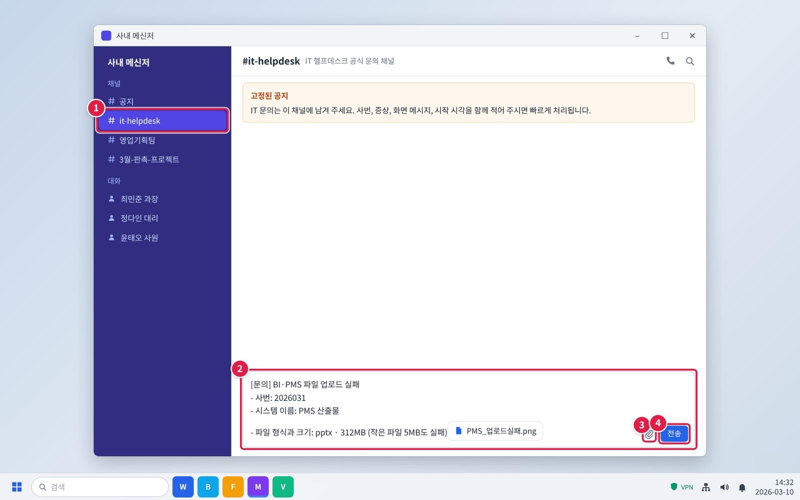

*그림 3.7-4. 캡처를 붙여 메신저 #it-helpdesk 채널에 신고하기*

- 단계 2. 작은 파일도 실패하면 파일 이름과 화면을 캡처해 헬프데스크에 신고합니다.
- ① 메신저 왼쪽 채널 목록에서 #it-helpdesk를 누릅니다.
- ② 입력창에 아래 항목을 한 줄씩 적습니다. 그대로 복사해 내용만 바꿔 써도 됩니다.
- ③ 클립 아이콘을 눌러 캡처나 파일을 붙입니다. 캡처는 Ctrl+V로 바로 붙여 넣어도 됩니다.
- ④ [전송]을 누릅니다. 담당자가 이 채널이나 개인 대화로 답합니다.
- 확인: 문의할 때 알려 줄 정보를 처음부터 적으면 다시 묻는 시간이 줄어듭니다.

### 3.8 PMS·메신저 연동 시 'API 호출 한도 초과'가 나며 동기화가 실패함

**문의 유형** SYS-05 · **처리 구분** 🔵 IT 담당자 처리 · **담당 부서** 업무시스템팀

#### 이런 경우

- PMS와 메신저 연동이 계속 실패하고 'API 호출 한도 초과' 메시지가 보인다.
- 다시 로그인해도 같다.

화면 메시지: "API 호출 한도 초과"

#### 원인

- 연동에 쓰는 계정의 호출 한도를 넘음

#### 조치 방법

1. 연동을 반복해서 다시 시도하지 말고 잠시 기다립니다.
2. 화면을 캡처해 헬프데스크에 신고합니다. 담당자가 연동 주기와 한도를 조정합니다.

**해결 확인**

- 연동이 정상으로 동기화되면 해결된 것이다.

**해결되지 않으면**

- 조정 후에도 실패하면 연동한 채널·프로젝트 이름을 알려 다시 문의한다.

**문의 시 알려 주실 정보**

- 사번
- 연동한 시스템
- 화면 메시지
- 실패한 시각

#### 화면 따라하기

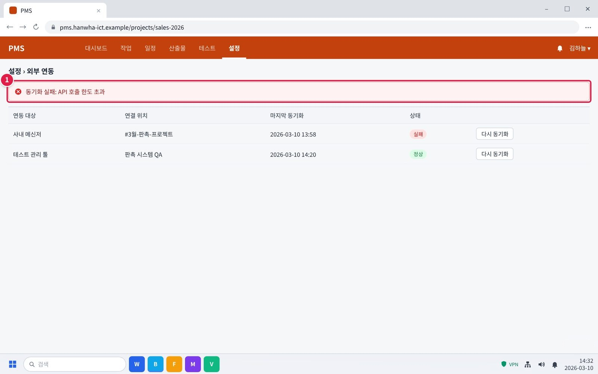

*그림 3.8-1. PMS 외부 연동 화면의 'API 호출 한도 초과' 메시지*

- 증상 화면. 이런 화면이 보이면 이 증상입니다.
- ① 연동 화면 위쪽에 'API 호출 한도 초과'가 보이고 메신저 연동 상태가 '실패'입니다.

![그림 3.8-2. [다시 동기화]를 반복해서 누르지 않기](../images/IT-SYS-002_24.jpg)

*그림 3.8-2. [다시 동기화]를 반복해서 누르지 않기*

- 단계 1. 연동을 반복해서 다시 시도하지 말고 잠시 기다립니다.
- ① [다시 동기화]를 여러 번 누르지 말고 기다립니다.
- 주의: 반복해서 누르면 호출 수가 늘어 한도 초과가 더 길어집니다.

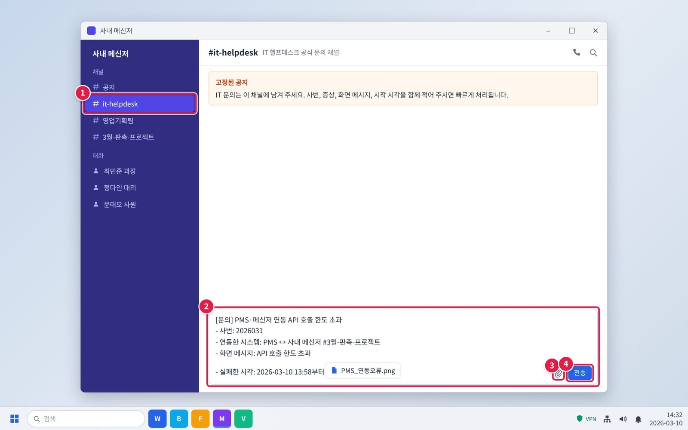

*그림 3.8-3. 캡처를 붙여 메신저 #it-helpdesk 채널에 신고하기*

- 단계 2. 화면을 캡처해 헬프데스크에 신고합니다. 담당자가 연동 주기와 한도를 조정합니다.
- ① 메신저 왼쪽 채널 목록에서 #it-helpdesk를 누릅니다.
- ② 입력창에 아래 항목을 한 줄씩 적습니다. 그대로 복사해 내용만 바꿔 써도 됩니다.
- ③ 클립 아이콘을 눌러 캡처나 파일을 붙입니다. 캡처는 Ctrl+V로 바로 붙여 넣어도 됩니다.
- ④ [전송]을 누릅니다. 담당자가 이 채널이나 개인 대화로 답합니다.
- 확인: 문의할 때 알려 줄 정보를 처음부터 적으면 다시 묻는 시간이 줄어듭니다.

## 4. 자주 묻는 질문

**Q. 업무 시스템이 느린데 저만 그런지 어떻게 알 수 있나요?**

A. 같은 팀 동료에게 같은 화면이 느린지 물어봅니다. 나만 느리면 3.1의 PC 기본 조치를, 여러 명이 느리면 느려진 시각과 화면 이름을 적어 ITssue 챗봇에 알립니다.

**Q. 오후만 되면 PMS가 느려요. 기다리면 되나요?**

A. 사용자가 몰리는 시간대 문제일 수 있습니다. 느려지는 시각과 화면을 적어 알려 주시면 담당자가 처리 용량을 확인합니다 (3.2).

**Q. 팀 전체가 업무 시스템을 아예 쓸 수 없어요.**

A. 느린 것이 아니라 장애입니다. IT-SYS-003을 따르고 IT 헬프데스크(내선 1000)에 알립니다.

## 5. 주의사항

- 느리다고 같은 작업을 여러 번 반복해서 저장하지 않는다.
- 업로드가 실패한 파일을 개인 메일이나 외부 저장소로 옮기지 않는다.
- 큰 파일은 부서 공유 드라이브에 올리고 경로를 공유한다.

## 6. 문의처

| 창구 | 연락처 | 이용 기준 |
| --- | --- | --- |
| ITssue 챗봇 | 사내 IT 포털(hanwha-admin) 상단 [챗봇 문의] | 24시간. 모든 IT 문의의 기본 창구입니다. 챗봇이 해결하지 못하면 확인을 거쳐 담당 팀에 티켓으로 접수합니다. |
| IT 헬프데스크 (서비스데스크) | 내선 1000 (평일 09:00~18:00) | PC나 챗봇을 쓸 수 없을 때, 여러 사람이 함께 업무를 못 할 때, 본인 확인이 필요한 처리 |
| 정보보안팀 | 내선 1119 | 링크 클릭·비밀번호 입력·감염 의심·계정 도용·장비 분실처럼 바로 알려야 할 보안 문제 |
| 메신저 | #it-helpdesk 채널 | 일반 IT 문의 (챗봇을 쓸 수 없을 때) |
| 메일 | it-helpdesk@hanwha-ict.example | 일반 IT 문의. 비밀번호·인증번호는 메일로 보내지 않습니다. |
| 처리 상황 알림 | 사내 메신저 알림 | 접수·담당자 배정·처리 완료를 알려 드립니다. 진행 상황은 [내 요청 현황]에서도 봅니다. |

## 부록 · 관련 문서 · 용어

#### 관련 문서

| 문서 번호 | 문서명 | 이럴 때 봅니다 |
| --- | --- | --- |
| IT-SYS-001 | 그룹웨어·ERP 이용 오류 대응 가이드 |  |
| IT-SYS-003 | 사내 시스템 장애 신고·이관 가이드 |  |
| IT-NET-001 | VPN 접속 장애 대응 가이드 |  |
| IT-NET-002 | 사내 네트워크 장애 대응 가이드 |  |
| IT-HW-001 | 업무 PC 기본 장애 대응 가이드 |  |
| IT-STD-001 | IT 서비스 운영 기준 |  |

#### 용어

| 용어 | 설명 |
| --- | --- |
| 업무 협업 플랫폼 | PMS(프로젝트 관리), BI(분석), 마케팅 툴 등 팀 단위로 쓰는 업무 시스템 |
| 연동 | 두 시스템이 데이터를 자동으로 주고받는 것 |
| 배치 | 정해진 시간에 데이터를 한꺼번에 처리하는 정기 작업 |

## 개정 이력

| 버전 | 개정일 | 작성자 | 변경 내용 |
| --- | --- | --- | --- |
| v1.0 | 2026-03-01 | 업무시스템팀 | 최초 작성 |
| v2.0 | 2026-10-16 | 업무시스템팀 | 7개 분류 통합 정리본. 문서 양식·열람 등급·용어·연락처를 통일하고 분류 사이의 중복 내용을 한 문서로 정리 |
