# 메일 이용 장애 대응 가이드

> 한화시스템 ICT 임직원 IT 안내 · 사내 시스템  
> IT-SYS-004 | 서비스데스크 | 2026-10-16 | v2.0 | **사내 일반** (전 임직원)

## 목차

- 1. 개요
- 2. 먼저 확인할 사항
- 3. 증상별 조치 방법
  - 3.1 거래처에서 보낸 메일이 받은편지함에 없음
  - 3.2 오늘 오후부터 메일이 한 통도 들어오지 않음
  - 3.3 메일함 용량 부족 경고가 계속 뜸
  - 3.4 첨부파일이 있는 메일만 반송됨
  - 3.5 해외 거래처로 보낸 메일이 팀 전체 반송됨
- 4. 자주 묻는 질문
- 5. 주의사항
- 6. 문의처
- 부록 · 관련 문서 · 용어
- 개정 이력

## 1. 개요

#### 목적

외부 메일이 오지 않거나 메일함 용량이 부족할 때, 보낸 메일이 반송될 때 직접 조치하는 방법과 문의하는 방법을 안내한다.

#### 적용 대상

사내 메일 계정의 수신·용량·외부 발송 문제에 해당한다. PC에 설치한 메일 프로그램 오류는 IT-SW-003 3.7, 여러 부서의 메일 송수신 불가는 IT-SYS-003을 본다.

#### 적용 환경

| 항목 | 내용 |
| --- | --- |
| 관련 도구·시스템 | 메일 |
| OS | Windows, macOS (개발 직군 선택) |

## 2. 먼저 확인할 사항

- PC에 설치한 메일 프로그램이 열리지 않거나 느리면 IT-SW-003 3.7을 본다.
- 여러 부서에서 동시에 메일을 보내거나 받지 못하면 IT-SYS-003 3.3을 따른다.
- 의심스러운 메일을 받았으면 IT-SEC-001을 본다.
- 팀 공용 메일(그룹 메일) 신청은 IT-SYS-005를 본다.

## 3. 증상별 조치 방법

| 번호 | 제목 | 문의 유형 | 처리 구분 | 담당 부서 |
| --- | --- | --- | --- | --- |
| 3.1 | 거래처에서 보낸 메일이 받은편지함에 없음 | SYS-06 | 🟢 사용자 직접 조치 | 서비스데스크 |
| 3.2 | 오늘 오후부터 메일이 한 통도 들어오지 않음 | SYS-06 | 🟢 사용자 직접 조치 | 서비스데스크 |
| 3.3 | 메일함 용량 부족 경고가 계속 뜸 | SYS-07 | 🟢 사용자 직접 조치 | 서비스데스크 |
| 3.4 | 첨부파일이 있는 메일만 반송됨 | SYS-08 | 🟢 사용자 직접 조치 | 시스템인프라팀 |
| 3.5 | 해외 거래처로 보낸 메일이 팀 전체 반송됨 | SYS-08 | 🔵 IT 담당자 처리 | 시스템인프라팀 |

#### 화면 보는 법

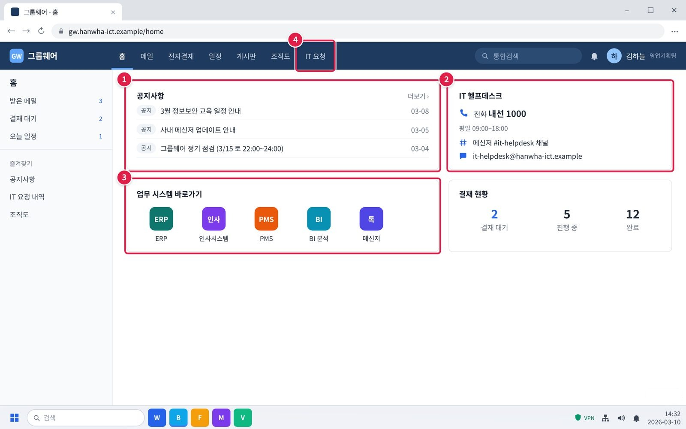

*그림 3-1. 그룹웨어 첫 화면. 이 문서에서 자주 쓰는 위치*

- 화면 안내. 이 문서에서 자주 쓰는 위치입니다.
- ① 공지사항: 시스템 장애가 생기면 '장애' 표시가 붙은 공지가 맨 위에 올라옵니다.
- ② IT 헬프데스크: 전화 내선 1000, 메신저 #it-helpdesk 채널. 막히면 여기로 문의합니다.
- ③ 업무 시스템 바로가기: ERP, 인사시스템, PMS, BI 분석, 메신저로 들어갑니다.
- ④ IT 요청: 그룹 메일, 권한, 파일 복구 같은 신청서를 내는 곳입니다.
- 확인: 이 문서의 화면에서 빨간 네모는 누르거나 볼 곳이고, 번호는 오른쪽 설명 번호와 같습니다.

### 3.1 거래처에서 보낸 메일이 받은편지함에 없음

**문의 유형** SYS-06 · **처리 구분** 🟢 사용자 직접 조치 · **담당 부서** 서비스데스크 · **관련 FAQ** FAQ-010

#### 이런 경우

- 거래처에서 메일을 보냈다는데 내 받은편지함에 없다.

화면 메시지: 없음

#### 원인

- 스팸 필터가 메일을 격리함

#### 조치 방법

1. 메일의 스팸(격리)함을 엽니다.
2. 해당 메일을 선택하고 [해제]를 누릅니다. 메일이 받은편지함으로 옮겨집니다.
3. 같은 거래처 메일이 계속 격리되면 헬프데스크에 발신 도메인을 허용 목록에 등록해 달라고 요청합니다.

**해결 확인**

- 메일이 받은편지함에 보이면 해결된 것이다.

**해결되지 않으면**

- 격리함에도 없으면 3.2(용량)를 확인하고 헬프데스크에 문의한다.
- 보낸 사람이 의심스러우면 해제하지 말고 IT-SEC-001을 따른다.

**문의 시 알려 주실 정보**

- 사번
- 보낸 사람 메일 주소
- 보낸 시각
- 메일 제목

#### 화면 따라하기

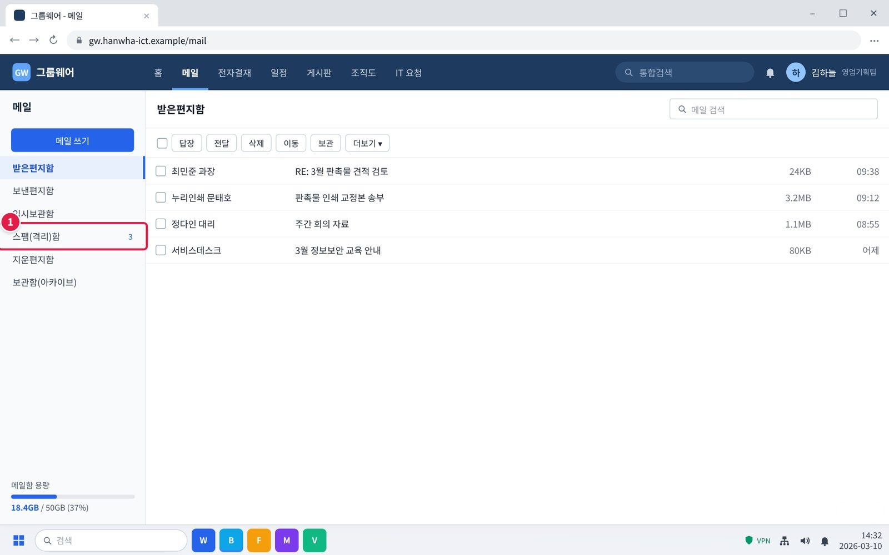

*그림 3.1-1. 메일 왼쪽 폴더 목록의 스팸(격리)함*

- 단계 1. 메일의 스팸(격리)함을 엽니다.
- ① 그룹웨어 [메일]에서 왼쪽 폴더 목록의 [스팸(격리)함]을 누릅니다. 숫자는 격리된 메일 수입니다.

![그림 3.1-2. 메일 격리함 화면. 메일을 선택하고 [해제]를 누르는 위치](../images/IT-SYS-004_03.jpg)

*그림 3.1-2. 메일 격리함 화면. 메일을 선택하고 [해제]를 누르는 위치*

- 단계 2. 해당 메일을 선택하고 [해제]를 누릅니다. 메일이 받은편지함으로 옮겨집니다.
- ① 거래처 메일 왼쪽 네모를 눌러 체크합니다.
- ② 위쪽 [해제]를 누릅니다. 메일이 받은편지함으로 옮겨집니다.
- 주의: 보낸 사람이 처음 보는 주소이거나 의심스러우면 해제하지 말고 IT-SEC-001을 따릅니다.

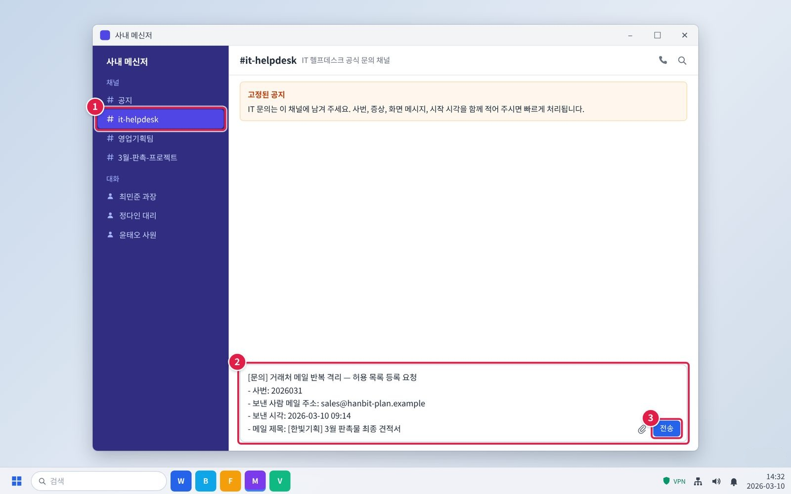

*그림 3.1-3. 같은 거래처 메일이 계속 격리되면 허용 목록 등록 요청*

- 단계 3. 같은 거래처 메일이 계속 격리되면 헬프데스크에 발신 도메인을 허용 목록에 등록해 달라고 요청합니다.
- ① 메신저 왼쪽 채널 목록에서 #it-helpdesk를 누릅니다.
- ② 입력창에 아래 항목을 한 줄씩 적습니다. 그대로 복사해 내용만 바꿔 써도 됩니다.
- ③ [전송]을 누릅니다. 담당자가 이 채널이나 개인 대화로 답합니다.
- 확인: 문의할 때 알려 줄 정보를 처음부터 적으면 다시 묻는 시간이 줄어듭니다.

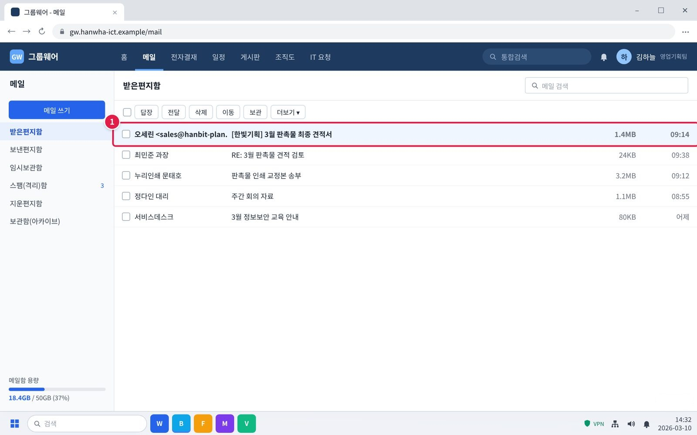

*그림 3.1-4. 받은편지함으로 옮겨진 메일*

- 해결 확인. 메일이 받은편지함에 보이면 해결된 것이다.
- ① 받은편지함에 메일이 보이면 해결된 것입니다.
- 주의: 격리함에도 없으면 메일함 용량(3.2)을 확인하고 헬프데스크에 문의합니다.

### 3.2 오늘 오후부터 메일이 한 통도 들어오지 않음

**문의 유형** SYS-06 · **처리 구분** 🟢 사용자 직접 조치 · **담당 부서** 서비스데스크 · **관련 FAQ** FAQ-010

#### 이런 경우

- 오늘 오후부터 메일이 한 통도 들어오지 않는다.
- 메일함 용량 경고가 떠 있었다.

화면 메시지: 없음

#### 원인

- 메일함 용량이 가득 차 새 메일을 받지 못함

#### 조치 방법

1. 메일함 용량 표시를 확인합니다.
2. 3.3에 따라 오래된 메일을 보관(아카이브)하거나 큰 메일을 지웁니다.
3. 지운편지함도 비웁니다.
4. 동료에게 테스트 메일을 보내 달라고 해 수신을 확인합니다.

**해결 확인**

- 새 메일이 다시 들어오면 해결된 것이다.

**해결되지 않으면**

- 용량에 여유가 있는데도 메일이 오지 않으면 헬프데스크에 문의한다.
- 다른 사람도 메일이 오지 않으면 IT-SYS-003 3.3을 따른다.

**문의 시 알려 주실 정보**

- 사번
- 메일함 용량
- 마지막으로 메일을 받은 시각

#### 화면 따라하기

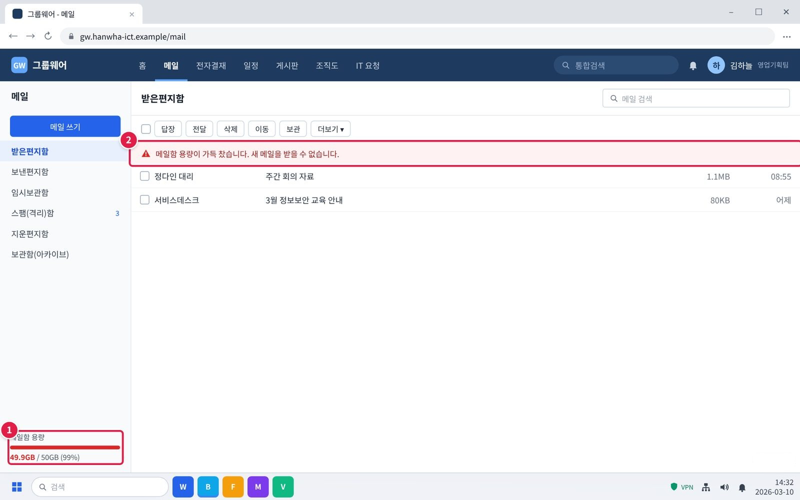

*그림 3.2-1. 메일함 용량 표시와 용량 초과 경고*

- 단계 1. 메일함 용량 표시를 확인합니다.
- ① 왼쪽 아래 '메일함 용량'을 봅니다. 99%처럼 빨간색이면 가득 찬 것입니다.
- ② 위쪽에 '새 메일을 받을 수 없습니다' 경고가 보입니다.
- 확인: 다음 단계는 3.3(용량 정리)을 따라 오래된 메일을 보관하거나 큰 메일을 지웁니다.

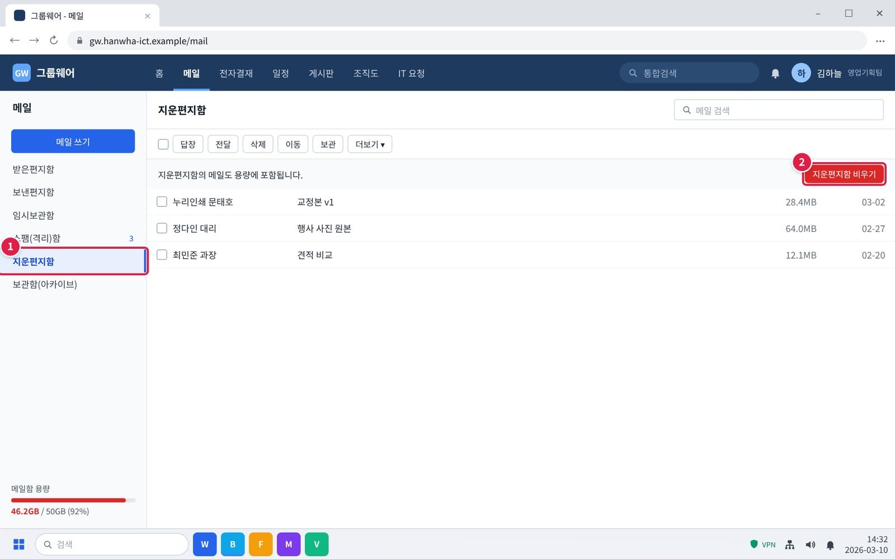

*그림 3.2-2. 지운편지함 비우기*

- 단계 3. 지운편지함도 비웁니다.
- ① 왼쪽 [지운편지함]을 누릅니다.
- ② [지운편지함 비우기]를 누르고 확인 창에서 [확인]을 누릅니다.
- 주의: 비운 메일은 되살릴 수 없습니다. 필요한 메일이 없는지 먼저 봅니다.

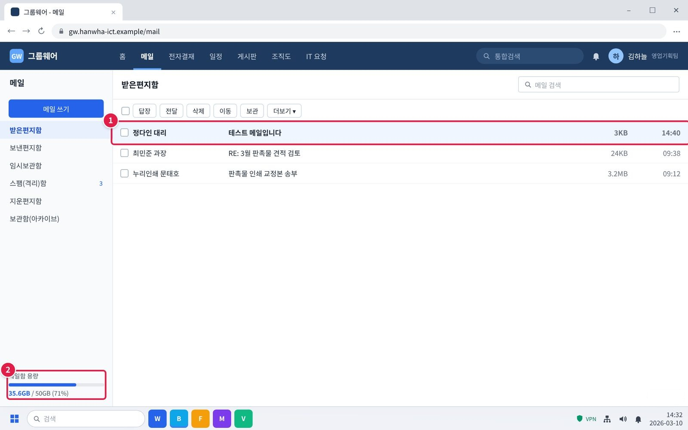

*그림 3.2-3. 동료가 보낸 테스트 메일로 수신 확인*

- 단계 4. 동료에게 테스트 메일을 보내 달라고 해 수신을 확인합니다.
- ① 동료에게 테스트 메일을 보내 달라고 부탁하고, 받은편지함에 들어오는지 봅니다.
- ② 용량이 90% 아래로 내려갔는지 확인합니다.
- 확인: 새 메일이 다시 들어오면 해결된 것입니다.

### 3.3 메일함 용량 부족 경고가 계속 뜸

**문의 유형** SYS-07 · **처리 구분** 🟢 사용자 직접 조치 · **담당 부서** 서비스데스크 · **관련 FAQ** FAQ-011

#### 이런 경우

- 메일함 용량 부족 경고가 계속 떠서 용량을 늘릴 수 있는지 궁금하다.

화면 메시지: 없음

#### 원인

- 기본 용량(50GB)에 가까울 만큼 메일이 쌓임
- 대용량 첨부 메일이 많음

#### 조치 방법

1. 메일 검색창에 size:>10MB 를 입력해 큰 메일을 찾습니다.
2. 필요 없는 큰 메일은 지우고, 필요한 첨부는 공유 드라이브에 저장한 뒤 메일을 지웁니다.
3. '보관(아카이브)' 기능으로 1년 이상 된 메일을 옮깁니다.
4. 자동 보관 설정을 켜 둡니다.

**해결 확인**

- 용량 경고가 사라지면 해결된 것이다.

**해결되지 않으면**

- 정리해도 업무상 용량이 부족하면 헬프데스크에 용량 증설 기준을 문의한다.

**문의 시 알려 주실 정보**

- 사번
- 현재 메일함 용량
- 이미 해 본 조치

#### 화면 따라하기

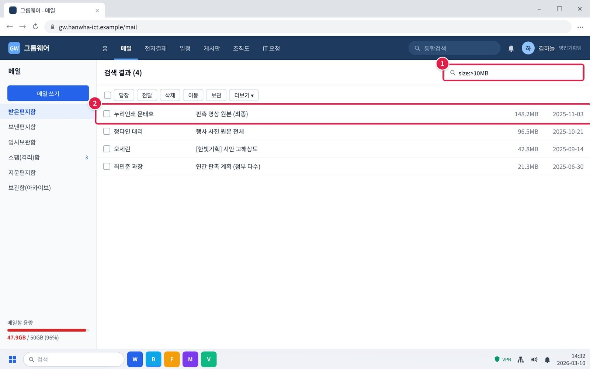

*그림 3.3-1. 메일 검색창에 size:>10MB 를 입력한 결과 화면*

- 단계 1. 메일 검색창에 size:>10MB 를 입력해 큰 메일을 찾습니다.
- ① 오른쪽 위 메일 검색창에 size:>10MB 를 입력하고 Enter를 누릅니다. 10MB보다 큰 메일만 나옵니다.
- ② 오른쪽 크기 열을 보며 큰 메일부터 정리합니다.

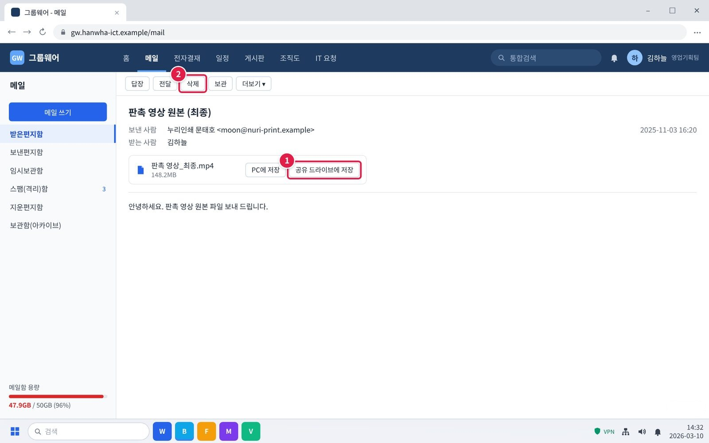

*그림 3.3-2. 첨부를 공유 드라이브에 저장한 뒤 메일 삭제*

- 단계 2. 필요 없는 큰 메일은 지우고, 필요한 첨부는 공유 드라이브에 저장한 뒤 메일을 지웁니다.
- ① 필요한 첨부는 [공유 드라이브에 저장]을 눌러 팀 폴더에 저장합니다.
- ② 저장한 뒤 위쪽 [삭제]로 메일을 지웁니다. 필요 없는 큰 메일은 바로 지웁니다.

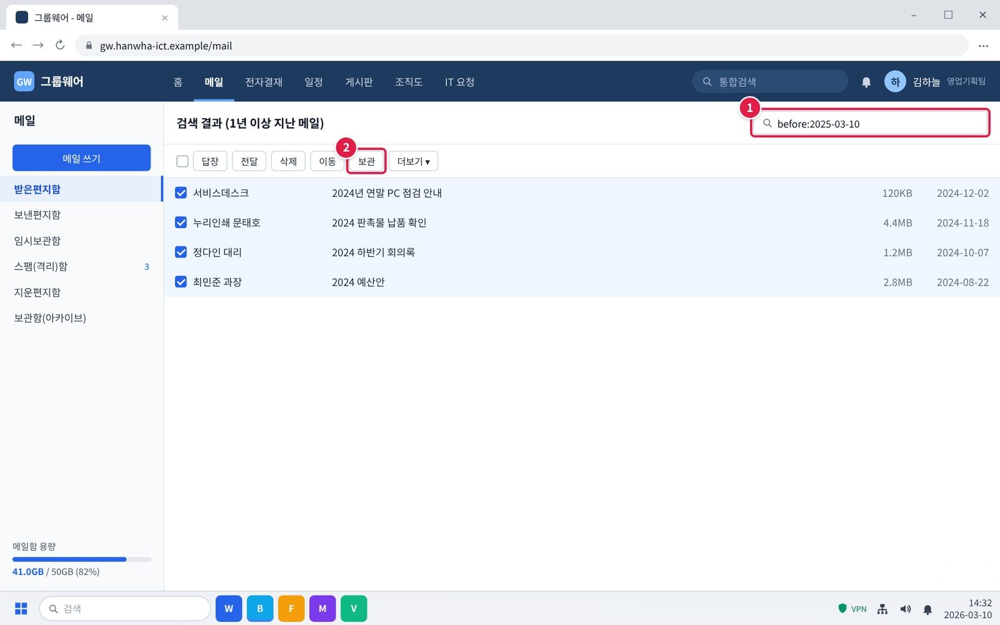

*그림 3.3-3. 1년 이상 된 메일을 보관(아카이브)으로 옮기기*

- 단계 3. '보관(아카이브)' 기능으로 1년 이상 된 메일을 옮깁니다.
- ① 검색창에 before:2025-03-10 처럼 1년 전 날짜를 넣어 오래된 메일을 찾고 맨 위 네모로 모두 체크합니다.
- ② 위쪽 [보관]을 누릅니다. 보관함(아카이브)으로 옮겨지고 메일함 용량에서 빠집니다.
- 확인: 보관한 메일은 왼쪽 [보관함(아카이브)]에서 언제든 다시 볼 수 있습니다.

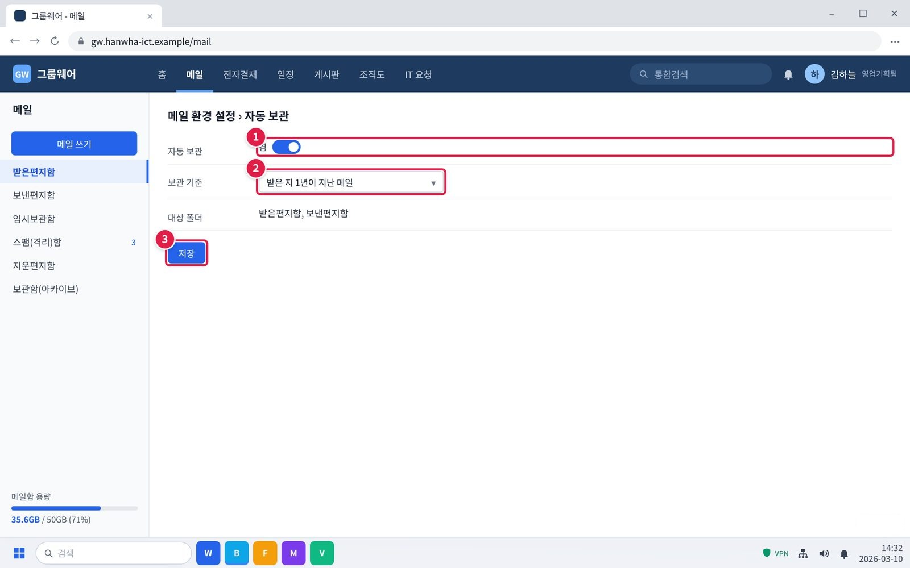

*그림 3.3-4. 자동 보관 설정 켜기*

- 단계 4. 자동 보관 설정을 켜 둡니다.
- ① 메일 오른쪽 위 설정(톱니바퀴) > 자동 보관에서 스위치를 켭니다.
- ② 보관 기준을 '받은 지 1년이 지난 메일'로 고릅니다.
- ③ [저장]을 누릅니다.
- 확인: 용량 경고가 사라지면 해결된 것입니다. 업무상 계속 부족하면 헬프데스크에 용량 증설 기준을 문의합니다.

### 3.4 첨부파일이 있는 메일만 반송됨

**문의 유형** SYS-08 · **처리 구분** 🟢 사용자 직접 조치 · **담당 부서** 시스템인프라팀 · **관련 FAQ** FAQ-012

#### 이런 경우

- 첨부파일이 있는 메일만 되돌아온다.

화면 메시지: 없음

#### 원인

- 첨부 용량이 25MB를 넘음

#### 조치 방법

1. 첨부파일 크기를 확인합니다.
2. 25MB가 넘으면 파일을 사내 파일 공유 링크로 바꿔 보냅니다.
3. 다시 보냅니다.

**해결 확인**

- 메일이 반송되지 않으면 해결된 것이다.

**해결되지 않으면**

- 첨부가 25MB보다 작은데도 반송되면 반송 메일 원문을 첨부해 헬프데스크에 문의한다.

**문의 시 알려 주실 정보**

- 사번
- 받는 사람 주소
- 첨부 크기
- 반송 메일 원문

#### 화면 따라하기

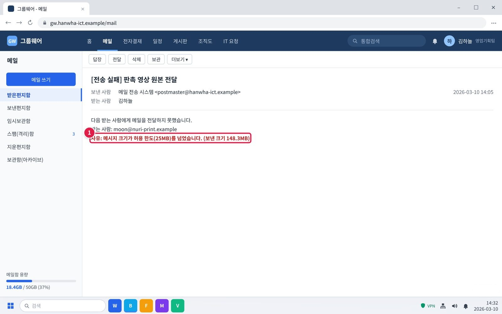

*그림 3.4-1. 첨부 용량 초과로 돌아온 반송 메일*

- 증상 화면. 이런 화면이 보이면 이 증상입니다.
- ① 반송 메일을 열면 사유에 '허용 한도(25MB)를 넘었습니다'가 있습니다.

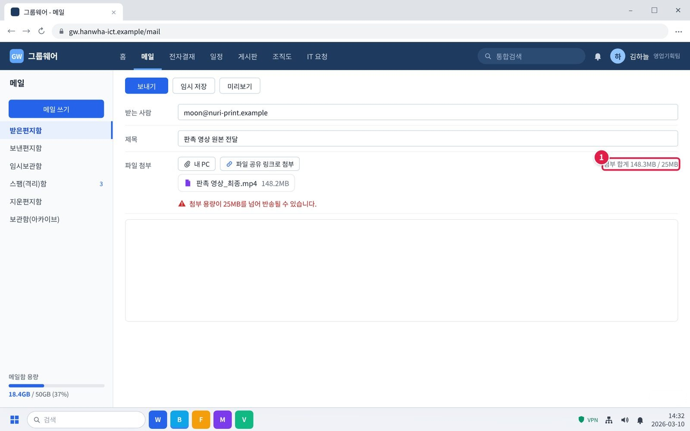

*그림 3.4-2. 메일 쓰기 화면의 첨부 크기*

- 단계 1. 첨부파일 크기를 확인합니다.
- ① 메일 쓰기 화면의 첨부 합계를 봅니다. 25MB가 넘으면 보낼 수 없습니다.

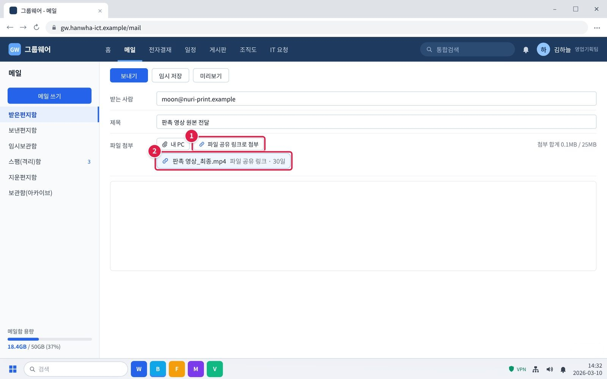

*그림 3.4-3. 사내 파일 공유 링크로 바꿔 첨부*

- 단계 2. 25MB가 넘으면 파일을 사내 파일 공유 링크로 바꿔 보냅니다.
- ① 큰 파일은 X로 지우고 [파일 공유 링크로 첨부]를 눌러 같은 파일을 고릅니다.
- ② 첨부가 링크로 바뀝니다. 받는 사람은 링크를 눌러 30일 동안 내려받을 수 있습니다.

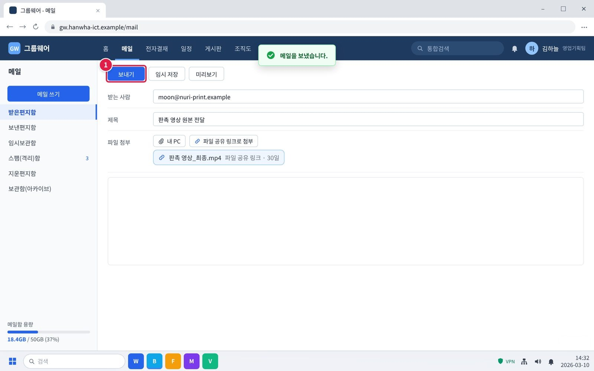

*그림 3.4-4. 다시 보내기*

- 단계 3. 다시 보냅니다.
- ① [보내기]를 누릅니다.
- 확인: 반송 메일이 다시 오지 않으면 해결된 것입니다. 25MB보다 작은데도 반송되면 반송 메일 원문을 붙여 문의합니다.

### 3.5 해외 거래처로 보낸 메일이 팀 전체 반송됨

**문의 유형** SYS-08 · **처리 구분** 🔵 IT 담당자 처리 · **담당 부서** 시스템인프라팀 · **관련 FAQ** FAQ-012

#### 이런 경우

- 해외 거래처로 보낸 메일이 전부 반송되고, 팀 전체가 같은 증상이다.

화면 메시지: 없음

#### 원인

- 회사 메일 발송 서버가 외부 스팸 목록에 올라 받는 쪽에서 거부함

#### 조치 방법

1. 반송 메일 원문을 저장합니다.
2. 같은 팀 여러 명이 같은 증상인지 확인합니다.
3. 반송 메일 원문을 첨부해 헬프데스크에 신고합니다.
4. 급한 내용은 전화 등 다른 방법으로 연락합니다.

**해결 확인**

- 같은 거래처로 보낸 메일이 반송되지 않으면 해결된 것이다.

**해결되지 않으면**

- 전 부서에서 메일 송수신 자체가 안 되면 IT-SYS-003 3.3을 따른다.

**문의 시 알려 주실 정보**

- 사번·부서
- 받는 사람 도메인
- 반송 메일 원문
- 영향 인원

#### 화면 따라하기

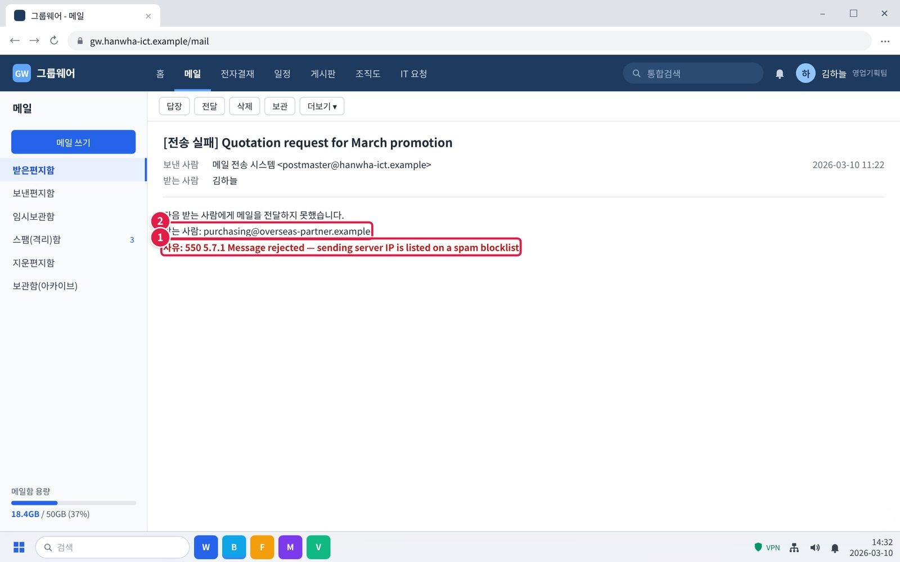

*그림 3.5-1. 해외 거래처로 보낸 메일의 반송 메일*

- 증상 화면. 이런 화면이 보이면 이 증상입니다.
- ① 반송 사유에 spam blocklist(스팸 목록)라는 말이 있습니다. 회사 메일 서버가 받는 쪽에서 차단된 경우입니다.
- ② 해외 거래처 주소로 보낸 메일이 모두 이렇게 돌아옵니다.

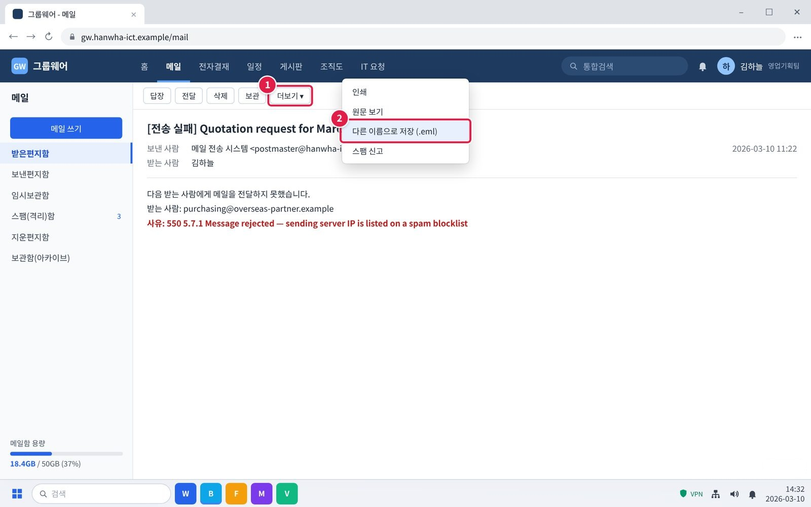

*그림 3.5-2. 반송 메일 원문 저장*

- 단계 1. 반송 메일 원문을 저장합니다.
- ① 반송 메일을 연 상태에서 위쪽 [더보기]를 누릅니다.
- ② [다른 이름으로 저장 (.eml)]을 눌러 PC에 저장합니다. 이것이 '반송 메일 원문'입니다.

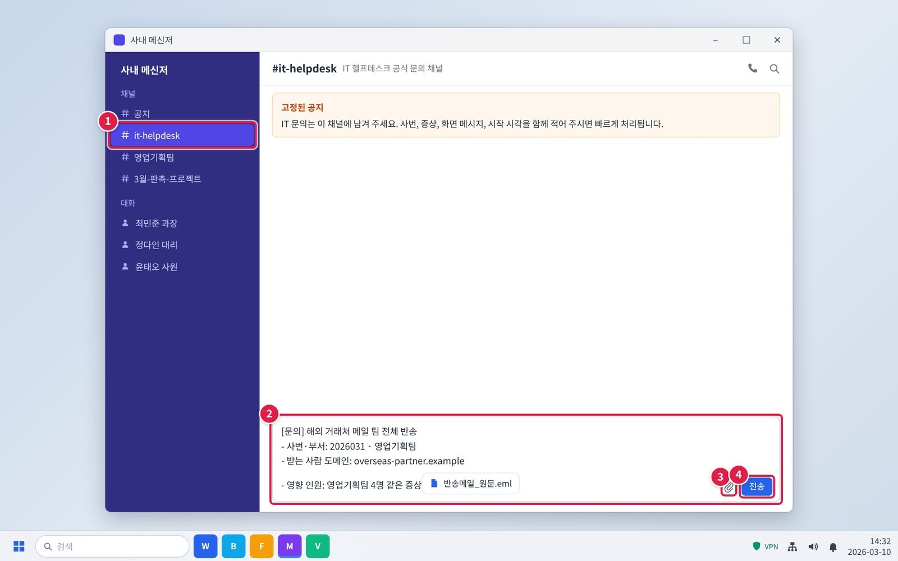

*그림 3.5-3. 반송 메일 원문을 붙여 메신저 #it-helpdesk 채널에 신고하기*

- 단계 3. 반송 메일 원문을 첨부해 헬프데스크에 신고합니다.
- ① 메신저 왼쪽 채널 목록에서 #it-helpdesk를 누릅니다.
- ② 입력창에 아래 항목을 한 줄씩 적습니다. 그대로 복사해 내용만 바꿔 써도 됩니다.
- ③ 클립 아이콘을 눌러 캡처나 파일을 붙입니다. 캡처는 Ctrl+V로 바로 붙여 넣어도 됩니다.
- ④ [전송]을 누릅니다. 담당자가 이 채널이나 개인 대화로 답합니다.
- ※ 급한 내용은 전화 등 다른 방법으로 거래처에 연락합니다. 확인: 문의할 때 알려 줄 정보를 처음부터 적으면 다시 묻는 시간이 줄어듭니다.

## 4. 자주 묻는 질문

**Q. 외부에서 보낸 메일이 안 와요. (FAQ-010)**

A. 먼저 스팸(격리)함을 확인하세요. 격리 메일은 '해제'를 누르면 받은편지함으로 이동합니다. 메일함 용량이 가득 찬 경우에도 수신이 거부될 수 있습니다.

**Q. 메일함 용량이 부족해요. (FAQ-011)**

A. 기본 용량은 50GB입니다. '보관(아카이브)' 기능으로 1년 이상 된 메일을 옮기거나, 검색창에 size:>10MB 를 입력해 대용량 메일을 정리하세요.

**Q. 메일이 반송돼요. (FAQ-012)**

A. 첨부 용량이 25MB를 넘으면 반송됩니다. 대용량 파일은 사내 파일 공유 링크를 이용하세요. 첨부가 없는데도 반송되면 반송 메일 원문을 첨부해 문의하세요.

## 5. 주의사항

- 보낸 사람이 의심스러운 메일은 격리함에서 해제하지 않는다.
- 대용량 파일을 개인 메일이나 외부 저장소로 보내지 않는다. 사내 파일 공유 링크를 쓴다.
- 개인정보가 들어 있는 파일의 외부 전송은 IT-SEC-004를 따른다.

## 6. 문의처

| 창구 | 연락처 | 이용 기준 |
| --- | --- | --- |
| ITssue 챗봇 | 사내 IT 포털(hanwha-admin) 상단 [챗봇 문의] | 24시간. 모든 IT 문의의 기본 창구입니다. 챗봇이 해결하지 못하면 확인을 거쳐 담당 팀에 티켓으로 접수합니다. |
| IT 헬프데스크 (서비스데스크) | 내선 1000 (평일 09:00~18:00) | PC나 챗봇을 쓸 수 없을 때, 여러 사람이 함께 업무를 못 할 때, 본인 확인이 필요한 처리 |
| 정보보안팀 | 내선 1119 | 링크 클릭·비밀번호 입력·감염 의심·계정 도용·장비 분실처럼 바로 알려야 할 보안 문제 |
| 메신저 | #it-helpdesk 채널 | 일반 IT 문의 (챗봇을 쓸 수 없을 때) |
| 메일 | it-helpdesk@hanwha-ict.example | 일반 IT 문의. 비밀번호·인증번호는 메일로 보내지 않습니다. |
| 처리 상황 알림 | 사내 메신저 알림 | 접수·담당자 배정·처리 완료를 알려 드립니다. 진행 상황은 [내 요청 현황]에서도 봅니다. |

## 부록 · 관련 문서 · 용어

#### 관련 문서

| 문서 번호 | 문서명 | 이럴 때 봅니다 |
| --- | --- | --- |
| IT-SW-003 | 업무용 SW 실행·오류 대응 가이드 |  |
| IT-SYS-003 | 사내 시스템 장애 신고·이관 가이드 |  |
| IT-SYS-005 | 메신저·화상회의·협업 도구 가이드 |  |
| IT-SEC-001 | 피싱·의심 메일 대응 가이드 |  |
| IT-SEC-004 | 보안 예외 신청·정책 안내 가이드 |  |
| IT-STD-001 | IT 서비스 운영 기준 |  |

#### 용어

| 용어 | 설명 |
| --- | --- |
| 격리함 | 스팸 필터가 의심 메일을 모아 두는 곳. 확인 후 해제할 수 있음 |
| 보관(아카이브) | 오래된 메일을 메일함 용량에서 빼서 따로 보관하는 기능 |
| 반송 | 보낸 메일이 받는 쪽에 전달되지 못하고 되돌아오는 것 |

## 개정 이력

| 버전 | 개정일 | 작성자 | 변경 내용 |
| --- | --- | --- | --- |
| v1.0 | 2026-03-01 | 서비스데스크 | 최초 작성 |
| v2.0 | 2026-10-16 | 서비스데스크 | 7개 분류 통합 정리본. 문서 양식·열람 등급·용어·연락처를 통일하고 분류 사이의 중복 내용을 한 문서로 정리 |
