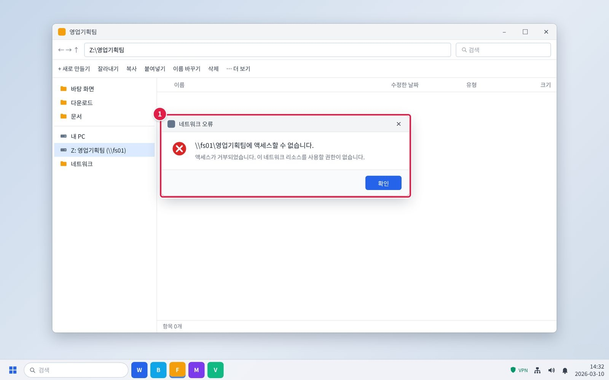
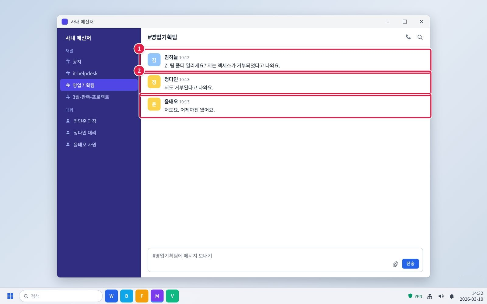
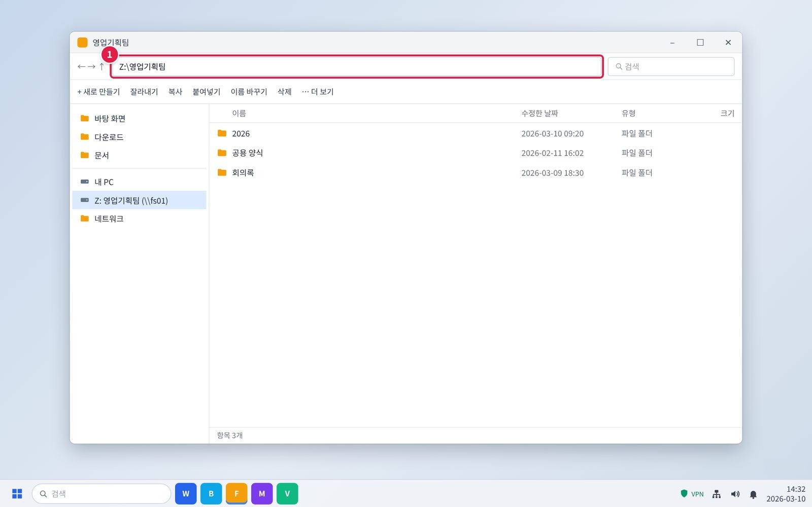
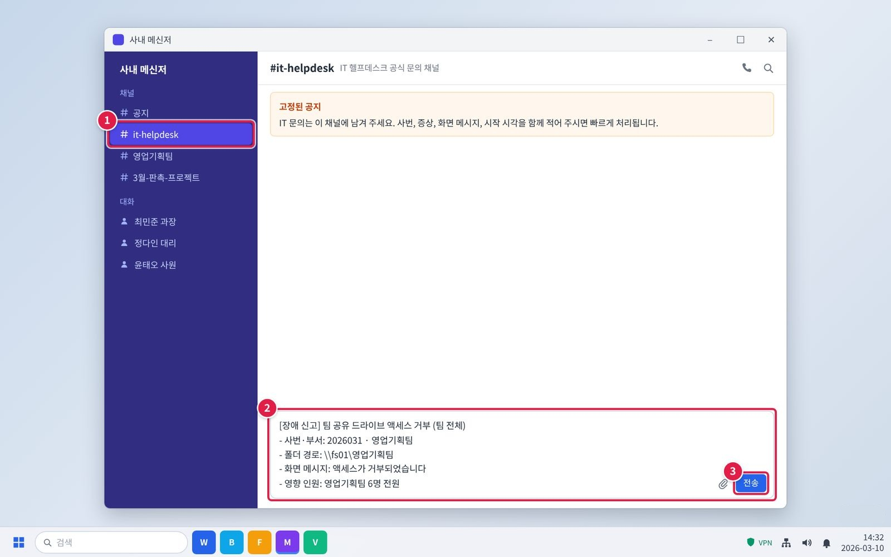
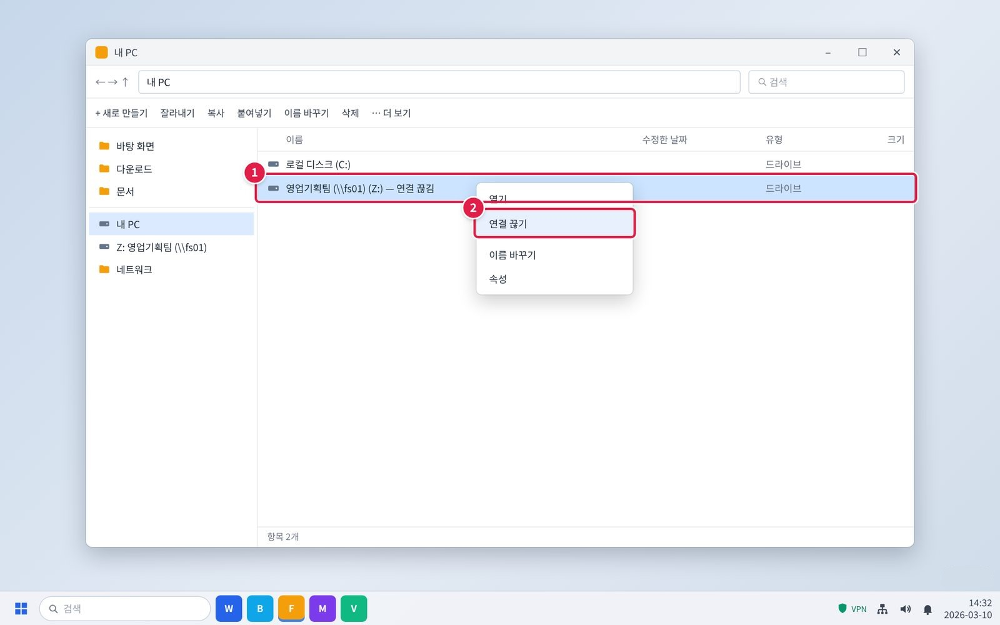
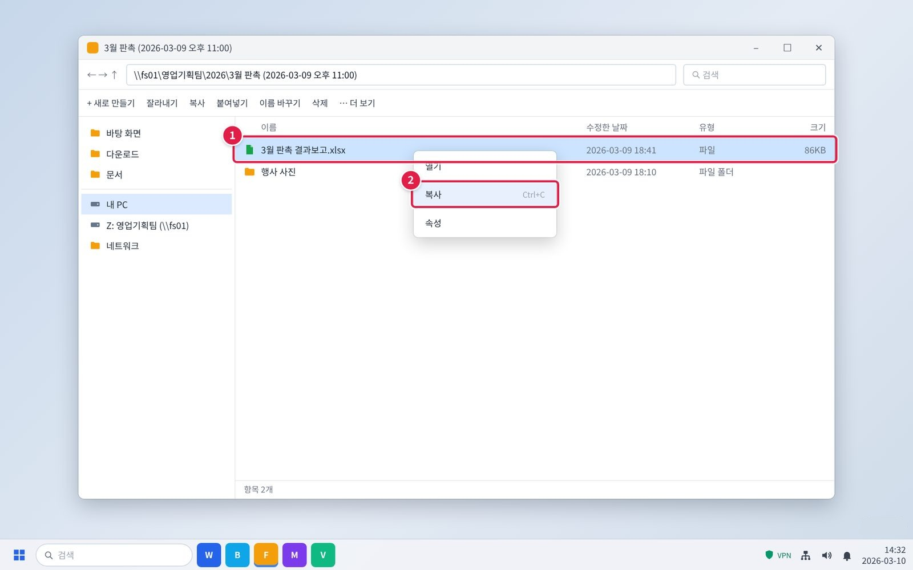
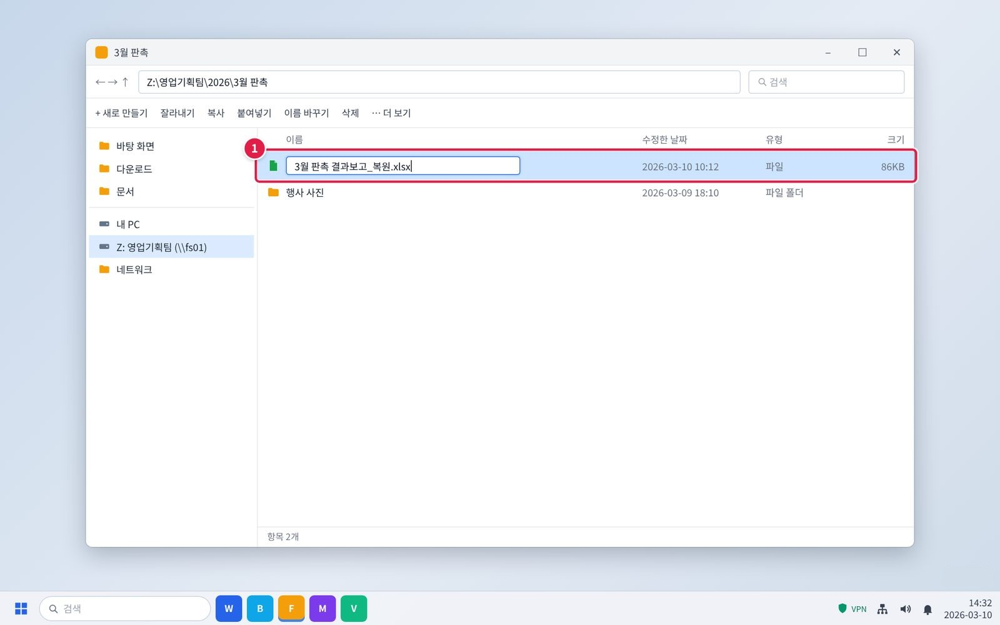
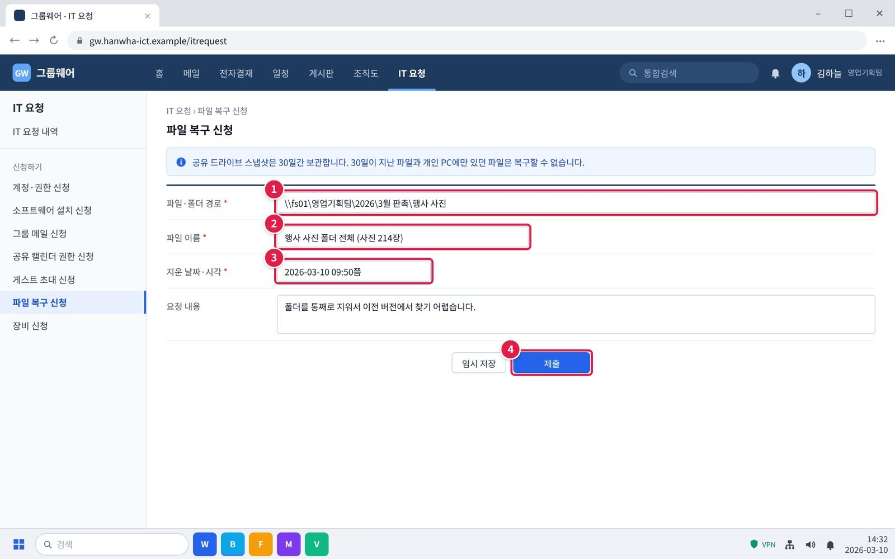
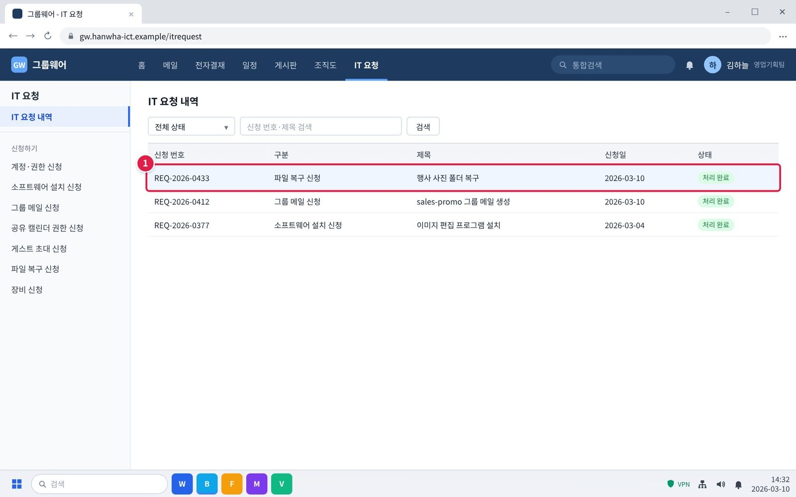

# 공유 드라이브·파일 복구 가이드

> 한화시스템 ICT 임직원 IT 안내 · 사내 시스템  
> IT-SYS-006 | 시스템인프라팀 | 2026-10-16 | v2.0 | **사내 일반** (전 임직원)

## 목차

- 1. 개요
- 2. 먼저 확인할 사항
- 3. 증상별 조치 방법
  - 3.1 팀 공유 드라이브에서 '액세스가 거부되었습니다'가 뜨고 팀원 전부 같음
  - 3.2 공유 드라이브 연결이 끊겨 다시 연결하려니 '경로를 찾을 수 없음'
  - 3.3 지운 파일을 '이전 버전'으로 직접 복원하기
  - 3.4 삭제한 파일 복구 요청
- 4. 자주 묻는 질문
- 5. 주의사항
- 6. 문의처
- 부록 · 관련 문서 · 용어
- 개정 이력

## 1. 개요

#### 목적

부서 공유 드라이브에 접속할 수 없을 때 확인하고 조치하는 방법과, 지운 파일을 이전 버전으로 직접 복원하거나 복구를 요청하는 방법을 안내한다.

#### 적용 대상

부서 공유 드라이브(파일서버)를 쓰는 전 임직원에 해당한다. 여러 팀의 공유 드라이브가 동시에 안 열리면 IT-SYS-003, 새 폴더 권한 신청은 IT-ACS-001을 본다.

#### 적용 환경

| 항목 | 내용 |
| --- | --- |
| 관련 도구·시스템 | 파일서버 |
| OS | Windows, macOS (개발 직군 선택) |

## 2. 먼저 확인할 사항

- 재택 중이면 VPN에 연결되어 있는지 먼저 확인한다.
- 다른 팀 공유 드라이브도 안 열리면 IT-SYS-003 3.4를 따른다.
- 처음 쓰는 폴더라 열리지 않으면 권한 신청 대상이다. IT-ACS-001을 본다.
- 공유 드라이브는 매일 스냅샷을 만들어 30일간 보관한다.

## 3. 증상별 조치 방법

| 번호 | 제목 | 문의 유형 | 처리 구분 | 담당 부서 |
| --- | --- | --- | --- | --- |
| 3.1 | 팀 공유 드라이브에서 '액세스가 거부되었습니다'가 뜨고 팀원 전부 같음 | SYS-13 | 🔵 IT 담당자 처리 | 시스템인프라팀 |
| 3.2 | 공유 드라이브 연결이 끊겨 다시 연결하려니 '경로를 찾을 수 없음' | SYS-13 | 🟢 사용자 직접 조치 | 시스템인프라팀 |
| 3.3 | 지운 파일을 '이전 버전'으로 직접 복원하기 | SYS-14 | 🟢 사용자 직접 조치 | 시스템인프라팀 |
| 3.4 | 삭제한 파일 복구 요청 | SYS-14 | 🔵 IT 담당자 처리 | 시스템인프라팀 |

#### 화면 보는 법

*그림 3-1. 그룹웨어 첫 화면. 이 문서에서 자주 쓰는 위치*

- 화면 안내. 이 문서에서 자주 쓰는 위치입니다.
- ① 공지사항: 시스템 장애가 생기면 '장애' 표시가 붙은 공지가 맨 위에 올라옵니다.
- ② IT 헬프데스크: 전화 내선 1000, 메신저 #it-helpdesk 채널. 막히면 여기로 문의합니다.
- ③ 업무 시스템 바로가기: ERP, 인사시스템, PMS, BI 분석, 메신저로 들어갑니다.
- ④ IT 요청: 그룹 메일, 권한, 파일 복구 같은 신청서를 내는 곳입니다.
- 확인: 이 문서의 화면에서 빨간 네모는 누르거나 볼 곳이고, 번호는 오른쪽 설명 번호와 같습니다.

### 3.1 팀 공유 드라이브에서 '액세스가 거부되었습니다'가 뜨고 팀원 전부 같음

**문의 유형** SYS-13 · **처리 구분** 🔵 IT 담당자 처리 · **담당 부서** 시스템인프라팀 · **관련 FAQ** FAQ-033

#### 이런 경우

- 팀 공유 드라이브에 들어가면 '액세스가 거부되었습니다'가 나오고 팀원 전부 그렇다.
- 원래 쓰던 폴더다.

화면 메시지: "액세스가 거부되었습니다"

#### 원인

- 폴더 권한 설정(상속)이 바뀌어 팀 권한이 빠짐

#### 조치 방법

1. 팀원 여러 명이 같은 증상인지 확인합니다.
2. 혼자만 안 되면 개인 권한 문제입니다. IT-ACS-001 3.4를 보고, 부서를 옮긴 뒤라면 IT-ACS-003 3.2를 봅니다.
3. 팀 전체가 같으면 폴더 경로를 적어 헬프데스크에 바로 신고합니다.

**해결 확인**

- 팀원들이 폴더를 다시 열 수 있으면 해결된 것이다.

**해결되지 않으면**

- 다른 팀 폴더도 열리지 않으면 IT-SYS-003 3.4를 따른다.

**문의 시 알려 주실 정보**

- 사번·부서
- 폴더 경로
- 화면 메시지
- 영향 인원

#### 화면 따라하기

*그림 3.1-1. 팀 공유 드라이브에서 '액세스가 거부되었습니다'*

- 증상 화면. 이런 화면이 보이면 이 증상입니다.
- ① 원래 쓰던 팀 폴더를 열면 '액세스가 거부되었습니다'가 뜹니다.

*그림 3.1-2. 팀원도 같은지 확인*

- 단계 1. 팀원 여러 명이 같은 증상인지 확인합니다.
- ① 팀 채널에 팀 폴더가 열리는지 물어봅니다.
- ② 팀원 여러 명이 같으면 팀 전체 문제입니다. 혼자만 안 되면 개인 권한 문제입니다 (IT-ACS-001 3.4).

*그림 3.1-3. 폴더 경로 복사*

- 단계 3. 팀 전체가 같으면 폴더 경로를 적어 헬프데스크에 바로 신고합니다.
- ① 파일 탐색기 위쪽 주소 표시줄을 누르면 경로 전체가 선택됩니다. Ctrl + C로 복사합니다.
- 확인: 복사한 경로를 신고 메시지에 붙여 넣습니다.

*그림 3.1-4. 메신저 #it-helpdesk 채널에 바로 신고하기*

- 단계 3. 팀 전체가 같으면 폴더 경로를 적어 헬프데스크에 바로 신고합니다.
- ① 메신저 왼쪽 채널 목록에서 #it-helpdesk를 누릅니다.
- ② 입력창에 아래 항목을 한 줄씩 적습니다. 그대로 복사해 내용만 바꿔 써도 됩니다.
- ③ [전송]을 누릅니다. 담당자가 이 채널이나 개인 대화로 답합니다.
- 확인: 문의할 때 알려 줄 정보를 처음부터 적으면 다시 묻는 시간이 줄어듭니다.

### 3.2 공유 드라이브 연결이 끊겨 다시 연결하려니 '경로를 찾을 수 없음'

**문의 유형** SYS-13 · **처리 구분** 🟢 사용자 직접 조치 · **담당 부서** 시스템인프라팀 · **관련 FAQ** FAQ-033

#### 이런 경우

- 공유 드라이브 연결이 끊겨서 다시 연결하려니 경로를 찾을 수 없다고 한다.

화면 메시지: "경로를 찾을 수 없음"

#### 원인

- 파일서버 주소가 바뀌었는데 PC에는 예전 경로로 연결되어 있음

#### 조치 방법

1. 재택 중이면 VPN에 연결합니다.
2. 탐색기에서 기존 드라이브를 마우스 오른쪽 클릭해 [연결 끊기]를 누릅니다.
3. 팀 공지나 헬프데스크에서 받은 새 경로로 [내 PC] > [네트워크 드라이브 연결]을 실행해 다시 연결합니다.

**해결 확인**

- 드라이브가 다시 열리면 해결된 것이다.

**해결되지 않으면**

- 새 경로로도 열리지 않으면 헬프데스크에 문의한다.

**문의 시 알려 주실 정보**

- 사번
- 기존 드라이브 경로
- 접속 장소 (사무실 / 재택)
- 화면 메시지

#### 화면 따라하기

*그림 3.2-1. 작업 표시줄의 VPN 아이콘과 VPN 연결 창*

- 단계 1. 재택 중이면 VPN에 연결합니다.
- ① 작업 표시줄 오른쪽 아래의 방패 모양 VPN 아이콘을 누릅니다.
- ② 연결 상태를 봅니다. '연결됨'이면 VPN은 정상입니다.
- ③ '연결 안 됨'이면 [연결]을 누르고 통합 계정으로 로그인합니다.
- 확인: 회사 밖(재택·출장)에서는 VPN이 '연결됨'이어야 사내 시스템이 열립니다.

*그림 3.2-2. 탐색기에서 기존 드라이브 연결 끊기*

- 단계 2. 탐색기에서 기존 드라이브를 마우스 오른쪽 클릭해 [연결 끊기]를 누릅니다.
- ① 파일 탐색기 왼쪽 [내 PC]를 누르고, 연결이 끊긴 드라이브를 마우스 오른쪽 버튼으로 누릅니다.
- ② [연결 끊기]를 누릅니다.

![그림 3.2-3. [내 PC] > [네트워크 드라이브 연결] 메뉴](../images/IT-SYS-006_08.jpg)

*그림 3.2-3. [내 PC] > [네트워크 드라이브 연결] 메뉴*

- 단계 3. 팀 공지나 헬프데스크에서 받은 새 경로로 [내 PC] > [네트워크 드라이브 연결]을 실행해 다시 연결합니다.
- ① [내 PC] 화면 위쪽 [더 보기]를 누릅니다.
- ② [네트워크 드라이브 연결]을 누릅니다.

![그림 3.2-4. 탐색기 [네트워크 드라이브 연결] 창. 폴더 경로 입력란](../images/IT-SYS-006_09.jpg)

*그림 3.2-4. 탐색기 [네트워크 드라이브 연결] 창. 폴더 경로 입력란*

- 단계 3. 팀 공지나 헬프데스크에서 받은 새 경로로 [내 PC] > [네트워크 드라이브 연결]을 실행해 다시 연결합니다.
- ① 드라이브 문자를 고릅니다. 예전과 같은 문자(예: Z:)를 고르면 편합니다.
- ② 팀 공지나 헬프데스크에서 받은 새 경로를 입력합니다.
- ③ '로그인할 때 다시 연결'을 체크합니다.
- ④ [마침]을 누릅니다.
- 확인: 드라이브가 다시 열리면 해결된 것입니다.

### 3.3 지운 파일을 '이전 버전'으로 직접 복원하기

**문의 유형** SYS-14 · **처리 구분** 🟢 사용자 직접 조치 · **담당 부서** 시스템인프라팀 · **관련 FAQ** FAQ-034

#### 이럴 때 사용합니다

- 공유 드라이브에서 어제 작업한 파일을 실수로 지웠다.
- 파일을 잘못 덮어써서 이전 내용이 필요하다.

#### 준비할 것

- 파일이 있던 폴더 경로
- 지우거나 덮어쓴 날짜·시각

#### 따라하기

1. 파일이 있던 폴더를 마우스 오른쪽 클릭해 [속성] > [이전 버전] 탭을 엽니다.
2. 지우기 전 날짜의 버전을 선택합니다.
3. [열기]로 내용을 확인한 뒤 필요한 파일을 원래 폴더로 복사합니다. 현재 파일을 덮어쓰지 않도록 다른 이름으로 저장합니다.

#### 완료 확인

필요한 파일이 원래 폴더에 다시 생기면 완료된 것이다.

#### 안 될 때

- 이전 버전 목록에 원하는 날짜가 없으면 3.4에 따라 복구를 요청한다.
- 30일이 지난 파일은 복구할 수 없다.

#### 화면 따라하기

![그림 3.3-1. 파일이 있던 폴더의 마우스 오른쪽 메뉴 [속성]](../images/IT-SYS-006_10.jpg)

*그림 3.3-1. 파일이 있던 폴더의 마우스 오른쪽 메뉴 [속성]*

- 단계 1. 파일이 있던 폴더를 마우스 오른쪽 클릭해 [속성] > [이전 버전] 탭을 엽니다.
- ① 지운 파일이 있던 폴더(예: 3월 판촉)를 마우스 오른쪽 버튼으로 누릅니다.
- ② 맨 아래 [속성]을 누릅니다.

![그림 3.3-2. 폴더 [속성] > [이전 버전] 탭. 날짜별 버전 목록과 [열기] 버튼 위치](../images/IT-SYS-006_11.jpg)

*그림 3.3-2. 폴더 [속성] > [이전 버전] 탭. 날짜별 버전 목록과 [열기] 버튼 위치*

- 단계 2. 지우기 전 날짜의 버전을 선택합니다.
- ① 위쪽 [이전 버전] 탭을 누릅니다.
- ② 파일을 지우기 전 날짜의 버전을 고릅니다. 어제 지웠으면 그 전날 밤 버전입니다.
- ③ [열기]를 누릅니다. 그 날짜의 폴더가 새 창으로 열립니다.

*그림 3.3-3. 이전 버전 창에서 필요한 파일 복사*

- 단계 3. [열기]로 내용을 확인한 뒤 필요한 파일을 원래 폴더로 복사합니다. 현재 파일을 덮어쓰지 않도록 다른 이름으로 저장합니다.
- ① 열린 창에서 필요한 파일을 찾아 마우스 오른쪽 버튼으로 누릅니다. 먼저 열어서 내용을 확인해도 됩니다.
- ② [복사]를 누릅니다.

*그림 3.3-4. 원래 폴더에 붙여넣고 다른 이름으로 저장*

- 단계 3. [열기]로 내용을 확인한 뒤 필요한 파일을 원래 폴더로 복사합니다. 현재 파일을 덮어쓰지 않도록 다른 이름으로 저장합니다.
- ① 원래 폴더에서 Ctrl + V로 붙여 넣고, 이름 끝에 _복원을 붙여 다른 이름으로 바꿉니다.
- 주의: 같은 이름의 현재 파일을 덮어쓰지 않습니다. 원하는 날짜가 목록에 없으면 3.4에 따라 복구를 요청합니다.

### 3.4 삭제한 파일 복구 요청

**문의 유형** SYS-14 · **처리 구분** 🔵 IT 담당자 처리 · **담당 부서** 시스템인프라팀 · **처리 기간** 접수 후 1영업일 · **관련 FAQ** FAQ-034

#### 이럴 때 신청합니다

- 이전 버전으로 직접 복원할 수 없다.
- 폴더 전체를 지웠다.

#### 신청 대상

- 해당 폴더에 접근 권한이 있는 사람

#### 준비할 정보

- 파일·폴더 경로
- 파일 이름
- 지운 날짜·시각

#### 신청 방법

1. 그룹웨어 > IT 요청 > 파일 복구 신청에 경로와 지운 시각을 적어 제출합니다. 급하면 IT 헬프데스크(내선 1000)로 전화합니다.
2. 복구 안내를 받으면 파일을 열어 확인합니다.

#### 승인 절차

1. 승인 없음 (접수 후 시스템인프라팀 처리)

#### 처리 기간과 결과 확인

접수 후 1영업일 안에 스냅샷에서 복구된다. 스냅샷은 30일간 보관하므로 30일이 지난 파일은 복구할 수 없다.

#### 반려되는 경우

- 30일이 지났거나 개인 PC에만 있던 파일은 복구할 수 없다.

#### 문의 시 알려 주실 정보

- 신청 번호
- 경로
- 지운 시각

#### 화면 따라하기

*그림 3.4-1. 파일 복구 신청 양식*

- 단계 1. 그룹웨어 > IT 요청 > 파일 복구 신청에 경로와 지운 시각을 적어 제출합니다. 급하면 IT 헬프데스크(내선 1000)로 전화합니다.
- ① 파일이나 폴더가 있던 경로를 적습니다. 탐색기 주소 표시줄에서 복사해 붙여 넣으면 정확합니다.
- ② 파일 이름(폴더면 폴더 이름)을 적습니다.
- ③ 지운 날짜와 대략의 시각을 적습니다.
- ④ [제출]을 누릅니다.
- 확인: 급하면 IT 헬프데스크(내선 1000)로 전화합니다.

*그림 3.4-2. IT 요청 내역에서 복구 결과 확인*

- 단계 2. 복구 안내를 받으면 파일을 열어 확인합니다.
- ① 상태가 '처리 완료'가 되면 원래 경로에서 파일을 열어 확인합니다.
- 확인: 접수 후 1영업일 안에 스냅샷에서 복구됩니다.

## 4. 자주 묻는 질문

**Q. 공유 드라이브가 열리지 않아요. (FAQ-033)**

A. VPN 연결 상태(재택 시)를 확인한 뒤, 탐색기에서 드라이브 연결을 끊고 다시 연결하세요. 팀 전체가 안 되면 서비스데스크로 즉시 신고하세요.

**Q. 실수로 파일을 지웠어요. (FAQ-034)**

A. 공유 드라이브는 매일 스냅샷을 보관합니다(30일). 폴더 마우스 오른쪽 클릭 > '이전 버전'에서 직접 복원할 수 있으며, 안 되면 경로와 삭제 시각을 적어 요청하세요.

## 5. 주의사항

- 업무 파일은 개인 PC가 아니라 공유 드라이브에 저장한다. 개인 PC의 파일은 복구할 수 없다.
- 이전 버전을 복원할 때 현재 파일을 덮어쓰지 않도록 다른 이름으로 저장한다.
- 공유 드라이브 경로와 자료를 외부에 공유하지 않는다.

## 6. 문의처

| 창구 | 연락처 | 이용 기준 |
| --- | --- | --- |
| ITssue 챗봇 | 사내 IT 포털(hanwha-admin) 상단 [챗봇 문의] | 24시간. 모든 IT 문의의 기본 창구입니다. 챗봇이 해결하지 못하면 확인을 거쳐 담당 팀에 티켓으로 접수합니다. |
| IT 헬프데스크 (서비스데스크) | 내선 1000 (평일 09:00~18:00) | PC나 챗봇을 쓸 수 없을 때, 여러 사람이 함께 업무를 못 할 때, 본인 확인이 필요한 처리 |
| 정보보안팀 | 내선 1119 | 링크 클릭·비밀번호 입력·감염 의심·계정 도용·장비 분실처럼 바로 알려야 할 보안 문제 |
| 메신저 | #it-helpdesk 채널 | 일반 IT 문의 (챗봇을 쓸 수 없을 때) |
| 메일 | it-helpdesk@hanwha-ict.example | 일반 IT 문의. 비밀번호·인증번호는 메일로 보내지 않습니다. |
| 처리 상황 알림 | 사내 메신저 알림 | 접수·담당자 배정·처리 완료를 알려 드립니다. 진행 상황은 [내 요청 현황]에서도 봅니다. |

## 부록 · 관련 문서 · 용어

#### 관련 문서

| 문서 번호 | 문서명 | 이럴 때 봅니다 |
| --- | --- | --- |
| IT-ACS-001 | 사내 시스템 접근권한 신청 가이드 |  |
| IT-SYS-003 | 사내 시스템 장애 신고·이관 가이드 |  |
| IT-NET-001 | VPN 접속 장애 대응 가이드 |  |
| IT-STD-001 | IT 서비스 운영 기준 |  |

#### 용어

| 용어 | 설명 |
| --- | --- |
| 스냅샷 | 공유 드라이브의 파일 상태를 매일 저장해 둔 복사본. 30일 보관 |
| 이전 버전 | 스냅샷에 저장된 날짜별 파일·폴더 상태 |
| 네트워크 드라이브 | 공유 폴더를 탐색기에서 드라이브처럼 연결한 것 |

## 개정 이력

| 버전 | 개정일 | 작성자 | 변경 내용 |
| --- | --- | --- | --- |
| v1.0 | 2026-03-01 | 시스템인프라팀 | 최초 작성 |
| v2.0 | 2026-10-16 | 시스템인프라팀 | 7개 분류 통합 정리본. 문서 양식·열람 등급·용어·연락처를 통일하고 분류 사이의 중복 내용을 한 문서로 정리 |
