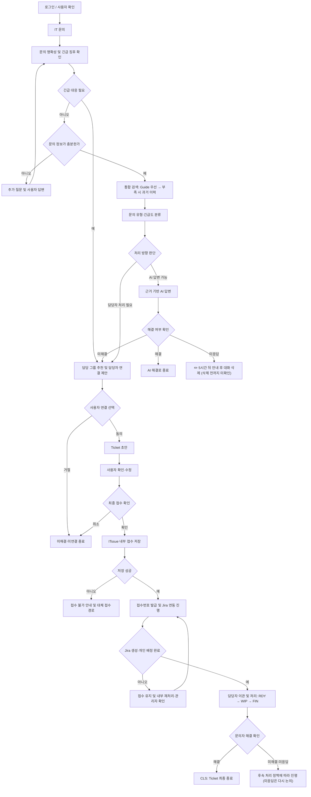

# ITssue — 제품 정의서 (PRD)

> 
> 
> 
> **문서 상태:** Draft v0.7
> 
> **표기:** 🆕 신규 추가 · ✏️ 일부 수정 (2026.10.26 변경분)
> 
> **프로젝트:** IT 장애·문의 대응 AI Agent
> 
> **팀:** ITssue
> 
> **대상 환경:** 가상 ICT 기업 / 임직원 약 400명
> 
> **집중 개발:** 2026.10.29 ~ 2026.11.11
> 
> **최종 발표:** 2026.11.13
> 

---

## 1. 프로젝트 개요

**ITssue HelpDesk**는 사내 IT 문의를 AI Agent가 이해하고, 사내 Guide를 기반으로 1차 대응하는 서비스이다.

AI만으로 해결하기 어렵거나 실제 조치가 필요한 문의는 **담당자 연결을 제안하고, 사용자의 확인을 거쳐 Jira Ticket으로 연결**한다. 담당 그룹을 자동 추천하고 개인 담당자를 자동배정하며, 처리 상태와 결과를 사용자에게 안내한다.

본 PRD는 기획서 v0.3을 기준으로 **제공 기능·제품 정책·MVP 범위**를 정의한다.

> 기획 배경·서비스 목표·기대효과는 **프로젝트 기획서**, 세부 조직·사용자·IT 환경은 **가상 기업 환경 정의서**에서 관리한다.
> 

---

## 2. Target User

### 👤 일반 임직원

IT 문제를 문의하고 해결 방법을 안내받는다. 

담당자 연결을 선택하면 Ticket 초안을 확인·수정한 뒤 접수하며, 이후 상태와 결과를 확인한다.

### 🛠 IT 운영 담당자

배정된 Ticket을 전달받아 처리하고, 진행 상태와 처리 결과를 등록한다.

IT 운영 담당자 역시 일반 임직원으로서 ITssue의 문의 기능을 사용할 수 있다.

### ⚙️ 관리자

전체 문의 및 Ticket 현황을 관리하고 사용자·권한·Guide를 관리한다.

자동배정 결과를 확인·변경하고, 해결 사례를 검토하여 새로운 Guide로 활용한다. 

관리자는 일반 임직원 및 담당자 기능도 사용할 수 있다.

---

## 3. 서비스 범위

### 3.1 IT 문의 Category

ITssue는 다음 **7개 Category**의 IT 문의를 대상으로 한다.

| 코드 | Category | 주요 범위 |
| --- | --- | --- |
| ACC | 계정·로그인 | 비밀번호, 계정 잠금, SSO, MFA |
| ACS | 접근권한 | 시스템·폴더 권한 신청·변경·회수 |
| NET | VPN·네트워크 | VPN, 사내망, Wi-Fi, 인터넷 연결 |
| SW | SW·라이선스 | 업무용 SW 설치·실행·업데이트·라이선스 |
| HW | HW·업무 PC | PC, 주변기기, 프린터, 장비 교체·수리 |
| SYS | 사내 시스템 | ERP, 전자결재, 인사·근태, 협업 시스템, 서버·DB |
| SEC | 정보보안 | 피싱, 악성코드, 침해·도용 의심, 장비 분실, 보안 예외·정책 |

세부 유형과 분류 경계는 데이터셋의 분류체계 및 공통 운영 기준에서 관리한다.

---

### 3.2 핵심 서비스 Flow

보안 사고 의심과 다수 영향 장애는 사용자 문의·추가 답변에서 조기에 식별한다. 실제 사고 여부와 원인은 담당자가 확인한다.

> 
> 
> 
> 긴급 대응 경로에서도 현재 확인된 문의 유형·긴급도·판단 근거를 Ticket 초안에 반영한다. 추가 확인은 접수와 대응에 필요한 최소 정보로 제한하며, 일반 검색 완료를 기다리느라 담당자 연결을 지연하지 않는다.
> 
> **사용자가 담당자 연결을 선택하고 Ticket 초안을 최종 확인한 후 접수한다.**
> 
> 내부 저장에 성공하면 접수번호를 안내하고 Jira 생성·개인 배정을 진행한다. 외부 연동·배정에 문제가 발생해도 접수는 유지하며 사용자에게 재접수를 요구하지 않는다.
> 

---

## 4. 핵심 기능 및 제품 정책

### 4.1 IT 문의 접수 및 명확성 확인

사용자는 자연어로 IT 문의를 입력한다. AI는 처리에 필요한 정보가 부족하면 추가 질문한다.

영향 범위·업무 중단 정도·대체 방법·시간 제약·보안 위험 등 판단에 필요한 정보를 수집하며, **비밀번호·인증번호·API 키는 요청하지 않는다.**

**문의에서 긴급 대응 징후가 확인되면 일반 검색·답변 과정 때문에 담당자 연결이 지연되지 않도록 한다.** 사용자 확인 전 Ticket을 생성하지 않는 원칙은 유지한다.

**추가 질문 항목 (프로토타입 기준):** 대상 시스템·증상·발생 시점·영향 범위와 업무 중단 정도·시도한 조치 5가지를 확인하며, 이미 답한 항목은 다시 묻지 않는다.

**로그인 전 상담 (제안 · 팀 확정 전):** 로그인 화면에서 계정 잠금·비밀번호·SSO·MFA 같은 계정·로그인(ACC) 범위의 공개 Guide 안내만 제공한다. 로그인 전에는 Ticket을 만들지 않으며, 접수는 로그인 후에 한다. 범위 밖 문의와 보안 사고 의심은 로그인 후 새 문의 또는 IT 헬프데스크로 안내한다.

---

### 4.2 통합 검색

**사내 Guide를 먼저 검색하고, Guide로 근거가 부족할 때 도입 이전 처리 이력(과거 이력)을 검토**한다.

**검색 순서**

1. 사용자가 열람할 수 있는 Guide를 먼저 검색한다.
2. Guide로 충분한 근거를 얻지 못하면 과거 이력에서 유사 사례를 찾아 해결 방법을 한 번 더 검토한다.
3. 과거 사례는 현재 Guide·운영 정책과 충돌하지 않는지 확인한 뒤에만 활용한다. 충돌하면 Guide를 우선한다.
4. 과거 사례를 근거로 답할 때는 Guide 출처와 구분해 **"과거 처리 사례 참고"**로 표시한다.
5. Guide와 과거 이력 모두 근거가 부족하면 임의로 답하지 않고 **추가 확인 또는 담당자 연결을 제안**한다.

- **사용자 권한에 따라 열람 가능한 정보**만 검색·답변에 활용한다.
- 외부 모델 입력에는 **외부 전송이 허용된 정보만 사용**한다.
- **과거 이력의 개인정보·업무정보에도 동일한 보호 기준**을 적용한다.
- **답변에 활용한 Guide의 출처를 제공**하고, 과거 사례를 활용한 경우에도 출처를 구분해 제공한다.

과거 이력은 도입 이전에 쌓인 처리 이력을 읽기 전용으로 둔 것이다. ITssue에서 새로 해결된 사례는 해결 사례 → 관리자 검토 → Guide 등록 경로(4.10)로 Guide에 편입한다.

사용자 권한은 로그인 정보와 서버에서 관리하는 권한을 기준으로 검사한다.

---

### 4.3 문의 유형 및 긴급도 판단

7개 Category와 세부 유형을 분류하고, 공통 운영 기준에 따라 **긴급도를 판단**한다.

| Level | 기본 판단 기준 |
| --- | --- |
| **P1 — 긴급** | 전사·여러 부서의 주요 업무 중단 또는 광범위한 보안 대응 필요 |
| **P2 — 높음** | 부서 단위 업무 영향, 개인 업무의 전면 중단 또는 보안 사고 의심 |
| **P3 — 보통** | 개인 업무 일부에 지장이 있으나 허용된 대체 방법으로 진행 가능 |
| **P4 — 낮음** | 현재 업무 지장이 없는 단순 문의·사전 신청 |

카테고리별 기본값을 참고하되 **영향 범위·업무 중단·대체 방법·시간 제약·보안 위험**에 따라 조정한다.

- **“급하다”는 표현만으로 자동 상향하지 않는다.**
- 여러 명의 **일괄 신청과 다수 사용자 장애를 구분**한다.
- 정보가 부족하면 추가 확인하며, **보안 사고 의심은 최소 P2로 연결**한다.
- **긴급도와 담당자 처리 필요 여부는 별도로 판단**한다.

AI는 문의를 해석하고, 백엔드는 사전 정의된 규칙을 적용한다. 판단 근거를 기록하며 세부 조정 규칙은 공통 운영 기준에서 관리한다. 공통 운영 기준은 Knowledge Guide의 **IT-STD-001 IT 서비스 운영 기준**(3장 긴급도와 처리 목표)이다.

---

### 4.4 처리 방향 판단

문의 내용·검색 근거·유형·긴급도를 바탕으로 처리 방향을 결정한다.

| 처리 방향 | 기준 |
| --- | --- |
| **AI 안내** | 충분한 근거가 있고 사용자가 수행할 수 있는 방법 또는 신청 절차를 안내할 수 있음 |
| **추가 확인** | 분류·긴급도·처리 방향을 결정할 정보가 부족함 |
| **담당자 처리** | 실제 조치·승인·권한 변경·전문 판단이 필요하거나 답변 근거를 확보하지 못함 |
| **지원 범위 밖** | 지원하는 7개 Category에 해당하지 않아 분류할 수 없음. 임의의 Category로 확정하지 않고 지원 범위 밖임을 안내하며, 필요하면 서비스데스크 확인을 제안 |

담당자 처리가 필요해도 Ticket을 즉시 생성하지 않고 사용자에게 연결을 제안한다. ****

외부 전송 제한으로 답변할 수 없는 경우에도 담당자 연결을 제공한다.

---

### 4.5 해결 여부 확인 및 Session

AI 답변 후 실제 해결 여부를 확인한다.

- **해결:** AI 자체 해결로 종료
- **미해결:** 추가 확인 또는 담당자 연결 제안
- **미확인:** ✏️ 5시간 동안 응답이 없으면 한 번 안내한 뒤 문의·대화를 삭제한다. 삭제 전까지는 `미확인`으로 표시한다.

종료된 문의는 다시 열어 대화를 이어갈 수 있다. **이력은 접근 권한과 보관 정책에 따라 유지**하되, ✏️ 아래 미응답 삭제 대상은 제외한다.

**문의 내역 (프로토타입 기준):** 사용자는 자신의 문의를 상태(진행 중·AI 해결·담당자 처리·해결 완료·미확인·미해결)·Category·기간으로 필터하고, 제목·접수번호·Guide명으로 검색한다. 담당자 답변 등 확인하지 않은 변화는 개수로 표시한다.

**Session 종료를 해결 완료로 간주하지 않는다.** ✏️ 미응답 처리는 아래 기준을 따른다.

🆕 **미응답 처리 (2026.10.22 팀 결정)**

| 상황 | 기준 | 처리 |
| --- | --- | --- |
| 해결 확인 미응답 | AI 답변 뒤 해결·미해결 버튼에 응답 없이 5시간 | 한 번 안내(예: "5시간 뒤까지 미확인 시 대화 내용은 삭제됩니다") 후 문의·대화 삭제 |
| 대화 중 이탈 | AI 채팅 중 마지막 활동 후 2시간 | 2시간까지는 `진행 중` 유지. 지나면 안내(예: "이어서 하지 않으면 대화내역이 사라집니다") 후 문의·대화 삭제 |
| 삭제 전 검사 | 삭제 전에 보안·로그 대상인지 확인 | 해당하면 삭제하지 않고 관리자 화면에서만 보이게 하며 문의자 화면에서는 숨긴다 (기준: 민감정보 정책) |
| 2시간 안에 돌아옴 | 입력창에 팝업 | `이어서 채팅하기`(입력창 잠금 해제, 같은 대화) / `새로운 문의하기`(새 문의 화면) |

- 시간(5시간·2시간)은 환경변수로 두어 나중에 바꿀 수 있게 한다. 안내 뒤 실제 삭제까지의 대기 시간은 미정이다.
- 삭제는 DB 부하를 줄이기 위한 것이며, 삭제된 문의는 목록과 통계에서 빠진다.
- 담당자에게 접수된 건(Ticket이 있는 문의)은 이번 삭제 대상에서 제외한다. FIN 이후 해결 확인 미응답은 다시 논의한다.
- 돌아왔을 때 대화 내역을 보여 주는 방식(브라우저 세션·쿠키)은 구현 단계에서 정한다.

🆕 **선택지 단계의 입력창:** 해결·미해결, 담당자 연결 여부처럼 버튼으로 고르는 단계에서는 입력창을 비활성화하며, 서버도 이 단계의 글을 받지 않는다. 프로토타입은 LLM 연결 전이라 시연용 버튼을 두었으므로 이 단계에서도 입력이 가능하다.

---

### 4.6 담당자 연결 및 Ticket 생성

기본 Flow는 다음과 같다.

> 
> 
> 
> **담당자 연결 제안 → 사용자 선택 → Ticket 초안 → 사용자 확인·수정 → 내부 접수 저장·접수번호 발급 → Jira 생성·개인 자동배정**
> 

사용자가 연결을 거절하거나 초안을 최종 확인하지 않으면 접수하지 않는다. **연결 거절은 해결 완료와 구분하여 기록한다.**

Ticket 초안에는 문의 요약·대상 시스템·영향 범위·긴급도와 근거·시도한 조치·담당 그룹 등 처리에 필요한 정보를 포함한다.

최종 확인된 요청은 ITssue에 먼저 저장하고, 저장 성공 후 접수번호를 안내한다. **Jira 생성과 개인 배정은 이후 진행하며, 실패해도 접수된 요청은 유지한다.**

내부 저장 자체가 실패하면 접수 완료로 안내하지 않는다. 가능한 범위에서 작성 내용을 보존하고 별도로 정한 대체 접수 경로를 안내한다. 대체 접수 경로는 **IT 헬프데스크(내선 1000, 평일 09:00~18:00)와 그룹웨어 IT 요청 메뉴**이다.

**번호 형식 (프로토타입·디자인 가이드 기준 예시):** 내부 접수번호는 `RCPT-1041`, Jira Ticket 번호는 생성 후 연결되는 `ITHD-1520` 형식으로 표시하며 두 번호를 구분한다. 접수 시점에는 접수번호만 있다.

**Ticket 초안 항목 (프로토타입 기준):** 문의 내용·대상 시스템·발생 시점·영향 범위와 업무 영향·시도한 조치·AI 안내 내용·Category·긴급도와 근거·추천 담당 그룹. Category를 확정하지 못하면 미분류로 두고 서비스데스크 확인으로 연결한다. 사용자가 수정해 Category나 긴급도가 달라지면 변경 내용을 안내하고 다시 확인받는다.

Ticket에는 **상담 Session 식별정보**를 연결한다. 전체 대화 원문을 무조건 복사하지 않으며, 조회 권한과 민감정보 처리 기준을 적용한다.

---

### 4.7 담당 그룹 추천 및 개인 담당자 자동배정

문의 유형과 공통 배정 기준에 따라 담당 그룹을 추천한다. 사용자 확인 후 접수된 요청은 Jira 생성 과정에서 해당 그룹의 **배정 가능한 개인 담당자에게 자동배정**한다.

- 개인 선정은 별도 배정 규칙을 기준으로 수행한다.
- 담당자 식별자와 배정 가능 여부를 서버에서 검증한다.
- 추천·배정 근거와 결과를 기록한다.
- 담당 그룹이 불명확하면 서비스데스크·관리자 확인으로 연결한다.
- 개인 후보가 없거나 배정에 실패하면 접수를 유지하고 해당 그룹의 관리자 확인·재배정으로 연결한다.
- 관리자는 담당자를 재배정하고 사유를 기록할 수 있다.

사용자에게 접수가 유지되고 있으며 담당자 연결을 확인 중임을 안내한다.

🆕 **긴급(P1) 알림:** 배정은 일반 규칙을 그대로 따르고, 접수 즉시 담당 그룹 전원(팀장 포함)에게 별도로 알린다. 알림 방식(Slack·화면)은 미정이다.

**담당 그룹 추천 순서**

1. 세부 유형과 대상 시스템이 일치하는 **예외 규칙**이 있으면 그 규칙의 그룹 (우선순위가 높은 규칙부터)
2. 일치하는 규칙이 없으면 세부 유형의 **기본 담당 그룹**
3. 그래도 확정하기 어려우면 **서비스데스크**(확인 그룹)가 확인

개인 선정·동률 처리·제외 조건 등 세부 규칙은 배정 기준 및 SRS에서 확정한다.

**프로토타입 적용 기준 (확정 규칙 아님):** 담당 그룹 안에서 배정 가능한 후보 중 처리 중(`RDY`·`WIP`) Ticket 수가 가장 적은 담당자를 선정한다. 후보가 없거나 배정에 실패하면 접수와 Jira Ticket을 유지하고 해당 그룹 관리자 확인으로 넘긴다. 관리자는 담당자를 지정할 때 사유를 반드시 입력한다.

---

### 4.8 Jira 연동 및 Ticket 처리

ITssue는 내부 접수와 연동·배정 진행 상황을 관리하고, **Jira는 Ticket의 실제 업무 처리 상태를 관리**한다.

내부 접수 완료, Jira 생성, 개인 담당자 배정은 각각 구분한다. Jira 생성과 개인 배정이 확인되면 담당자 이관으로 관리한다.

Jira 생성·배정 실패 시 접수 내용을 보존하고 내부 재처리 또는 관리자 확인으로 이어진다. 요청 시간 초과 등으로 생성 결과가 불명확하면 **기존 Ticket 생성 여부를 확인한 후 재시도하여 중복 생성을 방지**한다.

**기본 업무 상태: `RDY → WIP → FIN → CLS`**

| 상태 | 의미 |
| --- | --- |
| RDY | 담당자 처리 대기 |
| WIP | 담당자 처리 중 |
| FIN | 담당자 처리 완료 / 문의자 해결 확인 대기 |
| CLS | 문의자 해결 확인 완료 / 최종 종료 |

`FIN` 이후 문의자가 해결을 확인하면 `CLS`로 변경한다. 미해결 응답·미응답에 따른 후속 처리는 별도 정책으로 정의하며, **미응답만으로 해결 완료 처리하지 않는다.**

**FIN 이후 미해결 응답 (제안 · 팀 확정 전):** 문의자가 "해결되지 않았다"고 응답하면 남은 증상을 입력받고 Ticket을 `WIP`로 되돌려 담당자가 재확인한다. 담당자에게 알림을 보낸다. 미응답 시 처리는 계속 미확정이다.

**화면 표시 상태 (배지, 디자인 가이드 v0.7 기준):** 화면에는 아래 한글 상태명을 표시하고 영문 값은 개발용이다. Jira 업무 상태는 `RDY → WIP → FIN → CLS`를 유지하며, 아래 표시 상태는 내부 접수·Jira 연동·배정 상태와 업무 상태를 사용자에게 보여주기 위한 구분이다. 긴급도(P1~P4)는 처리 상태와 별개로 함께 표시한다.

| 표시 상태 | 영문 값 | 의미 | 대응 |
| --- | --- | --- | --- |
| 접수 | received | ITssue 내부 접수 완료, 담당자 배정 대기 | 문의 상태 `접수 완료` |
| 담당자 배정 | assigned | Jira Ticket 생성과 개인 담당자 배정이 확인됨 | `RDY` |
| 처리 중 | progress | 담당자가 처리하는 중 | `WIP` |
| 추가 답변 필요 | needs_reply | 처리 중에 담당자가 문의자의 답변을 기다림. 문의자의 행동이 필요한 유일한 상태 | `WIP` 안의 답변 대기 |
| 재배정 | reassigned | 담당 그룹·담당자가 바뀜. 진행률은 되돌리지 않고 변경 이벤트를 이력에 남김 | 관리자 재배정 이력 |
| 해결 확인 대기 | awaiting_confirm | 담당자 처리 완료, 문의자 해결 확인 대기 | `FIN` |
| 해결 완료 | resolved | 문의자 해결 확인 후 최종 종료 | `CLS` |
| 긴급 | urgent | 긴급도 표시 (처리 상태와 별개) | P1~P4 |

> 해결 확인 대기는 프로토타입에서 추가한 표시이며, 디자인 가이드 v0.7에 반영했다. 추가 답변 필요·재배정 표시도 프로토타입에서 확인할 수 있다.

세부 연동·재시도·복구 방식은 SRS와 시스템 설계서에서 정의한다.

---

### 4.9 Slack 알림

문의자에게 접수·주요 진행 상태·처리 결과를, 담당자에게 배정 관련 정보를 안내한다.

`FIN` 상태에서는 처리 결과와 해결 확인 경로를 제공한다. 알림에는 필요한 정보만 포함하고, 민감한 상세 내용은 권한이 있는 화면에서 확인하도록 한다.

**추가 문의를 AI가 중개하는 양방향 소통은 Could Have로 별도 검토한다.**

**알림 채널은 이번 프로젝트에서 Slack으로 정한다.**

**담당자-문의자 메시지 (Could · 시연용 목업):** ✏️ ITssue 화면의 담당자-문의자 질문·답변은 프로토타입의 시연용 목업으로만 둔다. 🆕 실제 추가 문의와 답변은 Jira 티켓에서 사람을 태그해 댓글로 주고받는다. ITssue는 담당자가 처리 완료 후 남긴 처리 결과(`resolutionNote`)만 가져오며, 그 열람 권한은 미정이다. AI 중개 방식의 양방향 소통(Could)과는 다르다.

---

### 4.10 Guide 관리

관리자는 **PPTX / PDF / DOCX** Guide를 등록하고 RAG Knowledge로 반영한다.

**기존 사람이 사용하던 Guide를 기준**으로 하며, **AI 응대 원칙은 시스템 프롬프트와 별도 서비스 정책으로 관리**한다.

**담당자의 해결 사례는 관리자가 정확성·민감정보·공개 범위·외부 전송 허용 여부를 검토한 뒤 Guide로 활용**한다.

> **해결 사례 → 관리자 검토 → Guide 등록 → RAG 반영**
> 

🆕 **해결 사례 Guide화 제안 (Could):** 매일 자정(트래픽이 적은 시간)에 당일 해결된 티켓을 AI가 유사도로 묶는다. 질문이 가장 많았던 주제의 해결 방법을 다음 날 관리자 화면에 해당 질문 비율(N%)과 함께 보여 주고, Guide로 만들지 묻는다. 외부 모델 호출에는 민감정보 정책의 가림·전송 규칙을 적용하고, Guide 등록 시 열람 범위·외부 전송 정책을 반드시 지정한다. 실행 스택·담당과 유사도 기준은 미정이며, Jira 티켓이 DB에 잘 적재되고 Guide화에 쓸 수 있는지는 반드시 테스트한다.

문서 버전과 접근·전송 정책을 관리한다. 세부 파싱·청킹·임베딩 방식은 시스템 설계서에서 정의한다.

AI 응대 원칙의 별도 정책은 Knowledge Guide의 **IT-AI-001**(접근권한 AI 응대·담당자 인계 기준)로 관리하며 RAG 검색 대상에서 제외한다.

**Guide 관리 화면 (프로토타입 기준)**

- 버전 상태: `현행` · `만료` · `초안`. 검색 준비가 끝난 현행 버전만 AI 답변에 사용하고, 초안은 검색 준비 완료 후에만 현행으로 전환한다.
- 버전별 **열람 범위**와 **외부 AI 전송 정책**을 따로 설정한다. 전송이 금지된 Guide를 묻는 질문에는 AI가 답하지 않고 담당자 연결을 제안한다.
- 열람 범위는 **사내 일반(전 직원, ALL) · 사내 제한(담당자 이상, AGENT) · 관리자 전용(관리자만, ADMIN)** 3단계이다 (환경정의서 4장).
- 외부 전송 정책은 **허용(ALLOWED) · 마스킹 후 허용(MASKED) · 금지(BLOCKED)** 3가지이다 (4.13).
- 열람 범위와 전송 정책이 지정되지 않았거나 불명확하면 가장 제한적인 값(관리자 전용·금지)으로 처리한다.
- 해결 완료된 Ticket의 처리 결과를 Guide 초안으로 만들 수 있다. 초안은 관리자 검토와 검색 준비 후에만 현행이 된다.
- FAQ는 열람 허용된 Guide를 출처로 게시한다 (4.16).

---

### 4.11 사용자 및 권한 관리

관리자는 **사용자 계정·상태·소속·서비스 권한을 관리**한다.

**사용자 권한**은 **Guide·과거 이력·Ticket·상담 이력 조회 및 기능 실행 범위를 제한**하는 데 활용한다.

**ITssue 서비스 권한 관리와 실제 업무 시스템 접근권한 부여는 구분한다.** 실제 권한 승인·변경은 해당 담당자의 업무로 연결한다.

**계정 상태:** `정상(ACTIVE)` · `잠김(LOCKED)` · `이용 제한(INACTIVE)`. 잠김은 로그인 5회 실패 시 적용되며 10분 후 자동으로 풀린다. 이용 제한은 관리자가 제한했거나 퇴사 등으로 비활성화된 계정이다. 잠김·이용 제한 계정은 로그인할 수 없으며, 이 경우 IT 헬프데스크 연락처를 안내한다. 제한·해제·수정에는 사유를 입력하고 이력을 남긴다.

**로그인과 계정 생성:** ITssue는 사번과 비밀번호로 로그인한다(자체 로그인). SSO는 이후 확장으로 두고 현재 범위에 포함하지 않는다. 회원가입 기능은 두지 않으며, 신규 입사자는 관리자가 계정을 생성해 임시 비밀번호와 함께 제공하고 첫 로그인에서 비밀번호를 바꾼다.

---

### 4.12 관리자 및 Dashboard

관리자는 **문의·Category·긴급도·AI 해결·담당자 이관·Ticket 상태·담당자별 처리 현황**을 확인한다.

**Jira에 연결되지 않은 내부 접수, 연동 실패, 배정 실패를 확인하고 재처리·재배정할 수 있어야 한다.** 이 기능은 Jira 연동 실패 시에도 내부 접수 기록을 기준으로 사용할 수 있도록 한다.

전체 운영 Dashboard와 사용자·권한·Guide 관리는 Should 범위로 구현한다. 담당자는 자신의 Ticket과 처리 현황을 확인한다.

세부 통계와 SLA 지표는 기준 확정 후 추가한다. 참고로 가상 운영 기준 **IT-STD-001 3장**에 긴급도별 응답·해결 목표가 정의되어 있으나, SLA 지표 적용은 Could로 유지한다.

**화면 구성 (프로토타입 기준)**

- **관리자 Dashboard:** 전체 접수·처리 중·해결 확인 대기·AI 해결·연동·배정 확인 건수, 팀별·Category별 진행도(일·주·월), 구성원별 개인 현황, 긴급도별 건수. **AI 해결과 담당자 처리 완료(`CLS`)는 합산하지 않고 따로 집계**한다. 구성원 현황은 업무량 확인용이며 평가·순위용이 아니다.
- **전체 접수:** Ticket(담당자 처리)과 AI 해결을 구분해 조회하고 상태·Category·긴급도·팀·담당자로 필터한다.
- **연동·배정 확인:** 확인이 필요한 접수의 사유·다음 조치·확인 담당·경과 시간을 보여주고 Jira 생성 확인·재시도, 담당자 지정(사유 필수)을 수행한다.
- **담당자 화면:** 처리할 문의(진행 중·해결 확인 대기·해결 완료)와 내 대시보드(내 현황·팀 현황·팀원별 진행도). 상태 변경과 처리 결과 등록은 담당자가, 해결 확인(`CLS`)은 문의자가 한다.

---

### 4.13 정보 보호

외부 모델 호출 전 **필요한 정보만 선별**하고, **민감정보를 제거·가명 처리하거나 전송을 차단**한다.

- 비밀번호·인증번호·API 키 등 비밀정보는 **외부 모델 입력과 로그에서 제외**한다.
- 검색 근거·대화 이력에도 동일한 전송 검사를 적용한다.
- 외부 전송 정책은 **허용(ALLOWED) · 마스킹 후 허용(MASKED) · 금지(BLOCKED)** 3가지이다. 마스킹 후 허용은 민감정보를 제거·가명 처리한 내용만 전달하며, 정책 값이 없거나 불명확하면 금지로 처리한다.
- **외부 전송이 금지된 정보는 사용자 열람 권한과 관계없이 외부 모델에 전달하지 않는다.**
- 전송할 수 없는 경우 제한 사유를 안내하고 담당자 연결을 제공한다.
- 모델 출력과 문서 내용이 서버 권한·실행 정책을 변경하지 못하도록 한다.

탐지 대상·차단 조건·통신 및 저장 보호·보관 기간은 SRS와 시스템 설계서에서 구체화한다.

---

### 4.14 Logging

분류·긴급도·사용자 확인·Ticket 생성·배정·재배정·전송 차단·실패 등 주요 처리 이력을 기록한다.

**Ticket이 생성되지 않은 문의도 필요한 범위에서 기록한다.** 원문 전체를 기본 기록 대상으로 삼지 않으며, 로그와 관측 도구에도 민감정보 보호 기준을 적용한다.

최소 추적 기록은 Must Have, 상세 모델 Trace와 운영 분석은 Should Have로 구분한다.

**AI 운영 화면 (Should, 프로토타입 기준):** 기간별 AI 상담 건수·AI 해결률·추정 비용과 예산 사용률을 관리자가 확인한다. 프로토타입의 수치는 예시 데이터이다.

**Golden Set 평가 결과 조회 (Could):** Golden Set 평가 문항과 결과는 DB가 아닌 파일로 관리한다. 대시보드에서 평가 결과를 비교해야 할 때 평가 결과 테이블을 추가한다.

---

### 4.15 Agent 및 모델 구성

캡스톤에서는 **Claude API와 싱글 Agent 기반 처리 흐름**을 사용한다.

**모델 호출 계층을 분리하여 향후 사내 모델이나 다른 제공 모델로 교체할 수 있도록 한다.** 

**권한 검사·외부 전송 제한·도구 실행 조건은 모델과 독립적으로 백엔드에서 적용한다.**

모델 교체 시 필요한 기능과 품질을 재검증한다. 파인튜닝은 선택적 비교 실험으로 관리한다.

---

### 4.16 FAQ (제안 · 팀 확정 전)

사용자는 자주 발생하는 IT 문제와 답변을 FAQ로 확인한다. FAQ는 **본인에게 열람이 허용된 Guide**만 출처로 하며, 열람해도 문의는 접수되지 않는다. 해결되지 않으면 해당 FAQ 제목으로 바로 새 문의를 시작할 수 있다. 관리자는 FAQ를 등록·삭제하고 출처 Guide를 지정한다.

---

### ✏️ 4.17 보안·감사 알림

문의가 접수되지 않았어도 **ITssue 안에서 감지된 보안 의심 신호**를 관리자가 모아 확인한다. 사내 보안관제를 대체하지 않으며 Ticket과 별도로 관리한다.

| 감지 유형 | 예 |
| --- | --- |
| 민감정보 입력 | 대화에 비밀번호·인증번호로 보이는 값 입력 |
| 외부 전송 금지 문서 질의 | AI 답변을 차단하고 담당자 연결을 제안한 경우 |
| 로그인 반복 실패 | 5회 실패로 계정 잠금 |
| 이용 제한 계정 접속 시도 | 이용 제한 상태 계정의 로그인 시도 |
| 긴급 징후 후 접수 없이 종료 | 긴급 징후 확인 후 담당자 연결을 거절하고 종료 |
| 비정상 대량 질의 | 단시간 질의 임계치 초과 |

- 상태는 `신규` → `확인 중` → `종결`이며 종결에는 사유를 입력한다.
- 목록과 상세에는 원문을 마스킹해서 보여주고, **원문 열람은 사유를 입력해야 하며 열람 기록을 남긴다.**
- 대상자에게 자동으로 알리거나 불이익을 주지 않는다. 확인 담당은 정보보안팀이다.
- 실제 보안 사고 여부는 담당자가 확인한다.
- 🆕 **긴급 징후가 있었는데 담당자 연결을 거절하고 종료한 경우는 반드시 기록한다.** (팀 결정)
- 🆕 민감정보(비밀번호 등) 입력 기록은 민감정보 정책(M4-1-3)에서 정한다. 비밀정보·고유식별·금융정보는 저장 전에 가려지므로 열람할 원문이 없고, 원문 열람은 나머지 글에만 해당한다.
- 🆕 관리자 알림 화면까지 포함해 진행한다. 화면은 프로토타입의 관리자 페이지에 이미 있으며 이후 수정으로 보완한다. 구현 우선순위는 기록(Must)·관리자 화면(Should)이다. 삭제 전 검사에서 보안·로그 대상이 된 문의는 삭제하지 않고 이 화면에서만 볼 수 있다.

---

## 5. 공통 정책

### AI는 근거 없이 답변하지 않는다

충분한 검색 근거가 없는 경우 임의로 답변하지 않고, **추가 확인 또는 담당자 연결을 제안한다.**

### AI가 사람의 권한을 대신하지 않는다

승인, 접근권한 부여·변경 등 실제 사람이 수행해야 하는 업무를 AI가 임의로 실행하지 않는다.

### 사용자 확인 없이 Ticket을 생성하지 않는다

담당자 처리가 필요하더라도 즉시 접수하거나 Jira Ticket을 생성하지 않는다. **사용자가 담당자 연결을 선택하고 Ticket 초안을 최종 확인한 후 내부 접수와 Jira 연동을 진행한다.**

### 접수와 담당자 이관은 해결 완료가 아니다

**내부 접수 완료, Jira Ticket 생성, 개인 담당자 배정, 실제 해결 완료를 구분한다.**

접수·Ticket 생성·연결 거절·Session 종료를 해결 완료로 간주하지 않는다.

### 사용자 권한에 따라 검색 범위를 제한한다

사용자가 접근할 수 없는 **Guide와 과거 이력 정보**는 검색 및 AI 답변의 근거로 사용하지 않는다.

### 열람 권한과 외부 전송 허용 여부를 구분한다

사용자가 열람할 수 있는 정보라도 외부 모델로 전송할 수 있는지는 별도로 검사한다. **외부 전송이 금지된 정보는 외부 모델 입력에서 제외한다.**

### 모델의 제안은 서버에서 검증한 후 실행한다

모델이 제안한 작업은 **백엔드에서 사용자 권한과 실행 조건을 검증한 후 수행한다.** 모델의 출력이나 시스템 프롬프트만으로 실행을 허용하지 않는다.

### 정보 보호 기준을 모든 처리 경로에 적용한다

모델 입력·Ticket·Slack 알림·로그에는 **각 목적에 필요한 최소한의 정보만 포함**하고, 민감정보 제거·가명 처리·전송 제한 등 해당 경로의 보호 기준을 적용한다.

---

# 6. MVP Scope

## 6.1 MVP 목표

**AI 해결**과 **담당자 처리**의 두 Flow가 End-to-End로 동작하는 것을 검증한다.

담당자 처리 Flow에는 **사용자 확인, 내부 접수·접수번호 발급, Jira 생성, 개인 담당자 자동배정, 연동·배정 예외 복구, 상태 연동, 문의자 해결 확인**을 포함한다.

---

## 6.2 Must Have

MVP에서 반드시 동작해야 하는 기능이다.

| 영역 | 필수 구현 범위 |
| --- | --- |
| 사용자 | 로그인·사용자 상태·부서·권한 확인 |
| 문의·추가 질문 | 자연어 접수 및 부족한 정보 확인 |
| 분류·긴급도 | 7개 Category, P1~P4 및 긴급 대응 징후 판단 |
| 검색 | Guide 우선 검색·부족 시 과거 이력 검토, 열람 권한과 외부 전송 조건 적용 |
| AI 대응 | 처리 방향 판단, 근거 기반 답변·출처, 해결 확인 |
| 담당자 연결 | 연결 제안 및 사용자 선택 |
| Ticket | 초안 확인·수정·최종 접수 확인, 내부 접수 저장·접수번호 발급, 상담 Session 식별정보 연결 |
| 접수 복구 | 연동 실패에도 접수 유지, 관리자 예외 목록·재처리, 내부 저장 실패 시 대체 접수 안내 |
| 자동배정 | 담당 그룹 추천·개인 자동배정, 배정 불가·실패 시 관리자 확인·재배정 |
| Jira·상태 | Ticket 생성·중복 방지·상태 및 결과 연동, `RDY` → `WIP` → `FIN` → `CLS` |
| Session | ✏️ 미응답 안내·삭제(해결 확인 5시간·대화 중 이탈 2시간), 삭제 전 보안·로그 검사, 이어서/새 문의 팝업, 선택지 단계 입력창 비활성화, 권한·보관 정책에 따른 이력 유지·재개 |
| 정보 보호 | 민감정보 처리·전송 제한·서버 권한 및 실행 검사 |
| 최소 기록 | 사용자 확인·분류·생성·배정·차단·실패 등 주요 이력, ✏️ 긴급 징후 후 연결 거절 종료 |
| 모델 구조 | 싱글 Agent, 모델 호출 계층 분리 |
| 평가 | Golden Set 평가 및 기능·E2E·배정·보안 테스트 |

---

## 6.3 Should Have

Must 완성 후 **구현을 목표로 하는 범위**이다.

| 영역 | 구현 범위 |
| --- | --- |
| Slack | 접수·배정·진행·완료 알림 및 해결 확인 경로 |
| Guide 관리 | 관리자 등록·버전 관리 및 RAG 반영 |
| Knowledge화 | 해결 사례 검토 후 Guide 등록 |
| 🆕 보안·감사 알림 | 관리자 알림 화면(목록·상세·상태 관리, 원문 마스킹·열람 기록) |
| 관리자 | 사용자·권한·Guide 관리 기능 확장 |
| Dashboard | 전체·Category·긴급도·담당자별 현황 |
| 상세 Logging | 모델·검색·외부 호출 Trace, 비용·지연 분석 |

Must의 권한·전송 검사는 사전 설정된 정책을 적용하고, Should에서 이를 관리하는 화면을 확장한다.

---

## 6.4 Could Have

개발 일정 및 핵심 기능 완성도에 따라 추가를 검토한다.

- 문의 해결 후 **사용자 만족도 평가** → 진행하면서 구현 여부 결정
- 기준 확정 후 SLA 지표
- **Golden Set 평가 결과 조회:** 평가 결과 테이블을 추가해 대시보드에서 비교 (필요 시)
- **Ticket 기반 양방향 소통:** 추가 문의를 AI가 요약·정리하여 중개
- **제한된 파인튜닝 실험:** 문의 분류 등 특정 과제의 개선 효과 비교
- **프로토타입 제안 기능 (우선순위는 팀에서 확정):** 로그인 전 상담(4.1), ✏️ 담당자-문의자 메시지(4.9, 시연용 목업), FIN 이후 미해결 시 `WIP` 복귀(4.8), FAQ(4.16)
- 🆕 **해결 사례 Guide화 제안:** 자정 유사도 분석 후 관리자에게 Guide화 여부를 묻는 기능 (4.10)

양방향 소통은 전달 범위·사용자 확인·대리 답변 정책을 팀에서 논의한 후 결정한다.

 Multi-Agent 전환은 현재 구현 목표에 포함하지 않는다.

---

# 7. 구현 제외 범위

이번 MVP에서는 다음 기능을 구현 범위에서 제외한다.

- 실제 PC 원격제어 및 장애 자동 복구
- AI의 독자적인 접근권한 승인·부여
- 복잡한 전자결재 시스템
- 실제 기업 내부 데이터
- Mobile Application / Voice Interface

---

# 8. 평가

ITssue MVP는 **핵심 End-to-End Flow의 정상 동작 여부**와 **AI / RAG 품질**을 기준으로 평가한다.

| 영역 | 평가 내용 |
| --- | --- |
| End-to-End | AI 해결 및 개인 자동배정을 포함한 담당자 처리 Flow |
| 추가 질문 | 판단에 필요한 정보를 적절하게 확인하는지 |
| 분류·긴급도 | Category·긴급도·조정 근거의 적절성 |
| 검색·답변 | 관련 근거 검색, 근거 기반 답변과 출처 |
| 처리 방향 | 안내·추가 확인·담당자 연결 판단의 적절성 |
| 배정 | 규칙에 맞는 그룹·개인 선정, 배정 불가 및 재배정 처리 |
| 권한·정보 보호 | 제한 정보가 검색 결과·모델 요청·알림·로그에 노출되지 않는지 |
| Ticket·상태 | 사용자 확인, 중복 생성 방지, Session 연결, 상태 연동 |
| 모델 구조 | 공통 호출 계층과 교체 Adapter의 동작 확인 |

AI·RAG 품질은 **Golden Set**, 기능·E2E·배정·보안은 **Test Case**로 검증한다.

평가용 민감정보는 가상 데이터를 사용한다. 지표와 목표 수치는 Test & Evaluation 자료에서 관리한다.

---

# 9. 미확정 사항

현재 팀에서 추가 논의 또는 검토가 필요한 사항

- [x]  Guide 공통 Template 최종 확정 ⇒ **10.06 작성**
- [x]  지원 Guide 문서 Format ⇒ **10.06 확정 가이드 문서 종류는  PPTX/PDF/DOCX로 제한**
- [x]  Logging 적용 여부 및 기록 범위 ⇒ **10.08 강사님 확인. 할 수 있으면 하면 좋다.**
- [x]  긴급도 Level 및 판단 기준 ⇒ **10.08 데이터셋 기준으로 초안 만듬. 이후 작업하면서 구체화.**
- [x]  담당자 자동 추천·배정 기준⇒ **10.08 데이터셋 기준으로 초안 만듬. 이후 작업하면서 구체화.**
- [x]  Single Agent / Multi-Agent 구성**⇒ 10.08 강사님 확인. Multi 좋지만 비용이 많이들어 기업 입장에선 잘 교육시킨 싱글을 선호할듯.**
- [x]  ✏️ **Session 운영:** 미응답 종료 시간과 재개·후속 처리 기준 ⇒ **10.22 확정. 해결 확인 5시간·대화 중 이탈 2시간, 안내 후 문의·대화 삭제(환경변수). 접수된 건은 제외하고 안내 뒤 삭제 대기 시간은 미정**
- [ ]  **개인 배정 규칙:** 업무량 산정, 동률 처리, 배정 제외 조건, 동시 배정
- [ ]  **접수·연동 복구:** 재시도 한도, 관리자 확인 기한, 기술 복구 책임자 *(대체 접수 경로는 10.16 IT 헬프데스크 내선 1000·그룹웨어 IT 요청으로 반영)*
- [ ]  **사용자 해결 확인:** FIN 이후 미응답 처리와 해결 확인 채널 *(미해결 응답 시 `WIP` 복귀는 10.16 제안으로 반영, 팀 확정 필요)*
- [ ]  **정보 보호:** 열람 범위, 대상별 외부 전송 기준, 민감정보 처리 범위, 보존·삭제 기간 *(민감정보 입력 기록은 M4-1-3 민감정보 정책에서 정함)*
- [ ]  **과거 이력 활용:** 과거 이력의 열람 범위·외부 전송 정책 초기값, ITssue에서 새로 해결된 Ticket의 검색 대상 포함 여부
- [ ]  **SSO 연동:** 자체 로그인 이후 확장 시점과 방식
- [ ]  **Ticket 정보:** 세부 필수 항목과 사용자 수정 시 재판단·재확인 기준
- [ ]  **양방향 소통:** Ticket 기반 AI 중개의 전달 범위와 사용자 확인 방식
- [ ]  **SLA:** 적용 여부와 기준 *(10.16 IT-STD-001 3장의 응답·해결 목표를 참조 기준으로 지정, 지표 적용은 Could 유지)*
- [ ]  ✏️ **프로토타입 제안 기능:** 로그인 전 상담·담당자-문의자 메시지(시연용 목업)·FAQ의 구현 여부와 우선순위
- [ ]  🆕 **접수된 건의 미응답 처리:** Ticket이 있는 문의(FIN 이후 해결 확인 미응답 포함)의 삭제 여부
- [ ]  🆕 **해결 사례 Guide화 자정 분석:** 실행 스택·담당, 유사도 기준(질문 비율 N% 표기), `resolutionNote` 열람 권한
- [ ]  🆕 **완료 Ticket DB 적재:** Jira 완료 Ticket을 DB로 옮길 범위와 방식
- [ ]  🆕 **대화 내역 복원:** 돌아왔을 때 대화 내역을 유지하는 방식(브라우저 세션·쿠키)
- [ ]  **파인튜닝:** 실험 대상·범위와 구현 여부
- [ ]  **평가 목표:** Golden Set 및 기능 검증의 지표·목표 수치

Claude API·싱글 Agent·PostgreSQL·pgvector는 현재 설계 방향으로 반영한다. Embedding 선정, Parser 처리 범위, Jira 필드 매핑 등 **기술적 결정 사항은 시스템 설계서에서 관리**한다.

세부 긴급도·배정 규칙은 공통 운영 기준에서 관리하고, 변경 시 관련 요구사항과 테스트 기준을 함께 갱신한다.

---

## Key Message

> ITssue는 권한과 정보 보호를 고려하여 IT 문의에 근거 기반으로 대응하고, 실제 조치가 필요한 업무를 사용자 확인과 개인 담당자 자동배정을 거쳐 HelpDesk Workflow로 연결하는 AI Agent 서비스이다.
> 

---

### 📎 관련 문서

- **프로젝트 기획서** — 기획 배경 / 서비스 목표 / 기대효과
- **SRS 요구사항 정의서** — 기능·비기능 요구사항 / 상태 / 검증 조건
- **시스템 설계서** — Architecture / Agent / RAG / ERD / API / 외부 연동
- **UX/UI 설계서** — User Flow / 화면 구조 / UI
- **UI 프로토타입·디자인 가이드** — 화면 구성과 연결 참고 자료 (`design/` 폴더)
- **가상 기업 환경 정의서** — 조직 / 사용자 / IT 환경 / 운영 정책
- **Knowledge Guide** — Category별 RAG용 사내 Guide (`dataset/guides`, 7개 분류 57종)

---

## 업데이트 로그

- **2026.10.06 — Draft v0.2**
    - IT 문의 지원 범위를 **7개 Category**로 확장하고 `정보보안` Category 추가
    - 핵심 서비스 Flow를 **문의 명확성 확인 → 통합 검색 → 유형·긴급도 분류 → 처리 방향 판단** 순서로 변경
    - 통합 검색 범위에 **사내 Guide + 과거 유사 Ticket** 반영
    - 주요 제품 용어를 **`처리 방향 판단` / `담당자 배정 제안`*으로 통일
    - 일반 임직원 / IT 운영 담당자 / 관리자 역할 및 권한 범위 보완
    - **MVP 목표 및 Must / Should / Could 범위**, 핵심 End-to-End Scenario 구체화
    - Guide 지원 문서 Format을 **PPTX / PDF / DOCX**로 확정
    
- **2026.10.07 — Draft v0.3**
    - SRS v0.3 기준으로 **문의 명확성 확인 / 처리 방향 판단의 역할을 분리**
    - 처리 방향을 **AI 답변 / 담당자 처리** 기준으로 정리
    - Chat Session **미응답 종료 및 문의·대화 이력 유지·재개 정책** 반영
    - AI 답변 후 미확인 문의의 상태 및 미확정 정책 반영
    - Ticket 상태를 **`RDY → WIP → FIN → CLS`*로 확장하고 문의자 해결 확인 절차 반영
    - 담당자 이관 이후 **Jira 상태 관리 및 Slack 진행·결과 안내 정책** 보완
    - 사용자 만족도 평가를 **Could Have 기능**으로 추가
    - 평가 기준을 **Golden Set 기반 AI/RAG 평가 / Test Case 기반 기능·E2E 검증**으로 구분
    
- **2026.10.09 — Draft v0.4**
    - 개인 자동배정·긴급도 정책
    - 정보 보호·로그·모델 교체·싱글 Agent, Session-Ticket 연결 반영
    - Must·Should·Could 재정리
- **2026.10.16 — Draft v0.5**
    - 4.1 추가 질문 5항목, 로그인 전 상담(제안)
    - 4.5 문의 내역 필터·검색
    - 4.6 Ticket 초안 항목, 번호 형식(접수번호 `RCPT-####`·Jira `ITS-####`), 대체 접수 경로(내선 1000·그룹웨어 IT 요청) 확정
    - 4.7 개인 자동배정 프로토타입 적용 기준(업무량 최소 후보, 확정 규칙 아님)
    - 4.8 FIN 이후 미해결 시 `WIP` 복귀(제안), **화면 표시 상태(배지) 한글·영문 정의와 `RDY→WIP→FIN→CLS` 대응표**
    - 4.9 알림 채널 **Slack 확정**, 담당자-문의자 메시지(제안)
    - 4.10 Guide 관리 화면(버전 상태·외부 전송 정책·해결 사례 초안), IT-AI-001 연결
    - 4.11 계정 상태 3종과 사유·이력 기록
    - 4.12 관리자·담당자 화면 구성, SLA는 IT-STD-001 3장 참조·Could 유지
    - 4.14 AI 운영 화면(Should), 4.16 FAQ(제안), 4.17 보안·감사 알림(제안)
    - 4.3 공통 운영 기준 = IT-STD-001, 6.4 Could·9장 미확정 항목 갱신
- **2026.10.19 — Draft v0.6**
    - 3.2·4.2·6.2 통합 검색을 **Guide 우선 → 근거 부족 시 과거 이력 검토**로 정리, 4.2 검색 순서 규칙
    - 4.4 처리 방향에 **지원 범위 밖** 추가
    - 4.7 담당 그룹 추천 순서(예외 규칙 → 기본 그룹 → 서비스데스크)
    - 4.10·4.13 열람 범위 3단계(ALL·AGENT·ADMIN)와 외부 전송 정책 3가지(ALLOWED·MASKED·BLOCKED), 미지정 시 가장 제한적인 값
    - 4.11 계정 상태를 정상·잠김·이용 제한으로 정리(승인 대기 삭제), 자체 로그인·회원가입 없음·관리자 계정 생성
    - 4.14 Golden Set 평가 결과 조회를 Could로 분리, 6.4 반영
    - 9장 미확정: 과거 이력 활용 범위, SSO 연동
    - 4.11·5장 정책 문구의 "과거 Ticket"을 "과거 이력"으로 정리
    - Jira Ticket 번호 예시 `ITS-1520` → `ITHD-1520` (Jira 프로젝트 키 `ITHD` = ITssue HelpDesk 확정)
- **2026.10.26 — Draft v0.7**
    - ✏️ 4.5 미응답 처리: 해결 확인 5시간·대화 중 이탈 2시간 안내 후 문의·대화 삭제(환경변수), 삭제 전 보안·로그 검사, 이어서/새 문의 팝업, 접수된 건 제외, 3장 흐름도 반영
    - 🆕 4.5 선택지 단계 입력창 비활성화(프로토타입은 시연용 버튼으로 예외)
    - 🆕 4.7 긴급(P1) 시 담당 그룹 전원 알림
    - ✏️ 4.9 담당자-문의자 메시지는 시연용 목업, 실제 소통은 Jira 댓글, 처리 결과(`resolutionNote`)만 가져옴
    - 🆕 4.10 자정 해결 사례 유사도 분석으로 Guide화 제안(Could)
    - ✏️ 4.17 보안·감사 알림 진행 확정(긴급 거절 종료 기록 필수, 관리자 화면 포함), 6.2·6.3·6.4·9장 반영
    
    ---