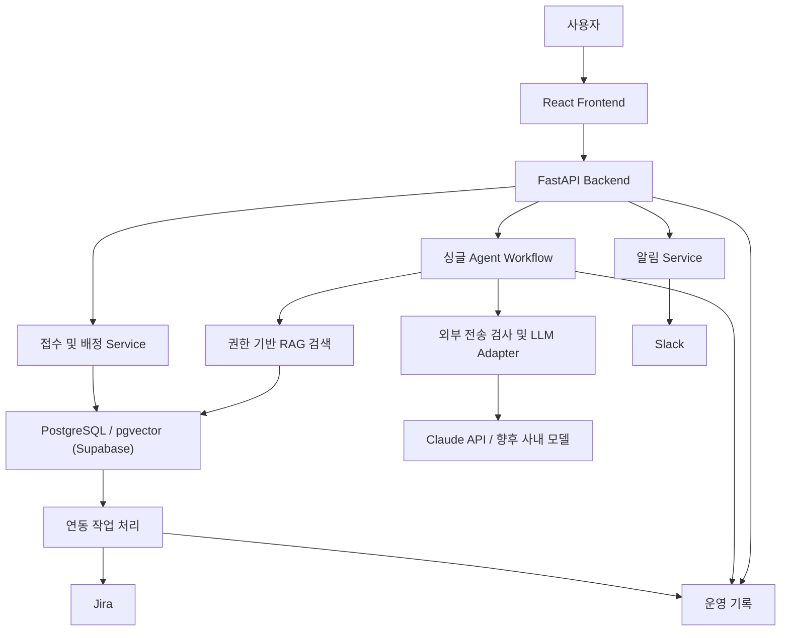
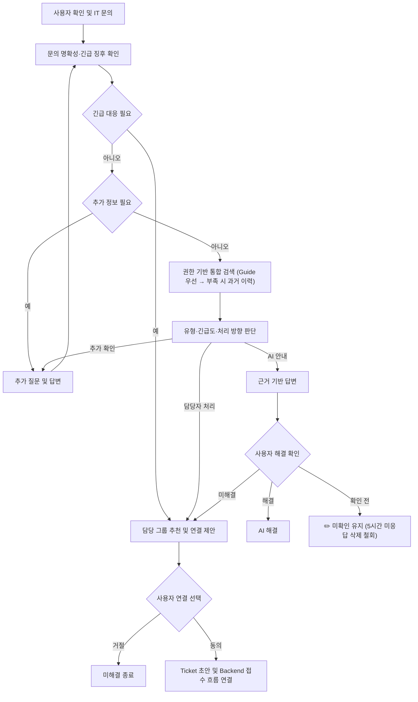
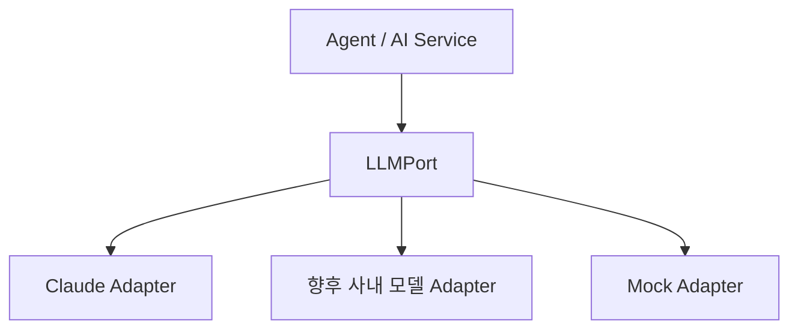
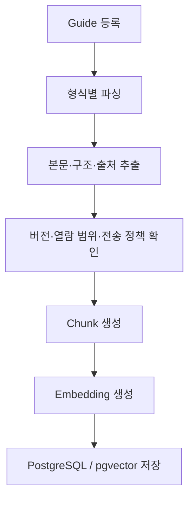
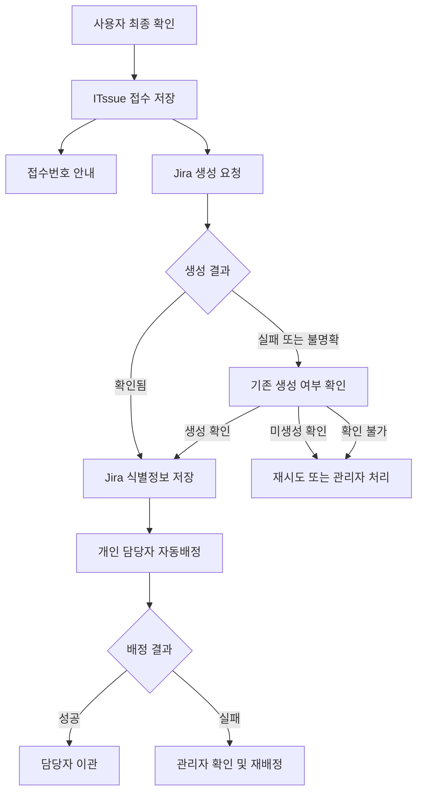

# ITssue — 시스템 설계서

> **문서 상태:** Draft v0.6
> 
> **표기:** 🆕 신규 추가 · ✏️ 일부 수정 (2026.10.26 정책 정정분; 이전 본문 표기 초기화)
> 
> 
> **프로젝트:** IT 장애·문의 대응 AI Agent
> 
> **팀:** ITssue
> 
> **집중 개발:** 2026.10.29 ~ 2026.11.11
> 
> **최종 발표:** 2026.11.13
> 

---

## 1. 문서 개요

본 문서는 ITssue의 PRD 및 SRS에서 정의한 기능과 요구사항을 실제 시스템으로 구현하기 위한 **기술 구조 및 구현 기준**을 정의한다.

본 문서에서는 다음 내용을 다룬다.

- Technical Requirements
- System Architecture
- Backend / AI Agent / RAG 구조
- Database 및 ERD *(DB에 실제로 저장할 데이터와 그 관계)*
- API 설계
- 외부 서비스 연동
- Logging 및 Evaluation
- 개발·실행 환경

> 서비스의 목적과 범위는 **프로젝트 기획서 및 PRD**, 기능·비기능 요구사항은 **SRS**를 기준으로 한다.
> 

---

# 2. Technical Requirements

## 2.1 기술 설계 원칙

ITssue는 다음 원칙을 기준으로 시스템을 구성한다.

### 기능별 책임 분리

Frontend, Backend, AI Agent, RAG, Database, 외부 서비스 연동의 책임을 분리한다.

### Layer 기반 Backend 구조

Backend는 기본적으로 다음 구조를 사용한다.

```
Router
  ↓
Service
  ↓
Repository
  ↓
Database
```

- **Router** : HTTP Request / Response 처리
- **Service** : Business Logic 수행
- **Repository** : Database 접근
- **Model** : Database Entity 정의
- **Schema** : API 입출력 데이터 검증

AI Agent 및 외부 서비스 연동은 Service Layer에서 필요한 기능을 호출하는 구조로 구성한다.

### 외부 서비스 의존성 분리

LLM, Jira, Slack 등 외부 서비스는 별도의 Integration Layer로 분리한다.

이를 통해 외부 API 또는 Model 변경이 핵심 Business Logic에 미치는 영향을 최소화한다.

### 설정과 코드 분리

API Key, Database URL, Model 설정 등의 환경별 설정은 `.env` 및 환경 변수로 관리하며 코드에 직접 포함하지 않는다.

---

# 3. Technology Stack

ITssue는 **짧은 개발 기간 내 구현 가능성, 문의 처리 흐름의 통제, 권한을 고려한 문서 검색, 결과 검증 및 운영 부담**을 기준으로 기술을 선정한다. 교육 과정에서 사용한 기술을 우선 활용하되, 프로젝트 요구와 평가 결과에 따라 변경할 수 있다.

**① 서비스 및 데이터 관리**

| 영역 | **선택 기술** | 선택 근거 | 한계 및 재검토 조건 | 재검토 시 대안 / 장점 |
| --- | --- | --- | --- | --- |
| Language | **Python 3.12** | 문서 파싱·임베딩·LLM·API를 같은 언어로 연결하여 개발 부담을 줄인다. | 조직의 기존 개발 언어와 유지보수 표준을 따라야 할 경우 | Java: 기업 업무 시스템 생태계 / TypeScript: 웹 프론트·백엔드 언어 통일 |
| Frontend | **React** | UI 프로토타입과 디자인 가이드(역할별 화면·상세 패널·대시보드·상태 배지)의 상호작용과 디자인 시스템을 그대로 구현하기 위해 사용한다. 채팅·Ticket 상세·관리 화면을 컴포넌트로 나누고, Backend와는 API로만 연결한다. | 일정 안에 화면 구현이 어려워지거나 SSR·SEO 요구가 생기는 경우 | Next.js: 라우팅·SSR 제공 / Streamlit: Python만으로 빠른 화면 구현(복잡한 상호작용에는 한계) |
| Backend API | **FastAPI** | AI 기능을 Python에서 직접 연결하고, API 검증·문서화와 비동기 외부 호출을 지원한다. | 인증·관리자 화면 등 통합 웹 기능이 많이 필요해질 경우 | Django·DRF: 인증·관리 기능 기본 제공 /Spring Boot: Java 기반 기업 시스템 연계 |
| Validation | **Pydantic v2** | API 입출력과 AI 결과의 필수 항목·자료형을 검사하여 잘못된 데이터 전달을 줄인다. | 데이터 형식 외에 업무 규칙·답변 정확성 검증이 필요할 경우 | 규칙 검증·평가셋 추가: 실제 판단의 적절성 확인 / JSON Schema: 언어 간 규격 공유 |
| ORM | **SQLAlchemy** | 사용자·문의·문서·티켓의 관계를 관리하고, DB 접근 코드를 업무 로직과 분리한다. | 복잡한 검색·집계에서 쿼리 제어와 성능 조정이 필요할 경우 | 직접 SQL 병행: 세밀한 쿼리 최적화 / Django ORM: Django 기반 서비스와 통합 |
| Migration | **Alembic** | DB 구조 변경 이력을 공유하여 팀원별 스키마 차이와 변경 누락을 줄인다. | ORM을 변경하거나 자동 생성으로 표현하기 어려운 변경이 생길 경우 | 수동 작성 마이그레이션: 변경 내용 직접 제어 / Django Migration: Django ORM과 통합 |
| Main DB | **PostgreSQL (Supabase 호스팅)** | 업무 데이터와 문서 버전·권한 정보·벡터를 함께 관리해 저장소 간 동기화 부담을 줄인다. DB 서버 운영은 Supabase에 맡기고, 팀이 같은 DB를 공유한다. Supabase는 DB 호스팅으로만 쓰며 자동 REST API·Auth·Storage는 쓰지 않는다(접속은 Backend만 한다). | 조직의 기존 DB 표준을 따라야 하거나 단순 로컬 실험만 필요한 경우 | MySQL·Oracle: 기존 기업 환경 활용  / SQLite: 설치 없는 로컬 개발 |
- **DB → Mongo DB vs PostgreSQL 비교**
    
    MongoDB는 **JSON처럼 중첩된 데이터를 묶어서 저장하기 편하고, 데이터마다 항목이 달라도 유연하게 다룰 수 있다.** 예를 들어 문의 유형별로 수집하는 정보가 다르거나, 외부 API 응답 구조가 자주 바뀌는 경우에 유리해. 다만 유연하다고 데이터 설계가 필요 없는 것은 아니야. 
    
    | 비교 항목 | PostgreSQL | MongoDB |
    | --- | --- | --- |
    | **잘 맞는 데이터** | 사용자·문의·담당자·티켓처럼 서로 연결된 데이터 | 구조가 다양한 JSON, 중첩된 기록 |
    | **주요 장점** | 테이블 간 관계를 명확히 관리하고, 외래키로 잘못된 연결을 방지 | 함께 조회하는 정보를 한 문서에 묶고 필드를 유연하게 추가 |
    | **ITssue 활용 예** | 문의자·담당자·티켓 연결, 문서 버전 관리, 부서별 처리 통계 | 문의별 추가 정보, 외부 API 응답, 대화 기록 |
    | **설계 시 주의점** | 테이블 구조 변경을 관리해야 함 | 정보를 중복 저장할지 참조할지 결정하고, 변경 시 일관성을 관리해야 함 |
    
    PostgreSQL은 외래키로 관계의 일관성을 검사하고, MongoDB는 관련 정보를 한 문서에 포함하거나 다른 문서를 참조하는 방식으로 설계해. **MongoDB도 관계를 표현할 수 있지만 접근 방식이 다르다.**
    
    ITssue에서는 다음 이유로 PostgreSQL이 더 자연스러워.
    
    - **관계가 중요해:** 누가 문의했는지, 누구에게 배정됐는지, 어느 티켓·문서 버전과 연결되는지 관리해야 해.
    - **유연한 정보도 저장할 수 있어:** PostgreSQL의 `JSONB`를 사용하면 문의별 추가 정보나 API 응답도 저장·검색할 수 있어.
    - **현재 구조를 활용할 수 있어:** SQLAlchemy·Alembic·pgvector 기반 설계를 MongoDB로 바꾸면 DB 접근과 검색 코드도 수정해야 해.
- : 실무의 경우 기업마다 달라 대표적인 스택을 비교하기가 어려움.
    - 일반 웹 서비스의 **React·Next.js + 백엔드 API + PostgreSQL**,
    - AI 서비스의 **React·Next.js + FastAPI + PostgreSQL**,
    - Java 기반 기업 시스템의 **React + Spring Boot + 관계형 DB**
    
    앞서 확인한 개발자 조사에서도 Python·FastAPI의 사용 증가와 PostgreSQL의 높은 선호가 나타나긴 함. 
    
    우리의 **React + FastAPI + PostgreSQL**은 “화면은 프로토타입·디자인 가이드대로 구현하고, AI와 업무 로직은 API로 분리해 화면과 Backend를 독립적으로 개발한다”는 선택 근거로 설명하면 좋을 듯. (10.16 Streamlit에서 React로 변경)
    

**② AI Agent 및 문서 검색**

| 영역 | **선택 기술** | 선택 근거 | 한계 및 재검토 조건 | 재검토 시 대안 / 장점 |
| --- | --- | --- | --- | --- |
| LLM Framework | **LangChain·LCEL** | 프롬프트·검색·모델 호출·출력 파싱을 재사용 가능한 단위로 연결해 반복 구현을 줄인다. | 단순 호출에 비해 구조가 복잡해지거나 라이브러리 의존성 관리 부담이 커질 경우 | SDK 직접 사용: 단순한 구조와 적은 의존성 / LlamaIndex: 문서 수집·검색 중심 구성 |
| Agent Workflow | LangGraph | 싱글 Agent의 추가 질문·검색·분류·답변·담당자 연결을 명시적인 상태와 분기로 관리한다. 실제 접수·배정·외부 API 실행은 Backend Service로 분리한다. | 분기가 적어 일반 함수로 충분하거나 상태 관리 구조가 불필요하게 복잡해질 경우 | Python Service Logic: 단순한 분기 구현과 의존성 감소 |
| LLM | **Claude API** | 교육에서 구축한 LLMPort·Adapter를 재사용해 구현 부담을 줄이고, 실제 문의로 분류·답변 품질을 검증한다. | 정확도·응답 시간·비용이 목표에 미달하거나 외부 전송 조건을 충족하지 못할 경우 | OpenAI·Gemini API: 모델별 품질·비용 비교 / 로컬 모델: 외부 전송 통제, 자체 운영 |
| 문서 파싱 | PDF: pypdf / pdfplumber, DOCX: python-docx, PPTX: 파서 선정 예정 | 사내 Guide의 본문과 제목·페이지·슬라이드 등 출처 정보를 추출하여 검색용 문서를 구성한다. 문서 형식에 따라 적합한 파서를 사용한다. | 스캔 PDF, 복잡한 표, 이미지 중심 문서는 텍스트 추출만으로 내용을 충분히 확보하기 어렵다. 추출 결과가 검색 품질에 영향을 주는 경우 보완한다. | OCR 및 문서 구조 분석 도구를 검토할 수 있다. 이미지 속 텍스트와 복잡한 문서 구조를 추가로 처리할 수 있다. |
| Chunking | **제목·상황·절차·표 단위 분할 + 길이 제한** | 한 상황의 확인 사항과 해결 절차를 함께 유지하고, 문서 ID·버전·위치 정보를 청크에 연결한다. | 청크가 너무 길거나 필요한 정보가 여러 청크로 분리돼 검색·답변 품질이 떨어질 경우 | LangChain 분할기: 길이 기반 분할 간소화 / 의미 기반 분할: 내용 경계 활용 |
| Embedding | **KURE-v1 / BGE-M3 비교 후 선택** | 한국어 문의와 사내 가이드의 검색 성능을 실제 데이터로 비교하고, 로컬 실행으로 문서 외부 전송을 줄인다. | 검색 적중률·속도·메모리가 목표에 미달하거나 로컬 모델 운영 부담이 클 경우 | OpenAI·Cohere·Upstage API: 모델 운영 부담 감소 / 다른 로컬 모델: 데이터에 맞는 성능 비교 |
| Vector Search | **pgvector** | 문서 버전·열람 권한 등 PostgreSQL의 메타데이터 조건과 벡터 검색을 함께 관리해 저장소 동기화 부담을 줄인다. | 검색 규모·지연 요구가 커지거나 필터 적용 후 검색 결과가 충분하지 않을 경우 | Qdrant·Milvus: 검색 전용 기능 / Pinecone: 관리형 운영 / MongoDB Vector Search: MongoDB 중심 데이터 구조와 통합 |
| 검색 보완 | **키워드 검색·BM25·리랭커 — 평가 후 도입 검토** | 오류 코드·시스템명 같은 정확한 단어 검색을 보완하고, 검색 후보의 관련성을 다시 평가한다. | 벡터 검색만으로 충분하거나 추가 처리 시간이 품질 개선보다 클 경우 | 벡터 검색만 유지: 구조·지연 감소 / OpenSearch: 전문 검색 기능 / Cross-encoder 리랭커: 후보 관련성 재평가 |
- 실무
    
    현업에서도 **문서 파싱 → 청킹 → 임베딩 → 검색 → LLM 답변**이라는 구성을 바탕으로 도구를 조합해. 
    
    우리 선택은 **LangChain·LangGraph + 로컬 임베딩 + PostgreSQL·pgvector**이고, 강점은 **업무 흐름을 통제하면서 문서와 검색 데이터를 함께 관리하는 것**
    

**③ 외부 연동·품질 검증·운영**

| 영역 | 선택 기술 | 선택 근거 | 한계 및 재검토 조건 | 재검토 시 대안 / 장점 |
| --- | --- | --- | --- | --- |
| Ticket | **Jira REST API** | AI가 해결하지 못한 문의를 담당자의 업무 티켓으로 연결하고, 처리 상태를 사용자에게 안내한다. | 조직이 다른 ITSM을 사용하거나 API 제약으로 필요한 기능을 구현하기 어려울 경우 | **기존 ITSM API:** 조직 업무 흐름과 통합 / **자체 티켓 관리:** 기능과 데이터 직접 통제 |
| Notification | **Slack API** | 접수·배정·처리 결과를 업무 메신저로 전달하고, 필요한 버튼·응답 기능을 연결한다. | 단순 알림만 필요하거나 조직에서 다른 메신저를 사용할 경우 | **Incoming Webhook:** 단순 알림 구현 / **Teams·메일:** 기존 업무 채널 활용 |
| Observability | Langfuse | Should 범위로 검색·모델 호출의 상세 Trace와 응답 시간·토큰 사용량을 분석한다. 기록 전에 민감정보를 제거하고 저장 항목을 제한한다. | 자체 운영 부담이 크거나 일반 API·DB까지 관측 범위를 확대해야 할 경우 | Langfuse Cloud: 운영 부담 감소 / OpenTelemetry: 서비스 전반 추적. 외부 전송 정책 충족 여부는 별도 확인 |
| 운영 기록 | Python logging + DB 이력 저장 | 필수 운영 기록으로 접수·분류·배정·외부 연동의 결과와 사유를 남겨 오류 추적과 관리자 복구를 지원한다. 민감정보를 제외하고 필요한 항목만 저장한다. | 서비스 규모가 커져 여러 실행 환경의 기록을 통합 조회해야 할 경우 | 중앙 로그 수집 도구: 여러 서비스의 기록을 통합 검색·분석 |
| 기능 테스트 | **pytest** | 문의 접수·권한 검사·티켓 생성·상태 조회를 자동 검증하여 변경으로 인한 기능 오류를 줄인다. | 실제 브라우저에서만 발생하는 화면·사용자 흐름 오류까지 검증해야 할 경우 | **Playwright 등 추가:** 브라우저 기반 사용자 흐름 검증 |
| AI 품질 평가 | **Golden Set** | 정답과 판단 기준이 있는 문의로 분류·긴급도·검색·답변·인계의 품질을 반복 비교한다. | 평가 사례가 부족하거나 여러 모델·프롬프트의 비교를 수동으로 관리하기 어려울 경우 | **Ragas·DeepEval:** RAG 평가 보조 / **promptfoo:** 모델·프롬프트 비교 자동화 |
| 실행 환경 | **Python 가상환경 · Node.js + Supabase(DB)** | 팀원이 같은 Supabase DB에 접속하고, Backend는 `requirements.txt`, Frontend는 `package-lock.json`으로 의존성 버전을 맞춰 환경 차이를 줄인다. | 배포 서버·고가용성·자동 확장이 필요해지는 경우 | **클라우드 배포 서비스:** 배포·확장·복구를 관리형으로 운영 |
| CI/CD | **GitHub Actions** | PR에서 테스트를 자동 실행하여 팀원의 변경이 기존 기능에 미치는 영향을 병합 전에 확인한다. | GitHub 외의 저장소를 사용하거나 조직의 기존 배포 체계와 통합해야 할 경우 | **GitLab CI:** GitLab과 통합 / **Jenkins:** 사내 환경에 맞춘 구성 자유도 |
- 참고사항
    
    현업 조합의 예로는 **GitHub Actions + 클라우드 배포**, 업무 연동에는 **Jira + Slack**을 생각하면 돼. 
    
    우리 프로젝트에서는 **Supabase로 DB를 공유하고, Actions로 테스트를 자동화하는 것부터** 적용하면 일정에 맞는 선택 근거가 돼.
    
    강사님 HTML의 **EC2·Caddy는 실제 배포 위치와 HTTPS 연결 방식을 정할 때 추가할 후보**야. 배포 서버는 별도 결정으로 두면 돼.
    

## 파인튜닝 관련

모델 파인튜닝은 **Could 범위의 실험**으로 두며, 핵심 서비스 구현의 필수 전제로 삼지 않는다.

일정과 데이터가 확보되면 문의 분류 등 제한된 과제에서 기본 모델과 성능을 비교한다. 학습 대상 모델과 방법은 별도로 선정하고, 평가 결과를 확인한 후 서비스 적용 여부를 결정한다.

---

# 4. System Architecture

## 4.1 전체 Architecture



사용자의 문의는 Backend에서 인증·권한을 확인한 후 Agent Workflow로 전달한다.

Agent는 문의 명확성 확인·검색·분류·답변·담당자 연결 제안을 수행한다. **Ticket 접수, 개인 담당자 선정, Jira·Slack 호출은 Backend Service가 실행 조건을 검증한 후 수행한다.**

외부 모델로 전달되는 정보는 호출 전에 전송 허용 여부와 민감정보를 검사한다. 모델 제공자가 변경되더라도 같은 서비스 흐름을 사용할 수 있도록 LLM 호출 계층을 분리한다.

사용자가 Ticket 초안을 최종 확인하면 **ITssue DB에 접수 내용을 먼저 저장하고 내부 접수번호를 발급**한다. 이후 Jira 생성과 개인 담당자 배정을 진행한다.

---

## 4.2 주요 Component

| 구성 요소 | 주요 역할 |
| --- | --- |
| **Backend Service** | 인증·권한 검사, 문의 관리, 최종 접수, 개인 배정, 외부 연동 실행 조건 검증 |
| **Agent Workflow** | 추가 질문, 검색 요청, 문의 분류·긴급도 판단, 답변 생성, 담당자 연결 제안 |
| **RAG** | 사용자에게 허용된 Guide를 우선 검색하고, 근거가 부족하면 과거 이력을 검토하며 출처 제공 |
| **LLMPort / Adapter** | 공통 모델 호출 계약을 제공하고 Claude 또는 향후 사내 모델에 연결 |
| **외부 전송 검사** | 모델·Jira·Slack에 전달할 정보를 대상별 정책에 따라 선별·제거·가명 처리하거나 차단 |
| **접수·연동 작업 처리** | 접수 내용 보존, Jira 생성·배정, 연동 결과 확인, 재시도 및 관리자 복구 지원 |
| **운영 기록** | 분류·접수·배정·외부 호출의 결과와 사유 기록 |

---

# 5. Backend Architecture

## 5.1 기본 구조

Backend는 기능별 Module과 Layer를 분리한다.

```
backend/
└─ app/
   ├─ api/
   │   └─ routers/
   │
   ├─ schemas/
   ├─ services/
   ├─ repositories/
   ├─ models/
   │
   ├─ agent/
   ├─ rag/
   ├─ integrations/
   │
   ├─ core/
   └─ main.py
```

각 영역의 역할은 다음과 같다.

| 영역 | 역할 |
| --- | --- |
| `api/routers` | API Endpoint |
| `schemas` | Pydantic Request / Response |
| `services` | Business Logic |
| `repositories` | DB 접근 |
| `models` | SQLAlchemy Model |
| `agent` | 문의 처리 Workflow |
| `rag` | 검색 및 Document Pipeline |
| `integrations` | LLM / Jira / Slack |
| `core` | Config / DB / Logging / Exception |

> 실제 Directory 구조는 구현 과정에서 기능별 Module 구성에 따라 조정할 수 있다.
> 

---

# 6. AI Agent 설계

## 6.1 Agent 처리 Flow



보안 사고 의심이나 다수 사용자에게 영향을 주는 장애 징후는 **문의 내용과 추가 질문 답변을 바탕으로 AI와 사전 정의된 규칙이 식별**한다. 긴급 대응이 필요한 경우 일반 검색·답변을 기다리지 않고 담당자 연결을 제안한다.

이는 실제 사고나 원인의 확정을 의미하지 않는다. 실제 사고 여부와 조치 필요성은 담당자가 확인한다.

최종 확인 이후의 접수·Jira 생성·개인 배정은 Agent의 대화 상태가 아닌 **Backend의 업무 처리 흐름**으로 관리한다.

---

## 6.2 Agent State

Agent State는 현재 상담의 판단과 응답 생성에 필요한 정보를 관리한다.

| 항목 | 내용 |
| --- | --- |
| **사용자·문의 식별정보** | 사용자 ID, 문의 ID, 상담 Session ID |
| **문의 및 추가 확인 정보** | 문의 내용, 추가 질문과 답변, 부족한 정보 |
| **긴급 판단 정보** | 보안 의심 징후, 영향 범위, 업무 중단, 대체 방법, 시간 제약 |
| **검색 결과** | 검색된 근거와 출처 식별정보 |
| **분류 결과** | 카테고리·세부 유형·긴급도 및 판단 근거 |
| **처리 방향** | 추가 확인, AI 안내, 담당자 연결 |
| **응답 정보** | 답변, 출처, 해결 확인 결과, Ticket 초안 참조 |

**접수 기록, Jira 연동 상태, 배정 결과는 DB를 기준으로 관리한다.** Agent State만으로 접수 완료나 담당자 이관 여부를 판단하지 않는다.

---

## 6.3 LLM Adapter

LLM 호출은 Business Logic에서 특정 Model SDK를 직접 호출하지 않고 Adapter를 통해 수행한다.



LLMPort는 입력·출력 Schema와 공통 오류 처리를 정의하고, 제공자별 호출 방식은 Adapter 내부에서 처리한다.

캡스톤에서는 Claude Adapter를 사용한다. Mock Adapter를 통해 모델 제공자가 변경되어도 핵심 서비스 흐름이 유지되는지 검증한다.

모델 호출 전에 외부 전송 검사를 수행하며, **외부 전송이 금지된 정보는 Claude 호출에 포함하지 않는다.** 현재 사용할 수 있는 내부 모델이 없는 경우 담당자 처리 경로로 연결한다.

---

# 7. RAG 설계

## 7.1 Knowledge Source

Knowledge는 기존 사람이 사용하던 **사내 Guide를 기본 근거**로 하고, Guide로 근거가 부족한 경우에 한해 **도입 이전 처리 이력(과거 이력)을 보조 근거**로 구성한다.

사내 Guide는 `dataset/guides`(7개 분류 57종)을 사용한다. 임직원용 가이드(`IT-{분류}-{번호}`)와 담당자용 매뉴얼(`IT-{분류}-{번호}-M`)은 같은 번호로 짝을 이루며, 공통 기준(`IT-STD`)이 함께 있다. 문서별 열람 등급·짝 문서·RAG 대상 여부는 `manifest.json`으로 관리하며 Guide 등록 시 메타데이터로 사용한다. AI 응대 정책(`IT-AI-001`)은 시스템 프롬프트·정책 관리용이므로 RAG 검색 대상에서 제외한다. 같은 문서는 한 가지 형식만 등록해 중복 검색을 막는다.

AI 도입에 따른 응대 원칙은 기존 Guide 전체를 수정하여 삽입하지 않고, **시스템 프롬프트와 서비스 정책으로 별도 관리**한다.

과거 이력(DB의 `legacy_inquiries`)은 도입 이전 데이터를 한 번만 적재해 읽기 전용으로 두며, 사용자에게 열람이 허용된 범위만 검색한다. 개인정보·업무정보와 외부 전송 조건을 확인한 후 활용한다. ITssue에서 새로 해결된 사례는 해결 사례 → 관리자 검토 → Guide 등록 경로로 Guide에 편입한다.

---

## 7.2 문서 처리  Pipeline



문서 등록 시 검색 가능 범위와 외부 모델 전송 가능 여부를 함께 관리한다.
Embedding을 외부 서비스에서 생성하는 경우에도 전송 검사를 적용한다. 새 버전 등록·문서 비활성화 시에는 검색 대상에 반영하여 이전 문서가 계속 사용되지 않도록 한다.

---

## 7.3 Chunk Metadata

최소 Metadata 후보는 다음과 같다.

| 항목 | 용도 |
| --- | --- |
| **문서·Chunk ID** | 원문 및 검색 단위 식별 |
| **문서 버전·활성 여부** | 현재 유효한 근거 선택 |
| **카테고리·제목·소제목** | 분류 및 문맥 보존 |
| **열람 범위·보안 등급** | 사용자별 검색·열람 제한 |
| **외부 전송 정책** | 외부 모델에 전달 가능한 내용인지 확인 |
| **페이지·슬라이드·절 위치** | 답변 출처 표시 (Guide는 문서 번호와 항목 번호로 표시. 예: IT-ACC-001 3.3) |
| **문서 번호·짝 문서·문서 종류** | 가이드·매뉴얼 연결, 공통 기준·AI 응대 정책 구분 |
| **RAG 대상 여부** | AI 응대 정책 등 검색 제외 문서 구분 |
| **본문·Embedding** | 검색 및 답변 근거 |

세부 필드와 자료형은 DB Schema에서 확정한다.

**열람 범위와 청크:** 열람 범위는 `ALL`(사내 일반, 전 임직원) · `AGENT`(사내 제한, IT 운영 담당자·관리자) · `ADMIN`(관리자 전용) 3단계이다. 열람 범위가 다른 문서를 한 청크로 합치지 않으며, 범위를 벗어난 문서(예: 담당자용 매뉴얼)의 원문·출처·요약은 검색·답변에 노출하지 않는다. 외부 전송 정책은 열람 범위와 별도로 `ALLOWED`(허용) · `MASKED`(마스킹 후 허용) · `BLOCKED`(금지) 3가지를 문서 버전별로 관리하며, 열람 범위와 전송 정책이 지정되지 않았거나 불명확하면 가장 제한적인 값(`ADMIN`·`BLOCKED`)을 적용한다.

---

## 7.4 검색 및 답변 흐름

1. 사용자 인증정보와 열람 범위를 확인한다.
2. 검색 입력을 정리하고, 외부 검색·Embedding 서비스를 사용하는 경우 전송 조건을 검사한다.
3. **열람 가능한 Guide를 먼저 검색**한다.
4. Guide로 충분한 근거를 얻지 못하면 **열람 가능한 과거 이력에서 유사 사례를 검색**하고, 현재 Guide·운영 정책과 충돌하는지 확인한다. 충돌하면 Guide를 우선한다.
5. 검색 결과의 관련성·버전·외부 전송 허용 여부를 확인한다.
6. 허용된 근거만 모델에 전달하여 답변을 생성한다.
7. 답변에 출처를 제공한다. 과거 사례를 근거로 한 경우 Guide 출처와 구분해 "과거 처리 사례 참고"로 표시한다.

사용자에게 열람 권한이 없는 정보는 검색 결과·답변·출처로 노출하지 않는다.

열람 가능한 정보라도 외부 전송이 금지된 경우 외부 모델 입력에서 제외한다. 활용 가능한 근거가 부족하면 추가 확인 또는 담당자 연결로 진행한다.

---

## 7.5 Answer Grounding

검색 결과에서 답변에 활용할 근거와 출처 위치를 선택하고, 해당 근거를 모델 입력에 포함한다.

생성된 답변은 근거와의 일치 여부 및 출처 유효성을 확인한다. 충분한 근거를 확보하지 못하면 **추가 확인 또는 담당자 연결**로 진행한다.

답변에는 사용한 Guide의 문서·버전·근거 위치를 식별할 수 있는 출처를 제공한다. 과거 이력을 활용할 때는 현재 Guide·운영 정책과의 적합성을 확인하고, 답변에서 과거 처리 사례 참고임을 구분해 표시한다.

---

## 7.6 해결 사례 Guide화 제안 (Could)

매일 자정(트래픽이 적은 시간)에 당일 CLS(종결)된 티켓을 모아 AI가 유사도로 묶고, 가장 많았던 질문 주제의 해결 방법을 다음 날 관리자 화면에 해당 질문 비율(N%)과 함께 보여 Guide로 만들지 묻는다. 관리자가 승인하면 해결 사례 → 관리자 검토 → Guide 등록 경로(7.1)를 따른다.

- ✏️ 후보 자격은 CLS(문의자가 해결을 확인한 종결 티켓)로 한정한다. FIN은 해결 확인 전이라 미검증이고 미해결 선택으로 WIP에 돌아갈 수 있으므로 대상에서 뺀다. 재처리 중(WIP)인 티켓의 이전 처리 결과도 후보가 아니다. 빈도(질문 비율)는 정확성의 증거가 아니라 재검토 신호로 본다.
- 입력은 Jira 티켓의 처리 결과(`resolutionNote`)와 문의 요약이며, 외부 모델 호출 전에 민감정보 정책의 가림·치환·전송 규칙을 적용한다.
- 등록 시 열람 범위와 외부 전송 정책을 반드시 지정한다(미지정 시 `ADMIN`·`BLOCKED`).
- 실행 방식(스케줄러 스택)·담당과 유사도 기준은 17장 미확정이다. Jira 티켓이 DB에 잘 적재되고 Guide화에 쓸 수 있는지는 반드시 테스트한다.

---

# 8. DB / ERD 설계

## 8.1 주요 Entity

MVP 기준 주요 Entity는 다음과 같이 구성한다.

| Entity / 관리 항목 | 주요 역할 |
| --- | --- |
| User | 사용자 식별정보·계정 상태·소속·역할·서비스 권한 관리 |
| Inquiry | 문의 내용·분류·긴급도·판단 근거·문의 처리 상태 관리 |
| Session | 상담 단위와 문의·Message 연결 |
| Message | 사용자·AI 메시지와 작성 시각·상담 순서 관리 |
| Guide | 문서 식별정보·제목·카테고리 등 기본 정보 관리 |
| Guide 버전·정책 정보 | 버전·원문 위치·활성 여부·열람 범위·외부 전송 정책 관리 |
| GuideChunk | 해당 Guide 버전의 검색 단위·본문·출처 위치·Embedding 관리 |
| Ticket | 내부 접수번호·최종 확인 초안·문의/Session 연결·Jira 식별정보·연동 및 배정 상태 관리 |
| TicketHistory | ✏️ Ticket 업무 상태의 변경 이력(변경 전·후 상태, 출처, 요청자, 사유) 관리. 처리 결과 본문은 이력에 남기지 않는다(재처리 시 보존 방식은 미결, 06 문서 참고) |
| 담당 그룹·배정 후보 정보 | 담당 그룹·처리 가능 업무·배정 가능 여부·Jira 사용자 식별정보 관리 |
| 연동 작업 정보 | Jira 생성·배정 작업의 상태·시도 결과·재처리 정보 관리 |
| 배정 이력 | 추천·선정·실패·재배정의 결과와 사유 관리 |
| 계정 상태 이력 | 계정 이용 제한·해제·수정의 사유와 처리자 관리 |
| Guide 버전 상태 | 현행·만료·초안, 검색 준비 상태, 열람 범위(ALL·AGENT·ADMIN), 외부 전송 정책(ALLOWED·MASKED·BLOCKED) 관리 |
| FAQ (제안) | 질문·답변·분류·출처 Guide 관리 |
| Ticket 메시지 (시연용 목업) | 담당자-문의자 추가 정보 요청·답변 화면. 실제 소통은 Jira 티켓 댓글로 한다 |
| Jira 댓글 화면 알림 (방향 확정) | 댓글 웹훅 → 댓글 재조회·수신자 판단 → 알림 저장·조회 API → ITssue 화면. 운영 수신·DB·API·화면 연결은 후속 구현 |
| 보안·감사 이벤트 | 감지 유형·심각도·마스킹된 내용·상태·원문 열람 사유와 이력 관리 |

상세 테이블 정의와 관계는 [06. 테이블 설계서](06.테이블_설계서.md)를 참조한다. 이 표는 개요이며 테이블 이름·필드는 06을 따른다. Ticket은 **Jira 생성 전에도 내부 접수 기록으로 존재**할 수 있다.

---

## 8.2 ERD 관계 설명

주요 관계는 다음과 같다.

- User와 해당 사용자의 Inquiry를 연결한다.
- Inquiry·Session·Message를 연결하여 상담 이력을 관리한다.
- Ticket은 원본 Inquiry와 관련 Session을 참조한다.
- Ticket에 연동 작업·배정 이력·처리 이력을 연결한다.
- Guide에 버전을 연결하고, 각 버전에 해당 GuideChunk를 연결한다.
- 담당 그룹과 배정 후보 사용자를 연결한다.

정확한 관계 수와 제약조건은 상세 ERD에서 확정한다. Jira 식별정보는 내부 접수 시점에는 없을 수 있으며, 생성 확인 후 연결한다.

---

## 8.3 접수 데이터 저장 원칙

사용자가 초안을 최종 확인하면 **접수 기록과 처리할 연동 작업을 함께 저장**한다. 저장 성공 후 내부 접수번호를 반환한다.

연동 작업은 프로세스가 재시작되어도 이어서 처리할 수 있도록 DB에 보존한다.

**번호 형식 (프로토타입·디자인 가이드 기준 예시):** 내부 접수번호는 `RCPT-1041`, Jira Ticket 번호는 `ITHD-1520` 형식이다. 접수번호는 저장 시 발급하고, Jira 번호는 생성 확인 후 연결한다. Jira 프로젝트 키는 **`ITHD`(ITssue HelpDesk)**로 확정했고(Jira Software 스페이스 "ITssue HelpDesk"), 번호는 Jira가 생성 시 발급한다. 이전 JSM 프로젝트 `ITS`는 과거 이력 보관용이다.

Jira 생성 실패나 배정 실패를 이유로 이미 저장된 접수 내용을 삭제하지 않는다. 로컬 저장 자체가 실패한 경우에는 접수 성공으로 안내하지 않는다.

---

# 9. API 설계

세부 Request / Response Schema는 구현 단계에서 확정하며, 본 문서에서는 주요 Endpoint와 처리 책임을 정의한다.

보호된 API는 Backend에서 사용자 인증과 대상 데이터·기능에 대한 권한을 검사한다.

## 9.1 User / Auth

| Method | Endpoint | 역할 |
| --- | --- | --- |
| POST | `/auth/login` | 로그인 및 사용자 상태 확인 |
| GET | `/users/me` | 현재 사용자의 소속·역할·접근 권한 조회 |

ITssue는 사번과 비밀번호로 로그인하는 자체 로그인 방식이다. SSO는 이후 확장으로 두며(사용자 식별 정보를 별도 테이블로 추가), 회원가입 API는 두지 않는다. 신규 입사자 계정은 관리자가 생성한다.

---

## 9.2 Inquiry / Chat

| Method | Endpoint | 역할 |
| --- | --- | --- |
| POST | `/inquiries` | 새 문의 생성 및 상담 Session 연결 |
| GET | `/inquiries/{id}` | 접근 가능한 문의의 상담 내용·진행 상태 조회 |
| GET | `/inquiries` | 사용자의 문의 목록 조회 |
| POST | `/inquiries/{id}/messages` | 메시지 입력 및 추가 질문·검색·분류·답변 처리 |
| POST | `/inquiries/{id}/replies` | 빠른 응답 버튼(해결됐어요·담당자 연결 등) 처리 |
| POST | `/inquiries/{id}/resolve` | 사용자 "해결됐어요" 확인 저장 |
| POST | `/inquiries/{id}/reject` | 사용자 "아직 해결되지 않았어요"와 남은 증상 저장 |
| ✏️ POST | `/inquiries/{id}/reopen` | 기존 문의·세션 이어가기 (기존 제안 주소; API 계약은 담당자 정합성 조정 필요) |

2026.10.19 제안: 경로·요청·응답 형식은 `07.API_계약서.md`를 기준으로 한다. 문의 동작은 모두 갱신된 문의(Inquiry) 전체를 돌려준다.

✏️ 해결 여부 확인은 AI 안내 이후와 담당자 처리 결과 안내 이후에 사용한다. 담당자 처리 건은 해결 선택 시 Jira CLS 전환, 미해결 선택 시 기존 Ticket의 WIP 복귀를 요청하고 반영 결과를 확인한다. 남은 증상 입력 방식은 별도 명세에서 정한다.

✏️ **미응답 삭제와 입력창 (2026.10.26 정정):** 11.4의 2시간 안내+10분 후 삭제·숨김 및 기존 세션 이어가기 규칙을 서버에서 적용한다. AI 답변 후 5시간 삭제는 철회하고 AI 답변 이력의 이후 삭제 범위는 미정이다. 선택지 단계의 글은 서버에서도 거부한다. 기존 IQ-06의 새 세션 생성·접수 건 제외 규칙은 후속 API 정합성 조정이 필요하다.

**추가 Endpoint 후보 (제안 기능, 명칭·Schema는 구현 중 조정)**

| Method | Endpoint | 역할 |
| --- | --- | --- |
| GET | `/faqs` | 열람 가능한 Guide를 출처로 하는 FAQ 목록 |
| POST / DELETE | `/admin/faqs`, `/admin/faqs/{id}` | 관리자 FAQ 등록·삭제 |
| GET / POST | `/tickets/{id}/messages` | 담당자-문의자 메시지 조회·등록 (시연용 목업) |
| GET / PATCH | `/admin/security-events`, `/admin/security-events/{id}` | 보안·감사 알림 조회·상태 변경 (진행 확정) |
| POST | `/admin/security-events/{id}/raw` | 사유를 입력한 원문 열람과 열람 기록 |
| POST | `/admin/guides/{id}/versions/{v}/activate` | 검색 준비 완료 버전의 현행 전환 |
| POST | `/admin/users/{id}/status` | 계정 이용 제한·해제와 사유 기록 |
| POST | `/admin/users` | 관리자의 신규 입사자 계정 생성 (임시 비밀번호 발급, 회원가입은 없음) |

---

## 9.3 Ticket

| Method | Endpoint | 역할 |
| --- | --- | --- |
| POST | `/inquiries/{id}/replies` (action `connect-yes`) | 담당자 연결에 동의한 문의의 Ticket 초안 생성 |
| GET | `/inquiries/{id}` | 사용자가 확인할 Ticket 초안·접수 상태 조회 (문의 응답의 `draft`·`ticket`) |
| POST | `/inquiries/{id}/draft/edit` | 접수 전 Ticket 초안 수정 |
| POST | `/inquiries/{id}/draft/confirm` | 사용자 최종 확인 후 내부 접수 저장·접수번호 발급 및 Jira 연동 작업 등록 |
| POST | `/inquiries/{id}/draft/cancel` | 접수하지 않고 종료 |

2026.10.19 제안: 초안·접수는 문의 아래 경로로 통일한다 (기존 `/ticket-drafts/{id}…`, `/tickets/{id}` 대체). 이미 화면이 이 경로로 동작한다. 상세는 `07.API_계약서.md`.

최종 확인 API는 **ITssue DB 저장 성공 후 접수번호를 반환**한다. Jira 생성과 개인 담당자 자동배정은 이후 내부 작업으로 수행한다.

같은 확인 요청이 반복되어도 중복 접수되지 않도록 처리한다. Jira 연동·배정 실패 시에도 내부 접수는 유지하며 사용자에게 재접수를 요구하지 않는다.

Ticket은 원본 문의와 상담 Session 식별정보를 참조한다. 전체 상담 원문을 Jira에 기본 복사하지 않는다.

---

## 9.4 Guide

| Method | Endpoint | 역할 |
| --- | --- | --- |
| POST | `/guides` | Guide 등록 및 버전·열람 범위·외부 전송 정책 저장 |
| GET | `/guides` | 사용자에게 열람이 허용된 Guide 목록 조회 |
| GET | `/guides/{id}` | 열람 가능한 Guide의 상세 정보 조회 |
| DELETE | `/guides/{id}` | 권한 있는 관리자의 Guide 삭제 요청 |

Guide 등록 이후 **Parsing → Chunking → Embedding** 처리를 내부 Ingestion Pipeline으로 연결한다.

삭제된 Guide는 검색 대상에서 제외한다. 원문·이력의 실제 삭제 범위와 시점은 데이터 보존 정책에 따른다.

---

## 9.5 Admin

| Method | Endpoint | 역할 |
| --- | --- | --- |
| GET | `/admin/inquiries` | 관리자 권한 범위 내 전체 문의 조회 |
| GET | `/admin/tickets` | Jira 미연결 접수를 포함한 내부 접수·연동·배정 현황 조회 |
| GET | `/admin/dashboard` | 카테고리·긴급도·담당자별 운영 현황 조회 |
| PATCH | `/admin/users/{id}` | 사용자 상태·역할·접근 권한 변경 |
| PATCH | `/admin/tickets/{id}/assignee` | 담당자 재배정 요청 및 변경 사유 기록 |
| POST | `/admin/tickets/{id}/retry` | Jira 생성 여부·기존 작업 상태 확인 후 실패한 연동 작업 재처리 |

관리자 조회 기능은 **Jira 연동이 실패해도 내부 접수 기록을 확인할 수 있도록** 구성한다.

연동 재처리 시 기존 Jira Ticket 생성 여부를 먼저 확인하여 중복 생성을 방지한다. 재배정·재처리의 실행자·시간·사유·결과를 기록한다.

> Endpoint 명칭과 세부 Schema는 Frontend 설계 및 구현 과정에서 조정할 수 있다.
> 

---

# 10. 외부 서비스 연동

## 10.1 Jira

Jira는 **담당자 처리 업무와 Ticket 상태의 기준 시스템(Source of Truth)**으로 사용한다.

### 주요 연동 범위



**ITssue는 내부 접수·상담 연결·연동 작업을 관리하고, Jira는 실제 Ticket 업무 상태를 관리한다.**

Jira 요청이 시간 초과되면 실제 Ticket이 생성되었을 수 있으므로, 기존 생성 여부를 확인한 후 재시도한다. 내부 접수 식별정보를 활용하여 중복 생성을 방지한다.

연동이나 배정에 문제가 생겨도 사용자는 다시 접수할 필요가 없으며, 담당 운영자가 내부 접수 기록을 기준으로 처리한다.

### 담당 그룹 추천 및 개인 자동배정

문의의 카테고리·대상 시스템·업무 유형으로 담당 그룹을 추천한다. 개인 담당자는 Backend의 배정 규칙으로 선정한다.

**담당 그룹 추천 순서:** ① 세부 유형·대상 시스템이 일치하는 예외 규칙의 그룹(우선순위가 높은 규칙부터) → ② 일치하는 규칙이 없으면 세부 유형의 기본 담당 그룹 → ③ 그래도 확정하기 어려우면 서비스데스크(확인 그룹)가 확인한다.

배정 후보의 처리 가능 범위·배정 가능 여부·Jira 사용자 유효성을 검사한다. 후보 간 업무량 비교를 적용하되, 업무량 산정·동률 처리·동시 배정 기준은 별도 배정 규칙에서 확정한다.

| 예외 | 처리 방향 |
| --- | --- |
| **담당 그룹을 확정하기 어려움** | 서비스데스크·관리자 확인 대상으로 유지 |
| **유효한 개인 후보 없음** | 확인된 담당 그룹의 관리자에게 배정 확인 요청 |
| **Jira 배정 요청 실패** | 생성된 Ticket과 접수 기록을 보존하고 재처리·관리자 확인 |
| **관리자 재배정** | 변경 담당자·사유·실행자·시간 기록 |

배정은 접근권한 승인이나 실제 시스템 권한 부여를 의미하지 않는다.

---

## 10.2 Slack 연

Slack은 접수·배정·처리 상태 및 결과를 알리는 채널로 활용한다. Jira 댓글 알림은 웹훅을 받아 ITssue 화면에 표시하는 것으로 별도 확정했다(2026.10.27). 댓글의 Slack 발송은 이번 결정에 포함하지 않는다.

알림에는 **수신자에게 필요한 최소 정보와 ITssue 또는 Jira 연결 정보**를 포함한다. 전체 상담 내용이나 민감정보를 그대로 전송하지 않는다.

Slack 전송 실패는 접수나 Jira 처리 결과를 취소하지 않으며, 실패 기록을 남기고 별도 재처리한다.

Ticket 기반 양방향 소통은 Could 범위로 두되, 향후 연결을 위해 Ticket에 상담 Session 식별정보를 남긴다.

ITssue 화면의 담당자-문의자 질문·답변은 시연용 목업이며, 실제 추가 문의·답변은 Jira 티켓의 댓글(사람 태그)로 한다. Jira 연동은 처리 결과(`resolutionNote`)뿐 아니라 댓글 생성 웹훅도 받는다. 댓글은 Jira에서 재조회해 수신자를 판단하고 ITssue 화면 알림으로 연결한다. 수신·판단 모듈은 존재하나 운영 알림 DB·조회/읽음 API·화면 연결은 아직 후속 구현이다. 긴급(P1) 접수는 배정 규칙은 그대로 두고 담당 그룹 전원(팀장 포함)에게 별도로 알리며, 알림 방식(Slack·화면)은 미정이다.

---

# 11. 상태 관리

### 11.1 문의 상태

| 상태 | 의미 |
| --- | --- |
| ✏️ `진행 중` | 질문·검색·판단·연결 제안·초안 확인 등 진행 중. 일반 이탈 대상은 2시간 안내+10분 후 삭제; AI 답변 이력의 적용 여부는 미정 |
| `AI 해결` | AI 안내 후 사용자가 해결을 확인 |
| ✏️ `미확인` | AI 답변 직후부터 해결·미해결 선택 전(`unconfirmed`). 시간 초과·종료가 아니며 기존 5시간 삭제는 철회 |
| `미해결 종료` | 담당자 연결을 거절하거나 최종 접수를 취소 |
| `접수 완료` | 최종 확인된 요청이 ITssue에 저장되고 내부 접수번호가 발급됨 |
| `담당자 이관` | Jira Ticket 생성과 개인 담당자 배정이 확인됨 |

Ticket 생성·연결 거절·Session 종료·미응답 삭제를 해결 완료로 간주하지 않는다.

### 11.2 연동·배정 상태

연동과 배정 상태는 문의 상태 및 Jira 업무 상태와 별도로 관리한다.

| 구분 | 내부 관리 상태 |
| --- | --- |
| **Jira 연동** | 연동 대기 / 결과 확인 중 / 연동 완료 / 관리자 확인 필요 |
| **개인 배정** | 배정 대기·진행 중 / 배정 완료 / 관리자 확인 필요 |

사용자에게는 기술 상태만 표시하지 않고, **접수번호와 현재 처리 상황**을 함께 안내한다.

예: “접수되었습니다. 담당자 연결을 진행하고 있습니다.”

예: “접수는 유지되어 있으며, 운영자가 담당자 연결을 확인하고 있습니다.”

‘결과 확인 중’은 내부 복구 상태로 사용한다. 장시간 방치하지 않도록 재시도·관리자 전환 기준을 별도로 정의한다.

### 11.3 Ticket 업무 상태

| 상태 | 의미 |
| --- | --- |
| **`RDY`** | 담당자 처리 대기 |
| **`WIP`** | 담당자 처리 중 |
| **`FIN`** | 담당자가 처리 완료 결과를 등록 |
| **`CLS`** | 문의자가 해결을 확인하여 종료 |

✏️ FIN은 담당자 처리 완료이며 해결 선택 시 CLS, 미해결 선택 시 기존 Ticket을 WIP로 되돌린다. 미응답은 FIN·해결 확인 대기(`awaiting_confirm`)로 유지하고 삭제·자동 종결하지 않는다. 상태 변경은 Jira 반영 결과를 확인한다. 확인 요청·추가 알림은 후순위다.

**화면 표시 상태(배지)와 내부 상태의 대응 (디자인 가이드 v0.7 기준)**

화면에는 한글 상태명을 표시하고 영문 값은 코드용이다. 서버 응답의 상태와 이벤트로 표시 상태를 정하며, 긴급도(P1~P4)는 상태와 별개로 표시한다.

| 표시 상태 | 영문 값 | 내부 상태 |
| --- | --- | --- |
| 접수 | received | 문의 `접수 완료` (Jira 생성·배정 전) |
| 담당자 배정 | assigned | `RDY` (Jira 연동 완료·배정 완료) |
| 처리 중 | progress | `WIP` |
| 추가 답변 필요 | needs_reply | `WIP` 중 문의자 답변 대기(메시지 상태) |
| 재배정 | reassigned | 재배정 이력 이벤트 (진행률은 유지) |
| 해결 확인 대기 | awaiting_confirm | `FIN` |
| 해결 완료 | resolved | `CLS` |
| 긴급 | urgent | 긴급도 표시 |

**서비스 계정 상태:** `정상(ACTIVE)` · `잠김(LOCKED)` · `이용 제한(INACTIVE)`. 잠김은 로그인 5회 실패 시 적용되며 10분 후 자동 해제된다. 잠김·이용 제한 계정은 로그인을 차단한다. 신규 입사자는 관리자가 계정을 생성해 `정상` 상태로 제공한다.

### 11.4 Session 관리 설명 교체

Session 종료는 상담 종료를 의미하며, 문의 해결이나 Ticket 종료를 자동으로 의미하지 않는다.

✏️ **미응답·이어가기 정책 (2026.10.26 정정)**

- AI 답변 직후부터 해결·미해결 선택 전까지 `미확인(unconfirmed)`으로 표시한다. 기존 5시간 미응답 삭제 규칙은 철회한다. AI 답변 이력이 있는 문의의 이후 삭제 범위는 미정이며, 연결 제안·초안으로 이동했더라도 삭제 대상으로 단정하지 않는다.
- 질문·연결 제안·초안의 일반 이탈 대상은 마지막 유효 활동 후 **2시간에 안내하고, 이후 10분 동안 유효 활동이 없으면** 문의·세션·메시지·출처·초안·판단 이력을 전체 삭제하고 목록·일반 통계에서도 제외한다. 두 시간값은 환경변수로 관리한다.
- 유효 활동은 저장에 성공한 사용자 글·선택·초안 수정 및 AI 응답 완료를 기준으로 한다. 조회·읽음·새로고침·자동 안내는 시간을 연장하지 않는다. AI 처리 중에는 삭제하지 않고, 삭제 직전 최근 활동·처리 중 여부·Ticket 생성·보관 예외를 재검사한다. 안내 후 유효 활동이 있으면 삭제 예약을 취소하고 현재 단계의 규칙을 다시 적용한다.
- Ticket이 있는 문의는 이탈 삭제 대상에서 제외한다. 보안·로그 대상은 삭제 대신 문의자 목록·상세·메시지 조회에서 숨기고 관리자만 열람한다. 보관 대상의 세부 기준·기간·이후 삭제 시점은 별도 정하며 이번에 확정하지 않는다.
- 돌아오면 기존 세션·단계에서 이어가기 / 새 문의 선택을 제공한다. 새 문의를 선택해도 이전 문의를 즉시 삭제하거나 활동한 것으로 처리하지 않고 기존 미응답 규칙을 적용한다.
- 담당자 처리 완료(FIN) 후 미응답은 `해결 확인 대기(awaiting_confirm)`로 유지하고 삭제·자동 종결하지 않는다. 해결 확인 요청·추가 알림은 후순위다.

✏️ **기존 세션 이어가기:** 미해결·미확인·해결 확인 대기는 기존 문의·세션에서 이어가며 기존 문의 ID·접수번호·Jira 번호를 유지한다. AI 미해결 건은 담당자 연결 여부를 묻고, 미확인은 기존 AI 답변의 해결·미해결 버튼, 해결 확인 대기는 기존 Ticket의 해결·미해결 버튼을 제공한다. 단순 열람·이어가기만으로 해결 결과나 Ticket 상태를 변경하지 않는다. 기존 추가 질문 횟수는 우선 유지하되 추후 변경할 수 있다. 기존 세션의 종료 정보와 API 계약은 담당자가 별도로 맞춘다.

✏️ **문의 내역 기준:** 기간 필터는 문의 시작일, 기본 정렬은 최근 활동순이다. `updated_at`은 사용자 글·AI 응답·선택·초안 저장·사용자에게 보이는 상태 변경 때 갱신하고 조회·읽음·변화 없는 동기화에서는 갱신하지 않는다. 미응답 계산용 활동 시각과 구분한다. 화면의 정렬 기능은 유지·구현하되 정렬 API 명세는 담당자가 별도로 정리한다.

✏️ **표시 상태와 저장 상태:** `unconfirmed`는 AI 답변 확인 대기, `awaiting_confirm`은 담당자 처리 결과 확인 대기다. `UNCONFIRMED` 저장값의 의미 변경 여부는 미정이며 DB·API·대화 담당자가 함께 정한다.

상담·접수·처리 기록은 보존 정책에 따라 관리한다. **영구 보존을 기본으로 가정하지 않으며**, 보존 기간과 삭제 기준은 별도로 정의한다.

---

# 12. 인증, 권한 및 정보 보호

### 사용자 권한

Backend에서 사용자 상태·역할·소속·접근 권한을 확인한다.

권한 검사는 Guide뿐 아니라 **과거 이력, Ticket, 상담 Session, 첨부 정보, 관리자 기능**에도 적용한다. 검색 조건과 응답 반환 단계에서 허용 범위를 검증한다.

ITssue의 서비스 역할과 실제 사내 시스템의 접근권한은 별도로 관리한다.

### 외부 전송 보호

사용자의 열람 권한과 외부 서비스 전송 허용 여부를 구분한다.

모델·Jira·Slack에 전송하기 전에 대상별로 필요한 정보만 선별하고, 민감정보를 제거·가명 처리하거나 전송을 차단한다. 외부 전송 정책이 없거나 불명확한 정보는 전송하지 않는다.

외부 전송 정책은 `ALLOWED`(허용) · `MASKED`(마스킹 후 허용) · `BLOCKED`(금지) 3가지이다. `MASKED`는 민감정보를 제거·가명 처리한 내용만 전달하고, 값이 없거나 불명확하면 `BLOCKED`로 처리한다.

이 검사는 답변 생성뿐 아니라 **분류·요약·검색어 생성 등 모든 외부 모델 호출**에 적용한다.

### 실행 통제

시스템 프롬프트는 AI의 응대 원칙을 정의한다. 실제 권한·도구 실행 조건은 Backend에서 검사한다.

문의·문서·과거 이력에 포함된 지시문이 시스템 정책이나 실행 권한을 변경하지 못하도록 한다.

비밀번호·MFA 인증값·API Key 등의 비밀정보는 요청하거나 로그에 남기지 않는다. API Key는 환경변수 등으로 관리하고 저장소에 포함하지 않는다.

---

# 13. Logging / Observability

### 필수 운영 기록

| 기록 대상 | 주요 항목 |
| --- | --- |
| **분류·판단** | 문의 ID, 분류·긴급도·처리 방향, 판단 근거 |
| **접수** | 접수번호, 최종 확인 및 저장 결과 |
| **배정** | 추천 그룹, 선정 담당자, 적용 근거, 실패·재배정 사유 |
| **외부 연동** | 작업 식별정보, 호출 대상, 시도·결과·오류 |
| **관리자 처리** | 실행자, 대상, 조치, 사유, 시간 |
| **보안·감사 이벤트** | 감지 유형·규칙, 마스킹된 내용, 상태 변경, 원문 열람 사유·열람자·시간. 긴급 징후 후 연결 거절 종료는 반드시 기록하고, 민감정보 입력 기록은 민감정보 정책(M4-1-3)에서 정한다 |
| **모델 호출** | 모델·Adapter, 처리 시간, 성공·실패, 사용량 |

전체 문의·Prompt·응답 원문을 기본 로그로 저장하지 않는다. 운영 분석에 필요한 최소 항목을 기록하고, 오류 메시지에도 민감정보가 남지 않도록 처리한다.

### 상세 Trace

Langfuse를 통한 검색·모델 호출 상세 Trace는 Should 범위로 적용한다.

상세 Trace에도 접근 제한·민감정보 처리·보존 정책을 적용하며, 외부 전송이 제한된 내용을 관측 도구로 우회 전송하지 않는다.

---

# 14. 오류 및 예외 처리

| 상황 | 처리 원칙 |
| --- | --- |
| 인증·권한 오류 | 접근을 차단하고 허용 가능한 안내 제공 |
| 검색 근거 부족 | 추가 확인 또는 담당자 연결 |
| 외부 전송 제한 | 제한 정보를 외부 모델에 보내지 않고 담당자 처리 경로 제공 |
| LLM 오류 | 기존 문의를 보존하고 제한된 재시도 또는 담당자 연결 |
| 로컬 접수 저장 실패 | 접수 성공으로 안내하지 않으며 가능한 입력 보존과 대체 접수 경로 안내 |
| Jira 생성 실패 | 내부 접수를 유지하고 운영자가 재처리 |
| Jira 생성 결과 불명확 | 기존 생성 여부 확인 후 재시도, 확인 불가 시 관리자 처리 |
| 개인 배정 실패 | 접수·Jira 정보를 보존하고 관리자 확인·재배정 |
| 상태 동기화 실패 | 마지막 확인 상태와 기준 시점을 유지하고 재동기화 |
| Slack 전송 실패 | 업무 상태를 유지하고 알림 재처리 |
| 문서 파싱 실패 | 실패 사유를 기록하고 검색 반영 제외 |

**외부 연동 오류를 문의자의 재접수 책임으로 돌리지 않는다.**

재시도 횟수·간격·관리자 전환 기준과 대체 접수 연락처는 운영 정책에서 확정한다.

---

# 15. 테스트 및 평가

| 영역 | 주요 검증 항목 |
| --- | --- |
| **문의 처리** | 추가 질문, 분류, 긴급도 근거, 긴급 징후의 조기 연결 |
| **RAG** | 관련 근거 검색, 출처, 유효 버전, 권한 없는 정보 제외 |
| **접수** | 최종 확인 전 접수 방지, 저장 성공 후 접수번호 발급 |
| **Jira 연동** | 생성 실패·시간 초과·중복 요청·재시작 이후 복구 |
| **개인 배정** | 유효 후보 선정, 후보 없음, 배정 실패, 관리자 재배정 |
| **정보 보호** | 실제 외부 전송 Payload·알림·로그의 민감정보 및 권한 검사 |
| **상태 관리** | 접수·이관·처리 완료·사용자 해결 확인 구분 |
| **모델 교체** | Mock Adapter 사용 시 공통 계약과 서비스 흐름 유지 |

Golden Set으로 분류·검색·답변·처리 방향을 평가하고, API·Service 테스트로 접수·권한·배정·외부 연동 예외를 검증한다.
세부 합격 기준과 측정 목표는 SRS 및 평가 계획에서 정의한다.

---

# 16. 개발 및 실행 환경

## 16.1 Local Development

```
Frontend
React

Backend
FastAPI + Uvicorn

Database
PostgreSQL + pgvector (Supabase)

External
Claude API
Jira API
Slack API

Observability
Langfuse
```

DB는 팀이 함께 쓰는 **Supabase(PostgreSQL + pgvector)** 에 `DATABASE_URL`로 접속한다. Backend는 Python 가상환경(`requirements.txt`)에서, Frontend는 Node.js(`package-lock.json`)로 실행한다.

DB에는 Backend만 접속하며 Frontend는 DB에 직접 접속하지 않는다. Supabase 접속 정보는 `.env`로 관리하고 저장소에 올리지 않는다.

---

## 16.2 환경 변수

주요 환경 변수 후보:

```
DATABASE_URL

LLM_API_KEY
LLM_MODEL

JIRA_BASE_URL
JIRA_EMAIL
JIRA_API_TOKEN

SLACK_TOKEN

LANGFUSE_PUBLIC_KEY
LANGFUSE_SECRET_KEY
LANGFUSE_HOST

SESSION_IDLE_TIMEOUT_MINUTES
SESSION_IDLE_DELETE_GRACE_MINUTES
```

API Key 및 Secret은 Git Repository에 Commit하지 않는다.

✏️ `SESSION_IDLE_TIMEOUT_MINUTES`는 120분, `SESSION_IDLE_DELETE_GRACE_MINUTES`는 안내 후 10분을 초기값으로 사용한다. 변수명은 백엔드 담당자가 확정한다. 기존 `RESOLUTION_CONFIRM_TIMEOUT_MINUTES`(300분)는 삭제 조건으로 사용하지 않는다.

---

# 17. 미확정 기술 사항

| 항목 | 추가 결정 내용 |
| --- | --- |
| **개인 배정 규칙** | 업무량 산정 대상, 동률 처리, 동시 배정, 제외 조건 |
| **연동 복구** | 재시도 횟수·간격, 결과 확인 방식, 관리자 전환 시점 |
| **복구 운영 책임** | 기술 연동 오류의 담당자 및 대응 기준 |
| **Jira 연동** | 필드 매핑, 상태 동기화 방식, 중복 확인 구현 |
| **정보 보호** | 민감정보 탐지·처리 기준, 대상별 전송 정책, 열람 범위 |
| **과거 이력 활용** | 과거 이력의 열람 범위·전송 정책 초기값(적재 시 기본값은 `ADMIN`·`BLOCKED`), ITssue에서 새로 해결된 Ticket의 검색 대상 포함 여부 |
| **SSO 연동** | 자체 로그인 이후 확장 시점과 방식 |
| **데이터 보존** | 상담·접수·로그 보존 기간과 삭제 기준 |
| ✏️ **사용자 해결 확인** | FIN 미응답 유지·미해결 WIP 복귀는 확정. 상태 변경 오류·재시도 및 후순위 확인 요청·추가 알림의 세부 계약 |
| **대체 접수 경로** | 로컬 접수 불가 시 연락처와 안내 방식 |
| **문서·검색** | PPTX 파서, Embedding 선정, Chunk·검색 세부 설정 |
| **Frontend** | React 개발 환경(번들러·라우팅·상태 관리), 디자인 토큰·컴포넌트 구성, Backend 인증 연동 방식 |
| **제안 기능 반영** | FAQ·담당자-문의자 메시지(시연용 목업)·로그인 전 상담의 구현 여부에 따른 Entity·API 확정. 보안·감사 알림은 진행 확정이므로 Entity·API를 확정 |
| ✏️ **미응답 삭제 구현** | 2시간 안내+10분 후 삭제 작업 주기·FK 처리·숨김·통계·경합 검사. AI 답변 이력의 이후 삭제 범위는 미정 |
| **자정 해결 사례 분석** | 실행 스택·담당, 유사도 기준(질문 비율 표기), `resolutionNote` 열람 권한, 완료 Ticket DB 적재 범위 |
| ✏️ **대화 내역 복원** | 기존 세션 재사용 시 종료 정보·API 계약, 브라우저 복원, 추가 질문 횟수 잠정 유지 기준 |
| **확장 기능** | 양방향 소통 범위, 파인튜닝 실험 대상 |
| **실행 환경** | 실제 배포 환경(배포 서버·HTTPS)과 Supabase 운영 구성(접속 정보 관리) |

> **싱글 Agent, 모델 Adapter 분리, 개인 자동배정, 내부 접수 우선 저장, 필수 운영 기록, 외부 전송 검사**는 미정 항목에서 제외하고 설계 방향으로 반영한다.
> 

---

## Key Message

> **ITssue의 시스템은 Frontend → Backend → AI Agent / RAG → Database 및 외부 업무 시스템으로 책임을 분리하고, AI의 판단 결과를 실제 Jira 기반 HelpDesk Workflow와 연결할 수 있도록 구성한다.**
> 

---

### 📎 관련 문서

- **프로젝트 기획서** — 기획 배경 / 서비스 목표 / 기대효과
- **제품 정의서 (PRD)** — 제품 범위 / MVP / 주요 기능 / 제품 정책
- **SRS 요구사항 정의서** — 기능·비기능 요구사항 / 상태 / 검증 조건
- **UX/UI 설계서** — User Flow / 화면 구조 / UI
- **UI 프로토타입·디자인 가이드** — 화면 구성과 연결 참고 자료 (`design/` 폴더). Frontend 구현은 React로 별도 진행
- **가상 기업 환경 정의서** — 조직 / 사용자 / IT 환경 / 운영 정책
- **테이블 설계서** — DB 테이블 정의 ([06.테이블_설계서](06.테이블_설계서.md))
- **Knowledge Guide** — Category별 RAG용 사내 Guide (`dataset/guides`, 7개 분류 57종)

---

## 업데이트 로그

- **2026.10.27 — Jira 댓글 화면 알림 방향 확정**
    - 댓글 웹훅 → ITssue 화면 알림을 명시. 제외·시연용 한정 설명을 정정하고 실제 DB·API·화면 연결은 후속 구현으로 구분. 다른 알림·상태 정책과 기존 우선순위는 유지.

- **2026.10.07 — Draft v0.1**
    - 시스템 설계서 최초 작성
    - Technical Requirements 및 전체 Architecture 초안 정의
    - Backend / AI Agent / RAG 구조 정의
    - Database 주요 Entity 및 ERD 초안 정의
    - 주요 API Endpoint 초안 정의
    - Jira / Slack 외부 연동 구조 정의
    - Logging / Evaluation / 개발 환경 초안 정의
- **2026.10.09 — Draft v0.2**
    - 기획서·PRD·SRS 변경 사항 반영
    - 내부 접수 우선 저장과 Jira 연동·개인 배정 예외 처리 보완
    - 권한 기반 검색·외부 전송 보호·운영 기록 반영
    - 싱글 Agent 및 모델 교체 구조 명시
    - 상태 관리·API·데이터 관리·검증 범위 정리
- **2026.10.16 — Draft v0.3**
    - 3장·4.1·16장: **Frontend를 Streamlit에서 React로 변경**
    - 7.1·7.3: Knowledge Source를 guides_final로 구체화, 문서 번호·짝 문서·RAG 대상 여부 메타데이터, 열람 등급 2종과 청크 분리 원칙, 출처는 문서 번호+항목 번호
    - 8.1: 계정 상태 이력·Guide 버전 상태·FAQ·Ticket 메시지·보안·감사 이벤트 Entity 후보, 8.3 번호 형식(접수번호 `RCPT-####`·Jira `ITS-####`)
    - 9.2: 문의자 미해결 응답 처리, 추가 Endpoint 후보(제안 기능)
    - 10.2: 알림 채널 Slack 확정
    - 11.3: **화면 표시 상태(배지) 한글·영문과 내부 상태 대응표**, 서비스 계정 상태
    - 13장: 보안·감사 이벤트 기록, 17장: Frontend·제안 기능 미확정 사항
    - 관련 문서: UI 프로토타입·Knowledge Guide(guides_final) 반영
- **2026.10.19 — Draft v0.4**
    - 4.2·6.1·7.1·7.4·7.5 통합 검색을 **Guide 우선 → 근거 부족 시 과거 이력 검토**로 정리, 과거 사례 출처 구분 표시
    - 7.3 열람 범위 3단계(ALL·AGENT·ADMIN)·외부 전송 정책 3가지(ALLOWED·MASKED·BLOCKED), 미지정 시 가장 제한적인 값, 12장 외부 전송 보호 반영
    - 8.1 06 테이블 설계서 참조, 계정 상태 이력·Guide 버전 상태 표기 정리
    - 9.1 자체 로그인 방식(SSO는 확장)·회원가입 없음, 9.2 계정 생성 API 후보, 승인 표현 삭제
    - 8.3 Jira 프로젝트 키를 `ITHD`(ITssue HelpDesk)로 확정, 번호 예시 `ITS-1520` → `ITHD-1520` · 16.2 환경 변수에 `JIRA_EMAIL` 추가 (Jira Cloud는 이메일 + API 토큰 인증)
    - 10.1 담당 그룹 추천 순서, 11.3 계정 상태를 정상·잠김·이용 제한으로 정리(승인 대기 삭제)
    - 17장 미확정: 과거 이력 활용 범위, SSO 연동 · 관련 문서에 테이블 설계서 추가
    - 12장 권한·실행 통제 문구의 "과거 Ticket"을 "과거 이력"으로 정리
    - 3장 Main DB·실행 환경, 4.1, 16.1: DB 호스팅을 **Supabase(PostgreSQL)** 로 명시하고 **Docker·Compose 관련 내용 삭제**, 17장 실행 환경 표현 정리
- **2026.10.26 — Draft v0.5**
    - ✏️ 6.1·11.1·11.4 미응답 처리를 해결 확인 5시간·대화 중 이탈 2시간 안내 후 삭제로 변경(삭제 전 보안·로그 검사, 접수된 건 제외), 9.2 미응답 삭제·입력창 비활성 서버 거부·이어서/새 문의 선택 값
    - ✏️ 8.1·9.2·10.2 담당자-문의자 메시지는 시연용 목업, 실제 소통은 Jira 댓글·`resolutionNote`만 가져옴, 🆕 긴급(P1) 담당 그룹 전원 알림
    - 🆕 7.6 자정 해결 사례 유사도 분석으로 Guide화 제안(Could)
    - ✏️ 8.1·9.2·13장 보안·감사 알림 진행 확정(긴급 거절 종료 기록 필수)
    - 🆕 16.2 환경변수 `RESOLUTION_CONFIRM_TIMEOUT_MINUTES`·`SESSION_IDLE_TIMEOUT_MINUTES`, ✏️ 17장 미확정 항목 갱신(미응답 삭제 구현, 자정 분석, 대화 내역 복원)

- **2026.10.26 — Draft v0.6 (정책 정정)**
    - ✏️ AI 답변 후 5시간 미응답 삭제 철회. 답변 직후 미확인, FIN 미응답은 해결 확인 대기 유지; AI 답변 이력의 이후 삭제 범위는 미정
    - ✏️ 질문·연결 제안·초안의 일반 이탈 대상은 2시간 안내+10분 후 전체 삭제·통계 제외. 새 문의 선택 시 즉시 삭제 없음. 보안·로그 대상은 숨김(이후 삭제 시점 미정)
    - ✏️ 기존 문의·세션 이어가기, AI 미해결 시 담당자 연결 제안, FIN 미해결 선택 시 WIP 복귀 반영
    - ✏️ 이전 본문 추가·수정 아이콘을 초기화하고 이번 정책 정정분만 표시. 이전 버전 로그는 당시 결정 이력으로 보존
    - 🆕 저장 상태 대응·기존 세션 종료 정보·추가 질문 횟수(잠정 유지)는 DB·API·대화 문서에서 후속 정합성 조정 필요
    - ✏️ 시작일 필터·최근 활동 갱신 기준 정리. 정렬 기능은 화면에 유지하며 정렬 API 명세는 수정 범위에서 제외

- **2026.11.02 — 문서 보완 (가이드 후보 자격·이력 범위)**
    - ✏️ 7.6 Guide화 제안 후보를 CLS 종결 티켓으로 한정하고 FIN·재처리 중 처리 결과는 제외 명시
    - ✏️ TicketHistory 설명을 실제 이력 테이블(상태 변경 이력, 처리 결과 본문 없음)에 맞춤. 문서 변경이며 구현은 포함하지 않음
