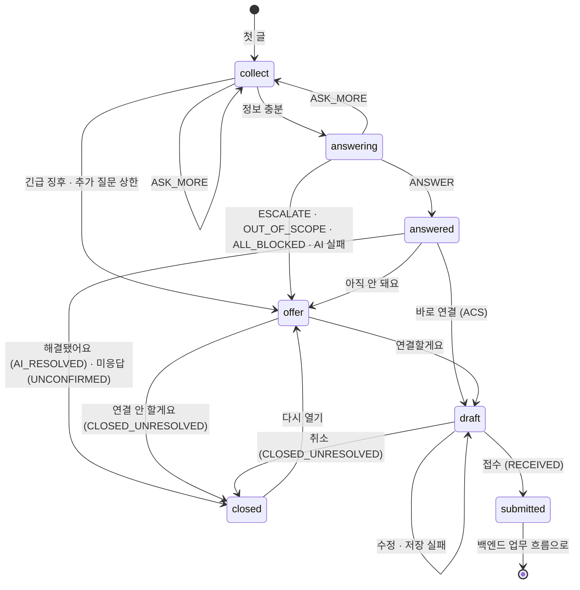

# ITssue — 대화 상태 정의

| 항목 | 내용 |
| --- | --- |
| WBS | M4-1-2 대화 상태 정의 (질문·추가 질문·답변·연결 제안·종료) |
| 작성 | 김현나 (M4 AI 판단·정보 보호) |
| 상태 | 초안 · 합의 전 (☐ 표시는 팀 논의 중) |
| 근거 문서 | PRD v0.6 3.2·4.1·4.4·4.5·4.6·4.13·4.14·4.17·5, SRS 2.6·2.7·2.8·3.1·3.2, 시스템 설계서 6.1·6.2·11·12, `docs/06.테이블_설계서.md` v0.6 (D·E·G장), `docs/07.API_계약서.md` v0.1, `docs/08.AI_입출력_형식.md`, `dataset/guides/common/IT-STD-001`·`IT-AI-001`, `frontend/src/api/chatTypes.ts`·`mock/chatEngine.ts` |
| 합의 대상 | M1 박민경 (백엔드·DB), M5 김현우 (API 계약서), M6 고나영 (화면) |

---

## 0. 개요

이 문서는 **문의 한 건의 대화가 어떤 상태를 거치고, 무엇 때문에 다음 상태로 넘어가는지**를 정한다.

- **상태(1장):** 대화 상태 6개와 기존 값(`step`·`inquiries.status`)의 대응
- **처리 순서(2장):** 글이나 버튼 요청 하나를 받았을 때 서버가 처리하는 순서
- **전이 조건(3장):** 상태가 바뀌는 조건, 누가 바꾸는지, 무엇을 기록하는지
- **AI 판단(4장):** 08 문서의 `action`·`urgent_signal`이 다음 상태가 되는 규칙
- **상태 저장(5장):** DB에 `step` 칸이 없으므로 기존 칸으로 계산하는 규칙
- **Session(6장):** 미응답 종료, 다시 열기, 종료 사유
- **상태도·시나리오(7·8장)**, **기존 문서·코드와 다른 점(9장)**, **합의 체크리스트(10장)**

### 범위

| 범위 안 | 범위 밖 (다른 흐름) |
| --- | --- |
| 첫 문의부터 접수 확정(`submitted`)·종료(`closed`)까지 | 접수 이후 Jira 생성·개인 배정·`RDY → WIP → FIN → CLS` (백엔드 업무 흐름, 시스템 설계서 6.1·11장) |
| 종료된 문의 다시 열기 | 접수 뒤 담당자-문의자 메시지, FIN 이후 해결 확인 (Ticket 흐름, SRS 4.4) |
| | 로그인 전 상담 (PRD 4.1 제안 기능, 대화 상태를 쓰지 않음) |

### 기본 원칙

1. **새 코드를 만들지 않는다.** 대화 상태는 07 API의 `step` 값을, 저장은 06 DB의 기존 값을 그대로 쓴다.
2. **AI는 접수·종료를 정하지 않는다.** AI 판단으로 갈 수 있는 상태는 질문·답변 준비·답변·연결 제안까지이고, 초안·접수·종료는 사용자 버튼과 서버 검증으로만 넘어간다. (PRD 5 "사용자 확인 없이 Ticket을 생성하지 않는다", SRS NFR-REL-02·NFR-SEC-05, **팀 확정**)
3. **종료·미응답·거절은 해결이 아니다.** (PRD 5, SRS NFR-REL-03, IT-AI-001 2장)
4. **화면은 "다음 상태"가 아니라 "동작"만 보낸다.** 다음 상태는 서버가 정한다.

---

## 1. 상태 정의

| # | 상태 | `step` | 뜻 | `inquiries.status` | 화면에서 할 수 있는 것 | 사용자가 글을 쓰면 |
| --- | --- | --- | --- | --- | --- | --- |
| 1 | 질문 | `collect` | 첫 문의를 받거나 추가 질문(`ASK_MORE`)의 답을 기다림 | `IN_PROGRESS` | 입력창 + 빠른 답 버튼 | **AI 판단** (명확성·긴급 징후 확인) |
| 2 | 답변 준비 | `answering` | 검색·판단 중. 잠깐 지나가는 상태 | `IN_PROGRESS` | 입력 막음, "근거를 찾고 있어요" 표시 | 받지 않음 |
| 3 | 답변 | `answered` | AI가 근거와 함께 안내했고 해결 여부를 기다림 | `IN_PROGRESS` | 해결됐어요 / 아직 안 돼요 + 입력창 | ☐ 팀 논의 (6.3 ③) |
| 4 | 연결 제안 | `offer` | 담당자 연결 여부를 기다림 | `IN_PROGRESS` | 연결할게요 / 연결 안 할게요 + 입력창 | 내용을 기록(초안 재료)하고 **연결 제안 유지**. AI를 다시 부르지 않음 |
| 5 | 초안 | `draft` | 접수 초안 확인·수정 중 (`ticket_drafts.status=EDITING`) | `IN_PROGRESS` | 초안 카드: 수정 · 접수 · 취소 | **안내만** ("초안에서 수정해 주세요") |
| 6 | 종료 | `submitted` | 접수 확정, 내부 저장 성공 | `RECEIVED` (이후 `HANDED_OFF`는 백엔드가 바꿈) | 접수 진행 카드 | **담당자에게 전달** (AI를 부르지 않음, Ticket 흐름) |
| | | `closed` | 해결·거절·취소·답변 후 미응답으로 끝남 | `AI_RESOLVED` · `CLOSED_UNRESOLVED` · `UNCONFIRMED` | 다시 열기 | 다시 열면 4번 `offer`부터 |

- **4번에서 글을 써도 다시 판단하지 않는 이유:** 담당자가 필요한 이유(권한 변경·긴급·근거 없음)는 추가 설명으로 바뀌는 경우가 드물고, 다시 판단하면 긴급 경로가 풀릴 위험이 있다. 쓴 내용은 초안에 들어간다.
- **5번 초안은 대화 원문이 아니라 판단 결과(`facts`)로 만든다.** 전체 대화를 그대로 복사하지 않는다. (PRD 4.6, IT-AI-001 4장)
- **긴급 경로의 4번**에는 행동 안내(예: "의심스러운 링크·첨부파일은 더 열지 마세요")를 항상 함께 보여 준다.

---

## 2. 처리 순서

사용자가 글을 쓰거나 버튼을 누를 때마다 서버는 아래 순서로 처리한다. 앞 단계에서 걸리면 뒤 단계는 하지 않는다.

| 순서 | 단계 | 하는 일 | 걸리면 | 근거 |
| --- | --- | --- | --- | --- |
| 1 | **본인 확인** | 요청한 사람이 이 문의의 주인인가 (다시 열기 포함) | `INQUIRY_NOT_FOUND`. 상태 그대로 | SRS NFR-SEC-02 (팀 확정) |
| 2 | **민감정보 가림** | 비밀번호·인증번호 같은 값을 가리고, **가린 글만** 저장·판단·전달한다. 세부 기준은 M4-1-3 민감정보 정책 | 안내 문구를 보여 주고 기록(`SECURITY_SIGNAL`). 상태는 바꾸지 않음 | PRD 4.13·4.17, IT-STD-001 5장 (팀 확정) |
| 3 | **허용 확인** | 지금 상태에서 받을 수 있는 동작인가 (3.2) | `INVALID_STEP` (제안). 상태 그대로 | 이 문서 |
| 4 | **상태별 처리** | 1장 "사용자가 글을 쓰면" 열대로: AI 판단 / 기록만 / 안내만 / 담당자에게 전달 | — | 1장 |
| 5 | **서버 보정** | AI 판단이면 08 3.2 보정 적용 (근거 없음·추가 질문 상한·긴급 고정 `URGENT_LATCH` 등) | `override_reasons`에 기록 | 08 3.2 |
| 6 | **다음 상태로 이동** | 3장 전이 표대로 | — | 3장 |
| 7 | **기록** | 3.3의 전이만 누가·언제·무엇을 남긴다. 대화 원문은 남기지 않는다 | — | PRD 4.14, IT-AI-001 5장 |

- **한 문의는 한 번에 하나씩 처리한다.** 같은 문의에 요청이 동시에 들어오면(버튼 두 번 누름, 창 두 개) 먼저 온 요청만 처리하고, 나중 요청은 3단계에서 걸러진다. (구현 예: 문의 행 잠금)

---

## 3. 상태 전이 조건

### 3.1 전이 표

`누가` 열: **AI** = AI 판단 결과(서버 보정 후) · **사용자** = 문의자의 버튼·글 · **서버** = 서버 규칙·처리 결과 · **시간** = 미응답 시간 경과

| # | 지금 | 조건 | 다음 | 누가 | DB에 바뀌는 값 | 기록 (3.3) |
| --- | --- | --- | --- | --- | --- | --- |
| T01 | (없음) | 첫 글 | `collect` → 판단 | 사용자 | `inquiries` 생성(`IN_PROGRESS`), `chat_sessions` 생성 | |
| T02 | `collect` | 긴급 징후 (`urgent_signal=true`) | `offer` | AI | `action=ESCALATE` | |
| T03 | `collect` | 추가 질문 (`ASK_MORE`, 상한 전) | `collect` | AI | `action=ASK_MORE` | |
| T04 | `collect` | 추가 질문 상한(2회) 도달 (`ASK_MORE_LIMIT`) | `offer` | 서버 | `action=ESCALATE` | |
| T05 | `collect` | 정보 충분 (그 밖의 판단, 4.1) | `answering` | AI | | |
| T06 | `answering` | 근거 있는 답변 (`ANSWER`) | `answered` | AI | `action=ANSWER` | |
| T07 | `answering` | 담당자 처리 필요·근거 없음 (`ESCALATE`, `NO_EVIDENCE`·`GUIDE_INSUFFICIENT` 포함) | `offer` | AI·서버 | `action=ESCALATE` | |
| T08 | `answering` | 지원 범위 밖 (`OUT_OF_SCOPE`) | `offer` | AI | `action=OUT_OF_SCOPE`, 추천 그룹 = 서비스데스크(`is_triage`) | |
| T09 | `answering` | 검색 결과가 모두 전송 금지 (`ALL_BLOCKED`) | `offer` | 서버 | `action=ESCALATE`. 제한 사유를 안내 (PRD 4.13) | `BLOCK` |
| T10 | `answering` | 검색 뒤에도 정보 부족 (`ASK_MORE`, 상한 전) | `collect` | AI | `action=ASK_MORE` | |
| T11 | `answering` | **AI 호출 실패** (응답 없음·형식 오류 재시도 실패) → 08 3.3 안전 기본값 | `offer` | 서버 | `action=ESCALATE`, `override_reasons`에 `AI_FAILED` | `FAIL` |
| T12 | `answered` | "해결됐어요" | `closed` | 사용자 | `AI_RESOLVED`, `resolution_result=RESOLVED`, `end_reason=USER_END` | |
| T13 | `answered` | "아직 안 돼요" | `offer` | 사용자 | `resolution_result=UNRESOLVED` | |
| T14 | `answered` | 글을 씀 | ☐ 팀 논의 (6.3 ③) | | | |
| T15 | `answered` | 미응답 시간 경과 | `closed` | 시간 | `UNCONFIRMED`, `resolution_result=NO_RESPONSE`, `end_reason=NO_RESPONSE` | |
| T16 | `offer` (또는 `answered`에서 바로 연결, 3.2) | "연결할게요" | `draft` | 사용자 | `ticket_drafts` 생성(`EDITING`) | `CONFIRM` |
| T17 | `offer` | "연결 안 할게요" | `closed` | 사용자 | `CLOSED_UNRESOLVED`, `end_reason=USER_END` | `CONFIRM`. 긴급이면 `SECURITY_SIGNAL` (3.4) |
| T18 | `offer` | 글을 씀 | `offer` | 사용자 | 초안 재료로 기록 (AI 호출 없음) | |
| T19 | `draft` | 초안 수정 | `draft` | 사용자 | 분류·긴급도·그룹 다시 판단. 바뀌면 "다시 판단됨" 표시 후 다시 확인받음 (SRS 2.8). 긴급 고정 적용 | |
| T20 | `draft` | "이 내용으로 접수" + 저장 성공 | `submitted` | 사용자 | `ticket_drafts.status=CONFIRMED`, `RECEIVED`, `tickets` 생성, `end_reason=HANDED_OFF` | `CONFIRM` |
| T21 | `draft` | "이 내용으로 접수" + **저장 실패** | `draft` | 서버 | 바뀌지 않음. `SAVE_FAILED` 응답, 대체 접수 경로 안내 (내선 1000·그룹웨어 IT 요청) | `FAIL` |
| T22 | `draft` | "접수하지 않을게요" | `closed` | 사용자 | `ticket_drafts.status=CANCELLED`, `CLOSED_UNRESOLVED`, `end_reason=USER_END` | `CONFIRM`. 긴급이면 `SECURITY_SIGNAL` (3.4) |
| T23 | `draft` | 글을 씀 | `draft` | 사용자 | 안내만 | |
| T24 | `collect`·`offer`·`draft` | 미응답 시간 경과 | ☐ 팀 논의 (6.3 ②) | 시간 | | |
| T25 | `submitted` | 글을 씀 | `submitted` | 사용자 | 담당자에게 전달 (Ticket 흐름) | |
| T26 | `closed` | "다시 열기" | `offer` | 사용자 | `IN_PROGRESS`, `resolution_result=UNRESOLVED` (5.2), 새 `chat_sessions` | |
| T27 | 모든 상태 | 허용되지 않는 동작 (지난 버튼, 동시 요청, 종료된 문의의 버튼) | 그대로 | 서버 | 바뀌지 않음. `INVALID_STEP` (제안) | |

- 접수 뒤 `RECEIVED → HANDED_OFF`(Jira 생성·개인 배정 확인)는 백엔드 업무 흐름이 바꾼다. 대화 상태는 `submitted` 그대로다.
- **AI가 바꾸는 전이(T02~T10)는 `collect`·`answering`·`answered`·`offer` 사이에서만 일어난다.** `draft`·`submitted`·`closed`로 가는 전이는 모두 사용자 또는 시간이다. (0장 원칙 2)

### 3.2 상태별 허용 동작

07 API 엔드포인트 기준이다. 표에 없는 동작은 T27로 거부한다.

| 상태 | 허용 동작 |
| --- | --- |
| `collect` | 글 (`messages`), 빠른 답 버튼 (`replies` · `quick`) |
| `answering` | 없음 (처리 중) |
| `answered` | 글, `replies` · `resolved`·`unresolved`·`connect-yes` |
| `offer` | 글, `replies` · `connect-yes`·`connect-no`·`noop` |
| `draft` | 글, `draft/edit`·`draft/confirm`·`draft/cancel` |
| `submitted` | 글 (담당자에게), 해결 확인·미해결 (`resolve`·`reject`, Ticket 흐름) |
| `closed` | `reopen` |

- `answered`의 `connect-yes`는 접근권한(ACS)처럼 안내 뒤 바로 담당자 연결을 고를 수 있는 경우다. (9장)
- 버튼은 그 버튼이 붙은 메시지가 **마지막 AI 메시지일 때만** 받는다. 지난 메시지의 버튼은 T27이다.

### 3.3 기록하는 전이

운영 기록(`audit_logs`)에 남긴다. **누가(`actor_id`)·언제·무엇(`event_type`·`result`)·사유(`reason`)만 남기고 원문은 저장하지 않는다.** (06 G장, PRD 4.14)

| 전이 | `event_type` | `result` 예 | 근거 |
| --- | --- | --- | --- |
| 연결 동의·거절 (T16·T17) | `CONFIRM` | `CONNECT_ACCEPTED` · `CONNECT_DECLINED` | 사용자 확인 (IT-AI-001 5장) |
| 초안 확정·취소 (T20·T22) | `CONFIRM` | `DRAFT_CONFIRMED` · `DRAFT_CANCELLED` | 사용자 확인 |
| 답변 차단 (T09) | `BLOCK` | `ALL_BLOCKED` | 전송 차단 (PRD 4.14) |
| AI 호출 실패 (T11) · 접수 저장 실패 (T21) | `FAIL` | `AI_FAILED` · `SAVE_FAILED` | 실패 (PRD 4.14) |
| 긴급인데 접수 없이 종료 (T17·T22) | `SECURITY_SIGNAL` (제안) | `URGENT_DECLINED` | PRD 4.17 (제안 기능) |
| 민감정보 감지 (2장 2단계) | `SECURITY_SIGNAL` (제안) | `SENSITIVE_INPUT` | PRD 4.17 (제안 기능) |

- 분류·긴급도·처리 방향은 판단 이력(`inquiry_assessments`)에 남으므로 여기서 다시 기록하지 않는다. (08 5.4)
- `SECURITY_SIGNAL`은 06 `audit_logs.event_type`에 없는 값이다. 추가를 요청한다. (10장)

### 3.4 긴급인데 연결을 거절한 경우

```
🚨 긴급 연결 제안 (offer) 또는 긴급 건의 초안 (draft)
   └─ "연결 안 할게요" / "접수하지 않을게요"
        ├─ 상태: closed · CLOSED_UNRESOLVED       ← 일반 거절과 같음
        ├─ 안내: 행동 안내 + "문제가 계속되면 IT 헬프데스크(내선 1000)"   ← 추가
        └─ 기록: SECURITY_SIGNAL · URGENT_DECLINED   ← 추가
```

- 대상자에게 자동으로 알리거나 불이익을 주지 않는다. 확인은 정보보안팀이 한다. (PRD 4.17)
- "긴급"은 이 문의에서 `urgent_signal=true`가 한 번이라도 있었는지로 본다 (긴급 고정, 4.2).

---

## 4. AI 판단과 상태

### 4.1 판단 결과 → 다음 상태

AI 판단은 `collect`에서 한 번, 정보가 충분하면 검색 뒤 `answering`에서 한 번 더 한다. 아래 값은 모두 **08 3.2 보정을 거친 최종값**이다.

| 판단 시점 | 입력 `search` | 결과 | 다음 상태 |
| --- | --- | --- | --- |
| 1차 (`collect`) | `null` | `urgent_signal=true` | `offer` (검색하지 않음) |
| | | `ASK_MORE` | `collect` |
| | | 그 밖 (`ANSWER`·`ESCALATE`·`OUT_OF_SCOPE`) | `answering` → 검색 후 2차 판단 |
| 2차 (`answering`) | M3 검색 결과 | `ANSWER` | `answered` |
| | | `ESCALATE` | `offer` |
| | | `OUT_OF_SCOPE` | `offer` (추천 그룹 = 서비스데스크) |
| | | `ASK_MORE` | `collect` |

- 1차에서는 `missing_items`·`urgent_signal`만 다음 상태를 정한다. 검색 전이라 근거가 없으므로, 1차의 `ANSWER`에 08 3.2의 근거 보정(`NO_EVIDENCE`·`GUIDE_INSUFFICIENT`)을 적용하지 않는다. (08 3.2)
- 2차에서 `urgent_signal=true`가 나오면 08 3.2 `URGENT_SIGNAL`로 `ESCALATE`가 되어 `offer`로 간다.

### 4.2 횟수와 긴급 고정

| 값 | 세는 기준 | 쓰는 곳 |
| --- | --- | --- |
| `ask_more_count` | **이번 Session** 시작 이후 최종 `action=ASK_MORE`인 판단 이력(`inquiry_assessments`) 수. 다시 열면 새 Session이라 0부터 | 08 1.1 입력, 상한 2회 (`ASK_MORE_LIMIT`, 08 5.6 초안) |
| `prior_urgent_signal` | **이 문의 전체**(Session 무관)에서 `urgent_signal=true`인 판단 이력이 있는가 | 08 1.1 입력, 긴급 고정 (`URGENT_LATCH`, 08 3.2) |

- 긴급 고정: 한 번 잡힌 긴급 징후는 AI가 `false`로 내도 이 문의에서 내리지 않는다. 실제 사고 여부는 담당자가 확인한다. (IT-AI-001 "보안 사고 의심은 최소 P2")
- `inquiry_assessments`에는 session 칸이 없으므로 `created_at ≥ chat_sessions.started_at`으로 이번 Session을 가른다.

---

## 5. 상태 저장

### 5.1 `step` 계산 규칙

DB에는 `step` 칸이 없다 (07 Inquiry `step` = "없음"). 서버는 아래 순서로 **기존 칸에서 `step`을 계산**한다. 위에서부터 처음 맞는 줄을 쓴다.

| 순서 | 조건 | `step` |
| --- | --- | --- |
| 1 | `inquiries.status` ∈ `AI_RESOLVED`·`CLOSED_UNRESOLVED`·`UNCONFIRMED` | `closed` |
| 2 | `inquiries.status` ∈ `RECEIVED`·`HANDED_OFF` | `submitted` |
| 3 | 가장 최근 `ticket_drafts.status = EDITING` | `draft` |
| 4 | `resolution_result = UNRESOLVED` 또는 가장 최근 `ticket_drafts.status = CANCELLED` | `offer` |
| 5 | `inquiries.action` ∈ `ESCALATE`·`OUT_OF_SCOPE` | `offer` |
| 6 | `inquiries.action = ANSWER` | `answered` |
| 7 | 그 밖 (`ASK_MORE` 또는 아직 판단 없음) | `collect` |

- `answering`은 저장하지 않는다. 처리 중인 응답에서만 쓰고, 다시 읽으면 처리 결과로 계산된다. AI 호출이 실패하면 안전 기본값(`ESCALATE`)이 저장되므로 `offer`가 된다 (T11).
- 이 규칙으로 1장의 상태가 모두 계산되므로 **`step` 칸을 추가하지 않는다.** 계산이 안 맞는 경우가 나오면 M1에 칸 추가를 요청한다.

### 5.2 다시 열 때의 값

| 칸 | 다시 열 때 | 이유 |
| --- | --- | --- |
| `inquiries.status` | `IN_PROGRESS` | |
| `resolution_result` | `UNRESOLVED` (제안) | 다시 열었다는 것은 해결되지 않았다는 뜻이다 (mock 안내: "해결되지 않았다면 담당자 연결을 도와드릴게요"). 5.1 4번으로 `offer`가 계산된다. 이전 값은 판단 이력·운영 기록에 남는다 |
| `closed_at` | 그대로 둔다 | 마지막 종료 시각. 다시 종료하면 갱신 |
| `chat_sessions` | 새 행 | 06 "문의를 다시 열면 세션이 새로 생김" |

---

## 6. Session 규칙

### 6.1 시작과 종료

| 시점 | `chat_sessions` | `end_reason` |
| --- | --- | --- |
| 첫 글 (T01) · 다시 열기 (T26) | 새 행, `started_at` | |
| 해결 확인 (T12) · 연결 거절 (T17) · 초안 취소 (T22) | `ended_at` | `USER_END` |
| 접수 확정 (T20) | `ended_at` | `HANDED_OFF` |
| 미응답 (T15, T24는 6.3 ②) | `ended_at` | `NO_RESPONSE` |

- **Session 종료는 해결이 아니다.** (PRD 4.5, 시스템 설계서 11.4)
- **대화 Session과 로그인은 다르다.** 미응답 종료는 대화가 끝나는 것이고 로그인 만료와 별개다.
- AI 호출을 기다리는 시간(`answering`)은 미응답 시간에 넣지 않는다.

### 6.2 미응답 시간

| 항목 | 값 |
| --- | --- |
| 설정 이름 | `SESSION_IDLE_TIMEOUT_MINUTES` |
| 값 | ☐ 팀 논의 (6.3 ①) |
| 세는 시점 | 마지막 AI 메시지(답변·질문·제안)를 보낸 때부터 |

### 6.3 팀 논의 중

| # | 질문 | 제안 | 지금 mock |
| --- | --- | --- | --- |
| ① | AI 답변 뒤 응답이 없으면 몇 분 후 대화를 끝내나 (PRD 9장 미확정) | 30분, 설정값 | 시연용 "응답 없이 시간 경과" 버튼 |
| ② | 답변 외 상태(`collect`·`offer`·`draft`)에서 응답이 없으면 (T24) | Session만 종료(`NO_RESPONSE`)하고 문의는 `IN_PROGRESS`·같은 `step` 유지. 다음 글이 오면 새 Session으로 이어서. `UNCONFIRMED`는 답변 후 미응답에만 쓴다 (PRD 4.5·SRS ANSWER-03의 정의) | 버튼이 있는 메시지면 모두 `UNCONFIRMED` |
| ③ | 답변 뒤 버튼 대신 글을 쓰면 (T14) | AI 판단을 다시 한다 → `collect`·`answered`·`offer` 중 하나. 긴급은 내려가지 않는다 (`URGENT_LATCH`). SRS ANSWER-02 "미해결이면 추가 확인 또는 담당자 연결"에 맞춤 | 기록 후 연결 제안 |

---

## 7. 상태도



`answered`에서 글을 쓴 경우(③)와 답변 외 상태의 미응답(②)은 팀 논의 뒤 추가한다.

---

## 8. 시나리오

| # | 경로 | 상태 순서 | 최종 `status` |
| --- | --- | --- | --- |
| 1 | 정상 해결 — "VPN 접속 시 오류 809가 떠요" | `collect` → `answering` → `answered` → "해결됐어요" → `closed` | `AI_RESOLVED` |
| 2 | 추가 질문 2회 후 연결 — "메일이 이상해요" | `collect` → (질문 1) `collect` → (질문 2) `collect` → 상한 `offer` → 연결 → `draft` → 접수 → `submitted` | `RECEIVED` |
| 3 | 긴급 — "이상한 메일 링크를 눌렀어요" | `collect` → 긴급 `offer` (검색 생략) → 연결 → `draft` → 접수 → `submitted` | `RECEIVED` |
| 4 | 긴급 거절 — 3번에서 "연결 안 할게요" | `collect` → 긴급 `offer` → 거절 → `closed` + 행동 안내 + `SECURITY_SIGNAL` | `CLOSED_UNRESOLVED` |
| 5 | 범위 밖 — "회의실 예약이 안 돼요" | `collect` → `answering` → `OUT_OF_SCOPE` `offer` (서비스데스크) → 거절 → `closed` | `CLOSED_UNRESOLVED` |
| 6 | 답변 후 미응답 | `collect` → `answering` → `answered` → 미응답 → `closed` | `UNCONFIRMED` |
| 7 | 저장 실패 | … → `draft` → 접수 → 저장 실패 → `draft` 유지 + 대체 접수 경로 안내 | `IN_PROGRESS` |
| 8 | 다시 열기 — 6번 문의를 다시 염 | `closed` → `offer` (새 Session, `UNRESOLVED`) → 연결 → `draft` → 접수 → `submitted` | `RECEIVED` |
| 9 | 전송 금지 문서 — 일반 임직원이 담당자 매뉴얼 내용을 물음 | `collect` → `answering` → `ALL_BLOCKED` `offer` (제한 사유 안내) | `IN_PROGRESS` |
| 10 | AI 호출 실패 | `collect` → `answering` → 안전 기본값 `offer` | `IN_PROGRESS` |

M4-2-1 판단 흐름 테스트와 M6 화면 확인에 이 경로를 쓴다.

---

## 9. 기존 문서·코드와 다른 점

### 9.1 프론트 mock (`frontend/src/api/mock/chatEngine.ts`)

| 항목 | mock | 이 문서 | 상태 |
| --- | --- | --- | --- |
| 답변 외 상태의 미응답 | `UNCONFIRMED` | ☐ 6.3 ② | 팀 논의 |
| 답변 뒤 글 | 기록 후 연결 제안 | ☐ 6.3 ③ | 팀 논의 |
| 접근권한(ACS) 안내 | `step=offer`에 "신청 방법을 확인했어요"(`resolved`)·"담당자 연결하기" 버튼 | `answered`로 본다 (안내 + 해결 확인). "확인했어요"는 `AI_RESOLVED`로 기록하되, 안내 문구는 "권한이 처리됐다"로 읽히지 않게 한다 (IT-AI-001 "신청 방법을 알았다 ≠ 권한이 부여됐다") | 확인 요청 |
| 긴급 거절 | 일반 거절과 같은 안내 | 행동 안내 + 내선 1000 + `SECURITY_SIGNAL` (3.4) | 확인 요청 |
| 다시 열기 | `IN_PROGRESS`·`offer` | 같음 + `resolution_result=UNRESOLVED`, 새 Session (5.2) | 같음 |
| 연결 제안에서 글 | 기록 후 연결 제안 | 같음 | 같음 |

### 9.2 PRD·SRS 미확정 사항 중 이 문서에서 정한 것

| 항목 | 정한 것 |
| --- | --- |
| 추가 질문 상한 | 2회 (08 5.6 초안을 따름), 이번 Session 기준 |
| 다시 열 때 | 새 Session, `offer`부터, 추가 질문 횟수 0부터 |
| 미응답 종료 시간 (PRD 9장) | ☐ 팀 논의 (6.3 ①) |

---

## 10. 합의 체크리스트

| 대상 | 확인할 것 | 상태 |
| --- | --- | --- |
| 전원 | 6.3 ① 미응답 시간, ② 답변 외 상태의 미응답, ③ 답변 뒤 글 | ☐ |
| M1 박민경 | 5.1 `step` 계산 규칙 (칸 추가 없이), 5.2 다시 열 때 `resolution_result=UNRESOLVED` | ☐ |
| M1 박민경 | 2장 한 문의 한 번에 하나씩 처리 (동시 요청) | ☐ |
| M1 박민경 | 4.2 `ask_more_count`·`prior_urgent_signal` 세는 기준 | ☐ |
| M1 박민경 | 06 `audit_logs.event_type`에 `SECURITY_SIGNAL` 추가, 3.3 `result` 값 | ☐ |
| M5 김현우 | 07 오류 코드에 `INVALID_STEP` (현재 단계에서 할 수 없는 동작) 추가 | ☐ |
| M6 고나영 | 9.1 mock과 다른 점 (ACS 안내 상태, 긴급 거절 안내) | ☐ |
| M6 고나영 | 3.2 지난 메시지 버튼 처리 (`INVALID_STEP`을 받으면 최신 `Inquiry`로 다시 그림) | ☐ |
| M4 김현나 | 08 3.2에 4.1 "1차 판단(`search=null`)에는 근거 보정을 적용하지 않음" 반영 | ☑ 반영 (08 3.2) |
| M4 김현나 | 2장 2단계 민감정보 기준 → M4-1-3 민감정보 정책 | ☐ |

---

## 업데이트 로그

| 날짜 | 버전 | 내용 |
| --- | --- | --- |
| 2026-10-21 | 초안 | 최초 작성 (합의 전). 상태 6개, 처리 순서 7단계, 전이 표 T01~T27, `step` 계산 규칙, Session 규칙, 시나리오 10개. 미응답 시간·답변 외 상태의 미응답·답변 뒤 글은 팀 논의 중 |
