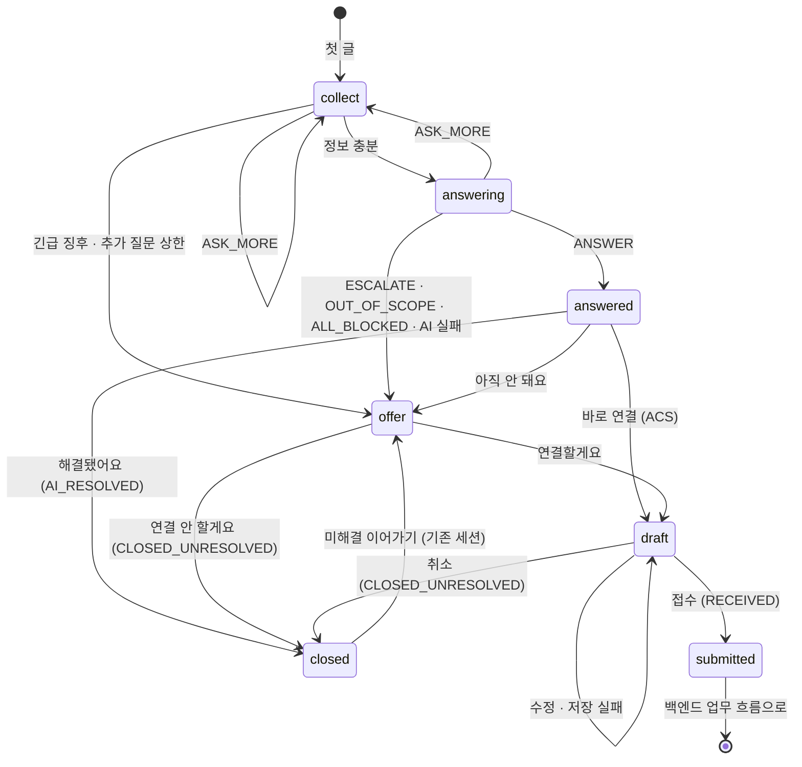

# ITssue — 대화 상태 정의

> **표기:** 🆕 신규 추가 · ✏️ 수정 (2026.10.26 정책 정정분)

| 항목 | 내용 |
| --- | --- |
| WBS | M4-1-2 대화 상태 정의 (질문·추가 질문·답변·연결 제안·종료) |
| 작성 | 김현나 (M4 AI 판단·정보 보호) |
| 상태 | ✏️ 정책 정정 (2026-10-26). PRD v0.8·SRS v0.8·시스템 설계서 v0.6 및 API 02 v0.3 기준. 저장 상태·종료 정보의 미결은 6.5 |
| 근거 문서 | PRD v0.8 3.2·4.1·4.4·4.5·4.6·4.13·4.14·4.17·5, SRS 2.6·2.7·2.8·3.1·3.2, 시스템 설계서 6.1·6.2·11·12, `docs/06.테이블_설계서.md` v0.8 (D·E·G장), `docs/07.API_설계서.md` v0.4, `docs/api/02.문의_상담.md`·`03.접수_연동.md` v0.3, `docs/08.AI_입출력_형식.md`, `docs/10.민감정보_정책.md`, `dataset/guides/common/IT-STD-001`·`IT-AI-001`, `frontend/src/api/chatTypes.ts`·`mock/chatEngine.ts` |
| 합의 대상 | M1 박민경 (백엔드·DB·API 명세), M6 고나영 (화면) |

---

## 0. 개요

이 문서는 **문의 한 건의 대화가 어떤 상태를 거치고, 무엇 때문에 다음 상태로 넘어가는지**를 정한다.

- **상태(1장):** 대화 상태와 기존 값(`inquiries.status`)의 대응, API `nextActions`와의 대응
- **처리 순서(2장):** 글이나 버튼 요청 하나를 받았을 때 서버가 처리하는 순서
- **전이 조건(3장):** 상태가 바뀌는 조건, 누가 바꾸는지, 무엇을 기록하는지
- **AI 판단(4장):** 08 문서의 `action`·`urgent_signal`이 다음 상태가 되는 규칙
- **상태 저장(5장):** DB에 `step` 칸이 없으므로 기존 칸으로 계산하는 규칙
- **미응답·Session(6장):** 미응답 안내·삭제, 돌아왔을 때 이어서 하기, 미결 사항
- **상태도·시나리오(7·8장)**, **기존 문서·코드와 다른 점(9장)**, **합의 체크리스트(10장)**

### 범위

| 범위 안 | 범위 밖 (다른 흐름) |
| --- | --- |
| 첫 문의부터 접수 확정(`submitted`)·종료(`closed`)까지 | 접수 이후 Jira 생성·개인 배정·`RDY → WIP → FIN → CLS` (백엔드 업무 흐름, 시스템 설계서 6.1·11장, API 03) |
| 종료된 문의 다시 열기 | 접수 뒤 담당자-문의자 메시지, FIN 해결 확인(CLS) 또는 미해결 시 새 문의 안내. 기존 FIN 티켓 재개는 제외 (SRS JIRA-06, TK-07) |
| | 로그인 전 상담 (PRD 4.1 제안 기능, 대화 상태를 쓰지 않음) |

### 기본 원칙

1. **새 코드를 만들지 않는다.** 대화 상태(`step`)는 서버 안에서만 쓰는 이름이다. 화면에는 API `AiTurn.nextActions`로 알리고(1.1), 저장은 06 DB의 기존 값을 그대로 쓴다(5장).
2. **AI는 접수·종료를 정하지 않는다.** AI 판단으로 갈 수 있는 상태는 질문·답변 준비·답변·연결 제안까지이고, 초안·접수·종료는 사용자 버튼과 서버 검증으로만 넘어간다. (PRD 5 "사용자 확인 없이 Ticket을 생성하지 않는다", SRS NFR-REL-02·NFR-SEC-05, **팀 확정**)
3. **종료·미응답·거절은 해결이 아니다.** (PRD 5, SRS NFR-REL-03, IT-AI-001 2장)
4. **화면은 "다음 상태"가 아니라 "동작"만 보낸다.** 다음 상태는 서버가 정한다.

---

## 1. 상태 정의

| # | 상태 | `step` | 뜻 | `inquiries.status` | 화면에서 할 수 있는 것 | 사용자가 글을 쓰면 |
| --- | --- | --- | --- | --- | --- | --- |
| 1 | 질문 | `collect` | 첫 문의를 받거나 추가 질문(`ASK_MORE`)의 답을 기다림 | `IN_PROGRESS` | 입력창 + 빠른 답 버튼 | **AI 판단** (명확성·긴급 징후 확인) |
| 2 | 답변 준비 | `answering` | 검색·판단 중. 잠깐 지나가는 상태 | `IN_PROGRESS` | 입력 막음, "근거를 찾고 있어요" 표시 | 받지 않음 (`REQUEST_IN_PROGRESS`) |
| 3 | 답변 | `answered` | AI가 근거와 함께 안내했고 해결 여부를 기다림 | `IN_PROGRESS` | 해결됐어요 / 아직 안 돼요 (입력창 비활성화) | **받지 않음** (서버도 거부) |
| 4 | 연결 제안 | `offer` | 담당자 연결 여부를 기다림 | `IN_PROGRESS` | 연결할게요 / 연결 안 할게요 (입력창 비활성화) | **받지 않음** (서버도 거부) |
| 5 | 초안 | `draft` | 접수 초안 확인·수정 중 (`ticket_drafts.status=EDITING`) | `IN_PROGRESS` | 초안 카드: 수정 · 접수 · 취소 (입력창 비활성화) | **받지 않음** (서버도 거부, M4 제안) |
| 6 | 종료 | `submitted` | 접수 확정, 내부 저장 성공 | `RECEIVED` (이후 `HANDED_OFF`는 백엔드가 바꿈) | 접수 진행 카드 | **담당자에게 전달** (AI를 부르지 않음, Ticket 흐름) |
| | | `closed` | 해결·거절·취소로 끝남 | `AI_RESOLVED` · `CLOSED_UNRESOLVED`; UNCONFIRMED 저장 의미는 미결 | 미해결 이어가기 | 기존 세션에서 `offer`부터 |

- **입력창 비활성화 (팀 결정):** 버튼으로 고르는 단계(3번 답변·4번 연결 제안)에서는 입력창을 끈다. 화면만 막으면 API로 글을 보낼 수 있으므로 **서버도 이 단계의 글을 거부**한다 (T27, SRS NFR-SEC-05). 1번 질문 단계는 빠른 답 버튼이 있어도 직접 써야 하므로 입력창을 켜 둔다.
- **5번 초안도 입력창을 끈다 (M4 제안):** 초안은 초안 카드에서 직접 고친다 (SRS 2.8). 채팅으로 쓴 글은 AI가 다시 판단하지 않도록 서버도 거부한다 (T27). 프론트 mock도 이 단계의 입력창을 잠근다.
- **5번 초안은 대화 원문이 아니라 판단 결과(`facts`)로 만든다.** 전체 대화를 그대로 복사하지 않는다. (PRD 4.6, IT-AI-001 4장)
- **긴급 경로의 4번**에는 행동 안내(예: "의심스러운 링크·첨부파일은 더 열지 마세요")를 항상 함께 보여 준다.
- ✏️ AI 답변 직후 해결·미해결 선택 전은 표시 상태 `unconfirmed`다. 저장값 `UNCONFIRMED`의 재정의 또는 파생 표시만 적용할지는 미결이다. 시간 경과만으로 종료·NO_RESPONSE로 바꾸지 않는다. 담당자 FIN 미응답은 `awaiting_confirm`으로 유지한다.

### 1.1 `step`과 API `nextActions`

API는 `step`을 내려주지 않고 `AiTurn.nextActions`(API 02 2.8)로 화면에 다음 행동을 알린다. 서버는 5.1로 `step`을 계산한 뒤 아래 표대로 `nextActions`를 만든다.

| `step` | `nextActions` (이 문서 기준) | API 명세 v0.3 대응·미결 |
| --- | --- | --- |
| `collect` | `REPLY` | 같음 |
| `answering` | (응답 없음, 처리 중) | 같음. 처리 중의 다른 요청은 `409 REQUEST_IN_PROGRESS` |
| ✏️ `answered` | `CONFIRM_RESOLUTION` | API 02에 반영. AI 답변 직후 표시 상태는 unconfirmed |
| `answered` (접근권한 등 바로 연결) | `CONFIRM_RESOLUTION`, `DECIDE_HANDOFF` | API는 `DECIDE_HANDOFF`를 `ESCALATE`·`UNRESOLVED`일 때만 준다 → **M4 제안** |
| ✏️ `offer` | `DECIDE_HANDOFF` | API 02에 반영. 입력창 비활성화 |
| ✏️ `draft` | (`AiTurn` 아님. TK-01~04) | IQ-08 글은 허용하지 않음. 기존 초안에서 수정 |
| `submitted` | (Ticket 흐름, API 03) | 같음 |
| ✏️ `closed` | `START_NEW`; 미해결이면 IQ-06 이어가기 | 기존 세션 재개 저장 정보는 6.5 미결 |
| ✏️ 이탈 후 돌아옴 (6.4) | 기존 세션 이어가기 / 새 문의 선택용 정보 | 세부 응답 필드는 API 02 미결; 새 문의 선택 시 기존 문의 즉시 삭제 없음 |

---

## 2. 처리 순서

사용자가 글을 쓰거나 버튼을 누를 때마다 서버는 아래 순서로 처리한다. 앞 단계에서 걸리면 뒤 단계는 하지 않는다.

| 순서 | 단계 | 하는 일 | 걸리면 | 근거 |
| --- | --- | --- | --- | --- |
| 1 | **본인 확인** | 요청한 사람이 이 문의의 주인인가 (다시 열기 포함) | `404 INQUIRY_NOT_FOUND`. 상태 그대로 | SRS NFR-SEC-02, API 설계서 3.2 (팀 확정) |
| 2 | **민감정보 가림** | 비밀번호·인증번호 같은 값을 가리고, **가린 글만** 저장·판단·전달한다. 세부 기준은 10 민감정보 정책 2~4장 | 안내 문구. 상태는 바꾸지 않음. 기록은 10 5.2 (`SENSITIVE_INPUT`) | PRD 4.13·4.17, IT-STD-001 5장 (팀 확정) |
| 3 | **허용 확인** | 지금 상태에서 받을 수 있는 동작인가 (3.2), 같은 문의를 처리 중인가 | `409 INQUIRY_INVALID_STATE` · 종료된 문의는 `409 INQUIRY_CLOSED` · 처리 중이면 `409 REQUEST_IN_PROGRESS`. 상태 그대로 | API 설계서 5.6, API 02 0.1 |
| 4 | **상태별 처리** | 1장 "사용자가 글을 쓰면" 열대로: AI 판단 / 담당자에게 전달 | — | 1장 |
| 5 | **서버 보정** | AI 판단이면 08 3.2 보정 적용 (근거 없음·추가 질문 상한·긴급 고정 `URGENT_LATCH` 등) | `override_reasons`에 기록 | 08 3.2 |
| 6 | **다음 상태로 이동** | 3장 전이 표대로 | — | 3장 |
| 7 | **기록** | 3.3의 전이만 누가·언제·무엇을 남긴다. 대화 원문은 남기지 않는다 | — | PRD 4.14, IT-AI-001 5장 |

- **한 문의는 한 번에 하나씩 처리한다.** 같은 요청의 재전송은 `Idempotency-Key`로 최초 결과를 돌려주고, 같은 문의의 다른 요청은 처리 토큰(`inquiries.processing_token`)으로 막는다. 세부 규칙은 API 설계서 2.6.1, API 02 0.1, 06 v0.7을 따른다.

---

## 3. 상태 전이 조건

### 3.1 전이 표

`누가` 열: **AI** = AI 판단 결과(서버 보정 후) · **사용자** = 문의자의 버튼·글 · **서버** = 서버 규칙·처리 결과 · **시간** = 미응답 시간 경과

| # | 지금 | 조건 | 다음 | 누가 | DB에 바뀌는 값 | 기록 (3.3) |
| --- | --- | --- | --- | --- | --- | --- |
| T01 | (없음) | 첫 글 (IQ-01) | `collect` → 판단 | 사용자 | `inquiries` 생성(`IN_PROGRESS`), `chat_sessions` 생성 | |
| T02 | `collect` | 긴급 징후 (`urgent_signal=true`) | `offer` | AI | `action=ESCALATE` | |
| T03 | `collect` | 추가 질문 (`ASK_MORE`, 상한 전) | `collect` | AI | `action=ASK_MORE` | |
| T04 | `collect`·`answering` | 추가 질문 상한 도달 — 답을 못 얻은 질문 2번(`ASK_MORE_UNANSWERED`) 또는 전체 5번(`ASK_MORE_LIMIT`) (4.2) | `offer` | 서버 | `action=ESCALATE` | |
| T05 | `collect` | 정보 충분 (그 밖의 판단, 4.1) | `answering` | AI | | |
| T06 | `answering` | 근거 있는 답변 (`ANSWER`) | `answered` | AI | `action=ANSWER` | |
| T07 | `answering` | 담당자 처리 필요·근거 없음 (`ESCALATE`, `NO_EVIDENCE`·`GUIDE_INSUFFICIENT` 포함) | `offer` | AI·서버 | `action=ESCALATE` | |
| T08 | `answering` | 지원 범위 밖 (`OUT_OF_SCOPE`) | `offer` | AI | `action=OUT_OF_SCOPE`, 추천 그룹 = 서비스데스크(`is_triage`) | |
| T09 | `answering` | 검색 결과가 모두 전송 금지 (`ALL_BLOCKED`) | `offer` | 서버 | `action=ESCALATE`. 제한 사유를 안내 (PRD 4.13) | `BLOCK` |
| T10 | `answering` | 검색 뒤에도 정보 부족 (`ASK_MORE`, 상한 전) | `collect` | AI | `action=ASK_MORE` | |
| T11 | `answering` | **AI 호출 실패** (응답 없음·형식 오류 재시도 실패) → 08 3.3 안전 기본값 | `offer` | 서버 | `action=ESCALATE`, `override_reasons`에 `AI_FAILED` | `FAIL` |
| T12 | `answered` | "해결됐어요" (IQ-09 `RESOLVED`) | `closed` | 사용자 | `AI_RESOLVED`, `resolution_result=RESOLVED`, `end_reason=USER_END` | |
| T13 | `answered` | "아직 안 돼요" (IQ-09 `UNRESOLVED`) | `offer` | 사용자 | `resolution_result=UNRESOLVED`. 코멘트는 저장만, 연결 제안 제공 (API 02 v0.3) | |
| ✏️ T15 | `answered` | 해결 확인 미응답 | 그대로 (`unconfirmed`) | 시간 | 기존 5시간 삭제 전이는 철회. AI 답변 이력의 이후 삭제 범위는 미정 | |
| T16 | `offer` (또는 `answered`에서 바로 연결, 3.2) | "연결할게요" (TK-01) | `draft` | 사용자 | `ticket_drafts` 생성(`EDITING`) | `CONFIRM` |
| T17 | `offer` | "연결 안 할게요" (IQ-04) | `closed` | 사용자 | `CLOSED_UNRESOLVED`, `end_reason=USER_END` | `CONFIRM`. 긴급이면 `URGENT_CLOSED` (3.4) |
| T19 | `draft` | 초안 수정 (TK-03) | `draft` | 사용자 | 분류·긴급도·그룹 다시 판단. 바뀌면 "다시 판단됨" 표시 후 다시 확인받음 (SRS 2.8). 긴급 고정 적용 | |
| T20 | `draft` | "이 내용으로 접수" (TK-04) + 저장 성공 | `submitted` | 사용자 | `ticket_drafts.status=CONFIRMED`, `RECEIVED`, `tickets` 생성, `end_reason=HANDED_OFF` | `CONFIRM` |
| T21 | `draft` | "이 내용으로 접수" (TK-04) + **저장 실패** | `draft` | 서버 | 바뀌지 않음. `500 TICKET_SAVE_FAILED`, 대체 접수 경로 안내 (내선 1000·그룹웨어 IT 요청) | `FAIL` |
| T22 | `draft` | "접수하지 않을게요" (TK-03 취소) | `closed` | 사용자 | `ticket_drafts.status=CANCELLED`, `CLOSED_UNRESOLVED`, `end_reason=USER_END` | `CONFIRM`. 긴급이면 `URGENT_CLOSED` (3.4) |
| ✏️ T24 | 일반 이탈 대상 `collect`·`offer`·`draft` | 2시간 안내 후 10분 무활동 | 전체 삭제 또는 숨김 | 시간 | Ticket 제외·AI 답변 이력 삭제 미정·보관 예외 검사. 삭제 전 활동·처리 중·접수 여부 재검사 | |
| T25 | `submitted` | 글을 씀 | `submitted` | 사용자 | 담당자에게 전달 (Ticket 흐름) | |
| ✏️ T26 | 미해결·미확인·해결 확인 대기 | 이어가기 (IQ-06) | 미해결 → `offer`, 미확인 → `answered`, FIN → Ticket 확인 | 사용자 | 기존 세션·번호·횟수 유지. 단순 이어가기로 해결 결과·Ticket 상태를 바꾸지 않음. 종료 정보 갱신은 미결(5.2) | |
| T27 | 모든 상태 | 허용되지 않는 동작 (지난 버튼, 동시 요청, 종료된 문의의 버튼, 입력창을 끈 단계의 글) | 그대로 | 서버 | 바뀌지 않음. `409 INQUIRY_INVALID_STATE` · `INQUIRY_CLOSED` · `REQUEST_IN_PROGRESS` (2장 3단계) | |
| ✏️ T28 | 일반 이탈 대상 `collect`·`offer`·`draft` | 마지막 유효 활동 후 2시간 | 그대로 | 시간 | 시스템 메시지로 10분 후 삭제 안내. Ticket·AI 답변 확인 대기 제외 | |
| ✏️ T29 | 일반 이탈 대상 `collect`·`offer`·`draft` | 삭제 전 돌아옴 | 같은 단계 또는 새 문의 | 사용자 | 이어서 → 기존 Session·같은 단계, 실제 선택·입력 성공 시 삭제 예약 취소. 새 문의 → 이전 건은 기존 미응답 규칙 적용 | |

- T14(답변 뒤 글)·T18(연결 제안에서 글)은 입력창 비활성화 결정으로, T23(초안에서 글)은 초안 입력창 비활성화(M4 제안)로 없앴다. 이 글들은 T27로 거부한다. 다른 번호는 그대로 둔다.
- 접수 뒤 `RECEIVED → HANDED_OFF`(Jira 생성·개인 배정 확인)는 백엔드 업무 흐름이 바꾼다. 대화 상태는 `submitted` 그대로다.
- **AI가 바꾸는 전이(T02~T10)는 `collect`·`answering`·`answered`·`offer` 사이에서만 일어난다.** `draft`·`submitted`·`closed`로 가는 전이는 모두 사용자 또는 시간이다. (0장 원칙 2)

### 3.2 상태별 허용 동작

API 명세 v0.3 및 이번 정책 정정 기준이다. 표에 없는 동작은 T27로 거부한다.

| 상태 | 허용 동작 |
| --- | --- |
| `collect` | 글·빠른 답 (IQ-08) |
| `answering` | 없음 (처리 중) |
| `answered` | 해결 확인 (IQ-09 `RESOLVED`·`UNRESOLVED`), 바로 연결 (TK-01, 아래 참고) |
| `offer` | 연결 동의 (TK-01) · 연결 거절 (IQ-04) |
| `draft` | 초안 조회·수정·취소 (TK-02·TK-03), 최종 접수 (TK-04) (글은 받지 않음) |
| `submitted` | 글 (담당자에게), 해결 확인·미해결 (TK-07, Ticket 흐름) |
| ✏️ `closed` | 미해결이면 기존 세션 이어가기 (IQ-06). AI 해결 완료 재개 확대는 이번 확정 범위 밖 |

- 빠른 답 버튼은 API에 따로 없으므로 버튼 문구를 글(IQ-08)로 보낸다.
- `answered`의 바로 연결(TK-01)은 접근권한(ACS)처럼 안내 뒤 바로 담당자 연결을 고를 수 있는 경우다. (**M4 제안**, 1.1·9장)
- 버튼은 그 버튼이 붙은 메시지가 **마지막 AI 메시지일 때만** 받는다. 지난 메시지의 버튼은 T27이다.

### 3.3 기록하는 전이

운영 기록(`audit_logs`)에 남긴다. **누가(`actor_id`)·언제·무엇(`event_type`·`result`)·사유(`reason`)만 남기고 원문은 저장하지 않는다.** (06 G장, PRD 4.14)

| 전이 | `event_type` | `result` 예 | 근거 |
| --- | --- | --- | --- |
| 연결 동의·거절 (T16·T17) | `CONFIRM` | `CONNECT_ACCEPTED` · `CONNECT_DECLINED` | 사용자 확인 (IT-AI-001 5장) |
| 초안 확정·취소 (T20·T22) | `CONFIRM` | `DRAFT_CONFIRMED` · `DRAFT_CANCELLED` | 사용자 확인 |
| 답변 차단 (T09) | `BLOCK` | `ALL_BLOCKED` | 전송 차단 (PRD 4.14) |
| AI 호출 실패 (T11) · 접수 저장 실패 (T21) | `FAIL` | `AI_FAILED` · `SAVE_FAILED` | 실패 (PRD 4.14) |
| 긴급인데 접수 없이 종료 (T17·T22) | `URGENT_CLOSED` | `URGENT_DECLINED` | PRD 4.17 감지 유형. **팀 결정: 꼭 기록** |

- 지금 API 명세는 문의·접수 흐름에서 TK-04 접수(`CONFIRM`)와 IQ-04 긴급 종료(`URGENT_CLOSED`)만 기록한다. 긴급 기록 이름은 API의 `URGENT_CLOSED`로 맞춘다. TK-03 초안 취소에도 남기도록 요청했다 (꼭 기록하는 것은 팀 결정). 표의 나머지 기록(연결 동의·초안 취소 `CONFIRM`, `BLOCK`, `FAIL`)은 API에 아직 없다.
- 차단·실패·민감정보 입력 기록은 10 민감정보 정책 5.2에서 정했다 (민감정보 기록 여부는 M4-1-3에서 정하기로 한 팀 결정에 따름). API 추가 요청은 10 7장 ①.
- 관리자 보안 알림 화면(PRD 4.17)은 이 문서 범위가 아니다. 기록만 먼저 남긴다.
- 분류·긴급도·처리 방향은 판단 이력(`inquiry_assessments`)에 남으므로 여기서 다시 기록하지 않는다. (08 5.4)
- 긴급 기록 값 `URGENT_CLOSED`는 06 `audit_logs.event_type`에 없다. 추가를 요청했다 (10장). `api/05`의 `event_type` 목록 확정 대상에는 들어 있다.

### 3.4 긴급인데 연결을 거절한 경우

```
🚨 긴급 연결 제안 (offer) 또는 긴급 건의 초안 (draft)
   └─ "연결 안 할게요" (IQ-04) / "접수하지 않을게요" (TK-03)
        ├─ 상태: closed · CLOSED_UNRESOLVED       ← 일반 거절과 같음
        ├─ 안내: 행동 안내 + "문제가 계속되면 IT 헬프데스크(내선 1000)"   ← 추가
        └─ 기록: 긴급 기록 URGENT_CLOSED   ← 추가
```

- 대상자에게 자동으로 알리거나 불이익을 주지 않는다. 확인은 정보보안팀이 한다. (PRD 4.17)
- "긴급"은 이 문의에서 `urgent_signal=true`가 한 번이라도 있었는지로 본다 (긴급 고정, 4.2).

---

## 4. AI 판단과 상태

### 4.1 판단 결과 → 다음 상태

AI 판단은 `collect`에서 한 번, 정보가 충분하면 검색 뒤 `answering`에서 한 번 더 한다. 아래 값은 모두 **08 3.2 보정을 거친 최종값**이다.

| 판단 시점 | 입력 `search` | 결과 | 다음 상태 |
| --- | --- | --- | --- |
| 1차 (`collect`) | `null` | `urgent_signal=true` | `offer` (검색하지 않음) |
| | | `ASK_MORE` | `collect` |
| | | 그 밖 (`ANSWER`·`ESCALATE`·`OUT_OF_SCOPE`) | `answering` → 검색 후 2차 판단 |
| 2차 (`answering`) | M3 검색 결과 | `ANSWER` | `answered` |
| | | `ESCALATE` | `offer` |
| | | `OUT_OF_SCOPE` | `offer` (추천 그룹 = 서비스데스크) |
| | | `ASK_MORE` | `collect` |

- 1차에서는 `missing_items`·`urgent_signal`만 다음 상태를 정한다. 검색 전이라 근거가 없으므로, 1차의 `ANSWER`에 08 3.2의 근거 보정(`NO_EVIDENCE`·`GUIDE_INSUFFICIENT`)을 적용하지 않는다. (08 3.2)
- 2차에서 `urgent_signal=true`가 나오면 08 3.2 `URGENT_SIGNAL`로 `ESCALATE`가 되어 `offer`로 간다.
- IQ-01 처리 순서(확인 항목 → 긴급 징후 → 검색)는 이 표와 같다. **1차에서 긴급이면 검색을 건너뛰고 바로 연결 제안**하는 규칙은 API에 없어 반영을 요청했다. (**M4 제안**)

### 4.2 횟수와 긴급 고정

| 값 | 세는 기준 | 쓰는 곳 |
| --- | --- | --- |
| ✏️ `ask_more_count` | 기존 Session 시작 이후 최종 `action=ASK_MORE` 판단 수. 재개·이어가기에서도 초기화하지 않고 잠정 유지 | 08 1.1 입력, 전체 상한 `ASK_MORE_TOTAL_LIMIT` |
| `ask_more_unanswered_count` | 위 질문 중 **답을 못 얻은 질문** 수. 질문한 항목(`missing_items`)이 다음 판단의 `facts`에서 **하나도** 채워지지 않으면 답을 못 얻은 것으로 본다 | 08 1.1 입력, 상한 `ASK_MORE_UNANSWERED_LIMIT` |
| `prior_urgent_signal` | **이 문의 전체**에서 `urgent_signal=true`인 판단 이력이 있는가 | 08 1.1 입력, 긴급 고정 (`URGENT_LATCH`, 08 3.2) |
| `prior_urgency` | **이 문의 전체**에서 이전 판단의 확정 긴급도 중 가장 높은 값. 초안 수정(T19)으로 다시 판단할 때는 넘기지 않는다(`null`) | 08 1.1 입력, 긴급도 유지 (`URGENCY_KEEP`, 08 5.3) |

**추가 질문 상한 (팀 결정)** — 둘 중 먼저 걸리면 담당자 연결 제안(`offer`, T04)

| 환경변수 | 시작값 | 뜻 |
| --- | --- | --- |
| `ASK_MORE_UNANSWERED_LIMIT` | 2 | 답을 못 얻은 질문 수. 헛돌 때 빨리 사람에게 넘긴다 |
| `ASK_MORE_TOTAL_LIMIT` | 5 | 전체 질문 수. 답은 오는데 끝없이 이어지는 것을 막는다 |

- 시작값이며 테스트 후 조정한다. (팀 결정)
- 예: 한 번에 잘 답함 1~2번 → 답변 / 나눠서 답함 3~4번 → 답변 / "몰라요" 2번 → 연결 / 답은 오는데 5번 → 연결
- 세는 기준("현재 Session 시작 이후", 답을 못 얻음의 정의)은 **M4 제안**이다.
- 값 4개는 서버가 판단 이력에서 계산해 AI 판단 노드에 넘긴다. (**M4 제안**, M1 구현)

**고정 규칙**

- 긴급 고정: 한 번 잡힌 긴급 징후는 AI가 `false`로 내도 이 문의에서 내리지 않는다. 실제 사고 여부는 담당자가 확인한다. (IT-AI-001 "보안 사고 의심은 최소 P2")
- 긴급도 유지: 대화 중 다시 판단해도 긴급도(P1~P4)는 이전 값보다 내리지 않는다. 낮추는 것은 담당자가 한다. 초안에서 사용자가 내용을 직접 고친 경우만 내려갈 수 있고, 바뀌면 다시 확인받는다. (SRS 2.8)
- ✏️ 기존 Session의 시작 시각·ID와 추가 질문 횟수를 이어가기에서도 유지한다. 종료 정보가 남은 세션의 횟수도 이어 쓰며 진행 중 세션만으로 계산 범위를 잘라내지 않는다. 횟수 관리 방식은 추후 변경할 수 있다.

---

## 5. 상태 저장

### 5.1 `step` 계산 규칙

DB에는 `step` 칸이 없다. 서버는 아래 순서로 **기존 칸에서 `step`을 계산**한다. 위에서부터 처음 맞는 줄을 쓴다.

| 순서 | 조건 | `step` |
| --- | --- | --- |
| ✏️ 1 | 저장 상태 대응이 확정된 `AI_RESOLVED`·`CLOSED_UNRESOLVED` | `closed` (미해결 재개 시 `offer`). `UNCONFIRMED`는 저장 의미 미결이므로 코드만 보고 종료로 간주하지 않음 |
| 2 | `inquiries.status` ∈ `RECEIVED`·`HANDED_OFF` | `submitted` |
| 3 | 가장 최근 `ticket_drafts.status = EDITING` | `draft` |
| 4 | `resolution_result = UNRESOLVED` 또는 가장 최근 `ticket_drafts.status = CANCELLED` | `offer` |
| 5 | `inquiries.action` ∈ `ESCALATE`·`OUT_OF_SCOPE` | `offer` |
| 6 | `inquiries.action = ANSWER` | `answered` |
| 7 | 그 밖 (`ASK_MORE` 또는 아직 판단 없음) | `collect` |

- `answering`은 저장하지 않는다. 처리 중(`processing_token`이 잡혀 있음)인 동안에만 쓰고, 다시 읽으면 처리 결과로 계산된다. AI 호출이 실패하면 안전 기본값(`ESCALATE`)이 저장되므로 `offer`가 된다 (T11).
- 이 규칙으로 1장의 상태가 모두 계산되므로 **`step` 칸을 추가하지 않는다.** 계산이 안 맞는 경우가 나오면 M1에 칸 추가를 요청한다.

### 5.2 기존 세션 이어가기의 값

| 항목 | 처리 | 주의 |
| --- | --- | --- |
| ✏️ 문의·세션 식별자 | 기존 값 유지, 새 행 생성 없음 | 미해결·미확인·해결 확인 대기 대상 |
| ✏️ AI 미해결 | `offer`, 담당자 연결 동의/거절 제공 | 문의자가 이미 선택한 UNRESOLVED 결과를 초기화하지 않음 |
| ✏️ AI 미확인 | `answered`, 기존 답변의 해결·미해결 선택 제공 | 재개 자체가 해결·미해결 응답이 아님 |
| ✏️ FIN | 해결 선택 또는 미해결 시 새 문의 안내 | 해결 → CLS 요청·Jira 반영 확인. 미해결 → 기존 FIN 보존·새 문의에서 별도 접수 확정. 미응답은 FIN 유지 |
| ✏️ 추가 질문 횟수 | 기존 값 잠정 유지 | 추후 변경 가능 |
| 🆕 저장·종료 정보 | `inquiries.status`, `closed_at`, 세션 `ended_at`·`end_reason`의 재개 처리·이력 보존 방식은 미결 | 임의로 값을 지우거나 새 세션을 만드는 것으로 확정하지 않음 |

기존 문의 ID·접수번호·Jira 번호를 유지한다. 이어가기 단독 요청으로 AI를 다시 호출하거나 Ticket을 생성하지 않는다. 삭제·숨김 문의는 재개할 수 없다. `UNCONFIRMED` 저장 매핑 미결과 사용자에게 제공할 동작은 구분한다.

---

## 6. 미응답·Session 규칙

### 6.1 시작·종료·이어가기

| 시점 | `chat_sessions` | 비고 |
| --- | --- | --- |
| 첫 글 (T01) | 새 행·`started_at` | 새로운 문의만 생성 |
| ✏️ 이어가기 (T26·T29) | 기존 행·ID·시작 시각 유지 | 종료된 행의 종료 정보 처리는 6.5 미결 |
| 해결 확인·연결 거절·초안 취소 | 기존 종료 기록 유지 | 종료 자체를 해결 완료로 취급하지 않음 |
| 접수 확정 | 기존 세션을 Ticket에 연결 | 재개로 새 접수·Jira 번호를 생성하지 않음 |
| ✏️ 일반 이탈 삭제 (T24) | 문의·세션·메시지·출처·초안·판단 이력 전체 삭제 | 목록·일반 통계 제외, 보안·로그 대상은 삭제 대신 숨김 |

대화 Session과 로그인 세션은 다르다. 브라우저 복원 방법은 백엔드·화면 담당자가 별도로 맞춘다.

### 6.2 미응답 시간 (2026-10-26 정정)

| 환경변수 (이름은 백엔드 확정) | 값 | 의미 |
| --- | --- | --- |
| ✏️ `SESSION_IDLE_TIMEOUT_MINUTES` | 120 | 질문·연결 제안·초안의 일반 이탈 대상 안내 시점 |
| 🆕 `SESSION_IDLE_DELETE_GRACE_MINUTES` | 10 | 안내 후 무활동 시 삭제까지의 대기 |

- ✏️ 기존 5시간 해결 확인 미응답 삭제는 철회한다. `RESOLUTION_CONFIRM_TIMEOUT_MINUTES`는 삭제 조건으로 사용하지 않는다. 이전 ‘종료 10분 전 안내’와 이번 ‘2시간 안내 후 10분 대기’를 혼동하지 않는다.
- 유효 활동은 저장된 사용자 글·선택·초안 수정 및 AI 응답 완료다. 조회·읽음·새로고침·자동 안내는 시간을 연장하지 않는다. AI 처리 중에는 삭제하지 않는다.
- 안내 후 유효 활동이 있으면 삭제 예약을 취소하고 해당 단계 규칙을 적용한다. 삭제 직전 활동·처리 중·Ticket 생성·보관 예외를 다시 검사한다.

### 6.3 이전 결정의 처리

✏️ 10/21·10/22의 시간·삭제·새 세션 결정은 아래 6.4로 정정한다. 당시 결정은 업데이트 로그에 보존하고 현재 동작 기준으로 사용하지 않는다. 선택지 단계 입력 거부·추가 질문 상한·긴급 기록 등 별도 결정은 유지한다.

### 6.4 현재 결정 (2026-10-26)

1. **AI 답변 후 미확인:** 답변 직후부터 해결·미해결 선택 전. 5시간 경과로 안내 후 삭제하거나 자동 종료하지 않는다. AI 답변 이력의 이후 삭제 여부는 미정이다.
2. **일반 이탈:** 질문·연결 제안·초안에 2시간 안내+10분 무활동 삭제 적용. AI 답변 이력이 있는 경우까지 삭제한다고 단정하지 않으며 Ticket은 제외한다.
3. **보안·로그 대상:** 삭제 대신 문의자에게 숨기고 관리자만 열람. 대상 기준은 최신 10 5.4를 따르며 이후 삭제 기한은 미정이다. 서버 로그·Trace 30일과 별개다.
4. **돌아옴:** 기존 세션·단계·추가 질문 횟수 유지. 새 문의를 골라도 이전 문의를 즉시 삭제하거나 활동한 것으로 처리하지 않고 기존 규칙을 적용한다.
5. **FIN:** 미응답은 해결 확인 대기 유지, 해결은 CLS 요청 후 Jira 반영 확인. 미해결은 기존 FIN·처리 이력을 보존하고 새 문의에서 별도 접수를 확정한다. 확인 요청·추가 알림은 후순위다.

### 6.5 미결 사항

| 항목 | 내용 | 담당 |
| --- | --- | --- |
| ✏️ AI 답변 이력 | 이후 연결 제안·초안 등으로 이동한 문의의 이탈 삭제 적용 여부 | 팀 |
| ✏️ 저장 상태 | UNCONFIRMED 재정의 또는 IN_PROGRESS 기반 파생 표시 중 선택, 기존 값 처리 | 민경·현나 |
| ✏️ 세션 종료 정보 | 기존 세션 재개 시 ended_at·end_reason·문의 closed_at 처리와 이력 보존 | 민경·현나 |
| ✏️ 숨김·활동 저장 | 숨김 시각·사유, 유효 활동·안내·삭제 예정 시각의 물리 저장·응답 필드 | 민경 |
| ✏️ 보관 기간 | 숨긴 문의·운영 기록의 기간 및 이후 삭제 시점 | 팀 |
| ✏️ 추가 질문 횟수 | 현재는 기존 횟수 유지, 추후 변경 가능 | 현나·민경 |

---

## 7. 상태도



✏️ T15의 5시간 삭제는 철회했다. 일반 이탈 안내·삭제(T24·T28), 돌아옴(T29), FIN Ticket 흐름은 6.4와 API 03을 따른다.

---

## 8. 시나리오

| # | 경로 | 상태 순서 | 최종 `status` |
| --- | --- | --- | --- |
| 1 | 정상 해결 — "VPN 접속 시 오류 809가 떠요" | `collect` → `answering` → `answered` → "해결됐어요" → `closed` | `AI_RESOLVED` |
| 2 | 추가 질문 뒤 연결 — "메일이 이상해요" (답은 오는데 원인이 좁혀지지 않음) | `collect` → (질문 1~5) `collect` → 전체 상한 `offer` → 연결 → `draft` → 접수 → `submitted` | `RECEIVED` |
| 3 | 긴급 — "이상한 메일 링크를 눌렀어요" | `collect` → 긴급 `offer` (검색 생략) → 연결 → `draft` → 접수 → `submitted` | `RECEIVED` |
| 4 | 긴급 거절 — 3번에서 "연결 안 할게요" | `collect` → 긴급 `offer` → 거절 → `closed` + 행동 안내 + 긴급 기록 | `CLOSED_UNRESOLVED` |
| 5 | 범위 밖 — "회의실 예약이 안 돼요" | `collect` → `answering` → `OUT_OF_SCOPE` `offer` (서비스데스크) → 거절 → `closed` | `CLOSED_UNRESOLVED` |
| ✏️ 6 | 답변 후 미응답 | `answered`에서 해결·미해결 선택 대기, 5시간 경과로 삭제하지 않음 | `unconfirmed` (저장 의미 미결) |
| 7 | 저장 실패 | … → `draft` → 접수 → 저장 실패 → `draft` 유지 + 대체 접수 경로 안내 | `IN_PROGRESS` |
| ✏️ 8 | AI 미해결 이어가기 | 기존 Session·횟수 유지 → `offer` → 연결 → `draft` → 접수. 단순 이어가기만으로 접수하지 않음 | `RECEIVED` (최종 접수 시) |
| 9 | 전송 금지 문서 — IT 담당자가 담당자 매뉴얼 내용을 물음 (일반 임직원에게는 매뉴얼이 열람 범위 밖이라 검색되지 않음, `청크_메타데이터.md` 4장) | `collect` → `answering` → `ALL_BLOCKED` `offer` (제한 사유 안내) | `IN_PROGRESS` |
| 10 | AI 호출 실패 | `collect` → `answering` → 안전 기본값 `offer` | `IN_PROGRESS` |
| 11 | 질문 단계에서 잠시 이탈 — "어떤 시스템인가요?"에 답 없이 회의 | `collect` → 1시간 뒤 돌아옴 → 입력창 잠금 + 팝업 → "이어서 채팅하기" → 같은 Session, `collect`에서 "ERP요" (추가 질문 횟수도 이어서) | `IN_PROGRESS` |
| ✏️ 12 | 일반 질문 단계 이탈 | 마지막 유효 활동 후 2시간 안내 → 10분 무활동 → 활동·접수·보관 예외 재검사 → 전체 삭제 | 목록·일반 통계 제외 |
| 13 | 답을 못 얻는 질문 — "그냥 안 돼요"·"몰라요" | `collect` → (질문 1, 답 없음) → (질문 2, 답 없음) → 상한 `offer` | `IN_PROGRESS` |
| 14 | 긴급 연결 제안에서 이탈 — 3번에서 연결 여부를 고르지 않고 떠남 | `collect` → 긴급 `offer` → 2시간 미응답 → 삭제 예고 안내 → 삭제 전 검사에서 보안·로그 대상(기준은 10 5.4) → 삭제하지 않고 관리자만 열람, 문의자 목록에서 숨김 | `IN_PROGRESS` (숨김) |

M4-2-1 판단 흐름 테스트와 M6 화면 확인에 이 경로를 쓴다.

---

## 9. 기존 문서·코드와 다른 점

### 9.1 프론트 mock (`frontend/src/api/mock/chatEngine.ts`)

| 항목 | mock | 이 문서 | 상태 |
| --- | --- | --- | --- |
| ✏️ 일반 이탈 | 과거 mock 비교이며 구현 완료를 뜻하지 않음 | 2시간 안내+10분 후 삭제, 예외·재검사 적용 | 화면 후속 수정 |
| ✏️ 미응답 시간 | 시연용 버튼 | 일반 이탈 2시간 안내+10분, AI 답변 후 5시간 삭제 없음 | 화면 후속 수정 |
| 답변·연결 제안 단계의 입력창 | 잠김 (`ChatView`) | 비활성화 (6.3 ③) | 같음 |
| 접근권한(ACS) 안내 | `step=offer`에 "신청 방법을 확인했어요"(`resolved`)·"담당자 연결하기" 버튼 | `answered`로 본다 (안내 + 해결 확인 + 바로 연결). "확인했어요"는 `AI_RESOLVED`로 기록하되, 안내 문구는 "권한이 처리됐다"로 읽히지 않게 한다 (IT-AI-001 "신청 방법을 알았다 ≠ 권한이 부여됐다") | 확인 요청 |
| 긴급 거절 | 일반 거절과 같은 안내 | 행동 안내 + 내선 1000 + 긴급 기록 (3.4) | 확인 요청 |
| 초안 단계의 입력창 | 잠김 (`ChatView`) | 같음. 서버도 거부 (1장) | 같음 |
| ✏️ 이어가기 | 기존 mock은 상태·입력 흐름이 다를 수 있음 | 기존 세션·횟수 유지, 미해결은 연결 제안·미확인은 해결 확인·FIN은 Ticket 확인 | 화면 후속 수정 |

### 9.2 API 명세와의 정합성

이 문서를 API에 맞춘 것과 API에 반영을 요청한 것을 나눈다. 요청 목록은 10장 합의 체크리스트의 M1 박민경 항목에 있다.

| 항목 | 처리 |
| --- | --- |
| 오류 코드 | 09의 `INVALID_STEP` 제안을 철회하고 `INQUIRY_INVALID_STATE`·`INQUIRY_CLOSED`·`REQUEST_IN_PROGRESS`를 쓴다 (2장) |
| 화면 상태 | `step`은 서버 안에서만 쓰고 `nextActions` 대응표를 둔다 (1.1) |
| 동시 요청 | `Idempotency-Key`와 처리 토큰으로 해결된 것을 따른다 (2장) |
| 다시 연 시각 | "이어서"는 같은 Session이므로 추가 질문은 현재 Session 시작 이후로 센다. 칸을 추가하지 않는다 (4.2) |
| ✏️ API 반영 (팀 결정) | AI 답변 미확인·5시간 삭제 철회, 일반 이탈 2시간+10분, 숨김 조회 차단, 기존 세션 이어가기. FIN 미해결은 기존 FIN 보존·새 문의에서 별도 접수 확정 |
| API에 요청 (기존 별도 제안) | ACS 바로 연결(3.2), 1차 긴급이면 검색 생략(4.1). 이번에 추가 확정하지 않음 |

### 9.3 PRD·SRS 미확정 사항 중 이 문서에서 정한 것

| 항목 | 정한 것 |
| --- | --- |
| ✏️ 미응답 정책 | 일반 이탈 2시간 안내+10분, AI 답변 후 5시간 삭제 철회. AI 답변 이력의 이후 삭제는 미정 |
| 추가 질문 상한 | 답을 못 얻은 질문 2번 / 전체 5번, 환경변수 (팀 결정). 08 5.6의 "초안 2회"를 대신함 |
| ✏️ 이어갈 때 | 기존 세션·번호·횟수 잠정 유지. AI 미해결은 연결 제안·미확인은 해결 확인·FIN은 Ticket 확인 |

- SRS ANSWER-02 "미해결이면 추가 확인 또는 담당자 연결": 답변 단계는 입력창을 끄므로 "아직 안 돼요"는 담당자 연결 제안으로 간다(T13). 추가 확인은 질문 단계에서만 한다.

---

## 10. 합의 체크리스트

| 대상 | 확인할 것 | 상태 |
| --- | --- | --- |
| ✏️ 전원 | 선택지 입력 거부·추가 질문 상한·긴급 기록 (6.3의 유지 결정) | ☑ 기존 결정 유지 |
| ✏️ 전원 | 6.4 현재 결정 1~5 | ☑ 팀 결정 (2026-10-26 정정) |
| 전원 | 6.5 미결 사항 (M4-1-3에서 정할 것 제외) | ☐ |
| ✏️ M1 박민경 | 이번 API 문서 정정은 반영. 저장 상태·종료 정보 확정 및 서버 구현은 후속 (9.2·6.5) | ☐ |
| M1 박민경 | 5.1 `step` 계산 규칙 (칸 추가 없이), 1.1 `nextActions` 대응 | ☐ |
| M1 박민경 | 4.2 AI 판단 노드 입력 4개(`ask_more_count`·`ask_more_unanswered_count`·`prior_urgent_signal`·`prior_urgency`)를 판단 이력에서 계산해 넘기기 | ☐ |
| M1 박민경 | 06 `audit_logs.event_type`에 긴급 기록 값 추가, 숨김 표시 칸·종료 정보·삭제 구현 (6.5) | ☐ |
| M1 박민경 | 6.4 미응답 작업(안내·삭제·삭제 전 검사)과 돌아왔을 때 대화 내역 표시 방식 | ☐ |
| ✏️ M4 김현나 · M1 박민경 | SESSION_IDLE_TIMEOUT_MINUTES=120·SESSION_IDLE_DELETE_GRACE_MINUTES=10 및 기존 질문 상한 설정. 5시간 변수는 삭제 조건에서 제외 | ☐ |
| ✏️ M6 고나영 | 이번 정책에 맞는 mock 수정은 별도 작업. 디자인·코드는 이번 PR에서 수정하지 않음 | ☐ |
| M6 고나영 | 9.1 mock과 다른 점 (ACS 안내 상태, 긴급 거절 안내) | ☐ |
| M6 고나영 | 3.2 지난 메시지 버튼 처리 (`409 INQUIRY_INVALID_STATE`를 받으면 최신 `Inquiry`로 다시 그림) | ☐ |
| M4 김현나 | 08 3.2에 4.1 "1차 판단(`search=null`)에는 근거 보정을 적용하지 않음" 반영 | ☑ 반영 (08 3.2) |
| M4 김현나 | 2장 2단계 민감정보 기준, 3.3 기록 범위, 6.5 보안·로그 대상 기준 | ☑ 10 민감정보 정책으로 작성 (M4 결정, 2026-10-26) |

---

## 업데이트 로그

| 날짜 | 버전 | 내용 |
| --- | --- | --- |
| 2026-10-21 | 초안 | 최초 작성 (합의 전). 상태 6개, 처리 순서 7단계, 전이 표 T01~T27, `step` 계산 규칙, Session 규칙, 시나리오 10개. 미응답 시간·답변 외 상태의 미응답·답변 뒤 글은 팀 논의 중 |
| 2026-10-21 | 초안 | 팀 결정 반영 (6.3): 미응답 2시간·종료 10분 전 안내(T28)·환경변수, 답변 외 단계 미응답은 진행 중 유지(T24), 답변·연결 제안 단계 입력창 비활성화(T14·T18 삭제, 서버도 거부), 추가 질문 상한 답 없음 2번/전체 5번(환경변수), 긴급 거절 기록 확정·민감정보 기록은 M4-1-3. M4 제안: 추가 질문 횟수를 "마지막으로 연 이후"로 세기, 긴급도 유지(`prior_urgency`). 시나리오 11~13 추가 |
| 2026-10-24 | 초안 | API 명세 v0.2·07 v0.3·06 v0.7에 맞춤: 오류 코드(`INVALID_STEP` 철회), `step`↔`nextActions` 대응(1.1), 허용 동작을 API ID로(3.2), 동시 요청은 처리 토큰. 10/22 팀 결정 반영(6.4): 해결 확인 5시간·대화 중 이탈 2시간 → 안내 → 삭제, 삭제 전 보안·로그 검사, 2시간 안에 돌아오면 팝업·같은 Session(T15·T24·T28 변경, T29 추가). 추가 질문은 현재 Session 시작 이후로 셈. M4 제안: 초안 단계도 입력창 비활성화·서버 거부(T23 삭제, mock과 같음). 미결 사항(6.5), API와 다른 점(9.2) 추가. 시나리오 6·11·12 변경, 14 추가 |
| 2026-10-25 | 초안 | 10 민감정보 정책 참조로 연결 (근거 문서에 추가): 2장 2단계 기준·기록, 3.3 차단·실패·민감정보 기록, 6.5 보안·로그 대상 기준, 시나리오 14, 10장 체크리스트. 긴급 기록 이름을 API의 `URGENT_CLOSED`로 통일 (T17·T22·3.3·3.4) |
| 2026-10-26 | 초안 | 10 확정에 맞춤 (6.5·10장 표시, 3.3 요청 번호). 시나리오 9 사용자를 IT 담당자로 (일반 임직원은 매뉴얼이 검색되지 않음). 9.2·10장의 Notion 토글 참조를 10장 체크리스트로 |
| 2026-10-26 | 정책 정정 | ✏️ 5시간 삭제 철회·AI 답변 직후 미확인, FIN 미응답 유지·미해결 WIP 복귀, 일반 이탈 2시간+10분·숨김, 기존 세션·번호·추가 질문 횟수 잠정 유지 반영. UNCONFIRMED 저장 의미·종료 정보·AI 답변 이력의 이후 삭제 범위는 미결. 이전 본문 아이콘 초기화 및 변경분 표시 |

### 2026-10-27 · FIN 미해결 정책 정정

- 기존 FIN 재개 기준을 철회한다. 미해결은 기존 티켓·처리 이력을 보존하고 새 문의에서 별도로 접수를 확정한다. 이전 변경 이력보다 본문과 이 정정 기준이 우선한다.
