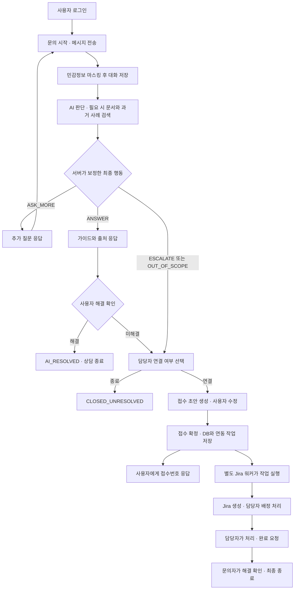
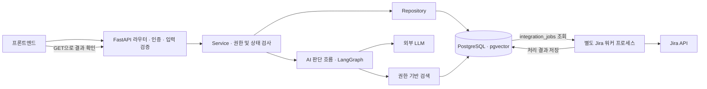
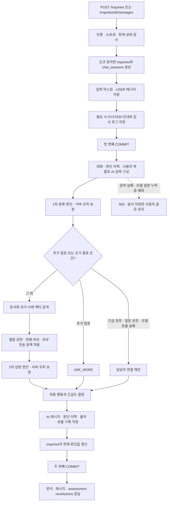
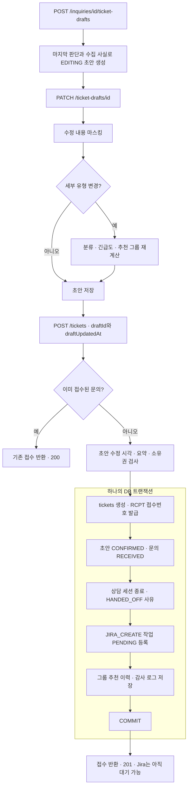
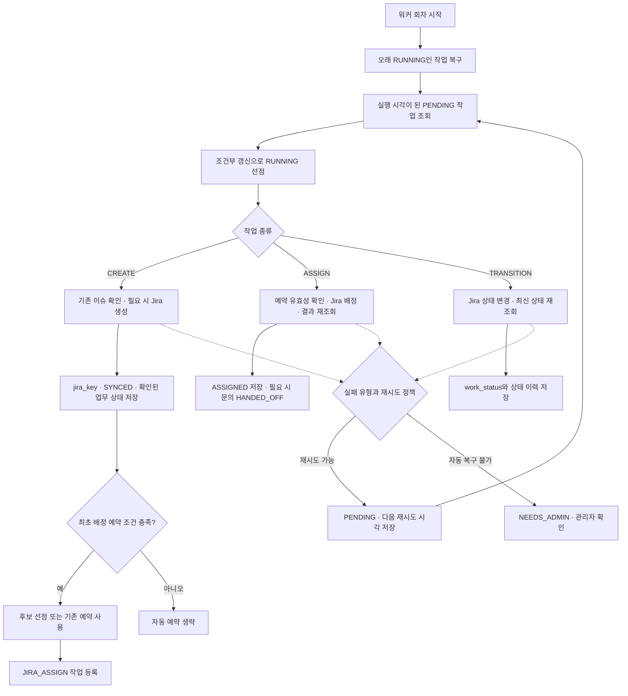
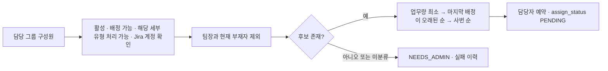
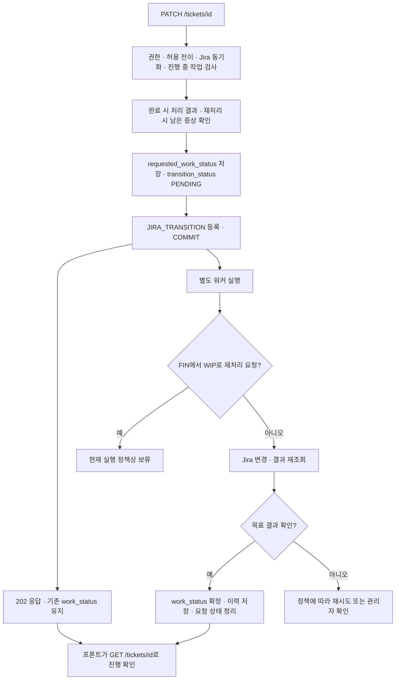
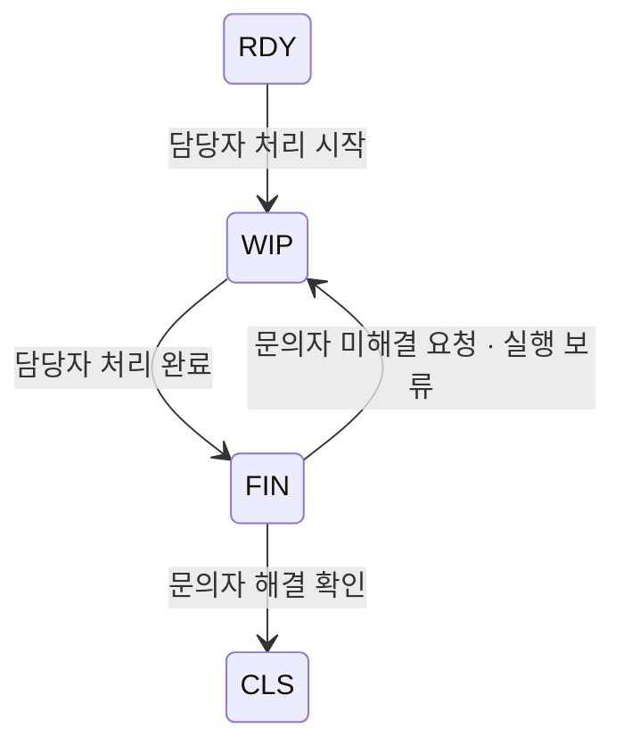
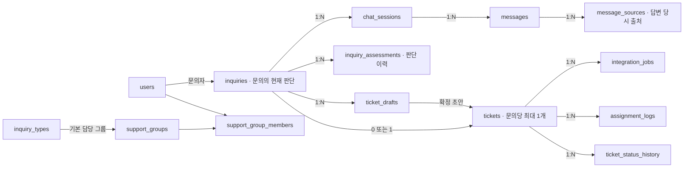
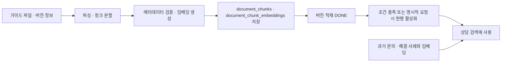

# 백엔드 API · DB 처리 흐름

2026-11-02 현재 코드 기준. 기획 문서보다 `api/`, `services/`, `models/`의 실제 동작을 우선했다. 아래 그림의 API 경로에는 모두 `/api/v1`이 붙는다.

## 1. 전체 흐름 — 먼저 이 그림부터

AI가 담당자 연결을 제안하는 것과 실제 접수 확정은 별개다. 실제 티켓은 사용자가 초안을 확인하고 `POST /tickets`를 호출할 때 생성된다. API는 진행 중 문의에서 직접 초안을 생성하는 것도 허용한다.

## 2. 실행 주체 — 누가 언제 처리하는가

- **상담 요청:** 사용자 글 저장 → AI 실행 → 답변 저장 → 응답 순서다. 현재 상담 AI는 별도 큐 워커로 분리돼 있지 않다.
- **접수 요청:** 내부 접수와 작업을 저장한 뒤 응답한다. Jira 처리는 별도 워커가 수행한다. `main.py`는 워커를 자동 실행하지 않는다.
- 워커는 한 회차에 `JIRA_CREATE → JIRA_ASSIGN → JIRA_TRANSITION` 순서로 처리한다. DB 작업표가 API와 워커 사이를 연결한다.

## 3. 상담 상세 — 저장과 AI 호출의 경계

모델 오류·전송 제한·근거 부족 등은 가능한 경우 담당자 연결 제안으로 처리한다. 검색 실패 등 처리되지 않은 예외는 503이 된다. 안전하지 않은 답변 등은 내부에서 재생성을 시도할 수 있으므로, 한 메시지가 항상 모델 호출 한 번을 의미하지는 않는다.

관련 테이블: `inquiries`, `chat_sessions`, `messages`, `inquiry_assessments`, `message_sources`, `llm_calls`, `audit_logs`.

`PUT /inquiries/{id}/resolution`은 AI를 다시 호출하지 않는다. 해결이면 `AI_RESOLVED`와 세션 종료를 저장하고, 미해결이면 `resolution_result=UNRESOLVED`만 남겨 연결 선택으로 안내한다. `POST /inquiries/{id}/sessions`는 현재 세션을 반환하는 이어가기 기능이며, 새 세션을 저장하지 않는다.

## 4. 초안 → 접수 확정 — 하나로 저장해야 하는 범위

DB 저장 실패 시 이 묶음을 롤백한다. Jira 호출은 이 트랜잭션 안에서 하지 않는다. 초안 취소는 초안만 지우는 동작이 아니라 문의도 `CLOSED_UNRESOLVED`로 종료하는 동작이다.

관련 테이블: `ticket_drafts`, `tickets`, `inquiries`, `chat_sessions`, `integration_jobs`, `assignment_logs`, `audit_logs`.

## 5. Jira 작업과 배정 — 정상 경로와 확인할 조건

생성 결과가 불확실하면 `VERIFYING`으로 두고 기존 이슈를 확인한다. 바로 재생성해서 중복 이슈를 만드는 일을 피하기 위한 경로다. 관리자 재처리는 `POST /tickets/{id}/integration-jobs`로 요청한다.

자동 후보 선정 규칙은 다음 순서다.

업무량은 `RDY + WIP + 배정 예약`을 반영한다. 직접 담당자를 지정하는 경우에는 별도 공통 자격 검사를 하며, 자동 선정의 팀장·부재자 제외 규칙은 적용하지 않는다.

**현재 연결에서 확인할 부분:** `save_ticket()`은 접수 확정 때 `RECOMMEND` 배정 이력을 생성한다. 그런데 `_reserve_initial_assignment()`는 담당자 예약이 없고 배정 이력이 하나라도 있으면 최초 자동 예약을 생략한다. 따라서 위 그림의 자동배정 경로가 일반 접수에서 항상 실행된다고 볼 수 없다. 현재 조건대로면 별도 배정 API가 필요할 수 있다. 이 문서는 해당 코드를 변경하지 않았다.

## 6. 업무 상태 변경 — 요청과 확정은 다르다

업무 전이는 다음과 같다. 마지막 재처리 전이는 API에서 접수하지만 현재 워커에서 보류한다.

`FIN`은 담당자의 처리 완료이며 문의자의 최종 확인 전이다. 업무가 종료돼도 문의의 `status`를 매번 같은 값으로 바꾸는 구조는 아니다. 화면은 티켓이 있으면 티켓 업무 상태를 우선해서 표시한다.

## 7. DB 연결 — 데이터가 쌓이는 순서

관계선은 핵심 연결을 추린 것이며 모든 외래키를 표시한 ERD는 아니다. `inquiries`의 현재 판단값과 `inquiry_assessments`의 판단 이력을 함께 보관한다. `tickets`의 요약·분류 등은 접수 확정 당시의 스냅샷이다.

DB 제약은 문의당 열린 세션 1개, 작성 중 초안 1개, 최종 접수 1개를 보장한다. 배정·상태 변경 작업은 접수와 작업 종류별로 진행 중 작업 1개로 제한한다.

### 상태를 읽는 기준

| 질문 | 확인할 필드 | 대표 값 |
|---|---|---|
| 상담이 끝났나, 접수됐나? | `inquiries.status` | IN_PROGRESS, AI_RESOLVED, CLOSED_UNRESOLVED, RECEIVED, HANDED_OFF |
| AI는 다음에 무엇을 하라고 하나? | `inquiries.action` | ASK_MORE, ANSWER, ESCALATE, OUT_OF_SCOPE |
| Jira 이슈가 만들어졌나? | `tickets.jira_sync_status` | PENDING, VERIFYING, SYNCED, NEEDS_ADMIN |
| Jira 담당자 배정이 확인됐나? | `tickets.assign_status` | PENDING, ASSIGNED, NEEDS_ADMIN |
| 실제 업무가 어디까지 됐나? | `tickets.work_status` | null, RDY, WIP, FIN, CLS |
| 상태 변경 요청을 처리 중인가? | `tickets.transition_status` | IDLE, PENDING, NEEDS_ADMIN |
| 워커의 개별 실행 작업은 어떤 상태인가? | `integration_jobs.status` | PENDING, RUNNING, DONE, FAILED, NEEDS_ADMIN |

`PENDING`의 의미는 테이블과 필드마다 다르다. 예를 들어 Jira 생성은 `SYNCED`여도 배정은 `PENDING`일 수 있다. 화면의 `displayStatus`는 저장 상태를 조합해서 계산하는 값이다.

## 8. 지식 데이터 준비 — 상담 전에 별도로 실행

현재 라우터에는 문서 업로드·현행 전환 API가 등록돼 있지 않다. 문서 적재 모듈과 실행 도구는 존재하며 FAQ CRUD API는 따로 있다. FAQ 수정이 자동으로 문서 재임베딩을 수행한다고 해석하면 안 된다.

## 구현 범위를 구분해서 볼 것

- Jira 웹훅 파서·검증 함수·상태 동기화 계획 함수와 `jira_webhook_events` 모델은 존재한다. 하지만 `main.py`에 등록된 라우터에는 웹훅 수신 API가 없고, 현재 워커도 웹훅 이벤트 소비 작업을 실행하지 않는다. Jira에서 직접 바꾼 상태가 자동으로 DB에 들어오는 완성 경로로 그리지 않았다.
- `FIN → WIP`는 API의 허용 전이에 포함되지만 실행기는 보류한다.
- 최초 자동배정은 5절의 이력 검사 조건을 확인해야 한다.

## 코드 근거

- API 진입점: `backend/app/main.py`, `backend/app/api/inquiries.py`, `backend/app/api/tickets.py`
- 상담과 AI: `backend/app/services/inquiry.py`, `backend/app/services/ai_responder.py`, `backend/app/agent/flow/graph.py`
- 화면 상태: `backend/app/services/inquiry_status.py`
- 접수와 배정: `backend/app/services/ticket.py`, `backend/app/services/assignment.py`, `backend/app/integrations/jira/assignment.py`
- Jira 실행: `backend/app/integrations/jira/worker.py`, `backend/app/services/jira_create.py`, `backend/app/services/jira_assign.py`, `backend/app/services/jira_transition.py`
- DB: `backend/app/models/inquiry.py`, `backend/app/models/ticket.py`, `backend/app/models/ops.py`
- 검색과 적재: `backend/app/rag/search/service.py`, `backend/app/rag/ingest/upload.py`

실행 환경이나 실제 Jira·DB를 호출한 검증은 수행하지 않았으며 저장소 코드의 분기와 저장 경계를 기준으로 작성했다.
