# ITssue HelpDesk 사용자 매뉴얼

| 항목 | 내용 |
| --- | --- |
| 읽는 사람 | 문의자(일반 임직원) · 담당자(IT 담당자) · 관리자(서비스데스크 운영) |
| 기준 | 실제 서버에 연결된 운영 화면. 시연 모드에서만 보이는 기능은 [부록 A](#부록-a-시연-모드에서만-보이는-기능)에 따로 모았습니다. |
| 기준 버전 | develop `e4f8929` (2026-11-10) |
| 그림 | 그림 자리만 잡아 두었습니다. 찍을 목록은 [부록 B](#부록-b-스크린샷-캡처-목록)에 있습니다. |

> 확인 필요: 운영 환경의 접속 주소. 본문에서는 "회사에서 안내한 ITssue 주소"로 적었습니다.

---

## 이 매뉴얼을 읽는 방법

| 나는 | 읽을 장 |
| --- | --- |
| 문의자 (일반 임직원) | [1. 시작하기](#1-시작하기) → [2. 문의자](#2-문의자) → [5. 문제가 생겼을 때](#5-문제가-생겼을-때) |
| 담당자 (IT 담당자) | 1장 → [3. 담당자](#3-담당자) → 5장. 내 IT 문제를 문의할 때는 2장을 봅니다. |
| 관리자 (서비스데스크 운영) | 1장 → [4. 관리자](#4-관리자) → 5장. 내 IT 문제를 문의할 때는 2장을 봅니다. |

### 표기 규칙

- **굵은 글씨**는 화면에 있는 버튼·메뉴·탭 이름입니다. 화면의 글자 그대로 적었습니다.
- "큰따옴표" 안의 글은 화면에 나오는 안내 문구입니다.
- 연락처는 화면과 같이 IT 헬프데스크 내선 1000 (평일 09:00~18:00)으로 적습니다.

## 목차

1. [시작하기](#1-시작하기)
2. [문의자](#2-문의자)
3. [담당자](#3-담당자)
4. [관리자](#4-관리자)
5. [문제가 생겼을 때](#5-문제가-생겼을-때)
- [부록 A. 시연 모드에서만 보이는 기능](#부록-a-시연-모드에서만-보이는-기능)
- [부록 B. 스크린샷 캡처 목록](#부록-b-스크린샷-캡처-목록)
- [부록 C. 화면 주소와 메뉴 찾아보기](#부록-c-화면-주소와-메뉴-찾아보기)

---

## 1. 시작하기

### 1.1 ITssue로 할 수 있는 일

ITssue는 사내 IT 문제를 묻고 해결하는 헬프데스크입니다.

- AI가 먼저 안내합니다. 문의를 적으면 AI가 사내 가이드를 근거로 해결 방법을 알려 줍니다. 안내 아래에는 근거로 쓴 가이드(출처)가 함께 나옵니다.
- 해결되지 않으면 담당자에게 접수합니다. AI가 대화 내용을 접수 초안으로 정리합니다. 내가 내용을 확인하고 **접수하기**를 눌러야만 접수됩니다.
- 진행 상황을 같은 화면에서 봅니다. 접수 뒤에는 담당자 배정, 처리 중, 해결 완료까지의 단계를 대화 화면에서 확인합니다.
- 담당자와 관리자의 업무 화면이 따로 있습니다. 담당자는 배정된 문의를 처리하고, 관리자는 전체 현황·가이드·계정을 관리합니다.

ITssue 접수는 사내 시스템의 권한 승인 절차를 대신하지 않습니다. 권한 부여는 담당자와 승인자가 별도 절차로 처리합니다.

### 1.2 역할 세 가지

| 역할 | 누구 | 로그인 후 첫 화면 | 사이드바 메뉴 |
| --- | --- | --- | --- |
| 문의자 | 일반 임직원 | 새 문의 | **문의**: 새 문의 · 문의 내역 · FAQ · 가이드 |
| 담당자 | IT 담당 부서 직원 | 내 대시보드 | **문의**: 새 문의 · 문의 내역 · FAQ · 가이드 **업무**: 내 대시보드 · 처리할 문의 · 통계 · 캘린더 |
| 관리자 | 서비스데스크 운영자 | 대시보드 | **문의**: 새 문의 · 문의 내역 · FAQ **운영**: 대시보드 · 통계 · 운영 현황 · 보안·감사 알림 · 운영 기록 · 전체 문의 · 가이드 관리 · 캘린더 · 계정 관리 · AI 운영 |

- 담당자와 관리자도 문의자와 같은 방법으로 새 문의를 할 수 있습니다.
- 관리자 메뉴에는 **가이드**가 없습니다. 관리자는 **가이드 관리**에서 가이드를 봅니다.
- 역할은 관리자가 [계정 관리](#49-계정-관리)에서 정합니다.

### 1.3 로그인

#### 사번으로 로그인하기

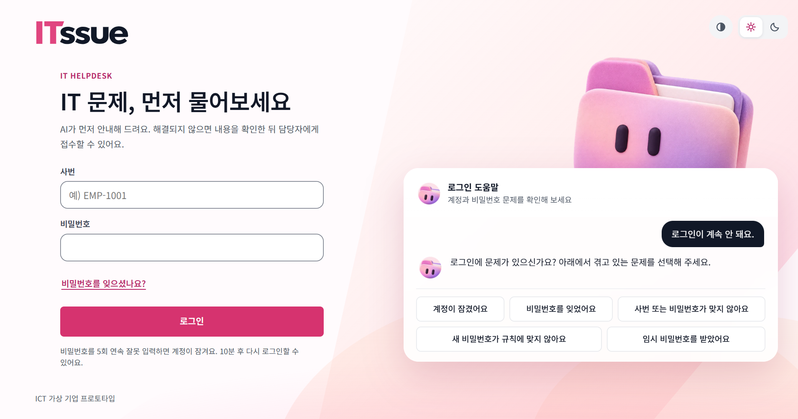

1. 회사에서 안내한 ITssue 주소로 접속합니다.
2. **사번** 칸에 사번을 입력합니다. 예: EMP-1001
3. **비밀번호** 칸에 비밀번호를 입력합니다.
4. **로그인**을 누릅니다.

로그인하면 역할에 맞는 첫 화면이 열립니다([1.2](#12-역할-세-가지)).

- 응답이 3초 넘게 걸리면 버튼 아래에 "서버 응답이 늦어지고 있어요. 조금만 더 기다려 주세요."가 나옵니다. 버튼을 다시 누르지 말고 기다립니다.
- 회원가입 기능은 없습니다. 처음 쓰는 사람은 관리자가 만들어 준 계정과 임시 비밀번호로 로그인합니다([임시 비밀번호로 처음 로그인할 때](#임시-비밀번호로-처음-로그인할-때)).

#### 로그인이 안 될 때

입력칸 바로 아래에 이유가 나옵니다.

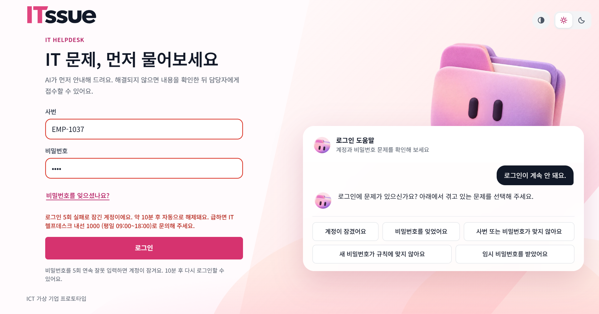

| 화면 문구 | 뜻 | 할 일 |
| --- | --- | --- |
| "사번과 비밀번호를 입력해 주세요." | 빈 칸이 있습니다. | 사번과 비밀번호를 모두 입력합니다. |
| "사번 또는 비밀번호를 확인해 주세요." | 사번이나 비밀번호가 맞지 않습니다. | 이메일이 아니라 사번을 넣었는지, Caps Lock·한/영 전환, 앞뒤 공백을 확인합니다. 계속 틀리면 반복해서 시도하지 말고 [비밀번호를 잊었을 때](#비밀번호를-잊었을-때)를 따릅니다. |
| "로그인 5회 실패로 잠긴 계정이에요. 약 N분 후 자동으로 해제돼요. 급하면 IT 헬프데스크 내선 1000 (평일 09:00~18:00)로 문의해 주세요." | 비밀번호를 5회 연속 틀려 계정이 잠겼습니다. | 화면에 나온 시간이 지난 뒤 다시 로그인합니다. 급하면 IT 헬프데스크에 연락합니다. |
| "이용이 제한된 계정이에요. IT 헬프데스크 내선 1000 (평일 09:00~18:00)로 문의해 주세요." | 관리자가 계정 이용을 제한했습니다. | IT 헬프데스크에 연락합니다. |

계정 잠김 규칙은 이렇습니다. 비밀번호를 5회 연속 잘못 입력하면 계정이 잠깁니다. 잠김은 10분 후 자동으로 풀립니다. 잠긴 동안에는 로그인할 수 없습니다.

#### 비밀번호를 잊었을 때

비밀번호는 보안을 위해 직접 초기화할 수 없습니다. IT 헬프데스크에서 임시 비밀번호를 받아야 합니다.

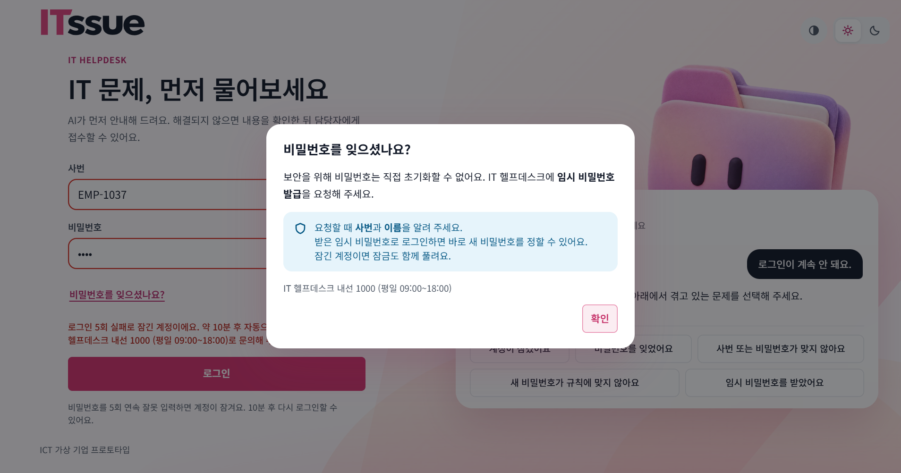

1. 로그인 화면에서 **비밀번호를 잊으셨나요?** 를 누릅니다.
2. 창에 나온 IT 헬프데스크(내선 1000, 평일 09:00~18:00)에 임시 비밀번호 발급을 요청합니다. 이때 사번과 이름을 알려 줍니다.
3. 창의 **확인**을 누릅니다.
4. 받은 임시 비밀번호로 로그인합니다.
5. 새 비밀번호를 정합니다(다음 절).

잠긴 계정이면 임시 비밀번호를 받을 때 잠금도 함께 풀립니다.

#### 임시 비밀번호로 처음 로그인할 때

임시 비밀번호로 로그인하면 "새 비밀번호를 정해 주세요" 창이 뜹니다. 새 비밀번호를 정하기 전에는 다른 기능을 쓸 수 없고, 이 창은 닫히지 않습니다. 나중에 하려면 **로그아웃**을 누릅니다.

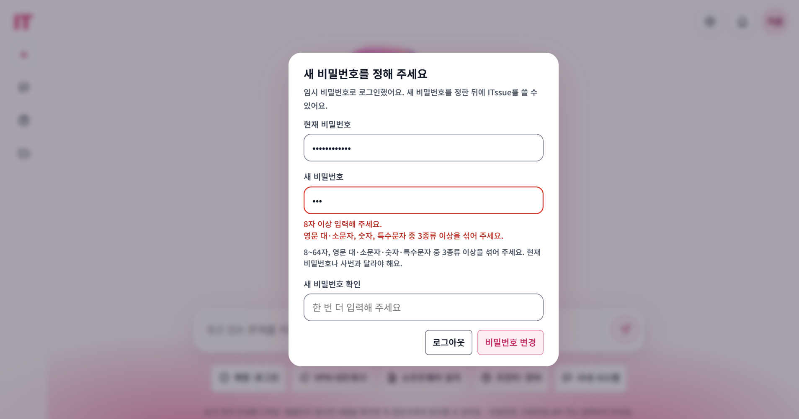

1. **현재 비밀번호** 칸에 받은 임시 비밀번호를 입력합니다.
2. **새 비밀번호** 칸에 새 비밀번호를 입력합니다.
3. **새 비밀번호 확인** 칸에 같은 비밀번호를 한 번 더 입력합니다.
4. **비밀번호 변경**을 누릅니다.
5. "비밀번호를 바꿨어요." 안내가 나오면 **로그인 화면으로**를 누릅니다.
6. 새 비밀번호로 다시 로그인합니다.

##### 비밀번호 규칙

새 비밀번호 칸 아래에 항상 보이는 규칙입니다.

> 8~64자, 영문 대·소문자·숫자·특수문자 중 3종류 이상을 섞어 주세요. 현재 비밀번호나 사번과 달라야 해요.

규칙에 맞지 않으면 칸 아래에 어긴 규칙이 모두 나옵니다.

| 화면 문구 | 고칠 점 |
| --- | --- |
| "8자 이상 입력해 주세요." / "64자 이하로 입력해 주세요." | 길이를 맞춥니다. |
| "영문 대·소문자, 숫자, 특수문자 중 3종류 이상을 섞어 주세요." | 글자 종류를 늘립니다. |
| "현재 비밀번호나 사번과 다른 값을 입력해 주세요." | 다른 값을 씁니다. |
| "새 비밀번호가 서로 달라요." | 확인 칸에 같은 값을 넣습니다. |
| "현재 비밀번호를 확인해 주세요." | 임시 비밀번호(또는 지금 쓰는 비밀번호)를 다시 확인합니다. |

비밀번호를 바꾸면 보안을 위해 모든 기기에서 로그아웃됩니다.

#### 로그인 화면의 로그인 도움말

로그인 화면 오른쪽의 **로그인 도움말**은 로그인 전에 자주 겪는 문제를 안내합니다.

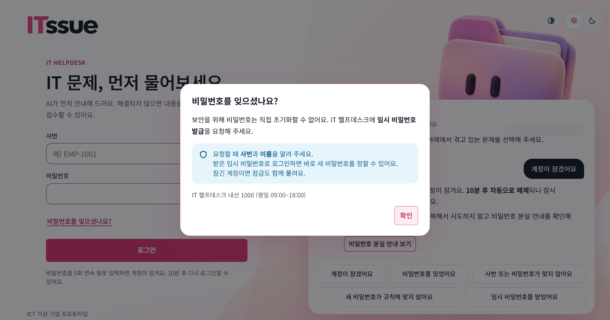

1. 아래 질문 중 겪고 있는 문제를 누릅니다.
   - **계정이 잠겼어요**
   - **비밀번호를 잊었어요**
   - **사번 또는 비밀번호가 맞지 않아요**
   - **새 비밀번호가 규칙에 맞지 않아요**
   - **임시 비밀번호를 받았어요**
2. 나온 안내를 따릅니다. 답변에 **비밀번호 분실 안내 보기**가 있으면 눌러서 [비밀번호를 잊었을 때](#비밀번호를-잊었을-때)의 창을 엽니다.

로그인 도움말은 정해진 안내만 보여 줍니다. 문의를 접수하지 않습니다. 다른 문의는 로그인한 뒤 **새 문의**에서 합니다.

#### 로그인이 만료됐을 때

보안을 위해 일정 시간이 지나면 로그인이 끝나고 로그인 화면으로 돌아갑니다. 이때 화면 위에 "로그인이 만료됐어요." 안내가 나옵니다. 다시 로그인하면 됩니다.

새로고침 직후에는 "로그인 상태를 확인하고 있어요" 화면이 잠깐 보일 수 있습니다. 확인이 끝나면 보던 화면이 열립니다.

#### 로그아웃

1. 화면 오른쪽 위의 이름 동그라미(**내 메뉴**)를 누릅니다.
2. **로그아웃**을 누릅니다.

### 1.4 화면 구성

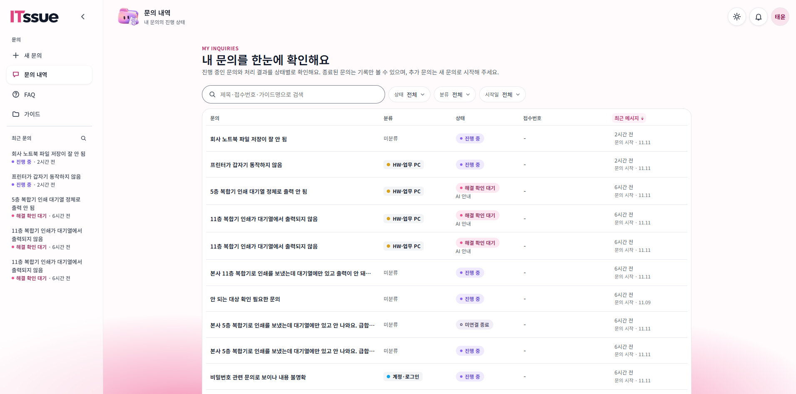

| 위치 | 이름 | 하는 일 |
| --- | --- | --- |
| 왼쪽 | 사이드바 | 로고, 메뉴, 최근 문의 |
| 오른쪽 위 | 화면 모드 · 알림 · 내 메뉴 | 화면 모드 바꾸기, 알림 보기, 내 프로필과 로그아웃 |
| 가운데 | 본문 | 화면 제목과 내용 |

#### 사이드바

- **로고**를 누르면 역할별 첫 화면으로 갑니다.
- 메뉴는 **문의** 묶음과 역할별 묶음(담당자는 **업무**, 관리자는 **운영**)으로 나뉩니다.
- **최근 문의**에는 내가 최근에 한 문의가 최대 5건 보입니다. 제목, 상태, 마지막 활동 시각이 나오고, 누르면 그 대화가 열립니다. 메뉴가 길어 자리가 모자라면 2건만 보입니다.
- **최근 문의** 오른쪽의 돋보기를 누르면 [문의 내역](#211-문의-내역)의 검색 칸으로 갑니다.
- 로고 오른쪽의 **‹** 를 누르면 사이드바가 아이콘만 남게 접힙니다. 다시 누르면 펼쳐집니다. 접힌 상태는 이 브라우저에 기억됩니다.
- 창이 좁으면(태블릿, 작은 창) 사이드바가 숨겨집니다. 화면 왼쪽 위의 **메뉴 열기** 버튼으로 열고, 바깥을 누르거나 Esc 키로 닫습니다.

##### 메뉴 옆 숫자와 점

| 메뉴 | 보이는 것 | 뜻 |
| --- | --- | --- |
| 문의 내역 | 숫자 | 아직 확인하지 않은 새 답변 수. 최근 문의 제목 옆 숫자도 같은 뜻입니다. |
| 처리할 문의 (담당자) | 숫자 | 처리 대기·처리 중·해결 확인 대기 건수 |
| 처리할 문의 (담당자) | 숫자에 붙은 점, 또는 "NEW N" | 새로 배정된 알림이 있음 |
| 운영 현황 (관리자) | 숫자 | 연동·배정 확인이 필요한 접수 수 |
| 보안·감사 알림 (관리자) | 숫자 | 아직 확인을 시작하지 않은 신규 알림 수 |
| 가이드 관리 (관리자) | 점 | 검색 준비에 실패한 가이드 버전이 있음 |

#### 오른쪽 위

- **화면 모드**: 지금 모드 아이콘(해 또는 달)이 보입니다. 마우스를 올리면 고대비·라이트·다크 세 칸으로 펼쳐집니다. 터치 화면에서는 눌러서 펼칩니다.
- **알림**(종): [1.5 알림](#15-알림)을 봅니다.
- **내 메뉴**(이름 끝 두 글자가 적힌 동그라미): **내 프로필**과 **로그아웃**이 있습니다.

새 문의 화면에는 위쪽 제목 줄이 없어서, 같은 버튼이 화면 오른쪽 위에 떠 있습니다.

긴 화면을 아래로 내리면 오른쪽 아래에 **맨 위로** 버튼이 나타납니다.

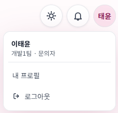

#### 화면 모드와 고대비 모드

- **라이트 모드**와 **다크 모드** 중 하나를 고릅니다.
- **고대비 모드**는 라이트·다크 위에 더해서 켜고 끄는 설정입니다. 켜면 글자와 선의 대비가 강해집니다.
- 고른 값은 이 브라우저에만 저장됩니다. 고르기 전에는 기기의 설정을 따릅니다.
- 로그인 화면 오른쪽 위에서도 같은 방법으로 바꿀 수 있습니다.

고대비 모드를 켜는 방법은 아래와 같습니다.

1. 화면 오른쪽 위의 화면 모드 아이콘에 마우스를 올립니다.
2. 왼쪽의 동그란 **고대비 모드** 버튼을 누릅니다.

같은 버튼을 다시 누르면 꺼집니다.

#### 내 프로필과 비밀번호 바꾸기

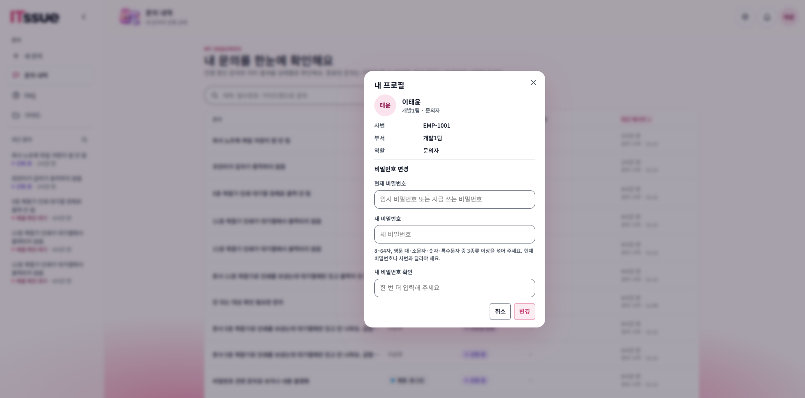

1. 오른쪽 위 **내 메뉴**를 누릅니다.
2. **내 프로필**을 누릅니다. 사번·부서·역할이 보입니다.
3. **비밀번호** 줄의 **변경**을 누릅니다.
4. **현재 비밀번호**를 입력합니다.
5. **새 비밀번호**를 입력합니다.
6. **새 비밀번호 확인**에 같은 비밀번호를 입력합니다.
7. **변경**을 누릅니다.
8. 완료 안내에서 **로그인 화면으로**를 누릅니다.
9. 새 비밀번호로 다시 로그인합니다.

- 바꾸지 않으려면 7단계 대신 **취소**를 누릅니다.
- 이름·부서·역할은 직접 바꿀 수 없습니다. 바꿔야 하면 관리자에게 요청합니다.

### 1.5 알림

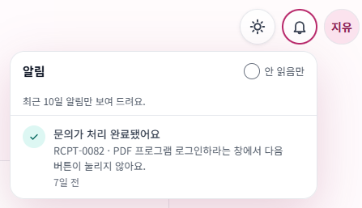

오른쪽 위 종 옆의 숫자는 안 읽은 알림 수입니다. 알림은 두 가지입니다.

| 알림 | 받는 사람 | 누르면 |
| --- | --- | --- |
| "새 티켓이 배정됐어요" | 담당자 (나에게 티켓이 배정될 때) | 그 티켓의 상세 화면 |
| "문의가 처리 완료됐어요" | 문의자 (담당자가 처리 결과를 등록할 때) | 그 문의의 대화 화면 |

1. 오른쪽 위 종을 누릅니다.
2. 확인할 알림을 누릅니다.

- 알림을 누르면 그 접수의 알림이 모두 읽음으로 바뀝니다.
- 최근 10일 알림만 보입니다.
- **안 읽음만**에 체크하면 안 읽은 알림만 보입니다.
- 알림이 많으면 맨 아래 **더 보기**를 누릅니다.
- 알림 수는 약 1분마다 새로 확인합니다.

### 1.6 상태 이름 한눈에 보기

#### 문의 상태 (모든 역할의 문의 내역·대화 화면)

| 화면의 상태 | 뜻 | 다음에 할 일 |
| --- | --- | --- |
| 진행 중 | AI와 대화하고 있습니다. | 대화를 이어 갑니다. |
| 해결 확인 대기 · AI 안내 | AI 안내를 받았고, 해결 여부를 아직 고르지 않았습니다. | 대화를 열어 **해결** 또는 **미해결**을 고릅니다. |
| AI 해결 | AI 안내로 해결되어 끝났습니다. | 할 일이 없습니다. |
| 미연결 종료 | 담당자 연결이나 접수 없이 끝났습니다. | 같은 문제가 남았으면 새 문의를 합니다. |
| 접수 | 접수되었고 담당자 연결을 진행하고 있습니다. | 기다립니다. |
| 담당자 확인 중 | 운영자가 담당자 연결을 확인하고 있습니다. 접수는 유지됩니다. | 다시 접수하지 말고 기다립니다. |
| 담당자 배정 완료 · 처리 대기 | 담당자가 정해졌고 처리 시작을 기다립니다. | 기다립니다. |
| 처리 중 | 담당자가 처리하고 있습니다. | 기다립니다. |
| 해결 확인 대기 · 담당자 처리 | 담당자가 처리 결과를 등록했습니다. | 대화를 열어 **해결** 또는 **미해결**을 고릅니다. |
| 해결 완료 | 문의자 확인으로 끝났습니다. | 할 일이 없습니다. |

#### 티켓 상태 (담당자·관리자 화면)

| 화면의 상태 | 뜻 |
| --- | --- |
| 접수 완료 · 배정 전 | 접수되었지만 아직 담당자가 정해지지 않았습니다. |
| 처리 대기 | 담당자가 정해졌고 처리를 시작하지 않았습니다. |
| 처리 중 | 담당자가 처리하고 있습니다. |
| 해결 확인 대기 | 담당자가 처리 결과를 등록했고 문의자의 확인을 기다립니다. |
| 해결 완료 | 문의자가 해결을 확인했습니다. |
| ITSM 반영 확인 중 | 상태 변경을 ITSM에 보냈고, 반영되기를 기다립니다. |
| 확인 필요 · ITSM 생성 확인 필요 · 배정 확인 | ITSM 생성이나 담당자 배정이 끝나지 않아 관리자 확인이 필요합니다. |

#### 긴급도 (담당자·관리자에게만 보입니다)

| 긴급도 | 기준 |
| --- | --- |
| 긴급 (P1) | 전사·여러 부서의 주요 업무 중단 또는 광범위한 보안 대응 필요 |
| 높음 (P2) | 부서 단위 업무 영향, 개인 업무 전면 중단 또는 보안 사고 의심 |
| 보통 (P3) | 개인 업무 일부에 지장이 있으나 허용된 대체 방법으로 진행 가능 |
| 낮음 (P4) | 현재 업무 지장이 없는 단순 문의·사전 신청 |

긴급도는 처리 순서를 정하는 내부 기준이라 문의자 화면에는 나오지 않습니다.

---

## 2. 문의자

이 장은 IT 문제를 문의하는 모든 사람이 읽습니다. 담당자와 관리자가 자기 문제를 문의할 때도 같습니다.

전체 흐름은 아래와 같습니다.

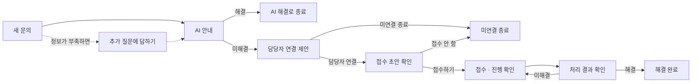

### 2.1 새 문의 시작하기

> 입력하지 말아야 할 정보: 비밀번호·인증번호·API 키는 입력하지 마세요. 상담 기록은 처리·운영 목적으로 활용될 수 있습니다. 실수로 입력하면 [2.14](#214-민감정보를-입력했을-때)를 봅니다.

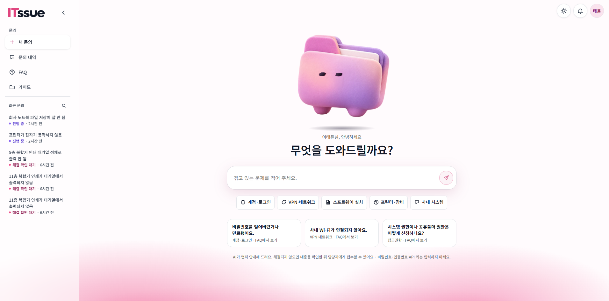

1. 사이드바에서 **새 문의**를 누릅니다.
2. "무엇을 도와드릴까요?" 아래 입력창에 겪고 있는 문제를 적습니다.
3. 입력창 오른쪽의 **보내기** 버튼을 누릅니다. Enter 키를 눌러도 보내집니다.

잘 적는 방법: 언제부터, 어떤 화면에서, 어떤 오류 문구가 나오는지, 무엇을 해 봤는지를 함께 적으면 AI가 되묻는 일이 줄어듭니다.

- 줄을 바꾸려면 Shift+Enter를 누릅니다.
- 입력창 아래의 분류 버튼(**계정·로그인**, **VPN·네트워크**, **소프트웨어 설치**, **프린터·장비**, **사내 시스템**)을 누르면 예시 문장이 입력창에 채워집니다. 바로 보내지는 않습니다. 내용을 고친 뒤 보냅니다.
- 그 아래의 FAQ 카드를 누르면 그 질문이 펼쳐진 [FAQ](#212-faq) 화면으로 갑니다.

### 2.2 답변을 기다리는 동안

보내면 바로 대화 화면으로 넘어가고, 내가 보낸 글과 진행 표시가 보입니다. 답변은 몇 초에서 1분 넘게 걸릴 수 있습니다.

| 기다린 시간 | 화면 문구 |
| --- | --- |
| 처음 | "문의를 처리하고 있어요." |
| 10초 뒤 | "답변을 준비하고 있어요. 잠시만 기다려 주세요." |
| 25초 뒤 | "답변 준비에 시간이 걸리고 있어요." |

- 기다리는 동안에는 새 글을 쓸 수 없습니다. 입력창에 "답변을 준비하는 동안은 새 글을 쓸 수 없어요."가 보입니다.
- 기다리는 동안 다른 화면으로 옮겨도 됩니다. 답변이 오면 사이드바의 최근 문의에 새 답변 표시가 붙습니다.
- 보내기에 실패하면 오류 문구와 함께 두 버튼이 나옵니다. 같은 글을 다시 보내려면 **다시 시도**를, 글을 고치려면 **질문 다시 쓰기**를 누릅니다.

### 2.3 AI 안내와 출처 확인하기

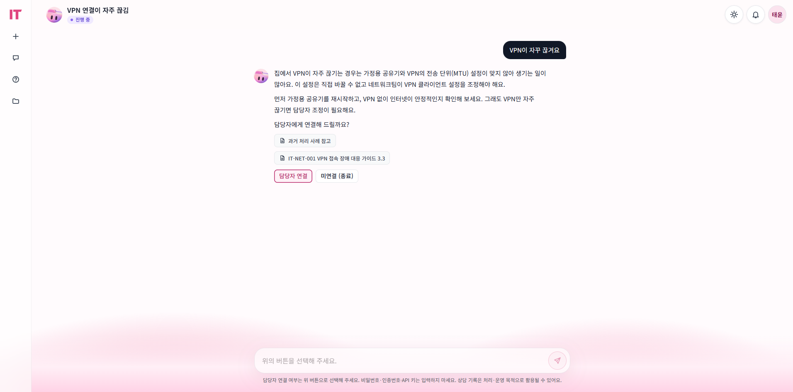

1. AI 안내를 읽고 순서대로 따라 합니다.
2. 근거를 확인하려면 안내 아래의 출처 버튼을 누릅니다. 출처 버튼에는 가이드의 문서 번호·제목·항목이 적혀 있습니다.
3. "출처 미리보기" 창에서 근거가 된 가이드 내용을 읽습니다.
4. 창을 닫습니다.
5. 안내대로 해 본 뒤 **해결** 또는 **미해결**을 누릅니다([2.5](#25-해결-여부-알려-주기)).

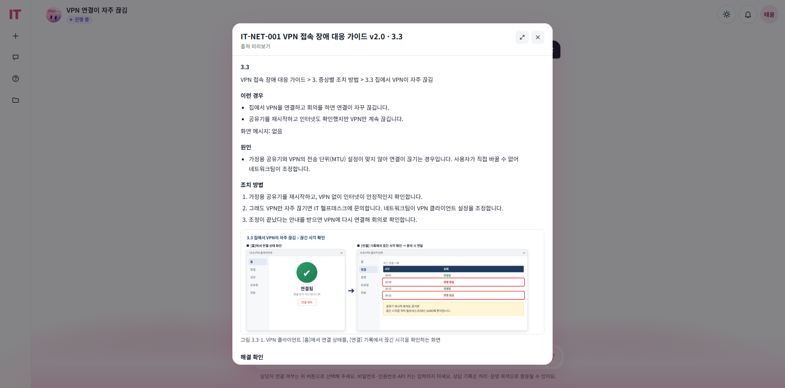

- 출처 미리보기 창 제목에는 문서 번호, 제목, 버전, 항목이 나옵니다. 창 위쪽 버튼으로 창을 넓게 볼 수 있습니다.
- 본문을 보여 줄 수 없는 출처는 창에 "이 화면에서는 가이드 본문을 아직 받아 오지 못해요. 위치만 확인해 주세요."처럼 안내합니다. 이때는 [가이드](#213-가이드) 메뉴에서 그 문서를 찾아 읽습니다.
- 가이드에 정확한 안내가 없으면 AI가 이전 처리 사례를 참고할 때가 있습니다. 이때는 **과거 처리 사례 참고** 버튼이 나옵니다. 과거 사례는 현재 가이드·정책과 다를 수 있으니 참고만 합니다.
- AI 안내 뒤에는 입력창이 잠기고 "위의 버튼을 선택해 주세요."가 보입니다. 버튼으로 고르는 단계에서는 글을 보낼 수 없습니다.

> 확인 필요: 실제 서버에 연결한 화면에서도 **과거 처리 사례 참고** 창에 "도입 이전 처리 이력 (읽기 전용, 시연용 가상 데이터)" 문구가 그대로 나옵니다. 운영 화면에 맞는 문구인지 확인이 필요합니다.

### 2.4 추가 질문에 답하기

정보가 부족하면 AI가 몇 가지를 되묻습니다. 질문마다 고를 수 있는 답이 버튼으로 나옵니다.

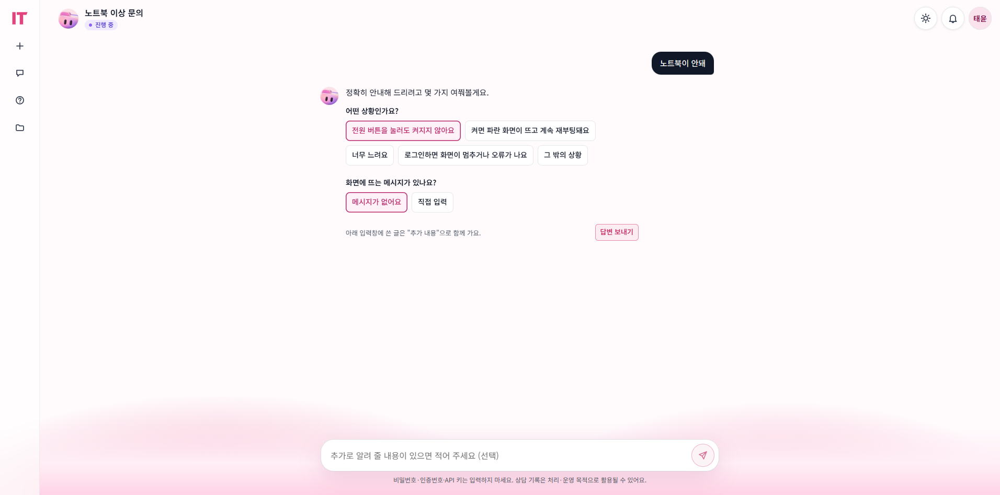

1. 질문마다 맞는 답 버튼을 하나씩 누릅니다.
2. 맞는 답이 없으면 **직접 입력**(상황을 묻는 질문은 **그 밖의 상황**)을 누릅니다.
3. 나타난 입력칸에 답을 적습니다.
4. 더 알려 줄 내용이 있으면 아래 입력창에 적습니다. 이 글은 "추가 내용"으로 함께 보내집니다. 없으면 이 단계를 건너뜁니다.
5. **답변 보내기**를 누릅니다.

- 모든 질문에 답해야 **답변 보내기**가 켜집니다. 남은 질문 수는 "N개 질문에 더 답하면 보낼 수 있어요."로 보입니다.
- 질문에 다 답하지 않고 입력창으로 보내려고 하면 입력창이 빨갛게 바뀌고 "아직 답하지 않은 질문이 N개 있어요. 모든 질문에 답한 뒤 보낼 수 있어요."가 잠깐 나옵니다.
- 보낸 답은 "이름: 답" 줄로 정리되어 내 말풍선에 남습니다. 지난 질문에는 내가 고른 답이 표시됩니다.
- 답을 모르면 직접 입력에 "모르겠어요"처럼 적어도 됩니다. 질문을 거듭해도 필요한 정보를 얻지 못하면 AI가 담당자 연결을 제안합니다.

### 2.5 해결 여부 알려 주기

AI 안내 아래의 버튼으로 결과를 알려 줍니다.

#### 해결됐을 때

1. **해결**을 누릅니다.

"AI 안내로 문제가 해결되었군요!" 안내가 나오고 문의는 **AI 해결**로 끝납니다. 끝난 문의 아래에는 "이 문의는 끝났어요. 새로 궁금한 게 있으면 새 문의로 시작해 주세요."와 **새 문의 시작하기** 버튼이 보입니다.

#### 해결되지 않았을 때

1. **미해결**을 누릅니다.
2. "아직 문제가 해결되지 않았군요." 안내 아래의 버튼으로 담당자 연결 여부를 고릅니다([2.6](#26-담당자-연결-여부-정하기)).

**미해결**을 누르는 것만으로는 접수되지 않습니다.

AI 안내 뒤에 해결 여부를 고르지 않고 나가도 문의는 지워지거나 끝나지 않습니다. 상태가 "해결 확인 대기 · AI 안내"로 남고, 나중에 이어서 고를 수 있습니다([2.10](#210-이전-문의-이어가기)).

### 2.6 담당자 연결 여부 정하기

아래 경우에 AI가 담당자 연결을 제안합니다.

- **미해결**을 눌렀을 때
- AI가 근거가 될 가이드를 찾지 못했을 때
- IT 지원 범위 밖의 문의일 때
- 보안 정책상 AI가 직접 안내할 수 없을 때: "담당자의 확인이 필요한 문의예요. 보안 정책에 따라 AI가 직접 안내하기 어려운 내용이에요. 담당자에게 문의할 수 있도록 도와드릴게요."
- 피싱 메일 링크를 누른 경우처럼 긴급 대응이 필요해 보일 때. 이때는 일반 안내보다 담당자 연결을 먼저 제안합니다.
- AI가 답변을 만들지 못했을 때: "지금은 AI 답변을 만들지 못했어요. 입력한 내용은 저장됐어요. 담당자에게 연결해 드릴까요?"
- 추가 질문으로도 필요한 정보를 얻지 못했을 때

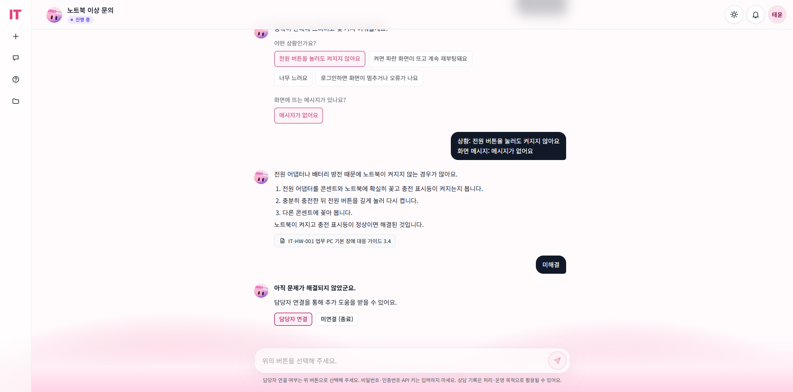

#### 담당자에게 연결하려면

1. **담당자 연결**을 누릅니다.

AI가 지금까지의 내용으로 접수 초안을 만듭니다. 아직 접수된 것은 아닙니다. 다음 절에서 확인하고 접수합니다.

#### 연결하지 않고 끝내려면

1. **미연결 (종료)** 를 누릅니다.

"담당자 연결 없이 상담을 종료했어요." 안내가 나오고 문의는 **미연결 종료**로 끝납니다. 티켓은 접수되지 않습니다. 같은 문제로 다시 연결하려면 새 문의를 합니다.

긴급 연결 제안에는 보안 사고가 의심될 때 할 일이 함께 나옵니다. 의심스러운 링크나 첨부파일을 더 열지 말고, 계정 정보를 입력하지 않습니다. 긴급 건은 되도록 **담당자 연결**을 고릅니다.

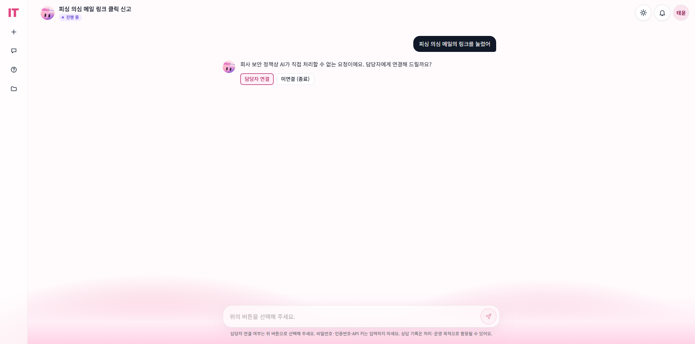

> 확인 필요: 긴급 건을 **미연결 (종료)** 로 끝낼 때 보안 행동 안내와 연락처가 대화에 따로 붙는지. 설계 문서(대화 상태 정의 3.4)에는 붙인다고 되어 있지만, 서버에서 그 문구를 만드는 곳을 찾지 못했습니다. 운영 기록에 긴급 건 종료가 남는 것은 확인했습니다.

### 2.7 접수 초안 확인하고 접수하기

**담당자 연결**을 누르면 "지금까지 확인한 내용을 정리했어요. 맞는지 확인하고, 필요하면 수정해 주세요." 아래에 **접수 초안** 카드가 나옵니다. 카드 오른쪽 위 배지는 "확인 대기 · 아직 접수되지 않았어요"입니다.

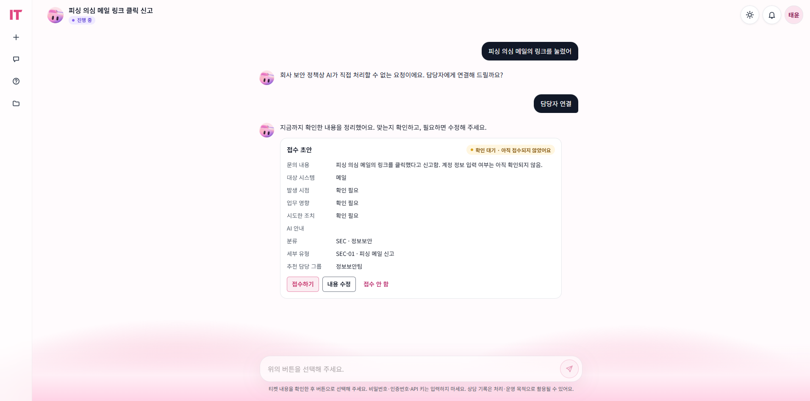

#### 초안 항목

| 항목 | 내가 고칠 수 있나 | 설명 |
| --- | --- | --- |
| 문의 내용 | 예 | 문제 요약 |
| 대상 시스템 | 아니요 (자동 판단) | 문제가 생긴 시스템 |
| 발생 시점 | 예 | 언제부터 생겼는지 |
| 업무 영향 | 예 | 나만 그런지, 업무를 할 수 있는지 |
| 시도한 조치 | 예 | 지금까지 해 본 것 |
| AI 안내 | 아니요 (자동 판단) | AI가 안내한 내용 요약 |
| 분류 | 아니요 (자동 판단) | 7개 분류 중 하나. 정하지 못하면 "미분류 · 서비스데스크 확인" |
| 세부 유형 | 아니요 (자동 판단) | 정하지 못하면 "담당자가 확인해요" |
| 추천 담당 그룹 | 아니요 (자동 판단) | 이 문의를 맡을 팀 |

값을 모르는 칸에는 "확인 필요"가 들어갑니다. 내용 수정으로 채울 수 있습니다.

#### 그대로 접수하기

1. 초안의 모든 줄을 읽습니다.
2. **접수하기**를 누릅니다.

"접수되었어요. 접수번호는 RCPT-0042 입니다."처럼 접수번호가 나오고, 아래에 진행 카드가 생깁니다([2.8](#28-접수-이후-진행-확인하기)). 초안 카드의 배지는 "접수 완료"로 바뀝니다.

#### 내용을 고친 뒤 접수하기

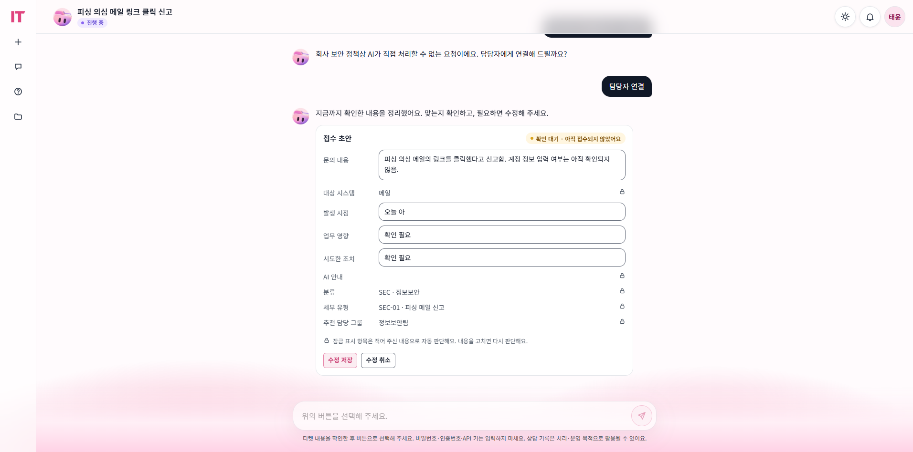

1. **내용 수정**을 누릅니다. 고칠 수 있는 네 줄이 입력칸으로 바뀝니다.
2. 고칠 칸의 내용을 고칩니다.
3. **수정 저장**을 누릅니다.
4. 카드 위의 노란 안내를 읽습니다.
5. 다시 판단된 줄(옆에 **다시 판단됨** 표시)이 맞는지 확인합니다.
6. **접수하기**를 누릅니다.

- 자물쇠 표시가 있는 줄은 내가 적은 내용으로 자동 판단합니다. 내용을 고치면 분류·세부 유형·추천 담당 그룹을 다시 판단합니다.
- 4단계의 안내는 둘 중 하나입니다. 값이 그대로면 "수정 내용을 반영했어요. 최종 접수 전에 한 번 더 확인해 주세요.", 바뀌었으면 "수정한 내용을 반영해 다시 판단했어요. … 변경된 내용으로 다시 확인해 주세요."입니다.
- 칸을 비운 채 저장하면 그 칸은 바뀌지 않고 원래 내용이 남습니다.
- 수정을 그만두려면 3단계 대신 **수정 취소**를 누릅니다. 문의는 끝나지 않고 편집만 취소됩니다.

#### 접수하지 않고 끝내기

1. **접수 안 함**을 누릅니다.
2. "접수하지 않고 문의를 종료할까요?" 창에서 **접수 안 함**을 누릅니다.

"담당자 연결 없이 상담을 종료했어요." 안내가 나오고 문의는 **미연결 종료**로 끝납니다. 티켓은 접수되지 않습니다. 같은 문제로 다시 접수하려면 새 문의를 합니다. 마음이 바뀌었으면 2단계에서 **돌아가기**를 누릅니다.

> 확인 필요: 이 확인 창에는 "문의 내역에서 다시 상담을 이어갈 수 있어요."라고 나오지만, 실제로 끝난 문의를 다시 열면 "티켓을 접수하지 않고 종료한 문의예요. 새 문의로 시작해 주세요."가 나오고 이어갈 수 없습니다. 본문은 실제 동작을 따랐습니다.

- 초안 단계에서는 입력창이 잠깁니다("티켓 내용을 확인한 후 버튼으로 선택해 주세요."). 내용은 초안 카드에서 고칩니다.
- 접수가 저장되지 않으면 오류 안내가 나옵니다. 작성한 내용은 남아 있으니 잠시 뒤 다시 누르거나 IT 헬프데스크·그룹웨어 IT 요청 메뉴를 이용합니다([5장](#53-접수할-때)).

### 2.8 접수 이후 진행 확인하기

접수하면 대화 화면에 진행 카드가 생깁니다. 화면 위쪽 제목 아래에도 접수번호와 ITSM 번호가 보입니다.

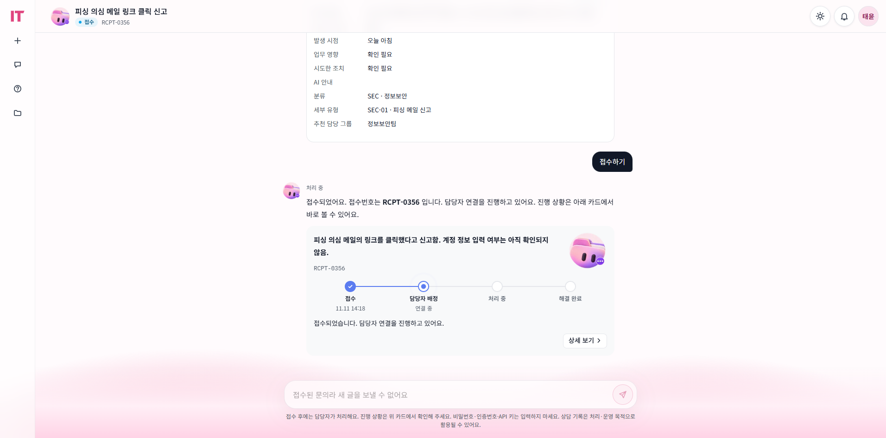

진행 카드는 네 단계로 진행 상황을 보여 줍니다.

접수 → 담당자 배정 → 처리 중 → 해결 완료

카드 아래의 안내 문구로 지금 상황을 알 수 있습니다.

| 안내 문구 | 뜻 |
| --- | --- |
| "접수되었습니다. 담당자 연결을 진행하고 있어요." | 담당자를 정하는 중입니다. |
| "접수는 유지되어 있으며, 운영자가 담당자 연결을 확인하고 있어요. 다시 접수하실 필요는 없어요." | 담당자 연결에 확인이 필요해 운영자가 보고 있습니다. 다시 접수하지 않습니다. |
| "OOO 담당자(팀 이름)에게 배정되었어요. 처리를 기다리고 있어요." | 담당자가 정해졌습니다. |
| "OOO 담당자가 처리하고 있어요." | 처리 중입니다. |
| "담당자가 처리 결과를 등록했어요. 해결되었는지 확인해 주세요." | 처리 결과를 확인할 차례입니다([2.9](#29-처리-결과-확인하기)). |
| "문의자 확인으로 종료되었어요. 감사합니다." | 해결 완료로 끝났습니다. |

#### 상세 보기

1. 진행 카드의 **상세 보기**를 누릅니다.
2. 오른쪽에 열린 티켓 상세에서 진행 단계, 접수번호, ITSM 티켓 번호, 분류, 담당 그룹, 담당자, 문의 내용, 처리 결과, 처리 이력을 확인합니다.
3. 오른쪽 위 **닫기**(✕)를 누릅니다.

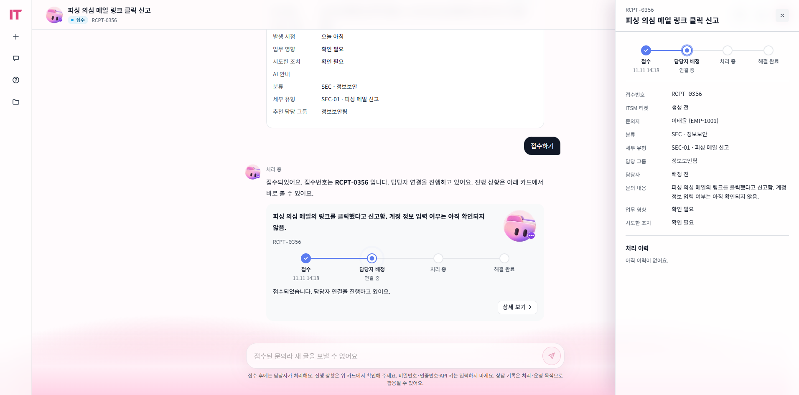

- 접수 뒤에는 대화창에 새 글을 보낼 수 없습니다. 입력창에 "접수된 문의라 새 글을 보낼 수 없어요"가 보입니다. 접수 뒤에는 담당자가 처리하고, 진행 상황은 카드에서 확인합니다.
- 대화 화면을 열면 ITSM의 최신 상태를 한 번 더 읽어 옵니다.

> 확인 필요: 접수 뒤에 문의자가 담당자에게 추가 내용을 전하는 방법, 담당자가 문의자에게 추가 정보를 요청하는 방법. 운영 화면에는 그런 입력 수단이 없고, 담당자 화면에는 "댓글·멘션은 ITSM에서 확인해 주세요."만 있습니다.

### 2.9 처리 결과 확인하기

담당자가 처리 결과를 등록하면 "문의가 처리 완료됐어요" 알림이 오고, 진행 카드에 "처리 결과 · (담당자 이름)"과 내용이 나옵니다. 상태는 "해결 확인 대기 · 담당자 처리"입니다.

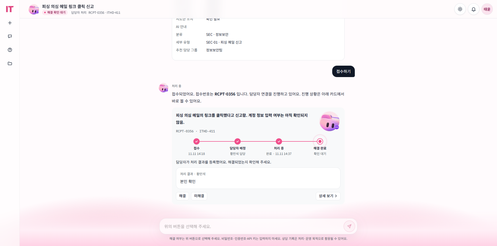

#### 해결됐을 때

1. 처리 결과를 읽습니다.
2. **해결**을 누릅니다.

"선택하신 내용을 ITSM에 반영하는 중이에요. 잠시 뒤 상태가 바뀌어요."가 잠깐 보인 뒤 **해결 완료**로 바뀝니다.

#### 해결되지 않았을 때

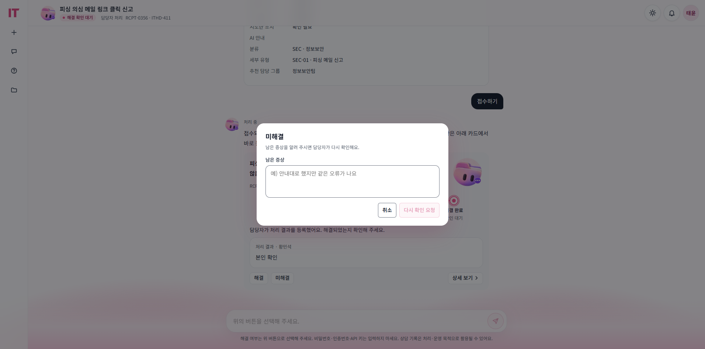

1. **미해결**을 누릅니다.
2. "미해결" 창의 **남은 증상** 칸에 아직 남은 문제를 적습니다. 예: "안내대로 했지만 같은 오류가 나요"
3. **다시 확인 요청**을 누릅니다.

"다시 확인을 요청했어요. 담당자가 재확인하고 있어요. 아래 카드에서 새 진행 상황을 볼 수 있어요." 안내와 함께 새 진행 카드가 생깁니다. 상태는 **처리 중**으로 돌아갑니다. 진행 카드는 가장 최근 것 하나만 보이고, 앞의 카드 자리에는 안내 글만 남습니다.

해결 여부를 고르지 않아도 자동으로 끝나지 않습니다. 해결 확인 대기 상태로 남습니다.

### 2.10 이전 문의 이어가기

이어갈 수 있는 문의는 "해결 확인 대기 · AI 안내" 상태뿐입니다. AI 안내를 받고 해결 여부를 아직 고르지 않은 문의입니다.

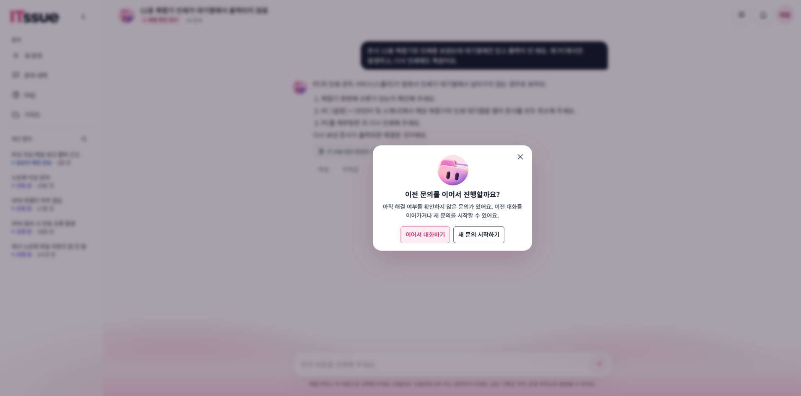

1. 사이드바의 최근 문의나 [문의 내역](#211-문의-내역)에서 그 문의를 누릅니다.
2. "이전 문의를 이어서 진행할까요?" 창에서 **이어서 대화하기**를 누릅니다.
3. "해결 여부를 선택해 주세요!" 창에서 **해결** 또는 **미해결**을 누릅니다.

- 2단계에서 새로 시작하려면 **새 문의 시작하기**를 누릅니다. 이전 문의는 지워지지 않습니다.
- 3단계에서 지금 고르지 않으려면 **나중에 선택할게요**를 누릅니다. 대화 화면의 AI 안내 아래 버튼으로 언제든 고를 수 있습니다.
- 창 오른쪽 위 ✕를 누르면 창만 닫힙니다. 잠긴 입력창을 누르면 창이 다시 뜹니다.
- 방금 보낸 문의에서는 이 창이 뜨지 않습니다.
- 담당자 처리 결과를 확인하는 문의("해결 확인 대기 · 담당자 처리")는 이 창 없이 열리고, 진행 카드의 버튼으로 고릅니다([2.9](#29-처리-결과-확인하기)).

끝난 문의는 이어갈 수 없습니다. 아래 문의를 열면 입력창이 잠기고, 입력창 자리에 이유가 보입니다. 같은 문제가 남았으면 **새 문의 시작하기**를 누릅니다.

| 문의 | 입력창에 보이는 문구 |
| --- | --- |
| AI 해결 | "AI 안내로 해결된 문의예요." |
| 미연결 종료 (담당자 연결 거절) | "담당자 연결 없이 종료한 문의예요. 이어갈 수 없어서 새 문의로 시작해 주세요." |
| 미연결 종료 (접수 안 함) | "티켓을 접수하지 않고 종료한 문의예요. 새 문의로 시작해 주세요." |
| 해결 완료 | "처리가 완료되어 종료된 문의예요." |

> 확인 필요: 문의 내역 화면 위쪽 설명에는 "해결 여부를 확인하지 않았거나 미해결·미접수로 종료한 문의는 다시 이어갈 수 있어요."라고 나옵니다. 실제로는 해결 여부를 확인하지 않은 문의만 이어갈 수 있습니다. 본문은 실제 동작을 따랐습니다.

### 2.11 문의 내역

내가 한 문의를 모두 봅니다. 관리자도 이 화면에서는 본인 문의만 봅니다.

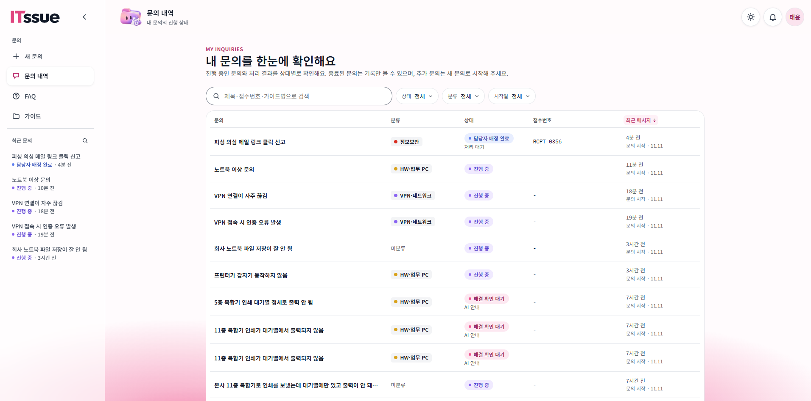

1. 사이드바에서 **문의 내역**을 누릅니다.
2. 찾는 문의가 있으면 검색 칸에 제목·접수번호·가이드명을 입력합니다.
3. 필요하면 위쪽 버튼으로 조건을 고릅니다.
4. 열 문의의 제목을 누릅니다.

#### 조건 버튼

| 버튼 | 고를 수 있는 값 |
| --- | --- |
| **상태** | 진행 중 · AI 해결 · 담당자 처리 · 해결 확인 대기 · 해결 완료 · 미연결 종료 (값마다 건수가 함께 보입니다) |
| **분류** | 계정·로그인 · 접근권한 · VPN·네트워크 · SW·라이선스 · HW·업무 PC · 사내 시스템 · 정보보안 |
| **시작일** | 최근 7일 · 최근 30일 |

- 조건을 모두 지우려면 **✕ 조건 해제**를 누릅니다.
- 상태의 "담당자 처리"는 접수·담당자 배정·처리 중을 묶은 것입니다. "해결 확인 대기"는 AI 안내 뒤와 담당자 처리 뒤를 함께 보여 줍니다.
- 표의 열은 문의, 분류, 상태, 접수번호, 최근 메시지입니다. 최근 메시지 아래 작은 글씨는 문의를 시작한 날입니다.
- 확인하지 않은 답변이 있는 문의는 제목이 굵게 보이고 "새 답변 N"이 붙습니다.
- 표 아래의 페이지 버튼으로 다음 쪽을 봅니다.

### 2.12 FAQ

자주 생기는 IT 문제와 답을 모은 화면입니다. 본인에게 열람이 허용된 가이드를 근거로 한 FAQ만 보입니다. FAQ를 읽어도 문의가 접수되지는 않습니다.

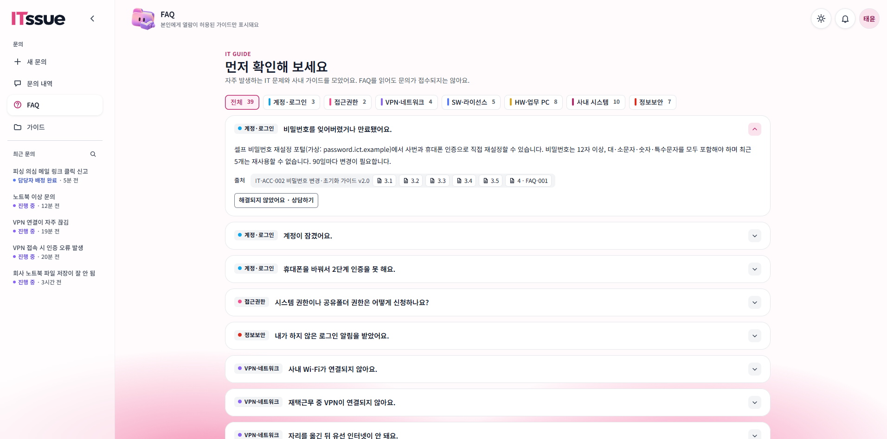

1. 사이드바에서 **FAQ**를 누릅니다.
2. 위쪽 분류 버튼으로 분류를 고릅니다. **전체**를 누르면 모두 보입니다.
3. 질문을 눌러 펼칩니다.
4. 답변과 아래의 출처를 읽습니다. 출처를 누르면 근거 본문이 열립니다.
5. 해결되지 않으면 **해결되지 않았어요 · 상담하기**를 누릅니다.

5단계를 누르면 새 문의 화면이 열리고, 입력창에 그 FAQ의 질문이 채워져 있습니다. 내용을 고친 뒤 보냅니다.

### 2.13 가이드

내가 볼 수 있는 사내 가이드를 직접 찾아 읽는 화면입니다. 본인에게 열람이 허용된 가이드의 현행 버전만 보입니다. 이 메뉴는 문의자와 담당자에게만 있습니다.

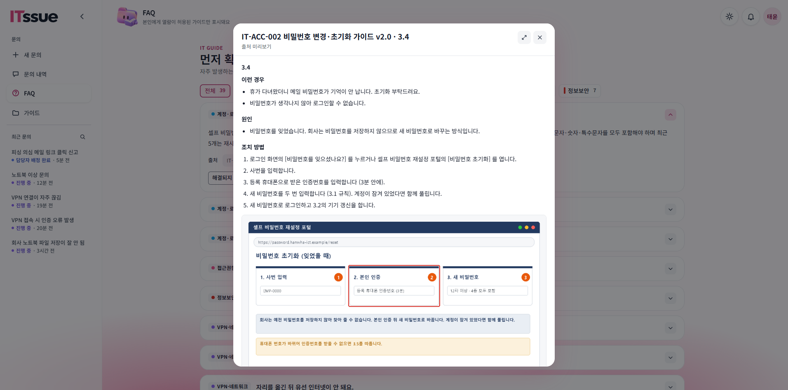

1. 사이드바에서 **가이드**를 누릅니다.
2. 분류 이름을 눌러 펼칩니다. 모든 분류를 한꺼번에 펼치려면 **모두 펼치기**를 누릅니다.
3. 읽을 가이드를 누릅니다.
4. 오른쪽에 열린 본문을 읽습니다.
5. 다 읽으면 **닫기**를 누릅니다.

- 본문 창 위쪽의 **크게 보기** 버튼을 누르면 화면 전체로 넓어집니다.
- 담당자에게만 열린 가이드에는 "담당자 이상" 표시가 붙습니다.
- 가이드를 읽어도 문의가 접수되지는 않습니다.

### 2.14 민감정보를 입력했을 때

비밀번호·인증번호·주민등록번호 같은 값을 입력하면, 저장하기 전에 그 부분이 ●●● 로 가려집니다. 그리고 대화에 분홍색 안내가 한 번 남습니다.

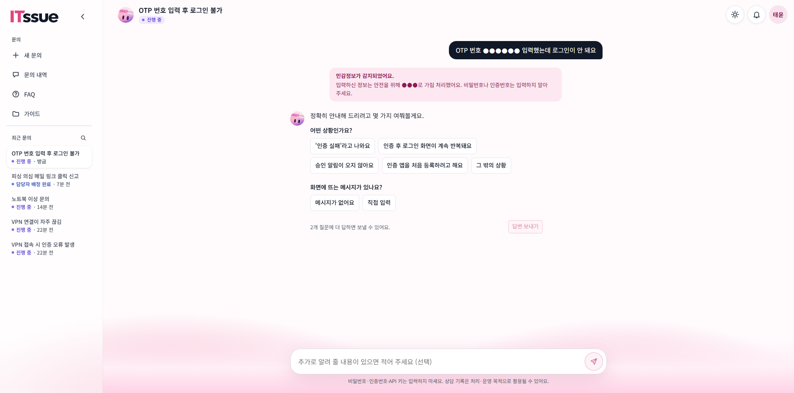

| 입력한 것 | 안내 문구 |
| --- | --- |
| 비밀번호, 인증번호(OTP·PIN), API 키, 6자리 이상 이어진 숫자 | "민감정보가 감지되었어요. 입력하신 정보는 안전을 위해 ●●●로 가림 처리했어요. 비밀번호나 인증번호는 입력하지 말아 주세요." |
| 주민등록번호, 카드번호, 계좌번호 | "개인정보가 감지되었어요. 입력하신 정보는 안전을 위해 ●●●로 가림 처리했어요. 문의에 필요하지 않은 개인정보는 입력하지 말아 주세요." |
| 접수 초안을 고칠 때 넣은 민감정보 | "민감정보가 가림 처리되었어요. 입력하신 내용에 민감정보가 포함되어 있어 일부 내용을 가렸어요. 접수 전 내용을 확인해 주세요." |

- 가려진 값은 담당자에게도 보이지 않습니다. 다시 적지 않아도 됩니다.
- 실제로 쓰는 비밀번호를 입력했다면 그 비밀번호를 바꿉니다. 안내 끝에 "실제 사용 중인 비밀번호라면 비밀번호 재설정 포털에서 변경해 주세요."가 붙을 수 있습니다.
- 휴대폰 번호, 이메일, 사번, 내선번호, IP 주소, 오류 코드는 문제를 진단하는 데 필요해 가리지 않습니다.

> 확인 필요: 안내에 나오는 "비밀번호 재설정 포털"의 위치. ITssue 비밀번호는 [내 프로필](#내-프로필과-비밀번호-바꾸기)에서 바꿉니다. 사내 다른 시스템의 비밀번호는 어디서 바꾸는지 매뉴얼에 적을 주소가 필요합니다.

---

## 3. 담당자

### 3.1 담당자 화면 개요

로그인하면 **내 대시보드**가 열립니다. 사이드바의 **업무** 메뉴에서 일하고, 내 IT 문제는 **문의** 메뉴에서 문의자와 같은 방법으로 문의합니다([2장](#2-문의자)).

| 메뉴 | 하는 일 |
| --- | --- |
| **내 대시보드** | 내 담당 문의의 현황과 먼저 볼 문의 |
| **처리할 문의** | 내 담당 티켓 목록과 처리 |
| **통계** | 내 통계와 팀 통계 |
| **캘린더** | 연차·반차 일정 등록 |

알아 둘 점이 세 가지 있습니다.

- 상태를 바꾸는 작업(처리 시작, 처리 완료)은 ITSM에 반영된 것을 확인한 뒤 화면에 적용됩니다. 그 사이에는 "ITSM 반영 확인 중"이 보입니다.
- 댓글·멘션은 ITSM에서 확인합니다. ITssue는 배정 알림을 보여 줍니다.
- 새 티켓이 배정되면 "새 티켓이 배정됐어요" 알림이 옵니다([1.5](#15-알림)).

### 3.2 내 대시보드

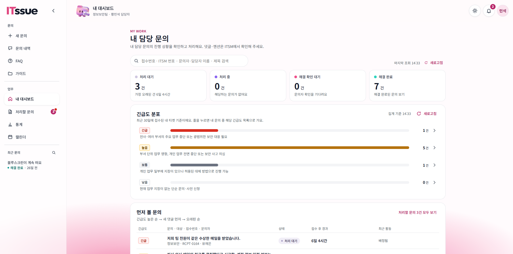

| 구역 | 내용 |
| --- | --- |
| 검색 | 접수번호·ITSM 번호·문의자·담당자 이름·제목으로 내 담당 문의를 찾습니다. 결과는 최근 접수 10건까지 보이고, **검색 지우기**로 닫습니다. |
| 상태 바로가기 | **처리 대기**, **처리 중**, **해결 확인 대기**, **해결 완료** 건수. 누르면 [처리할 문의](#33-처리할-문의)의 해당 탭으로 갑니다. 처리 대기·처리 중 아래에는 가장 오래된 건의 경과 시간이 나옵니다. |
| 긴급도 분포 | 최근 30일에 접수된 내 티켓의 긴급도별 건수. 줄을 누르면 그 긴급도의 목록으로 갑니다. |
| 먼저 볼 문의 | 지금 처리할 문의를 "긴급도 높은 순 → 새 댓글 먼저 → 오래된 순"으로 보여 줍니다. 줄을 누르면 티켓 상세가 열립니다. **처리할 문의 N건 모두 보기**로 전체 목록에 갑니다. |

- 최신 상태로 다시 읽으려면 **새로고침**을 누릅니다. 옆에 "마지막 조회 HH:MM"이 보입니다.

### 3.3 처리할 문의

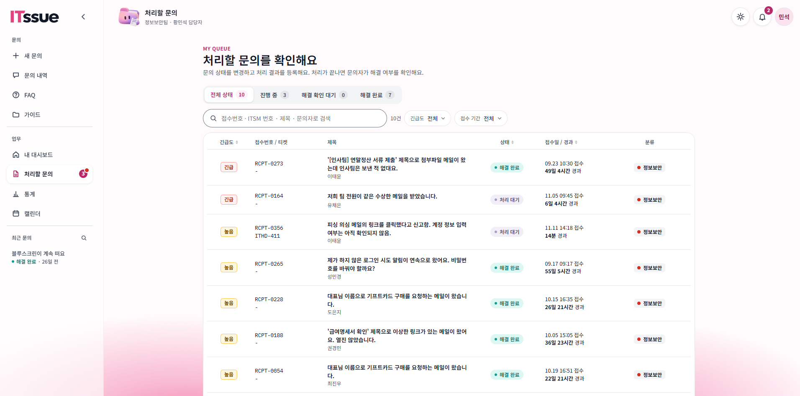

1. 사이드바에서 **처리할 문의**를 누릅니다.
2. 위쪽 탭에서 상태를 고릅니다.
3. 필요하면 검색 칸과 필터로 좁힙니다.
4. 처리할 티켓 줄을 누릅니다. 오른쪽에 티켓 상세가 열립니다([3.4](#34-티켓-상세-보기)).

| 탭·필터 | 값 |
| --- | --- |
| 상태 탭 | **전체 상태** · **진행 중** · **해결 확인 대기** · **해결 완료**. **진행 중**을 고르면 그 아래에 **전체 진행 중** · **처리 대기** · **처리 중**이 나옵니다. |
| 검색 | 접수번호 · ITSM 번호 · 제목 · 문의자 |
| **긴급도** | 긴급 · 높음 · 보통 · 낮음 |
| **접수 기간** | 오늘 · 최근 30일 · 최근 1년 |

표의 열은 긴급도, 접수번호 / 티켓, 제목, 상태, 접수일 / 경과, 분류입니다.

### 3.4 티켓 상세 보기

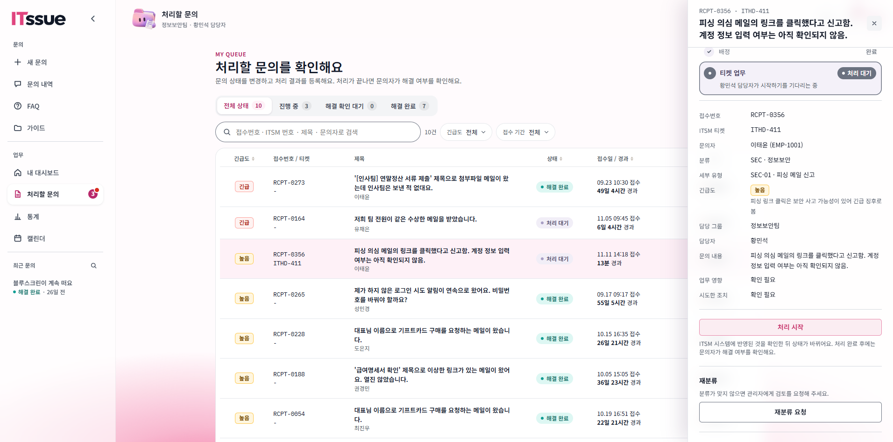

티켓 상세는 위에서부터 아래 순서로 구성됩니다.

1. 처리 상태: 문의 상태, ITSM 연동, 배정, 티켓 업무, 상태 변경이 한 줄씩 보입니다. 진행 중인 줄에는 지금 상황이 짧게 붙습니다. 예: "ITSM 티켓을 만드는 중", "담당 그룹에서 담당자를 정하는 중"
2. 접수 정보: 접수번호, ITSM 티켓, 문의자(이름과 사번), 분류, 세부 유형, 긴급도와 그 이유, 담당 그룹, 담당자, 문의 내용, 업무 영향, 시도한 조치, AI 안내, 처리 결과
3. 처리 버튼: **처리 시작** 또는 **처리 완료** ([3.5](#35-처리-시작하고-처리-결과-등록하기))
4. **재분류** 구역: 분류가 맞지 않을 때 쓰는 구역 ([3.6](#36-분류가-맞지-않을-때-재분류-요청))
5. **처리 이력**: 상태 변경, 담당자 배정·재배정, 재분류 요청·반려가 최근 순으로 쌓입니다. 처리 완료 때의 처리 결과와 문의자가 미해결을 고를 때 적은 남은 증상도 여기에 남습니다.

- 다른 담당자가 맡은 티켓이면 "다른 담당자가 맡은 접수예요. 상태는 맡은 담당자만 바꿀 수 있어요."가 보입니다.
- 닫으려면 오른쪽 위 **닫기**(✕)를 누릅니다.

### 3.5 처리 시작하고 처리 결과 등록하기

#### 처리 시작

1. 처리할 문의에서 상태가 **처리 대기**인 티켓을 엽니다.
2. **처리 시작**을 누릅니다.
3. "ITSM 시스템 반영을 확인하고 있어요. 확인되면 상태가 바뀌어요."가 사라질 때까지 기다립니다.

상태가 **처리 중**으로 바뀌고, 버튼이 **처리 완료**로 바뀝니다.

#### 처리 완료와 처리 결과 등록

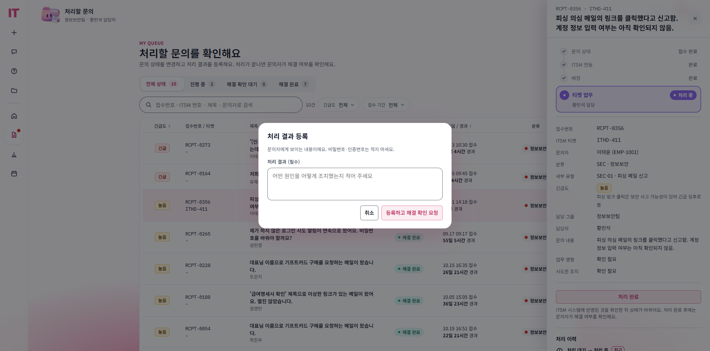

1. 상태가 **처리 중**인 티켓을 엽니다.
2. **처리 완료**를 누릅니다.
3. "처리 결과 등록" 창의 **처리 결과** 칸에 어떤 원인을 어떻게 조치했는지 적습니다.
4. **등록하고 해결 확인 요청**을 누릅니다.

- 처리 결과는 문의자에게 그대로 보입니다. 비밀번호·인증번호는 적지 않습니다.
- 처리 결과는 1~4,000자로 적습니다.
- 등록하면 상태가 **해결 확인 대기**가 되고, 문의자에게 "문의가 처리 완료됐어요" 알림이 갑니다.
- 화면에 "문의자의 해결 확인을 기다리고 있어요. 미응답만으로 종료하지 않아요."가 보입니다.
- 문의자가 **해결**을 고르면 **해결 완료**가 됩니다.
- 문의자가 **미해결**을 고르면 **처리 중**으로 돌아옵니다. 처리 이력에 문의자가 적은 "남은 증상"이 남으니, 확인하고 다시 처리합니다.

#### 처리 시작·처리 완료 버튼이 눌리지 않을 때

아래 중 하나에 해당하면 버튼이 꺼져 있습니다. 조건이 풀리면 다시 켜집니다.

- ITSM 티켓 생성이 아직 끝나지 않았습니다.
- 담당자 배정이 아직 끝나지 않았습니다.
- 앞서 누른 상태 변경을 ITSM에 반영하는 중입니다.
- 재분류 검토를 기다리는 중입니다. 이때는 "재분류 검토·자동배정 반영이 끝날 때까지 처리 시작·완료를 할 수 없어요."가 보입니다.

### 3.6 분류가 맞지 않을 때: 재분류 요청

분류가 잘못돼 내 팀이 처리할 문의가 아니면, 관리자에게 재분류 검토를 요청합니다.

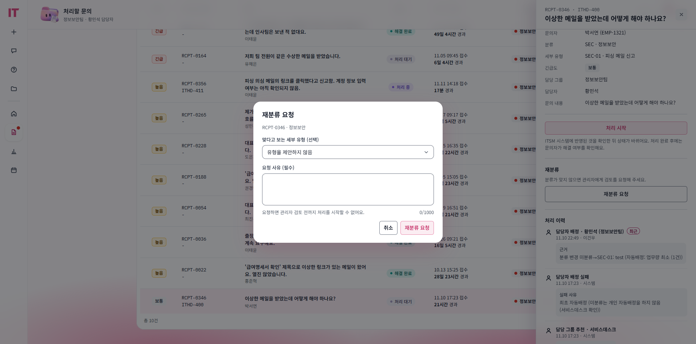

1. 티켓 상세의 **재분류** 구역에서 **재분류 요청**을 누릅니다.
2. 맞다고 보는 유형이 있으면 **맞다고 보는 세부 유형 (선택)** 에서 고릅니다. 모르면 "유형을 제안하지 않음"으로 둡니다.
3. **요청 사유 (필수)** 칸에 이유를 적습니다. 1,000자까지 쓸 수 있습니다.
4. 창 아래의 **재분류 요청**을 누릅니다.

- "재분류 검토를 요청했어요."가 나오고, 구역에 "재분류 검토 대기예요."가 보입니다.
- 관리자 검토가 끝날 때까지는 처리 시작·완료를 할 수 없습니다. 문의는 처리 대기 상태로 유지됩니다.
- 관리자가 분류를 바꾸면 새 처리 그룹의 담당자에게 자동으로 배정됩니다.
- 관리자가 반려하면 "재분류 요청이 반려됐어요."와 반려 사유가 보입니다. 같은 문의에서는 다시 요청할 수 없습니다.

### 3.7 통계

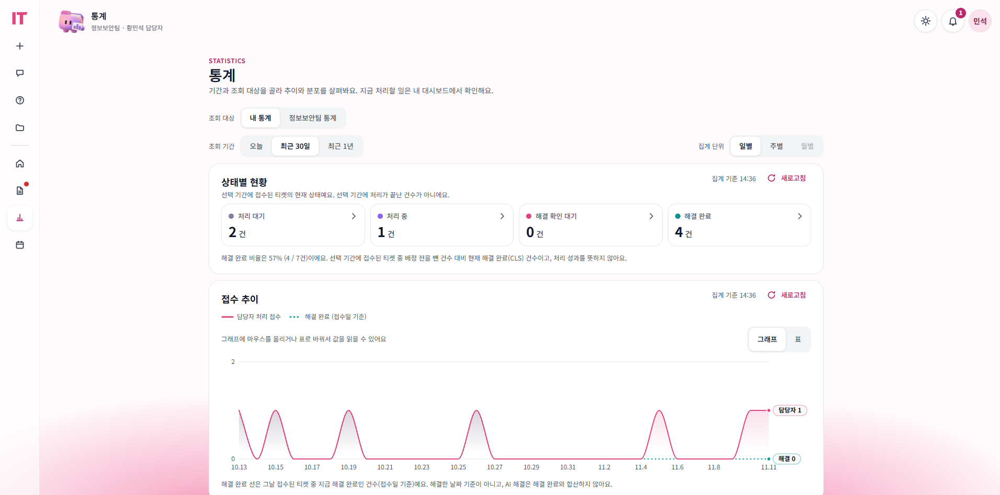

1. 사이드바에서 **통계**를 누릅니다.
2. **조회 대상**에서 **내 통계** 또는 **(팀 이름) 통계**를 고릅니다.
3. **조회 기간**에서 **오늘**, **최근 30일**, **최근 1년** 중 하나를 고릅니다.
4. **집계 단위**에서 **일별**, **주별**, **월별** 중 하나를 고릅니다. 기간에 맞지 않는 단위는 꺼져 있습니다.

| 구역 | 내용 |
| --- | --- |
| 상태별 현황 | 선택 기간에 접수된 티켓의 지금 상태별 건수와 해결 완료 비율. 칸을 누르면 처리할 문의의 해당 목록으로 갑니다. |
| 접수 추이 | 담당자 처리 접수와 해결 완료(접수일 기준) 선 그래프. **그래프**와 **표**를 바꿔 볼 수 있습니다. 기간이 오늘이면 그래프 대신 오늘 건수만 보입니다. |
| 팀원별 진행도 | 팀 통계에서만 보입니다. 카드에 마우스를 올리면 상태별 건수가, 누르면 자세한 내용이 보입니다. |

- 해결 완료 비율과 팀원별 진행도는 업무량을 확인하는 용도입니다. 처리 성과나 평가 순위를 뜻하지 않습니다.
- 한 구역을 불러오지 못하면 그 구역에만 "이 구역을 불러오지 못했어요."가 나옵니다. **다시 시도**를 누릅니다.

### 3.8 캘린더

연차·반차를 등록하는 화면입니다. 등록한 시간에는 자동 배정에서 빠집니다. 일정은 본인 것만 등록하고 삭제할 수 있습니다.

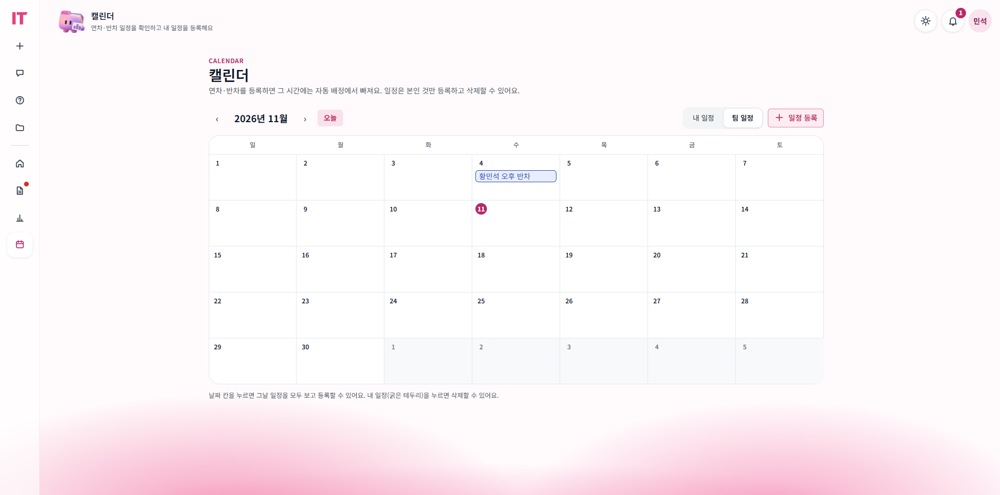

#### 일정 등록하기

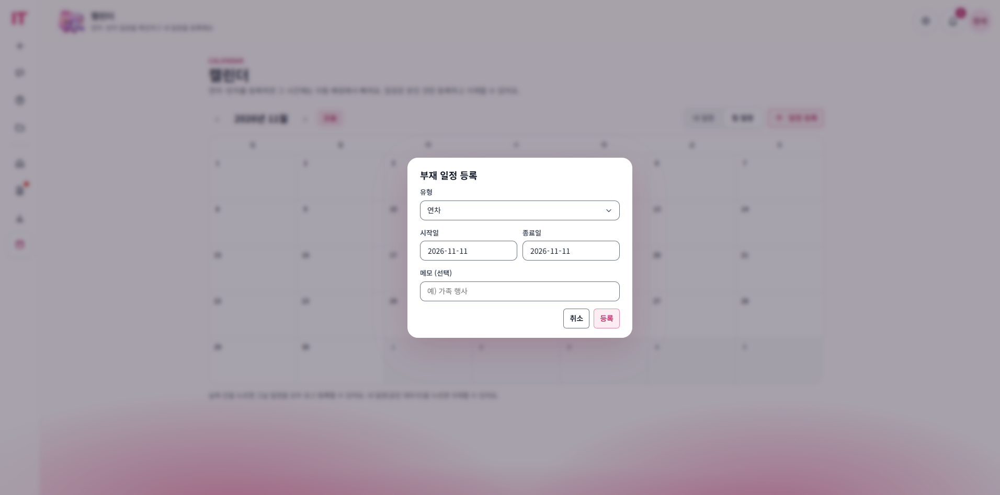

1. 사이드바에서 **캘린더**를 누릅니다.
2. **일정 등록**을 누릅니다.
3. **유형**에서 **연차**, **오전 반차**, **오후 반차** 중 하나를 고릅니다.
4. **시작일**을 정합니다. 반차는 이 칸이 **날짜** 하나로 바뀝니다.
5. 연차면 **종료일**을 정합니다.
6. 필요하면 **메모 (선택)** 를 적습니다. 500자까지 쓸 수 있습니다.
7. **등록**을 누릅니다.

날짜 칸을 눌러 그날 일정을 본 뒤 **이 날 일정 등록**을 눌러도 됩니다.

#### 일정 삭제하기

1. 달력에서 내 일정을 누릅니다. 내 일정은 굵은 테두리로 보입니다.
2. 확인 창에서 **삭제**를 누릅니다.

삭제하면 그 기간에도 다시 자동 배정 대상이 됩니다.

#### 보기 바꾸기

- **내 일정**과 **팀 일정** 중에서 고릅니다.
- **‹**·**›** 로 달을 옮기고, **오늘**로 이번 달에 돌아옵니다.

---

## 4. 관리자

관리자 메뉴는 사이드바 **운영** 묶음의 순서대로 설명합니다. 끝에 FAQ 관리를 덧붙였습니다.

### 4.0 로그인 직후에 뜨는 창

#### 새 보안·감사 알림

확인을 시작하지 않은 신규 보안·감사 알림이 있으면 로그인 직후 "새 보안·감사 알림이 있어요" 창이 뜹니다. "검토가 필요한 신호이며, 보안 사고나 위반이 확정된 것은 아니에요."

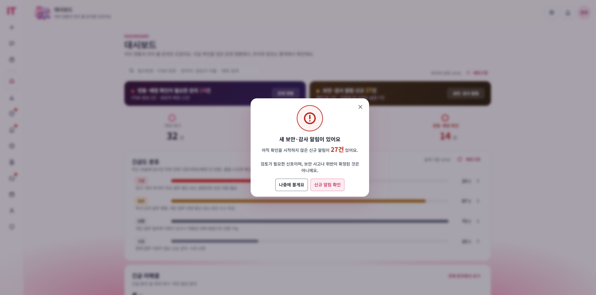

1. 바로 보려면 **신규 알림 확인**을 누릅니다. [보안·감사 알림](#44-보안감사-알림) 화면이 신규 알림만 걸러서 열립니다.

나중에 보려면 **나중에 볼게요**를 누릅니다.

#### 가이드 적재 실패

검색 준비(적재)에 실패한 가이드가 있으면 어느 화면에서든 "가이드 적재에 실패했어요" 창이 뜹니다. 실패한 가이드는 현행으로 바꿀 수 없습니다.

1. **가이드 관리에서 보기**를 누릅니다.
2. [가이드 관리](#47-가이드-관리)에서 실패한 버전을 다시 시도합니다.

나중에 하려면 **나중에 볼게요**를 누릅니다.

### 4.1 대시보드

처리 현황과 먼저 볼 문의를 모은 첫 화면입니다.

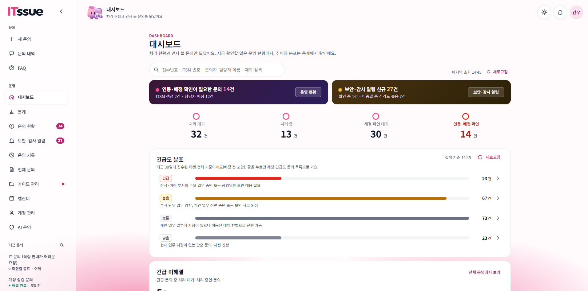

| 구역 | 내용 | 누르면 |
| --- | --- | --- |
| 검색 | 접수번호·ITSM 번호·문의자·담당자 이름·제목으로 모든 문의 검색 (최근 접수 10건까지) | 티켓 상세 |
| 연동·배정 확인이 필요한 문의 | ITSM 생성 · 상태 동기화 · 담당자 배정별 건수 | **운영 현황** |
| 보안·감사 알림 신규 | 신규 건수, 확인 중 건수, 미종결 중 심각도 높음 건수 | **보안·감사 알림** |
| 처리 현황 | **처리 대기** · **처리 중** · **해결 확인 대기** · **연동·배정 확인** 건수 | 전체 문의의 해당 목록, 또는 운영 현황 |
| 긴급도 분포 | 최근 30일에 접수된 전체 티켓(배정 전 포함)의 긴급도별 건수 | 그 긴급도의 전체 문의 목록 |
| 긴급 미해결 | 긴급 문의 중 처리 대기·처리 중인 것. 접수가 오래된 순으로 3건 | **전체 문의에서 보기** |

- 추이·분포·진행도는 **통계 보기**를 눌러 [통계](#42-통계)에서 봅니다.
- 최신 상태로 다시 읽으려면 **새로고침**을 누릅니다.

### 4.2 통계

티켓(담당자 처리)과 AI 해결을 나눠서 보여 줍니다.

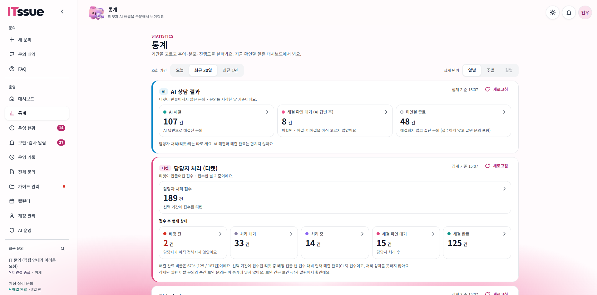

1. 사이드바에서 **통계**를 누릅니다.
2. **조회 기간**을 고릅니다.
3. **집계 단위**를 고릅니다.

| 구역 | 내용 |
| --- | --- |
| AI 상담 결과 | 티켓이 만들어지지 않은 문의를 문의 시작일 기준으로 셉니다. **AI 해결**, **해결 확인 대기 (AI 답변 후)**, **미연결 종료**. 누르면 [전체 문의](#46-전체-문의)의 AI 처리 목록으로 갑니다. |
| 담당자 처리 (티켓) | 티켓이 만들어진 접수를 접수일 기준으로 셉니다. **담당자 처리 접수** 전체와, 접수 후 현재 상태(**배정 전**, **처리 대기**, **처리 중**, **해결 확인 대기**, **해결 완료**), 해결 완료 비율 |
| 접수 추이 | 담당자 처리 접수와 해결 완료(접수일 기준) 선 그래프 |
| 팀별 진행도 | 팀별 막대. 팀을 누르면 아래에 구성원별 진행도 카드가 나옵니다. 카드의 **티켓 목록 ›** 으로 그 사람의 티켓 목록에 갑니다. |

- AI 해결과 해결 완료는 합치지 않고 따로 셉니다.
- 응답이 없어 정리된 문의와 숨긴 보안 문의는 통계에 넣지 않습니다. 보안 건은 보안·감사 알림에서 확인합니다.
- AI 해결의 일별·주별 추이는 그리지 않습니다. 기간 합계는 AI 상담 결과에서 봅니다.

### 4.3 운영 현황

연동·배정 확인이 필요한 문의와 팀원별 진행 중인 업무를 보는 화면입니다. 지금 처리되지 않은 전체 문의를 기준으로 합니다.

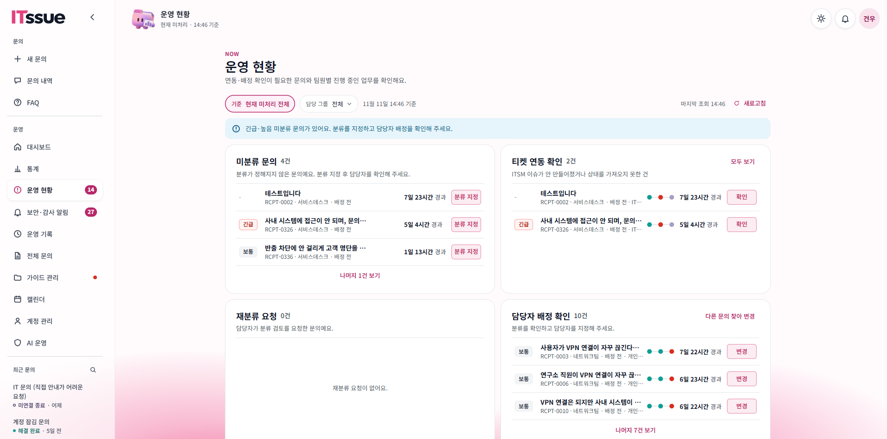

| 구역 | 내용 | 버튼 |
| --- | --- | --- |
| 최근 처리 결과 | 이 화면에서 요청한 일과 그 결과. 화면을 새로 열면 지워집니다. | **처리 이력 보기** |
| 미분류 문의 | 분류가 정해지지 않은 문의. 긴급·높음 건이 있으면 위에 경고가 나옵니다. | **분류 지정** |
| 티켓 연동 확인 | ITSM 이슈가 안 만들어졌거나 상태를 가져오지 못한 건 | **확인** |
| 재분류 요청 | 담당자가 분류 검토를 요청한 문의 | **검토** |
| 담당자 배정 확인 | 개인 배정을 확인해야 하는 건 | **변경**, **다른 문의 찾아 변경** |
| 팀별 개인 현황 | 담당 그룹별 구성원의 오늘 상태(근무·부재), 처리 대기·처리 중 건수, 긴급도, ITSM 계정 연결 여부, 비고 | 이름을 누르면 그 사람의 처리 대기·처리 중 티켓 목록 |

- 위쪽 **담당 그룹**으로 한 팀만 볼 수 있습니다.
- 목록의 줄(버튼 말고 제목 부분)을 누르면 티켓 상세가 열립니다.
- 목록이 3건을 넘으면 **나머지 N건 보기**로 펼칩니다.
- 비고의 "부재 중 · 자동배정 제외"는 캘린더에 부재 일정이 있는 사람, "ITSM 배정 반영 불가"는 ITSM 계정이 연결되지 않은 사람입니다.

#### ITSM 생성·상태 확인하고 다시 처리하기

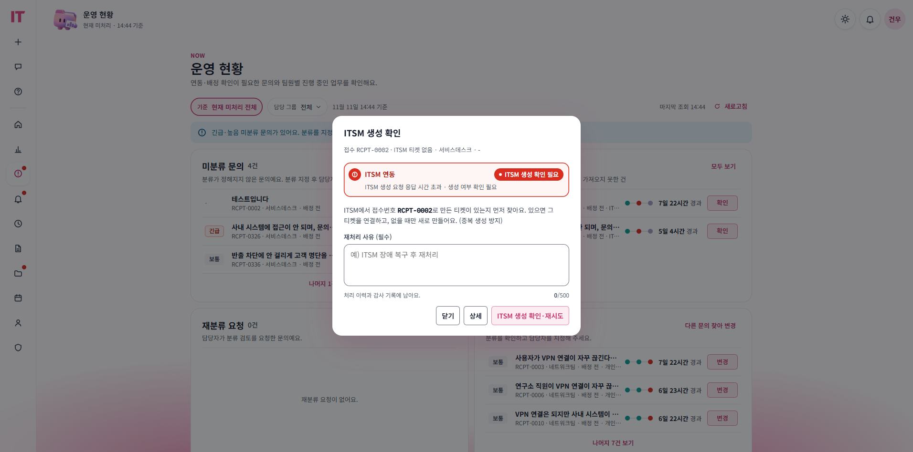

1. **티켓 연동 확인** 목록에서 **확인**을 누릅니다.
2. 창에서 "확인이 필요한 내용"을 읽습니다.
3. **재처리 사유 (필수)** 칸에 이유를 적습니다. 예: "ITSM 장애 복구 후 재처리"
4. 창 아래의 실행 버튼을 누릅니다. 버튼 이름은 문제에 따라 둘 중 하나입니다.
   - **ITSM 생성 확인·재시도**: ITSM에서 접수번호로 만든 티켓이 있는지 먼저 찾습니다. 있으면 그 티켓을 연결하고, 없을 때만 새로 만듭니다. 그래서 중복으로 만들어지지 않습니다.
   - **ITSM 상태 확인·다시 반영**: ITSM의 현재 상태를 먼저 읽습니다. 이미 바뀌어 있으면 완료로 처리하고, 아니면 바꾸는 요청을 다시 보냅니다.

- 사유는 처리 이력과 감사 기록에 남습니다.
- 실행하면 "재처리를 등록했어요. 실행기가 처리하면 상태가 바뀌어요."가 나오고, 결과는 **최근 처리 결과**에 쌓입니다.
- 티켓 상세에서도 같은 일을 할 수 있습니다. 상세의 **ITSM 확인·재시도** 버튼을 누릅니다.
- 창의 **상세**를 누르면 그 티켓의 상세가 열립니다.

#### 담당자 지정·재배정하기

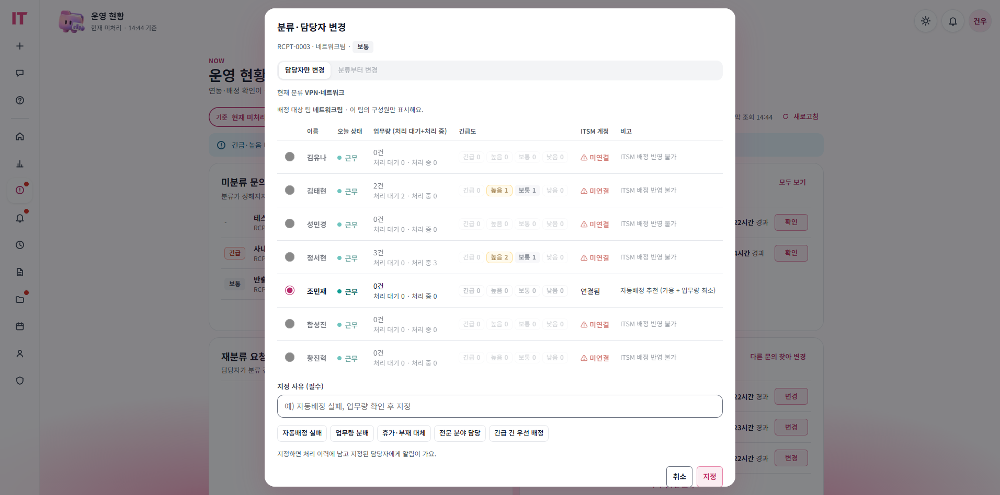

1. **담당자 배정 확인** 목록에서 **변경**을 누릅니다. 티켓 상세의 **담당자 지정** 또는 **담당자 변경**을 눌러도 됩니다.
2. **담당자만 변경**이 선택된 상태인지 확인합니다.
3. 표에서 맡길 사람을 고릅니다.
4. 사유 칸에 이유를 적습니다. 자주 쓰는 사유 버튼을 눌러 채워도 됩니다.
5. **지정** 또는 **재배정**을 누릅니다.

- 표에는 배정 대상 팀의 구성원만 보입니다. 열은 이름, 오늘 상태, 업무량(처리 대기+처리 중), 긴급도, ITSM 계정, 비고입니다.
- 비고의 "자동배정 추천 (가용 + 업무량 최소)"은 근무 중이고 업무량이 가장 적은 사람입니다.
- 부재 중인 사람에게도 예외로 지정할 수 있습니다. 이때는 사유에 이유를 남깁니다. ITSM 계정이 연결되지 않은 사람에게는 배정이 반영되지 않습니다.
- 지정·재배정은 처리 이력에 남고 새 담당자에게 알림이 갑니다. 진행 상태는 그대로 유지됩니다.
- 분류부터 바꾸려면 2단계에서 **분류부터 변경**을 고릅니다. 처리 대기 상태일 때만 고를 수 있습니다.

#### 분류 지정·재분류와 재분류 요청 검토

티켓 상세의 **분류·담당자 지정** 구역에서 합니다.

1. 버튼을 누릅니다.
   - 미분류 문의: **분류 지정**
   - 분류를 바꿀 문의: **분류 변경**
   - 담당자가 재분류를 요청한 문의: **재분류 검토**
2. **세부 유형 (필수)** 을 고릅니다.
3. 창에 나온 처리 그룹을 확인합니다.
4. 사유 칸(**분류 지정 사유** 또는 **재분류 사유**)에 이유를 적습니다. 500자까지 쓸 수 있습니다.
5. **분류 지정** 또는 **재분류 지정**을 누릅니다.

- 처리 그룹이 바뀌면 새 그룹에서 담당자가 자동으로 배정됩니다. 같은 그룹이면 지금 담당자가 그대로 맡습니다.
- 분류와 배정 결과는 ITSM에 차례로 반영됩니다. 시간이 걸릴 수 있고, 그동안 진행 상태는 처리 대기로 유지됩니다.

재분류 요청을 받아들이지 않으려면 반려합니다.

1. **재분류 반려**를 누릅니다.
2. **반려 사유 (필수)** 를 적습니다.
3. **반려**를 누릅니다.

반려 사유는 담당자에게 보입니다. 반려한 뒤에는 그 문의에서 다시 요청할 수 없습니다.

관리자의 티켓 상세에는 **AI 판단 이력**도 보입니다. AI가 처음 판단한 긴급도·분류, 규칙이 바꾼 내역, 최종 적용 값, AI가 더 물어본 내용이 판단 순서대로 나옵니다.

### 4.4 보안·감사 알림

ITssue 안에서 감지된 보안 신호를 확인하는 화면입니다. 문의가 접수되지 않았어도 감지된 신호가 모입니다. 사내 보안 관제를 대체하지 않고, 티켓과도 따로 관리합니다.

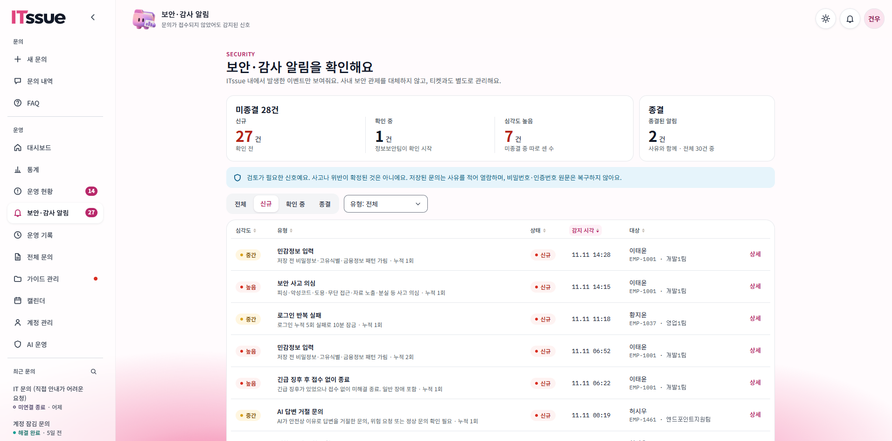

> 검토가 필요한 신호예요. 사고나 위반이 확정된 것은 아니에요. 저장된 문의는 사유를 적어 열람하며, 비밀번호·인증번호 원문은 복구하지 않아요.

위쪽에는 미종결 건수(**신규**·**확인 중**), 미종결 중 **심각도 높음** 건수, **종결된 알림** 건수가 보입니다.

#### 거르기

- 처리 상태: **전체** · **신규** · **확인 중** · **종결**. 처음 열면 신규만 보입니다.
- 유형: 민감정보 입력, 외부 전송 금지 문서 질의, 로그인 반복 실패, 이용 제한 계정 접속 시도, 긴급 징후 후 접수 없이 종료, 비정상 대량 질의, 보안 사고 의심, 권한·승인 우회 요청, 보안 통제 해제·기록 은폐 요청, 제한 정보 추출 요청, 자료 반출 우회 요청, AI 통제 우회 요청, AI 답변 거절 문의

표의 열은 심각도(높음·중간·낮음), 유형, 상태, 감지 시각, 대상입니다. 목록은 약 30초마다 새로 확인합니다.

#### 알림 확인하고 종결하기

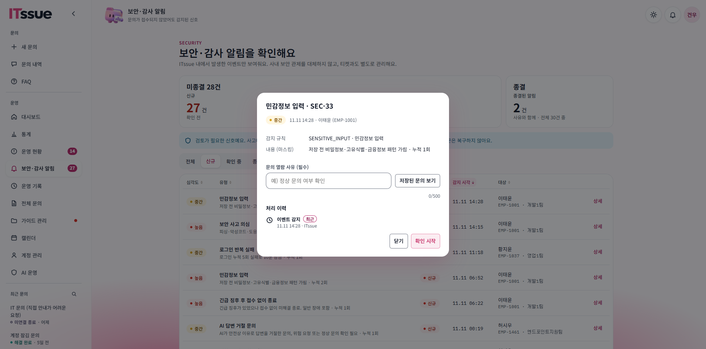

1. 확인할 알림 줄의 **상세**를 누릅니다.
2. 감지 규칙과 "내용 (마스킹)"을 읽습니다.
3. 확인을 시작하려면 **확인 시작**을 누릅니다. 상태가 **확인 중**으로 바뀝니다.
4. 저장된 문의를 봐야 하면 **문의 열람 사유 (필수)** 칸에 이유를 적습니다. 예: "정상 문의 여부 확인"
5. **저장된 문의 보기**를 누릅니다. 비밀값은 가려진 채로 보이고, 열람 기록이 남습니다.
6. 확인이 끝나면 **종결 (사유 입력)** 을 누릅니다.
7. "알림 종결" 창의 **종결 사유 (필수)** 를 적습니다. 예: "정상 문의로 확인"
8. **종결**을 누릅니다.

상세 아래의 **처리 이력**에 감지, 확인 시작, 열람, 종결이 순서대로 남습니다.

### 4.5 운영 기록

ITssue에서 일어난 주요 처리 기록입니다. AI 판단·접수 확정·담당자 배정·실패 같은 기록이 남습니다. 대화 원문은 남기지 않고 결과와 사유만 보여 줍니다.

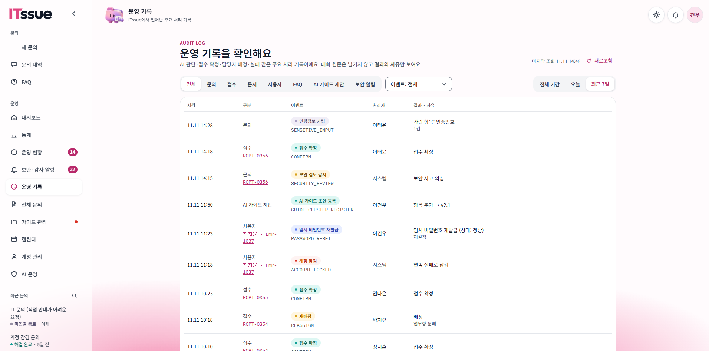

1. 사이드바에서 **운영 기록**을 누릅니다.
2. **구분**을 고릅니다: **전체** · **문의** · **접수** · **문서** · **사용자** · **FAQ** · **AI 가이드 제안** · **보안 알림**
3. 필요하면 **이벤트** 목록에서 한 가지 이벤트를 고릅니다.
4. **기간**을 고릅니다: **전체 기간** · **오늘** · **최근 7일**

- 표의 열은 시각, 구분, 이벤트, 처리자, 결과 · 사유입니다. 사람이 아닌 자동 처리는 처리자가 "시스템"으로 보입니다.
- 접수번호를 누르면 그 티켓의 상세가 열립니다.
- 사용자 이름을 누르면 [계정 관리](#49-계정-관리)에서 그 사람을 검색한 화면으로 갑니다.
- 이벤트 예: 접수 확정, 재배정, 분류 변경, 재분류 요청, 연동 재처리, 민감정보 가림, 근거 차단, AI 실패, 긴급 건 종료, 현행 버전 전환, 열람·전송 정책 변경, 계정 생성, 역할 변경, 계정 상태 변경, 임시 비밀번호 재발급, 계정 잠김, FAQ 삭제, FAQ 자동 중단, 보안 알림 확인 시작·종결·문의 열람

### 4.6 전체 문의

모든 문의를 보는 화면입니다. 위쪽 **구분**에서 **담당자 처리**와 **AI 처리**를 바꿉니다.

#### 담당자 처리 (티켓)

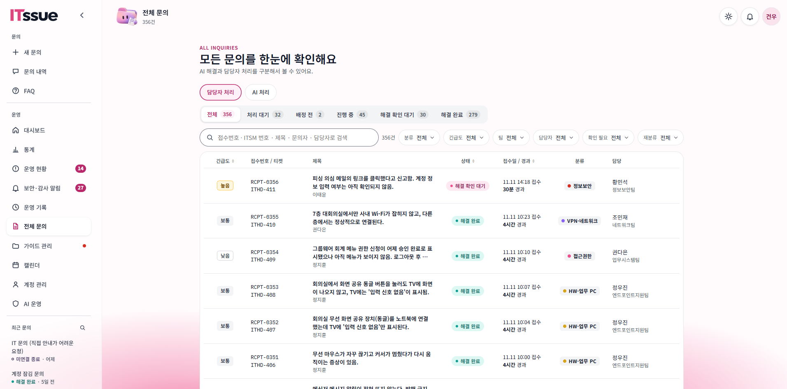

| 탭·필터 | 값 |
| --- | --- |
| 처리 상태 탭 | **전체** · **처리 대기** · **배정 전** · **진행 중** · **해결 확인 대기** · **해결 완료**. **진행 중** 아래에 **전체 진행 중** · **처리 대기** · **처리 중**이 나옵니다. |
| 검색 | 접수번호 · ITSM 번호 · 제목 · 문의자 · 담당자 |
| **분류** | 7개 분류 |
| **긴급도** | 긴급·높음 · 긴급 · 높음 · 보통 · 낮음 |
| **팀** · **담당자** | 팀, 사람 |
| **확인 필요** | 확인 필요만 |
| **재분류** | 검토 대기만 |

- 조건을 모두 지우려면 **✕ 필터 해제**를 누릅니다. 대시보드·통계에서 넘어오면 **접수 기간** 조건이 붙어 있을 수 있습니다. 옆의 ✕로 풉니다.
- 표의 열은 긴급도, 접수번호 / 티켓, 제목, 상태, 접수일 / 경과, 분류, 담당입니다. 재분류를 기다리는 건에는 "재분류 검토 대기" 표시가 붙습니다.
- 줄을 누르면 티켓 상세가 열립니다. 관리자는 상세에서 ITSM 확인·재시도, 분류·담당자 지정, AI 판단 이력을 볼 수 있습니다([4.3](#43-운영-현황)).

#### AI 처리

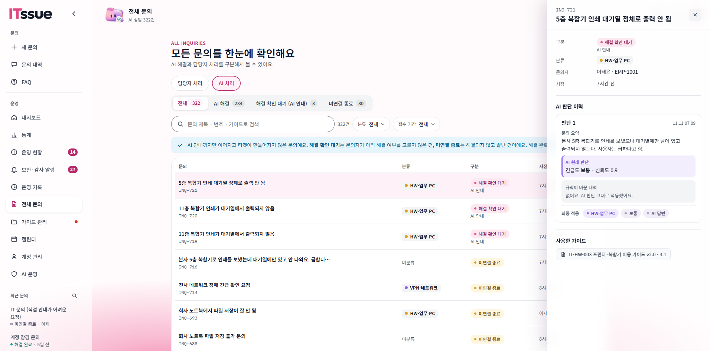

AI 안내까지만 이어지고 티켓이 만들어지지 않은 문의입니다.

1. **구분**에서 **AI 처리**를 누릅니다.
2. 탭을 고릅니다: **전체** · **AI 해결** · **해결 확인 대기 (AI 안내)** · **미연결 종료**
3. 필요하면 검색(문의 제목·번호·가이드)과 **분류**·**접수 기간**으로 좁힙니다.
4. 줄을 누릅니다.

오른쪽 상세에는 구분, 분류, 문의자, 시점, **사용한 가이드**, **참고한 과거 처리 사례**가 나옵니다. 사용한 가이드를 누르면 AI가 근거로 쓴 본문이 열립니다. 사용한 가이드가 없으면 근거를 찾지 못했거나 차단되어 AI가 답하지 못했을 수 있습니다.

### 4.7 가이드 관리

AI 답변의 근거가 되는 가이드 문서를 관리합니다. 현행 버전 중 검색 준비가 끝난 버전만 AI 답변에 쓰입니다.

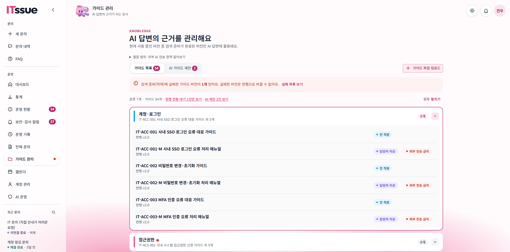

#### 두 가지 정책

| 정책 | 뜻 | 값 |
| --- | --- | --- |
| 열람 범위 | 누가 이 가이드를 볼 수 있는지 | 전 직원 · 담당자 이상 · 관리자만 |
| 외부 AI 전송 | 이 가이드 내용을 AI 모델에 보내 답변을 만들어도 되는지 | 허용(그대로 보냄) · 마스킹 후 허용(민감정보를 가린 내용만 보냄) · 금지(보내지 않음) |

- 정하지 않으면 가장 제한적인 값(관리자만·금지)이 됩니다.
- 사용할 수 있는 근거가 없으면 AI는 답하지 않고 담당자 연결을 제안합니다.
- 담당자용 매뉴얼은 외부 AI 전송이 금지로 고정됩니다.

#### 버전 상태

| 구분 | 값 |
| --- | --- |
| 상태 | 현행(지금 쓰는 버전) · 초안(올렸지만 아직 안 쓰는 버전) · 만료(예전 버전) |
| 검색 준비 | 준비 중 · 준비 완료 · 준비 실패 |

#### 화면 사용법

1. 위쪽 **보기**에서 **가이드 목록**을 고릅니다.
2. 분류 이름을 눌러 펼칩니다.
3. 가이드를 눌러 버전 표를 엽니다.

버전 표의 열은 버전, 상태, 검색 준비, 열람 범위, 외부 AI 전송, 현행 관리, 올린 시각, 본문입니다. 본문을 보려면 그 줄의 **보기**를 누릅니다.

목록 위의 버튼으로 거를 수 있습니다: **현행 전환 대기 N건만 보기**, **AI 제안 N건 보기**, **비활성 문서도 보기**(또는 **비활성 문서 숨기기**), **모두 펼치기**.

#### 가이드 파일 올리기

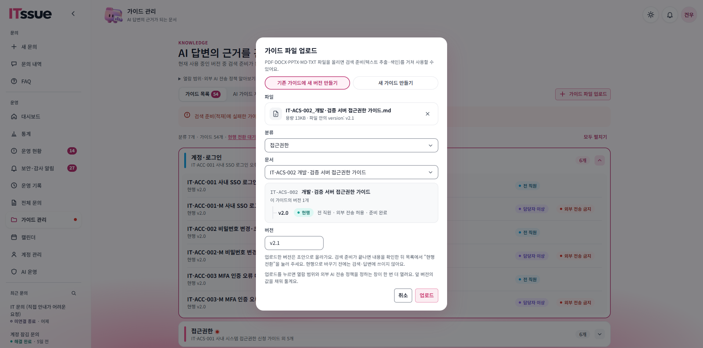

1. **가이드 파일 업로드**를 누릅니다.
2. 방식을 고릅니다: **기존 가이드에 새 버전 만들기** 또는 **새 가이드 만들기**
3. 파일 칸을 눌러 파일을 고릅니다. 끌어다 놓아도 됩니다.
4. **분류**를 고릅니다.
5. 새 버전이면 **문서**를 고릅니다. 새 가이드면 **가이드 제목**을 적습니다.
6. **버전**을 적습니다. 예: v4.0
7. **업로드**를 누릅니다.
8. "등록 설정을 확인해 주세요" 창에서 **열람 범위**를 고릅니다.
9. 같은 창에서 **외부 AI 전송**을 고릅니다.
10. **올리기**를 누릅니다.

5단계는 2단계에서 고른 방식에 따라 둘 중 하나만 합니다.

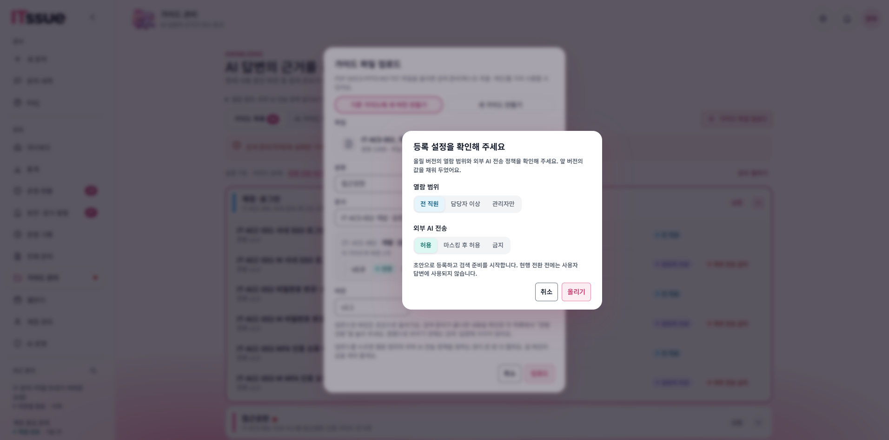

- 파일은 PDF·DOCX·PPTX·MD·TXT 중 1개, 20MB 이하만 올릴 수 있습니다.
- 새 가이드의 문서 번호는 같은 분류의 다음 번호로 자동으로 정해집니다.
- 파일 안에 version 값이 있으면 6단계의 버전과 같아야 합니다. 다르면 칸 아래에 안내가 나옵니다.
- 새 버전을 올리면 앞 버전의 열람 범위·외부 AI 전송 값이 미리 채워집니다.
- 올린 버전은 **초안**으로 들어가고 검색 준비를 시작합니다. 현행으로 바꾸기 전에는 검색·답변에 쓰이지 않습니다.

> 확인 필요: 올린 뒤에 버전의 **열람 범위**를 바꾸는 방법. 버전 표에서는 외부 AI 전송만 바꿀 수 있고, 열람 범위는 보기만 됩니다.

#### 현행으로 바꾸기

1. 가이드의 버전 표를 엽니다.
2. 바꿀 버전의 검색 준비가 "준비 완료"인지 확인합니다.
3. 그 줄의 **보기**를 눌러 본문을 확인합니다.
4. 그 줄의 **현행 전환**을 누릅니다.

- "현행 버전을 바꿨어요."가 나오면 그 버전이 바로 검색·답변에 쓰입니다.
- 만료된 예전 버전도 **현행 전환**으로 다시 현행으로 되돌릴 수 있습니다.
- 그 가이드에 아직 검토하지 않은 AI 가이드 제안이 있으면 "현행을 바꿀 수 없어요" 창이 뜹니다. **AI 가이드 제안 보기**를 눌러 제안을 먼저 처리합니다.

#### 외부 AI 전송 바꾸기

1. 버전 줄의 **외부 AI 전송** 칸에서 바꿀 값(**금지**, **마스킹 후 허용**, **허용**)을 누릅니다.
2. "외부 전송 정책 변경" 창에서 **변경 사유**를 적습니다. 전송 범위가 넓어질 때는 반드시 적습니다.
3. **변경**을 누릅니다.

사유는 운영 기록에 남습니다.

#### 가이드 비활성화·활성화

1. 가이드를 펼친 뒤 **비활성화**(또는 **활성화**)를 누릅니다.
2. 확인 창의 안내를 읽습니다.
3. 창의 **비활성화**(또는 **활성화**)를 누릅니다.

- 비활성화하면 그 가이드의 현행 버전이 검색·답변에서 빠집니다. 그 가이드를 근거로 게시된 FAQ도 자동으로 내려갑니다. 목록에는 남고 문서 번호도 바뀌지 않습니다.
- 다시 활성화하면 비활성화 전의 현행 버전이 바로 검색·답변에 쓰입니다. 내려간 FAQ는 다시 게시되지 않으니 [FAQ 관리](#411-faq-관리)에서 직접 다시 게시합니다.

#### 검색 준비에 실패했을 때

1. 버전 표에서 "준비 실패 · 사유 보기"를 누릅니다.
2. "검색 준비에 실패했어요" 창에서 실패 사유를 읽습니다.
3. 둘 중 하나를 누릅니다.
   - **같은 파일로 다시 시도**
   - **파일 바꿔 시도**: 글자를 추출할 수 있는 원본 파일로 바꿔 올립니다.

같은 파일을 새로 올릴 수는 없습니다. 실패한 버전은 현행으로 바꿀 수 없습니다.

#### AI 가이드 제안

AI가 주 1회, 아직 가이드에 반영하지 않은 해결 완료 사례를 분석해 비슷한 사례를 묶어 제안합니다. 승인하면 현행이 아닌 초안 버전으로 가이드 목록에 들어가고, 현행 전환은 검색 준비가 끝난 뒤 직접 합니다.

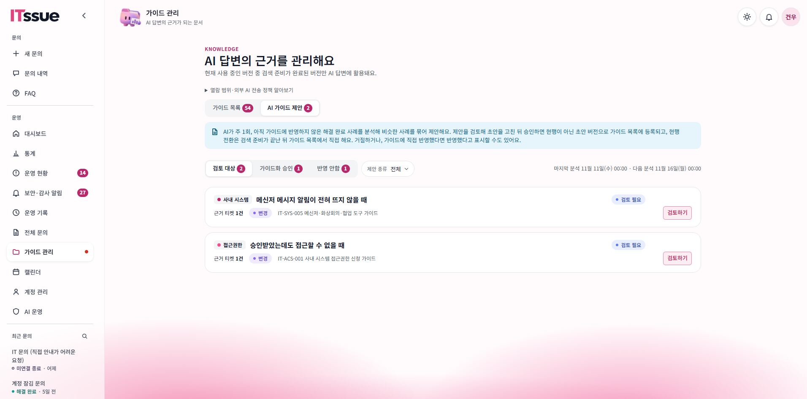

- 위쪽 **보기**에서 **AI 가이드 제안**을 누르면 열립니다.
- 탭: **검토 대상** · **가이드화 승인** · **반영 안함**
- **제안 종류**: 가이드 제안 · 매뉴얼 후보 · 보안 사고 사례
- 마지막 분석·다음 분석 시각이 보입니다. 분석이 실패하면 "가장 최근 분석이 실패했어요"가 붙습니다.

##### 제안을 가이드 초안으로 등록하기

1. 제안의 **검토하기**를 누릅니다.
2. **근거 티켓**과 **AI 판단**을 읽습니다.
3. **AI 수정 제안문**(새 가이드는 **본문**)을 읽고 필요한 곳을 고칩니다.
4. **임시 저장**을 누릅니다.
5. **승인하고 초안 등록**을 누릅니다.
6. 등록 설정 창에서 **열람 범위**와 **외부 AI 전송**을 고릅니다.
7. **초안으로 등록**을 누릅니다.
8. 검색 준비가 끝나면 **현행으로 전환**을 누릅니다. 가이드 목록의 **현행 전환**으로 해도 됩니다.

- "AI가 추측해서 쓴 칸"이 표시되면 사실과 맞는지 확인하고 고칩니다.
- 본문에 "(작성 필요)"가 남아 있으면 그 장을 채운 뒤 임시 저장해야 등록할 수 있습니다.
- 넣을 문서를 바꾸거나 연결하려면 **넣을 문서 변경**(또는 **문서 연결**)을 누릅니다.
- 제안을 만든 뒤 기준 가이드가 바뀌었으면 등록할 수 없습니다. **최신 버전과 비교**로 확인하고 **다시 맞추기**를 누른 뒤 고쳐서 저장합니다.

##### 반영하지 않기

1. **반영 안함**을 누릅니다.
2. **사유 (필수)** 를 적습니다.
3. 창의 **반영 안함**을 누릅니다.

##### 직접 반영했다고 표시하기

가이드나 매뉴얼에 이미 직접 반영했으면 표시만 합니다. 표시하면 되돌릴 수 없습니다.

1. **직접 반영 표시**를 누릅니다. 매뉴얼 후보는 **매뉴얼에 반영했어요**, 보안 사고 사례는 **가이드·매뉴얼에 반영했어요**입니다.
2. 확인 창의 **반영했어요**를 누릅니다.

매뉴얼 후보와 보안 사고 사례는 가이드 초안을 만들지 않습니다. 내용을 참고해 직접 반영한 뒤 표시합니다.

### 4.8 캘린더

담당자의 [캘린더](#38-캘린더)와 같습니다. 관리자에게는 차이가 두 가지 있습니다.

- 보기 버튼이 **내 일정**과 **전체**입니다.
- **팀** 버튼으로 한 팀의 일정만 볼 수 있습니다. 여러 팀을 함께 볼 때는 이름 앞에 팀 이름 앞 두 글자가 붙습니다. 예: [네트] 정서현 연차

### 4.9 계정 관리

ITssue 이용 권한을 관리합니다. 사내 시스템의 실제 접근권한 승인은 별도 절차이고, ITssue 접수가 이를 대신하지 않습니다. 회원가입 기능은 없고, 신규 입사자는 관리자가 계정을 만들어 줍니다.

#### 목록 보기

- 검색: 이름·사번·부서
- 거르기: **부서**, **역할**, 상태 탭(**전체** · **정상** · **잠김** · **이용 제한**)
- 표의 열: 사번, 이름, 부서, 역할, 상태, 이용 제한·해제, 비밀번호, 계정 정보
- 표 아래의 **계정 변경 이력**에 최근 12건이 보입니다. 수행한 관리자와 변경 대상은 다른 사람입니다.

#### 계정 추가하기

1. **계정 추가**를 누릅니다.
2. **사번**을 적습니다.
3. **이름**을 적습니다.
4. **이메일**을 적습니다.
5. **부서**를 고릅니다.
6. **직급**을 고릅니다.
7. **역할**을 고릅니다.
8. **추가**를 누릅니다.
9. "임시 비밀번호를 발급했어요" 창에 나온 임시 비밀번호를 안전한 방법으로 본인에게 전달합니다.
10. **확인**을 누릅니다.

임시 비밀번호는 이 창에서 한 번만 보입니다. 창을 닫으면 다시 볼 수 없습니다. 사용자는 첫 로그인에서 새 비밀번호를 정합니다.

#### 임시 비밀번호 발급하기

비밀번호를 잊은 사용자에게 새 임시 비밀번호를 줍니다.

1. 그 사람 줄의 **임시 비밀번호 발급**을 누릅니다.
2. 필요하면 **발급 사유 (선택)** 를 적습니다. 예: "비밀번호를 잊어 IT 헬프데스크로 요청"
3. **발급**을 누릅니다.
4. 결과 창에 나온 임시 비밀번호를 안전한 방법으로 전달합니다.
5. **확인**을 누릅니다.

발급하면 지금 쓰던 비밀번호는 쓸 수 없고 그 사람의 모든 로그인이 끊깁니다. 잠긴 계정이면 잠금도 풀립니다.

#### 이용 제한·해제하기

1. 그 사람 줄에서 버튼을 누릅니다.
   - 정상 계정: **이용 제한**
   - 이용 제한 계정: **제한 해제**
   - 잠긴 계정: **잠금 해제**
2. **사유 (필수)** 를 적습니다.
3. **확인**을 누릅니다.

이용 제한하면 그 계정은 로그인할 수 없습니다. 해제하면 바로 다시 로그인할 수 있습니다. 내 계정의 권한과 상태는 바꿀 수 없습니다.

#### 계정 정보 수정하기

1. 그 사람 줄의 **수정**을 누릅니다.
2. 이름, 이메일, 부서, 역할 중 바꿀 값을 고칩니다.
3. 역할을 바꿨으면 **변경 사유**를 적습니다.
4. **저장**을 누릅니다.

### 4.10 AI 운영

AI 상담과 모델 호출의 사용량·추정 비용을 봅니다. 서버 데이터를 기준으로 집계합니다.

1. 사이드바에서 **AI 운영**을 누릅니다.
2. **집계 기간**에서 **일**(최근 14일) 또는 **월**(최근 12개월)을 고릅니다.

- 위쪽 칸: 기간 내 AI 상담, AI 해결률, 추정 비용(기간 합계), 예산 사용
- **상담 건수와 비용**: 전체 상담과 AI 해결 선 그래프. 축 아래 숫자는 추정 비용(USD)입니다. 모델 호출 건수, 실패 건수, 평균 응답 시간도 함께 나옵니다.
- **연도** 버튼은 꺼져 있습니다. 서버는 기간을 최대 1년까지 집계합니다.

> 확인 필요: 예산 값을 정하는 곳. 예산이 없으면 "설정된 예산이 없어요"가 나오지만, 화면에서 예산을 정하는 메뉴는 없습니다.

### 4.11 FAQ 관리

FAQ는 관리자만 등록·수정·게시 중단·삭제할 수 있습니다. 사이드바 **문의** 묶음의 **FAQ** 화면에서 합니다.

#### FAQ 등록하기

1. 사이드바에서 **FAQ**를 누릅니다.
2. **FAQ 등록**을 누릅니다.
3. **분류**를 고릅니다.
4. **질문 제목**을 적습니다. 500자까지 쓸 수 있습니다.
5. **답변**을 적습니다. 4,000자까지 쓸 수 있습니다.
6. **출처 가이드**를 하나 이상 고릅니다. 고른 분류의 전 직원용 현행 가이드만 보입니다. 20개까지 고를 수 있습니다.
7. 바로 공개하려면 **등록하면서 문의자에게 공개**를 켭니다.
8. **등록**을 누릅니다.

#### 수정·게시 중단·삭제하기

FAQ를 펼치면 오른쪽에 관리 버튼이 있습니다.

- **수정**: 내용을 고칩니다. 게시 중인 FAQ를 고치면 저장할 때 자동으로 게시가 중단됩니다. 바로 다시 공개하려면 **저장하면서 바로 게시**를 켭니다.
- **게시 중단** / **다시 게시**: 문의자에게 보이지 않게 내리거나 다시 올립니다. 게시 중단된 FAQ에는 "게시 중단" 표시가 붙습니다.
- **삭제**: 되돌릴 수 없습니다. 잠시 내리려면 삭제 대신 게시 중단을 씁니다.

출처 가이드가 없는 FAQ는 게시할 수 없습니다. 가이드를 비활성화하면 그 가이드를 근거로 한 FAQ는 자동으로 게시가 중단됩니다.

---

## 5. 문제가 생겼을 때

화면에 나온 문구를 아래 표에서 찾습니다. 그래도 해결되지 않으면 IT 헬프데스크 내선 1000 (평일 09:00~18:00) 또는 그룹웨어 IT 요청 메뉴를 이용합니다.

### 5.1 로그인할 때

| 화면 문구 | 할 일 |
| --- | --- |
| "사번 또는 비밀번호를 확인해 주세요." | 사번(이메일 아님), Caps Lock, 한/영 전환, 앞뒤 공백을 확인합니다. 계속 실패하면 반복하지 말고 [비밀번호를 잊었을 때](#비밀번호를-잊었을-때)를 따릅니다. |
| "로그인 5회 실패로 잠긴 계정이에요. 약 N분 후 자동으로 해제돼요. …" | 화면에 나온 시간이 지난 뒤 로그인합니다. 급하면 IT 헬프데스크에 연락합니다. |
| "이용이 제한된 계정이에요. …" | IT 헬프데스크에 연락합니다. |
| "서버 응답이 늦어지고 있어요. 조금만 더 기다려 주세요." | 버튼을 다시 누르지 말고 기다립니다. |
| "로그인이 만료됐어요." / "로그인이 만료되었어요. 다시 로그인해 주세요." | 다시 로그인합니다. |
| "로그인이 필요해요. 다시 로그인해 주세요." | 다시 로그인합니다. |
| "새 비밀번호를 정해 주세요" 창이 닫히지 않음 | 임시 비밀번호 상태입니다. 새 비밀번호를 정해야 쓸 수 있습니다([1.3](#임시-비밀번호로-처음-로그인할-때)). |

### 5.2 문의하고 대화할 때

| 화면 문구 | 할 일 |
| --- | --- |
| "문의를 보내지 못했어요. 잠시 뒤 다시 시도해 주세요." | **다시 시도**를 누릅니다. 글을 고치려면 **질문 다시 쓰기**를 누릅니다. |
| "지금은 AI 답변을 만들지 못했어요. 입력한 내용은 저장됐어요. 담당자에게 연결해 드릴까요?" | 쓴 글은 저장되어 있습니다. **담당자 연결**을 누르거나, 잠시 뒤 새 문의를 합니다. |
| "문의를 불러오지 못했어요" / "연결이 불안정할 수 있어요. 잠시 뒤 다시 시도해 주세요." | **다시 불러오기**를 누릅니다. 계속되면 IT 헬프데스크에 연락합니다. |
| "문의를 찾을 수 없어요" / "삭제되었거나 볼 수 없는 문의예요. 본인이 보낸 문의만 열 수 있어요." | **문의 내역 보기**로 내 문의를 확인하거나 **새 문의 시작하기**를 누릅니다. |
| "이미 종료된 문의예요. 새 문의로 시작해 주세요." / "이미 종료된 문의는 이어갈 수 없어요. 새 문의로 시작해 주세요." | 끝난 문의입니다. 새 문의를 합니다. |
| "문의 상태가 바뀌어 요청을 처리하지 못했어요. 최신 상태를 확인해 주세요." | 화면이 최신 상태로 다시 그려집니다. 바뀐 화면에서 다시 고릅니다. |
| "아직 답하지 않은 질문이 N개 있어요. 모든 질문에 답한 뒤 보낼 수 있어요." | 추가 질문에 모두 답한 뒤 보냅니다([2.4](#24-추가-질문에-답하기)). |
| 입력창에 "위의 버튼을 선택해 주세요." | 글 대신 대화 속 버튼으로 고르는 단계입니다. |
| 입력창에 "접수된 문의라 새 글을 보낼 수 없어요" | 접수 뒤에는 글을 보낼 수 없습니다. 진행 카드에서 상황을 확인합니다. |
| "요청이 잠시 제한됐어요. 잠시 후 다시 시도해 주세요." | 잠시 기다린 뒤 다시 합니다. |
| "요청을 보내지 못했어요. 잠시 뒤 다시 시도해 주세요." | 잠시 뒤 다시 누릅니다. |

### 5.3 접수할 때

| 화면 문구 | 할 일 |
| --- | --- |
| "담당자 연결(접수 초안)은(는) ITSM 연동이 준비된 뒤에 열려요. 지금은 사용할 수 없어요." (또는 "최종 접수…", "접수 이후 해결 확인…") | 지금 환경에서는 ITssue로 접수할 수 없습니다. IT 헬프데스크나 그룹웨어 IT 요청 메뉴로 접수합니다. |
| "접수를 저장하지 못했어요. 작성한 내용은 보존돼 있으니 잠시 후 다시 시도하거나 IT 헬프데스크 내선 1000 (평일 09:00~18:00)·그룹웨어 IT 요청 메뉴를 이용해 주세요." | 잠시 뒤 **접수하기**를 다시 누릅니다. 급하면 안내된 경로로 접수합니다. |
| "접수 초안 내용이 바뀌었어요. 변경된 내용을 확인한 뒤 다시 접수해 주세요." | 초안 카드를 다시 읽고 **접수하기**를 누릅니다. |
| "접수 초안을 더 이상 수정할 수 없어요. 최신 상태를 확인해 주세요." / "접수 초안을 찾을 수 없어요. …" | 이미 접수됐거나 취소된 초안입니다. 화면을 새로 열어 상태를 확인합니다. |
| "처리 결과를 확인하지 못했어요. 연결 상태를 확인한 뒤 처리 상태를 다시 확인해 주세요." | 이미 처리됐을 수 있습니다. 버튼을 다시 누르지 말고 문의 내역에서 상태를 먼저 확인합니다. |
| 진행 카드에 "운영자가 담당자 연결을 확인하고 있어요. 다시 접수하실 필요는 없어요." | 접수는 저장되어 있습니다. 다시 접수하지 말고 기다립니다. |
| "선택하신 내용을 ITSM에 반영하는 중이에요. 잠시 뒤 상태가 바뀌어요." / "연동 작업이 진행 중이에요. 최신 상태를 확인해 주세요." | 잠시 기다린 뒤 다시 확인합니다. |

### 5.4 목록이나 화면이 보이지 않을 때

| 화면 문구 | 할 일 |
| --- | --- |
| "정보를 불러오지 못했어요. 연결 상태를 확인한 뒤 다시 불러와 주세요." | 네트워크 연결을 확인하고 **다시 시도**를 누릅니다. |
| "이 구역을 불러오지 못했어요." (통계) | 그 구역의 **다시 시도**를 누릅니다. 다른 구역은 그대로 볼 수 있습니다. |
| "알림을 불러오지 못했어요. …" | 알림 창의 **다시 불러오기**를 누릅니다. |
| "이 작업을 할 권한이 없어요." | 내 역할로 할 수 없는 작업입니다. 필요하면 관리자에게 요청합니다. |
| "요청한 정보를 찾을 수 없어요. 목록을 다시 불러와 주세요." | 목록을 새로 엽니다. |
| "처리 중 오류가 발생했어요. 잠시 후 다시 시도해 주세요." | 잠시 뒤 다시 합니다. 계속되면 IT 헬프데스크에 연락합니다. |

### 5.5 담당자·관리자 작업 중

| 화면 문구 | 할 일 |
| --- | --- |
| **처리 시작**·**처리 완료** 버튼이 꺼져 있음 | [3.5의 확인 사항](#35-처리-시작하고-처리-결과-등록하기)을 봅니다. |
| "처리 결과를 1~4,000자로 입력해 주세요." | 처리 결과 길이를 맞춥니다. |
| "티켓 상태가 바뀌어 요청한 작업을 진행할 수 없어요. 최신 상태를 확인해 주세요." | 티켓을 다시 엽니다. |
| "아직 ITSM 연동이 완료되지 않아 이 작업을 진행할 수 없어요." | ITSM 연동이 끝날 때까지 기다립니다. 오래 걸리면 관리자가 [운영 현황](#43-운영-현황)에서 확인합니다. |
| "이미 재분류 검토 중이에요. 검토 결과를 기다려 주세요." | 관리자의 검토를 기다립니다. |
| "반려된 문의는 다시 재분류를 요청할 수 없어요." | 같은 문의에서는 다시 요청할 수 없습니다. 필요하면 관리자에게 직접 연락합니다. |
| "이 담당자에게 배정할 수 없어요. 소속 그룹·배정 가능 여부·ITSM 계정을 확인해 주세요." | 다른 사람을 고르거나 그 사람의 ITSM 계정 연결을 확인합니다. |
| "준비 중이에요. 아직 변경 내용은 저장되지 않아요." / "아직 서버 변경 요청을 사용할 수 없는 환경이에요." | 지금 환경에서는 분류·재분류를 바꿀 수 없습니다. 시스템 담당자에게 연동 준비 상태를 확인합니다. |
| "선택한 기간에 이미 등록된 부재 일정이 있어요. 기간을 확인해 주세요." | 겹치지 않는 기간으로 등록합니다. |
| "종료일은 시작일 이후로 정해 주세요." / "반차는 하루만 등록할 수 있어요." | 날짜를 고칩니다. |

### 5.6 관리자의 가이드·FAQ·계정 작업 중

| 화면 문구 | 할 일 |
| --- | --- |
| "PDF·DOCX·PPTX·MD·TXT 파일만 등록할 수 있어요. …" | 지원하는 형식으로 바꿔 올립니다. |
| "파일이 너무 커요. 20MB 이하 파일을 올려 주세요." / "파일 크기가 등록 가능한 용량…을 초과했어요. …" | 더 작은 파일을 올립니다. |
| "같은 파일이 이미 등록되어 있어요. …" / "이미 올라간 파일이에요." | 안내된 문서·버전을 확인합니다. 그 문서가 비활성이면 **그 문서 활성화하기**를 누릅니다. |
| "이미 있는 버전이에요. 다른 번호를 적어 주세요." | 다른 버전 번호를 적습니다. |
| "파일 안의 version(…)과 달라요. …" | 버전 칸을 파일 안 값과 같게 맞추거나 파일을 고칩니다. |
| "검색 준비가 완료된 버전만 현행으로 전환할 수 있어요." | 검색 준비가 끝날 때까지 기다립니다. 실패했으면 [다시 시도](#검색-준비에-실패했을-때)합니다. |
| "현행을 바꿀 수 없어요" 창 | 그 가이드의 AI 가이드 제안을 먼저 처리합니다. |
| "담당자용 매뉴얼은 외부 AI 전송을 금지에서 바꿀 수 없어요. …" | 담당자용 매뉴얼은 금지로 고정입니다. |
| "기준 가이드가 바뀌었어요. "다시 맞추기"를 먼저 해 주세요." | 제안 검토 패널에서 **다시 맞추기**를 누릅니다. |
| "다른 관리자가 먼저 초안을 고쳤어요. …" | 바뀐 최신 초안을 확인한 뒤 다시 고칩니다. |
| "출처 가이드가 없어서 게시할 수 없어요. …" / "전 직원이 볼 수 있는 현행 가이드를 출처로 연결한 뒤 게시해 주세요." | FAQ **수정**에서 출처 가이드를 고른 뒤 게시합니다. |
| "이미 등록된 사번이에요." / "이미 등록된 이메일이에요." | 기존 계정이 있는지 검색해 봅니다. |
| "내 계정의 권한과 상태는 바꿀 수 없어요." | 다른 관리자에게 요청합니다. |
| "역할을 바꿀 때는 사유를 입력해 주세요." | 변경 사유를 적습니다. |

---

## 부록 A. 시연 모드에서만 보이는 기능

시연 모드는 서버 없이 화면을 보여 주기 위한 모드입니다. 아래 기능은 시연 모드에서만 보이고, 실제 서버에 연결한 운영 화면에는 없습니다. 시연 계정의 비밀번호는 모두 `demo`입니다.

### A.1 로그인

| 기능 | 설명 |
| --- | --- |
| **시연용 바로 로그인** | 비밀번호 없이 계정을 골라 로그인하는 버튼 줄입니다. **문의자**(EMP-1001), **담당자**(EMP-1004), **관리자**(EMP-1178), **임시 비밀번호 계정**(EMP-1300), **이용 제한 계정**(EMP-1005), **잠김 계정**(EMP-1037) |
| 입력칸 미리 채움 | 사번 칸에 EMP-1001, 비밀번호 칸에 demo가 들어가 있습니다. |
| 시연 안내 줄 | 로그인 버튼 아래에 "시연 계정 비밀번호는 demo 입니다."와 "임시 비밀번호 상태 시연: EMP-1300 / Tmp#Demo1234"가 보입니다. |

### A.2 문의 대화

| 기능 | 설명 |
| --- | --- |
| 응답 없음 시연 버튼 | 입력창 아래 "시연" 줄에 **응답 없음 안내**, **안내 뒤 삭제**, **돌아옴 팝업** 버튼이 있습니다. 질문·연결 제안·초안 단계에서만 보입니다. |
| 응답 없음 안내 띠 | 입력창 위에 "10분 후 대화가 자동으로 종료되며, 대화 내역이 삭제됩니다. 상담을 계속하려면 메시지를 입력해 주세요."가 노란 띠로 보입니다. |
| "잠시 자리를 비우셨네요" 창 | 삭제 전에 돌아온 상황을 보여 주는 창입니다. **이어서 대화하기** · **새 문의 시작하기**. 응답 없는 대화를 정리하는 규칙은 아직 서버에 적용되지 않았습니다. |
| 정해진 답변 | AI 대신 정해진 규칙으로 답합니다. 같은 입력에는 항상 같은 답이 나오고, 기다리는 동안 "근거를 찾고 있어요"가 보입니다. |
| 접수 이후 자동 진행 | 접수하면 ITSM 번호 생성 → 담당자 배정 → 처리 시작 → 처리 결과 등록이 몇 초 간격으로 저절로 진행됩니다. 운영 화면에서는 담당자가 실제로 처리할 때 바뀝니다. |
| 접수 뒤 담당자에게 글 보내기 | 접수 뒤에도 입력창이 열려 있고 "담당자에게 추가로 전달할 내용을 입력해 주세요."가 보입니다. 운영 화면에서는 잠깁니다. |
| "추가 답변 필요" 상태 | 진행 카드에 "OOO 담당자가 추가 정보를 요청했어요. 답변을 남겨 주세요."가 나올 수 있습니다. 운영 화면에서는 나오지 않습니다. |
| 접수 저장 실패 카드 | 저장 실패를 시연할 때 대화 속에 빨간 카드로 보입니다. 운영 화면에서는 입력창 위 오류 안내로 나옵니다. |
| 출처 미리보기 "(시연)" | 창 제목 아래 "출처 미리보기 (시연)"으로 보입니다. |
| 보낸 직후 대기 화면 | 운영 화면에서는 보낸 직후 대기 화면을 거치지만, 시연 모드는 바로 대화 화면으로 갑니다. |

### A.3 그 밖의 화면

| 화면 | 시연 모드에서 다른 점 |
| --- | --- |
| 알림 | 알림이 없습니다. 종 목록이 비어 있습니다. |
| 보안·감사 알림 | 제목 옆에 "시연 데이터" 표시가 있고, 상세에서 **원문 보기**로 원문을 봅니다. 운영 화면은 **저장된 문의 보기**(비밀값 가림)입니다. |
| AI 가이드 제안 | "시연 데이터" 표시와 "이번 분석 결과 · 마지막 분석 … · 다음 분석 …"이 보입니다. |
| AI 운영 | 제목 아래가 "사용량과 비용 · 시연 데이터"이고, **연도** 버튼을 쓸 수 있습니다. |
| 계정 관리 | 이력 제목이 "이용 제한·해제 이력"이고, 이 화면에서 처리한 것만 보입니다. |
| 가이드 본문 | "이 문서는 시연용 본문이에요."로 시작하는 본문이 나올 수 있습니다. |
| 목록 정렬 | 문의 내역·처리할 문의·전체 문의 등에서 더 많은 열을 눌러 정렬할 수 있습니다. 운영 화면은 일부 열만 정렬됩니다. |
| 데이터 | 새로고침하면 모든 시연 데이터가 처음 상태로 돌아갑니다. |

---

## 부록 B. 스크린샷 캡처 목록

### B.1 찍기 전에

- 저장 위치: `docs/images/manual/` (파일명은 아래 표 그대로)
- 시연 모드로 찍습니다. 계정은 `frontend/src/api/mock/accounts.ts`의 시연 계정이고, 비밀번호는 모두 `demo`입니다.
- 시연 전용 요소는 화면에 넣지 않습니다. 로그인 화면의 "시연용 바로 로그인" 줄과 시연 안내 줄, 대화 화면 입력창 아래의 "시연" 버튼 줄, "시연 데이터" 표시, 출처 미리보기의 "(시연)"은 잘라내거나 가립니다.
- 새로고침하면 시연 데이터가 처음으로 돌아갑니다. 한 흐름(예: 11 → 12 → 14 → 16 → 17 → 18 → 19 → 20 → 21)은 새로고침 없이 이어서 찍습니다.
- 접수하면 처리 단계가 몇 초 간격으로 자동 진행됩니다(약 1초 → 1초 → 2.6초 → 3.2초). 18·19번은 "담당자 배정"이나 "처리 중" 단계가 보일 때 바로 찍고, 20번은 "해결 확인 대기"가 될 때까지 기다립니다.
- 화면 모드는 라이트, 고대비 꺼짐, 창 너비 1440px 기준으로 맞춥니다.
- `/chat/{id}`의 `{id}`는 새 문의를 보내면 정해지는 번호입니다. 표의 "미리 만들 상태"대로 문의를 보내면 그 대화 화면이 열립니다.
- "서버 필요"로 표시한 그림은 시연 모드에서 같은 화면을 만들 수 없어 실제 서버 환경에서 찍습니다.

### B.2 목록 (54장)

| 파일명 | 화면 경로 | 로그인 계정 | 미리 만들 상태 · 찍을 장면 |
| --- | --- | --- | --- |
| 01-login.png | /login | (로그아웃) | 로그인 화면 전체. 시연 전용 줄은 잘라냄 |
| 02-login-help.png | /login | (로그아웃) | 오른쪽 로그인 도움말에서 **계정이 잠겼어요**를 눌러 답변과 **비밀번호 분실 안내 보기**가 보이는 상태 |
| 03-login-locked.png | /login | (로그아웃) | 사번 EMP-1037, 비밀번호 demo 입력 후 **로그인**. 잠김 오류 문구가 보이는 상태 |
| 04-forgot-password.png | /login | (로그아웃) | **비밀번호를 잊으셨나요?** 를 눌러 연 창 |
| 05-new-password.png | /login → /new | EMP-1300 / Tmp#Demo1234 | 로그인 직후 뜬 "새 비밀번호를 정해 주세요" 창. 새 비밀번호 칸에 "abc"를 넣고 **비밀번호 변경**을 눌러 규칙 오류가 보이게 함 |
| 06-layout.png | /list | EMP-1001 | 새 문의 2~3건을 먼저 만들어 사이드바 최근 문의가 보이는 상태. 사이드바·오른쪽 위·본문이 모두 나오게 |
| 07-user-menu.png | /list | EMP-1001 | 오른쪽 위 **내 메뉴**를 눌러 펼친 상태 (화면 오른쪽 위만 잘라도 됨) |
| 08-profile.png | /list | EMP-1001 | **내 프로필** 창에서 **변경**을 눌러 비밀번호 입력칸을 펼친 상태 |
| 09-notifications.png | 아무 화면 | 담당자 계정 (서버 필요) | 안 읽은 알림이 1건 이상 있는 상태에서 종을 눌러 목록을 연 상태 |
| 10-new-inquiry.png | /new | EMP-1001 | 입력 전 화면. 분류 버튼과 추천 FAQ 카드가 보이게 |
| 11-chat-answer.png | /chat/{id} | EMP-1001 | 새 문의에 "오늘 오전부터 VPN에 접속할 때 인증 오류가 나요. 저만 그렇고 재접속해 봤어요" 보냄. AI 안내, 출처 버튼, **해결**·**미해결**이 보이는 상태 |
| 12-source-preview.png | /chat/{id} | EMP-1001 | 11번 화면에서 출처 버튼을 눌러 연 출처 미리보기 창. 제목 아래 "(시연)"은 가림 |
| 13-chat-questions.png | /chat/{id} | EMP-1001 | 새 문의에 "VPN이 자꾸 끊겨요"만 보내 추가 질문이 나온 상태. 첫 질문의 답 하나만 고른 상태 |
| 14-chat-offer.png | /chat/{id} | EMP-1001 | 11번 대화에서 **미해결**을 눌러 **담당자 연결**·**미연결 (종료)** 가 보이는 상태 |
| 15-chat-urgent.png | /chat/{id} | EMP-1001 | 새 문의에 "피싱 의심 메일의 링크를 눌렀어요" 보냄. 긴급 연결 제안이 보이는 상태 |
| 16-draft-card.png | /chat/{id} | EMP-1001 | 14번에서 **담당자 연결**을 눌러 나온 접수 초안 카드 |
| 17-draft-edit.png | /chat/{id} | EMP-1001 | 16번에서 **내용 수정**을 누른 상태 (입력칸과 자물쇠 표시가 보이게) |
| 18-ticket-card.png | /chat/{id} | EMP-1001 | 16번에서 **접수하기**를 누른 뒤 진행 카드가 "담당자 배정" 또는 "처리 중" 단계일 때 |
| 19-ticket-detail.png | /chat/{id} | EMP-1001 | 18번 카드의 **상세 보기**로 연 오른쪽 티켓 상세 |
| 20-ticket-result.png | /chat/{id} | EMP-1001 | 접수 후 약 10초 기다려 "해결 확인 대기"가 된 진행 카드. 처리 결과와 **해결**·**미해결**이 보이게 |
| 21-reopen-request.png | /chat/{id} | EMP-1001 | 20번에서 **미해결**을 눌러 연 "미해결" 창. 남은 증상 칸에 예시 문장 입력 |
| 22-resume-popup.png | /chat/{id} | EMP-1001 | 11번처럼 AI 안내까지 받은 문의를 하나 만들고 **해결**·**미해결**을 누르지 않은 채 **문의 내역**으로 이동한 뒤, 그 문의를 다시 연 상태 |
| 23-inquiry-list.png | /list | EMP-1001 | 상태가 다른 문의 3건 이상(예: AI 해결, 해결 확인 대기, 처리 중)을 만든 뒤 목록 |
| 24-faq.png | /faq | EMP-1001 | FAQ 하나를 펼쳐 답변·출처·**해결되지 않았어요 · 상담하기**가 보이는 상태 |
| 25-guide-library.png | /docs | EMP-1001 | 분류 하나를 펼친 뒤 가이드 하나를 눌러 오른쪽 본문이 열린 상태 |
| 26-sensitive-notice.png | /chat/{id} | EMP-1001 | 새 문의에 "OTP 번호 123456 입력했는데 로그인이 안 돼요" 보냄. ●로 가려진 내 말풍선과 분홍 안내가 보이는 상태 |
| 27-agent-dash.png | /my | EMP-1004 | 기본 화면 |
| 28-agent-queue.png | /queue | EMP-1004 | **전체 상태** 탭 |
| 29-agent-ticket-detail.png | /queue/5004 | EMP-1004 | 처리 대기 티켓 "재택 VPN 인증 오류" 상세. 처리 상태·접수 정보·**처리 시작**이 보이게 |
| 30-agent-resolution.png | /queue/5002 | EMP-1004 | 처리 중 티켓 "VPN 인증서 만료 알림이 계속 떠요"에서 **처리 완료**를 눌러 연 "처리 결과 등록" 창 |
| 31-agent-reclassify.png | /queue/5004 | EMP-1004 | 재분류 구역의 **재분류 요청**을 눌러 연 창 |
| 32-agent-stats.png | /stats | EMP-1004 | **내 통계**, **최근 30일**, **일별** |
| 33-calendar.png | /calendar | EMP-1004 | **팀 일정** 보기 |
| 34-calendar-add.png | /calendar | EMP-1004 | **일정 등록**을 눌러 연 "부재 일정 등록" 창 |
| 35-admin-security-notice.png | /login → /dash | EMP-1178 | 로그인 직후 뜬 "새 보안·감사 알림이 있어요" 창 |
| 36-admin-dash.png | /dash | EMP-1178 | 35번 창을 **나중에 볼게요**로 닫은 뒤 대시보드 |
| 37-admin-stats.png | /stats | EMP-1178 | **최근 30일**. 팀별 진행도에서 팀 하나를 눌러 구성원별 진행도 카드가 펼쳐진 상태 |
| 38-admin-ops.png | /ops | EMP-1178 | 기본 화면 (미분류·티켓 연동 확인·재분류 요청·담당자 배정 확인 목록이 보이게) |
| 39-admin-itsm-check.png | /ops | EMP-1178 | **티켓 연동 확인** 첫 줄의 **확인**을 눌러 연 창 |
| 40-admin-assign.png | /ops | EMP-1178 | **담당자 배정 확인** 첫 줄의 **변경**을 눌러 연 창 |
| 41-admin-security.png | /security | EMP-1178 | 처리 상태 **전체**. 제목 옆 "시연 데이터" 표시는 가림 |
| 42-admin-security-detail.png | /security | EMP-1178 | **신규** 알림 한 건의 **상세** |
| 43-admin-audit.png | /audit | EMP-1178 | 구분 **전체**, 기간 **최근 7일** |
| 44-admin-tickets.png | /tickets | EMP-1178 | 구분 **담당자 처리**, 처리 상태 **전체** |
| 45-admin-tickets-ai.png | /tickets | EMP-1178 | 구분 **AI 처리**. 한 줄을 눌러 오른쪽 AI 처리 상세가 열린 상태 |
| 46-admin-guides.png | /guides | EMP-1178 | **가이드 목록**. 분류 하나를 펼치고 가이드 하나의 버전 표를 연 상태 |
| 47-admin-guide-upload.png | /guides | EMP-1178 | **가이드 파일 업로드** 창. **기존 가이드에 새 버전 만들기**, 분류·문서를 고른 상태 |
| 48-admin-guide-policy.png | /guides | EMP-1178 | 47번에서 파일·버전을 넣고 **업로드**를 눌러 뜬 "등록 설정을 확인해 주세요" 창 |
| 49-admin-guide-suggestions.png | /guides | EMP-1178 | **AI 가이드 제안** 탭, **검토 대상**. "시연 데이터" 표시는 가림 |
| 50-admin-case-review.png | /guides | EMP-1178 | 49번에서 제안 하나의 **검토하기**를 눌러 연 검토 패널 |
| 51-admin-accounts.png | /accounts | EMP-1178 | 상태 **전체** |
| 52-admin-temp-password.png | /accounts | EMP-1178 | 아무 문의자 계정의 **임시 비밀번호 발급** → **발급**을 눌러 뜬 결과 창 |
| 53-admin-ai-ops.png | /ai | EMP-1178 (서버 권장) | 집계 기간 **일**. 시연 모드로 찍으면 "시연 데이터" 문구를 가림 |
| 54-admin-faq-edit.png | /faq | EMP-1178 | **FAQ 등록** 창. 분류와 출처 가이드를 고른 상태 |

---

## 부록 C. 화면 주소와 메뉴 찾아보기

브라우저 주소창에 보이는 경로와 매뉴얼의 절을 이어 둔 표입니다.

| 경로 | 화면 | 쓰는 역할 | 매뉴얼 |
| --- | --- | --- | --- |
| /login | 로그인 | 모두 | [1.3](#13-로그인) |
| /new | 새 문의 | 모두 | [2.1](#21-새-문의-시작하기) |
| /chat/new | 새 문의를 보낸 직후 대기 화면 | 모두 | [2.2](#22-답변을-기다리는-동안) |
| /chat/(번호) | 문의 대화 | 모두 | [2.3](#23-ai-안내와-출처-확인하기)~[2.10](#210-이전-문의-이어가기) |
| /list | 문의 내역 | 모두 | [2.11](#211-문의-내역) |
| /faq | FAQ (관리자는 FAQ 관리 포함) | 모두 | [2.12](#212-faq), [4.11](#411-faq-관리) |
| /docs | 가이드 | 문의자·담당자 | [2.13](#213-가이드) |
| /my | 내 대시보드 | 담당자 | [3.2](#32-내-대시보드) |
| /queue, /queue/(번호) | 처리할 문의, 티켓 상세 | 담당자 | [3.3](#33-처리할-문의)~[3.6](#36-분류가-맞지-않을-때-재분류-요청) |
| /stats | 통계 | 담당자·관리자 (화면이 다름) | [3.7](#37-통계), [4.2](#42-통계) |
| /calendar | 캘린더 | 담당자·관리자 | [3.8](#38-캘린더), [4.8](#48-캘린더) |
| /dash | 대시보드 | 관리자 | [4.1](#41-대시보드) |
| /ops | 운영 현황 | 관리자 | [4.3](#43-운영-현황) |
| /security | 보안·감사 알림 | 관리자 | [4.4](#44-보안감사-알림) |
| /audit | 운영 기록 | 관리자 | [4.5](#45-운영-기록) |
| /tickets, /tickets/(번호) | 전체 문의, 티켓 상세 | 관리자 | [4.6](#46-전체-문의) |
| /guides | 가이드 관리 | 관리자 | [4.7](#47-가이드-관리) |
| /accounts | 계정 관리 | 관리자 | [4.9](#49-계정-관리) |
| /ai | AI 운영 | 관리자 | [4.10](#410-ai-운영) |

없는 주소로 들어가면 로그인 상태에 맞는 첫 화면으로 이동합니다.
