# 테이블별 상태값과 변경 흐름

2026-11-02 저장소 코드 기준. 실제 DB의 데이터나 배포 상태를 조회한 결과는 아니다. 코드 변경 없이 상태 정의와 쓰기 경로를 정리했다.

읽는 기준:
- **구현:** 현재 서비스·실행 모듈에 상태를 설정하는 코드가 있다.
- **예약/정의만:** DB가 허용하거나 모델에 정의되어 있지만 현재 런타임에서 해당 상태로 바꾸는 경로를 찾지 못했다.
- **계산값:** DB 컬럼이 아니라 다른 필드로 계산한다.
- 그림의 실선은 구현된 경로, 점선은 예약·미연결·보류 경로다. 실선이어도 실행기 배포와 개별 검증 조건 충족이 필요하다.
- `null`은 문자열이 아니라 SQL NULL이다. DB 제약이 허용하는 조합과 서비스가 실제로 만드는 조합은 다를 수 있다.

## 1. 상태 필드 전체 지도

| 테이블 | 필드 | 관리하는 대상 |
|---|---|---|
| users | account_status | 사용자 계정 사용·잠금 |
| auth_sessions | revoked_at / expires_at / revoke_reason | 로그인 세션 유효·만료·폐기 |
| inquiries | status | 문의 생애주기 |
| inquiries | action | 최신 AI 판단의 다음 행동 |
| inquiries | resolution_result | 사용자 해결 확인 결과 |
| inquiries | urgency | 최신 긴급도 |
| inquiry_assessments | action / urgency / urgent_signal | 각 AI 판단 당시의 이력 |
| chat_sessions | ended_at / end_reason | 상담 세션 종료 여부·이유 |
| ticket_drafts | status | 접수 초안 작성·확정·취소 |
| tickets | jira_sync_status | Jira 이슈 생성·연결 |
| tickets | assign_status | 담당자 배정 예약·확인 |
| tickets | work_status | 실제 업무 진행 |
| tickets | requested_work_status | 요청한 목표 업무 상태 |
| tickets | transition_status | 업무 상태 변경 요청 처리 |
| tickets | urgency | 접수 확정 시 긴급도 스냅샷 |
| integration_jobs | status | 개별 외부 연동 작업 실행 |
| jira_webhook_events | status | 웹훅 수신 이벤트 처리 · 정의만 |
| notifications | status | 알림 발송 · 정의만 |
| document_versions | ingest_status / is_current | 문서 적재·현행 여부 |
| document_versions, legacy_inquiries | view_scope / transfer_policy | 열람·외부 전송 정책 |
| 여러 기준정보 테이블, faqs | is_active 등 | 활성·배정 가능 여부 |

`status`만으로 전체 업무를 판단할 수 없다. 예를 들어 `tickets.jira_sync_status=SYNCED`는 Jira 연결 완료이고, 담당자 배정이나 업무 완료를 뜻하지 않는다.

## 2. inquiries — 문의

### 2.1 status: 문의 생애주기

| 값 | 의미 | 언제 설정되는가 | 이후 경로 |
|---|---|---|---|
| IN_PROGRESS | 상담 중 | 문의 시작 | AI_RESOLVED / CLOSED_UNRESOLVED / RECEIVED |
| AI_RESOLVED | AI 안내로 해결했다고 사용자가 확인한 종료 | 해결 확인 API의 RESOLVED | 같은 문의 재개 없이 새 문의 시작 |
| CLOSED_UNRESOLVED | 해결·접수 없이 상담 종료 | 종료 API 또는 초안 취소 | 같은 문의 재개 없이 새 문의 시작 |
| RECEIVED | 내부 접수 확정 | POST /tickets | Jira 배정 확인 후 HANDED_OFF |
| HANDED_OFF | 담당자에게 인계됨 | Jira 배정 성공 확인 | 업무 진행은 tickets.work_status로 관리 |
| UNCONFIRMED | DB에 남아 있는 미확인 상태 정의 | **현재 이 값으로 저장하는 경로 없음** | 구현된 전이 없음 |

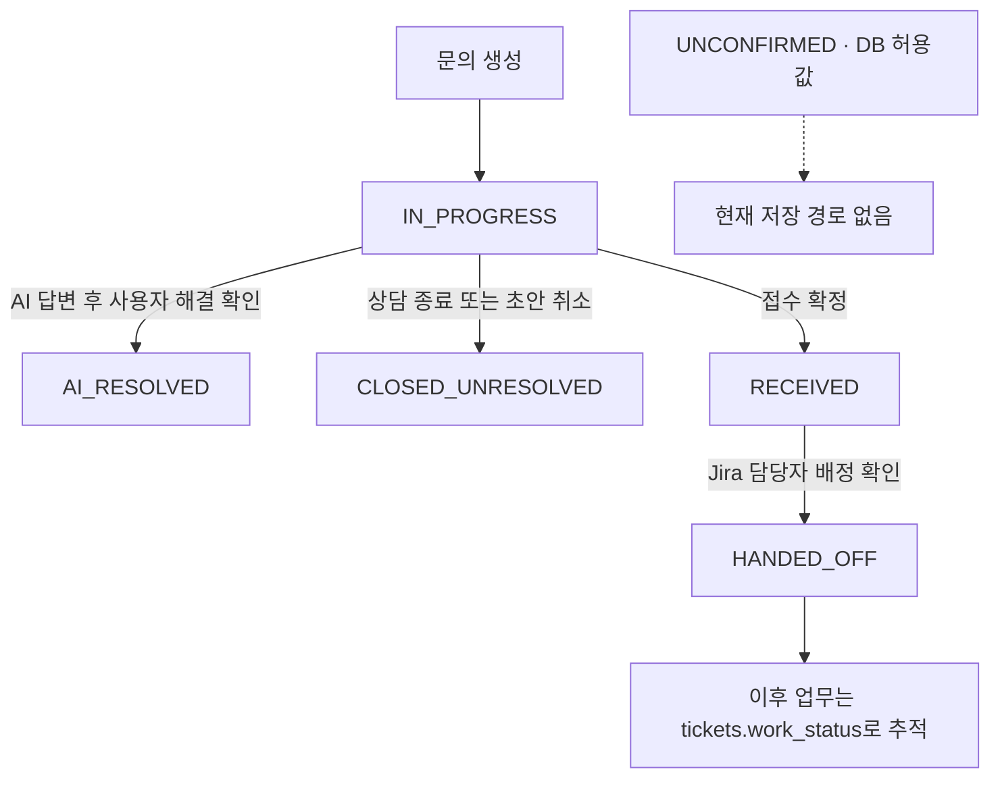

**자주 혼동하는 부분:** AI 답변을 보여 주고 사용자 확인을 기다릴 때 실제 `status`는 보통 `IN_PROGRESS`다. `action=ANSWER`, `resolution_result=null` 조합을 화면에서 `unconfirmed`로 계산한다. 티켓 최종 종결 때도 문의 `status`를 `AI_RESOLVED`로 바꾸지 않는다.

### 2.2 action: 최신 AI 판단

| 값 | 의미 | 프론트의 다음 행동 |
|---|---|---|
| null | 판단이 아직 없음 · 첫 AI 처리 전 또는 실패 후 가능 | 오류 복구 등 별도 고려 필요 |
| ASK_MORE | 문제 판단에 필요한 정보 추가 수집 | REPLY · 사용자 답변 전송 |
| ANSWER | 근거를 바탕으로 해결 가이드 제공 | CONFIRM_RESOLUTION |
| ESCALATE | 담당자 연결 제안 | DECIDE_HANDOFF |
| OUT_OF_SCOPE | 지원 범위 밖으로 판단 | DECIDE_HANDOFF · 서비스데스크 확인 |

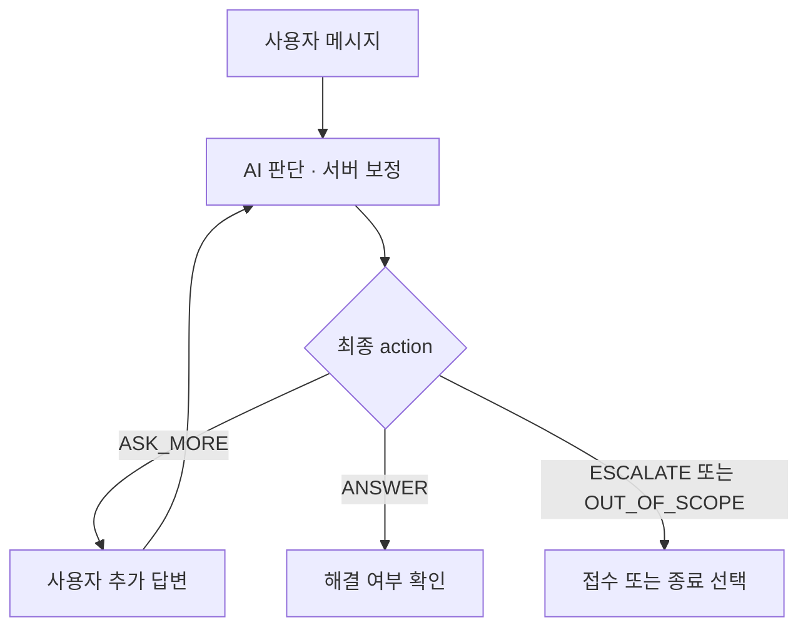

고정된 순서로 모든 action을 거치는 것은 아니다. 사용자 메시지 추가 API는 현재 `status=IN_PROGRESS AND action=ASK_MORE`일 때만 허용한다. `ANSWER → ASK_MORE`를 사용자 추가 메시지로 자유롭게 오가는 구조가 아니다. 모델 제안값이 아니라 서버 보정 후 최종값을 저장한다.

### 2.3 resolution_result: 사용자 해결 확인

| 값 | 의미 | 설정 경로 |
|---|---|---|
| null | 해결 여부 미확인 | 최초 상태 |
| RESOLVED | 사용자가 해결 확인 | AI 해결 확인 또는 티켓 CLS 반영 |
| UNRESOLVED | AI 안내로 해결되지 않음 | AI 답변에 대해 미해결 선택 |
| NO_RESPONSE | 무응답 예약값 | API 입력으로 받지 않으며 현재 자동 설정 코드 없음 |

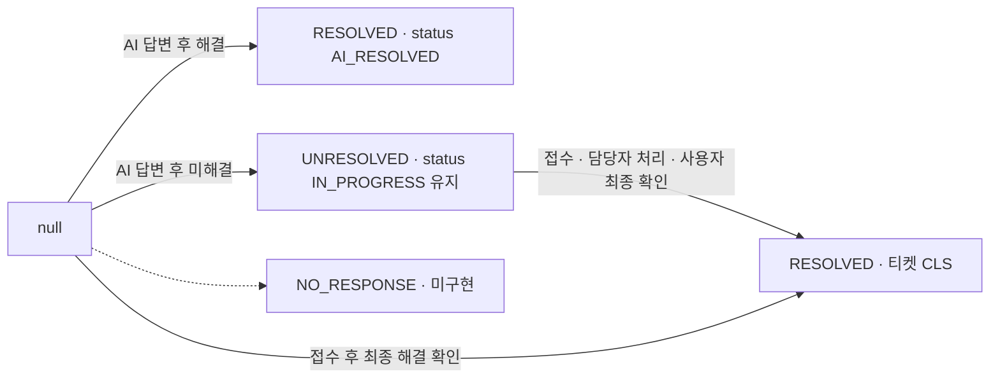

AI 미해결 결과를 남긴 직후에는 다시 AI를 호출하지 않는다. 이후 접수 또는 종료를 선택한다. 최종 티켓 종료에서는 `closed_at`과 `resolution_result`를 갱신하고 문의 `status`는 유지한다.

### 2.4 urgency와 inquiry_assessments

공통 값은 **P1 → P2 → P3 → P4 순으로 긴급도가 낮아진다.** P1이 가장 긴급하고 P4가 가장 낮다. 별도 응답시간 SLA를 이 값만으로 단정할 수는 없다.

| 테이블·필드 | 의미 | 변경 방식 |
|---|---|---|
| inquiries.urgency | 현재 확정 긴급도 | AI 턴 결과로 갱신 |
| inquiry_assessments.urgency | 해당 판단 당시 긴급도 | 새 이력 행을 추가 |
| inquiry_assessments.action | 해당 판단 당시 최종 행동 | 새 이력 행을 추가 |
| inquiry_assessments.urgent_signal | 해당 판단의 긴급 징후 여부 | true / false를 새 이력에 저장 |
| ticket_drafts.urgency | 작성 중 초안 긴급도 | 최초 복사 · 세부 유형 변경 시 재계산 |
| tickets.urgency | 접수 당시 긴급도 | 확정 때 복사 · 현재 티켓 수정 API에는 긴급도 수정 경로 없음 |
| inquiry_types.default_urgency | 유형별 기본 긴급도 | 기준정보 · 현재 조회 API만 존재 |
| legacy_inquiries.urgency | 과거 사례 당시 긴급도 | 과거 데이터 적재값 |

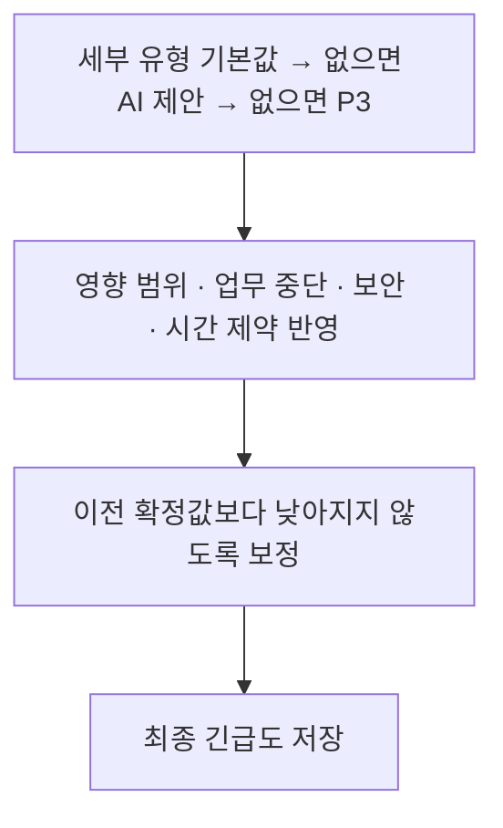

보안 의심·대체수단 없는 개인 업무 전면 중단은 최소 P2, 전사 업무 중단·지장은 P1로 올리는 규칙이 있다. 대화 및 초안 재계산에서는 이전보다 긴급도를 낮추지 않는다. `urgent_signal`은 긴급도 P1과 같은 뜻이 아니다. 이전 판단에 긴급 징후가 있었는지도 AI 입력과 종료 감사 기록에서 참고한다.

## 3. chat_sessions — 상담 세션

별도 `status` 컬럼은 없다.

| 필드·값 | 의미 | 변경 시점 |
|---|---|---|
| ended_at=null, end_reason=null | 열린 세션 | 문의 시작 |
| end_reason=USER_END | 사용자 흐름에서 상담 종료 | AI 해결 확인 또는 미해결 종료·초안 취소 |
| end_reason=HANDED_OFF | 접수를 확정해서 상담을 넘김 | **접수 확정 시점** · Jira 배정 확인 전 |
| end_reason=NO_RESPONSE | 무응답 종료 예약값 | 현재 자동 설정 경로 없음 |

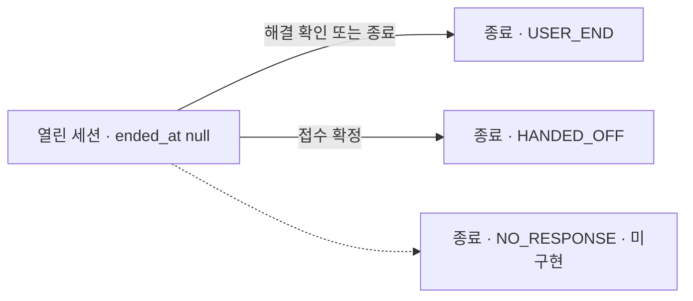

`end_reason=HANDED_OFF`와 `inquiries.status=HANDED_OFF`는 **설정 시점이 다르다**. 전자는 접수 확정, 후자는 Jira 배정 확인이다. 이어가기 API는 기존 세션을 돌려주며 종료된 세션을 다시 열지 않는다. 열린 세션은 문의당 최대 하나다.

## 4. ticket_drafts — 접수 초안

| status | 의미 | 변경 주체·조건 |
|---|---|---|
| EDITING | 사용자가 확인·수정하는 중 | 초안 생성 |
| CONFIRMED | 해당 내용으로 접수 확정 | 소유권·수정 시각·필수값 검사 후 POST /tickets |
| CANCELLED | 접수하지 않고 취소 | 초안 취소 또는 상담 미해결 종료 |

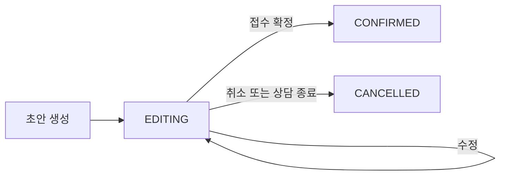

CONFIRMED·CANCELLED를 EDITING으로 되돌리는 API는 없다. 취소 시 문의도 `CLOSED_UNRESOLVED`로 종료된다. 문의당 EDITING 초안은 최대 하나다.

## 5. tickets — 한 테이블 안의 다섯 상태 축

각 필드는 서로 다른 질문에 답한다. 아래 전이는 개별 필드 기준이며 아무 조합이나 유효한 것은 아니다.

### 5.1 jira_sync_status: Jira 생성·연결

| 값 | 의미 |
|---|---|
| PENDING | 내부 접수는 저장됐고 Jira 생성·연결 처리 대기 |
| VERIFYING | Jira에 반영됐는지 불확실해서 조회 확인 중 |
| SYNCED | Jira 이슈 연결 확인 · jira_key 저장 |
| NEEDS_ADMIN | 자동 생성·확인을 계속하기 어려워 관리자 확인 필요 |

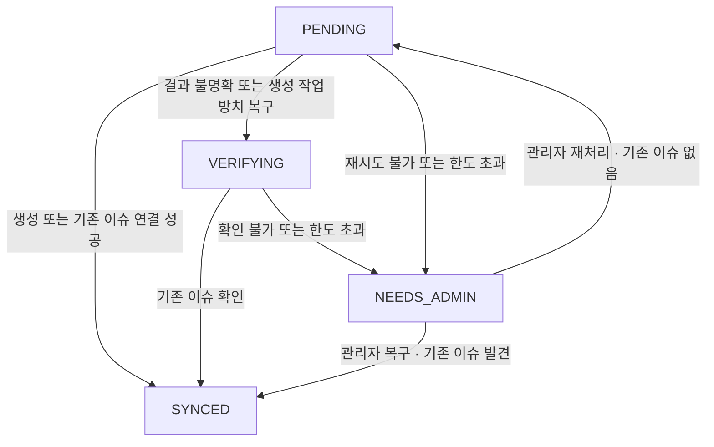

일시적 실패면 PENDING이나 VERIFYING을 유지하면서 작업의 다음 실행 시각을 잡는다. SYNCED는 이후 모든 필드가 Jira와 실시간 일치한다는 보장이 아니라 이슈 생성·연결 축의 완료다.

### 5.2 assign_status: 담당자 배정

| 값 | 의미 |
|---|---|
| PENDING | 배정 대기 또는 담당자 예약 후 Jira 반영 확인 대기 |
| ASSIGNED | Jira 담당자가 예약한 담당자와 일치함을 확인 |
| NEEDS_ADMIN | 후보가 없거나 배정 실패로 관리자 확인 필요 |

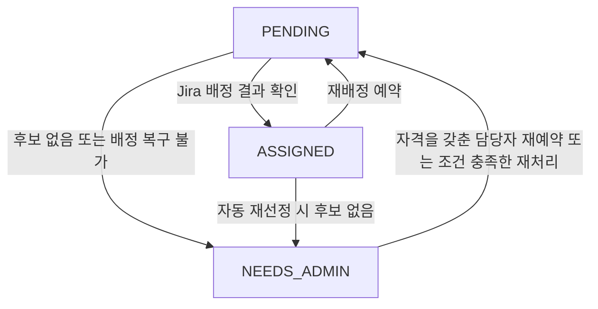

PENDING이어도 `assignee_id`는 비어 있거나 예약 담당자가 들어 있을 수 있다. NEEDS_ADMIN일 때도 결과 불확실로 예약을 보존하면 담당자 ID가 남는다. 확실한 배정 실패는 예약을 해제한다. 재배정은 `assignment_revision`을 올려 이전 작업이 새 담당자를 덮어쓰지 못하게 한다.

**현재 자동배정 연결 주의:** 접수 확정이 만드는 RECOMMEND 이력과 최초 배정 함수의 '이력이 있으면 생략' 조건이 충돌할 수 있다. 따라서 접수 후 자동으로 ASSIGNED가 된다고 가정하면 안 된다. 별도 배정 API 경로는 존재한다.

### 5.3 work_status: 실제 업무 상태

| 값 | 의미 | 설정·요청 주체 |
|---|---|---|
| null | 아직 확인된 Jira 업무 상태 없음 | 접수 최초 |
| RDY | 처리 준비·대기 | 새 Jira 이슈 생성 또는 기존 이슈 상태 확인 |
| WIP | 처리 중 | 담당 측이 처리 시작 요청 |
| FIN | 담당 측 처리 완료 · 문의자 확인 대기 | 담당 측이 처리 결과와 함께 완료 요청 |
| CLS | 문의자가 해결 확인한 최종 종결 | 문의자가 종결 요청 |

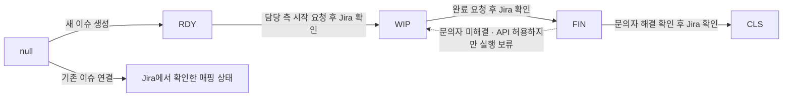

API의 허용 전이는 RDY→WIP, WIP→FIN, FIN→CLS, FIN→WIP다. 이 중 **FIN→WIP는 현재 실행기에서 보류**한다. CLS에서 다시 열거나 RDY로 되돌리는 API 전이는 없다. 기존 Jira 이슈 연결 때는 RDY가 아닌 기존 상태가 들어올 수도 있다.

업무 전이 요청에는 Jira 연결 완료(`SYNCED`), 권한, 진행 중 변경 작업 없음 등이 필요하다. 완료는 처리 결과가 필요하며 재완료라면 이번 요청에 새 처리 결과가 필요하다. 재처리 요청에는 남은 증상이 필요하다. 화면에서 RDY를 `assigned`로 표현해도 `assign_status=ASSIGNED`라는 뜻은 아니다.

### 5.4 requested_work_status: 요청한 목표

| 값 | 의미 |
|---|---|
| null | 목표 상태 요청이 없음 · 또는 처리 결과 문구만 수정 중 |
| WIP / FIN / CLS | 허용 전이에 따라 요청한 목표 상태 |
| RDY | DB는 허용하지만 현재 API에서 RDY로 가는 전이는 없음 |

요청 접수 시 목표값을 저장하고, Jira에서 결과 확인 성공 시 null로 비운다. 실패·관리자 확인 상태에서는 복구할 요청을 보존한다. 처리 결과만 수정할 때는 목표가 null이어도 `transition_status=PENDING`일 수 있다.

### 5.5 transition_status: 상태 변경 요청의 진행

| 값 | 의미 |
|---|---|
| IDLE | 진행 중인 상태·처리 결과 변경 요청 없음 |
| PENDING | 요청 저장됨 · 워커 실행 또는 확인 대기 |
| NEEDS_ADMIN | 자동 실행·확인이 어려워 관리자 확인 필요 |

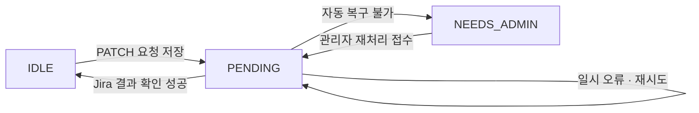

예를 들어 완료 요청 직후는 `work_status=WIP`, `requested_work_status=FIN`, `transition_status=PENDING`이다. 성공 확인 후에만 `work_status=FIN`, `requested_work_status=null`, `transition_status=IDLE`이 된다. API의 202는 요청 접수 완료를 의미한다.

## 6. integration_jobs — 개별 외부 연동 작업

작업 종류 `job_type`: JIRA_CREATE(생성·연결), JIRA_ASSIGN(배정), JIRA_TRANSITION(업무 상태·처리 결과 변경).

| status | 의미 | 현재 코드 |
|---|---|---|
| PENDING | 실행 또는 다음 재시도 대기 | 구현 |
| RUNNING | 실행기가 작업을 선점해서 처리 중 | 구현 |
| DONE | 이 작업의 처리가 끝남 | 구현 · 성공 외에 오래된 배정 작업 무효화도 포함 |
| NEEDS_ADMIN | 자동 복구 불가 · 관리자 확인 | 구현 |
| FAILED | 실패 작업을 표현할 수 있는 DB 허용값 | 재처리 API는 입력 원본으로 인정하지만 현재 실행기는 실패를 NEEDS_ADMIN으로 저장 |

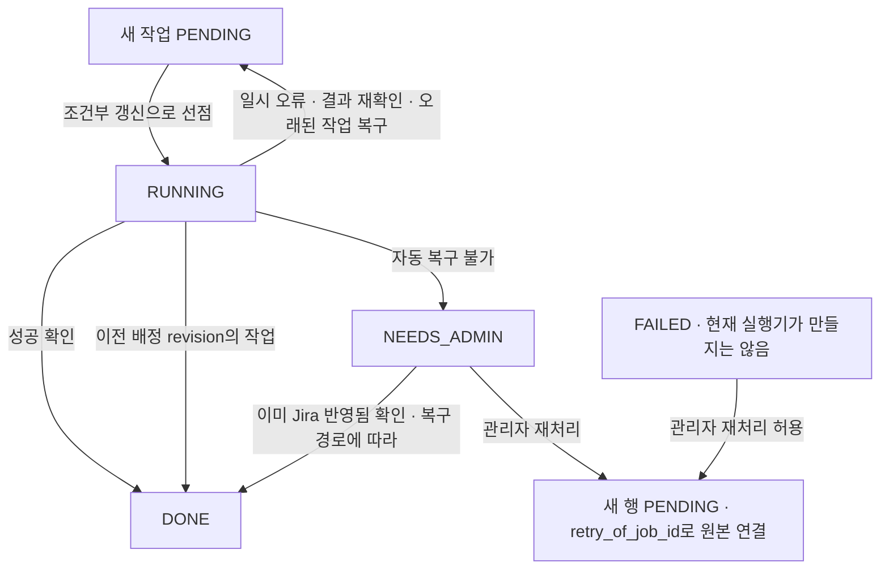

**자동 재시도와 관리자 재처리가 다르다.** 자동 재시도는 같은 작업 행을 PENDING으로 되돌린다. 관리자 재처리는 보통 새 행을 만들고 원본 실패 이력을 보존한다. Jira에 이미 반영된 결과를 복구하는 경우 원본을 DONE으로 바꾸는 경로도 있다. 새 작업 생성은 항상 추가 검증을 거친다.

작업 DONE만 보고 티켓 전체가 끝났다고 판단하면 안 된다. CREATE 작업이 DONE이어도 배정·업무 처리는 남아 있을 수 있다. 배정의 오래된 revision 작업은 실제 변경 없이 DONE으로 끝날 수 있다.

## 7. 문의 한 건의 상태가 같이 바뀌는 예

정상 경로를 이해하기 위한 예다. 배정 경로 실행과 외부 호출 성공을 전제로 한다. 실제로는 일부 단계에서 대기·실패·관리자 확인으로 갈 수 있다.

| 사건 | 문의 status | 초안 status | Jira 생성 | 배정 | 업무 work_status | 변경 처리 |
|---|---|---|---|---|---|---|
| 상담 시작 | IN_PROGRESS | — | — | — | — | — |
| AI가 연결 제안 | IN_PROGRESS · action ESCALATE | — | — | — | — | — |
| 초안 작성 | IN_PROGRESS | EDITING | — | — | — | — |
| 접수 확정 | RECEIVED | CONFIRMED | PENDING | PENDING | null | IDLE |
| Jira 생성 확인 | RECEIVED | CONFIRMED | SYNCED | PENDING | RDY | IDLE |
| Jira 배정 확인 | HANDED_OFF | CONFIRMED | SYNCED | ASSIGNED | RDY | IDLE |
| 처리 시작 요청 | HANDED_OFF | CONFIRMED | SYNCED | ASSIGNED | RDY · 목표 WIP | PENDING |
| 시작 확인 | HANDED_OFF | CONFIRMED | SYNCED | ASSIGNED | WIP | IDLE |
| 완료 요청 | HANDED_OFF | CONFIRMED | SYNCED | ASSIGNED | WIP · 목표 FIN | PENDING |
| 완료 확인 | HANDED_OFF | CONFIRMED | SYNCED | ASSIGNED | FIN | IDLE |
| 문의자 종결 요청 | HANDED_OFF | CONFIRMED | SYNCED | ASSIGNED | FIN · 목표 CLS | PENDING |
| 종결 확인 | HANDED_OFF · resolution_result RESOLVED | CONFIRMED | SYNCED | ASSIGNED | CLS | IDLE |

접수 확정에서 초안·문의·세션·티켓·생성 작업·이력을 하나의 DB 트랜잭션으로 저장한다. Jira 호출은 이후 별도 실행기에서 수행한다. 종결 확인 시 문의의 status가 HANDED_OFF로 남아 있어도 티켓 CLS를 보고 화면은 해결로 표시한다.

## 8. 화면 계산값 — DB 상태와 구분

### displayStatus

다음 표는 **위에서부터 우선 적용**한다.

| 조건 | displayStatus | 화면 의미 |
|---|---|---|
| 티켓 있음 · work_status RDY | assigned | 처리 준비·대기 |
| 티켓 있음 · work_status WIP | progress | 처리 중 |
| 티켓 있음 · work_status FIN | awaiting_confirm | 문의자 해결 확인 대기 |
| 티켓 있음 · work_status CLS | resolved | 해결·종결 |
| 티켓 있음 · 그 외/null | received | 접수됨 |
| 티켓 없음 · IN_PROGRESS + ANSWER + resolution_result null | unconfirmed | AI 답변 해결 여부 미확인 |
| 티켓 없음 · AI_RESOLVED | ai_resolved | AI 해결 |
| 티켓 없음 · CLOSED_UNRESOLVED | unresolved | 미해결 종료 |
| 티켓 없음 · RECEIVED | received | 접수됨 |
| 나머지 | in_progress | 상담 중 |

### needsAdmin / nextActions

| 계산값 | 규칙 |
|---|---|
| needsAdmin | jira_sync_status / assign_status / transition_status 중 하나라도 NEEDS_ADMIN이면 true |
| START_NEW | AI_RESOLVED 또는 CLOSED_UNRESOLVED |
| DECIDE_HANDOFF | IN_PROGRESS이고 resolution_result UNRESOLVED 또는 action ESCALATE/OUT_OF_SCOPE |
| CONFIRM_RESOLUTION | IN_PROGRESS이고 action ANSWER · 위 미해결 조건이 우선 |
| REPLY | 그 외 IN_PROGRESS |
| 빈 nextActions | 기본 응답에서 IN_PROGRESS도 위 종료 상태도 아닌 경우 |
| CONFIRM_TICKET_RESOLUTION | 이어가기 API에서 티켓 FIN인 경우 |

`nextActions`는 화면 유도용 값이다. 서버 API의 상태·권한 검사가 최종 기준이다. 예를 들어 AI 판단 전 action이 null이어도 기본 계산은 REPLY를 내지만 메시지 추가 API는 ASK_MORE를 요구한다.

## 9. users — 계정 상태

| account_status | 의미 |
|---|---|
| ACTIVE | 활성 계정 |
| LOCKED | 로그인 실패 누적으로 잠긴 계정 |
| INACTIVE | 관리자가 비활성화한 계정 |

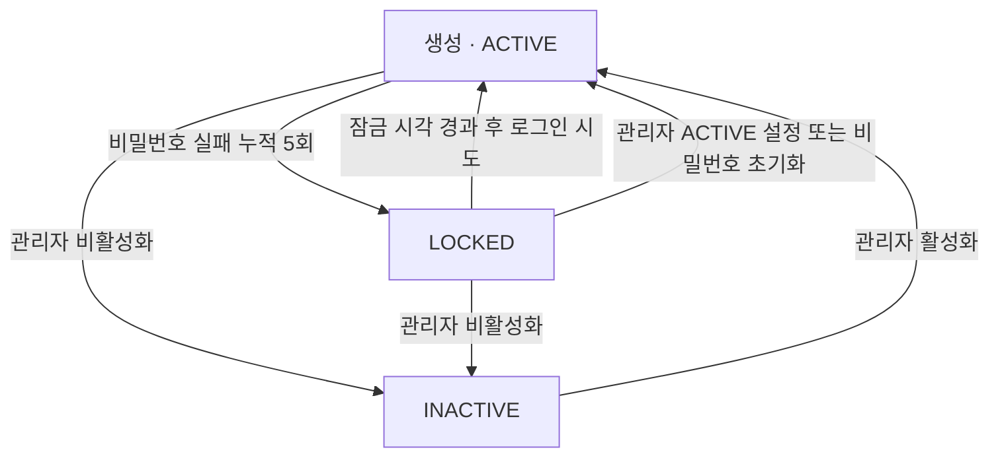

잠금은 현재 코드상 10분이며 시간이 흐르는 순간 자동으로 DB 값을 바꾸는 스케줄러는 없다. 다음 로그인 시도를 처리하면서 해제한다. 관리자는 API로 LOCKED를 직접 설정하지 못한다. 본인 계정 상태·권한 변경은 금지하며 관리 변경 사유가 필요하다. INACTIVE 계정의 비밀번호를 초기화해도 ACTIVE로 바꾸지는 않는다.

LOCKED 검사는 신규 로그인에 적용된다. 현재 기존 세션의 인증·토큰 갱신은 INACTIVE는 막지만 LOCKED를 별도로 막지 않으므로, 잠금이 기존 세션 폐기를 뜻하지 않는다.

## 10. auth_sessions — 로그인 세션

`status` 컬럼 없이 시각으로 판단한다.

| 조건 | 의미 |
|---|---|
| revoked_at=null AND expires_at가 미래 | 유효한 세션 · 토큰 및 사용자 검사도 필요 |
| expires_at가 현재 이하 | 만료 세션 |
| revoked_at가 존재 | 폐기 세션 |

| revoke_reason | 설정 사건 |
|---|---|
| LOGOUT | 해당 세션 로그아웃 |
| PASSWORD_CHANGE | 사용자가 비밀번호 변경 · 기존 세션들 폐기 |
| PASSWORD_RESET | 관리자가 비밀번호 초기화 · 기존 세션들 폐기 |
| TOKEN_REUSE | 이미 교체된 refresh token 재사용 감지 · 해당 세션 폐기 |

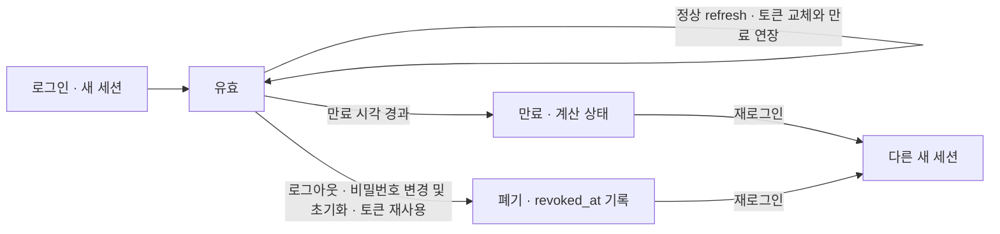

폐기된 세션을 되살리는 경로는 없다. 사용자 `password_changed_at=null`은 초기 비밀번호 변경이 필요한 상태를 나타내며 일반 API 접근이 제한된다. 계정 account_status와 별도의 조건이다.

## 11. document_versions — 문서 적재와 현행

### ingest_status

| 값 | 의미 |
|---|---|
| PENDING | 적재 대기·미완료 |
| DONE | 파싱·청크·임베딩 저장 완료 |
| FAILED | 적재 실패 · ingest_error에 사유 |

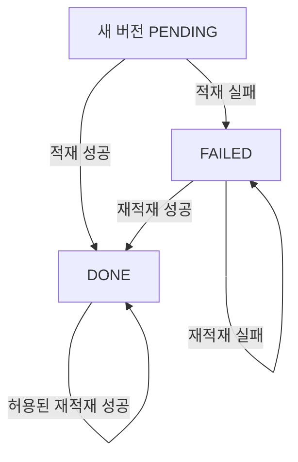

실제 적재 코드는 FAILED에서 DONE으로 직접 갱신할 수 있다. 재시도 전에 반드시 PENDING을 거친다고 그리면 안 된다. 업로드 적재는 DONE·현행 버전을 일반 실패 처리로 FAILED로 덮지 않는다. manifest 교체 경로의 실패 처리는 비현행 버전 보호 조건이 다르므로 DONE이 영원히 불변이라고 단정할 수도 없다. RUNNING이라는 적재 상태는 없다. 도구의 반환값 SKIPPED·MOVED는 DB ingest_status 허용값이 아니다.

### is_current

| 값 | 의미 | 조건 |
|---|---|---|
| false | 비현행 · 보관 또는 승인 대기 | 적재 완료여도 비현행일 수 있음 |
| true | 검색에 사용할 현행 버전 | ingest_status DONE 필수 · 문서당 최대 하나 |

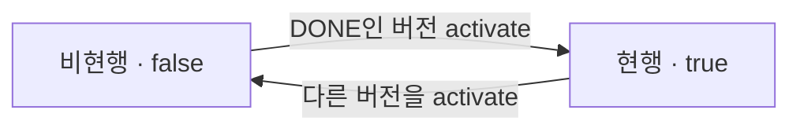

새 버전을 현행으로 바꿀 때 이전 현행은 false로 바꾼다. `activated_at`은 최초 활성화 시각이며 내려가도 보존한다. 업로드 적재 함수 기본값은 자동 활성화하지 않으며 manifest 적재는 옵션과 기존 현행 여부 등에 따라 활성화한다. 활성화 함수는 있지만 현재 FastAPI에는 문서 관리 라우터가 연결돼 있지 않다.

검색에는 활성 문서 + 현행 버전 + DONE + 사용자 열람권한 조건을 함께 적용한다.

## 12. 정책 상태 — 문서 버전과 과거 사례

### document_versions.view_scope / legacy_inquiries.view_scope

| 값 | 열람 가능한 역할 |
|---|---|
| ALL | EMPLOYEE, AGENT, ADMIN |
| AGENT | AGENT, ADMIN |
| ADMIN | ADMIN |

### document_versions.transfer_policy / legacy_inquiries.transfer_policy

| 값 | 외부 LLM에 근거를 전달하는 정책 |
|---|---|
| ALLOWED | 전송 허용 · 공통 안전 검사는 별도로 적용 |
| MASKED | 정책에 따른 가명화·마스킹 후 전송 |
| BLOCKED | 외부 전송 금지 |

둘은 처리 단계를 나타내는 상태가 아니라 독립적인 접근 정책이다. `ALL → AGENT → ADMIN`이나 `ALLOWED → MASKED → BLOCKED` 순서로 진행하는 것이 아니다. 기본값은 ADMIN/BLOCKED다. 현재 문서 정책 관리 API는 없고 적재·정책 적용 도구 경로를 사용한다. 적재 도구에는 기존 DB 정책을 함부로 덮지 않도록 검사하는 규칙이 있다.

열람 허용과 외부 전송 허용도 별개다. 사용자가 열람 가능한 근거라도 외부 LLM 전송은 막힐 수 있다.

## 13. 활성·배정 관련 Boolean

| 테이블·필드 | true | false | 현재 변경 경로 |
|---|---|---|---|
| departments.is_active | 사용 가능한 부서 | 비활성 부서 | 기준정보·시드 관리 · 조회 API만 있음 |
| support_groups.is_active | 활성 담당 그룹 | 비활성 그룹 | 기준정보·시드 관리 · 조회 API만 있음 |
| support_group_members.is_active | 활성 그룹 구성원 | 비활성 구성원 | 기준정보·시드 관리 · 조회 API만 있음 |
| inquiry_types.is_active | 사용 가능한 세부 유형 | 신규 선택·분류 대상에서 제외 | 기준정보·시드 관리 · 조회 API만 있음 |
| routing_rules.is_active | 활성 라우팅 규칙 정의 | 비활성 규칙 정의 | 현재 서비스 경로에서 사용하는 규칙으로 단정 불가 |
| knowledge_documents.is_active | 검색 대상 문서 | 검색 제외 문서 | 적재·데이터 관리 · 현재 수정 API 없음 |
| faqs.is_active | 게시 활성 의사 | 비게시 | 관리자 FAQ 생성·수정 API |
| support_group_members.assignable | 배정 대상 자격 | 배정 대상에서 제외 | 기준정보 관리 · 배정 검증에서 확인 |
| support_groups.is_triage | 서비스데스크·초기 분류용 그룹 | 일반 담당 그룹 | 그룹 성격 설정 · 진행 상태 아님 |
| inquiry_assessments.urgent_signal | 긴급 징후 있음 | 긴급 징후 없음 | 각 AI 판단 이력에 기록 |
| llm_calls.success | 해당 모델 호출 성공 | 해당 호출 실패 | 호출별 이력 추가 · 변경 상태 아님 |

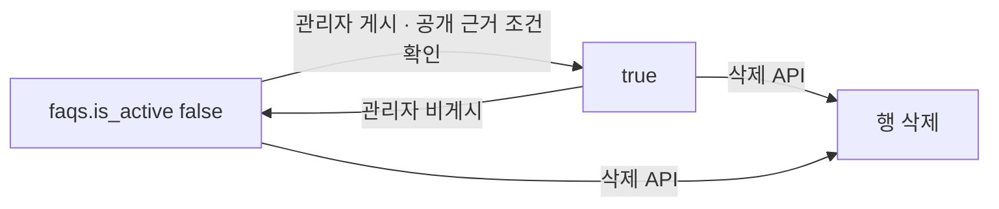

FAQ는 true 하나만으로 일반 사용자 노출이 보장되지 않는다. 연결된 현행 공개 근거 등 게시 조건을 추가 검사한다. FAQ DELETE는 is_active=false로 바꾸는 방식이 아니라 실제 행 삭제다. 나머지 Boolean도 DB에서는 양방향 값 변경이 가능하지만 현재 제품 API에 토글 기능이 있다고 해석하면 안 된다.

## 14. 정의는 있으나 아직 완성된 처리 경로가 없는 상태

### jira_webhook_events.status

| 값 | 정의상 의미 |
|---|---|
| PENDING | 이벤트를 저장하고 처리 대기 |
| DONE | 이벤트 처리 완료 |
| IGNORED | 처리 대상이 아니어서 무시 |
| NEEDS_ADMIN | 이벤트 자동 처리 불가 |

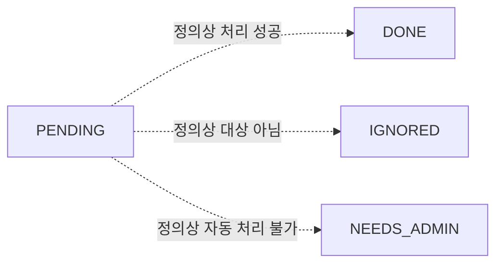

이 그림은 **현재 실행 흐름이 아니라 정의상 의미**다. 파서·서명 검증·상태 동기화 계획 함수는 있지만 수신 API와 영속 이벤트 소비 경로는 현재 앱에 연결돼 있지 않다.

### notifications.status

| 값 | 정의상 의미 |
|---|---|
| PENDING | 알림 발송 대기 |
| SENT | 발송 성공 |
| FAILED | 발송 실패 |

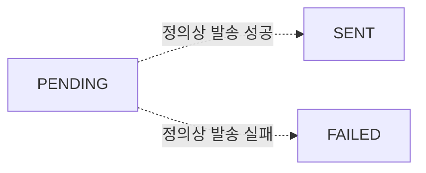

모델은 있지만 현재 서비스에서 Notification 행의 생성·상태 갱신·재시도 소비 경로는 확인되지 않는다. 댓글 알림 도우미 등의 존재만으로 이 테이블 기반 전이가 구현됐다고 볼 수 없다. FAILED→PENDING 재시도도 현재 구현으로 표시하지 않았다.

## 15. 상태와 비슷하게 보이는 코드값 — 분류·역할·이력

다음은 순서대로 진행하는 상태가 아니다. 누락을 피하기 위해 함께 정리한다.

| 테이블·필드 | 값과 의미 | 변경·기록 방식 |
|---|---|---|
| users.service_role | EMPLOYEE 일반 직원 / AGENT 상담·처리 담당 / ADMIN 운영 관리자 | 관리자 사용자 생성·수정 · 역할 변경 사유 필요 · 본인 변경 금지 |
| support_group_members.member_role | AGENT 그룹 담당자 / MANAGER 그룹 팀장 | 그룹별 역할 · users.service_role과 다름 |
| inquiry_types.request_kind | INCIDENT 장애 / REQUEST 작업·서비스 요청 / QUESTION 문의 | 기준정보 |
| messages.sender | USER 사용자 / AI AI / SYSTEM 시스템 안내 | 메시지마다 기록 |
| message_sources.source_kind | DOCUMENT 문서 / LEGACY 과거 사례 | 답변 출처마다 기록 |
| integration_jobs.job_type | JIRA_CREATE 생성 / JIRA_ASSIGN 배정 / JIRA_TRANSITION 상태·결과 변경 | 작업 생성 시 종류 지정 · 상태처럼 순서 변경하지 않음 |
| assignment_logs.event | RECOMMEND 그룹 추천 / ASSIGN 배정·예약 / REASSIGN 재배정 / FAIL 배정 실패 | 사건별 새 이력 · ASSIGN 기록만으로 Jira 배정 확인을 뜻하지 않음 |
| ticket_status_history.from_status, to_status | RDY / WIP / FIN / CLS · 이전 상태는 최초면 null 가능 | 상태 전이 당시 기록 · 현재 상태를 덮어쓰는 필드 아님 |
| ticket_status_history.source | ITSSUE 서비스 요청 경로 / JIRA Jira 기원 | 이력 출처 · 현재 전이 실행기는 ITSSUE로 저장 |
| knowledge_documents.doc_type | GUIDE 가이드 / MANUAL 담당자 매뉴얼 / STANDARD 공통 기준 | 문서 종류 |
| document_versions.file_format | PDF / DOCX / PPTX / MD / TEXT | 원본 파일 형식 |
| document_chunks.chunk_type | ITEM 항목 / CHAPTER 장 / FAQ 질문답변 / PREFACE 서문 | 청크 종류 · 적재 시 기록 |
| legacy_inquiries.channel | PHONE 전화 / MAIL 메일 / MESSENGER 메신저 | 과거 접수 채널 |
| legacy_inquiries.handling_type | IMMEDIATE 즉시 처리 / TICKET 티켓 처리 | 과거 처리 방식 |
| legacy_inquiries.impact_scope | PERSONAL 개인 / DEPARTMENT 부서 / COMPANY 전사 | 과거 영향 범위 |
| time_off.time_off_type | ANNUAL 연차 / HALF_AM 오전 반차 / HALF_PM 오후 반차 | 일정 유형 · 현재 부재 여부는 날짜·시간으로 계산 |
| audit_logs.event_type, result | 로그인 차단·계정 변경·민감정보·접수 등 사건과 결과 | 자유 텍스트 이벤트 기록 · 고정 상태 전이 enum 아님 |
| llm_calls.purpose | CLASSIFY 1차 분류 / ANSWER 2차 답변 등 호출 목적 | 호출별 기록 · DB의 고정 상태 enum 아님 |
| notifications.kind | 알림 종류를 위한 텍스트 | 모델에 고정 enum 제약 없음 · 런타임 생산 경로 미연결 |

`categories`, `member_skills`, `document_chunk_embeddings`, `legacy_inquiry_embeddings`에는 별도 처리 상태 컬럼이 없다. 카테고리 코드, 보유 기술, 임베딩 모델 이름은 분류·식별자다. `attempts`, `assignment_revision`, `failed_login_count`는 상태가 아니라 상태 판단에 사용하는 카운터다.

## 16. 구현과 정의가 어긋나지 않게 확인할 목록

| 항목 | 현재 코드 해석 |
|---|---|
| inquiries.status UNCONFIRMED | DB 허용값이지만 현재 미확인은 계산값 unconfirmed 사용 |
| resolution_result / end_reason NO_RESPONSE | 예약값 · 무응답 자동 종료 경로 없음 |
| integration_jobs.status FAILED | 허용·재처리 대상이지만 현재 실행기 실패 저장은 NEEDS_ADMIN |
| requested_work_status RDY | DB 허용 · 현재 API 전이 목표로는 사용하지 않음 |
| FIN→WIP | API 접수 허용 · 실행 보류 · PENDING에 남을 수 있음 |
| 최초 자동배정 | RECOMMEND 이력과 생략 조건 확인 필요 |
| jira_webhook_events / notifications | 모델 상태 정의와 실제 연결된 실행 경로를 구분 |
| displayStatus / needsAdmin / nextActions | DB 컬럼이 아닌 계산값 |

## 코드 근거

- 모델 전체: `backend/app/models/{org,auth,inquiry,ticket,knowledge,support,taxonomy,ops,time_off,embedding}.py`
- 상담·세션·해결: `backend/app/services/inquiry.py`
- 화면 계산: `backend/app/services/inquiry_status.py`
- 초안·접수·상태 요청·배정 API: `backend/app/services/ticket.py`
- 배정 예약: `backend/app/services/assignment.py`
- 외부 작업 실행: `backend/app/services/{jira_create,jira_assign,jira_transition}.py`
- 관리자 재처리: `backend/app/services/integration_retry.py`
- 계정·로그인: `backend/app/services/{auth,user}.py`, `backend/app/schemas/user.py`
- FAQ 게시: `backend/app/services/faq.py`
- 문서 적재·활성화: `backend/app/rag/ingest/__init__.py`, `backend/app/rag/ingest/upload.py`
- 권한 정책: `backend/app/core/permissions.py`

함께 보기: [프로젝트 전체 처리 흐름](12.백엔드_처리흐름_플로우차트.md)
