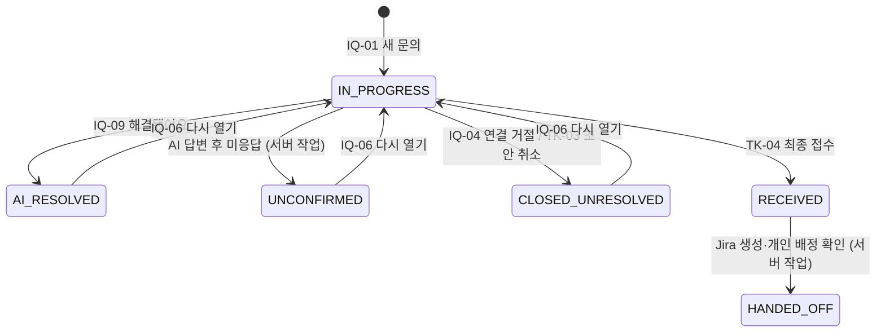

# API 명세서 — 문의·상담 (IQ)

> **문서 상태:** Draft v0.2
>
> **기준:** [08. API 설계서](../08.API_설계서.md) v0.2 · [06. 테이블 설계서](../06.테이블_설계서.md) v0.7
>
> **대상 테이블:** `inquiries`, `inquiry_assessments`, `chat_sessions`, `messages`, `message_sources`

---

## 0. 읽는 법

- 경로는 Base URL `/api/v1` 이후 부분이다.
- 표의 **컬럼**은 테이블 설계서의 컬럼이다. `(파생)`은 테이블 컬럼이 아닌 계산값이다.
- **공통 에러는 API별 표에서 생략한다**: `401 UNAUTHORIZED`, `401 TOKEN_EXPIRED`, `403 AUTH_ACCOUNT_INACTIVE`, `403 AUTH_PASSWORD_CHANGE_REQUIRED`, `422 VALIDATION_ERROR`, `429 TOO_MANY_REQUESTS`, `500 INTERNAL_ERROR`
- **권한이 없는 문의는 `404 INQUIRY_NOT_FOUND`** 로 응답한다 (API 설계서 3.2).
- 페이지가 없는 목록은 `{ "items": [...] }` 형식이다.

---

## 0.1 요청 재전송과 동시 처리

IQ-01·IQ-08·IQ-09는 `Idempotency-Key` 필수이며 08번 2.6.1을 따른다. 같은 키와 본문이면 최초 결과를 반환한다. 다른 본문은 `409 IDEMPOTENCY_KEY_REUSED`, 문의의 다른 변경이나 AI 처리가 진행 중이면 `409 REQUEST_IN_PROGRESS`이다. IQ-01에서 문의·메시지와 중복 요청 기록을 함께 저장하고, 응답 단절 후에도 같은 키로 조회·재시도하면 기존 문의를 재사용한다.

메시지 seq는 세션별 원자적으로 발급한다. 사용자 메시지 저장 후 AI 처리 소유권을 확인해 결과를 반영한다. AI 처리 중 종료·해결 확인·초안 생성·최종 접수·다른 메시지는 거절하며, 소유권 만료 후 늦게 돌아온 결과도 버린다. 복구 시 저장된 메시지를 다시 생성하지 않는다.


## 1. 문의 상태와 API

### 1.1 문의 상태 (`inquiries.status`) 전이



- 미응답 종료(SRS ANSWER-03)는 API가 아니라 서버의 주기 작업이 처리한다: 마지막 AI 답변 이후 정해진 시간(미결) 동안 사용자 메시지가 없으면 세션 `end_reason = NO_RESPONSE`, 문의 `status = UNCONFIRMED`, `resolution_result = NO_RESPONSE`.
- `RECEIVED`·`HANDED_OFF` 이후 진행은 [03. 접수·연동](03.접수_연동.md)의 접수(Ticket) API로 한다.

### 1.2 화면 표시 상태 `displayStatus` (파생)

SRS 4.5 배지 값을 쓴다. 접수 건은 접수의 업무 상태(`tickets.work_status`)를 함께 본다.

| `inquiries.status` | `tickets.work_status` | displayStatus | 화면 표시 |
|---|---|---|---|
| `IN_PROGRESS` | | `in_progress` | 진행 중 |
| `AI_RESOLVED` | | `ai_resolved` | AI 해결 |
| `UNCONFIRMED` | | `unconfirmed` | 미확인 |
| `CLOSED_UNRESOLVED` | | `unresolved` | 미해결 |
| `RECEIVED` | (null 또는 RDY) | `received` | 접수 |
| `HANDED_OFF` | `RDY` | `assigned` | 담당자 배정 |
| `HANDED_OFF` | `WIP` | `progress` | 처리 중 |
| `HANDED_OFF` | `FIN` | `awaiting_confirm` | 해결 확인 대기 |
| `HANDED_OFF` | `CLS` | `resolved` | 해결 완료 |

`in_progress`·`ai_resolved`·`unconfirmed`·`unresolved`는 SRS 4.5에 없는 문의 전용 값이다 (PRD 4.5 문의 내역 필터).

---

## 2. 공통 스키마

### 2.1 참조 객체

| 스키마 | 필드 | 출처 |
|---|---|---|
| `CategoryRef` | `code`, `name` | `categories` |
| `InquiryTypeRef` | `id`, `code`, `name` | `inquiry_types` |
| `GroupRef` | `id`, `name` | `support_groups` |
| `UserRef` | `id`, `employeeNo`, `name` | `users` |

### 2.2 `Inquiry` — 문의 상세

| 필드 | 타입 | null | 컬럼 | 설명 |
|---|---|---|---|---|
| id | number | | `inquiries.id` | |
| userId | number | | `inquiries.user_id` | 문의자 |
| user | UserRef | | (파생) | |
| title | string | Y | `inquiries.title` | AI가 만든 요약 제목. 첫 AI 처리 전에는 `null` |
| status | string | | `inquiries.status` | 1.1 |
| displayStatus | string | | (파생) | 1.2 |
| categoryCode | string | Y | `inquiries.category_code` | 현재 판단 |
| category | CategoryRef | Y | (파생) | |
| inquiryTypeId | number | Y | `inquiries.inquiry_type_id` | 현재 판단 |
| inquiryType | InquiryTypeRef | Y | (파생) | |
| urgency | string | Y | `inquiries.urgency` | `P1`~`P4` |
| action | string | Y | `inquiries.action` | `ANSWER` / `ASK_MORE` / `ESCALATE` / `OUT_OF_SCOPE` |
| recommendedGroupId | number | Y | `inquiries.recommended_group_id` | |
| recommendedGroup | GroupRef | Y | (파생) | |
| resolutionResult | string | Y | `inquiries.resolution_result` | `RESOLVED` / `UNRESOLVED` / `NO_RESPONSE` |
| currentSessionId | number | Y | (파생) | 진행 중(`ended_at is null`) 세션. 없으면 `null` |
| activeDraftId | number | Y | (파생) | `status = EDITING`인 접수 초안. 없으면 `null` |
| ticket | TicketRef | Y | (파생) | 접수된 경우 |
| createdAt | string(datetime) | | `inquiries.created_at` | |
| updatedAt | string(datetime) | Y | `inquiries.updated_at` | |
| closedAt | string(datetime) | Y | `inquiries.closed_at` | |

`TicketRef`

| 필드 | 타입 | null | 컬럼 |
|---|---|---|---|
| id | number | | `tickets.id` |
| receiptNo | string | | `tickets.receipt_no` |
| jiraKey | string | Y | `tickets.jira_key` |
| workStatus | string | Y | `tickets.work_status` |

### 2.3 `InquirySummary` — 목록용

| 필드 | 타입 | null | 컬럼 |
|---|---|---|---|
| id | number | | `inquiries.id` |
| user | UserRef | | (파생) 문의자 |
| title | string | Y | `inquiries.title` |
| status | string | | `inquiries.status` |
| displayStatus | string | | (파생) |
| category | CategoryRef | Y | (파생) |
| urgency | string | Y | `inquiries.urgency` |
| receiptNo | string | Y | (파생, `tickets.receipt_no`) |
| createdAt | string(datetime) | | `inquiries.created_at` |
| updatedAt | string(datetime) | Y | `inquiries.updated_at` |

### 2.4 `Session` — 상담 세션

| 필드 | 타입 | null | 컬럼 | 설명 |
|---|---|---|---|---|
| id | number | | `chat_sessions.id` | |
| inquiryId | number | | `chat_sessions.inquiry_id` | |
| startedAt | string(datetime) | | `chat_sessions.started_at` | |
| endedAt | string(datetime) | Y | `chat_sessions.ended_at` | 진행 중이면 `null` |
| endReason | string | Y | `chat_sessions.end_reason` | `USER_END` / `NO_RESPONSE` / `HANDED_OFF` |

### 2.5 `Message`

| 필드 | 타입 | null | 컬럼 | 설명 |
|---|---|---|---|---|
| id | number | | `messages.id` | |
| sessionId | number | | `messages.session_id` | |
| seq | number | | `messages.seq` | 세션 안 순서 |
| sender | string | | `messages.sender` | `USER` / `AI` / `SYSTEM` |
| content | string | | `messages.content` | |
| sources | MessageSource[] | | (파생) | AI 메시지의 출처. 없으면 `[]` |
| createdAt | string(datetime) | | `messages.created_at` | |

### 2.6 `MessageSource` — 답변 출처

| 필드 | 타입 | null | 컬럼 | 설명 |
|---|---|---|---|---|
| id | number | | `message_sources.id` | |
| sourceKind | string | | `message_sources.source_kind` | `DOCUMENT`(가이드) / `LEGACY`(과거 처리 사례 참고) |
| docCode | string | Y | `message_sources.doc_code` | `DOCUMENT`일 때. 예: `IT-ACC-001` |
| version | string | Y | `message_sources.version` | `DOCUMENT`일 때 |
| location | string | Y | `message_sources.location` | 예: `3.3` |
| excerpt | string | Y | `message_sources.excerpt` | 근거로 쓴 본문 |
| rank | number | Y | `message_sources.rank` | 근거 순위 |

- 화면 표시는 `DOCUMENT`면 `docCode` + `location`(예: "IT-ACC-001 3.3"), `LEGACY`면 "과거 처리 사례 참고"로 한다 (SRS ANSWER-01).
- **응답 시점에 요청자의 열람 범위를 다시 검사한다.** 지금 볼 수 없는 문서(예: 권한이 낮아진 사용자의 `AGENT` 매뉴얼)의 출처는 항목 자체를 빼고 준다.
- `chunk_id`, `legacy_inquiry_id`는 응답에 넣지 않는다.

### 2.7 `AssessmentView` — 사용자용 판단 결과

`inquiry_assessments`의 이번 판단 행 중 화면에 필요한 값만 준다.

| 필드 | 타입 | null | 컬럼 | 설명 |
|---|---|---|---|---|
| missingItems | string[] | | `missing_items` | 아직 확인하지 못한 항목. 없으면 `[]` |
| urgentSignal | boolean | | `urgent_signal` | 긴급 징후 |
| categoryCode | string | Y | `category_code` | |
| inquiryTypeId | number | Y | `inquiry_type_id` | |
| urgency | string | Y | `urgency` | |
| urgencyReason | string | Y | `urgency_reason` | |
| action | string | Y | `action` | |

`missingItems` 값: `TARGET_SYSTEM`(대상 시스템), `SYMPTOM`(증상), `OCCURRED_AT`(발생 시점), `IMPACT_SCOPE`(영향 범위), `WORK_STOPPED`(업무 중단), `WORKAROUND`(대체 방법), `TRIED_ACTIONS`(시도한 조치), `TIME_CONSTRAINT`(시간 제약), `SECURITY_RISK`(보안 위험)

### 2.8 `AiTurn` — AI 처리 결과

IQ-01, IQ-08, IQ-09의 응답이다.

| 필드 | 타입 | null | 설명 |
|---|---|---|---|
| inquiry | Inquiry | | 처리 후 문의 |
| messages | Message[] | | **이번 요청으로 생긴 메시지**(사용자 메시지 + AI·SYSTEM 메시지), `seq` 순 |
| assessment | AssessmentView | Y | 이번 요청으로 판단을 새로 했으면 그 결과, 아니면 `null` |
| nextActions | string[] | | 화면에 보여줄 다음 행동 (파생) |

`nextActions` 값

| 값 | 화면 | 나오는 조건 |
|---|---|---|
| `REPLY` | 입력창 (추가 질문 답변·이어서 질문) | 세션이 진행 중 |
| `CONFIRM_RESOLUTION` | "해결됐어요 / 아직 해결되지 않았어요" 버튼 → IQ-09 | `action = ANSWER` 답변 직후 |
| `DECIDE_HANDOFF` | "담당자 연결 / 연결하지 않음" 버튼 → TK-01 / IQ-04 | `action = ESCALATE`, 또는 `resolutionResult = UNRESOLVED` |
| `START_NEW` | "새 문의" 버튼 | 문의가 종료됨 |

- `action = OUT_OF_SCOPE`이면 지원 범위 밖 안내 메시지와 함께 `REPLY`, `DECIDE_HANDOFF`(서비스데스크 확인)를 준다 (SRS ACTION-01).

### 2.9 `Assessment` — 판단 이력 (ADMIN)

| 필드 | 타입 | null | 컬럼 | 설명 |
|---|---|---|---|---|
| id | number | | `id` | |
| inquiryId | number | | `inquiry_id` | |
| facts | Facts | Y | `facts` | 확인 항목 |
| missingItems | string[] | | `missing_items` | |
| urgentSignal | boolean | | `urgent_signal` | |
| categoryCode | string | Y | `category_code` | 최종값 |
| inquiryTypeId | number | Y | `inquiry_type_id` | 최종값 |
| urgency | string | Y | `urgency` | 최종값 |
| urgencyReason | string | Y | `urgency_reason` | |
| action | string | Y | `action` | 최종값 |
| aiOutput | object | Y | `ai_output` | AI 원래 판단 (규칙 적용 전) |
| overrideReasons | OverrideReason[] | | `override_reasons` | 규칙이 바꾼 항목. 없으면 `[]` |
| createdAt | string(datetime) | | `created_at` | |

`jsonb` 컬럼은 Pydantic 모델로 정의해 **키도 camelCase로 바꾼다.** 값은 바꾸지 않는다.

`Facts` (`facts`)

| 필드 | 타입 | 설명 |
|---|---|---|
| targetSystem | string \| null | 대상 시스템 |
| symptom | string \| null | 증상 |
| occurredAt | string \| null | 발생 시점 (사용자 표현 그대로) |
| impactScope | string \| null | 영향 범위 |
| workStopped | boolean \| null | 업무 중단 여부 |
| workaround | string \| null | 대체 방법 |
| triedActions | string \| null | 시도한 조치 |
| timeConstraint | string \| null | 시간 제약 |
| securityRisk | string \| null | 보안 위험 |

`OverrideReason` (`override_reasons[]`)

| 필드 | 타입 | 설명 |
|---|---|---|
| field | string | 바뀐 항목. 컬럼명 값 그대로. 예: `"urgency"` |
| ai | string \| null | AI 판단값 |
| final | string \| null | 규칙 적용 후 값 |
| rule | string | 규칙 코드. 예: `"SEC_MIN_P2"` |
| reason | string | 이유 |

---

## 3. API

### IQ-01 새 문의 시작

`POST /inquiries` · 권한: 로그인 · 요구사항: INQ-01~04

**Request Body**

| 필드 | 타입 | 필수 | 컬럼 | 제약 |
|---|---|---|---|---|
| content | string | Y | `messages.content` | 1~4000자 |

```json
{
  "content": "어제 업데이트 이후로 VPN 접속이 안 돼요. 재택 중이라 업무를 못 하고 있습니다."
}
```

**처리**

1. `inquiries`(`status = IN_PROGRESS`), `chat_sessions`, `messages`(`seq = 1`, `sender = USER`)를 한 트랜잭션으로 저장한다.
2. AI 처리: 확인 항목 점검 → 긴급 징후 확인 → (정보가 충분하면) 열람 가능한 가이드 검색 → 부족하면 과거 이력 검색 → 분류·긴급도·처리 방향 판단 → 답변 또는 추가 질문.
3. `inquiry_assessments` 저장, `inquiries`의 현재 판단값·`title` 갱신, AI 메시지와 `message_sources` 저장.
4. 외부 모델 오류·외부 전송 제한·근거 부족은 에러가 아니라 담당자 연결 제안(`action = ESCALATE`)으로 응답한다.

**Response** `201 Created` — `AiTurn`

```json
{
  "inquiry": {
    "id": 128,
    "userId": 17,
    "user": { "id": 17, "employeeNo": "E2024017", "name": "김민지" },
    "title": "업데이트 이후 VPN 접속 불가",
    "status": "IN_PROGRESS",
    "displayStatus": "in_progress",
    "categoryCode": "NET",
    "category": { "code": "NET", "name": "VPN·네트워크" },
    "inquiryTypeId": 21,
    "inquiryType": { "id": 21, "code": "NET-01", "name": "VPN 접속 불가" },
    "urgency": "P2",
    "action": "ASK_MORE",
    "recommendedGroupId": 5,
    "recommendedGroup": { "id": 5, "name": "네트워크팀" },
    "resolutionResult": null,
    "currentSessionId": 140,
    "activeDraftId": null,
    "ticket": null,
    "createdAt": "2026-10-21T10:12:03+09:00",
    "updatedAt": "2026-10-21T10:12:09+09:00",
    "closedAt": null
  },
  "messages": [
    {
      "id": 901, "sessionId": 140, "seq": 1, "sender": "USER",
      "content": "어제 업데이트 이후로 VPN 접속이 안 돼요. 재택 중이라 업무를 못 하고 있습니다.",
      "sources": [], "createdAt": "2026-10-21T10:12:03+09:00"
    },
    {
      "id": 902, "sessionId": 140, "seq": 2, "sender": "AI",
      "content": "접속할 때 화면에 나오는 오류 메시지가 있나요? 같은 팀의 다른 분들도 같은 증상인지 알려 주세요.",
      "sources": [], "createdAt": "2026-10-21T10:12:09+09:00"
    }
  ],
  "assessment": {
    "missingItems": ["SYMPTOM", "IMPACT_SCOPE"],
    "urgentSignal": false,
    "categoryCode": "NET",
    "inquiryTypeId": 21,
    "urgency": "P2",
    "urgencyReason": "개인 업무 전면 중단 (재택 중 VPN 불가)",
    "action": "ASK_MORE"
  },
  "nextActions": ["REPLY"]
}
```

**Errors**

| HTTP | code | 조건 | details |
|---|---|---|---|
| 422 | `VALIDATION_ERROR` | `content` 없음·4000자 초과 | `content` / `REQUIRED`·`TOO_LONG` |
| 503 | `AI_UNAVAILABLE` | 문의·메시지는 저장했으나 응답을 만들 수 없음 (담당자 연결 제안조차 불가한 경우) | `[{ "reason": "INQUIRY_ID", "message": "저장된 문의", "value": 128 }]` |

`AI_UNAVAILABLE`을 받으면 Frontend는 `details[].value`의 문의로 이동해 TK-01(담당자 연결)을 안내한다.

---

### IQ-02 문의 목록

`GET /inquiries` · 권한: 로그인 · 요구사항: INQ-05, ADMIN-03

EMPLOYEE·AGENT는 본인 문의만, ADMIN은 전체를 본다.

**Query**

| 파라미터 | 타입 | 필수 | 컬럼 | 설명 |
|---|---|---|---|---|
| page | number | | | 기본 1 |
| size | number | | | 기본 20, 최대 100 |
| sort | string | | | 기본 `createdAt,desc`. 가능: `createdAt`, `updatedAt`, `urgency` |
| displayStatus | string (반복) | | (파생) | 1.2 값 |
| status | string (반복) | | `status` | |
| categoryCode | string (반복) | | `category_code` | |
| urgency | string (반복) | | `urgency` | |
| createdFrom | string(date) | | `created_at` | 이 날짜 00:00부터 (KST) |
| createdTo | string(date) | | `created_at` | 이 날짜 24:00까지 (KST) |
| q | string | | `title`, `tickets.receipt_no`, `message_sources.doc_code` | 제목·접수번호·가이드 문서 번호 부분 일치 |
| userId | number | | `user_id` | **ADMIN만** |

`GET /inquiries?displayStatus=in_progress&displayStatus=received&categoryCode=NET&createdFrom=2026-10-01`

**Response** `200 OK` — `Page<InquirySummary>`

```json
{
  "items": [
    {
      "id": 128,
      "user": { "id": 17, "employeeNo": "E2024017", "name": "김민지" },
      "title": "업데이트 이후 VPN 접속 불가",
      "status": "RECEIVED",
      "displayStatus": "received",
      "category": { "code": "NET", "name": "VPN·네트워크" },
      "urgency": "P2",
      "receiptNo": "RCPT-0042",
      "createdAt": "2026-10-21T10:12:03+09:00",
      "updatedAt": "2026-10-21T10:20:41+09:00"
    }
  ],
  "page": 1, "size": 20, "totalCount": 1, "totalPages": 1
}
```

**Errors**

| HTTP | code | 조건 |
|---|---|---|
| 400 | `INVALID_REQUEST` | `createdFrom`가 `createdTo`보다 늦음 |
| 403 | `FORBIDDEN` | ADMIN이 아닌데 `userId` 지정 |
| 422 | `VALIDATION_ERROR` | enum 값·날짜 형식 오류 |

---

### IQ-03 문의 상세

`GET /inquiries/{inquiryId}` · 권한: 본인·담당 그룹·ADMIN · 요구사항: INQ-05

담당 그룹: 이 문의의 접수(`tickets.group_id`)에 속한 그룹 구성원.

**Path**: `inquiryId` (number, `inquiries.id`)

**Response** `200 OK` — `Inquiry`

**Errors**

| HTTP | code | 조건 |
|---|---|---|
| 404 | `INQUIRY_NOT_FOUND` | 문의 없음 또는 볼 권한 없음 |

---

### IQ-04 문의 종료 (담당자 연결 거절)

`PATCH /inquiries/{inquiryId}` · 권한: 본인 · 요구사항: ASSIGN-02

담당자 연결 제안을 거절하거나 사용자가 상담을 끝낼 때 쓴다. 해결 완료와 구분해 `CLOSED_UNRESOLVED`로 남긴다 (SRS NFR-REL-03).

**Path**: `inquiryId` (number)

**Request Body**

| 필드 | 타입 | 필수 | 컬럼 | 제약 |
|---|---|---|---|---|
| status | string | Y | `inquiries.status` | `CLOSED_UNRESOLVED`만 |

```json
{ "status": "CLOSED_UNRESOLVED" }
```

**처리**: 문의 `status = CLOSED_UNRESOLVED`, `closed_at = now()`; 진행 중 세션 `ended_at = now()`, `end_reason = USER_END`; 작성 중 초안이 있으면 `CANCELLED`. 긴급 징후(`urgent_signal`)가 있던 문의면 `audit_logs`에 남긴다 (`event_type = URGENT_CLOSED`).

**Response** `200 OK` — `Inquiry`

**Errors**

| HTTP | code | 조건 | details |
|---|---|---|---|
| 404 | `INQUIRY_NOT_FOUND` | 문의 없음·본인 아님 | |
| 409 | `INQUIRY_INVALID_STATE` | `status`가 `IN_PROGRESS`가 아님 | `[{ "reason": "CURRENT_STATUS", "message": "현재 상태", "value": "RECEIVED" }]` |
| 422 | `VALIDATION_ERROR` | `status`가 `CLOSED_UNRESOLVED`가 아님 | `status` / `INVALID_VALUE` |

---

### IQ-05 상담 세션 목록

`GET /inquiries/{inquiryId}/sessions` · 권한: 본인·담당 그룹·ADMIN · 요구사항: ANSWER-04

**Path**: `inquiryId` (number)

**Response** `200 OK` — `{ "items": Session[] }`, `startedAt` 오름차순

```json
{
  "items": [
    { "id": 140, "inquiryId": 128, "startedAt": "2026-10-21T10:12:03+09:00", "endedAt": "2026-10-21T10:20:41+09:00", "endReason": "HANDED_OFF" }
  ]
}
```

**Errors**

| HTTP | code | 조건 |
|---|---|---|
| 404 | `INQUIRY_NOT_FOUND` | 문의 없음 또는 볼 권한 없음 |

---

### IQ-06 문의 다시 열기

`POST /inquiries/{inquiryId}/sessions` · 권한: 본인 · 요구사항: ANSWER-04

종료된 문의에 새 상담 세션을 만들어 대화를 이어간다.

**Path**: `inquiryId` (number)

**Request Body** 없음

**처리**: 문의 행을 잠그고 종료 상태와 활성 세션 부재를 확인한 뒤 새 `chat_sessions` 생성, 문의 `status = IN_PROGRESS`, `resolution_result = null`, `closed_at = null`. 이전 판단값(분류·긴급도)은 유지하고 다음 메시지에서 다시 판단한다.

**Response** `201 Created`

| 필드 | 타입 | 설명 |
|---|---|---|
| session | Session | 새 세션 |
| inquiry | Inquiry | 다시 열린 문의 |

**Errors**

| HTTP | code | 조건 | details |
|---|---|---|---|
| 404 | `INQUIRY_NOT_FOUND` | 문의 없음·본인 아님 | |
| 409 | `INQUIRY_ALREADY_OPEN` | 진행 중 세션이 있음 | `[{ "reason": "SESSION_ID", "message": "진행 중 세션", "value": 140 }]` |
| 409 | `INQUIRY_INVALID_STATE` | `RECEIVED`·`HANDED_OFF` 문의 (접수 건은 접수 화면에서 진행) | `CURRENT_STATUS` |

---

### IQ-07 메시지 목록

`GET /inquiries/{inquiryId}/messages` · 권한: 본인·담당 그룹·ADMIN · 요구사항: INQ-03, ANSWER-01

**Path**: `inquiryId` (number)

**Query**

| 파라미터 | 타입 | 필수 | 컬럼 | 설명 |
|---|---|---|---|---|
| sessionId | number | | `messages.session_id` | 없으면 모든 세션 |

**Response** `200 OK` — `{ "items": Message[] }`, 세션 시작 순 → `seq` 순

```json
{
  "items": [
    {
      "id": 906, "sessionId": 140, "seq": 6, "sender": "AI",
      "content": "VPN 클라이언트를 최신 버전(5.2)으로 다시 설치해 보세요. ...",
      "sources": [
        {
          "id": 77, "sourceKind": "DOCUMENT", "docCode": "IT-NET-001", "version": "v1.2",
          "location": "3.2", "excerpt": "3.2 업데이트 후 접속 불가 ...", "rank": 1
        },
        {
          "id": 78, "sourceKind": "LEGACY", "docCode": null, "version": null,
          "location": null, "excerpt": "VPN 클라이언트 재설치 후 정상 접속 확인", "rank": 2
        }
      ],
      "createdAt": "2026-10-21T10:15:30+09:00"
    }
  ]
}
```

**Errors**

| HTTP | code | 조건 |
|---|---|---|
| 404 | `INQUIRY_NOT_FOUND` | 문의 없음 또는 볼 권한 없음 |
| 422 | `VALIDATION_ERROR` | `sessionId`가 이 문의의 세션이 아님 (`NOT_FOUND`) |

---

### IQ-08 메시지 전송

`POST /inquiries/{inquiryId}/messages` · 권한: 본인 · 요구사항: INQ-03·04, ANSWER-01, ACTION-01·02

진행 중 세션에 사용자 메시지를 저장하고 AI 처리 결과를 응답한다.

**Path**: `inquiryId` (number)

**Request Body**

| 필드 | 타입 | 필수 | 컬럼 | 제약 |
|---|---|---|---|---|
| content | string | Y | `messages.content` | 1~4000자 |

```json
{ "content": "\"인증 서버에 연결할 수 없습니다\"라고 나와요. 팀원들은 잘 됩니다." }
```

**처리**: IQ-01의 2~4와 같다. 추가 답변으로 판단이 바뀌면 `inquiries`의 현재 판단값을 갱신한다 (SRS CLASS-02).

**Response** `201 Created` — `AiTurn`

답변한 경우 예:

```json
{
  "inquiry": { "id": 128, "status": "IN_PROGRESS", "action": "ANSWER", "...": "..." },
  "messages": [
    { "id": 905, "sessionId": 140, "seq": 5, "sender": "USER", "content": "\"인증 서버에 연결할 수 없습니다\"라고 나와요. 팀원들은 잘 됩니다.", "sources": [], "createdAt": "2026-10-21T10:15:21+09:00" },
    { "id": 906, "sessionId": 140, "seq": 6, "sender": "AI", "content": "VPN 클라이언트를 최신 버전(5.2)으로 다시 설치해 보세요. ...", "sources": [ { "id": 77, "sourceKind": "DOCUMENT", "docCode": "IT-NET-001", "version": "v1.2", "location": "3.2", "excerpt": "...", "rank": 1 } ], "createdAt": "2026-10-21T10:15:30+09:00" }
  ],
  "assessment": {
    "missingItems": [], "urgentSignal": false, "categoryCode": "NET", "inquiryTypeId": 21,
    "urgency": "P3", "urgencyReason": "개인 업무 일부 지장, 사무실 접속으로 대체 가능", "action": "ANSWER"
  },
  "nextActions": ["CONFIRM_RESOLUTION", "REPLY"]
}
```

**Errors**

| HTTP | code | 조건 | details |
|---|---|---|---|
| 404 | `INQUIRY_NOT_FOUND` | 문의 없음·본인 아님 | |
| 409 | `INQUIRY_CLOSED` | 진행 중 세션이 없음 (종료된 문의) | |
| 409 | `INQUIRY_INVALID_STATE` | `IN_PROGRESS`가 아님 (예: 이미 접수됨) | `CURRENT_STATUS` |
| 422 | `VALIDATION_ERROR` | `content` 없음·4000자 초과 | `content` |
| 503 | `AI_UNAVAILABLE` | 사용자 메시지는 저장했으나 응답을 만들 수 없음 | `[{ "reason": "MESSAGE_ID", "message": "저장된 메시지", "value": 905 }]` |

---

### IQ-09 해결 확인

`PUT /inquiries/{inquiryId}/resolution` · 권한: 본인 · 요구사항: ANSWER-02

AI 답변을 받은 뒤 해결 여부를 저장한다. 담당자 처리 건의 해결 확인은 TK-07(`FIN → CLS`)을 쓴다.

**Path**: `inquiryId` (number)

**Request Body**

| 필드 | 타입 | 필수 | 컬럼 | 제약 |
|---|---|---|---|---|
| resolutionResult | string | Y | `inquiries.resolution_result` | `RESOLVED` / `UNRESOLVED` (`NO_RESPONSE`는 서버만 설정) |
| comment | string | | `messages.content` | `UNRESOLVED`일 때 남은 증상. 1~4000자. 사용자 메시지로 저장 |

```json
{
  "resolutionResult": "UNRESOLVED",
  "comment": "재설치했는데 같은 오류가 나요."
}
```

**처리**

| resolutionResult | 처리 |
|---|---|
| `RESOLVED` | 문의 `status = AI_RESOLVED`, `closed_at = now()`; 세션 `ended_at = now()`, `end_reason = USER_END`; SYSTEM 메시지("해결로 종료되었습니다") |
| `UNRESOLVED` | `status`는 `IN_PROGRESS` 유지; `comment`가 있으면 사용자 메시지로 저장 후 AI가 추가 확인 또는 담당자 연결 제안 |

**Response** `200 OK` — `AiTurn`

- `RESOLVED`: `nextActions = ["START_NEW"]`
- `UNRESOLVED`: `nextActions`에 `DECIDE_HANDOFF` 또는 `REPLY`

**Errors**

| HTTP | code | 조건 | details |
|---|---|---|---|
| 404 | `INQUIRY_NOT_FOUND` | 문의 없음·본인 아님 | |
| 409 | `INQUIRY_INVALID_STATE` | `IN_PROGRESS`가 아님, 또는 아직 AI 답변(`action = ANSWER`)이 없음 | `CURRENT_STATUS` |
| 422 | `VALIDATION_ERROR` | `resolutionResult` 값 오류(`NO_RESPONSE` 포함) | `resolutionResult` / `INVALID_VALUE` |

---

IQ-09 재호출: 같은 키·본문은 최초 AiTurn을 반환하고 댓글·SYSTEM 메시지·AI 처리를 반복하지 않는다. 다른 키로 이미 AI_RESOLVED인 문의에 RESOLVED를 보내도 현재 문의와 `messages: []`, `assessment: null`, `nextActions: ["START_NEW"]`를 200으로 반환한다. 그 밖의 종료 상태에서 다른 결과로 바꾸는 요청은 409이다. 해결 결과와 세션 종료·메시지·중복 요청 결과는 한 트랜잭션으로 저장한다.


### IQ-10 판단 이력

`GET /inquiries/{inquiryId}/assessments` · 권한: ADMIN · 요구사항: CLASS-03

AI 원래 판단(`aiOutput`)과 규칙이 바꾼 내역(`overrideReasons`)을 함께 본다.

**Path**: `inquiryId` (number)

**Response** `200 OK` — `{ "items": Assessment[] }`, `createdAt` 오름차순

```json
{
  "items": [
    {
      "id": 311,
      "inquiryId": 130,
      "facts": {
        "targetSystem": "메일",
        "symptom": "모르는 링크를 눌러 계정 정보를 입력함",
        "occurredAt": "오늘 오전",
        "impactScope": "개인",
        "workStopped": false,
        "workaround": null,
        "triedActions": null,
        "timeConstraint": null,
        "securityRisk": "피싱 의심"
      },
      "missingItems": [],
      "urgentSignal": true,
      "categoryCode": "SEC",
      "inquiryTypeId": 51,
      "urgency": "P2",
      "urgencyReason": "보안 사고 의심은 최소 P2",
      "action": "ESCALATE",
      "aiOutput": { "categoryCode": "SEC", "urgency": "P3", "action": "ESCALATE" },
      "overrideReasons": [
        { "field": "urgency", "ai": "P3", "final": "P2", "rule": "SEC_MIN_P2", "reason": "보안 사고 의심은 최소 P2" }
      ],
      "createdAt": "2026-10-21T11:02:15+09:00"
    }
  ]
}
```

**Errors**

| HTTP | code | 조건 |
|---|---|---|
| 403 | `FORBIDDEN` | ADMIN이 아님 |
| 404 | `INQUIRY_NOT_FOUND` | 문의 없음 |

---

## 4. 미결 사항

| 항목 | 내용 |
|---|---|
| 미응답 종료 시간 | AI 답변 후 몇 분 동안 응답이 없으면 `UNCONFIRMED`로 종료할지 |
| 메시지 길이 | `content` 최대 4000자 (제안) |
| AI 응답 방식 | 동기 응답 유지 또는 스트리밍(SSE) |
| 메시지 목록 페이지 | 대화가 길어질 때 커서(`afterSeq`) 방식 페이지 도입 여부 |

---

## 업데이트 로그

- **2026.10.22 — v0.2**
    - 승인된 검토 결과 반영: Jira 확인 상태·복구, 중복·동시 요청, FAQ 공개 출처 및 문서 간 규칙 보완. 04·07 문서는 수정하지 않음.

- **2026.10.21 — v0.1**
    - IQ-01~10 최초 작성
