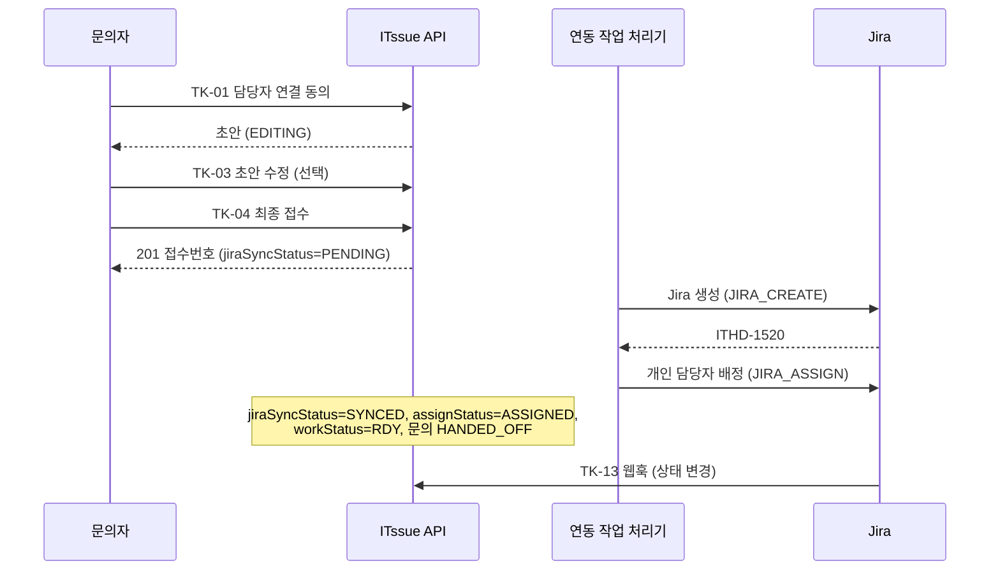

# API 명세서 — 접수·연동 (TK)

> **표기:** 🆕 신규 추가 · ✏️ 수정 (2026.10.26 정책 정정분)

> **문서 상태:** Draft v0.3
>
> **기준:** [07. API 설계서](../07.API_설계서.md) v0.4 · [06. 테이블 설계서](../06.테이블_설계서.md) v0.8
>
> **대상 테이블:** `ticket_drafts`, `tickets`, `ticket_status_history`, `assignment_logs`, `integration_jobs`, `support_group_members`

---

## 0. 읽는 법

- 경로는 Base URL `/api/v1` 이후 부분이다.
- 표의 **컬럼**은 테이블 설계서의 컬럼이다. `(파생)`은 테이블 컬럼이 아닌 계산값이다.
- **공통 에러는 API별 표에서 생략한다**: `401 UNAUTHORIZED`, `401 TOKEN_EXPIRED`, `403 AUTH_ACCOUNT_INACTIVE`, `403 AUTH_PASSWORD_CHANGE_REQUIRED`, `422 VALIDATION_ERROR`, `429 TOO_MANY_REQUESTS`, `500 INTERNAL_ERROR`
- 볼 권한이 없는 초안·접수는 `404`로 응답한다 (API 설계서 3.2).
- 참조 객체 `CategoryRef`·`InquiryTypeRef`·`GroupRef`·`UserRef`, 화면 표시 상태 `displayStatus`는 [02. 문의·상담](02.문의_상담.md) 1.2·2.1을 따른다.
- **담당 그룹**: 접수의 `tickets.group_id` 그룹에서 `support_group_members.is_active = true`인 구성원. **MANAGER**: 그중 `member_role = MANAGER`.

---

✏️ **숨김 조회:** 보안·로그 대상으로 숨긴 문의에 연결된 자료는 일반 문의자·담당 그룹의 조회·변경으로 노출하지 않는다. 관리자 보안 조회만 별도 권한으로 허용한다(API 02 1.1.1). Ticket이 있는 문의는 이탈 자동 삭제 대상에서 제외한다.

## 1. 상태와 흐름

### 1.1 접수 흐름



### 1.2 접수의 상태 컬럼

| 컬럼 | 값 | 의미 |
|---|---|---|
| `jira_sync_status` | `PENDING` → `VERIFYING` → `SYNCED` / `NEEDS_ADMIN` | Jira 생성. `VERIFYING`은 결과가 불명확해 기존 생성 여부를 확인하는 중 |
| `assign_status` | `PENDING` → `ASSIGNED` / `NEEDS_ADMIN` | 개인 담당자 배정 |
| `work_status` | `null` → `RDY` → `WIP` → `FIN` → `CLS` | 업무 상태. Jira 생성 직후 `RDY` |

- 문의(`inquiries.status`)는 `jira_sync_status = SYNCED`이고 `assign_status = ASSIGNED`가 되면 `RECEIVED` → `HANDED_OFF`로 바뀐다.
- **확인 필요(`needsAdmin`)**: `jira_sync_status`, `assign_status`, `transition_status` 중 하나가 `NEEDS_ADMIN`.

### 1.3 업무 상태 변경 규칙 (TK-07)

| 변경 | 실행자 | 조건 | 함께 처리 |
|---|---|---|---|
| `RDY → WIP` | 담당 그룹·ADMIN | `jira_sync_status = SYNCED` | |
| `WIP → FIN` | 담당 그룹·ADMIN | `resolution_note`가 있음 (요청에 포함 가능). ✏️ 재완료(이 Ticket의 `ticket_status_history`에 `FIN → WIP`가 있음)는 요청에 새 처리 결과를 반드시 포함하며 저장된 이전 값으로 대신할 수 없다 | Jira FIN 확인 후 `finished_at` 확정 |
| `FIN → CLS` | 본인(문의자) | | 요청 시 `resolution_confirmed_at` 기록, Jira CLS 확인 후 `closed_at`·문의 해결 결과 확정 |
| ✏️ `FIN → WIP` | 본인(문의자) | 미해결 선택. `reason`(남은 증상) 필수; 확정 요구사항 SRS JIRA-06 | Jira WIP 확인 후 `finished_at = null`. 기존 Ticket·세션·번호 유지, 담당자 전달 방식은 별도 정리 |

✏️ FIN 미응답은 `awaiting_confirm`·FIN으로 유지하고 삭제·자동 CLS 전환하지 않는다. 이어가기는 기존 Ticket의 해결·미해결 버튼을 제공한다. 단순 열람·이어가기는 상태 변경을 만들지 않는다. 확인 요청·추가 알림은 후순위다. 확인된 WIP 반영 후에만 `progress`로 표시하며 실패·결과 불명확은 기존 확인 상태와 변경 진행 상태로 구분한다.

- 그 밖의 변경(예: `RDY → FIN`, `CLS → *`)은 `409 TICKET_INVALID_TRANSITION`.
- 요청 시 `work_status`는 유지하고 `requested_work_status`와 `transition_status = PENDING`을 저장한 뒤 불변 payload의 `JIRA_TRANSITION`을 등록한다. 응답은 202이며 완료가 아니다. 실패하면 `transition_status = NEEDS_ADMIN`; `jira_sync_status`는 Jira 생성·연결 상태이므로 바꾸지 않는다.
- Jira 반영 성공을 조회로 확인한 뒤 상태·처리 결과·시각을 갱신하고 이력을 한 번만 기록한다. 요청 작업에 대응하면 source = ITSSUE, Jira에서 직접 바뀌었으면 JIRA이다. 성공 후 목표는 NULL, transition_status는 IDLE이다. 중간 상태 충돌은 덮어쓰지 않고 NEEDS_ADMIN으로 보존한다.
- `resolutionNote`만 수정할 때도 JIRA_TRANSITION payload에 처리 결과를 저장해 비동기로 반영하고 202를 반환한다. Jira 확인 전 응답의 resolutionNote는 마지막 확인 값이다. 진행 중 같은 종류 작업이 있으면 409 INTEGRATION_JOB_IN_PROGRESS이다.

---

## 2. 공통 스키마

### 2.1 `TicketDraft` — 접수 초안

| 필드 | 타입 | null | 컬럼 | 설명 |
|---|---|---|---|---|
| id | number | | `ticket_drafts.id` | |
| inquiryId | number | | `inquiry_id` | |
| sessionId | number | | `session_id` | |
| summary | string | Y | `summary` | 문의 요약. 접수 전 반드시 채워야 함 |
| targetSystem | string | Y | `target_system` | 대상 시스템 |
| symptom | string | Y | `symptom` | 증상 |
| occurredAt | string | Y | `occurred_at` | 발생 시점. **사용자 표현 그대로** (예: "어제 업데이트 이후") |
| categoryCode | string | Y | `category_code` | `null`이면 미분류 (서비스데스크 확인) |
| category | CategoryRef | Y | (파생) | |
| inquiryTypeId | number | Y | `inquiry_type_id` | |
| inquiryType | InquiryTypeRef | Y | (파생) | |
| urgency | string | Y | `urgency` | `P1`~`P4` |
| urgencyReason | string | Y | `urgency_reason` | 긴급도 근거 |
| businessImpact | string | Y | `business_impact` | 업무 영향 |
| triedActions | string | Y | `tried_actions` | 시도한 조치 |
| recommendedGroupId | number | Y | `recommended_group_id` | 추천 그룹 |
| recommendedGroup | GroupRef | Y | (파생) | |
| status | string | | `status` | `EDITING` / `CONFIRMED` / `CANCELLED` |
| createdAt | string(datetime) | | `created_at` | |
| updatedAt | string(datetime) | Y | `updated_at` | |

### 2.2 `Ticket` — 접수 상세

| 필드 | 타입 | null | 컬럼 | 설명 |
|---|---|---|---|---|
| id | number | | `tickets.id` | |
| receiptNo | string | | `receipt_no` | 내부 접수번호. 예: `RCPT-0042` |
| draftId | number | | `draft_id` | |
| inquiryId | number | | `inquiry_id` | |
| sessionId | number | | `session_id` | |
| requester | UserRef | | (파생, `inquiries.user_id`) | 문의자 |
| summary | string | | `summary` | 확정 시점 스냅샷 |
| targetSystem | string | Y | `target_system` | 스냅샷 |
| symptom | string | Y | `symptom` | 스냅샷 |
| occurredAt | string | Y | `occurred_at` | 스냅샷 (사용자 표현) |
| categoryCode | string | Y | `category_code` | 스냅샷 |
| category | CategoryRef | Y | (파생) | |
| inquiryTypeId | number | Y | `inquiry_type_id` | 스냅샷 |
| inquiryType | InquiryTypeRef | Y | (파생) | |
| urgency | string | Y | `urgency` | 스냅샷 |
| urgencyReason | string | Y | `urgency_reason` | 스냅샷 |
| businessImpact | string | Y | `business_impact` | 스냅샷 |
| triedActions | string | Y | `tried_actions` | 스냅샷 |
| groupId | number | Y | `group_id` | 배정 그룹 |
| group | GroupRef | Y | (파생) | |
| assigneeId | number | Y | `assignee_id` | 개인 담당자 |
| assignee | UserRef | Y | (파생) | |
| jiraKey | string | Y | `jira_key` | 예: `ITHD-1520`. Jira 생성 전 `null` |
| jiraUrl | string | Y | (파생) | `JIRA_BASE_URL/browse/{jiraKey}` |
| jiraSyncStatus | string | | `jira_sync_status` | 1.2 |
| assignStatus | string | | `assign_status` | 1.2 |
| workStatus | string | Y | `work_status` | 1.2 |
| needsAdmin | boolean | | (파생) | 1.2 |
| displayStatus | string | | (파생) | 02 문서 1.2 |
| resolutionNote | string | Y | `resolution_note` | 담당자 처리 결과 |
| createdAt | string(datetime) | | `created_at` | 접수 시각 |
| finishedAt | string(datetime) | Y | `finished_at` | FIN 시각 |
| closedAt | string(datetime) | Y | `closed_at` | CLS 시각 |

`Ticket` 추가 필드 (최초 접수 시 null/IDLE):

| 필드 | 타입 | 설명 |
|---|---|---|
| requestedWorkStatus | string 또는 null | 요청한 목표 상태 |
| transitionStatus | string | IDLE / PENDING / NEEDS_ADMIN |
| workStatusConfirmedAt | datetime 또는 null | Jira 상태 마지막 확인 시각 |
| resolutionConfirmedAt | datetime 또는 null | 문의자의 해결 확인 요청 시각 |

`TicketSummary`에도 requestedWorkStatus·transitionStatus·workStatusConfirmedAt을 포함한다 (2.3). displayStatus는 확인된 workStatus 기준이며 처리 중 작업은 별도 안내한다.


### 2.3 `TicketSummary` — 목록용

| 필드 | 타입 | null | 컬럼 |
|---|---|---|---|
| id | number | | `id` |
| receiptNo | string | | `receipt_no` |
| jiraKey | string | Y | `jira_key` |
| inquiryId | number | | `inquiry_id` |
| requester | UserRef | | (파생) |
| summary | string | | `summary` |
| category | CategoryRef | Y | (파생) |
| urgency | string | Y | `urgency` |
| group | GroupRef | Y | (파생) |
| assignee | UserRef | Y | (파생) |
| jiraSyncStatus | string | | `jira_sync_status` |
| assignStatus | string | | `assign_status` |
| workStatus | string | Y | `work_status` |
| requestedWorkStatus | string | Y | `requested_work_status` |
| transitionStatus | string | | `transition_status` |
| workStatusConfirmedAt | string(datetime) | Y | `work_status_confirmed_at` |
| needsAdmin | boolean | | (파생) |
| displayStatus | string | | (파생) |
| createdAt | string(datetime) | | `created_at` |

### 2.4 `StatusHistory`

| 필드 | 타입 | null | 컬럼 |
|---|---|---|---|
| id | number | | `ticket_status_history.id` |
| ticketId | number | | `ticket_id` |
| fromStatus | string | Y | `from_status` |
| toStatus | string | | `to_status` |
| source | string | | `source` (`JIRA` / `ITSSUE`) |
| actorId | number | Y | `actor_id` |
| actor | UserRef | Y | (파생) |
| reason | string | Y | `reason` |
| changedAt | string(datetime) | | `changed_at` |

### 2.5 `AssignmentLog`

| 필드 | 타입 | null | 컬럼 | 설명 |
|---|---|---|---|---|
| id | number | | `assignment_logs.id` | |
| ticketId | number | | `ticket_id` | |
| event | string | | `event` | `RECOMMEND` / `ASSIGN` / `FAIL` / `REASSIGN` |
| groupId | number | Y | `group_id` | |
| group | GroupRef | Y | (파생) | |
| assigneeId | number | Y | `assignee_id` | |
| assignee | UserRef | Y | (파생) | |
| ruleId | number | Y | `rule_id` | 적용된 예외 규칙. `null`이면 기본 그룹 |
| reason | string | Y | `reason` | 적용 근거·실패 사유 |
| actorId | number | Y | `actor_id` | `null`이면 시스템 |
| actor | UserRef | Y | (파생) | |
| createdAt | string(datetime) | | `created_at` | |

### 2.6 `IntegrationJob` (ADMIN)

| 필드 | 타입 | null | 컬럼 | 설명 |
|---|---|---|---|---|
| id | number | | `integration_jobs.id` | |
| ticketId | number | | `ticket_id` | |
| jobType | string | | `job_type` | `JIRA_CREATE` / `JIRA_ASSIGN` / `JIRA_TRANSITION` |
| retryOfJobId | number | Y | `retry_of_job_id` | 원본 실패 작업 |
| status | string | | `status` | `PENDING` / `RUNNING` / `DONE` / `FAILED` / `NEEDS_ADMIN` |
| attempts | number | | `attempts` | |
| nextRetryAt | string(datetime) | Y | `next_retry_at` | |
| lastError | string | Y | `last_error` | 민감정보 제외된 오류 |
| idempotencyKey | string | | `idempotency_key` | |
| createdAt | string(datetime) | | `created_at` | |
| updatedAt | string(datetime) | Y | `updated_at` | |

---

## 3. API

### TK-01 담당자 연결 동의 (초안 생성)

`POST /inquiries/{inquiryId}/ticket-drafts` · 권한: 본인 · 요구사항: ASSIGN-01·02, TICKET-01

**Path**: `inquiryId` (number)

**Request Body** 없음

**처리**

1. 최근 판단 이력(`inquiry_assessments`)의 확인 항목·분류·긴급도로 초안 항목을 채우고, AI가 대화를 요약해 `summary`를 만든다.
2. 추천 그룹: ① 예외 규칙(`routing_rules`) → ② 세부 유형 기본 그룹 → ③ 서비스데스크(`is_triage`) 순서.
3. `status = EDITING`으로 저장한다.
4. 요약 생성(AI)에 실패해도 초안은 만든다. 이때 `summary = null`이며 사용자가 직접 채운다.

**Response** `201 Created` — `TicketDraft`

```json
{
  "id": 55,
  "inquiryId": 128,
  "sessionId": 140,
  "summary": "Windows 업데이트 이후 VPN 클라이언트에서 '인증 서버에 연결할 수 없습니다' 오류로 접속 불가. 재설치 후에도 동일.",
  "targetSystem": "VPN",
  "symptom": "인증 서버에 연결할 수 없습니다 오류",
  "occurredAt": "어제 업데이트 이후",
  "categoryCode": "NET",
  "category": { "code": "NET", "name": "VPN·네트워크" },
  "inquiryTypeId": 21,
  "inquiryType": { "id": 21, "code": "NET-01", "name": "VPN 접속 불가" },
  "urgency": "P2",
  "urgencyReason": "개인 업무 전면 중단 (재택 중 VPN 불가)",
  "businessImpact": "재택 근무 중 사내 시스템 접속 불가",
  "triedActions": "VPN 클라이언트 재설치",
  "recommendedGroupId": 5,
  "recommendedGroup": { "id": 5, "name": "네트워크팀" },
  "status": "EDITING",
  "createdAt": "2026-10-21T10:18:00+09:00",
  "updatedAt": null
}
```

**Errors**

| HTTP | code | 조건 | details |
|---|---|---|---|
| 404 | `INQUIRY_NOT_FOUND` | 문의 없음·본인 아님 | |
| 409 | `DRAFT_ALREADY_EXISTS` | 작성 중(`EDITING`) 초안이 있음 | `[{ "reason": "DRAFT_ID", "message": "작성 중인 초안", "value": 55 }]` |
| 409 | `INQUIRY_CLOSED` | 진행 중 세션이 없음 | |
| 409 | `INQUIRY_INVALID_STATE` | `IN_PROGRESS`가 아님 (이미 접수됨 등) | `CURRENT_STATUS` |

Frontend는 `DRAFT_ALREADY_EXISTS`를 받으면 `details[].value`의 초안을 연다.

---

### TK-02 초안 조회

`GET /ticket-drafts/{draftId}` · 권한: 본인 · 요구사항: TICKET-02

**Path**: `draftId` (number, `ticket_drafts.id`)

**Response** `200 OK` — `TicketDraft`

**Errors**

| HTTP | code | 조건 |
|---|---|---|
| 404 | `DRAFT_NOT_FOUND` | 초안 없음·본인 아님 |

---

### TK-03 초안 수정·취소

`PATCH /ticket-drafts/{draftId}` · 권한: 본인 · 요구사항: TICKET-02

보낸 필드만 바꾼다. `EDITING` 초안만 바꿀 수 있다.

**Path**: `draftId` (number)

**Request Body — 수정**

| 필드 | 타입 | 필수 | 컬럼 | 제약 |
|---|---|---|---|---|
| summary | string | | `summary` | 1~2000자 |
| targetSystem | string \| null | | `target_system` | 100자 이하 |
| symptom | string \| null | | `symptom` | 2000자 이하 |
| occurredAt | string \| null | | `occurred_at` | 200자 이하. 날짜로 바꾸지 않음 |
| businessImpact | string \| null | | `business_impact` | 2000자 이하 |
| triedActions | string \| null | | `tried_actions` | 2000자 이하 |
| inquiryTypeId | number \| null | | `inquiry_type_id` | 있는 세부 유형. `null`이면 미분류 |

- `categoryCode`는 `inquiryTypeId`의 분류로 서버가 채운다.
- `urgency`, `urgencyReason`, `recommendedGroupId`는 **직접 바꿀 수 없다** (`NOT_ALLOWED`). 수정한 내용으로 서버가 긴급도 규칙과 담당 그룹 추천을 다시 적용한다 (SRS TICKET-02, CLASS-02).
- 보낸 글 칸(`summary`·`targetSystem`·`symptom`·`occurredAt`·`businessImpact`·`triedActions`)은 **저장 전에 민감정보를 가린다** ([10. 민감정보 정책](../10.민감정보_정책.md) 4장 ②). 가린 유형마다 `audit_logs`에 `SENSITIVE_INPUT`을 남긴다 (값·원문 없이 유형과 개수만, 10 5.2).

```json
{
  "businessImpact": "재택 근무 중 사내 시스템 접속 불가. 오늘 18시 결산 마감 보고 필요",
  "inquiryTypeId": 21
}
```

**Request Body — 취소**

| 필드 | 타입 | 필수 | 컬럼 | 제약 |
|---|---|---|---|---|
| status | string | Y | `status` | `CANCELLED`만. 다른 필드와 함께 보낼 수 없음 |

```json
{ "status": "CANCELLED" }
```

취소 처리: 초안 `CANCELLED`, 문의 `status = CLOSED_UNRESOLVED`, `closed_at = now()`, 세션 `ended_at = now()`, `end_reason = USER_END`.

**Response** `200 OK`

| 필드 | 타입 | 설명 |
|---|---|---|
| draft | TicketDraft | 수정 후 초안 |
| changes | DraftChange[] | 서버가 다시 판단해 **바뀐 항목**. 없으면 `[]`. 있으면 Frontend는 변경 내용을 안내하고 다시 확인받는다 |
| maskNotice | string \| null | 고친 글에서 민감정보를 가렸으면 안내 문구(10 6.1 `MASK_NOTICE_DRAFT`), 아니면 `null`. Frontend는 초안 카드 위에 보여 준다. 첫 줄이 제목이다 |

`DraftChange`

| 필드 | 타입 | 설명 |
|---|---|---|
| field | string | `categoryCode` / `inquiryTypeId` / `urgency` / `recommendedGroupId` |
| before | string \| number \| null | |
| after | string \| number \| null | |
| reason | string \| null | 바뀐 이유. 예: "시간 제약(오늘 18시 마감)으로 상향" |

```json
{
  "draft": { "id": 55, "urgency": "P2", "status": "EDITING", "updatedAt": "2026-10-21T10:19:12+09:00", "...": "..." },
  "changes": [],
  "maskNotice": null
}
```

**Errors**

| HTTP | code | 조건 | details |
|---|---|---|---|
| 404 | `DRAFT_NOT_FOUND` | 초안 없음·본인 아님 | |
| 409 | `DRAFT_NOT_EDITABLE` | `EDITING`이 아님 (이미 접수·취소) | `[{ "reason": "CURRENT_STATUS", "message": "현재 상태", "value": "CONFIRMED" }]` |
| 422 | `VALIDATION_ERROR` | 길이 초과, 없는 `inquiryTypeId`(`NOT_FOUND`), `urgency` 등 포함(`NOT_ALLOWED`), `status`와 다른 필드를 함께 보냄(`NOT_ALLOWED`), `status`가 `CANCELLED` 아님(`INVALID_VALUE`) | 필드별 |

---

### TK-04 최종 접수

`POST /tickets` · 권한: 본인 · 요구사항: TICKET-03·04, NFR-REL-04·07

초안을 최종 확인해 ITssue에 접수를 저장하고 접수번호를 발급한다. **Jira 생성·개인 배정은 이후 연동 작업이 처리한다.**

**Request Body**

| 필드 | 타입 | 필수 | 컬럼 | 제약 |
|---|---|---|---|---|
| draftId | number | Y | `tickets.draft_id` | |
| draftUpdatedAt | string(datetime) \| null | Y | `ticket_drafts.updated_at` | 사용자가 확인한 초안의 `updatedAt` 값 그대로. 수정한 적 없으면 `null` |

```json
{
  "draftId": 55,
  "draftUpdatedAt": "2026-10-21T10:19:12+09:00"
}
```

**처리** (한 트랜잭션)

1. 문의 → 초안 순으로 행을 잠그고 AI 처리 중이면 거절한다. 같은 문의의 기존 접수가 있으면 해당 접수를 반환한다. 초안이 `CONFIRMED`이고 접수가 있으면 **기존 접수를 `200 OK`로 돌려준다** (중복 접수 방지, `draft_id` UNIQUE).
2. 초안이 `EDITING`인지, `draftUpdatedAt`이 현재 초안의 `updated_at`과 같은지 확인한다. 다르면 `DRAFT_RECONFIRM_REQUIRED`.
3. `summary`가 비어 있으면 `422`.
4. `tickets` 생성: 초안 값 스냅샷, `receipt_no` 발급(`RCPT-` + 4자리), `group_id = recommended_group_id`, `jira_sync_status = PENDING`, `assign_status = PENDING`, `work_status = null`.
5. 초안 `CONFIRMED`, 문의 `status = RECEIVED`, 세션 `ended_at = now()`, `end_reason = HANDED_OFF`.
6. `integration_jobs`(`JIRA_CREATE`, `PENDING`, `idempotency_key = create:{receipt_no}`), `assignment_logs`(`RECOMMEND`), `audit_logs`(`CONFIRM`) 저장.
7. 저장에 실패하면 접수 성공으로 응답하지 않는다 (`TICKET_SAVE_FAILED`). 초안은 `EDITING` 그대로 남는다.

**후속 Jira 생성의 필수 입력**

- 접수 백엔드는 저장된 확정 접수에서 `categoryCode`(분류), `urgency`(P1~P4), `groupId`와 `group: {id, name}`(담당 그룹)을 구성해 Jira 생성 연결 함수에 전달한다. `groupId`와 `group.id`는 같아야 하며 분류·그룹 이름은 기존 Jira 매핑의 허용값을 사용한다.
- 세 항목은 **Jira 생성 시 필수**다. 누락·빈값·잘못된 값이면 Jira 요청 없이 오류를 반환하며, 임의 기본값으로 채우거나 생성 성공으로 처리하지 않는다. 이미 저장된 내부 접수는 유지한다.
- `Ticket` 응답의 null 허용 표기는 Jira 전송 시 빈값을 허용한다는 뜻이 아니다. TK-04 요청 본문은 기존 `draftId`·`draftUpdatedAt`을 유지하고, 확정값 조회·구성은 서버가 맡는다.
- 호출 방법·전체 필수 키·실패 처리는 [확정 접수 → Jira 생성 연결](../integrations/jira/CONFIRMED_TICKET.md)을 따른다. 실제 API/작업 실행기 호출·결과 DB 저장은 후속 구현이다.

**Response** `201 Created` — `Ticket` (이미 접수된 초안이면 `200 OK`)

```json
{
  "id": 42,
  "receiptNo": "RCPT-0042",
  "draftId": 55,
  "inquiryId": 128,
  "sessionId": 140,
  "requester": { "id": 17, "employeeNo": "E2024017", "name": "김민지" },
  "summary": "Windows 업데이트 이후 VPN 클라이언트에서 '인증 서버에 연결할 수 없습니다' 오류로 접속 불가. 재설치 후에도 동일.",
  "targetSystem": "VPN",
  "symptom": "인증 서버에 연결할 수 없습니다 오류",
  "occurredAt": "어제 업데이트 이후",
  "categoryCode": "NET",
  "category": { "code": "NET", "name": "VPN·네트워크" },
  "inquiryTypeId": 21,
  "inquiryType": { "id": 21, "code": "NET-01", "name": "VPN 접속 불가" },
  "urgency": "P2",
  "urgencyReason": "개인 업무 전면 중단 (재택 중 VPN 불가)",
  "businessImpact": "재택 근무 중 사내 시스템 접속 불가. 오늘 18시 결산 마감 보고 필요",
  "triedActions": "VPN 클라이언트 재설치",
  "groupId": 5,
  "group": { "id": 5, "name": "네트워크팀" },
  "assigneeId": null,
  "assignee": null,
  "jiraKey": null,
  "jiraUrl": null,
  "jiraSyncStatus": "PENDING",
  "assignStatus": "PENDING",
  "workStatus": null,
  "requestedWorkStatus": null, "transitionStatus": "IDLE",
  "workStatusConfirmedAt": null, "resolutionConfirmedAt": null,
  "needsAdmin": false,
  "displayStatus": "received",
  "resolutionNote": null,
  "createdAt": "2026-10-21T10:20:41+09:00",
  "finishedAt": null,
  "closedAt": null
}
```

화면 안내 예: "접수되었습니다(RCPT-0042). 담당자 연결을 진행하고 있습니다." 이후 TK-06으로 진행 상황을 확인한다.

**Errors**

| HTTP | code | 조건 | details |
|---|---|---|---|
| 404 | `DRAFT_NOT_FOUND` | 초안 없음·본인 아님 | |
| 409 | `DRAFT_NOT_EDITABLE` | 취소된 초안 | `CURRENT_STATUS` |
| 409 | `DRAFT_RECONFIRM_REQUIRED` | `draftUpdatedAt`이 현재 초안과 다름 (다른 화면에서 수정됨 등) | `[{ "reason": "DRAFT_UPDATED_AT", "message": "현재 초안 수정 시각", "value": "2026-10-21T10:21:00+09:00" }]` |
| 422 | `VALIDATION_ERROR` | 초안의 `summary`가 비어 있음 | `[{ "field": "summary", "reason": "REQUIRED", "message": "문의 요약을 입력해 주세요." }]` |
| 500 | `TICKET_SAVE_FAILED` | DB 저장 실패 | `null` |

```json
{
  "error": {
    "code": "TICKET_SAVE_FAILED",
    "message": "접수를 저장하지 못했습니다. 작성하신 내용은 보존되어 있으니 잠시 후 다시 시도하거나 IT 헬프데스크(내선 1000)·그룹웨어 IT 요청 메뉴를 이용해 주세요.",
    "details": null,
    "traceId": "0b8e1f52-6c3a-4d9e-a1f7-2e4b5c6d7e8f"
  }
}
```

---

### TK-05 접수 목록

`GET /tickets` · 권한: 로그인 · 요구사항: ADMIN-01·03·05

**Query**

| 파라미터 | 타입 | 필수 | 컬럼 | 설명 |
|---|---|---|---|---|
| view | string | | | 조회 범위 (아래 표). 기본: EMPLOYEE `REQUESTER`, AGENT `ASSIGNED`, ADMIN `ALL` |
| page | number | | | 기본 1 |
| size | number | | | 기본 20, 최대 100 |
| sort | string | | | 기본 `createdAt,desc`. 가능: `createdAt`, `urgency`, `workStatus` |
| workStatus | string (반복) | | `work_status` | |
| jiraSyncStatus | string (반복) | | `jira_sync_status` | |
| assignStatus | string (반복) | | `assign_status` | |
| needsAdmin | boolean | | (파생) | `true`면 생성·배정·상태 변경 확인 필요 건만 |
| categoryCode | string (반복) | | `category_code` | |
| urgency | string (반복) | | `urgency` | |
| groupId | number | | `group_id` | |
| assigneeId | number | | `assignee_id` | |
| createdFrom / createdTo | string(date) | | `created_at` | |
| q | string | | `receipt_no`, `jira_key`, `summary` | 부분 일치 |

| view | 범위 | 사용할 수 있는 권한 |
|---|---|---|
| `REQUESTER` | 내가 문의한 접수 | 로그인 |
| `ASSIGNED` | 내가 속한 담당 그룹의 접수 | AGENT |
| `ALL` | 전체 | ADMIN |

`GET /tickets?view=ASSIGNED&assigneeId=42&workStatus=RDY&workStatus=WIP`
`GET /tickets?view=ALL&needsAdmin=true&sort=createdAt,asc`

**Response** `200 OK` — `Page<TicketSummary>`

```json
{
  "items": [
    {
      "id": 42, "receiptNo": "RCPT-0042", "jiraKey": "ITHD-1520", "inquiryId": 128,
      "requester": { "id": 17, "employeeNo": "E2024017", "name": "김민지" },
      "summary": "Windows 업데이트 이후 VPN 접속 불가",
      "category": { "code": "NET", "name": "VPN·네트워크" },
      "urgency": "P2",
      "group": { "id": 5, "name": "네트워크팀" },
      "assignee": { "id": 42, "employeeNo": "E2019042", "name": "박서준" },
      "jiraSyncStatus": "SYNCED", "assignStatus": "ASSIGNED", "workStatus": "WIP",
      "requestedWorkStatus": null, "transitionStatus": "IDLE",
      "workStatusConfirmedAt": "2026-10-21T10:40:02+09:00",
      "needsAdmin": false, "displayStatus": "progress",
      "createdAt": "2026-10-21T10:20:41+09:00"
    }
  ],
  "page": 1, "size": 20, "totalCount": 1, "totalPages": 1
}
```

**Errors**

| HTTP | code | 조건 |
|---|---|---|
| 400 | `INVALID_REQUEST` | `createdFrom`가 `createdTo`보다 늦음 |
| 403 | `FORBIDDEN` | 권한에 맞지 않는 `view` (예: EMPLOYEE가 `ASSIGNED`) |
| 422 | `VALIDATION_ERROR` | enum 값·날짜 형식 오류 |

---

### TK-06 접수 상세

`GET /tickets/{ticketId}` · 권한: 본인·담당 그룹·ADMIN · 요구사항: TICKET-04, JIRA-05

**Path**: `ticketId` (number, `tickets.id`)

**Response** `200 OK` — `Ticket`

**Errors**

| HTTP | code | 조건 |
|---|---|---|
| 404 | `TICKET_NOT_FOUND` | 접수 없음 또는 볼 권한 없음 |

---

### TK-07 업무 상태 변경·처리 결과 등록

`PATCH /tickets/{ticketId}` · 권한: 본인·담당 그룹·ADMIN · 요구사항: JIRA-03·04·06

변경 규칙은 1.3을 따른다.

✏️ 문의자 해결 선택은 기존 `ticketId`에 `workStatus=CLS`, 미해결 선택은 `workStatus=WIP`와 남은 증상(`reason`)을 보낸다. 새 Ticket·세션·접수번호·Jira 번호를 만들지 않는다. 같은 전환이 처리 중이면 중복 연동 작업을 생성하지 않으며 완료 후 재전송 판별은 미결 사항에서 정한다.

**Path**: `ticketId` (number)

**Request Body**

| 필드 | 타입 | 필수 | 컬럼 | 제약 |
|---|---|---|---|---|
| workStatus | string | | `work_status` | `WIP` / `FIN` / `CLS` |
| resolutionNote | string | 조건부 | `resolution_note` | `FIN`으로 바꿀 때 저장된 값이 없으면 필수. ✏️ 재완료는 저장된 값이 있어도 요청에 새 값이 필수. 1~4000자. 담당 그룹·ADMIN만 |
| reason | string | 조건부 | `ticket_status_history.reason` | `FIN → WIP`(미해결)일 때 필수(남은 증상). 1~2000자 |

- `resolutionNote`만 보내면 상태는 그대로 두고 처리 결과만 저장한다 (`WIP`·`FIN`에서만).
- `workStatus`와 `resolutionNote`가 둘 다 없으면 `422` (`workStatus` / `REQUIRED`).
- 실행자는 목표 상태로 정한다. `FIN`과 `FIN` 이외에서의 `WIP`는 담당 그룹·ADMIN, `CLS`와 `FIN`에서의 `WIP`는 문의자. 실행자가 맞으면 허용 변경(1.3)인지 본다. 그래서 담당자의 `RDY → FIN`은 `409`, 담당자의 `CLS`는 `403`이다.
- `resolutionNote`·`reason`은 Jira로 보내기 전에 민감정보를 가린다 ([10. 민감정보 정책](../10.민감정보_정책.md) 4장 ②). 가린 유형마다 `audit_logs`에 `SENSITIVE_INPUT`을 남긴다.
- 등록하는 `JIRA_TRANSITION` 작업의 `payload`: `ticketId`·`receiptNo`·`jiraKey`·`fromStatus`·`toStatus`(처리 결과만 수정이면 `null`)·`resolutionNote`·`reason`·`requestedBy`·`requestedAt`·`resolutionConfirmedAt`. `idempotency_key = transition:{UUID}`.

담당자 처리 완료:

```json
{
  "workStatus": "FIN",
  "resolutionNote": "VPN 인증서 만료로 확인되어 재발급 후 접속 정상 확인했습니다."
}
```

문의자 해결 확인:

```json
{ "workStatus": "CLS" }
```

**Response** `202 Accepted` — `Ticket` (확인된 상태와 변경 진행 상태). TK-06으로 반영 결과를 확인한다.

**Errors**

| HTTP | code | 조건 | details |
|---|---|---|---|
| 409 | `INTEGRATION_JOB_IN_PROGRESS` | 상태 변경·처리 결과 작업이 진행 중이거나, 이전 요청이 확인되지 않음(`transition_status`가 `PENDING`·`NEEDS_ADMIN`) | `[{ "reason": "TRANSITION_STATUS", "message": "상태 변경 작업 상태", "value": "PENDING" }]` |
| 403 | `FORBIDDEN` | 실행자가 맞지 않음 (예: 문의자가 FIN 이외 상태에서 `WIP`로 변경, 담당자가 `CLS`로 변경, 문의자가 `resolutionNote` 전송) | |
| 404 | `TICKET_NOT_FOUND` | 접수 없음 또는 볼 권한 없음 | |
| 409 | `TICKET_NOT_SYNCED` | `jira_sync_status`가 `SYNCED`가 아님 | |
| 409 | `TICKET_INVALID_TRANSITION` | 허용되지 않은 변경 | `[{ "reason": "TRANSITION", "message": "요청한 변경", "value": { "from": "RDY", "to": "FIN" } }]` |
| 422 | `TICKET_RESOLUTION_NOTE_REQUIRED` | `FIN`으로 바꾸는데 처리 결과 없음 (✏️ 재완료는 요청에 새 처리 결과 없음) | `resolutionNote` / `REQUIRED` |
| 422 | `VALIDATION_ERROR` | `FIN → WIP`인데 `reason` 없음, 값 오류 | 필드별 |

---

### TK-08 업무 상태 이력

`GET /tickets/{ticketId}/status-history` · 권한: 본인·담당 그룹·ADMIN · 요구사항: JIRA-05

**Path**: `ticketId` (number)

**Response** `200 OK` — `{ "items": StatusHistory[] }`, `changedAt` 오름차순

```json
{
  "items": [
    { "id": 301, "ticketId": 42, "fromStatus": null, "toStatus": "RDY", "source": "JIRA", "actorId": null, "actor": null, "reason": null, "changedAt": "2026-10-21T10:21:30+09:00" },
    { "id": 305, "ticketId": 42, "fromStatus": "RDY", "toStatus": "WIP", "source": "ITSSUE", "actorId": 42, "actor": { "id": 42, "employeeNo": "E2019042", "name": "박서준" }, "reason": null, "changedAt": "2026-10-21T10:40:02+09:00" }
  ]
}
```

**Errors**

| HTTP | code | 조건 |
|---|---|---|
| 404 | `TICKET_NOT_FOUND` | 접수 없음 또는 볼 권한 없음 |

---

### TK-09 담당자 지정·재배정

`PUT /tickets/{ticketId}/assignment` · 권한: MANAGER·ADMIN · 요구사항: ASSIGN-05, ADMIN-01

**Path**: `ticketId` (number)

**Request Body**

| 필드 | 타입 | 필수 | 컬럼 | 제약 |
|---|---|---|---|---|
| groupId | number | Y | `tickets.group_id` | 활성 담당 그룹 |
| assigneeId | number \| null | Y | `tickets.assignee_id` | `null`이면 그 그룹에서 자동배정을 다시 실행 |
| reason | string | Y | `assignment_logs.reason` | 1~500자 |

- MANAGER는 **현재 배정 그룹이 자기 그룹인 접수**만 바꿀 수 있다. 다른 그룹으로 넘길 때는 `assigneeId = null`로 자동배정을 요청한다. 다른 그룹의 개인 직접 지정은 ADMIN만 가능하며 위반은 403이다.
- 지정·자동배정 모두 사용자가 ACTIVE이고 서비스 역할이 AGENT/ADMIN이며, 활성 그룹의 활성 구성원·assignable = true·유효한 Jira 계정·해당 세부 유형의 member_skills를 충족해야 한다. 미분류는 서비스데스크 확인으로 유지하고 개인 자동배정을 하지 않는다.

```json
{
  "groupId": 5,
  "assigneeId": 47,
  "reason": "기존 담당자 휴가로 재배정"
}
```

**처리**: 활성 배정 작업이 있으면 409 INTEGRATION_JOB_IN_PROGRESS. 접수를 잠그고 assignment_revision을 증가시킨 뒤 payload에 그룹·후보·revision을 보존한다. `group_id`·`assignee_id` 갱신, `assign_status = PENDING`; `assignment_logs`(기존 담당자가 있으면 `REASSIGN`, 없으면 `ASSIGN`, `actor_id` = 요청자); Jira가 생성돼 있으면 `JIRA_ASSIGN` 작업 등록 (아직이면 생성 후 배정); `audit_logs`(`REASSIGN`). Jira 반영이 확인되면 `assign_status = ASSIGNED`.

- 자동배정(`assigneeId = null`)은 [11. Jira 티켓 담당자 배정 로직](../11.Jira_티켓_담당자_배정_로직.md) 2.3·2.4를 따른다. 팀장·부재자를 빼고, 업무량(예약 `PENDING` + 배정 확인된 `RDY`·`WIP`, 지금 배정하는 접수 제외)이 가장 적은 사람 → 마지막 배정이 오래된 사람 → 사번 순. 같은 그룹의 선정은 그룹 행을 잠가 줄 세운다. 배정 이력 `reason`에 "(자동배정: 업무량 최소 (N건) …)"을 덧붙인다.
- 부재자는 요청 시각의 `time_off` 일정으로 계산하며(KST, 05 TO), 그룹 전원이 부재면 후보 없음과 같다.
- 직접 지정은 공통 자격만 본다. 팀장·부재자 제외는 적용하지 않아 부재자도 사유를 받고 지정할 수 있다 (11 3.1). 미분류 접수는 직접 지정할 수 없다 (`ASSIGNEE_NOT_ASSIGNABLE`, 메시지에 빠진 이유).
- 후보가 없거나 미분류 접수의 자동배정이면 담당자를 비우고 `assign_status = NEEDS_ADMIN`, 배정 이력 `FAIL`. `JIRA_ASSIGN`은 등록하지 않는다.
- 후보 선정·예약·revision·배정 이력·작업 등록은 공용 함수(`reserve_assignment`)가 한다. Jira 생성 직후 최초 자동배정도 같은 함수를 쓴다.
- `reason`이 없거나 공백뿐이면 `ASSIGNMENT_REASON_REQUIRED`.
- `JIRA_ASSIGN` 작업의 `payload`: `ticketId`·`receiptNo`·`jiraKey`·`groupId`·`assigneeId`·`jiraAccountId`·`assignmentRevision`·`requestedBy`·`requestedAt`. `idempotency_key = assign:{UUID}`. 실행기는 `payload.assignmentRevision`이 접수의 현재 값과 다르면 Jira를 바꾸지 않는다.
- `audit_logs`(`REASSIGN`)의 `result`는 배정 이력 이벤트(`ASSIGN`·`REASSIGN`·`FAIL`), `reason`은 요청 사유.

**Response** `200 OK` — `Ticket`

**Errors**

| HTTP | code | 조건 | details |
|---|---|---|---|
| 403 | `FORBIDDEN` | MANAGER·ADMIN이 아님, 또는 다른 그룹의 접수 | |
| 404 | `TICKET_NOT_FOUND` | 접수 없음 또는 볼 권한 없음 | |
| 409 | `TICKET_INVALID_TRANSITION` | 종료(`CLS`)된 접수 | `CURRENT_STATUS` |
| 422 | `ASSIGNMENT_REASON_REQUIRED` | `reason` 없음 | `reason` / `REQUIRED` |
| 422 | `ASSIGNEE_NOT_ASSIGNABLE` | 그룹 미소속·배정 불가·Jira 계정 없음 | `[{ "field": "assigneeId", "reason": "INVALID_VALUE", "message": "Jira 계정이 연결되지 않은 담당자입니다." }]` |
| 422 | `VALIDATION_ERROR` | 없는·비활성 `groupId`(`NOT_FOUND`) | 필드별 |

---

### TK-10 배정 이력

`GET /tickets/{ticketId}/assignment-logs` · 권한: 담당 그룹·ADMIN · 요구사항: ASSIGN-05

**Path**: `ticketId` (number)

**Response** `200 OK` — `{ "items": AssignmentLog[] }`, `createdAt` 오름차순

```json
{
  "items": [
    { "id": 90, "ticketId": 42, "event": "RECOMMEND", "groupId": 5, "group": { "id": 5, "name": "네트워크팀" }, "assigneeId": null, "assignee": null, "ruleId": null, "reason": "세부 유형 NET-01 기본 그룹", "actorId": null, "actor": null, "createdAt": "2026-10-21T10:20:41+09:00" },
    { "id": 93, "ticketId": 42, "event": "ASSIGN", "groupId": 5, "group": { "id": 5, "name": "네트워크팀" }, "assigneeId": 42, "assignee": { "id": 42, "employeeNo": "E2019042", "name": "박서준" }, "ruleId": null, "reason": "처리 중 접수 최소 (2건)", "actorId": null, "actor": null, "createdAt": "2026-10-21T10:21:35+09:00" }
  ]
}
```

**Errors**

| HTTP | code | 조건 |
|---|---|---|
| 404 | `TICKET_NOT_FOUND` | 접수 없음 또는 볼 권한 없음 (문의자 본인도 404) |

---

### TK-11 연동 작업 목록

`GET /tickets/{ticketId}/integration-jobs` · 권한: ADMIN · 요구사항: ADMIN-01

**Path**: `ticketId` (number)

**Response** `200 OK` — `{ "items": IntegrationJob[] }`, `createdAt` 오름차순

```json
{
  "items": [
    { "id": 61, "ticketId": 43, "jobType": "JIRA_CREATE", "retryOfJobId": null, "status": "NEEDS_ADMIN", "attempts": 3, "nextRetryAt": null, "lastError": "Jira 서버 오류입니다. (503)", "idempotencyKey": "create:RCPT-0043", "createdAt": "2026-10-21T11:00:00+09:00", "updatedAt": "2026-10-21T11:15:00+09:00" }
  ]
}
```

**Errors**

| HTTP | code | 조건 |
|---|---|---|
| 403 | `FORBIDDEN` | ADMIN이 아님 |
| 404 | `TICKET_NOT_FOUND` | 접수 없음 |

---

### TK-12 연동 재처리

`POST /tickets/{ticketId}/integration-jobs` · 권한: ADMIN · 요구사항: JIRA-02, ADMIN-01

실패했거나 관리자 확인이 필요한 연동 작업을 새로 등록한다.

**Path**: `ticketId` (number)

**Request Body**

| 필드 | 타입 | 필수 | 컬럼 | 제약 |
|---|---|---|---|---|
| retryOfJobId | number | Y | `integration_jobs.retry_of_job_id` | 이 접수의 FAILED/NEEDS_ADMIN 원본 작업. jobType·payload는 서버가 원본에서 복사 |
| reason | string | Y | (`audit_logs.reason`) | 1~500자 |

```json
{
  "retryOfJobId": 61,
  "reason": "Jira 장애 복구 후 재처리"
}
```

**처리**

- `JIRA_CREATE`: 먼저 접수번호로 Jira에 이미 생성됐는지 확인한다(`find_by_receipt`). 있으면 `jira_key`를 연결하고 `SYNCED`로 바꾼다. 없으면 생성 작업을 등록하고 `jira_sync_status = PENDING`.
- 같은 종류의 `PENDING`·`RUNNING` 작업이 있으면 등록하지 않는다.
- `audit_logs`(`event_type = INTEGRATION_RETRY`, 실행자·사유).

**Response** `201 Created` — `IntegrationJob` (새로 등록한 작업). 기존 Jira를 찾아 연결한 경우에는 `200 OK` — `{ "ticket": Ticket, "job": null, "recoveryResult": "LINKED_EXISTING" }`.

원본 작업의 접수 소속·실패 상태를 검사한다(없는 ID·다른 접수는 404 NOT_FOUND, 재처리 불가 상태는 409 INTEGRATION_RETRY_NOT_ALLOWED). 원본 payload는 변경하지 않는다. JIRA_ASSIGN은 현재 assignment_revision과 일치해야 하며, JIRA_TRANSITION은 Jira 현재 상태와 원본 목표를 대조한다. 이미 목표가 반영됐으면 원본 작업을 완료 처리해 200 `{ ticket, job: null, recoveryResult: "ALREADY_APPLIED" }`, 다른 변경과 충돌하면 409 INTEGRATION_RETRY_NOT_ALLOWED이다. 외부 결과 확인 불가 시 중복 실행하지 않고 관리자 확인 상태를 유지하며 503 SERVICE_UNAVAILABLE을 반환한다. 새 작업의 retryOfJobId는 원본 ID이며 payload·논리 작업 식별자는 계승한다.

**Errors**

| HTTP | code | 조건 | details |
|---|---|---|---|
| 403 | `FORBIDDEN` | ADMIN이 아님 | |
| 404 | `TICKET_NOT_FOUND` | 접수 없음 | |
| 404 | `NOT_FOUND` | `retryOfJobId` 작업이 없거나 다른 접수의 작업 | |
| 409 | `INTEGRATION_RETRY_NOT_ALLOWED` | 원본이 FAILED·NEEDS_ADMIN이 아님, 배정 revision 불일치, 다른 변경과 충돌 | |
| 409 | `INTEGRATION_ALREADY_SYNCED` | `JIRA_CREATE`인데 이미 `jira_key`가 있음 | `[{ "reason": "JIRA_KEY", "message": "연동된 Jira", "value": "ITHD-1520" }]` |
| 409 | `INTEGRATION_JOB_IN_PROGRESS` | 같은 종류 작업이 진행 중 | `[{ "reason": "JOB_ID", "message": "진행 중 작업", "value": 61 }]` |
| 409 | `TICKET_NOT_SYNCED` | `JIRA_ASSIGN`·`JIRA_TRANSITION`인데 Jira 생성 전 | |
| 422 | `VALIDATION_ERROR` | `retryOfJobId` 누락·형식 오류, `reason` 없음 | 필드별 |
| 503 | `SERVICE_UNAVAILABLE` | Jira 외부 결과를 확인할 수 없음 (중복 실행하지 않고 관리자 확인 유지) | |

---

### TK-13 Jira 웹훅

`POST /webhooks/jira` · 권한: Jira (웹훅 비밀값) · 요구사항: JIRA-05

Jira에서 이슈 상태·담당자가 바뀌면 호출된다. **Request Body는 Jira 웹훅 형식 그대로**이며 camelCase 변환 규칙을 적용하지 않는다.

**Header**

| 헤더 | 필수 | 설명 |
|---|---|---|
| `X-Itssue-Webhook-Secret` | Y | 환경 변수 `JIRA_WEBHOOK_SECRET`과 비교 (전달 방식 미결) |

**Request Body** (사용하는 필드만)

| 필드 | 설명 |
|---|---|
| `webhookEvent` | 상태·담당자 변경은 `jira:issue_updated`, 댓글 생성은 `comment_created` |
| `issue.key` | Jira 번호 → `tickets.jira_key`로 접수를 찾음 |
| `changelog.items[]` | `field = status`: 상태 변경, `field = assignee`: 담당자 변경 |
| `timestamp` | 변경 시각 (ms) |
| `comment.id` | 댓글 생성 이벤트의 댓글 ID. 작성자·내용은 Jira 댓글 API에서 재조회 |

**처리**

| 변경 | 처리 |
|---|---|
| 상태·처리 결과 | 이벤트 값으로 직접 덮어쓰지 않고 Jira 최신 이슈와 변경 이력을 조회해 업무 상태·처리 결과 필드(resolutionNote)를 함께 반영한다. FIN·CLS·재개 시각은 1.3 기준이며 CLS는 문의자의 해결 확인 기록과 대응할 때만 최종 종료로 인정한다. 확인 기록 없는 CLS는 관리자 확인 대상으로 보존하고 성공 종료로 표시하지 않는다. |
| 담당자 | 계정과 현재 배정 그룹의 활성 구성원·사용자 상태·처리 가능 업무를 검증한다. 유효한 배정만 ASSIGNED로 확정하고 배정 이력·문의 이관을 반영한다. 미등록·배정 해제·타 그룹 계정은 ASSIGNED로 처리하지 않고 NEEDS_ADMIN으로 전환한다. 그룹을 임의 추론하지 않는다. |
| 댓글 생성 | Jira 댓글을 재조회하고 ITssue 접수의 문의자·담당자와 작성자를 대조해 화면 알림 수신 대상을 계산한다. 알림 저장·중복 방지·조회/읽음 API·화면 연결은 후속 구현이다. Jira 자체 알림만으로 대체하거나 시연용 목업으로 한정하지 않는다. |
| 미연결 issue.key | 영속 수신 기록에 남기고 204. Jira 생성 후 연결 시 대기 이벤트를 재대조한다. 외부 무관 이슈는 보존 정책에 따라 IGNORED 처리한다. |

- 이벤트 식별자(없으면 변경 이력 ID, 둘 다 없으면 본문 해시)를 중복 검사하고 `jira_webhook_events`에 영속 저장한 뒤 204를 반환한다. 저장 실패는 500으로 응답해 재전송 가능하게 한다.
- 처리는 접수별로 직렬화한다. 이벤트는 최신 상태 재조회 트리거로 사용하므로 늦게 온 과거 이벤트가 상태를 되돌리지 않는다. Jira 재조회 실패는 PENDING으로 남겨 재시도하며 마지막 확인 상태를 유지한다.
- 동일 논리 변경의 이력은 한 번만 기록하고 ITssue가 보낸 변경의 반사 웹훅으로 새 Jira 작업을 만들지 않는다. assignment_revision이 오래된 작업은 최신 배정을 덮어쓰지 않는다.
- 외부 Jira 처리 결과 필드의 실제 ID·매핑은 연동 설정에서 확정한다. 처리 결과 없는 FIN은 완료 안내 대신 관리자 확인 대상으로 둔다.

댓글 알림 방향은 2026.10.27 확정했으며 상세 수신자 규칙과 구현 범위는 [댓글 알림 인수인계](../integrations/jira/HANDOFF.md)를 따른다. 이 결정은 기존 상태 전환 정책이나 웹훅 인증 규칙을 변경하지 않는다.

**Response** `204 No Content`

**Errors**

| HTTP | code | 조건 |
|---|---|---|
| 400 | `INVALID_REQUEST` | JSON 형식 오류, `issue.key` 없음 |
| 401 | `WEBHOOK_SIGNATURE_INVALID` | 비밀값 없음·불일치 |

---

## 4. 미결 사항

| 항목 | 내용 |
|---|---|
| 접수번호 동시 발급 | `RCPT-` 4자리 일련번호를 시퀀스로 발급할지 (9999 초과 시 자릿수) |
| ✏️ FIN 후속 알림 | 미응답 FIN 유지·미해결 WIP 복귀는 확정. 확인 요청·추가 알림은 후순위, 전달 방식은 별도 정리 |
| ✏️ 해결 확인 중복 요청 | FIN → WIP/CLS 완료 후 재전송 판별·이력 보존·재처리 계약 |
| ✏️ 재처리 시 이전 결과 보존 | 재완료 때 새 처리 결과는 필수로 확정했다. 덮어쓴 이전 처리 결과·완료 시각을 이력으로 남길지, 남긴다면 어디에 둘지(이력 칼럼·별도 테이블)는 미결이다. 현재 이력 테이블에는 처리 결과 본문이 없다 |
| 웹훅 인증 | 비밀값 헤더 또는 Query 전달, Jira 웹훅 설정 방식 |
| 초안의 AI 안내 내용 | PRD 초안 항목의 "AI 안내 내용"을 담을 컬럼이 없음. 필요하면 `ticket_drafts`에 컬럼 추가 |

---

## 업데이트 로그

- **2026.11.02 — TK-09 부재자 제외 연결**
    - 자동배정에서 `time_off` 일정의 지금 부재자를 뺀다. 직접 지정은 부재자도 허용

- **2026.11.02 — TK-09 자동배정 기준을 11 담당자 배정 로직에 맞춤**
    - 업무량에 예약 포함, 팀장·부재자 제외, 동률은 마지막 배정 → 사번 순, 그룹 단위 선정 잠금. 미분류 접수 직접 지정 거부. 최초 자동배정과 공용 함수 사용

- **2026.11.02 — TK-09 구현 기준 보완**
    - 자동배정 선택 기준(처리 중 접수 최소), 후보 없음·미분류 처리(`FAIL`·`NEEDS_ADMIN`), 공백 사유, `JIRA_ASSIGN` payload 항목, 감사 로그 값 명시

- **2026.11.02 — TK-07 구현 기준 보완**
    - 빈 요청 `422`, 목표 상태로 실행자 판단(403과 409 구분), `resolutionNote`·`reason` 저장 전 가림, `JIRA_TRANSITION` payload 항목, `transition_status = NEEDS_ADMIN`일 때도 새 요청 거부(`INTEGRATION_JOB_IN_PROGRESS`) 명시

- **2026.11.02 — TK-03 민감정보 가림 반영**
    - TK-03 보낸 글 칸의 저장 전 가림과 `SENSITIVE_INPUT` 기록, 응답 `maskNotice` 추가 (10 민감정보 정책 4.1 "API 03 TK-03" 반영). 기존 필드는 그대로라 하위 호환

- **2026.10.27 — Jira 댓글 화면 알림 방향 확정**
    - 댓글 웹훅 → ITssue 화면 알림을 명시. 제외·시연용 한정 설명을 정정하고 실제 DB·API·화면 연결은 후속 구현으로 구분. 다른 알림·상태 정책과 기존 우선순위는 유지.

- **2026.10.27 — Jira 생성 필수 입력 계약**
    - 분류·긴급도·담당 그룹의 전송 필수 조건과 상세 계약 링크를 보완. 기존 API 요청·DB 제약·코드는 변경하지 않음.

- **2026.10.22 — v0.2**
    - 승인된 검토 결과 반영: Jira 확인 상태·복구, 중복·동시 요청, FAQ 공개 출처 및 문서 간 규칙 보완. 04 문서는 수정하지 않음.
    - `TicketSummary` 표에 상태 변경 필드 추가, `idempotency_key`를 `create:{receipt_no}`로 맞춤, TK-12 에러 표 보완, 설계서 링크 07로 수정

- **2026.10.21 — v0.1**
    - TK-01~13 최초 작성

- **2026.10.26 — Draft v0.3 (정책 정정)**
    - ✏️ FIN 미응답 유지·미해결 WIP 복귀를 확정 요구사항으로 반영. 기존 Ticket·세션·번호 유지, Jira 반영 확인·실패 표시 및 권한 오류 예시 정정. 중복 완료 요청 계약은 미결

- **2026.11.02 — 문서 보완 (재완료 처리 결과 필수)**
    - ✏️ 재완료(FIN → WIP 이력이 있는 Ticket의 WIP → FIN)는 요청에 새 처리 결과를 필수로 확정(TK-07 전환 표·`resolutionNote` 설명·`TICKET_RESOLUTION_NOTE_REQUIRED` 조건). 4장 미결 사항에는 이전 결과 보존 위치만 남김. 문서 변경이며 구현은 포함하지 않음
