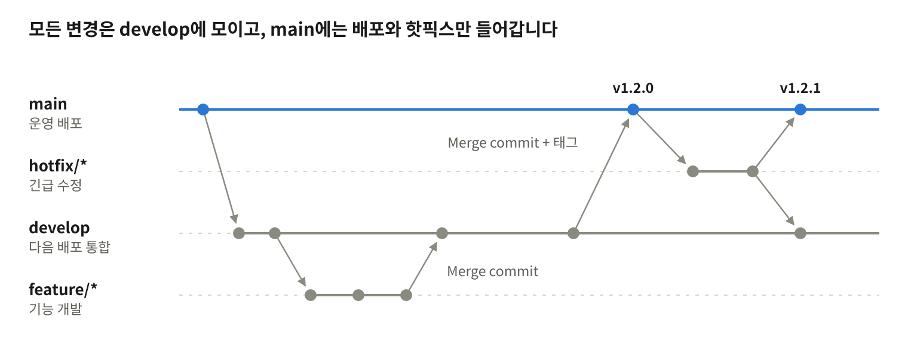

# Git 협업 가이드 (git-flow)

2026-10-07

이 프로젝트는 git-flow를 따르며, 운영 브랜치는 `main`, 통합 브랜치는 `develop`입니다. 모든 작업은 보조 브랜치에서 하고 PR로만 병합합니다.

## 브랜치 구조

상시 브랜치는 `main`과 `develop` 두 개뿐이고, 나머지는 작업이 끝나면 삭제합니다.

| 브랜치 | 역할 | 분기 출발 | 병합 대상 | 수명 |
| --- | --- | --- | --- | --- |
| `main` | 운영에 배포된 코드. 모든 병합에 버전 태그가 붙음 | - | - | 상시 |
| `develop` | 다음 배포를 위한 통합 브랜치 | `main` (최초 1회) | `main` (배포 시) | 상시 |
| `feature/*` | 기능 개발, 일반 버그 수정 | `develop` | `develop` | 병합 후 삭제 |
| `hotfix/*` | 운영 장애 긴급 수정 | `main` | `main`, `develop` | 병합 후 삭제 |

브랜치 이름은 소문자와 하이픈만 쓰고, 이슈 번호가 있으면 앞에 붙입니다.

| 종류 | 형식 | 예시 |
| --- | --- | --- |
| 기능 | `feature/<이슈번호>-<요약>` | `feature/123-login-api` |
| 핫픽스 | `hotfix/<버전>` | `hotfix/1.2.1` |

## 한눈에 보기



`feature`는 `develop`으로만 병합되고, 배포할 때 `develop`을 `main`에 병합합니다. `hotfix`는 `main`과 `develop` 양쪽으로 병합됩니다.

## 초기 설정

저장소를 클론한 뒤 `develop`을 받아 두면 준비가 끝납니다.

```bash
git clone <저장소 URL>
cd <프로젝트>
git switch develop
```

git-flow 확장 도구는 선택 사항입니다. 사용한다면 운영 브랜치를 `main`으로 지정해 초기화합니다. 기본값이 `master`이므로 반드시 직접 입력합니다.

```bash
git flow init
# Branch name for production releases: main
# Branch name for "next release" development: develop
# Feature branches? feature/
# Release branches? release/   (기본값 그대로 두고 사용하지 않음)
# Hotfix branches? hotfix/
# Version tag prefix? v
```

이 문서의 명령은 확장 도구 없이 순수 git만으로 적었습니다. `git flow finish` 계열 명령은 로컬에서 바로 병합하므로 쓰지 않고, 병합은 항상 PR로 합니다.

## 기능 개발 흐름 (feature)

기능 하나당 브랜치 하나를 `develop`에서 만들고, PR로 `develop`에 병합합니다.

1. 최신 `develop`에서 브랜치를 만듭니다.

   ```bash
   git switch develop
   git pull origin develop
   git switch -c feature/123-login-api
   ```

2. 작은 단위로 커밋하고 원격에 올립니다.

   ```bash
   git add .
   git commit -m "feat: 로그인 API 추가"
   git push -u origin feature/123-login-api
   ```

3. PR을 올리기 전에 `develop`의 변경을 반영하고 충돌을 해결합니다.

   ```bash
   git fetch origin
   git merge origin/develop
   # 충돌이 나면 파일을 고친 뒤
   git add .
   git commit
   git push
   ```

4. `develop`을 대상으로 PR을 만들고 리뷰를 받습니다.
5. 승인과 CI 통과 후 Merge commit 방식으로 병합하고 브랜치를 삭제합니다.

rebase와 force push(`--force`, `--force-with-lease`)는 쓰지 않습니다. 이미 push한 커밋은 고치지 말고 새 커밋을 추가합니다.

## 배포 흐름 (develop → main)

별도의 release 브랜치는 두지 않고, 배포할 내용이 `develop`에 모이면 `develop`을 `main`에 바로 병합합니다.

1. 배포 범위의 기능이 모두 `develop`에 병합됐는지 확인하고, `develop` 기준으로 QA를 마칩니다.
2. 버전 번호를 올리는 PR을 `develop`에 병합합니다.
3. `develop`에서 `main`을 대상으로 PR을 만들어 Merge commit 방식으로 병합합니다.
4. `main`의 병합 커밋에 태그를 붙입니다.

   ```bash
   git switch main
   git pull origin main
   git tag -a v1.2.0 -m "Release 1.2.0"
   git push origin v1.2.0
   ```

배포 PR이 열려 있는 동안 `develop`에 병합한 내용은 그 배포에 함께 나갑니다. 배포에 넣지 않을 기능은 배포가 끝난 뒤에 병합합니다.

버전은 유의적 버전(`MAJOR.MINOR.PATCH`)을 따릅니다. 호환되지 않는 변경은 MAJOR, 기능 추가는 MINOR, 버그 수정은 PATCH를 올리고, 태그에는 `v` 접두사를 붙입니다.

## 긴급 수정 흐름 (hotfix)

운영 장애는 `develop`을 거치지 않고 `main`에서 바로 분기해 고칩니다.

1. `main`에서 핫픽스 브랜치를 만듭니다. 버전은 PATCH를 하나 올립니다.

   ```bash
   git switch main
   git pull origin main
   git switch -c hotfix/1.2.1
   ```

2. 장애 수정에 필요한 최소한의 변경만 커밋하고 버전 번호를 올립니다.
3. `main`을 대상으로 PR을 만들어 Merge commit 방식으로 병합하고 `v1.2.1` 태그를 붙입니다.
4. 같은 브랜치를 `develop`에도 PR로 병합합니다.
5. 핫픽스 브랜치를 삭제합니다.

4번을 빠뜨리면 다음 배포에서 같은 버그가 다시 나옵니다.

## 커밋 메시지 규칙

커밋 메시지는 `<타입>: <제목>` 형식으로 쓰고, 제목은 50자 이내로 무엇을 했는지 적습니다.

```text
feat: 로그인 API 추가

- JWT 액세스 토큰과 리프레시 토큰 발급
- 로그인 실패 5회 시 계정 잠금

Refs: #123
```

| 타입 | 용도 |
| --- | --- |
| `feat` | 새 기능 |
| `fix` | 버그 수정 |
| `refactor` | 동작 변화 없는 코드 구조 개선 |
| `docs` | 문서 수정 |
| `test` | 테스트 추가, 수정 |
| `style` | 포맷, 세미콜론 등 동작과 무관한 변경 |
| `chore` | 빌드 설정, 의존성, 기타 잡무 |

- 커밋 하나에는 한 가지 변경만 담습니다.
- 본문은 필요할 때만 쓰고, 왜 바꿨는지를 적습니다.
- 관련 이슈는 마지막 줄에 `Refs: #번호` 또는 `Closes: #번호`로 연결합니다.

## PR·코드 리뷰 규칙

PR은 리뷰어 1명 이상의 승인과 CI 통과가 있어야 병합할 수 있습니다.

| PR 방향 | 병합 방식 | 이유 |
| --- | --- | --- |
| `feature/*` → `develop` | Merge commit | 기능 브랜치의 커밋이 모두 남아 변경 이력을 자세히 볼 수 있음 |
| `develop` → `main` | Merge commit | 배포 시점과 이력을 보존 |
| `hotfix/*` → `main`, `develop` | Merge commit | 위와 같음 |

Squash merge와 Rebase merge는 쓰지 않습니다. 커밋이 그대로 이력에 남으므로 커밋 메시지 규칙을 지켜 작성합니다.

작성자

- PR 제목은 커밋 메시지와 같은 형식으로 씁니다. (예: `feat: 로그인 API 추가`)
- 본문에 변경 내용, 테스트 방법, 관련 이슈를 적습니다.
- PR 하나는 리뷰어가 한 번에 볼 수 있는 크기로 유지합니다. 변경이 400줄을 넘으면 나누는 것을 검토합니다.
- 작업 중인 PR은 Draft로 올립니다.

리뷰어

- 요청받은 리뷰는 수업일 기준 1일 안에 봅니다.
- 반드시 고쳐야 하는 것과 제안을 구분해서 남깁니다.
- 병합은 승인 후 작성자가 직접 합니다.

## 브랜치 보호와 금지 사항

`main`과 `develop`에는 직접 push할 수 없도록 저장소에 보호 규칙을 겁니다.

| 설정 | `main` | `develop` |
| --- | --- | --- |
| 직접 push 금지 (PR 필수) | 적용 | 적용 |
| 승인 1명 이상 | 적용 | 적용 |
| CI 통과 필수 | 적용 | 적용 |
| force push 금지 | 적용 | 적용 |
| 브랜치 삭제 금지 | 적용 | 적용 |

하지 않는 것

- `main`, `develop`에 직접 커밋하거나 force push하지 않습니다.
- `feature` 브랜치를 `main`에서 만들거나 `main`으로 병합하지 않습니다.
- `develop` → `main` PR은 Squash나 Rebase로 병합하지 않습니다. 두 브랜치의 이력이 갈라집니다.
- 어떤 브랜치에서도 rebase, amend, force push로 이미 push된 이력을 바꾸지 않습니다.
- 비밀번호, API 키, `.env` 파일을 커밋하지 않습니다.
