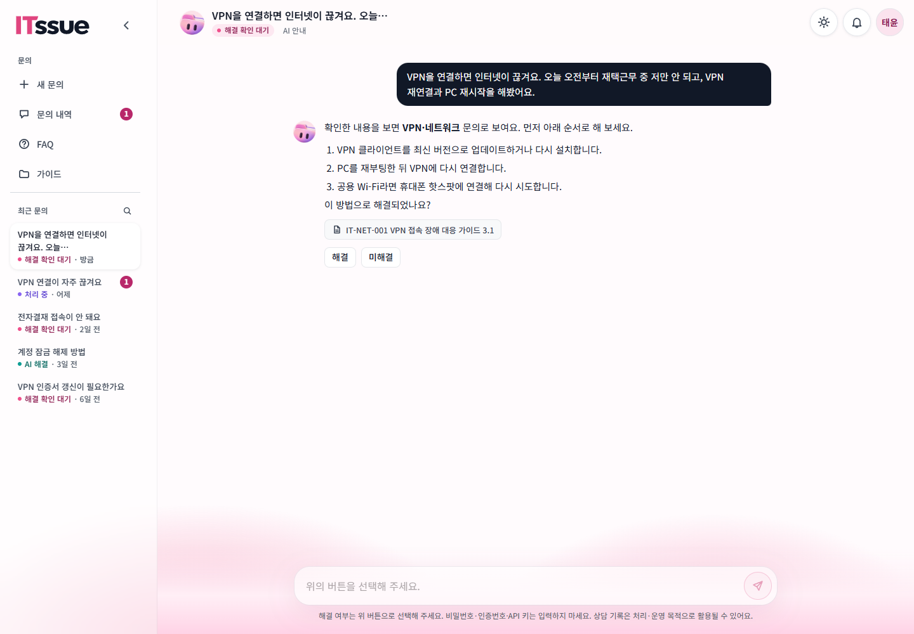
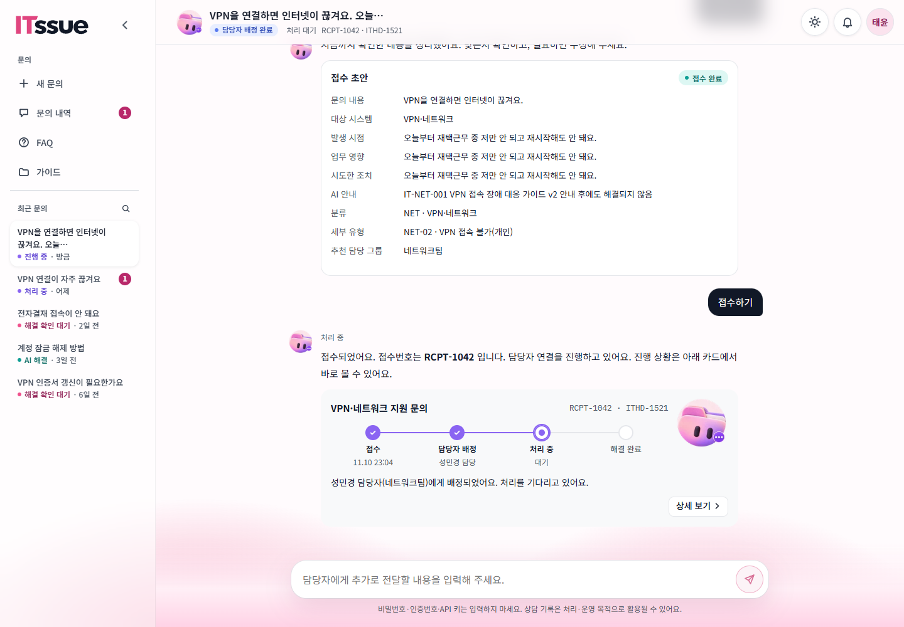
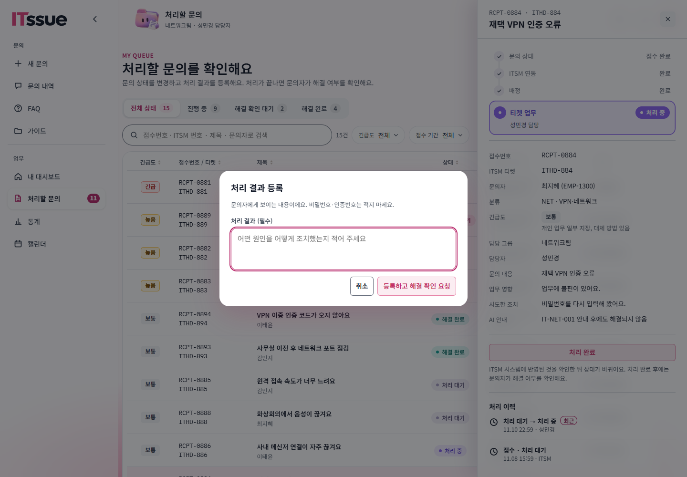
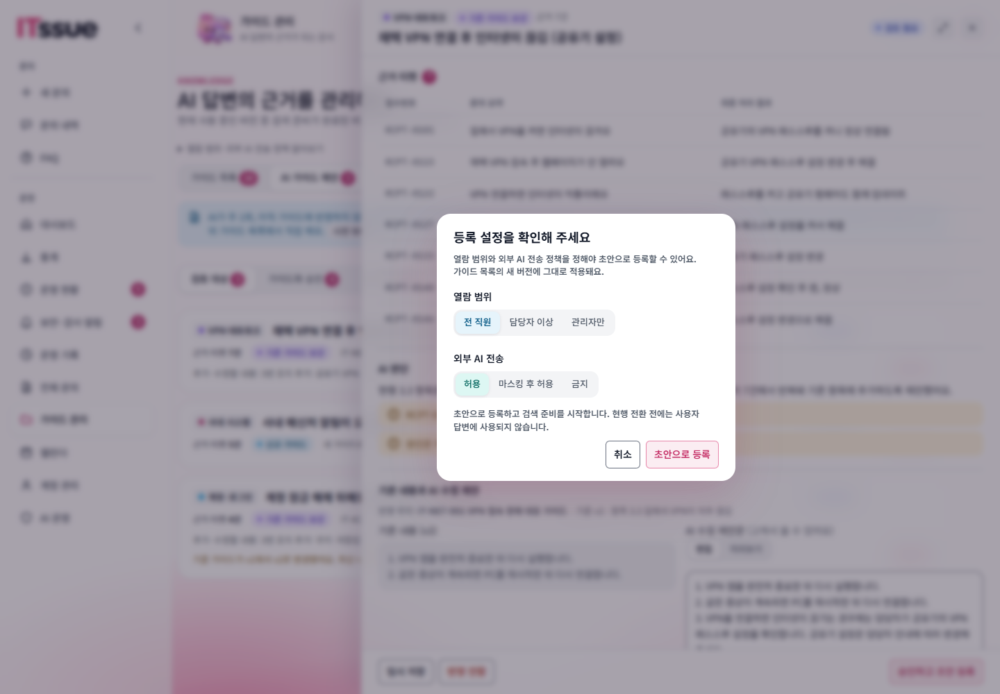
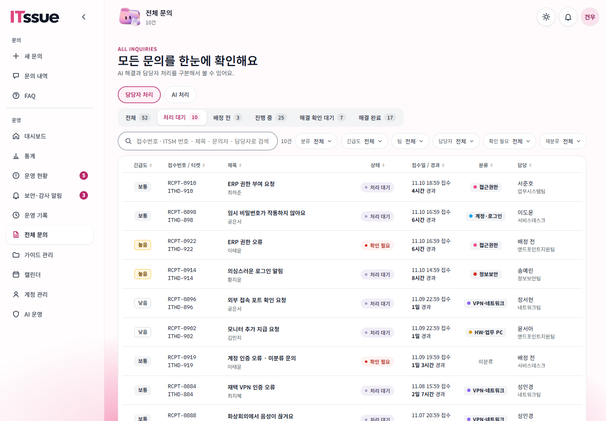
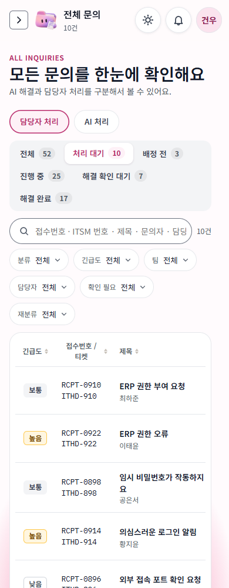

# 프론트 마감 최종 점검

기준: `develop ccb08bc`와 `fix/admin-overview-consistency` 작업본. 문의자·담당자·관리자의 주요 19개 페이지, 핵심 선택 흐름, 기획서·SRS·06의 남은 범위를 확인했다. 프론트와 문서만 수정했으며 백엔드는 변경하지 않았다.

## 판단

**확인한 범위에서 마감을 위해 새로 만들어야 할 필수 프론트 화면·미연동 버튼은 추가 발견하지 않았다.** 현재 단계에서는 새 기능보다 배포 환경의 접수·Jira 반영·해결 확인·가이드 등록 흐름을 검증하는 것이 우선이다. 아래 점검은 로컬 모의 환경과 코드 대조이며, 실제 모델·Jira·Vercel 운영 검증을 대신하지 않는다.

06의 Must는 현재 확정된 테스트 차단 문제가 없다는 뜻이다. SRS의 모든 Must가 구현·운영 검증을 마쳤다는 뜻으로 확대하지 않는다.

## 화면 점검 순서와 결과

| 단계 | 화면·행동 | 결과와 한계 |
| --- | --- | --- |
| 1. 문의자 | 새 문의·문의 내역·FAQ·가이드, 새 메시지 입력 → 답변 → 출처 열기·Esc 닫기 → 미해결 → 담당자 연결 → 초안 → 접수 | 모의 흐름 정상. 접수 전 확인과 접수 뒤 읽기 전용 초안·진행 카드 구분. 실제 AI 판단·지연·서버 접수 영속성은 별도 |
| 2. 문의자 해결 확인 | 기존 FIN 문의의 미해결 사유 입력 창 열기·취소 | 사유 입력·요청 버튼 구분, Esc 닫기 정상. 실제 FIN→WIP·재완료·CLS는 배포 시험 필요 |
| 3. 담당자 | 내 대시보드·처리할 문의·통계·캘린더·가이드, 상세 → 처리 시작 → 처리 완료 창 | 모의 RDY→WIP와 처리 결과 창 정상. 본인 담당 문의에서 동작을 노출. ITSM 반영은 실제 서버 확인 필요 |
| 4. 관리자 | 대시보드·전체 문의·운영 현황·통계·가이드 관리·보안 알림·운영 기록·계정 관리·AI 운영·캘린더 | 10개 페이지에서 런타임 오류·1440px 문서 가로 넘침 없음. 목록·필터·배지·카드 톤을 대조 |
| 5. 관리자 검토 | AI 제안 목록 → 검토 패널 → 승인 등록 설정 | 열람 범위·외부 AI 전송 정책과 초안 등록/현행 전환 구분 정상. 이번 브라우저 점검에서는 실제 등록 API를 호출하지 않음 |
| 6. 관리자 처리 대기 | 전체 문의의 전체 → 처리 대기 → 배정 전 순서, RDY 선택·건수 | 기존 `workStatus=RDY`·`statusCounts.RDY` 사용. 새 API 없음. 선택 탭 하나만 강조 |
| 7. 공통 | 역할별 접근·화면 모드·좁은 화면 | 문의자 `/tickets`는 새 문의로, 담당자 `/accounts`는 내 담당 문의로 이동. 역할별 대표 화면의 라이트·다크·두 고대비 모드와 390px 표시 확인 |

주요 페이지 19개를 라이트 모드에서 확인했고, 모든 페이지의 모든 상태를 네 모드로 전수 시험한 것은 아니다. 필터 결과·실제 서버의 긴 제목·대량 목록·업로드 파일 종류별 변환 결과도 운영 확인이 필요하다.

## 발견·반영한 보완

| 항목 | 처리 |
| --- | --- |
| 전체 문의의 처리 대기 직접 조회 | 전체와 배정 전 사이에 RDY 탭 추가. 기존 진행 중 묶음과 상세 필터는 유지 |
| 좁은 화면의 문의 표 | 고정 배치 표가 390px 폭으로 줄어 열 이름·본문이 세로로 깨지는 것을 확인. 공통 `.tbl.fx` 최소 폭 760px, 기존 `.tw` 내부 가로 스크롤로 보완. 데스크톱 열 구성 유지 |
| 관리자 대시보드 긴급 범위 | P1만 조회·집계·표시하고 전체 문의 이동도 `pri=P1`으로 일치 |
| AI 상담 결과의 상태 점 | AI 해결=해결 색, 해결 확인 대기=확인 대기 색, 미연결 종료=빈 점으로 기존 상태 표시와 일치 |
| 운영 현황 카드 | 미분류·재분류 요청도 긴급도 → 제목/접수 정보 → 경과 → 행동 순서. 신호등은 생략하되 다른 카드와 칼럼 정렬 유지. 긴급도 칸 84→48px |
| 재배정 후보의 팀 | 현재 그룹 구성원만 읽는 코드 확인. 대상 팀과 해당 팀 구성원만 표시한다는 안내 추가 |
| AI 제안 순서·필터 | 서버의 `ticketCount` 내림차순은 기존 구현 유지. 분류 필터를 가이드 제안/매뉴얼 후보/보안 사고 사례로 교체하고 승인·반영 안함 탭에서도 선택 유지. 보안 종류는 기존 SEC_MANUAL 응답 호환용이며 SEC 신규 분석 제외 결정은 유지 |
| 관리자 통계 주기 갱신 | 15초 티켓 구독 제거. 화면 재진입·조건 변경·새로고침에서 읽음. 나머지 폴링 변경은 별도 브랜치에서 검토 |
| 문서의 과거 설명 | 06 R-51의 API 미구현 설명을 과거 이력으로 구분. `.env.example`의 “로그인 전 상담·통계는 항상 모의” 안내 정정. 실제 환경 파일은 변경하지 않음 |

처리 대기는 업무 상태 RDY 기준이다. RDY여도 미분류·배정 확인 등의 문제가 있으면 행 배지는 그 확인 사유를 우선 표시한다. 기존 “진행 중” 묶음은 RDY+WIP이므로 처리 대기 탭과 건수를 더하면 중복된다. 이번에 기존 필터 의미를 변경하지 않았다.

## 기획·06 대조에서 남은 것

| 구분 | 항목 | 다음 확인 |
| --- | --- | --- |
| 기존 흐름의 배포 확인 | 접수→Jira 생성·배정, 담당자 시작·완료, FIN→WIP→재완료→CLS | 기존 문의·접수·Jira 번호 유지, 실패·중복·무한 대기 없는지 |
| 서버 응답·운영 확인 | R-44 출처, R-45 새 답변 점, R-46 건수, R-47 적재 요약, R-48 본문, R-49 배정 복구 | 06 7장의 시험을 실제 데이터로 수행. 코드 연결을 운영 성공으로 간주하지 않음 |
| 가이드 자산화 | R-23·R-51 분석 일정·검토·등록·검색 준비·현행 전환 | 실제 모델 초안 품질, 정책 저장·권한, 재등록·기준 변경 복구 시험 |
| AI 응답 안정성 | 응답 시간·실패 복구·화면 이동/재진입 | 07 기준으로 실제 지연·오류·프록시 한계를 확인. 작업 큐 전환은 이번 필수 아님 |
| SRS상 미구현·미확인 Must | ANSWER-05/06 이탈 정리·보안 대상 숨김, NFR-SEC-08 보관·자동 삭제, NFR-SEC-04/06/07 로그 보호·배포 비밀·HTTPS 검증 | 서버/운영 범위의 기존 잔여 요구로 구분. 이번 프론트 수정으로 해결했다고 표시하지 않음. 새 개발 요청은 추가하지 않음 |
| 기존 확장 경계 | ASSIGN-03의 routing_rules 대신 세부 유형 기본 그룹 사용, 답변 품질 평가 API 없음 | 현재 제공 기능과 확장을 구분. 숨겨진 Golden Set 모의 함수를 실제 평가 기능으로 설명하지 않음 |

문의 분류 변경은 세부 유형 ID와 기본 처리 그룹을 사용한다. 7개 대분류만 선택하게 줄이면 현재 API·배정 규칙과 달라진다. 프론트는 기존 계약을 유지한다. 세부 유형을 바꾸는 동작이 과거 AI 답변을 다시 만드는 기능은 아니다.

## 접근성·디자인과 검사 범위

- 공통 글꼴·상태 토큰·버튼·필터·패널을 유지했다. 대표 모드 캡처에서 대비·테두리·버튼 표현이 모드에 맞게 바뀌는 것을 확인했다.
- 출처·사유 모달의 입력 초점과 Esc 닫기, 역할별 화면 이동, 상태 탭 선택을 확인했다. 전체 키보드 여정·스크린리더·수치 기반 대비 검사는 이번 범위가 아니다.
- 긴 본문 패널은 내부 스크롤과 고정 행동 영역을 사용한다. 390px 담당자 상세는 전체 폭으로 표시된다. 문의 표는 화면 전체를 늘리지 않고 표 안에서 스크롤한다.
- 실제 서버 데이터·권한·쿠키·배포 환경 변수는 로컬 모의 검수로 확정할 수 없다. Vercel의 서버 모드 설정과 `VITE_SERVER_INTAKE`, worker 실행 여부는 배포 시험 때 확인한다.
- 검증: 프로덕션 빌드·린트, Vitest 95파일/706개 통과. CSS의 최소 폭 보완은 브라우저에서 재확인했다. 별도 폴링 점검은 [주기 조회 점검 기록](프론트_API_주기조회_점검_2026-11-10.md)을 따른다.

## 캡처

원본 전체 캡처·실행 스크립트는 작업공간 `tmp/final-audit-20261110`·`tmp/guide-review/final-*.cjs`에 보관했다. 아래는 실제로 열어 확인한 대표 캡처다. 데이터·사용자는 모의 데이터다.

1. 새 문의 답변·출처·선택 — 정상.

2. 사용자 확인 후 접수 — 정상.

3. 담당자 처리 결과 입력 — 정상.

4. 관리자 가이드 등록 정책 확인 — 정상.

5. 관리자 처리 대기 탭 — 추가·확인.

6. 좁은 화면의 표 — 최소 폭·가로 스크롤 보완 후 확인.

